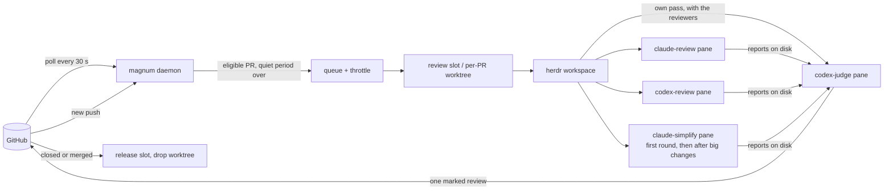

<p align="center">
  
</p>

<h1 align="center">Magnum PR</h1>

<p align="center"><strong>Multiple agents. One review. No drama.</strong></p>

<p align="center">
  <a href="https://go.dev/"></a>
  
  <a href="https://herdr.dev"></a>
  <a href="https://cli.github.com/"></a>
  <a href="LICENSE"></a>
</p>

Magnum reviews your pull requests with the AI coding agents you already use. On every push, several
agents (Claude Code, Codex, droid, omp or any CLI [herdr](https://herdr.dev) can drive) review the PR
side by side, a **judge** agent proves or rejects each finding they raise, and Magnum posts exactly
**one** GitHub review, as you or as a GitHub App. It runs as a daemon on your Mac, on the agent
subscriptions you already have, and every agent works in a herdr pane you can watch or take over.

<p align="center">
  <a href="#quick-start">Quick start</a> ·
  <a href="#how-it-works">How it works</a> ·
  <a href="#what-the-author-sees">What the author sees</a> ·
  <a href="#faq">FAQ</a> ·
  <a href="#configuration">Configuration</a> ·
  <a href="#daily-use">Commands</a> ·
  <a href="#the-pr-board">PR board</a>
</p>

- **Several reviewers, one review.** Each agent has its own prompt, model, credentials and schedule.
  Their findings go to a judge, so the author reads one review with one verdict, not four.
- **Proven or dropped.** The judge reproduces each finding and posts it on the line that must change,
  with the reproduction and the fix. A finding it cannot prove is not posted.
- **Re-reviews that remember.** A push goes back to the sessions that reviewed the PR before: they read
  the author's replies, check the claimed fixes and review only what changed.
- **Real checkouts.** Each PR gets its own worktree, or a warm slot with its own databases for a big app,
  so the agents can run the tests; a closed or merged PR releases it.
- **Your machine, your budget.** No hosted service in between: the agent CLIs you are logged into do the
  reviewing, and GitHub calls go through `gh`. Quiet periods, minimum intervals and daily caps keep a
  burst of pushes from burning your subscription, and a model at its limit can hand over to a fallback.
- **Fixes what it finds.** On a PR you wrote, one key starts a fixer agent that fixes the findings worth
  fixing, answers the threads, also those of other reviewers that nobody answered, and pushes as you.
  Magnum then reviews the push again, up to a cap of
  cycles ([Fixing your own PRs](#fixing-your-own-prs)).
- **Learns the repository.** The judge keeps notes per repository (how to test it, known pitfalls), and
  an optional daily retro collects what human reviewers caught that Magnum missed.

> [!NOTE]
> **Disclaimer:** this repository is 100% vibecoded and, I'd say, 100% awesome. It saves me hours, and I
> use it every day. If you're happy to let AI review your pull requests, I hope you won't mind that AI
> wrote the reviewer too.

### What the author sees

One review per round: a verdict line first (`Fix 1 problem before merging.`, or `No problems found.
LGTM :shipit:`) with the problems it counts listed under it, then each finding as an inline comment on the
line that must change, like this one:

> **[P2] Old Reject error appears in a new chat**
>
> If Reject fails after the user opens another chat, the old error appears there.
>
> **Reproduce** (`app/chat.test.jsx:88`)
>
> ```js
> it("keeps a late Reject error out of a new chat", async () => {
>   const chat = render(<Chat />);
>   api.reject.mockRejectedValueOnce(new Error("timeout"));
>   await chat.click("Reject");
>   await chat.click("New Chat");
>   await flushPromises();
>   expect(chat.text()).not.toContain("timeout"); // fails: the error is shown
> });
> ```
>
> **Fix**
>
> The `catch` changes state before the session check. Check the captured session first.

The author answers on the thread (`fixed`, `not a bug: <why>`, `won't fix: <why>`), and the next push is
re-reviewed against those answers. A reply with no push gets its answer a few minutes later: the judge
re-decides the thread and answers there (an acknowledgement, one sentence with its evidence, or an answer
to a question), or posts a new review when its verdict changes; after two rebuttals in one thread it
stops arguing and leaves the call to the operator. A P1 or P2 problem the judge proved next to the PR's changes that the
PR did not bring is not a finding: up to three go into a collapsed "Found nearby, not this PR's" block
before Checks, one line each, never counted in the verdict (a security one only into `magnum debt`,
unless the repository is private).
A false claim of the description that bears on risk (a ticked "Can be reverted easily" the previous
release cannot keep) is a finding, or one `Description: ✗ <claim>: <why>` line when it harms nothing;
a change the base does not need (the failure it names does not happen there, or code, configuration
or a validation every writer passes already meets its goal) is one finding that names what does it and
leaves closing the PR, or keeping it with the true reason, to the author;
and with `[jira]` on a requirement of the PR's Jira issue it does not meet is one `Ticket: ✗ <what>: <why>`
line, or a finding when it has impact. [The judge skill](#the-judge-skill) has the full format.

With `[pipeline] status_comment = true` the PR also gets one comment, edited in place, that says whether
its review is queued (and why it waits), in progress or posted (with its verdict in a few words), says when
Magnum's own failure stopped it, answers a review request on a PR Magnum leaves out, and ends on a true
line when the PR is closed, merged or turned into a draft first, so nobody merges before it by accident
(see [Review status comment](#review-status-comment)).

## How it works



1. **Poll.** One GraphQL query per organization finds new PRs, new heads, new repositories and closed
   PRs, and a second reads the CI state of the watched repositories' open PRs (a CI run that ends does not
   count as a change of the PR). Open PRs that existed before Magnum started are left alone until they
   change. A draft waits until it is ready for review or someone requests a review (`include_drafts`).
2. **Throttle.** A new head waits for a quiet period (default 5 min, 15 min after a burst of three
   pushes within 30 min) and at least 30 min since the previous round (2 h for a draft a watch
   includes); pushes coalesce to the latest head; `magnum review` overrides.
3. **Check out.** Pool repositories (big apps with databases) get one of N provisioned slots; small
   repositories get a worktree next to their clone. Checkouts are detached, so they never collide with
   branches you have open yourself.
4. **Review.** Every role from the pipeline configuration gets a pane: candidate reviewers and the
   read-only simplifier (it proposes simplifications in a report, edits nothing) run in parallel, the
   judge does its own full pass alongside them, a checkout a role left modified is caught and restored,
   and once both ended the judge weighs every report against its own pass.
5. **Post and verify.** The judge posts one review with inline comments and an invisible run marker
   through `magnum post-review`, which checks every inline comment's line against the PR's diff first;
   Magnum verifies on GitHub that exactly that review by exactly that identity exists for that commit.
6. **Repeat and clean up.** New commits re-prompt the same sessions. A push while the reviewers (and the
   judge's own pass) still run restarts them in place on the new head (at most twice per round); a push
   while the judge weighs the reports is noted on the posted review and re-reviewed right after the
   quiet period. A closed or merged PR
   releases its folder after a grace period, with teardown hooks for its databases. If the poll confirms the
   close or the merge while a round runs, the round stops as `magnum abort` stops it (a `round.stopped`
   event). A round that someone asked for (`magnum review`, the board's `r`, a review request) and a
   post-merge review run on.

## Quick start

Requirements: macOS (see [Linux](#linux) below), [herdr](https://herdr.dev) 0.9.3+ running, `gh` logged
in and the agent CLIs you want to use (`codex`, `claude`, `droid`, `omp`). MySQL only for a `[[pool]]`
that declares databases: DBngin's server at 127.0.0.1:3306 (root, no password), or any other one that
`MAGNUM_MYSQL_DSN` names (a [go-sql-driver DSN](https://github.com/go-sql-driver/mysql#dsn-data-source-name)
such as `root:secret@tcp(127.0.0.1:3307)/`) in the environment of the daemon and the CLI (the LaunchAgent
does not carry it: a daemon launchd runs sees it only through `mise exec`, from the checkout's mise env);
[mise](https://mise.jdx.dev) only for a pool whose worktrees use it; dev.fast Whiteboard only for
whiteboards, with `[pipeline] whiteboard = true` or by hand with `magnum whiteboard` ([Whiteboards of reviewed
PRs](#whiteboards-of-reviewed-prs)): Whiteboard
Desktop running (or `whiteboard server start`) and its `whiteboard` CLI on PATH.

```bash
brew install zhuravel/tap/magnum             # built from source by Homebrew
magnum init                                  # ~/.config/magnum/config.toml: your gh login, one repository, who posts
magnum doctor                                # what this setup uses, with the exact fix for each problem
magnum daemon                                # in a second terminal or herdr pane: the daemon in the foreground
magnum review owner/repo#123 --wait          # one review of that repository's PR, start to finish
```

When the review has posted, hand the daemon to launchd (`install` stops the foreground one) and add the
extras you want:

```bash
magnum install --plugin                      # launchd agent + herdr plugin
magnum install --gh --no-launchd             # optional: `gh magnum …`
magnum hooks install                         # optional: agents report a turn's end at once (see Agent hooks)
magnum completion zsh > "${fpath[1]}/_magnum"
```

To upgrade: `brew upgrade magnum && magnum daemon-restart --when-idle` (the daemon keeps running the old
binary until it restarts; `--when-idle` restarts at the first moment nothing is in flight, no round, no
notes curation or retro, no slot job and no approval being posted or withdrawn as you, `--drain` also stops new
rounds meanwhile). `magnum status` and every reply to a
command the daemon answers say when the daemon runs an older build than the CLI or the binary on disk; with
`[daemon] restart_on_new_build = true` the daemon restarts on a new build by itself, at the first tick
nothing is in flight.

`magnum init` refuses to replace an existing config without `--force` (the old file is kept as
`config.toml.bak`); [config.example.toml](config.example.toml) is the same minimal setup to copy by hand.
To post as a GitHub App, answer 2 when init asks who posts: it asks for the App's ids and names the file
to save its private key as, `~/.config/magnum/keys/<app>.pem` (it never asks for the key); `magnum
identities check` verifies the App. A big repository with its own databases gets a pool of warm slots:
add a `[[pool]]` (see below), then `magnum slots provision --count 6`. `--count` takes 1 to 999; a count that would pass the pool's `max` is refused before anything is provisioned.

## FAQ

**How is this different from a hosted review bot?** Magnum is not a service: it runs on your Mac and
drives the agent CLIs you are already logged into, so reviews come out of subscriptions you already have.
The agents work in a real checkout of the PR (a worktree, or a pool slot with its own databases), so they
can run your tests, and you can watch any of them in its pane. A judge has to reproduce a finding before
it is posted, and later pushes resume the same sessions. The trade-off: reviews happen only while your
Mac is on and the daemon runs, and they spend your own budget.

**What does it cost?** Magnum is free (MIT); every round spends some of the budget of each agent it runs.
The defaults keep that down: a draft waits until it is ready for review or a review is requested, a push
waits for 5 quiet minutes (15 after a burst), a PR gets at most one round per 30 minutes (2 hours for a
draft a watch includes) and 12 automatic rounds a day, a push that only touches
comments, whitespace or docs, only merges the base branch, or changes no file at all, is not re-reviewed, and a change under 30
code lines since the last review gets a check by the judge alone. With 80% of the Codex budget used,
full re-reviews wait; at 95%, rounds that need Codex wait. `magnum status` shows how fast that budget goes,
`magnum stats` lists the PRs that took the most agent time, and
[triage](#triage-fewer-reviewers-for-a-small-diff) can skip reviewers on a small diff.

**Is it safe to point agents at pull requests?** Reviewing a PR means running its code: the agents run
its tests in the checkout, with the autonomy your agent CLIs allow. Watch repositories whose contributors
you would let run code on your machine; PRs from forks are skipped by default. Magnum treats PR content
as data: PR text never goes into a prompt, the repository's instruction files count only for its
conventions, permission prompts are answered No, hooks a checkout brings are declined, and your personal
GitHub tokens are stripped from review worktrees. [Under the hood](#under-the-hood) has the details.

**How noisy is it?** The judge posts only what it can reproduce, ranks findings by who can reach them (P0
to P3), and offers at most five simplifications by default (`max_simplifications`), marked optional.
Every candidate it rejects is recorded with a reason, so `magnum stats` shows per reviewer how many
findings were raised, posted and rejected, and why. The optional
[retro](#learning-from-other-reviewers) measures the other side: what human reviewers caught that Magnum
missed.

**Why herdr panes and not headless runs?** So you can see what an agent is doing, take it over or answer
it when it is stuck, and so its session lives on: a re-review continues the conversation that wrote the
first review. herdr also gives Magnum pane titles, toasts and a plugin for its popups.

**Can it post as a bot instead of me?** Yes: give it a GitHub App and the App posts, so its approvals and
change requests do not come from your account. See [Identities](#identities-who-posts).

**Does it run on Linux?** Not yet. [Linux](#linux) lists the five macOS-only spots; a small platform
interface around them is the whole job, and contributions are welcome.

## Configuration

Two layers and the App keys:

- The built-in defaults: [config.defaults.toml](config.defaults.toml), embedded in the binary. The
  daemon defaults, the agent kinds and the review roles, every key documented; it names no account,
  repository or path of yours. Editing it changes the defaults after `make build`.
- Your config, `~/.config/magnum/config.toml` (`$XDG_CONFIG_HOME/magnum/config.toml` when that is set;
  `magnum init` writes it): your identities, watches, pools and repos, plus any default you want to
  override. Its `[[watch]]`, `[[identity]]`, `[[pool]]` and `[[repo]]` blocks are appended, a `[[role]]`
  overrides the keys it sets on the role of the same name (or is appended), scalar keys and
  `[kinds.<name>]` entries override key by key. [config.full.example.toml](config.full.example.toml) is
  a complete, working setup (Talkable's) to copy from. `magnum config` and `magnum doctor` say which
  files were read.
- App private keys: PEM files the identity's `private_key_file` names, by convention
  `~/.config/magnum/keys/<identity>.pem` (chmod 600; doctor warns about a looser mode). The older
  `private_key_env` (an environment variable holding the PEM or its path, e.g. from a checkout's
  `mise.local.toml`) still works; launchd then runs the daemon through `mise exec`.

Magnum keeps its own files where XDG says: the registry, review reports and repository notes in
`~/.local/share/magnum` (`$XDG_DATA_HOME`), logs, locks, the identities' gh config dirs and the tab-bar
file in `~/.local/state/magnum` (`$XDG_STATE_HOME`); `magnum config` prints both. `MAGNUM_HOME=<checkout>`
keeps them in the checkout's `state/` instead, for development.

`--config FILE` (or `$MAGNUM_CONFIG`) replaces the built-in defaults with a complete file of your own.

Besides those, Magnum reads `MAGNUM_MYSQL_DSN` (the MySQL server, see [Quick start](#quick-start)) and
`HERDR_BIN_PATH` (the herdr executable that `magnum open`, `reveal_on_attention` and the plugin commands run;
herdr sets it inside plugin actions, else `herdr` on `PATH`), and hands `[herdr] socket` (your herdr
session) to the herdr commands it runs and to the LaunchAgent as `HERDR_SOCKET_PATH`. `MAGNUM_BIN` names the
`magnum` binary that the herdr plugin's commands run (else the plugin's own `bin/magnum`, then the installed one),
`MAGNUM_PICK_QUERY` is the initial filter of `magnum pick` (as `--query`), and `MAGNUM_TUI_TRACE=<file>`
makes a live screen append one line per message to the file, with how long its Update and View took, to
diagnose a frozen or spinning screen (off unless set). Every role's pane gets the round's context
in its environment, next to the identity's gh selection (an App's `GH_CONFIG_DIR`, with `GH_TOKEN` and
`GITHUB_TOKEN` blanked) and the slot's env: `MAGNUM_PR_URL`, `MAGNUM_IDENTITY` (`gh` or `app`),
`MAGNUM_REVIEWER_LOGIN` (the login that posts), `MAGNUM_SELF_LOGIN` (your own login: the watch's
poll login when a `gh` identity polls, see `poll_identity`), `MAGNUM_NO_FINDINGS_EVENT` and
`MAGNUM_BLOCKING_EVENT` (the repository's verdict events) and `MAGNUM_REPORT_DIR` (the round's report
directory).

`[daemon] restart_on_new_build` (default `false`): when `true`, every reconcile looks at the binary
launchd starts; once a new one passes its check (`<binary> version` and `<binary> config`, as
`daemon-restart` checks it) the daemon exits at the first tick no round is claiming, reviewing or
verifying, and launchd starts the new build (events `daemon.restart_pending`, then
`daemon.restarted_for_build`). Dispatch is never held for it, and a daemon launchd does not run (started
by hand) only says so: nothing would start it again.

`[daemon] shell_path` (default `true`): launchd gives the daemon a fixed `PATH` (`~/.local/bin`, mise's
shims, Homebrew's and the system directories), and every command it runs inherits it: the pool hooks, the
readiness commands, `mise exec`, gh and the agent CLIs. A tool only your shell's exports put on `PATH`, such
as DBngin's `mysql`, `psql` or `redis-server` in versioned directories, is missing there (every schema load
then fails). So the daemon asks your login shell for its `PATH` once at its start, before it runs anything (`$SHELL -ilc`, `zsh`
when `SHELL` is unset, 20 s at most, no terminal and no stdin; a shell that answers nothing in 20 s is asked
once more, for 40 s, because a cold start of its startup files can outlast the first wait), and appends the directories its own `PATH`
lacks, in the shell's order. launchd's `PATH` stays first, so mise's shims still win. Banners and hook
output are skipped: the last line that reads as a `PATH` (colon-separated absolute directories) counts. The
`daemon.shell_path` event says how many directories were added ("PATH from zsh: 4 directories added"),
and `magnum status` shows the count on its daemon line. The debug log names the directories, the event
never does; a `PATH` from the second ask adds "on a second try". A shell that fails, prints no `PATH` or
answers nothing in either wait leaves launchd's `PATH` alone, with a warning event ("the login shell (zsh)
answered nothing in 20s, nor in 40s on a second try. The launchd PATH stays"). A
change of your shell's `PATH` (a DBngin upgrade) takes effect at the next `magnum daemon-restart`, as a
config change does. The CLI keeps the environment of the terminal it runs in. `false` keeps launchd's
`PATH` alone and runs no shell. The factory daemon (`magnum factory daemon`) takes the same `PATH` at its start, because it runs its copies'
setup, reset and precheck commands itself. `logs/factory.log` says what the shell added, and a change takes
effect at the next `magnum factory install`. Whatever `shell_path` says, a daemon whose environment names no
locale (launchd sets neither `LANG` nor `LC_ALL`) sets `LANG=en_US.UTF-8` at its start, which every command it
runs inherits, and logs it: without one, Ruby reads every file as US-ASCII and rubocop crashes. A `LANG` or an
`LC_ALL` already set is kept.

Three more `[daemon]` keys pace the agents. `max_total_working_codex` (default 5) caps the Codex agents working at once, your own sessions included (those of your herdr session count beside the review panes' when `[herdr] review_session` puts these in another; a session of yours that does not answer counts none). `agent_start_stagger` (default `"15s"`) is the least time between two agent launches, across rounds, and at most 3 Codex agents start at once. `min_warm` (default `"30m"`) is how long a pool slot another PR holds must stay unused before a waiting PR may take it back, its sessions parked and the slot released: with no human typing, no session working, blocked or prompted within it, no run and no pin.

magnum's review panes run in a herdr session: yours by default (`[herdr] socket`, named by `[terminal]
session`). `[herdr] review_session = "reviews"` puts them in a session of their own (`herdr --session
reviews`: its own herdr server and terminal windows), on `~/.config/herdr/sessions/<name>/herdr.sock` unless
`[herdr] review_socket` names another socket (absolute after `~` expands, and only with `review_session`;
`"default"` is herdr's own default session). `[herdr] socket` stays your session whatever the panes' is: the
toasts show there, the slot guards and the inventory read your agents and consoles there (a herdr of yours
that is not running shows the agents it saved, as idle ones: it restores them when it starts), and the herdr plugin and the LaunchAgent use it. `magnum open`, the board's `o`
and `reveal_on_attention` reveal a client of the panes' session, and the daemon opens one in a new window when
no herdr server runs in a named session, which starts it after a reboot (at once, then at most twice an hour
while it stays down, each a `herdr.opened` event; never your own, nor a session whose server runs but does not
answer: a client of it may be open, and the open would bring it to the front). A change moves the panes once
the daemon runs on it (`magnum daemon-restart --drain`; the factory's local review, whose rounds open there
too, follows once the factory daemon starts on it: `magnum factory install`), at its first moment with nothing
in flight: until then
no round, retro, curation, fix or whiteboard starts (a PR's wait says `draining`), and `magnum open` of a PR
with nothing live asks to try again in a minute. Then it rebinds every PR's sessions to the panes that hold
their conversations (a server that started again restored them under new ids), parks them, pinned PRs too (the
conversations are kept; pins and slots stay), closes their workspaces in the old session, toasts once in yours
and restarts, and launchd starts it in the new session (a daemon launchd does not run, `magnum daemon` in a
terminal, exits too, and its toast and exit say to start it again by hand). The move holds to the next idle moment while a park is
refused (an agent at work, a busy pane of yours in a magnum workspace), while the old session does not answer,
while no herdr server runs there and magnum recorded panes in it (herdr restores them and resumes their agents
when its server starts, so the move waits to park them: it opens a named old session itself, and names the
command that starts yours), and while the restart is refused because what launchd would start fails its check:
the event `herdr.panes_move_waits` names the PR or the reason, and a toast does after 30 minutes. A move cut
short goes on at the next start. A named review session is never the factory's (`[factory] herdr_session`), by name or by
socket, nor your session's name (`[terminal] session`) on another socket, and doctor warns while it is your own
session (`[herdr] socket` on its socket: the panes then share yours, and no guard reads where you work). The
registry records which session its herdr ids are of once a daemon of this build starts: if `[herdr] socket`
and `[terminal] session` point at the session the panes should run in, start the daemon on them first, then
point them back at your session and set `review_session` to that session, and nothing moves. With
`review_session = ""` the panes stay in your session, as before, even when the factory runs there
too (`[factory] herdr_session = "default"`).

A command handed to the daemon waits up to 30 s for its answer (the daemon answers requests before its
GitHub poll and between the poll's GitHub calls, so one waits for a single call); a request still pending says how to follow it (`magnum logs request:<id> -f`). A request
that reaches a daemon newer than it fails with "this daemon predates <field>: restart it" instead of
running without the field. Without a daemon, `review`, `approve`, `request-changes` and `open` of a parked
PR refuse and queue nothing (they would post or act whenever a daemon next started); the other commands
still queue for the next start, and a request no daemon saw within an hour fails at startup as "expired:
queued while no daemon ran".

The daemon prunes audit events older than `[daemon] keep_events` (default `"30d"`) and handled CLI
requests older than `keep_requests` (default `"7d"`) on every reconcile; `"0"` keeps them forever. The
step rows a checkout resumes from after a crash are the one exception, and only while their subject (a
checkout, named with the head's sha) has had an event inside the window: a subject quiet for `keep_events`
loses them with the rest. `poll_interval` and `reconcile_interval` must be positive, `observe_interval`
`"0"` or between 2 seconds and `poll_interval`, the other waits and quiet periods (`close_grace`,
`push_quiet_period`, ...) and `min_free_disk_gb` not negative, and `default_repo`, when set,
`owner/name`; the config is refused otherwise. Two `[[pool]]` blocks may not
render the same `slot_name` or `slot_path`.

A push that lands while a round's reviewers still run restarts them on the new head, up to
`[daemon] max_round_restarts` times per round (default 2; `0` turns restarts off). The turns it cuts
short are interrupted and their roles prompted again on the new head: an agent reviewer with esc, a shell
role's command with ctrl+c, and the judge's own pass with one ctrl+c, which aborts Codex's turn and keeps
the session with its context (two quit Codex, as for a judge that timed out). All of them get their keys
at once, before Magnum waits for any of them, and then Magnum waits for all of them side by side, so the
restart waits for the slowest turn, not for each in turn. A shell role's command that still runs 10 seconds
after its ctrl+c gets another, three in all, and then Magnum stops it itself (see below). The checkout never
switches, nor is restored, under a command that still runs, the command of a shell reviewer that timed out
before the push included: when Magnum cannot stop it, a warning names the role and the round fails with
that cause. That round costs the PR no attempt and no round of the daily cap, and the PR's next round takes
it up again. An agent gets up to a minute after its interrupt to go idle, and a
warning names it when it does not. A claude reviewer still at work 10 seconds after its esc whose
transcript shows background work it started still running (a test run in the background keeps it at work
after an interrupt) is told then to stop that work, which is what ends it, rather than at the end of the
minute; one idle within the 10 seconds gets no message then, only the one about work its transcript still
shows once it is idle. A stop that worked is an info event (`round.cut_settled`, with the seconds the agent
took to go idle), not a warning. When a refusal or a lost judge ends the round instead, the turns still at
work are stopped the same way.

`codex review` sometimes goes on after its ctrl+c, and its pane stays busy. Two things end it. First,
`magnum db-lock`, which the built-in shell line runs every command through, passes the interrupt on and
notes the processes under the command. A command, or one of those processes, that still runs 10 seconds
later gets SIGTERM, and 5 seconds after that SIGKILL, together with every process under it (a sandbox's child
in a process group of its own too). db-lock says so on stderr, keeps the lock until those processes are gone
or SIGKILL went out, and exits with 128 plus that signal. Second, Magnum stops the command itself after the
restart's last ctrl+c, but only its own run: the shell line's db-lock names the run (`--run <run>`), and
Magnum keys or signals a pane's command only when that argv names a run of the PR's role in this checkout,
in the role's own pane, and the run is the one cut or no longer in flight. Its ctrl+c goes only to the
role's own pane, and only to a command that carries that run's token. A command without a token gets it only
when the line Magnum typed carried none (a `command` of your own without `{{.DBLockCommand}}`) and herdr still
shows the pane in the session's checkout, with no other PR's session in it. A run whose line was never typed
(it still waited for a busy pane) gets nothing at all. Magnum notes the job's processes from
the process table, each by its pid and start time (a process that moves to another process group stays the
same process), and before each signal it reads the table and asks herdr again: a process whose identity
changed gets nothing, and neither does a pane whose job changed. It sends SIGTERM to the job's process group,
reads the table again, and sends SIGTERM to each of those processes, then SIGKILL the same way 5 seconds
later. Each wait has one 5-second deadline that every read shares. The stop counts only once the shell is
idle and every noted process is gone, so a pane that went idle after a ctrl+c is a stop only once the
processes noted at that ctrl+c are gone too; a process that outlives SIGKILL fails it. When SIGKILL
leaves the pane busy, Magnum splits a new pane with the session's working directory and environment, moves
the role there, asks herdr once more and closes the old one. Without a recorded environment the old pane
closes all the same and the session is lost, so the next round lays a new pane out. Each stop writes
`pr.shell_stop_begin` (the process group and the processes as pid, group and name, never arguments),
`pr.shell_stopped` (the step that worked and the seconds) or `pr.shell_stop_failed` (`not_own`, `signal` or
`close`). A stop never counts a command as yours: nothing during a round starts `human_cooldown` or keeps
the judge from its prompt. A shell reviewer that timed out, or whose wait failed, gets the same stop before
its run ends. A shell role whose pane is still busy when its next run starts
does the same: an earlier run of its own that is over is stopped at once, and the line runs. Anything else
gets the minute a fresh pane's shell has to start. When the pane is still busy then, Magnum splits a new pane
with the session's environment, moves the role there (`pr.shell_move_begin`, then `pr.shell_moved` or
`pr.shell_move_failed`) and runs the line in it. It never sends the busy pane a key, a signal or a close:
the pane stays on a closed row of the role and closes with the other retired panes once it is an idle shell.
The new line's db-lock then waits for the lock that the busy command may hold, up to its `--timeout` (20
minutes) or the role's timeout, rather than failing as busy after a minute. Without a recorded environment
the run fails as busy, as before.

Nothing switches a slot's checkout while a command still runs in a shell pane of its PR there. Before a
round checks the PR out, before the fixer starts, before `magnum open` checks a PR out and before a release
resets the slot, Magnum closes the runs a crashed daemon left open and looks at the PR's shell panes in that
slot. It asks herdr only when the PR has a shell pane there. A pane herdr shows as another's (another agent,
or a working directory outside the checkout) is left alone, unless its command carries Magnum's line for
this checkout. A pane whose working directory herdr does not report stays in the look. An earlier run of
its own is stopped. A command Magnum did not start (no run token, or another PR's, role's or run's), the
command of a role of your own without the run token, or one of its own that it cannot stop, holds the
switch. The hold costs no attempt and no round of the daily cap. Magnum looks again after about 1, 2 and 5
minutes, then every 10 minutes. It writes one event when the hold starts (`pr.shell_hold`) and one when it ends
(`pr.shell_hold_ended`), and shows one toast. After 15 minutes of a round's hold the PR shows under
needs-attention with a plain reason: "a command magnum did not start keeps the shell pane of <slot> busy",
"the <role> command (no run token) still runs in the shell pane of <slot>", or "magnum cannot stop its own
command in <slot>: <cause>". The fixer and the other jobs that would switch that checkout see the same hold.
A hold that one of them meets is looked at again at each reconcile until it ends. The next round's first
look starts a hold of its own, with its event and its toast, and so does a round's look at a hold that
nothing looked at for 30 minutes. If herdr cannot say what the panes run, nothing is held: the round tries
again a minute later, with no event and no toast, and a slot that a failed `magnum fix` or `magnum open`
reserved still goes back to the pool. The hold never marks you as at work. A shell role whose `command` of
your own leaves `{{.DBLockCommand}}` out carries no run token: its interrupts are the plain ctrl+c presses it
always got, Magnum never signals or closes its command, a restart that finds it still running ends the
round, as above, and the next checkout waits for it.

A clean review that went without a reviewer is completed on a repository Magnum [approves as
you](#approving-as-you). When auto-approval refuses a review that left nothing to fix because a reviewer
of its round left no report, and every such report is missing for a cause that passes by itself (`busy`,
`timeout`, `lost`, `no_session`, `failed`, `stalled`, `overloaded`, `cancelled`, `human_active`,
`missing`), Magnum queues a completion of that head (`pr.complete_queued`, with the round, the head, the
roles, the causes and the attempt). The completion is a re-review of the same head that runs the judge in
its session and only the roles the review went without, with the prompts their round gave them, and no
triage and no restarts. The judge gets the other reports of that round and the late ones, marked `(late)`,
decides the findings of the late ones while the others stand (a late finding the last review already
posted is that finding, not a new one), and posts a new review, whose record lists only what it still went
without: auto-approval decides on it as on any review. When every late reviewer misses again, the judge is
not prompted and nothing is posted (`pr.complete_unheard`), and the next completion runs only when what each
of them missed for passes by itself (a usage limit or a logout gives up). A completion waits for what any automatic round
waits for (capacity, its slot or pin, the GitHub budget, the pause of a kind it needs, quiet hours, a
snooze), but not for the push quiet period, the re-review interval or the daily cap. It never holds its
approval for a full pass, and counts neither toward the daily cap, nor toward the re-reviews of a full
pass, nor toward the re-review interval of the next push (`engine.round_start` names the round it
completes as `completes`). A reviewer that refused, is logged out or hit its usage limit gets no
completion (that needs you or time), and neither does a review that held its approval (its full pass
follows), a head another gate refuses for good (its own CI workflows, the review agents' configuration,
more files than Magnum can check: the status comment says that gate's words), a post-merge review, a dry
run or an eval replay. Nor does a delta check of a small push after the incomplete review: it carries the
missing reports of the older head, which a completion of the new one cannot complete, so its refusal stands
until a full re-review (a limit of the design). A push or the close of the PR drops a completion that
waits, and `magnum abort` (or the board's take-back) of one that waits or runs stops the head's
completions (`pr.complete_stopped`), also after a push back to the head; a new head gets its own, and an
abort of any other round leaves them alone. Each head gets 2 completion rounds, counted as they start, a
failed round's retry included, and kept across a restart, a close and reopen, and a push back to the
head; after them `pr.complete_gave_up` says so once and the refusal stands. A completion whose round fails
writes `pr.complete_failed` and retries as a failed round does while the head has a round left. A stop of
the daemon during the head's last completion round, before its judge was prompted, resumes that round
after the restart: no reviewer runs again, and the judge gets the late reports the round verified and the
standing ones (with none verified, nothing is posted and Magnum gives up). The re-review interval a
completion gives back is the one of the round it completes, also after a retried or continued round.

A push that lands while the judge works lets the round finish: Magnum appends "Reviewed <sha>; N commits arrived during
the review, re-review follows" (or, for a small delta, "a short check of those commits follows") to the
posted review and queues the re-review without waiting for `min_rereview_interval`. A PR whose head changed `burst_pushes` times (default 3) within `burst_window`
(default `"30m"`) waits `burst_quiet_period` (default `"15m"`) instead of `push_quiet_period`; a
`[[watch]]` can override all three, and `burst_pushes = 0` turns the rule off.

A watch's `include_own = false` skips the PRs you authored (its author is one of your logins: every gh
identity and every watch's posting identity, the board's "mine"), whichever of your logins opened them,
not only the watch's poll login. A PR you authored waits `[daemon] own_min_rereview_interval` after its
last round instead of `min_rereview_interval` when that is set (default `"0"`: the same interval), say `"2h"` while another
session of yours pushes to it often; an own draft waits the longer of it and `draft_min_rereview_interval`,
a `[[watch]]` can override it, and a review request or `magnum review` skips it like the other timing
rules. The wait names it ("re-review · own PR interval → 16:40").

`magnum snooze <ref>` holds one PR's automatic rounds for a while: `--for` (default `2h`), `--until 18:00`
(tomorrow once past) or an RFC 3339 time; `--off` lifts it. Until then no push, quiet period, re-review,
reply round or delta check starts a round on it (the first review of a new PR included), while
`magnum review`, the board's review keys and a review request on GitHub still run one and leave the
snooze in place. It ends on its own at its time and survives a daemon restart (the registry keeps it); a
round in flight finishes. The board's `z` snoozes the selected PR for 2h after a y/N, and on a snoozed PR
offers to lift it; the state cell says `snoozed → 18:00` (in the wait, or after the state when nothing
waits), the card until when, since when and by whom (`magnum snooze` or the board), and `tui --json`
has `snoozed_until`, `snoozed_at` and `snoozed_by`.

Codex may block an account it takes for a cyber abuser, also when all it reads is your team's own code. So
when a role's turn ends on one of Codex's safety warnings ("This content was flagged for possible
cybersecurity risk", the words "cyber permissive safeguards" or "Daybreak access", or a usage-policy
violation, abuse or a threat named in Codex's own `■`/`⚠`/`ERROR:` line; the kind's `health_patterns`
`refused` list, read from the pane after the turn's prompt and, when the pane scrolled past it, from the
turn's error in the session's Codex rollout, `codex_error_info` `cyber_policy`), the round ends at once,
whichever role it was (the judge's own pass, its candidates turn, a nudge or a continue, a reviewer,
codex-review's output; also when a push cut the stage a moment before). A Codex helper agent the role's
session spawned counts as the role: when its rollout (the one naming the session as its parent) records a
`cyber_policy` refusal within the turn, the round ends the same way, even though the session's own turn
ended ok and the judge posted its review (which stays posted): no nudge, no retry, the other
roles are interrupted (the turns of the refused kind first), and the round's outcome and
the PR's last error say "Codex refused the review: content flagged as a cybersecurity risk (codex-judge,
run r-…)". The PR is flagged for good (the refused head, role, run and time) and one toast says so. By
default (`[pipeline] judge_fallback = "claude-judge"`; a `[[watch]]` may set its own) the PR goes on: it is
flagged for Codex, which never sees it again, its roles of that kind (`codex-judge`, `codex-review`) are
dropped, and `claude-judge`, the second built-in judge held in reserve (Claude Opus at xhigh, the judge's
prompts and skill), judges it from the next round on, starting fresh through the recovery prompt that
reads the earlier reviews and threads from GitHub. The PR goes back in line (a reviewed one as
`rereview_pending`, an unreviewed one `queued`) and waits the usual re-review interval, keeps its slot
and agents, and `magnum review` works; the board's cell reads `Codex flagged · judge claude-judge`.
`magnum roles` names each watch's fallback judge. The built-in default is off, with no error and no
warning, for a watch it does not fit: one whose judge is `claude-judge` or another Claude judge, or every
watch of a base config (`--config`) whose own `[[role]]` list has no `claude-judge`; a value you write
must fit (see [Roles and kinds](#roles-and-kinds-the-review-pipeline)). Without a fallback judge
(`judge_fallback = ""`, or the default off for the watch), after a refusal by the fallback's kind too, or
with a fallback no longer declared as a judge of another kind, magnum never reviews the PR again, on any
head, by itself or when asked (no retry, continue, reply round or delta check; `magnum review` and the
board's `r`/`R` refuse with the reason): the board's state cell and
card read `Codex flagged · never reviewed again`, the card says when and where and how to lift it,
`magnum status` lists the PR among what needs you, `magnum tui` prints `codex-flagged` in STATE and
`tui --json` has `codex_flag` and `codex_flag_detail`; `magnum stats` counts such rounds as `refused`.
Review it by hand. Only `magnum codex-flag clear <ref>` lifts the flag, after a y/N question on a
terminal that names the account risk; `magnum codex-flag set <ref> [reason]` flags a PR by hand (one
Codex warned about elsewhere). The flag fails closed: a flag record magnum cannot parse is a flag, a
registry read that fails holds the PR that tick, and a flag a refused round could not write holds the PR
from memory and is written again every tick. A flagged PR gives back what it holds: the tick after the
flag parks its idle agents and releases its pool slot (a `pr.codex_flag_released` event), unless
`magnum open` pinned it for you to review by hand. Another PR's judge never hears of it: `related.json`
leaves flagged PRs out. A `magnum eval run` case whose replay was refused is recorded in
`<state>/eval/flagged.json` and never replayed, nor is another case on the same PR (`owner/repo#N`) or a
case whose PR the registry holds a Codex flag for (`eval run` says so; delete its entry, or clear the
flag, to replay it).

`[daemon] quiet_hours` (unset by default) holds the costly rounds of every PR during a daily window of
local time, `"HH:MM-HH:MM"` such as `"01:00-07:00"`: inside it first reviews, full re-reviews (a review
request's on GitHub too) and the continue of a judge turn a usage limit paused wait for its end
(`re-review · quiet hours → 07:00`), while their timing rules keep counting. A round of the judge alone
still starts: a delta check of a small push, a reply round, and a re-review of the head Magnum reviewed
(a review request after a reply), each one turn of a few minutes. `magnum review`, the board's and the
picker's review keys still start any round, and a round in flight finishes. Under `autofix = "open"` no new
fix loop starts by itself inside it (a loop that runs goes on, and `f` still starts one). Nothing else stops: the poll,
auto-approval, the retro, notes curation, parking and cleanup go on. The window includes its start and
excludes its end, and crosses midnight when the end comes first (`"22:00-06:00"` covers 22:00 to 05:59); a
malformed value or an empty window (`"07:00-07:00"`) is refused when the config loads.

### Settings: changing your config from a screen

The settings screen (`magnum settings`) changes a fixed list of settings in `~/.config/magnum/config.toml`
so you do not have to open an editor:

- **Spend & models:** `[pipeline] spend`, each agent kind's own `[kinds.<name>] spend`, the model, effort
  and re-review effort of each role in each `[spend.<level>]` table, and each role's base `model` in its
  `[[role]]` block. A role that two `[[role]]` blocks of your file name is left to a hand edit: the loader
  merges them, so which one to change is not clear.
- **Usage caps:** `[usage] codex_soft` and `codex_hard`.
- **Each `[[watch]]`:** `roles`, `auto_approve`, `auto_approve_authors`, `auto_approve_skip_authors`,
  `manual_repos`, `ignore_checks`, `include_drafts`, `stakes` and `own_min_rereview_interval`.
- **Each repository:** its `[[repo]]` block's `stakes`, `max_simplifications`, `auto_approve_authors`,
  `auto_approve_skip_authors`, `allow_bot_authors`, `required_checks` and `ignore_checks`. A watched
  repository without a block gets a minimal one.
- **Schedule:** `quiet_hours`, `push_quiet_period`, `min_rereview_interval` and
  `own_min_rereview_interval`.
- **Reviews & agents:** `[pipeline]` `status_comment`, `whiteboard`, `judge_fallback`, `fix_cycles`,
  `autofix`, `max_simplifications` and `judge_fresh_after`, and `[daemon]` `park_idle_after`,
  `max_concurrent_reviews` and `max_total_working_codex`.

It never edits identities, `auto_approve_as`, App keys, paths and sockets, commands, args, env, hooks,
MCP, the sandbox or pools. Those stay hand edits.

A save edits the file in place and never rewrites it:

- **Changed values:** only the value is replaced. The trailing comment stays at its column (a gap that
  holds a tab is kept as it is), even when several cells of one inline table change, and every other
  comment, blank line and line ending stays as it was. Each key of an inline table is edited in place
  inside its braces.
- **Keys you did not set:** a new key goes after the last key of its table, so above a `[pool.env]`
  subtable.
- **New blocks and tables:** a missing `[[repo]]` or `[[role]]` block goes after the last one of its kind.
  A missing table goes after the last table of its family (`[spend.*]`, `[kinds.*]`); with no family, it
  goes before the first array of tables.
- **Back to the default:** the key's line is deleted and its comment stays as a comment line.
- **Dated notes:** each changed line gets a note such as `# 2026-10-20: was "high"`. On a line that
  already has a comment, the note goes first, and it takes the place of the "was" note an earlier save left
  there (a line keeps the newest one; the rest of its comment stays). Notes are on by default and can be
  turned off.

Before anything is written, the save makes five checks:

- The file must not have changed on disk since the screen read it.
- The new file must decode with exactly the edited values changed.
- No line outside the edited keys' lines may change, byte for byte. A failure here, or a file that does not
  read back, is a bug in the editor and is reported as one; nothing is written.
- It must pass `magnum config`'s checks: the loader and the prompt render.
- The settings screen must understand the shape it is editing. A shape it does not, such as a table only
  dotted keys define, an inline table over several lines, or a multi-line array with comments inside, is
  refused, and you edit that key by hand.

The file is written atomically and keeps its mode. Saves take a lock file beside the config,
`~/.config/magnum/.config.toml.lock` (created 0600 and kept), so two screens, or a screen and a script,
never interleave, whatever `MAGNUM_HOME` each runs with. The hash is checked again right before the
write. A symlinked config, or one with more than one hard link, is refused rather than replaced with a
file.

The version a save replaces is kept in `~/.local/share/magnum/config-history/`, one
`<UTC time>-<sha>.toml` per save, and the last 20 are kept. A restore goes through the same checks (it needs
no current file that loads: a restore mends one a hand edit broke), and
the version it replaces is kept too.

The daemon reads the config only when it starts, so a save takes effect after a restart:

- **Restart when idle:** the screen can ask the daemon to restart once nothing is in flight. Before any
  idle restart (a saved config, a new build, a landed skill version) the daemon checks what it would start
  on. It loads a changed config file again, and when the binary on disk changed since it started, it runs
  that binary's own check; a binary that is missing or cannot be read counts as a failure. If the check
  fails, the daemon does not exit, drops the save's request and says so once (`daemon.config_restart_refused`).
  A new build or a landed skill version still waits: it checks again when the file or the binary changes,
  or every 10 minutes. With only the saved config waiting nothing checks again: once the file is fixed,
  `magnum daemon-restart --when-idle` or a new save restarts on it, as the event says. Right before exiting it checks once more that nothing
  started meanwhile. When it
  exits, launchd starts it again. A file reverted by hand to the config the daemon runs needs no restart,
  and the request is dropped. The events are `daemon.restarted_for_config` and
  `daemon.config_restart_refused`.
- **Restart by hand:** a daemon that launchd does not run leaves the restart to you
  (`magnum daemon-restart --when-idle`).
- **Restart pending:** the daemon records the hash of the user config it loaded. Until it runs the file on
  disk, `magnum status` shows `config: ... changed since the daemon started` and how the change will
  apply. When the daemon refused to restart on the file, it says to fix the file (`magnum config` shows
  why) instead.

### Re-reviews

A push whose changes since the last review are only comment lines, whitespace or documentation is not
re-reviewed: Magnum compares the reviewed commit with the new head (one GitHub call), moves the review
to the new head with its verdict, keeps an App's approval and records `pr.trivial_delta`. When such a
commit arrived during the judge's turn, the note on the review says "(comments only), no re-review
needed" instead. `[daemon] skip_trivial_deltas` (default
`["comments", "whitespace", "docs", "base", "empty"]`, `[]` = re-review every push) picks the kinds, a
`[[watch]]` can override it, and `magnum review` always runs. A list you wrote before `empty` existed
replaces the default and so keeps it off. A file that steers the review agents (an `AGENTS.md`, `CLAUDE.md` or `CLAUDE.local.md` in any
directory, anything under `.claude/` or `.codex/`, `.mcp.json`) never counts as documentation for this, nor
does a file a link of those paths in the reviewed commit's tree leads to (`.claude/skills` ->
`../.agents/skills` makes `.agents/skills/x/SKILL.md` one), a file on the way to such a target (a push may
turn it into a link), or a file the instruction files import (`@path`); a reviewed commit whose links
Magnum cannot read makes the push non-trivial. A
comment line that holds its language's interpolation counts as code, because in a heredoc, a template or a
`run:` block it runs: `#{` in Ruby and ERB, `{` in Python, `${` in JavaScript, TypeScript, Kotlin, shell and
Terraform, `{{` in YAML.

A push that merges the base branch into the PR (or rebases it onto the base) is judged by the PR's own
diff, not by the commits it brings: when the comparison of the reviewed commit with the new head shows a
merge commit or a divergence, Magnum compares the PR's diff against its base before and after the push
(two more GitHub calls, `<base>...<reviewed>` and `<base>...<head>`), file by file, by the sequence of
added and removed lines (context lines and hunk positions, which master's changes move, do not count).
When no file's own change differs, the push is the kind `base` ("base merge only"): the review stands
and `pr.trivial_delta` says, e.g., "the push to 2017f29 only merges master (13 commits, the PR's own
changes unchanged)". A file without a complete patch, or a diff over GitHub's 300-file cap, makes the
comparison incomplete, and the push is measured as any other. A daemon that starts on this rule checks
the PRs already waiting for a re-review once more, on its first poll, and settles those a base merge
queued.

A push of commits that change no file (an empty commit to re-run CI) is the kind `empty`: when GitHub
compares the reviewed commit with the new head as ahead of it, with at least one commit and no changed
file, the head has the reviewed commit's tree, so the review stands and `pr.trivial_delta` says "changes no
file (1 commit)". A head behind the reviewed commit (a force push back to an ancestor) or a diverged range
with no file is not that, and is handled as before. A watch whose `skip_trivial_deltas` leaves out `empty`
re-reviews such a push.

Any other push is measured by the same GitHub call: the changed lines that are code (not comments,
blank lines, whitespace moves or documentation) since the reviewed commit; after a base merge or a
rebase, only the lines that changed in the PR's own diff. An automatic re-review runs after the quiet
period once that delta reaches `[daemon] rereview_min_lines` (default 30) or adds a file; a smaller
delta waits for further pushes, at most `rereview_max_wait` (default `"2h"`) after its first push.
`rereview_min_lines = 0` turns the threshold off, and a `[[watch]]` can override both. A force push back to
an ancestor of the reviewed commit (GitHub: "behind") has nothing to measure, so the threshold does not hold
its re-review. A re-review that waited for a small delta is measured once more right before it starts,
since the push was measured once, when the poller saw it, and a build that did not know a class of
trivial push (or a setting changed) may have queued it: if the push is trivial now (one GitHub call, the
same classes), the review stands for the head as above and no round starts, takes a slot or counts against
the cap (`pr.trivial_delta` says so). Any other result, and a comparison that fails, start the round as
before; each head is measured at most once per daemon run, and a delta check, a forced or requested round, a
full pass, a reply round, a CI check or a completion is not measured again.

Such a small delta (more than 0 and fewer than `rereview_min_lines` code lines, no added file) gets a
delta check instead of that wait and a full round (`[daemon] delta_check`, default `true`; a `[[watch]]`
can override it): once the push quiet period (or the burst one) is over, only the judge runs, in its own
session at its `rereview_effort`, without triage or reruns, and its prompt asks for one short review of the
commits since its last one against the PR's purpose and its earlier findings (`delta_check: true`, and the
delta's files listed in `delta-check.json` in the report directory). A modified image or other binary file
(no patch) counts 0 lines there and is named in that list; an added file still means a full round. Pauses,
the re-review interval, the daily cap, capacity and drains hold it as any round, and a forced or requested
round, or one that names roles, runs in full. The board, the card and `magnum status` call it a delta
check (`delta check · quiet → 14:09` while it waits, `delta check (4 lines)` on the card's last round and
in `engine.round_start`); the board marks a running one `∆` after its pill. A judge whose session is gone
(lost, parked by an identity migration, or fresh sessions requested) checks the delta in a fresh session
(`round.delta_check_fresh`): a recovery round of the judge alone at its `rereview_effort`, whose prompt has it read its previous review and threads before it
reviews just those commits (`delta_check: true` in `judge-recovery.md`); only when no review by the PR's
current or former identities is on record to build on does it become a full recovery round
(`round.delta_check_dropped`). An App's approval of the reviewed commit stands meanwhile (`review.approval_kept_for_check`): the check's approval supersedes it
(`review.approval_superseded`); a check that comments, requests changes, fails or needs attention, a later
push that makes the delta too large, or no check posted within an hour of the check becoming due (after the
push quiet period; quiet hours do not hold the check, and a `magnum pause` counts) dismisses it then, with the reason. `delta_check = false` keeps the wait and the full round.

A re-review of a head Magnum already reviewed (no new commits: `magnum review`, or a review request, to
have it re-read an author's reply) runs the judge alone as a delta check does: no triage, reruns or own
pass, at its `rereview_effort`, in a fresh session too when the old one is gone (`round.same_head_fresh`).
Its prompt says the head is unchanged: re-read the replies and comments since the last review, re-decide
each earlier finding under the reply contract, run no check that review already ran, and post one short
review, headed `Re-review of <sha> (no new commits):`. `round.same_head` records it. A request that names
roles (`--role`, `--simplify`) or asks for fresh sessions (`--fresh`) runs every reviewer as before, and so
does a round whose checkout finds a newer head (`round.same_head_dropped`).

A re-review reads only the commits since the last review, so after its first review nothing reads a
long-lived PR whole again. Every tenth automatic re-review is therefore a full pass (`[pipeline]
full_pass_every`, default `10`; `0` turns it off): the PR's sessions are parked and every role starts fresh
as with `--fresh`, the reviewers review the whole PR with their first-review prompts at their full effort
(triage judges the whole PR, as for a first review), and the judge gets the recovery prompt with a full-pass
clause (`full_pass: true`): review the full PR diff again as a first review does, then decide every earlier
thread under the reply contract; a finding the earlier reviews missed ends its title with `(missed
earlier)`, and the body is headed `Re-review <a> → <b> (full pass):`. The judge's own pass (with the
default `judge_own_pass = "parallel"`) is blind: it reviews the full diff as a first review does and reads
no earlier review, thread or reply, so the fresh session does not take on the old framing before it reads
the code; the candidates prompt then lists the earlier reviews, and the judge decides their threads there.
It costs a first review's rounds of every role. The count is the PR's re-reviews that posted a review on new
commits since its first review or its last full pass, read from the registry's runs, so a PR reviewed
before the key existed counts its past re-reviews. A delta check counts, and a due full pass overrides it:
the small push runs the full pass instead of the judge's check, so small pushes never put one off. A forced
or requested round counts but never becomes one, except `magnum review --fresh`: its round, on a new head or
the reviewed one, runs the full pass when any rule (`full_pass_every`, or the churn and age rules below)
makes one due, as an automatic re-review would, and the reason ends `, on magnum review --fresh`
(talkable#11483's recovery of its reviewed head after a dead judge ran none after 34 re-reviews and never a
full pass); a re-review of the same head, a reply round and a CI check neither count nor become one. The
soft Codex budget cap holds a full pass as any automatic full re-review.

Rounds say how often the whole-PR view was lost, not how much the code changed, so churn and age make a
full pass too. A PR's baseline is its last full pass, else its first review (a PR reviewed before these
rules: its next review of new commits); a round of the reviewed head that is no full pass (a same-head
round, `magnum review --fresh` with no full pass due) never becomes it, since it read nothing new and the
age rule would count from it. The baseline holds the PR's size then: its changed files and their added plus deleted lines,
lockfiles and the watch's `related_ignore` paths left out (`git diff --numstat` in the round's checkout).
Every review that posts on new commits adds them to the churn since the baseline, measured as the re-review
reads them: from the reviewed commit to the head, or, when the push merged the base branch, the change of
the PR's own diff before and after it, so the base branch's commits are not the PR's. The next automatic
re-review is a full pass once that churn reaches `full_pass_lines` lines (default `500`) or touches
`full_pass_files` files (default `10`, each file once), or a quarter of the PR's lines or files at the
baseline when that is more, or once `full_pass_after` (default `"12h"`) passed since the baseline, whatever
the PR's size, so the first push of a workday gets a whole read; `0` turns each rule off alone. The rules apply in that order, after
`magnum review --full` and `full_pass_every`, and a full pass that posts is the new baseline. `round.full_pass`
says why one runs and which rule fired (`rule`: the key, or `requested`), `engine.round_start` says
`re-review (full pass)` with the reason in `full_pass_reason`, the card's last round `full pass`, and the
status comment `In progress (full pass)`. `magnum review --full <ref>` asks for one by hand.

An approval rests on a whole read of the PR, not on a chain of deltas each read on its own. A re-review of a
PR that had `[pipeline] approve_after_full_pass` re-reviews or more since its baseline (default `2`, counted
as `full_pass_every` counts; `0` turns it off) cannot approve: its `no_findings_event` is `COMMENT`, its
prompt says why, and a clean verdict's body adds the line `A full pass of the whole PR follows before
approval.` after the verdict line. When such a review posts with the verdict `clean`, Magnum forces a full
pass of the same head at once, as `magnum review --full` does: every role starts fresh on the whole diff,
its clean verdict approves (one that finds problems posts as usual), and it is the new baseline, so the
next push and a clean re-review approve on their delta again. With the default, one round of fixes after
the first review approves on its delta. The hold applies to automatic and requested rounds alike (a delta
check, a recovery, an audit pass, a re-review of the same head) and to your own PRs, whose clean verdict
is a comment anyway; a full pass, a post-merge review, a reply round, a CI check and a dry run never hold.
Nor does a re-review in a repository with no approval to hold: where a clean review comments anyway (the
`no_findings_event` of the identity it posts as, or of its `[[repo]]` block, is `COMMENT`) and Magnum does
not approve as you (no `auto_approve` for it), the clean re-review posts its comment without the line and
no full pass follows.
Auto-approval as you waits for the full pass too. `round.approval_hold` says why a round holds
(`engine.round_start` carries `approval_hold`), `pr.approval_full_pass` that the full pass follows, whose
`round.full_pass` names the rule `approval` (`before_approval` in its start event), and the card's last
round says `full pass (before approval)`. Until a later review posts, the board's FINDINGS reads `✔ held`
for the review that held its approval (`findings.held` in `magnum tui --json`).

A full pass reads the whole PR again; what the evidence map (see the judge's `evidence.json` under the
pre-pass) says no round read or probed, or changed since one did, needs only those areas read. Every fifth
automatic re-review of a PR whose map holds `unknown` or `stale` entries is therefore an audit pass
(`[pipeline] audit_every`, default `5`; `0` turns it off), counted as the full pass counts, since the PR's
first review, its last full pass or its last audit pass: every session starts fresh, the round runs as a
recovery whose reviewers re-review the delta at their rereview effort (as with a cold judge), and the judge
gets `audit.json` in the report directory (the areas come from the PR, so the prompt names only the file):
at most three `unknown` or `stale` areas, the riskiest first (an irreversible write, authorization, money,
an optional branch, a file of the pre-pass's lists), and, marked `rotation`, the oldest probe on a file the
pushes touched since, to run again. It probes each through its real entry point with a control, writes each
probe that passes as `probed` in its evidence, posts no finding that only says an area is unknown, then
re-reviews the delta and decides the earlier threads. An audit pass counts toward the full pass's count and
never replaces one: when both are due, the full pass runs. A delta check, a re-review of the same head, a
reply round, a CI check, a forced or requested round and a push that left the head as reviewed never become
one. `round.audit_pass` says why it runs, `engine.round_start` says `re-review (audit pass)` and the card's
last round `audit pass`.

Replies get that round on their own, without a push. The poll reads, for a PR whose activity moved, its
reviews and comments with their authors and their association with the repository (no text): a reply in
one of Magnum's threads by the PR's author, by an owner, member or collaborator of the repository or by the
watch's fixer App (an App has no association with the repository, and it answers for the author), or a
comment by the PR's author or a review of theirs with no inline comments (a body alone answers the review
as a whole; the author's agent's "(Claude)" replies are the author's), never one by Magnum's own logins.
A review of the author's whose inline comments start threads of their own (the findings of their own
review tool, say) or answer another reviewer's is no reply. The poll's read says which for the last two
reviews; for every other review since Magnum's latest review of the PR (up to ten) it asks GitHub in one
more call for the batch (1 point, none when nothing needs it), and a review it could not ask about counts
as before. A reply in a thread is a review with no body, which GitHub's timeline never lists: the poll
finds it among the PR's last two reviews, so a reply with two newer reviews after it and no push starts
nothing (the next round's judge still reads it in the threads). Since replies often fill those two, a newer
review with a body is then asked about in that one more call. The first poll of each repository with this
build reads every open PR Magnum reviewed at its head once, changed or not, so a reply an earlier build
could not see is read too. Anyone else's reply in a thread (in a public repository anyone may
reply), a bot's without that association, a teammate's review elsewhere or a bot's top-level comment
starts nothing; the next round's judge reads them anyway. When such replies came on a head Magnum reviewed, the PR waits
`[daemon] reply_debounce` (default `"3m"`, `"0"` turns it off) after the last one and at least
`reply_min_interval` (default `"2h"`) after the last such round on that head, and then the judge alone
re-decides the threads (`re-decision · 2 replies → 14:09` while it waits, `reply round (2 replies)` in
`engine.round_start`). The quiet periods, the re-review interval and the daily cap do not hold it, and it
does not count against the cap; a round that only answers does not hold the next push either, whose
re-review interval counts from the last review round. When its verdict and event stay those of its last review, the judge posts
no review: it answers in the threads through `magnum post-review --replies` (an acknowledgement for a
reason it accepts, since resolving the thread is the author's; one sentence with its evidence for a
rebuttal; an answer as deep as asked; nothing where a reply needs none), and the round ends `replied`,
verified by the replies carrying its run's marker (`pr.replied`; the review stands, findings and
auto-approval are untouched). A thread another reviewer or the author started is theirs: the judge never
answers it inline, and `post-review` skips a reply there (listed under `skipped`) and posts the rest. A
reply round with nothing of Magnum's to answer ends `replied` with no replies, never blocked: the PR
stays reviewed with the replies read, so they start no new round, and `round.replies_none` says how many
replies started it and why none was Magnum's to answer (none in its threads, or the ones there needed no
answer); it never needs your attention. A changed verdict posts one short review, as any round does. A push
meanwhile wins: the re-review of the new head reads the replies too. After two of Magnum's rebuttals in
a thread, an answer marks the thread `stop`: the judge replies there no more, `post-review` refuses to,
and the board flags the PR for you (`pr.stalemate`; `reviewed · argued` in STATE), as do `magnum status`'s
ATTENTION, the dashboard's and `magnum tui --needs-me`, until you act on it
(`magnum review`, a verdict, a mute). The judge still decides the finding, and writes the stopped threads
whose finding it keeps open as `stops_open` in its result: a thread whose answer it accepts is not
flagged, and a later round that settles a flagged thread clears the flag (so does the continued turn of a
round a usage limit paused after flagging). A list with an entry that names no thread of the threads file
by its id decides nothing, with a warning: every stopped thread stays flagged. Replies older than the daemon's first start with this build start nothing on their own; the board
counts them (`↩N`), and `magnum review --replies` (the board's `r` on such a row) re-decides them now.

CI that finishes red after the review gets a round of its own too. The judge reads the head's failing
checks when its prompt goes out (see The judge skill), so a review posted before CI finished never saw a
check that failed later. When a check of the head Magnum reviewed (no push since) fails after the judge
prompt behind the latest review posted on that head (the prompt's time, not the post's: a check that
finished in between was not seen either), the PR waits for a judge check of that head (`pr.ci_red`;
`CI check · CI red` on the board, "CI turned red after the review; judge check pending" on the card).
The judge alone, told that CI finished red after its review, decides each failed check from its log (a
P1 broken build when the PR causes it, else an unrelated Checks line) and posts one review
(`rereview round (CI red after the review)` in `engine.round_start`). Like a reply round it skips the
quiet periods, the re-review interval and the daily cap, counts against no cap and runs in quiet hours;
a snooze or a mute holds it. One judge check covers each failing check of a head: a rerun that fails the
same way starts no other, a different check failing later does. A rerun that turns the checks pending,
or passes, while it waits drops it (`pr.ci_red_dropped`, back to reviewed), and a push supersedes it.
A check `ignore_checks` names is no failure here: it starts no judge check, and its record never names
it. The poll reads a head's checks again when its CI rollup's state changes, and also when its counts of
failed, pending or passed checks do (a rollup stays FAILURE while an earlier failure is red, and a check
created passed, such as a run's report through the Checks API, moves only the passed count); the counts
come in the same rollup request, with more fields. It also reads them on every poll while Magnum's start
of a `ci_dispatch` workflow waits for its run, and while its re-run of a run that started no job waits for
the new attempt (in any repository; it then also reads the head's runs, one REST call).

The rest of the re-review sees a base merge the same way: triage reads the PR's own diff of the files whose
own change differs, the simplify reviewer's rerun measures that change, and the reviewers' and the judge's
prompts say the push merged the base branch, so they compare the PR's diff before and after it instead of
reading the base branch's commits as the PR's.

### Review requests, caps and pauses

A review request runs without delay: when someone requests a review from your login (the watch's poll
login when a `gh` identity polls, else its `auto_approve_as` or the first `gh` identity: see
`poll_identity`), from a posting identity's login (an App's `<slug>[bot]` too) or from a team a `[[watch]]`
lists in `request_teams`, or marks a draft ready for review, the round starts `[daemon] request_debounce` (default `"1m"`) after the
request and the last push. It skips the quiet periods, the re-review intervals, the delta threshold and
the daily cap. Requests are edge-triggered by their time on the PR's timeline: one counts once, and only
when it is newer than the PR's last round start; a review of the head posted after it answers it too.
On a draft a `[[watch]]` skips (`include_drafts = false`, the default), such a request makes the draft eligible for the
one round it starts, and the wait says so (`review · requested on a draft by alice → 14:09`); a later
push to the draft is skipped again until a newer request (GitHub keeps your request after magnum's App
reviews, so the request alone does not count twice).

The daily cap (`max_rounds_per_pr_per_day`, default 12) counts automatic rounds when they start:
requested rounds and `magnum review` never count. A round Magnum itself cut short is refunded
(`round.refunded`): one a shutdown, restart, drain, abort or the PR's close on GitHub stopped, one that
failed before any agent was prompted or on a prompt this build could not render, and one whose judge ran
out of fallback models. Posted, blocked, timed-out and needs-attention rounds count.

Every PR waiting for a round says why and until when: the dashboard's queue and the PR board show a
compact form (`re-review · quiet → 14:09`, `re-review · cap 6/6 → 00:00`, `re-review · small delta
8/30 lines → 16:40`, `re-review · requested by alice → now`, `delta check · quiet → 14:09`), and the card and
`magnum status <ref>` the full sentence with the command that lifts it (`magnum review <ref>` for the
timing rules, `magnum resume` for a pause). A retry names the attempt to come and what the last one hit
(`re-review · retry 2/3 setup → 22:57`, `retry 2/3 judge lost`, `timeout`, `human active`, ...; a narrow
column drops the cause first). A round waiting on the PR's pinned slot (`magnum pin`, or `magnum open` with
`[daemon] open_hold = "0"`) reads `re-review · pinned → u` with no error mark, the card says who pinned it
("pinned by magnum open (u unpins)"), and once the round has waited 30 minutes one toast per PR and pin says
"talkable#11792 waits for your pin (magnum unpin …)". A restore by `magnum open` (the board's `o`) holds the PR
as a pin does but ends by itself (`[daemon] open_hold`, default `30m`, extended to `human_cooldown` after your
last input in its panes): the round waiting on it reads `re-review · held → 03:21` and toasts nothing, any
other row's state cell says `held → 03:21`, the card "held by open until 03:21 (u hands it back, p keeps it)",
`magnum status` "review8 (talkable#12048, open, held by open until 03:21)" on its pins line and "held by open
until 03:21" on the PR's card (`held_until` in the JSON of both and in `tui --json`), and the summary pill
counts it apart ("📌 2 pinned · 1 held"); when it ends, the tick unpins the PR and its slot before dispatch with
one `pr.open_hold_ended` event (a hold a slot guard persisted for your changes stays, as for a review's unpin).
At the daemon's start a lasting pin an earlier `magnum open` made (its newest pin event is the open's) becomes
a hold ending `open_hold` after the start (`pr.open_hold_set`). A pin never lapses by itself, not when GitHub
merges or closes the PR either: the `pr.closed` event then says "slot kept: pinned (magnum unpin)" instead
of "slot released after 10m0s", one toast per PR says "magnum: talkable#11999 closed | its slot review16
stays pinned (magnum unpin)", `magnum status` lists every pin with the PR's state and the pin's age
("pinned:   review16 (talkable#11999, closed 5h ago, pinned 5d)"; a pin older than the events kept has no
age; `pins` in the JSON), and the board's summary pill adds how many of its pins hold a closed PR
("📌 4 pinned · 2 on closed PRs", only when there is one).

A slot its guard holds (`head_drift`: a commit made in it or a moved HEAD, `unpushed_commits`: commits on
no remote, `dirty_worktree`: a person's changes) keeps its PR waiting, and every sentence that says so names
the way back with the slot in quotes: "waiting: slot talkable/talkable-integration#867 is held: head_drift
(magnum unpin "talkable/talkable-integration#867")" in the reply of `magnum review`, in the PR's wait on the
board and the card, and in the refusal of `magnum fix`; the attention line of `magnum status` says
"check the folder, then `magnum unpin "<slot>"`"; and the skipped line of a release plan says "held:
head_drift (acknowledge it with magnum unpin "<slot>")" (its JSON keeps `reason: hold_reason` and the
`detail`, and adds `slot`). `magnum unpin <PR or slot>` hands the slot back whether or not anything is
pinned: for a `head_drift` or `unpushed_commits` hold it takes the folder's current HEAD as the checkout
Magnum expects, so the next release resets the slot, and answers "acknowledged the head_drift hold of slot
talkable/talkable-integration#867: HEAD 3e8c5b6 is now the checkout magnum expects; the next release resets
it" (a `dirty_worktree` hold comes back at the next guard while the changes are there). `magnum release`
never acknowledges a hold: a release must not take a HEAD it did not check out. A HEAD that is the PR's
pushed head is no drift, though: when the folder's HEAD is the head the poll last read from GitHub, its tree
has no changes and none of its commits is missing from the remotes (a person went on in the PR's panes and
pushed), the guard takes it as the checkout Magnum expects (a `slot.head_recorded` event) and the round goes
on; any other moved HEAD is held as before.

A round that fails three times on one head (a timeout, an error, a setup failure charged to the PR) parks
its PR in needs attention. When the cause was Magnum's own (an unknown role, a launch line that broke), the
fix is a new build, config or prompts, so the attention records what the daemon ran (the build's commit
and the binary's mtime, a hash of the config and one of the prompts and skills it loaded), and the next
start, after its recovery and before the first dispatch, puts back in line every open PR a failed round
parked under another one: queued, or re-review pending for a reviewed PR, with its attempts reset and not
forced, so it waits its turn like any PR. Each gets a `pr.retried_after_restart` event ("retried after the
restart on e7ad419: the failure's build differs") and one toast names them all ("magnum: retrying 2 PRs
parked by failed rounds before this build"). A PR that fails again on the same build, config and prompts
stays parked (and its attention toasts again), as does every other cause: a fix loop that needs your call,
a blocked judge, an identity failure, an API that stayed overloaded, a Codex flag.

An agent API that answers overloaded (a 5xx, a 429, "stream disconnected before completion" in the judge's
pane) pauses the PR's round, never the kind: the round continues after 1 minute, then after 2, and the
third overload on the head parks the PR in needs attention. An overload other PRs share is the provider's,
not the PR's, and charges no attempt: when, within the last hour, another PR's round on the same agent
kind ended overloaded, or another PR's agent of that kind ended with the same pane line (the lines
`agents.shared_failure` groups), the round continues after a wait that doubles from 1 minute up to 30
minutes for as long as its overloads come shared, and the PR does not park for them. The hour is twice
that longest wait, so PRs that retry together every 30 minutes still find each other. Its error says so
(`overloaded: codex is overloaded across 3 PRs (no attempt charged; retry 2 in 2m): judge pane: …`), and
each such retry is one `round.overload_shared` info event under the PR naming how many PRs share it. An
overload no other PR shares is charged as before, and a PR an overload already parked stays parked until
`magnum review`.

A launch failure other PRs share is not the PR's either. A round whose error carries a pane line (a
judge's prompt herdr refused because its launch died, "the pane shows: Error: …") that another PR's agent
ended with within the last 30 minutes (the lines `agents.shared_failure` groups) charges no attempt and
does not count against the daily cap: the PR goes back in line and retries after a wait that doubles from 1
minute up to 30 minutes while its rounds keep ending on that line. Its error says so (`error: the launch
fails the same way on 2 PRs (no attempt charged; retry 1 in 1m): …`), and each such round is one
`round.launch_shared` info event under the PR. A line no other PR shares is charged as before, but the
attempts it charged go back once another PR's agent ends with it (one `round.attempts_refunded` event), and
a PR they parked in needs attention goes back in line at once.

A fetch, clone, checkout or dependency step that fails for a reason outside the PR (an SSH key the
agent lost, DNS, a network timeout or refusal, a server curl could not connect to, TLS, or the same
dependency error on two PRs within ten minutes) pauses dispatch for everything once, with one toast,
and is never charged to the PR. Magnum probes `git ls-remote` of a watched clone (over HTTPS through
gh, like its fetches) after 2 minutes, then after twice as long each time it still fails (up to 30
minutes), and resumes by itself when it answers; `magnum resume` lifts the pause at once.

A logged-out agent CLI pauses its kind: the login check before a round (`[kinds.*] login_check`) skips a
logged-out reviewer and ends a round whose judge is logged out, and a run that fails with the login error
(a reviewer's command, the judge's pane) pauses the kind the moment it fails, not when the round ends, so
other rounds stop starting its roles while this one goes on without the reviewer. A judge that stops
without a result while a reviewer's run proved its kind logged out ends its turn as `login_required`,
which Magnum continues once the login is back, instead of a nudge. The pause lifts when the login check
passes, and, for a pause a run proved, once the kind's login file changed too (`login_file`, codex:
`auth.json` under its home): `codex login status` reads the saved tokens and says logged in while a
revoked refresh token fails every call. A login file written after the run that failed (you logged in
since) leaves the decision to the login check alone, so a pause the round's end repeats lifts on its next
check. A pause whose login file stays unchanged lifts after 2 hours at most once the login check passes,
with a warning event; a run that fails again pauses the kind again.

The `[usage]` section watches the Codex budget, which Magnum reads from Codex's own session files
(`codex_home`, default `$CODEX_HOME` or `~/.codex`) at most once a minute. At `codex_soft` percent
(default 80) automatic full re-reviews wait (`re-review · Codex soft cap` on the board), since a full
re-review costs about twice a first review and finds no more; first reviews, delta checks, re-reviews of
the same head, reply rounds, a review request and `magnum review` still run. At `codex_hard` (default 95)
every round that needs Codex waits until the budget is below it again. The factory reads the same budget (at
each launch of a stage with a Codex role, and each pass of a local review that runs one): at `codex_soft` its
local review waits, and its stages' Codex roles yield, each running as its Claude `codex_fallback` (see
[Factory](#factory-writing-code-from-a-jira-key-or-a-prompt), Roles). `magnum status`
and the tab bar show the gauge (`codex 87%`); `0` turns a cap off. The reading can be stale: after a switch to
another Codex account the newest session file still carries the old account's limits, and no Codex session runs
to refresh it while the kind is paused, or at the soft cap while every round waiting is a full re-review.
`magnum resume --tool codex` (or `--tool all`, with or without a daemon) overrules the reading whenever it
is at either cap, a pause or not, and lifts the hard cap's pause: both caps wait for Codex's next reading,
from the next Codex session magnum or you run, and apply again if it is still at a cap. A reading below
the soft cap is not overruled. `magnum status` says so on its codex line (`lifted by magnum resume 11:20:
the caps wait for Codex's next reading`; `overruled_at` in the JSON), and a round's wait names the
command (`magnum resume --tool codex` lifts the pause; at the soft cap, it overrules a reading made stale
by a switch of Codex account).

A Codex process keeps the login it started with, so after a switch of Codex account (clauth makes
`~/.codex/auth.json` a symlink to a profile's file) a live session goes on spending the old account's
budget. Once a minute, with the budget, the daemon reads `auth.json` under `codex_home` (through a
symlink) and keeps only a fingerprint of its account in the registry (the sha256 of `tokens.account_id`,
or of `api-key` in API-key mode; never a token). When it changes, or at the first read when a live Codex
session started before the file last changed, every live Codex session started before parks once it is
idle (a busy one after its turn; a pinned PR's stay), so its next prompt resumes it with `codex resume
<id>` in a new process under the new login, a judge keeping its conversation; no round starts on its PR
before (the wait says `codex-judge restarts in a new process first`). The usage-limit pause of `codex`
is lifted and the budget reading overruled, both the old account's, and one `codex.login_changed` event
and toast say how many sessions restart ("Codex login changed: 3 Codex sessions restart with the new
one"). A token refresh of the same account changes nothing. A usage limit hit by a session started
before the current login pauses no kind: the session restarts, and its round retries a minute later
(`codex.stale_usage_limit`). `magnum restart-sessions --tool <kind>` (or `x` on the kind's row of the
settings screen's Runtime section) does the same by hand for any kind, Claude included, whose login magnum
does not watch.

A round's end pauses a kind again for a reviewer's usage limit or lost login only when it came after the
kind's pause was last lifted on purpose: by `magnum resume --tool <kind>` (or `all`, with or without a
daemon, a pause or not) or, for `codex`, by a change of Codex login; a pause that ends by itself lifts
nothing. A paused round's continue carries its reviewers' reports, and the end of the paused turn is the
failure's time; a run of the round has its own end. A failure from before the lift pauses nothing, and an
info event under the PR says so (`round.pause_skipped`: "codex-review's usage_limit is from before the
codex pause was lifted at 22:50; not paused again"); the review still names the report as missing.

Magnum meters its own GitHub calls. Every GraphQL call tells it the points GitHub charged and the rate
limit left, every REST call counts as one request against the core budget, and the daemon adds them up
per identity, per op and per clock hour (the last 24 hours, written to the registry at most once a minute),
keeping each identity's budget: the lowest reading whose window has not ended, whatever reset each names,
since one login can show two windows at once. A call GitHub refuses for its rate limit sets the budget to
0 until the reset the meter knows, or for 5 minutes when it knows none. `magnum status` shows one line per
identity, the window reaching back to the hour before while the current hour is younger than 30 minutes:

```
github:   zhuravel 4692/5000, resets 17:13 · since 16:00 1,470 points: round setup 620, settle 300, radar 180, …
```

The ops say what read GitHub: a round's setup (with its triage, delta check, full pass, rerun and
post-merge reads named apart), the round itself (the threads file, posting, verification) and its
settle; the poll's radar, CI, details and confirmations under their own names, a push's since-review
size and trivial-delta check; a fix job, its reads of the other reviewers (`other reviewers`) and its
settle; a whiteboard, the retro, auto-approval, the approval follow-up, the status comments and
`magnum approve`. `magnum status --json` has every hour by op under `github.identities`. The budget is
the identity's own: on your gh login it is shared by every tool that uses it (agents' `gh` calls
included), while the ops count only the daemon's calls.

So the meter also keeps each GraphQL rate-limit window its calls answered in, by the reset GitHub names
(one login can show two windows at once; a reset within 10 seconds of a kept window's is that window):
the most points used any answer in it gave, and what the daemon's own calls there cost. The rest went to
calls outside magnum, the points spent in the window before the daemon's first call included. On your gh login that is every other tool signed in with it (a
terminal or editor app's pull request and CI views, your own `gh`) and the agents' `gh` calls in the
panes; for an App identity it is the agents' `gh` calls, which a pane makes as its posting identity, and
anything else that uses the installation. When the windows that have not reset hold 100 points or more of
it, the identity's line ends with their sum and since when (the earliest window's start, an hour before
its reset):

```
github:   zhuravel 62/5000, resets 17:29 · below the floor of 500: new work waits until 17:29 · since 16:00 526 points: radar 227, ci states 227, details 54 · 4,412 points outside magnum since 16:29
```

`windows` in the JSON lists each identity's windows of the last 24 hours with `reset_at`, `limit`,
`used`, `points` and `outside`. The first tick that finds a window's outside spend at a fifth of its
limit (1,000 of 5,000) says so once for that window, with a `github.outside_spend` warning and a toast:
"GitHub budget of zhuravel: 1,050 points of this window went to calls outside magnum (another tool on this
login, or the agents' own gh)". Nothing waits for it: the floor below reads the budget left as before.

Below `[github] budget_floor` points of an identity's budget (default 500 of 5,000; `0` turns it off;
at most 5000), no new work that reads GitHub as that identity starts until the budget's reset:

```toml
[github]
budget_floor = 500
```

A round waits (`review · github budget → 17:13` on the board, `waits: github budget: zhuravel at 312
points until 17:13` on the card and in `magnum status <ref>`) when its watch's poll identity or the
identity it posts as is below the floor; `magnum review` still forces it, and the forced round waits
too, its answer ending `waiting: github budget: ...`. A fix job waits: `magnum fix` and an autofix are
held, as during a drain (`held; the fix of ... starts once the GitHub budget of zhuravel recovers if
the review on a1b2c3d still stands`), and a fix loop's next cycle waits the same way (`fix.waiting`);
the tick that finds the budget recovered starts them before any round takes the PR, as long as the
review still stands (a held autofix also needs autofix still on and no `magnum fix --off`). Below the
floor a fix reads nothing from GitHub and takes no pin off: the other reviewers' threads and comments are
read when the held fix starts. A fix whose read of them, made before it starts, GitHub refuses for the rate
limit is held the same way once the budget shows below the floor. A posted review's whiteboard is
remembered and made once the identity it reads as recovered (`magnum whiteboard` is refused with the
budget and its reset), and the retro and a notes curation are queued until then. Auto-approval reads
nothing from GitHub as such an identity (a PR's reviews as the identity it approves as, a base tip's checks
as the poll identity), nor while the poll waits for the rate limit, and says so once in the log; a read
GitHub refuses for its rate limit is made again only after the identity's reset, not on every tick. What runs
goes on: a running round finishes (its settle and posting reads are the round's), a fix job or a
whiteboard that started runs to its end, a paused round's continuation finishes its judge turn, and
the poll keeps its own floor of 50 points, so new pushes and requests are still seen. The first tick
below the floor writes a `github.budget_low` event and toasts once ("GitHub budget of zhuravel at 312
points: new rounds wait until 17:13"), `magnum status` lists the hold among its pauses
(`github:zhuravel: budget floor until 17:13`), and the tick that finds the budget recovered writes
`github.budget_recovered`.

An idle agent is parked to free memory once it has idled for `[daemon] park_idle_after` (default `"15m"`,
`"0"` never); the next round resumes its conversation, which costs a Claude role a few seconds. Its idle time
counts from its own last turn or from the end of the PR's last round, fix job or whiteboard job, whichever is
later, so a reviewer that waited while the judge worked is not parked during the round or right after it,
and a fix cycle or a whiteboard that starts after the round finds the agents where they were. The judge
waits `[pipeline] judge_fresh_after` (`"90m"`) instead when that is longer: within it the next round reuses
the live judge rather than launch Codex again, and after it the judge would start fresh anyway (see below);
with `judge_fresh_after = "0"` it parks at `park_idle_after` like the others. So 15 minutes after a round
the reviewers park alone, their panes closed and the workspace kept, and `pr.parked` names their roles, each
with the threshold it idled past, with `"partial": true`, and says which agent stays until when; at
`judge_fresh_after` the PR's park takes the judge, the `codex-review` shell and the workspace. Only an agent
whose conversation can be resumed (herdr reported its session id) parks early: one without waits for the
PR's park. An early park quits the agent with one ctrl+c and a second later its kind's `exit_keys`
(Claude: `/exit`). Before each of these keys, herdr must still show the session's own conversation idle in
that pane, and a read of the screen right before the key must show no dialog and the composer, the one line
between its two rules, as a bare prompt mark (nothing typed, no placeholder, no draft). Otherwise nothing
more is sent (a screen that is not bare at the start gets no key at all), the park fails busy and the
session waits for the PR's park. A kind without `exit_keys` gets two ctrl+c. It ends as the PR's park
does: once the pane is an idle shell, the pane is closed and only then is the session parked, a pane that
runs something by then being left for a later close; each session's park records `pr.session_park_begin`,
then `pr.session_parked` ("quit with its exit keys" when they quit it) or `pr.session_park_failed`. This
covers a reviewed PR, an ineligible one (a draft, a mute or a skip after its review), and a PR whose review
or re-review waits behind `magnum pause`, a drain, the daily cap, or anything else that ends more than
`park_idle_after` from now. A PR that needs attention keeps its agents, since its pane shows what went
wrong, and so do pinned or held slots and PRs you typed into within `human_cooldown`; nothing parks while a
round, a fix job or a whiteboard job holds the PR, or while one of its agents works or is blocked.
The fixer's session is parked with the others; the next fix job resumes its conversation. A park closes the
panes it parked (see below), and a resume starts the conversation in a new pane; `o` and `magnum open` open
what is live, so a role whose pane is gone focuses a live agent pane of the PR, the judge's first. A park that
fails, for example because an agent does not quit on ctrl+c, is not tried on every tick. The next try waits
twice as long as the last wait: two ticks after the first failure, then four, eight and so on, up to 12
hours. A new round of the PR or a change in its sessions starts the wait over, and so does the PR's park
after an early park failed, so a reviewer that will not quit does not hold the judge's park. An early park
never uses the hard mode: an agent that ignores its exit keys too stays live, nothing closed, and waits for
the PR's park. The first failure of each cause records a `pr.park_failed` warning with the cause's class
(`quit_timeout`, `busy`, `herdr` or `error`) and the wait. Later failures of the same cause record
nothing, and a park that works records `pr.parked` as usual. A park that cannot quit one agent still quits
the PR's others and reports the
failures together. When the failure was an agent that did not quit (`quit_timeout`), the idle park's next
try, once the wait has passed, parks in the hard mode described below, and its `pr.parked` event says
"(hard: an agent did not quit at the plain park)". A failure of another class keeps the plain park, and a
restart forgets the record, so the first try after it is plain again.

A fresh start (`magnum review --fresh`, a full or audit pass, a new identity) parks every agent of the PR
first. When an agent stays in its pane through ctrl+c, that park waits like any busy agent: a minute at a
time, no attempt charged, and the board and the card count the tries (`retry 2/3 agent busy`). The second
try parks in the hard mode. Magnum sends the kind's `exit_keys` (Claude: `/exit`), waits again, and then
closes that pane alone, never the workspace, whose other panes may be yours. The session is closed, not
parked, and a `pr.park_forced` event names the role and the pane. A park that waits for a run of the PR (a
fixer or another round at work) is never forced, and `magnum abort` parks the same hard way on its last of
three tries. The release of a Codex-flagged PR keeps the plain park and its backoff.
Once any park worked (the idle park, a fresh start's, a hard one, `magnum abort`, `magnum release`, the
release of a Codex-flagged PR, an eviction), magnum closes the panes of the sessions it parked or closed, so
the workspace keeps one pane per role of the round plus the panes magnum does not own. The pane of a session
that was lost (its agent exited) is closed at the tick that sees it, unless a round holds the PR, and the
reconcile closes what is left for every PR, at the daemon's start and every `reconcile_interval`. A pane is
closed only when a parked, closed or lost session of the PR recorded it, it shows an idle shell and no
starting or live session of the PR still uses it, so a shell you opened in the workspace, which no session
recorded, stays, and a workspace left with no pane at all is closed. A
`pr.panes_closed` event says how many and of which roles, and, of a lost session's pane, the error line the
CLI printed before it died (`last_lines`, by role; a line that starts at column 0 with error, fatal or panic,
redacted), read before the pane closes; a reconcile with nothing to close records nothing.
A parked or lost conversation is kept: the role's next start resumes it in a new pane, unless the directory it
worked in no longer exists (the slots moved to another `slot_path`): its conversation names files there, so
the role starts fresh.
herdr numbers its workspaces and panes from the start again after it restarts, so old sessions' ids can
name the new panes of another PR. Magnum never closes, reuses or parks away a pane or a workspace that a
starting or live session of another PR records (of two live sessions with one pane, the newer owns it): an
old parked, closed or lost session of the PR that records one has its herdr ids dropped, which one
`agents.herdr_ids_reused` event says, and nothing of it is closed; its conversation still resumes, in a new
pane. What no registry row records, an eval replay's panes (a replay keeps its sessions in a registry of its
own) or your own, can take an old id too, so magnum closes, parks or reuses a pane by the id a session
recorded, or sends it a key there (a park's or a quit's ctrl+c, a hard park's exit keys), only while herdr
shows it is still that session's: the agent there carries the session's agent name, or, with no agent, the
pane works in the PR's checkout (the slot the session ran in). A quit that finds its pane someone else's
sends nothing and logs it: it counts as done when herdr lists the session's agent nowhere, and waits for
the next try (busy) when herdr shows that agent in another pane, where magnum moves the session. A workspace is
closed or reused only while every pane in it is the PR's that way (a pane no session records must carry one
of the PR's agents or work in its checkout, so a shell you `cd` elsewhere in a PR's workspace makes the next
round lay out a workspace of its own). A pane or a workspace that fails is left alone, and the old
session that recorded it has its herdr ids dropped, one `agents.herdr_ids_reused` event per reason
(`other_pr`, `another_agent`, `outside_checkout`) naming the ids, never a pane's text or directory.

An agent CLI that dies as it starts can leave herdr listing the launch under the role's agent name
(`launch_pending`, status unknown) on a pane that shows only a shell prompt, and herdr refuses that name to
every later start (`agent_name_taken`). Before a start, and when the quit that starts a role fresh finds the
name still listed after its wait, magnum closes such a pane and records a `pr.launch_cleared` warning with
the role, the pane and the CLI's own error line. A pane whose agent works or is blocked, or whose
foreground is anything but the shell, is never touched. When the launch held the very pane the role was
about to start in, magnum first splits a replacement from it, with the same environment and label, and the
agent starts there.

A new CLI version is the first suspect when launches start failing, so the daemon reads the version of each
agent kind its roles use, as `magnum doctor` does (`<kind> --version` through its PATH), when it starts and
at every tick's health check, and keeps it in the registry with the binary (the kind's command with its
links resolved; for a mise shim, which links to mise itself, the binary `mise which <kind>` names) and its
modification time. The version command runs again only once the binary changes, except that a read that
failed (an error, its 15-second timeout, a context that ended) leaves nothing recorded and is tried again at
the next health check: one warning per cause since the daemon started, and a `kind.version_unknown` warning
when three checks in a row failed (the start's read is the first; the reads go on). Another version than the
one recorded is a `kind.version_changed` event. For a CLI mise pins, one whose tool in `mise ls --current
--json` (by the kind's name, else the one whose install directory holds the binary) requests the very version
it resolves to (`codex = "0.162.1"`), the change is unexpected: a warning and one toast ("codex-cli 0.162.1 →
0.163.0 at 11:24"), both naming the pin ("mise pins it to 0.162.1"). Any other change is routine, such as
Claude Code updating itself or a tool mise requests as `latest`, `lts` or a prefix: the event is info, with
no toast, and so is a change when mise cannot answer (mise is asked only when a version changed). Either way
`magnum status` shows the versions on its `clis:` line, with "(changed at 11:24)" for a day after a change.
When `mise which <kind>` does not answer, the shim stands for the binary; when it runs out its 15 seconds
(as it does in bursts when the Mac is short of memory), it is not asked again for 2 minutes, then twice as
long each time it still runs out (up to 30 minutes), so a health check does not wait 15 seconds every tick.
The shim stands for the binary during the wait; an answer, or a failure that is no timeout, ends it. No
install changes the shim, so meanwhile each health check reads the version through it (`codex --version`,
as the launches run it) and records a new one at once; the same version records nothing.
`magnum doctor` runs its own checks and never waits.
For that day a PR that goes to needs attention because a role of that kind did not start (the "failed 3× …
start codex-judge" line, a dead launch's line among them) ends its line with "; the codex CLI changed at
11:24", whether mise pins the CLI or not. When two or more PRs' agents end with the same pane error line
within 30 minutes (the line of a `pr.launch_cleared`, of a prompt herdr refused because the agent was gone, or
of a lost agent's pane in `pr.panes_closed`), the daemon records an `agents.shared_failure` warning naming the
PRs, the roles, the line and a CLI change of the day, pinned or not, with one toast ("2 PRs' codex-judge
launches end the same way"), once per line a day. Magnum pins no version: you decide, and mise owns the
versions. When the roles whose agents ended that way share one agent kind, that kind is held for 15 minutes
(`kind.held`, and the warning says "codex is held until 18:38" instead of "nothing is paused"): a round that
needs an agent of the kind runs its watch's `judge_fallback` in the judge's place and without the kind's agent
roles (a shell role such as codex-review still runs), and a round whose judge has no fallback of another kind
waits, as for a paused kind. Once the 15 minutes are over, the next round that needs the kind runs it as
before, the probe (`kind.hold_probe`), while other rounds keep the fallback: the hold ends as soon as the
probe's agent of the kind takes its prompt (`kind.hold_lifted`, with a toast "codex launches again"), even
after a restart of the agent; once the probe's round ends, a launch that died on the hold's line holds the
kind 15 minutes more (`kind.hold_renewed`), charging its PR nothing, and one that died on a line of its own is
the PR's failure, charged as any other, and leaves the hold to the next probe. Lines from before a lift do not
hold the kind again. `magnum status` lists the hold among the pauses (`codex: shared launch failure …`), and
`magnum resume --tool codex` lifts it at once.

The machine's memory is measured, not acted on. At most once a minute the health check starts a sample of
the kernel's memory pressure level (`sysctl -n kern.memorystatus_vm_pressure_level`: 1 normal, 2 warn, 4
critical) and the swap (`sysctl -n vm.swapusage`) on a goroutine of its own, each command with a 3-second
timeout, so one that fails keeps the other's reading; the tick never waits for it, and the next tick's check
records the finished sample in the registry (`machine.memory`: the level, the swap used and its total in
bytes, when it was read and, for a part it could not read, why). A new level counts once two samples in a
row read it (the first known level since a start counts at once), so a level that flaps for one sample
records nothing, and each change of the level that counts is a `machine.memory_pressure` event: the first
known level since a start is info, a return to normal is info, warn a warning and critical an error. A run
of critical pressure, which starts at its first critical sample and lasts until a normal sample, toasts
once ("magnum: memory pressure critical", with the swap and how many of magnum's agents are live), and never
twice within an hour, so a level that flaps does not toast again. A command that fails (Linux has neither
value) leaves its part unknown, with one warning per value and kind of failure (a non-zero exit, a timeout,
a failed start, an answer that does not parse) since the daemon started, and no sysctl at `/usr/sbin/sysctl`
stops the sampling until the daemon restarts; an unknown sample is never a return to normal. `magnum status`
shows the sample on its `memory:` line and `magnum doctor` reads the level and the swap at once (a WARN at
critical). Nothing waits on memory pressure yet: the samples tell how often it is critical, which a hold on
it would need to know.

The judge is the exception to resuming. Codex's prompt cache lasts about an hour and a half, so a judge
resumed later re-reads its whole conversation uncached on its first turn (25 of 39 resumed judge turns did,
4.7M tokens in 2.3 days). A judge whose last turn on the PR ended longer than `[pipeline] judge_fresh_after`
ago (default `"90m"`, `"0"` always resumes) starts the next round in a fresh session instead, the way a judge
whose session was lost does: a re-review becomes a recovery, whose prompt has the judge read its earlier
reviews and their threads from GitHub, while the reviewers keep their conversations and re-review the new
commits as usual. Unlike a lost session's, that judge works at its `rereview_effort` and its own pass reviews
the commits since the last review (the whole PR again after a force push); a delta check or a re-review of
the same head runs with a fresh judge at its `rereview_effort` too. A judge still live in its pane is quit
first, which parks its conversation (history kept), and the fresh one starts once herdr no longer lists it.
A continue finishes its paused turn in the old conversation. Each such start is a `round.judge_fresh_cold`
event with the idle time. A session that has served its role's `max_session_rounds` (the judge's 6) starts
fresh the same way, however recent its last turn (see Roles and kinds). So does a live Codex judge that never
took a prompt, whatever its idle time and `judge_fresh_after`: one with no session id and no rollout (Codex
writes it at the first prompt) more than a minute after its last prompt went out, whose prompts would stall
the same way again; its `round.judge_fresh_cold` event says so (`reason` `no_rollout`).

### Review status comment

People on a PR cannot see that Magnum is about to review it: they merge before the review posts, or ask
you where it is while it waits out a quiet period or a slot. `[pipeline] status_comment = true` (default
`false`) gives every PR Magnum means to review one comment on its conversation that says where the review
stands. Magnum posts it as the PR's posting identity (the watch's `identity`, the one the reviews use),
edits it in place and never posts a second one; its first line is the marker `<!-- magnum:status -->`:

```
<!-- magnum:status -->
**Magnum review status** (status changed 14 Oct, 18:43 UTC)
- [x] Review queued for `54fc258`: not before 18:45 UTC (the push quiet period)
- [ ] In progress
- [ ] Posted

This comment updates by itself.
A merge before the review posts skips it.
Reviews by the team's magnum.
```

```toml
[pipeline]
status_comment = true                              # default false
status_comment_note = "Reviews by the team's magnum."   # a line of yours under a review to come; "" = none

[[watch]]
owner = "example"
status_comment = false                             # this watch's PRs get none (true: only this watch's get one)
```

The header's time is when the stage or the wait last changed, with the day; an edit of anything else (a
link that turned up, your note) leaves it. The first line says where the review stands, in plain words:

- **Review queued for `54fc258`** once the PR waits for its round (queued, or waiting for a re-review,
  with the wait `magnum status` shows) or its round starts without a wait; "Re-review queued for" after an
  earlier review, and "Another review requested for" when `magnum review` (the board's `r`) or a review
  request asks for one more review of the head magnum reviewed. Then why it waits, in fixed words: "other
  reviews are running" (the slots and the review capacity), the earliest start of a timing rule ("not
  before 18:45 UTC (the push quiet period)", and the same for the burst quiet period, the re-review
  intervals, the daily round cap, a small change, a snooze, quiet hours and a review request's short
  delay), never a promised start, since the capacity can delay it, "a retry after a failed attempt", "starts
  shortly", or "held on Magnum's side" for a pause, an identity, a pinned slot and the like, whose own words
  can name an error, a branch, a pool or an identity. The comment carries no PR text. A re-review's list is
  followed by the latest earlier review, "Earlier review of `a1b2c3d`: <link>", and, when that review's
  result recorded earlier findings it kept open, "The last review recorded 2 earlier findings still open."
  (that review's count, not a live one).
- **In progress since 18:47 UTC** once the round started.
- **Posted**: the list collapses to one line, "Review of `54fc258` posted 18:52 UTC: Fix 1 problem before
  merging, 4 optional. <link>", without the sentences or your note. The words before the link are the
  review's verdict line, rebuilt from the result its round stored: "Blocking: 2 problems must be fixed
  before merging" (a P0 or P1, new or still open), "Fix 1 problem before merging" (P2), "No blocking
  problems" (optional ones only) or "No problems found", the optional ones (P3s and simplifications)
  counted after it, never a score; a review no round of Magnum's posted (a manual verdict) has only the
  link. The comment stays, and the next review of the PR starts the list again in it. A round on the
  reviewed head that nobody asked for (a reply round, a judge check of red CI, a re-decision of the
  replies) leaves the posted line. A review that held its approval (`approve_after_full_pass`, under
  Re-reviews) reads "Review of `54fc258` posted 18:52 UTC: No problems found. <link>. A full pass follows
  before approval." while its full pass waits; the full pass then shows as "Full pass before approval of
  `54fc258`" with "In progress (full pass) since 18:53 UTC", and its posted line replaces it.
- **Why no approval came**, on a repository Magnum [approves as you](#approving-as-you): under the posted
  line of a review that left nothing to fix, one line says why Magnum did not approve the head as
  `auto_approve_as`, naming its login as plain text (never `@alice`, which would notify it at every edit),
  in the third person and in fixed words for each kind of reason: "Not approved as alice: the PR changes
  its own CI workflows or actions, so alice must review and approve it in person." (and the same for a PR
  that changes the instructions or configuration of the AI review agents, or more files than Magnum can
  check); "Not approved as alice: one of Magnum's reviewers did not finish on this head, and Magnum
  approves only a complete review. The next review, or a review by alice, decides."; while Magnum runs
  that reviewer again (a completion, described with a round's restarts under Configuration) "Not approved as
  alice yet: one of Magnum's reviewers did not finish on this head, and Magnum runs it again. Magnum
  approves only a complete review.", and the line before once it gives up on the head; "Approval as alice
  waits for the checks of this head to pass." (with "Some fail now." when they fail); "Magnum stopped
  approving this PR as alice. A review by alice decides." once your changes request by hand, a dismissal or
  `magnum unapprove` stopped it; and "The approval as alice did not post. Magnum told alice." when its
  last attempt failed. It never names a path, a reviewer, a check or the reason's own words. On a PR the
  author lists (`auto_approve_skip_authors`, `auto_approve_authors`) or the watch's filters (a manual
  repository, a bot, a label, `skip_paths`, a Codex flag) keep from auto-approval, it says nothing at all,
  whatever else held the approval back or stopped it, and the comment reads as on a watch without
  auto-approval. It says nothing either for your own PR, a head the login already approved on GitHub or
  that Magnum's approval as the login still stands on, a review that left something to fix or whose result
  cannot tell, a reason the next poll mends or that carries an error (a file list or a round record Magnum
  cannot read, a post it tries again), while a held review's full pass follows, and while the PR is a
  draft, muted, or not reviewed (a reply, CI-check or re-decision round is due or runs on it). Your review
  in progress holds the approval silently only when nothing else does. The line comes a tick after
  auto-approval decides, goes when the approval posts and changes with the kind of reason; a reason that
  changes within its kind (another file of the agents' configuration) edits nothing.
- A [fix loop](#fixing-your-own-prs) shows as its own line: "Applying automatic fixes, cycle 1 of 3"
  under the posted line while the fixer works, and "Reviewing the fixes in `b2c3d4e`" for its re-review of
  what the fixer pushed, from the loop's state (never the fixer's words).
- One line replaces the list when Magnum will not review the head: "Magnum will not review this head. The
  operator was told." for a PR muted, ignored, flagged by Codex (with no fallback judge) or parked by a
  fix loop for your call, with no word of the cause. A PR Magnum's own failure parked for you
  (needs_attention: a setup or round that failed on every attempt, the agent API overloaded, a judge that
  reported a blocker or stopped without a review, an identity problem) reads "Magnum failed to finish the
  review of `54fc258`. The fault is on its side, not in your PR. The operator was told. A new push starts
  a new review." (a push queues it again); muted, it reads as muted.
- A review request that comes while the PR is muted or the watch's filters leave it out (a baseline PR
  included) gets "Magnum is not reviewing this PR. The operator was told.": it opens the comment where none
  stands, or turns the one there, and names no reason (the repositories are public, and a mute's reason or a
  filter could tell who is reviewed). The request is someone's, yours included; a draft marked ready is
  not one. You get one info toast per request that names the reason ("magnum: talkable/example#12: review
  requested by alice (not reviewed: muted)"; a manual repository's own toast stands for it) and a
  `pr.request_declined` event. The line holds while that request is the newest and no round served it; an
  unmute, or a filter change that queues the PR, hands the comment back to its review, and a mute or unmute
  drops the request (kv `pr.<id>.request_declined`).

**The factory part.** On a PR a [factory](#factory-writing-code-from-a-jira-key-or-a-prompt) task published, the
comment carries a factory part below Magnum's lines, rendered from the PR's status file that the factory daemon writes
(`<data dir>/factory/pr-status/<owner>/<repo>/<number>.json`, described under Factory as "The PR's status file"),
which the review daemon only reads:

```
**Magnum factory** · Jira ABC-12: in code review

| Step | State |
|---|---|
| Plan | 3 questions, 2 answered |
| Code | 6 commits, 3 specs: red on the base, green at the head |
| Local review | 2 rounds, clean, 2 notes left open |
| Published | 4 Oct, 16:05 UTC |
| Fix loop | running, cycle 2, 3 pushes, 7 threads answered |
| Staging | deployed to `beta` |

Now: waits on the reviewers · updated 09:41 UTC
```

Every word of it is the comment's own, mapped from the file's fixed words, a count or a time, never a string of the
file passed on: the plan's questions asked and answered ("no questions"); the code's commits and spec files (a count
of 0 is left out, since a ready card an older build drew counts no commits) and its proof ("red on the base, green at
the head", "green at the head", "red on the base, not green at the head" or "no proof"); the local review's rounds,
verdict ("clean", "findings left", "did not finish", "no verdict") and the notes it left open; the publish time, with
its day; the fix loop's state ("running", "left to the operator", "done", "off"), cycle, pushes and threads answered;
the staging deploy ("deploying", "deployed" or "failed", with the env's name only when it is a slug): one row per
staging env of the repository when the file lists them (`stagings`), in the config's order and named after the env
(`| Staging · bart | deployed |`; `Staging` alone for an env whose name is no slug), and the one row above for a file
without them. A row with nothing to say reads `none` (no code counted, no local review, no fix loop yet, no staging
deploy). The heading names the Jira issue only when the file has one (its key and its status: "to do", "in
development", "in code review", "done", "another status", "status not known"). The Now line says who the PR waits on ("waits on the operator", "on Magnum",
"on the reviewers", "on CI", "on the factory", "on nobody"), the task's end when it ended ("merged", "the task
stopped", "the task failed"), and when the file last changed, with its day once that is not the day of the edit, as
Magnum's own times.

The part never opens a comment where Magnum would post none, never changes Magnum's lines or the header's time, and
follows the comment's own end: the last edit of a PR closed, merged or turned into a draft carries the part, written at
once even where Magnum's own lines stand as they were (merged after its review), and nothing after it. Its rows are as
the file says them then, and its Now line says the end in Magnum's words, `Now: merged`, `Now: closed` or `Now: a
draft`, while the file still says the PR is open (the factory writes its own end a tick after it sees the merge, after
that last edit); a file that already says the task's end keeps it. Each tick that looks at the comment reads the file,
renders the part and compares its sum with the one the comment last carried (kv `pr.<id>.factory_status`): a new sum
edits the comment as a change of Magnum's lines does, under the same 2-minute spacing, and the same sum edits nothing,
whatever the factory rewrites. So a status edits the comment once when it changes, and once more at the next UTC day,
when its "updated" time gains its day. A file that goes away drops the part at the next edit. A file the reader refuses
(over 64 KiB, cut short, another schema version, a word it does not know, a digest that does not match) counts as
missing and is logged once while its refusal stays the same. A comment a person deleted is posted once more only for a
change of Magnum's lines, as without a factory: an edit only the part asked for that finds the comment gone posts
nothing.

Every comment ends on a true line, written at once (the 2-minute spacing below does not hold it) and only
once: "Closed before the review of `54fc258` posted." for a PR closed without a merge, "Merged before the
review of `54fc258` posted." for one GitHub merged first, the posted line for one merged or closed after its
review, and "Not reviewing: the PR is a draft." for a PR that turned into a draft (with `include_drafts =
false`) while its review was queued; on a factory PR, the factory part's Now line says the end too (above). A tick
writes it whatever the PR's state, a release included (released
PRs of the last 24 hours are read for it). After it nothing is written until a new head, a new review
request, `magnum review`, a reopen or, for a draft, ready for review.

A post-merge review, an eval replay, a dry run (`magnum daemon --dry-run`, `magnum review --no-post`) and a
watch with the key off get none. A draft gets one only for a review someone asked for (a review request, or
`magnum review`), which opens it as on a ready PR, and otherwise only keeps one it had; a PR of a manual
repository gets one once `magnum review` queues it, or the not-reviewing line for a review request. The
daemon brings the comment in line with the registry at every tick, after it recorded the waits, and edits
only a changed text, at most once per PR every 2 minutes and 10 comments a tick, so In progress and Posted
can follow the round by a tick or two. The
comment never holds a round: a write GitHub refuses records a `pr.status_comment_failed` warning (at most
one per PR an hour) and a later tick tries again, and each comment posted or edited records a
`pr.status_comment` event with its stage. A comment someone deleted is posted once more at its next change
(a last line is not); deleted a second time, the PR gets none until its next push. The kv row
`pr.<id>.status_comment` keeps the comment's id, the identity that posted it, what it last said and whether
it ended. An App identity comments with the "Pull requests" write permission its reviews already need.

### Identities: who posts

```toml
[[identity]]
name = "me"
kind = "gh"                        # your gh login
login = "your-login"
no_findings_event = "APPROVE"
# dismiss_own_stale_change_requests = true   # default: false for kind = "gh", true for "app" (see below)
# review_footer = "_Reviewed {{.Short}} by the team's bot; reply on the thread._"   # a template; default: magnum's (see below); "" = none

[[identity]]
name = "reviewer-app"
kind = "app"                       # a GitHub App: reviews appear as <slug>[bot]
login = "your-app[bot]"
app_id = 123456
client_id = "Iv23liXXXXXXXXXXXXXX"
installation_id = 12345678
private_key_file = "~/.config/magnum/keys/reviewer-app.pem"
no_findings_event = "COMMENT"      # never let a bot approval unlock a merge by accident

[[identity]]
name = "fixer-app"
kind = "app"                       # an App of the fixer's own (Fixing your own PRs): no watch reviews, polls or approves as it
login = "your-fixer[bot]"
app_id = 234567
client_id = "Iv23liYYYYYYYYYYYYYY"
installation_id = 23456789
private_key_file = "~/.config/magnum/keys/fixer-app.pem"
token_repositories = ["talkable"]  # every token magnum mints for it reaches these repositories only
token_permissions = { contents = "write", pull_requests = "write" }   # with these permissions only
user_id = 123456789                # its bot user's id, which its commits' noreply email carries
```

`token_repositories` and `token_permissions` (kind `app` only) narrow every installation token Magnum mints
for the App: the repositories, by name within the installation's account (no owner, at most 500), and the
permissions, `read` or `write` by GitHub's permission name, that GitHub's token call takes. Without them a
token has the installation's whole access, as before. `user_id` (kind `app` only) is the App's bot user's
numeric id. A fixer App must set all three, with `contents` and `pull_requests` write and nothing else
(`metadata = "read"` may be added); validation refuses it otherwise, and refuses the keys on a `gh` identity.
Every token in the App's gh config directory is then that narrow, since the daemon's refresh and the check
mint the same way; GitHub refuses a mint that names a repository outside the installation or a permission it
lacks, and the token refresh then fails as any other does. A fixer App's tokens reach its `token_repositories`
alone, so `magnum fix` (and autofix, whose PR then needs you) refuses a PR of any other repository of the watch
("the fixer App ... tokens do not reach owner/repo: add repo to its token_repositories") before anything starts,
and `magnum doctor` names the watch's repositories it knows (include and `manual_repos` names, its pools, the
repositories the registry saw) that the list leaves out. For an App a watch's fixer acts as, `magnum
identities check` also wants `contents` write in the installation (a reviewing App needs read), passes
`workflows` write as the daemon's own push of a merge that carries the base's workflow files, and warns
"needs Workflows on the App" with where to grant it when the installation has read or none (`magnum push`
still refuses the fixer's own change to `.github/workflows`), checks that the
installation's account owns every repository the fixer pushes to and that `user_id` is the bot user's id
(GitHub's `GET /users/<login>`; it prints the line to set on a mismatch), and runs `git ls-remote` of the
first repository over HTTPS with the App's gh config and gh as git's only credential helper. `magnum doctor`
warns when such a watch's pool clone sets `remote.origin.pushurl`, for which git ignores the fixer pane's
`pushInsteadOf` refusal of a plain `git push` (Fixing your own PRs).

App tokens are minted from a short-lived JWT and refreshed before they expire; every GitHub call,
including those, goes through `gh api` by default, so no extra firewall rules are needed (`[github] transport = "direct"` makes the JWT and token calls Go `net/http` requests, which an outbound firewall may block for a rebuilt, unsigned binary). The App needs the repository
permission Pull requests "Read and write"; Actions, Checks and Commit statuses "Read-only" are
recommended, since the judge reads the PR's CI with the App's token (without Actions it cannot read why a
CI job failed). `magnum identities check` verifies the key, the App, the installation, its permissions and
that `login` is the App's `<slug>[bot]`; a recommended permission the installation lacks is a WARN line
that does not fail the check. A PR follows its watch's identity. When you move a watch to another
identity, the next round of each of its PRs posts as the new one (`pr.identity_migrated`): it parks the
sessions the old identity ran in, reads the old login's reviews and threads as its own history (the
previous review, the replies to answer, the earlier findings), and once its review is posted dismisses
what the old identity left standing, its change requests and an App's approvals, with the old identity's
own credentials. It reads every review of the PR for that (up to 500); a PR with more dismisses nothing
and says so in a `review.former_dismiss_failed` warning. `magnum review --as <identity>` pins one PR to an
identity, and a pinned PR never migrates.

`dismiss_own_stale_change_requests` says what happens to an identity's own earlier REQUEST_CHANGES review
once a newer review of the PR has nothing blocking: `true` dismisses it ("Superseded by the newer Magnum
review"), `false` leaves it standing, and a standing change request keeps blocking the author's merge until
a human dismisses it. The default follows the kind: `true` for an `app`, `false` for `gh`, because a `gh`
identity is your own account and its reviews are yours to withdraw; set it to `true` on a `gh` identity to
let Magnum do that. A change request you posted by hand (`magnum request-changes`) and any review posted
after the PR was merged are never dismissed, and a dismissal that fails (a missing permission) only warns.

`review_footer` is the footer Magnum appends to every review the identity posts, once the review is
verified, there for the PR's author (the judge never writes it, and a dry run gets none). Without the key it
is Magnum's: the reviewed commit, then, collapsed under "About Magnum", that the review is automated, that a
P0-P2 thread is answered with `fixed`, `not a bug: <why>` or `won't fix: <why>` (the words the reply
classifier knows; a P3's title says it needs no reply), that a simplification keeps behavior, so it is
applied or answered `won't fix: <the risk>` (only when the watch runs a role aliased `simplify`), that
new pushes are re-reviewed automatically (when `[daemon] quiet_hours` is set, during it only small ones
by a short check, the window named with the daemon's offset from UTC, "03:00-12:00 UTC+3"; drafts only
on request when the watch has
`include_drafts = false`, the default), that a thread reply gets an answer without a push,
and whose review request starts a round (your login, as for review requests: the watch's poll login when
that is a `gh` identity, else its `auto_approve_as` or the first `gh` identity; the posting login when no `gh`
identity is declared); `config.defaults.toml` shows it word for word. It is a Go
`text/template` of at most 2,000 characters, line breaks allowed, with `.SHA` and `.Short` (10 characters)
of the reviewed commit, `.Repo`, `.Number`, `.Login` (the posting login), `.Simplify`, `.Clean` (no
findings and no simplifications), `.Event` (`APPROVE`, `COMMENT` or `REQUEST_CHANGES`), `.PostMerge`,
`.DeltaCheck`, `.QuietHours` (`""` when unset), `.DraftsSkipped` and `.RequestLogin`; `""` turns it off. A template that does not render fails validation and the start check,
like a broken prompt. Magnum starts the footer with `<!-- magnum:footer -->` after a blank line, puts its
own notes ("_Reviewed d4e5f6a; 1 commit arrived during the review …_") above it, and replaces it rather than
adding a second one when it edits the review again; a review whose judge wrote the old footer itself is left
as it is.

### Watches, pools and repos: what to review and where

```toml
[[watch]]
owner = "talkable"
include = ["talkable"]             # repository globs; ["*"] for the whole organization
identity = "reviewer-app"          # who posts
poll_identity = "me"               # who polls: a gh identity (your account) or an App (below)
include_drafts = false             # the default: a draft waits until ready for review, or a review request for you (one round per request); true: drafts too
skip_bot_authors = true
allow_bot_authors = ["helper[bot]"]
skip_departed_authors = true       # default: a branch PR by someone (not a bot) no longer a member or collaborator is not reviewed
roles = ["claude-review", "codex-review", "claude-simplify", "codex-judge"]
stakes = "A SaaS on the public internet: merchants' money and shoppers' personal data."   # what its repositories put at risk

[[repo]]                           # an internal tool of the same owner states its own
repo = "talkable/example"
stakes = "Internal tooling with no customers: a defect costs a colleague an hour at most."

[[pool]]                           # a big app with its own databases: a pool of warm slots
repo = "talkable/talkable"
main_clone = "~/Projects/talkable"
slot_path = "~/Projects/talkable.review{n}"
min = 12
max = 18
setup = ["bin/worktree-setup"]     # runs once per slot with WT_BRANCH=review<n>
teardown = ["bin/worktree-archive"]
copy_files = ["mise.local.toml", "config/initializers/local.rb"]
```

`poll_identity` is who polls the watch's repositories and reads their PRs: a `gh` identity (your account,
as in the config `magnum init` writes) or an App, whose installation has a GitHub budget of its own that
other tools on your login cannot drain; unset, it is the watch's `identity`. Magnum still needs your own
login, whoever polls: a review request for it starts a round, a PR it authored is self-authored (the judge
posts COMMENT both ways), the footer names it as the login to request, and panes get it as
`MAGNUM_SELF_LOGIN`. It is the poll identity's login when that is a `gh` identity, else the watch's
`auto_approve_as`, else the first `gh` identity declared; a watch that polls as an App with no `gh`
identity declared has none, and `magnum doctor` warns. The inventory's GitHub reads (the PR states of
`magnum status --all`) go through that `gh` identity too.

Repositories without a pool get a worktree per PR (`<clone>__worktrees/pr-<N>`). The clone is the one found
under the watch's `clone_root` (default `~/Projects`) by its `origin`. If the clone has
[worktrunk](https://worktrunk.dev) hooks in `.config/wt.toml`, Magnum runs them with
`WT_BRANCH=magnum-pr-<N>` on create and before removal, so apps that derive databases from the
workspace name get isolated ones. A `[[repo]]` block can declare `setup`, `teardown`, `copy_files` and
`env` explicitly instead, and `wt_hooks = false` there ignores `.config/wt.toml` without replacing it. The main clone's local mise file is rendered into the worktree (GitHub
tokens and the `[[repo]]` `strip_env` keys dropped, its `env` set) and its `copy_files` copied when the
worktree is created and again at each round's checkout, as a pool slot's are, so a `strip_env` name or
`env` key added since reaches the next round's panes once the daemon runs with it; the rendered file is
rewritten each time. The rendered file keeps the main clone's spelling, `mise.local.toml` or
`.mise.local.toml` (the dotted one when both exist, as mise lets it override the other); a pool slot
whose main clone has neither gets `mise.local.toml`. A file magnum rendered under the other spelling
is removed, so renaming the main clone's file leaves none behind; a file magnum did not write is kept,
and `copy_files` never copies either spelling. A `copy_files` entry may name a directory of the main clone
(generated fixtures git ignores, such as `app/javascript/__tests__/__mocks__`): its regular files are copied
into the checkout under the same paths, each only when the checkout lacks it or holds an older copy (another
size, or older than the main clone's), so a checkout does not rewrite them each round. A link in the tree is
neither followed nor copied, a path that leads out of the main clone or the checkout fails the copy, and a
missing directory is skipped as a missing file is. The guard that keeps a slot or worktree with a person's
untracked files from removal does not count the file magnum rendered (its first line is magnum's
marker), even where the PR's `.gitignore` names only the other spelling; a file of that name without the
marker still counts. Its `no_findings_event` and `blocking_event` override the posting identity's
verdicts for that repository, pooled or not. When a PR an App identity approved gets new commits,
Magnum dismisses that approval before the re-review is queued (a small delta keeps it until its delta
check posts, at most an hour); `keep_approvals = true` on the `[[repo]]` (or the `[[watch]]`) keeps it.
`stakes` on the `[[repo]]` (or the `[[watch]]`; the repo's wins), one line of at most 300 characters, says
what the repository puts at risk, as in the example above: the judge's prompts carry it as `stakes` in
their `<magnum>` block and the claude-review prompts in one sentence, and the judge sizes each finding's
harm against it, never against a stakes block in the checkout, which is PR content; codex-review gets
none. Unset, nothing renders. `max_simplifications` on the `[[repo]]` (0 to 10) is how many
simplifications the judge posts at most on the repository's PRs, the most substantial first; 0 or unset
keeps `[pipeline] max_simplifications` (1 to 10, default 5), and a pooled repository may set it too.
`auto_approve_skip_authors` on the `[[repo]]` adds logins to the watch's for that repository, and
`auto_approve_authors` there replaces the watch's allowlist for it (Approving as you); a pooled
repository may set both.
`ignore_checks` on the `[[watch]]` (`["Vendor Gates"]`, say, a third-party app's check that fails on every
PR), and on the `[[repo]]`, whose list adds to the watch's for that repository (a pooled one too), names
checks Magnum treats as absent wherever it reads a PR's CI. Its entries are read as `required_checks`'
are: globs (case-sensitive) over check run names and commit status contexts, or `workflow:<glob>` for
every check of each GitHub Actions workflow whose file or declared name it matches; an empty or malformed
entry fails to load. Such a check stays out of the judge's `failing_checks`, starts no CI follow-up
(below), holds back neither the judge's approval nor the approval as you, and turns no row red on the
board or in `magnum prs`. GitHub's rollup, which one that failed keeps at `FAILURE`, is decided again from
the head's other checks: failed when one of them failed, running when one runs, green when they passed or
skipped. Where Magnum cannot tell what the rest did, the rollup decides as before: the stored checks are
an older head's, GitHub listed only part of them (it lists 100), or the rollup moved since they were read.
It changes nothing GitHub enforces (a check its rules require still blocks the merge), and no event or log
names a check for it. Default: none.
`prepare` (such as `["bin/rails db:test:prepare"]`) and
`ready` (probes, exit 0 = ready) on a `[[pool]]` or `[[repo]]` run in the checkout before the
reviewers, as `zsh -lc` with the slot's env and within `ready_timeout` (5m) together, followed by a
check that the login shell runs the Ruby the checkout pins; a failure never stops the round, it tells
the judge what will not work. A pool's `post_checkout` commands (such as
`["bundle check >/dev/null || bundle install --jobs 4", "yarn install --frozen-lockfile"]`) run in the
slot through `mise exec` after a checkout or a release, within 30 minutes, when the checkout's lockfiles
or the commands themselves differ from those of their last run in that slot: Gemfile.lock,
pnpm-lock.yaml, yarn.lock, package-lock.json, bun.lock, composer.lock, go.sum, Cargo.lock, poetry.lock
and uv.lock at the checkout's root, one it lacks counting for nothing. So an edit to the commands reruns
them at each slot's next checkout. A new slot (and a repaired one) runs them once after its `setup` and the
checks of what the setup made, before it is free, logged to `logs/provision-<slot>.log` with the setup: a
`setup` that installs less than they do (gems but no `node_modules`) leaves no slot without the rest. One that
fails or runs past its 30 minutes leaves the slot provisioning, and the next try starts at them, not at the
setup. When the files under a pool's `schema_paths` (such as `["db/"]`) differ
from those the slot's databases were last loaded from, or the development database's
`schema_migrations` no longer match them, the pool's `reset_db` commands run first, as a release runs
them (through `mise exec` in the slot, not `zsh -lc`, so the checkout's local mise file does not
override the pool's env) within 30 minutes of their own (with `ready_timeout` starting after them), so the slot's databases
carry the PR's tables and columns. Another round of the same PR, or a PR on the same schema, reloads
nothing ("schema unchanged since <commit>: no reset"), and a release keeps the databases as they are
for the next PR to compare (each reload rewrites every table); `magnum open` reloads them the same way
before it hands a person a free slot. `reset_db_on_schema_change = false` on the `[[pool]]` keeps
`reset_db` to the release, which then loads the base schema, and `magnum doctor` warns about a pool with
`schema_paths` and no `reset_db`. A slot whose checkout changed the files under `schema_paths` against its
base carries the `dirty_schema` flag, and a release that must reload the databases (the flag with
`reset_db_on_schema_change = false`, or kept databases that no longer match what was loaded) moves the slot
to the `dirty_schema` state and runs `reset_db` through `mise exec` within 30 minutes. A reload that fails
twice in a row makes the slot `broken`, with the reload's error as its last error, and lets its PR go: the
PR's next round takes another slot (a slot pinned meanwhile keeps its PR, which waits for it). So does a
slot whose reload before the reviewers fails in two rounds in a row (counted per slot, until a reload passes
or a repair): its next release breaks it without reloading, with "<slot> schema reset failed in two rounds:
<cause>" as its last error, and the second failure toasts once ("slot review4: the schema reset failed in two
rounds (<cause>); it breaks at its release, then `magnum slots repair review4`"; each failure is a
`slot.schema_reset_failed` event). The cause is the failed command's last line, which for a rake task is the
line after "aborted!", not its "(See full trace by running task with --trace)" trailer; the readiness file,
the `round.readiness` event and the judge's machine lines carry it too.
`magnum slots repair <slot>` provisions the slot again and puts it back in the pool. A release that
stalled half way (an eviction a restart cut, a fetch that failed in a GitHub outage) leaves its slot
`releasing` (or `dirty_schema`), out of the pool: a PR waiting for a slot with none evictable resumes it,
and so does the reconcile on its own (every `reconcile_interval`), one slot per reconcile, the one stalled
longest first, once the slot has been in that state for over 30 minutes, when the heavy worker has nothing
else to do and no step of its release runs (the newest `slot:<name>:release` step event is not a begin
this daemon wrote less than 2 hours ago), with a `slot.release_resumed` event. It is the eviction's job:
the PR is reserved, its sessions parked, and the release goes on after its last completed step once its
guard allows it (a pin, a person's work or a drifted HEAD refuse it, and it is tried again half an hour
later); the slot of a closing PR is cleanup's. After 3 resumed releases of one slot in a row that failed,
the reconcile stops resuming it: a `slot.release_given_up` warning and one toast ("slot review4 (releasing):
its release failed 3 times in a row, so magnum stops resuming it. Fix the cause, then `magnum release
review4` (`magnum slots repair review4` once it is broken).") say so, and the slot is resumed again only
when its state or `updated_at` changes by another path (your repair or release, a PR waiting for a slot
that resumed it), after half an hour more in its new state. The count is kept in the registry
(`slot.<id>.release_resumes`), so a restart does not start it over. A free slot above a pool's `min` is removed once it has been idle for
`idle_remove_after` (168h when unset or 0; a negative value is refused). A watch's `skip_paths` (path globs where `**` spans
directories, such as `["docs/**", "**/*.md"]`) skips a PR whose changed files all match, while a forced
`magnum review` still runs it. A watch's `skip_bot_authors` (default `true`) skips every bot's PR, and its
`allow_bot_authors` names the bots whose PRs are reviewed all the same, such as `["helper[bot]"]` above for
an App that writes code for the team, while the dependency bots' PRs stay skipped: GitHub logins, matched as `skip_authors`
matches them (any case, with or without `[bot]`; none empty or with a space; `helper` or `helper[bot]`, never
`app/helper`, which the config refuses in this list, in `skip_authors`, in `auto_approve_skip_authors` and
in `auto_approve_authors` because it would match no author), and a `[[repo]]` block's
`allow_bot_authors` adds logins for that repository alone. Such a PR is reviewed as a person's would be,
under every other filter but `skip_departed_authors`, which reads only people's membership (an App's
`authorAssociation` is `NONE` whatever its installation writes): `skip_authors` wins (a login on both lists is skipped), with
`skip_bot_authors = false` the list changes nothing, and auto-approval treats it as any PR its watch
reviews (`auto_approve_skip_authors` keeps it out, as does an `auto_approve_authors` that does not list it). Its author is still a bot: its remarks count only in
Magnum's threads, and nothing in the PR is trusted. The daemon classifies the skipped PRs again when it
starts, so once it restarts on the new list a bot's PR the poll skipped ("bot author") is queued without a
push, and one open since the repository's first sync goes back to baseline, as the first sync left it; a
skipped PR that another rule still skips shows that rule's reason from then on. A
watch's `skip_cross_repository` (default `true`) skips a PR whose head lives in a fork, and `false` reviews it. A watch's `manual_repos` (names of repositories it covers, without owner
or pattern, such as `["example"]`) keeps them on the board, in `magnum tui`, the status and the retro,
but starts no round there on its own: not for a new PR, a push or a review request on GitHub. Their PRs
read "skipped · manual"; `magnum review`, the board's `r`/`R` and the picker review one. A review request
on such a repository is still recorded: its `pr.review_requested` event says "manual repository: no round
starts by itself; `magnum review <owner/repo#N>` runs one", and one toast per request names who asked
("magnum: talkable/example#12: review requested by alice (manual repository)"). A PR whose base
branch name has anything but letters, digits, `.`, `_`, `/` and `-` (or `..`, or a leading `-`) is never
reviewed: the judge prompts put `origin/<base>` into a git command when the merge base is unknown, and git
allows `$`, `|`, `&` and parentheses in a branch name that anyone who can push may create. The poll makes
such a PR ineligible ("base branch name has characters magnum does not pass to a shell"), and a round
forced on it fails at its prompts, which refuse such a base. See the comments in `config.defaults.toml` for
every key.

#### Approving as you

GitHub does not count a GitHub App's approval toward a branch's required approvals, so a PR Magnum found
clean still waits for yours. A watch can let Magnum post your own approval on the repositories it names
(off by default):

```toml
[[watch]]
owner = "talkable"
include = ["talkable"]
identity = "reviewer-app"
auto_approve = ["talkable"]        # repository names of the watch, or ["*"]
auto_approve_as = "me"             # an identity of kind gh: your own account
# auto_approve_body = "Approved after Magnum's review of {{.Short}}."   # one line; magnum adds its marker
# auto_approve_skip_authors = ["alice"]   # GitHub logins whose PRs Magnum never approves as you on its own
# auto_approve_authors = ["rev-ann"]      # when set, the only GitHub logins whose PRs Magnum approves as you on its own
```

Magnum approves as `auto_approve_as`, on the head it reviewed, as soon as the round that posted the review
ends (each tick looks again, for a post to retry or a PR that changed), only when all of these hold:

- its author is not in `auto_approve_skip_authors` and, where an `auto_approve_authors` applies, is in
  it (below);
- its latest verified review is of the PR's current head and leaves nothing to fix before merging: no
  P0, P1 or P2 finding, still-open earlier ones included, by the priorities the judge's result gives them
  (P3 findings and simplifications do not block it). Only a result written before it gave them leaves the
  still-open ones to the review's verdict line (`No blocking problems.`, `No problems found…`, `No new
  problems since…`); a line it does not know is not clean;
- the review heard every reviewer of its round: none ran and left no report (wrote none, timed out,
  failed) or was skipped as logged out (the judge then posts `COMMENT`, which an App posts anyway). A
  round continued after a pause counts only the roles its paused round ran; a round of the judge alone (a
  delta check, a same-head re-review, a reply round) counts what the round before it went without, since
  its review builds on that one. Magnum keeps the record of each round's reports, and a review whose round
  it has no record of (one posted before Magnum kept them) is not approved. A review that missed a
  reviewer for a cause that passes by itself (a busy pane, a timeout, ...) is completed on its head: the
  missing reviewer runs again, at most twice per head, and the completion's review is approved when it
  heard everyone (see the completion paragraph under Configuration);
- the PR is open, not a draft, not muted, not yours, and no round is due or running on it; a dry run or
  a post-merge review never approves;
- its watch would review it on its own: a `magnum review` of a PR the watch's filters leave out (a
  `manual_repos` repository's, a bot's, one with a `skip_labels` label, one whose files all match
  `skip_paths`, ...) is not approved, however clean, nor is a PR Codex flagged;
- it changes none of the review agents' instructions or hooks: no `AGENTS.md`, `AGENTS.override.md`,
  `CLAUDE.md` or `CLAUDE.local.md` at any depth and in any case, nothing under a `.claude/` in any
  directory (Claude Code loads the skills of a `packages/web/.claude/skills/` once it reads a file there,
  and a skill can declare hooks) or under the root's `.codex/`, and no root `.mcp.json` (the head's file
  list, as the poller read it: GitHub's list of what the PR's commits change, with the path each rename
  leaves, which the poller reads from GitHub's REST list for a head whose list has a rename, so a PR that
  moves `.claude/hooks/x.rb` elsewhere changes `.claude/`; while that list cannot be read, a list kept for
  the same head is dropped and the PR waits without a class), nothing a link of those paths leads to
  (`CLAUDE.md` -> `docs/guide.md`, `app/CLAUDE.md` -> `../docs/app.md`, `.claude/skills` ->
  `../.agents/skills` and a link under the directory it leads to; a link to the root, `.claude/skills` ->
  `..`, makes every file one), nothing on the way to such a target (a push may turn it into a link), and
  nothing those files import (`@path`, Claude Code's imports: a team `AGENTS.md` that imports
  `@.docs/guide.md` loads the PR's guide; the file a link of an instruction file or a rules file leads to
  imports whatever its name, `CLAUDE.md` -> `.cursorrules`; an import resolves from the directory of each
  path Claude may read its file by, the file's own, a link's that leads to it, the one an import named it
  by, through the tree's links, five hops deep, one more than Claude's four; a path is read as written and
  as Claude Code's Markdown lexer ends it, at a `#fragment`, a backslash no space follows, or where an
  emphasis, a code span, a link's text or inline HTML begins or ends (in a link's text with `\[` and `\]`
  made brackets, as marked makes them), so `**@docs/guide.md**` and `[@docs/guide.md](docs/guide.md)`
  import the guide, and the text after a YAML frontmatter and each HTML block that starts with a comment,
  its comments taken out, are read on their own, as Claude reads them; a home or an absolute import is
  never the tree's, and an import of a directory, which Claude skips, is that path alone: a change under
  it is none, the root never one).
  Paths match in ASCII case, which every case-insensitive filesystem folds alike; a name outside ASCII
  equals an ASCII one only through the few characters that fold into ASCII (`ſ`, the Kelvin sign, `ı`,
  `İ`, `ß`, the Latin ligatures) or that HFS+ ignores, and a listed path whose name may so fold to a
  target's (APFS opens `claß.md` for `class.md`, `first.md` for `first.md`; two names outside ASCII always
  may), and a tree with a link whose path or text is outside ASCII beside a link that steers the agents, or
  at, on the way to or under a file they load through imports (APFS checks `docſ` -> `evil` out in place
  of `docs/`), wait without a class: Magnum does not model a filesystem's fold of such a name (a test
  fixture `café.txt` elsewhere holds nothing back). Magnum reads the links and the imports from the head's
  own tree in the PR's clone, whatever head its sessions launched on, and a head whose links it cannot read
  waits without a class (a failure the tree always gives is kept for that head, any other for 2 minutes or
  until a round fetches the head; every import and every 4 KiB of an imported file count against the
  walk's budget, and a path longer than 4096 bytes, which git checks nothing out at, leads nowhere). They steer the review agents, and their hooks run on every
  teammate's machine once merged. That a session of the head left the config out does not count by itself:
  git compared the slot's files with a merge base, so an ignored `__pycache__/*.pyc` an earlier PR's round
  left there, an uncommitted edit, a stacked PR's base branch, or a compare git could not make would hold
  the PR back for something its commits do not change, and each pass decides again. A PR of more files than
  GitHub lists (100) is not approved either, even when the REST list read for its renames names them all. A
  standing approval is held to this gate again when the PR is retargeted to another base branch, and
  withdrawn when it refuses (until the head's file list was read against the base branch the PR now names,
  the gate refuses too); a push whose file list this gate refuses for good (the agents' config, its own
  workflows or actions, more files than GitHub lists) withdraws a standing approval at once, before the
  new head's round, naming the head;
- it changes none of its own workflows or actions: nothing under `.github/workflows/` or `.github/actions/`
  (in any case; the same file list). A workflow the PR adds may declare the CI workflow's name, and one
  that edits the CI workflow or an action it runs controls what the checks below say, so such a PR waits
  for you: the card reads "the PR changes its own workflows or actions: approve by hand". A file list
  Magnum cannot read whole holds the PR for this too ("Magnum cannot tell whether it changes the review
  agents' instructions or hooks, or its own workflows or actions: …"). An action elsewhere in the
  repository that a workflow runs (`uses: ./tools/setup`) is not looked for;
- its head's checks pass, or it has none: while they fail or still run (the rollup `FAILURE`, `ERROR`,
  `PENDING` or `EXPECTED`) Magnum waits, and approves once they pass. A check that fails the same way on
  the base branch's tip (the same workflow file and check failed on the tip the poller last read) does not
  hold it: once the head's other checks finished, a head whose every failing check also fails there is
  approved, and a `review.auto_approve_ci_base` event says so once per head and review (it names no
  check). The base tip's checks are read once per tip and ten minutes; a failure Magnum cannot match
  (another check, another workflow, no known tip, a read that fails) still holds the PR. Where the
  repository's `[[repo]] required_checks` lists checks, only the checks it names count (matched as the
  board matches them) and the rollup no longer decides: a failing check outside the list never holds the
  approval, whose `review.auto_approved` event and the daemon's log name it ("ignored 1 failing check
  outside required_checks: Terraform scripts / lint"; the posted approval does not), one outside it that
  still runs is not waited for, and a required one that fails or runs holds the PR as above, the base
  tip's comparison included. A required check with no run on a head whose checks Magnum read whole holds
  the PR too, however the other checks read ("its head's required checks have not run (magnum approves it
  once they pass)"), where something makes it required there: a check GitHub's rulesets or branch
  protection require on the default branch, for a PR into that branch (with or without the key; GitHub's
  list names each check exactly, never as a glob), or a `required_checks` entry in a repository that sets
  `ci_dispatch` (see Autofix on anything open). A CI workflow that runs only when a PR opens gives a later push no
  run of it, and GitHub will not merge that head; Magnum approves once the check ran there and passed, and
  an approval that stands on an earlier head waits as it does for checks that run. Without `ci_dispatch` a
  `required_checks` entry with no run at the head leaves the gate to every check, as before: a workflow
  whose path filters skip the head never runs there, and GitHub merges it where it does not hold the
  repository to the list. A PR stacked on another branch is not held for GitHub's list either (the base
  it merges into may require nothing). A `workflow:<glob>` entry names every check of each workflow whose file
  (`ci.yml`) or declared name (`CI`) it matches; the head's checks are kept one run per workflow file and
  check name, so a workflow of the same name in another file never replaces the runs of the CI workflow's
  file (its runs count beside them). A name glob counts the latest check run of each matching name and,
  apart, the latest commit status of that name: a status, which anyone who can write to the repository
  posts, never stands for a check run, nor a check run for a status. When the head's stored checks cannot
  say (none read for the head, more than GitHub lists, checks a build before this rule stored, which the
  poller reads again at once) every check counts, as without the key; the list GitHub's rulesets declare
  changes the gate only for a check of it with no run at the head. A check `ignore_checks` names (Watches, pools and repos) is absent here as
  everywhere, before `required_checks` or the base tip's comparison reads the checks (a `required_checks`
  entry that names only such checks does not count): a head whose only failing check it names is approved
  once the others pass, its rollup decided from them, and one where another check still runs waits for it;
- on GitHub (read just before posting) you have not approved that head, have no review in progress, and
  have not requested changes on the PR by hand; a PR with more reviews than Magnum reads (500) is not approved.

When the review, the watch, the agents' files, the workflows or the checks hold a PR back, the card says
why ("magnum does not approve it as you: its head's checks fail …"; `auto_approve_refused` in
`magnum tui --json`) and a `review.auto_approve_refused` event records each reason once. The PR's
[status comment](#review-status-comment), where it has one, tells its people the kind of reason under the
posted review, naming your login, in fixed words that never carry the card's (nothing for the author lists
or the watch's filters). They do not
refuse the board's `A` (or `magnum approve --as`) on a row that needs you: there you decide by hand.
`magnum stats` (APPROVALS) counts, per repository, the window's merges that rested on these approvals
alone, with no person's approval beside them, and those merged past the head Magnum approved.

The judge's own approval passes the same gates. Where the posting identity's `no_findings_event` is
`APPROVE` (a gh identity's default, or a `[[repo]]` block's), a clean review is an approval too, with or
without auto-approval, so a round there is held to the gates that need no review when it is dispatched (a
draft, a muted PR, one its watch would not review on its own, one that changes its own workflows or
actions or the review agents' instructions or hooks, one whose file list Magnum cannot read whole;
every kind of round decides them from the PR as it is then, a continued one too, so a PR that turned into
a draft while its round was paused comments), and to the CI gate when the judge's prompt is written,
from the same read of the PR's checks as the prompt's `failing_checks`, with the checks `ignore_checks`
names left out of both (a continued round's prompt decides it again): a head whose checks fail other than the way the base branch's tip fails them is refused, and
checks that still run, pass, or fail as the tip's do let the approval through (Magnum does not wait for
them as it does before approving as you: the judge posts once). A refused round's no-findings event is
`COMMENT` in the prompt and in its `post_review` line, and one `round.approval_refused` event per head and
reason says why in the prompt's words (`ci` in its data, the CI state the gate decided by, for a CI
refusal); the round's `round.judge` event carries `ci_gate` (`green`, `running`, `red-like-base`, `red` or
`unknown`, for a registry that holds a newer head's checks than the round's, or no rollup of the PR at all:
the poll's CI read failed or never ran, which lets the approval through as a green one does) whenever the CI
gate was asked.
A post-merge review, a dry run, an eval replay and a round of your own PR comment anyway and are held to
none. Magnum does not dismiss an approval the judge already posted.

`auto_approve_skip_authors` keeps some authors' PRs for a person's review, whatever Magnum's review says
(a colleague whose PRs must get an explicit human approval): GitHub logins, matched as `skip_authors`
matches them (any case, with or without `[bot]`; none empty or with a space; `app/<name>` is refused). A `[[repo]]` block's
`auto_approve_skip_authors` adds logins for that repository alone. On such a PR Magnum reviews as
usual and never posts your approval, neither as the automatic approval nor as the review itself: where the
posting identity approves when clean (your own gh account, or any identity whose `no_findings_event` is
`APPROVE`), its clean review of such a PR is a `COMMENT`. The refusal is recorded once per head, whatever round reviewed it
(`auto_approve_refused` reads "the author is in auto_approve_skip_authors", the card "auto-approval: off
for this author (auto_approve_skip_authors)", and the row shows no `✔ auto`). The board's `A` still
approves it as you, since you are the person it waits for, and an approval standing from before the
author was listed stays (a later review that finds something to fix withdraws it as any other). Nothing
on GitHub names the author or the list: the PR's status comment reads as on a watch without
auto-approval.

`auto_approve_authors` is the other way round: when set, only the authors it lists get your approval
from Magnum on its own, for repositories where you trust only some people's code that far. GitHub
logins, matched and checked as `auto_approve_skip_authors` is. The watch's list decides on every
repository the watch auto-approves; a `[[repo]]` block's `auto_approve_authors`, when set (not empty),
replaces it for that repository alone (it does not add to it, so a repository can trust fewer people
than the watch); with neither set every author not skipped is approved, as before. A login on both
lists is skipped (`auto_approve_skip_authors` wins), and a PR whose author Magnum does not know is on no
list. Any other author's PR is reviewed as usual and never approved as you, neither by the automatic
approval nor by a clean review an approving identity posts (it comments, as on a skipped author's PR): the
refusal is recorded once per head (`auto_approve_refused` reads "the author is not in auto_approve_authors", the card
"auto-approval: off for this author (not in auto_approve_authors)", and the row shows no `✔ auto`). As
with the skip list, the board's `A` still approves it as you, an approval standing from before the list
left the author out stays, and nothing on GitHub names the author or the list.

The body is one line, `Auto-approved: Magnum's review of `<sha7>` found no blocking problems ([review](<url>)).`
(or `auto_approve_body`, a template of `.Short`, `.SHA`, `.ReviewURL`, `.Repo` and `.Number`), with a hidden
`<!-- magnum:auto-approval head=<sha7> -->` marker Magnum knows its approvals by. One approval per review:
a post GitHub refuses (403, 422) is not tried again for that review, another failure is tried again after
5 minutes (three posts at most), and one whose answer was lost is found on GitHub instead of posted twice.
Once a review's last post failed, the card says "its approval did not post, and magnum does not try it again
for this review", and the status comment that it did not post and that you were told.

New commits alone leave the approval standing (the repository decides about stale approvals): the next
review decides. One that leaves something to fix, on any head, withdraws it (Magnum dismisses it as you:
"Magnum's review of <sha7> found blocking problems; this automatic approval is withdrawn ([review](<url>))."),
and a clean one of the PR's head is held to the reviewers, watch, agents' files, workflows and checks
conditions above as a new approval is: one they refuse withdraws it too, in the status comment's words for
the kind of reason, never the card's ("Magnum's review of <sha7> found nothing to fix, but the PR changes
the instructions or configuration of the AI review agents, so alice must review and approve it in person;
this automatic approval is withdrawn ([review](<url>)).", and "… but Magnum no longer approves it
automatically; …" for the watch's filters and a file list Magnum cannot read; a later attempt sends the
same words), with the same events and toast, which say the card's words ("… but it changes the review
agents' instructions or hooks (AGENTS.md); …"), while the head's checks still run Magnum waits, and a
head it has not reviewed yet changes nothing. A clean review they let through leaves the approval standing
without a second one, and they decide once per review: checks that fail afterwards do not withdraw it before
the next review. A clean review after a withdrawal approves again (a head whose checks pass later included).
A withdrawal GitHub refuses (422) reads the review again: one gone ends there, and one dismissed
meanwhile counts as that dismissal (below: by you or anyone else it stops auto-approval of the PR, by GitHub
on a push it does not); one GitHub keeps refusing is tried three times, 5 minutes apart, then ends failed
with an event and one urgent toast (dismiss it on GitHub). `magnum request-changes` withdraws your standing
approval first, as you, since GitHub would count it next to the changes request, and auto-approval waits
until the changes request is recorded. The approval of a PR that was merged or
closed ends as history (`review.auto_approval_ended`): nothing follows it any more.

Your word wins, for good on that PR: once you request changes on it by hand (one you post with `magnum
request-changes` counts as yours), or you or anyone else dismisses one of these approvals, Magnum stops
approving that PR as you, and your changes request shows as `✔ lift your ✗` instead. Your latest verdict by
hand decides, so an approval after your changes request lifts it before Magnum sees the PR. A comment by hand,
also a reply in a thread (GitHub records it as a review), stops nothing. Neither does your approval by hand
(also one you post with `magnum approve`, and `magnum approve --as` your account, the board's `A` on a row that
needs you, which is followed like these approvals): Magnum posts nothing beside your approval of the head,
replaces a standing approval of its own with yours, and approves a later head it finds clean as you again. A
review of yours that is dismissed since stops it too, because GitHub does not say whether it requested changes,
unless GitHub dismissed it as stale on a push, which it does only to approvals. Holds that a comment or an
approval by hand made before 2026-11-03 were lifted on the upgrade (migration 30), and the next pass reads the
PR's reviews again. `magnum review` does not change a stop; `magnum unapprove --resume <ref>` lifts it
(only what you do from then on counts). GitHub dismissing one of these approvals as stale on a push does not
stop it. Nor does
Magnum's own request whose answer was lost: Magnum acts as your login, so GitHub names you on its dismissals
and approvals too, and only Magnum's record of its request tells them apart. Before it sends an approval or a
withdrawal as you it records the request as pending (`pr.<id>.auto_approve_pending`, the head;
`pr.<id>.auto_withdraw_pending`, the review), an answer that tells what GitHub did (done, or refused with a 4xx)
clears it, and one it never got (a stop, a timeout, a network failure, a 5xx) leaves it. A retry or the next
check that finds what the pending request asked for, the review dismissed or an approval of that head by your
login (whatever its body), counts it as Magnum's own: the usual `review.auto_approval_withdrawn` or
`review.auto_approved` event, ending "(the first request's answer was lost)", and auto-approval goes on. A
restart waits for these writes (`daemon-restart --when-idle` and `--drain` count them as in flight), and a stop
that comes anyway gives a write that started 30 s to finish. A write that grace runs out on ends its begin
event with an info event (`review.auto_approve_cut`, `review.auto_approval_withdraw_cut`), the cut
withdrawal counts as an attempt (the next daemon's begins with the next number), and a post still in doubt
when the next daemon finds no approval of the head on GitHub's whole list fails its row with a
`review.auto_approve_failed` event ("the daemon stopped before GitHub answered"). The pending record goes
with the request wherever it ends for good: a failed row out of its three attempts, a PR that merged or
closed, a post found missing.
`magnum unapprove <ref>` (y/N on a terminal) and the board's `D` (y/N) withdraw a standing approval and stop
it too.

You see every one: a toast per approval ("approved as you: talkable#12001", with the link) and per
withdrawal, `✔ auto` in the board's STATE and "N auto-approved" in the titles, the card, `magnum tui
--auto-approved`, and "approvals: auto-approved: N today, M standing" in `magnum status`. Each post and
withdrawal is a row of the registry's `auto_approvals` with begin, ok and fail events
(`review.auto_approve_begin`, `review.auto_approved`, `review.auto_approve_failed`, `review.auto_approve_cut`,
`review.auto_approval_withdraw_begin`, `review.auto_approval_withdrawn`, `review.auto_approval_withdraw_failed`,
`review.auto_approval_withdraw_cut`; every begin has an end, a write a stop cut included);
`magnum approve` and `magnum request-changes` write `review.manual_verdict_begin`, `review.manual_verdict`
and `review.manual_verdict_failed`.

### Roles and kinds: the review pipeline

The pipeline is data. Each `[[role]]` is a pane: which agent runs it, with which prompt, model,
effort and credentials, when it runs and how its report is captured. Exactly one role per watch is
the judge.

```toml
[[role]]
name = "claude-review"
kind = "claude"                    # codex | claude | droid | omp | … | shell
prompt = "claude-review.md"        # prompts/<file>; embedded defaults when absent
rereview = "claude-rereview.md"    # new commits since its last report: the delta only
restart = "claude-restart.md"      # a push cut its review short; the round restarted on the new head
effort = "high"
rereview_effort = "medium"         # re-reviews of new commits: fewer, surer findings on the delta
runs = "always"                    # always | first | manual | never
output = "claude-review.md"        # the report the judge receives

[[role]]
name = "codex-review"
kind = "shell"
tool = "codex"                     # codex's login check, pauses and health patterns apply
effort = "high"                    # -c model_reasoning_effort=high, never your global Codex effort
command = "{{.DBLockCommand}} codex review{{if .Model}} -c model={{.Model}}{{end}}{{if .Effort}} -c model_reasoning_effort={{.Effort}}{{end}}{{range .ToolOutput}} {{.}}{{end}}{{range .MCPOff}} {{.}}{{end}} --base {{if .BaseSHA}}{{.BaseSHA}}{{else}}{{.BaseRef}}{{end}}"   # takes its turn on the slot's databases; no MCP servers; the merge base
capture = "stdout"

[[role]]
name = "claude-simplify"
kind = "claude"
prompt = "claude-simplify.md"      # read-only: four angles in parallel subagents, every qualifying proposal, ranked
runs = "first"                     # first review of a PR, then on request (`magnum review --role claude-simplify`, or `--simplify`)
rerun_min_lines = 150              # ...and again once 150 code lines changed since its last run (0 = never)
output = "claude-simplify.md"      # the proposals; no `after`, so it runs alongside the reviewers

[[role]]
name = "codex-judge"
kind = "codex"
judge = true
skill = "{{repo}}/skills/magnum-review/SKILL.md"
prompt = "judge-initial.md"
rereview = "judge-rereview.md"
effort = "xhigh"
rereview_effort = "high"           # re-reviews of new commits; the first review stays at xhigh
max_subagents = 2                  # subagents open at once (0 = none)
max_session_rounds = 6             # rounds one session serves on a PR, then a fresh one (0 = no limit)
timeout = "90m"
```

A role's `timeout` bounds each of its turns (40m, a judge's 90m). `[daemon] reviewer_timeout` and
`judge_timeout` are only the timeouts of a role that sets none: a role's own wins, and the seven built-in roles
set theirs, so they change only a role you add without one, and `magnum config` (and doctor) warns when they
change nothing. To give a built-in role another, set `timeout` in a `[[role]]` block of its name.

Non-judge roles run in parallel unless `after = [...]` orders them; the judge runs last and gets every
other role's report. The judge's own full pass needs no report, so by default it starts with the
reviewers: `[pipeline] judge_own_pass = "parallel"` (a `[[watch]]` may set its own) prompts the judge
with `judge-own-pass.md` in the first stage, and it reads the code, runs its checks and writes its proven
findings to `judge-own.md` in the report directory, posting nothing; once every reviewer and that pass
ended, whichever comes last, its usual prompt names `phase: candidates` and that file, and it judges the
reports against it, posts and updates the notes. Over 54 rounds a first review took 32 minutes at the
median (51 at p90), the reviewers 17 and then the judge 15 one after the other; overlapping the own pass
leaves about the longer of the two plus 5 to 8 minutes of judging and posting, some 9 minutes off the
median at about the same usage. The own pass is a run of its own (kind `own_pass`, `round.own_pass`
events, `codex-judge own pass` on the board's card, in `magnum stats` and `own_pass` in `tui --json`;
the state cell reads `reviewers+judge` while both work), bounded by the judge's `timeout`; a push cuts
it short and the restart prompts it again on the new head, naming the head it moved from, and a pass
that left no file only makes the candidates prompt ask for it. Crash recovery counts it with the
reviewers (a daemon restart during it starts the round again), and a usage limit there pauses the round
at the candidates prompt, whose turn the paused round then continues. A judge alone (a delta check, a re-review of the same head, a continued
turn, a round whose reviewers were all dropped) gets one prompt, and `judge_own_pass = "after"` keeps one
prompt after the reviewers.

A watch without `roles = [...]` runs every role and its first judge. A second judge stands in reserve: the
built-in `claude-judge` (kind claude, model opus, effort xhigh, the same `judge-*.md` prompts and skill,
output `claude-judge.json`) runs for no watch until `[pipeline] judge_fallback` (`"claude-judge"` by
default, or a `[[watch]]`'s) switches a PR to it after a Codex refusal, or, with no flag, while a launch
failure shared across PRs holds the judge's kind, or a watch's `roles` names it as its judge. Validation
refuses a `judge_fallback` you write that names no judge, a shell role, the watch's own judge, a judge of
the same kind, or a role the watch's `roles` already list. The built-in default is
never refused: where it would be, it is off for that watch (a watch judged by `claude-judge` or another
Claude judge, a base config whose own `[[role]]` list has no `claude-judge`), and `judge_fallback = ""`
turns it off everywhere.

A third kind of role takes part in no round: the fix role (`fix = true`). The built-in `claude-fix` (kind
claude, model opus, effort high, the prompt `fix.md`, the fix skill, `timeout` 60m, no identity) belongs to
the fix job, which fixes Magnum's findings on your own PRs (see [Fixing your own
PRs](#fixing-your-own-prs)). Four `[pipeline]` keys configure the job, and a `[[watch]]` may set its own of
the first three. `fix_role` (default `"claude-fix"`) names the role the job runs, and `fix_role = ""` on a watch
switches the job off for that watch. `fix_cycles` (default 3, at least 1) caps the fix runs of one loop.
`autofix` (`"never"` by default, `"own"` or `"open"`) says whether a loop also starts by itself after a review
with findings on your own PRs (`"own"`), or whenever something is open on them once the reviewers settle
(`"open"`, with the `settle_*`, `magnum_late_after`, `autofix_max_loops`, `hands_off_after_push`,
`quiet_logins` and `quiet_markers` keys). `fix_compact_at` (default 70) is the context percent at which a resumed fixer is
compacted; a watch cannot override it. A watch's `roles` list may not name a fix role, and `magnum roles` leaves it out.
Validation refuses a `fix_role` that names no role, a judge, a shell role or a role without `fix = true`, and
a fix role whose declared identity is an App a watch reviews, polls or approves as, or an App not narrowed as a
fixer App must be. A watch's `fix_identity` names the identity its PRs' fixer acts as, over the fix role's own;
a fix role that names none, on a watch that sets none, acts as the watch's poll identity.

A fourth kind of role takes part in no round either: the whiteboard role (`whiteboard = true`). The built-in
`claude-whiteboard` (kind claude, model opus, effort medium, the prompt `whiteboard.md`, no skill, `timeout`
30m, no identity) belongs to the whiteboard job, which writes a dev.fast Whiteboard of a PR after Magnum
posts a review on it (see [Whiteboards of reviewed PRs](#whiteboards-of-reviewed-prs)). Two `[pipeline]`
keys configure the job, and a `[[watch]]` may set its own of each: `whiteboard` (default `false`) switches
the automatic job on, and `whiteboard_role` (default `"claude-whiteboard"`) names the role that writes it;
`whiteboard_role = ""` means no whiteboard job at all, by hand or automatic. The role's `args` give its
session the Whiteboard MCP server alone (`--mcp-config` with an inline JSON that starts `whiteboard mcp`),
and the claude kind's `--strict-mcp-config` keeps every other server out. A whiteboard role without an
`identity` acts as the watch's poll identity; one it declares must be a `gh` identity. A watch's `roles` list
may not name a whiteboard role, and `magnum roles` leaves it out. Validation refuses a `whiteboard_role` that
names no role, a judge, a fix role, a shell role or a role without `whiteboard = true`, and a whiteboard role
with `runs`, `after`, `own_pass` or `max_session_rounds`.

What the reviewers add is measured, not guessed: in a round with the own pass, `judge` among a posted
finding's sources means the own pass found it before any report was read. `magnum stats` (WHO FOUND THE
POSTED FINDINGS, WHAT THE REVIEWERS ADD; `value` in `--json`) counts, for first reviews, re-reviews and
delta checks (the judge alone), the posted findings by priority found by the own pass, by the own pass
and a reviewer, and by reviewers only (by reviewer), the reviewer-only P0 to P2 per 10 rounds and each
role's median turn. Read the re-review row against its reviewers' minutes: when reviewers alone add
almost no P0 to P2 there, more re-reviews can run as the judge alone (a higher `rereview_min_lines` makes
more of them delta checks) and save the reviewers' turns; the first review row tells the same of first
reviews.

No role may edit the checkout: after each stage Magnum compares HEAD and `git status`
with what the stage found (the judge's own pass included while it works), and a role that changed them
gets a `round.checkout_dirty` warning and the checkout reset to the PR head (`git reset --hard`, `git
clean -fd`) before anything else runs on it.

The judge also knows the repository's other PRs on the same files, since a round otherwise sees only its
own PR (two open PRs fixing one flaky spec in different ways went unnoticed). The Details the poll reads
for a changed PR carry its changed paths (GitHub's first 100; a longer list is marked truncated), which
the registry keeps per PR with the head they belong to, refreshed only when the head moves and kept after
the PR merges. Every judge prompt (the own pass, the candidates phase, a round's one prompt, a delta
check) then names `related.json` in the report directory as `related_prs`, when there is any: the open
PRs (drafts included) and those merged within `[pipeline] related_lookback` (14 days) whose paths overlap
the PR's at the head under review, paths matching `related_ignore` (lockfiles by default) aside, a
`[[watch]]` may set both (`related_lookback = "0s"` there, as in `[pipeline]`, keeps only the open PRs;
unset keeps the pipeline's); an open PR without activity for 30 days (the board's UPDATED) is left out. They
are ranked by shared paths, at most 10 with 20 paths each, and each has its number, URL, state (and merge
time), last activity, head, the shared paths, whether Magnum reviewed it with its last review's URL and
verdict, and how many findings Magnum posted on those paths; no titles, bodies or comments (the judge
reads a PR itself with `gh` when it matters). An open one whose head is in the history of the head under
review is marked `"stack": "below"` (this PR is stacked on it), one whose history holds that head
`"above"`: the round's checkout answers (`git merge-base --is-ancestor`), never GitHub, so a head Magnum
never fetched gets no mark, nor do the same head and a merged PR. The `related_prs` line names them
(`(#751 stacked below this PR; #753 above it)`), and with a PR below, every judge prompt but a continued
turn's says in one line, listed in `related.json` or named by an earlier review, that a finding only on
lines that PR introduced is that PR's (`outside_diff`), named in the review's related-PR line. Every
judge prompt records its whole set in
`related-all.json` beside it, with what the PR's posted reviews named so far (each related PR's state
when last named and every path it shared), and a later round's `related.json` leaves out a related PR an
earlier posted review named unless its state changed since (merged, closed and reopened, made ready or
turned back into a draft) or it now shares a path no earlier line of it listed; fewer shared paths, a
new head or activity are no news, so a busy neighbour's pushes do not repeat the Related or Stacked
line. The first review names them all; with nothing new there is no file and no `related_prs`. A round's
`round.related` event says what the judge was given: the numbers of the related PRs, how many an
earlier review named that were left out, and the PRs stacked below and above this one (a warning when
the list could not be made and the judge goes without it). The
skill has the judge name an open PR
that changes the same behaviour (a duplicate or competing fix, conflicting edits, one needing the other)
in one line of its review, raise a finding only when merging both provably breaks something, check that
the PR does not undo what a recently merged one fixed, and record a flaky-test or recurring-bug pattern
in the repository notes. A blind replay (`magnum eval`) never gets the file: it would tell of later PRs.

The reviewers also get the changed files' history, since in 4 of 5 misses traced the changed file's own
recent log named the fix the PR undid. Before the reviewers of each head, Magnum writes `history.json` in
the report directory: each file the PR changes that exists on its base (at most 40, in git's order, paths
matching `related_ignore` aside) with its last 8 commits on `origin/<base>`, each with its short SHA,
date, subject and the PR number a subject ending in `(#123)` names, read with `git log` in the checkout.
A commit the base got after the PR's merge base is marked `after_merge_base` (a second `git log` at the
merge base lacks it): the PR was never tested with it, and a PR once passed alone and failed after the
merge because a newer base commit changed the tool its spec called. The judge's prompts (the own pass,
the candidates phase, a round's one prompt) name it as `history`, the claude-review prompts in one
sentence; the judge reads a commit that fixed the code or mechanism the PR touches (`git show <sha>`), and
a PR that undoes or re-breaks that fix gets a finding; when a commit after the merge base changes what the
PR's code or tests call, the judge runs the affected specs on the merged tree (`git merge-tree`, checked
out in a scratch worktree), and a clean merge whose specs fail there is a broken build; a textual conflict,
which GitHub shows, is one body line and no finding. A restart writes
the new head's; a blind replay reads the logs at its merge base, never anything newer; a continued turn
gets none, and a `git log` that fails or takes more than 2 minutes in all only leaves the prompts without
it (a `round.history` warning).

The reviewers also learn which of the repository's own docs name the changed files, since agents opened a
repository's wiki only on the PRs that edited it. Beside `history.json`, Magnum writes `docs.json` in the
report directory: for each path the PR changes (added files included, paths matching `related_ignore`
aside, at most 400), the `.md` files on `origin/<base>` whose text names it, those naming it most often
first (at most 10, the rest counted); for the paths no page names, the pages that name their directory
(`app/services/mailer/`; two levels deep at least, since nearly every page names `app/`). It lists at most
40 paths and directories, the paths first, and counts the rest as `more`; only page paths, never their
text. The pages are read with one `git grep` on the base's tree, never in the checkout, whose copy of a page
is the PR's: a PR that edits a page gets the base's version listed. A blind replay reads them at its merge
base. A round without a page that names a changed path gets no file; each head's `round.docs` event counts
the pages listed (0 for none), and a grep that fails or takes more than 30 seconds only warns. The judge's
prompts (the own pass, the candidates phase, a round's one prompt) name the file as `docs`, the
claude-review prompts in one sentence. The reviewers read the pages that bear on the change as the base has
them (`git show <base>:<page>`); what a page records as deliberate, or as a known gap, is a nearby problem
at most, never this PR's finding, and a finding against documented behaviour needs a proof.

**Tickets.** The judge checks a PR against the Jira issue it names, since a review verified the
description's claims but never what the task asked for. With `[jira]` on (off by default), a round
reads the issue and writes it as `ticket.md` in the report directory. The key is the first one a
`trackers` template on that site knows (`[board]`, `[[watch]]` or `[[repo]]`, the templates the board's `t`
opens) in the PR's title, else in its head branch; a tracker elsewhere (Linear) is never read. The
description is not searched for a key yet: the round has no copy of it and reads none from GitHub, and
keeping the keys a description names at poll time is the follow-up if keys turn out to live only there.
One read a round, before the stages of its first head, through curl with the account's email and API token
on stdin (`GET <url>/rest/api/2/issue/<KEY>?expand=names&fields=*all`, the v2 API, whose description is
text); a restart writes the new head's copy without reading again, a continued turn names the paused
turn's file, and a blind replay reads it too (no comment is read, so nothing written after the review
reaches its judge). The file holds the key and URL, the summary, status (a Done or Closed issue is still
handed over), type, priority, labels and parent, the description (its first 20,000 bytes) and every text
custom field whose name holds acceptance, criteria, requirement, definition of done or scope (8,000 bytes
each); never a comment, a person (assignee, reporter, watchers) or an attachment. Every judge prompt names
it as `ticket`, by its path only. The judge holds the description's stated scope and the PR's behaviour
against what the issue asks: a requirement the PR does not meet, or a change the issue does not ask for
that the description leaves unexplained, is one body line `Ticket: ✗ <what>: <why>` beside the
description's, or a finding at its priority when it has impact; what the issue leaves open is no finding.
Each head's `round.ticket` event names the key, the status, the number of requirement fields and the sizes,
never the summary or any text; a PR that names no key gets one info line, and a refusal (401, 403, 404), a
timeout or an answer that is not an issue is one warning with its class, the round going on without the
file. A token file that is missing or open to others is a config warning, and a `round.ticket` warning
once per daemon start, info after; `magnum doctor` checks it, and `MAGNUM_LIVE_JIRA=1 magnum doctor` also
asks Jira whether it accepts the account (`GET /rest/api/2/myself`). No GitHub budget is spent.

```toml
[jira]
url = "https://example.atlassian.net"   # the site, https only; the trackers whose template starts with it name the issue
user = "alice@example.com"              # the Jira account's email
token_file = "keys/jira.token"          # its API token alone on one line, chmod 600 (relative: beside config.toml)

[board]
trackers = ["https://example.atlassian.net/browse/PS-{num}"]   # "[PS-123] …" in a title names PS-123
```

Beside `related.json`, `history.json` and `docs.json`, the reviewers get Magnum's own reading of the diff,
since a colleague's review tool lists the references a PR broke before any model reads code, and its
reviewers found defects from those leads that Magnum's missed. Before the reviewers of each head, Magnum
writes `prepass.json` in the report directory, read with git alone from the PR's diff
(`base_sha...head_sha`) and the head's tree, paths matching `related_ignore` aside, with four lists:
`removed_symbols`, each definition the diff removes or renames and does not add back under the same name
(Ruby `def`, `class` and `module`; Go `func` and `type`; JavaScript and TypeScript `function`, `class`,
`export const` and `const x = (`; Python `def` and `class`), with the files of the head outside the diff
that still name it as a whole word (`git grep -w`; each file's first line, at most 20 files; names under 4
characters and a short stop list such as `call` and `init` are never searched); `test_gaps`, each changed
source file whose test the diff leaves alone by its language's naming convention (`app/models/order.rb`
and `spec/models/order_spec.rb`, `x.go` and `x_test.go`, `x.ts` and `x.test.ts` or `__tests__/x.ts`, `x.py`
and `test_x.py`), tests, fixtures, migrations, generated files, views, styles, documents and configuration
files aside; `siblings`, the closest existing file to each new one (the same suffix and the longest
common prefix, in its directory, else its parent); and `methods`, since a reviewer who reads only a hunk
misses a write elsewhere in the same method: for each hunk of a modified source file, the method that
encloses it at the head, with its file, name, first and last line and whole body, found by the language's
shape rather than a parser (Ruby `def` to its `end` at the same indentation; Go, JavaScript and TypeScript
to the closing brace, braces in strings and comments aside; Python `def` to the first line at its
indentation or less). A method two hunks change is listed once; a hunk outside any method, and a method
the diff adds whole, list nothing. A method over 300 lines comes without its body, at most 120 methods are
listed (the rest counted as `unlisted_methods`), and past 400 KB of bodies the largest are dropped first
(counted as `dropped_bodies`). When it cannot run (no base sha, more than 50,000 changed lines, a git
failure, more than 60 seconds) the file says `skipped` and why, and the review goes on; each head's
`round.prepass` event counts the lists or gives the reason. The judge's prompts (the own pass, the
candidates phase, a round's one prompt) name the file as `prepass`, and they and the claude-review
prompts say to read it first, a changed method's body before its hunk and the sibling before the new
file: each item is a lead to check, never a finding by itself. codex-review runs the stock `codex review`
and does not get it.

Each round's judge also says what it examined, since a finding locates a problem and says nothing about the
areas that passed, and on a 268-file PR three latent defects sat in areas 38 rounds never probed. Before
it writes its result file, the judge writes `evidence.json` beside it (`evidence_file`): one entry per
behaviour it read or probed in the round (`path`, an optional `symbol`, `behaviour` and `state`: `read`;
`probed` with the probe's `command`, whether it ran a `control` and its `result`; or `skipped` with the
reason in `result`) and one `unknown` entry per file of the diff it reviewed that it did not read, 30 to
80 entries for 30 files. The round drops an entry without a path or with another state (one warning counts them) and
keeps a probe without a command as `read`. When the review posts, Magnum merges the file into the PR's
evidence map, `evidence.json` in the root of the PR's reports (`reviews/<owner>/<repo>/<number>/`, above
the per-head directories), keyed by path and behaviour: a newer entry replaces an older one, a file a round
read loses its `unknown` entry, and on a new head every entry whose file differs between the map's head and
the new one becomes `stale` unless the round wrote it again (every one, when git cannot tell). Each entry
keeps the head and the round that wrote it. The next rounds' judge prompts name the map as `evidence` and
the claude-review prompts in one sentence: the areas marked `unknown` or `stale` are leads to read first,
never findings by themselves, and a `probed` entry with a control needs no new probe. `magnum status <ref>`
shows it on the card, `evidence: 41 behaviours probed, 12 read, 9 unknown, 4 stale (3 files never read)`
(`--json`: `detail.evidence`), a file never read being one no round read or probed.

The judge also sees the head's failing CI checks, since a PR once got LGTM while a check had failed on
that head. When a judge prompt goes out (initial, rereview, continue), Magnum reads the PR's checks from
the registry (`prs.ci_json`, the poller's last Details fetch) and, when they belong to the head under
review and one failed, writes `failing-checks.json` in the report directory (name, state, workflow and
time of each failed check; the PR's workflows name them, so the names stay out of the prompt) and names
it as `failing_checks`. The review's Checks then say for each one whether the PR causes it, from its log
(`gh run view --log-failed`): one the PR causes is a P1 broken build, any other is named as unrelated. A
check `ignore_checks` names is left out of the file, so a head whose only failed checks it names gets
none, and its review says nothing of them. A blind replay never gets the file.

A session role's turn ends when herdr shows its agent idle on two readings in a row, the second at least 3
seconds after the first (a status that flickers idle for a moment ends nothing; 10 seconds while the
message after a denied prompt still waits for a screen it may type into). Besides each tick, which reads
herdr after the GitHub poll, the daemon reads it every `[daemon] observe_interval` (default `"5s"`) while a
run is submitted or at work, one herdr snapshot each time and none while no run is in flight, looks only at
the agents of those runs (the tick looks at every agent, and reports a dialog that waits for you), and
takes the second reading as soon as it may end the turn: a turn's end is seen about 8 to 12 seconds after
the agent stopped instead of a minute or more, and the round's next stage starts as soon as it is (its
wait wakes on the run's end instead of its next 10-second look). A pass slower than the interval is a
warning in the daemon's log, at most once a minute; `observe_interval = "0"` leaves the reading to the
ticks, as before. The judge's ends as soon
as its result file (`codex-judge.json`, the last thing its skill writes) parses with a final status
(`posted`, `replied`, `dry_run`, `blocked`, `identity_error`, `closed`, `stopped` or `error`), and Magnum
checks GitHub at once instead of a minute or two later. The agent may still be printing its last message
then: that work is the turn's, never taken for someone typing into the pane, and Magnum sends the judge
nothing new until herdr shows it idle (it refuses the prompt as busy after 2 minutes). A result file that
does not parse, or holds another status, ends the turn as before: two idle readings, or 2 minutes after the
file appeared while the agent still shows working. Claude Code also ends
its turn while work it started in the background runs (a command run in the background or moved there by
its timeout, an asynchronous subagent, a skill forked into the background such as `/code-review`) and
resumes when that work notifies it, so for a claude agent Magnum reads the session's transcript too
(`projects/<checkout>/<session id>.jsonl` under the pane's `CLAUDE_CONFIG_DIR`, else `~/.claude`; only what
the run appended) and keeps the turn going while such work has not finished or the agent has not answered
its notification (one `agent.background_wait` event per run). herdr's status comes from the same hook
script as a Codex session's id, so herdr's idle alone does not end a Codex turn either: when the session has
an id and its rollout under its Codex home holds no `task_complete` (or `turn_aborted`) since the prompt and
was written within the last 90 seconds, the turn is still working, and Magnum keeps waiting and logs that
once per run. A turn whose rollout has ended it, or whose rollout stopped growing, ends on the two idle
readings as before, and so does one with no id or no rollout to read. The role's `timeout`, which its prompt names
as the time budget, still bounds the turn: when it passes, Magnum asks the agent once to stop its background
tasks (TaskStop), write its report with what it found and list the checks it stopped as pending
(`round.time_up`), and waits 5 more minutes before it interrupts the agent and counts the report as
`timeout`. A reviewer whose turn ended without a report is interrupted too, and so is one whose turn a push
or the end of the round cuts short. An interrupt does not stop a claude agent's background work, so an
agent whose transcript still shows some is told once more to stop it with TaskStop and do nothing else
(after a push, that the head moved and the next message restarts the review on it), and the warning says
whether it did within 2 minutes (for a turn a push or the round's end cut short, a stop that worked is
said in a `round.cut_settled` info event instead); work that
finishes later anyway resumes the agent, and that turn is not taken for someone typing into the pane. If
its transcript shows a prompt typed after Magnum's last prompt to it, a claude agent at work with no Magnum
prompt in flight counts as someone typing into its pane (prompts to the PR wait `human_cooldown`, and an
`agent.human_active` event says until when), and otherwise not. A judge whose round ended without its
result, also after a nudge, may still post that round's review, as when you resume it in its pane; its
session at work after the round follows those rules (a codex judge's counts as you typing). When its
result file holds a posted review of that round on the PR's head within the judge's `timeout` of the
round's end, the PR leaves needs attention at once, past the re-review interval and the push quiet period
(one `round.late_result` event), and its next round adopts the review, prompting nothing; a round on that
head that finds no such review on GitHub gives its judge that round's marker, so a review the judge still
posts with it is not posted twice. A
reviewer's report starts with its run's marker (`<!-- magnum:run=<run id> -->`, which the prompts ask for
and codex-review's line prints before the output), a report file already there when its role is prompted
is set aside (`<name>.prev`), a report without its run's marker counts as missing, and a continued round
reuses only the reports its paused round verified, so a report written after its run ended never passes
for a later run's.

claude-simplify is Claude Code's `/simplify` made read-only. Four subagents review the diff in parallel,
one angle each: reuse (code the codebase already has), simplification (redundant state, near-copies,
nesting, dead code), efficiency (repeated work, serial independent steps, hot-path blocking) and altitude
(a symptom patched instead of the mechanism). Instead of applying the fixes it writes every qualifying
proposal, ranked, to `claude-simplify.md`: the angle, the lines, what the change removes, the exact current and
replacement lines, the other sites of the same idea and why behaviour is unchanged, then what it skipped
and why. The judge proves each with its own equivalence probe and posts the most substantial first, at
most `[pipeline] max_simplifications` of them (5 by default, 1 to 10); a `[[repo]]` block's own value wins
for that repository.

With no `[[role]]` at all Magnum has seven built-in roles, the four above, the second judge, the fix role
and the whiteboard role, which `config.defaults.toml` writes out in full; a block named like a built-in
role inherits every key it does not set.

A role whose `runs` is `first` (after its first run) or `manual` runs when asked:
`magnum review <ref> --role <name>` adds it to one round (repeat the flag for several), and a `never`
role is refused. `--simplify` is the shorthand for the role aliased `simplify`, claude-simplify by
default. `magnum roles` prints the effective roles per watch with the prompt file each resolves to, and
`magnum roles --kinds` prints how each agent kind is started, resumed and checked for login, so you can
see what Magnum will type.

`[kinds.<name>]` tables describe how each agent CLI is started, resumed, named, given a model and
effort, checked for login and classified for usage limits (`codex`, `claude`, `droid` and `omp` ship
with defaults; any herdr-supported kind can be added). A resumed Codex session runs in the slot it was
restored into (`-c tui.resume_cwd=current`): Codex 0.162 would otherwise ask which directory to use when
the slot changed, and Magnum does not answer that dialog. A conversation resumes by the session id herdr
reports (`session_source = "herdr"`), which herdr learns from its agent integration's hook, for Codex the
SessionStart hook in `$CODEX_HOME/hooks.json` (`herdr-agent-state.sh`). Codex keeps your trust in each hook in
`config.toml`'s `[hooks.state]`, and an entry with `enabled = false` (a hooks dialog answered that way) leaves
every Codex session without an id: no judge is resumed, and a helper's Codex refusal is not seen. `magnum
doctor` warns about it, the daemon records an `agents.session_id_missing` warning once per kind and start when
a session's first turn ends without an id, and Magnum never turns the hook back on itself (set `enabled =
true` in that entry). When herdr gives a Codex session no id (its hook did not reach the session, as on a
loaded machine), Magnum takes it from the session's rollout from a minute after its start: the one rollout
under the session's Codex home that Codex's TUI (`source` `cli` in its first line, never `codex exec`'s or
a helper agent's) started in the session's checkout within two minutes of the session's start, whose id no
other session holds, recorded with an `agent.session_id` event. None, or two (two Codex sessions started
in one checkout at once), records nothing, and herdr's id, when it comes, wins. Codex keys a hook's trust
by its place (`session_start:<group>:<index>`), so a rewrite of `hooks.json` that moves herdr's hook leaves
it untrusted at its new place until you trust it again when Codex asks you to review the hooks. Once a
minute, with the usage read, the daemon compares `hooks.json`'s modification time: a change after which
herdr's hook is missing, disabled, behind a SessionStart hook without a timeout of 10 s or less, or without
a trust entry for its place gives one `codex.hooks_changed` warning and one toast naming the file and the
failed checks ("$CODEX_HOME/hooks.json changed at 16:07: herdr's Codex session hook runs after 2
SessionStart hooks without a timeout (Bartender NotchBar, moshi-hook) in $CODEX_HOME/hooks.json; ... run
`magnum doctor`"; `~/.codex/hooks.json` for the default Codex home). It also reads the registry: when the
newest two Codex sessions in a row, of any PRs, that ran an agent have no session id five minutes after
their start, one `codex.session_ids_missing` warning and one toast say since when ("Codex sessions get no
session id since 16:08 (2 sessions). Judges cannot resume and can stop early. Run `magnum doctor`."),
once, until a session started since has an id (herdr's or its rollout's), which one
`codex.session_ids_back` info event says. Magnum never edits `hooks.json` on its own (only `magnum hooks install` and
`uninstall`, on your word, add or remove magnum's own entries, see [Agent hooks](#agent-hooks)) and never edits
`[hooks.state]`. Prompts are files under `[pipeline]
prompts_dir` (default `prompts/`, falling back to copies built into the binary), so a prompt change is
a file edit, not a rebuild. The judge prompts take the text they share from one file,
`prompts/judge-shared.md`, so a shared rule is one edit. The daemon loads the prompts and copies the judge skill and the fix skill when it starts,
right after checking that its build renders them, so an edit takes effect at the next
`magnum daemon-restart`; `magnum status` counts the files changed on disk since. [prompts/README.md](prompts/README.md) lists every key, every template
variable and examples (a droid simplifier, an omp reviewer, a watch with two roles).

#### Models and effort

Every task is a role, so its model and effort live in its `[[role]]` block in your config; a block
there overrides the built-in role of the same name key by key, so it needs only the keys you change.
`model` picks the model (else the kind's `default_model`, else the CLI's own), `effort` the reasoning
effort of first reviews and `rereview_effort` that of re-reviews of new commits. Claude roles get both as
`--model` and `--effort` at launch and on every resume, so a role without them runs at your own Claude
Code `model` and `effortLevel` settings, and a resumed conversation keeps the model it started on. `codex-review` is a
shell role that runs `codex review`: its command passes the role's `model` as `-c model=…` (only when it
has one; else Codex's own model) and its `effort` (`high` by default) as `-c model_reasoning_effort=…`,
so it never runs at the effort of your global Codex config (it did, at `xhigh`, for 23% of the Codex
spend). Its model belongs in `model =`, not in `args`: the `args`, appended after, still win as Codex
config overrides, over a spend level's model too. A `command` of your own that leaves `{{.Model}}` out
refuses a `model` rather than dropping it.

`[pipeline] spend` sets how hard every built-in role thinks, so a week of tight or of free usage is one
line: `"medium"` (the default) keeps the efforts config.defaults.toml writes out, `"high"` makes every
`effort` and `rereview_effort` `xhigh` (the strongest level both Codex and Claude take), and `"low"` takes
each one notch down (`xhigh` to `high`, `high` to `medium`), with `medium` the floor and an unset one left
unset. Each cell is `effort`, then `rereview_effort` ("-": unset; an unset `rereview_effort` is `effort`,
and a Claude role without `effort` runs at your own Claude Code `effortLevel`):

| Role | `low` | `medium` | `high` |
|---|---|---|---|
| `codex-judge` | `high`, `medium` | `xhigh`, `high` | `xhigh`, `xhigh` |
| `claude-review` | `medium`, `medium` | `high`, `medium` | `xhigh`, `xhigh` |
| `codex-review` | `medium`, - | `high`, - | `xhigh`, `xhigh` |
| `claude-simplify` | -, - | -, - | `xhigh`, `xhigh` |
| `claude-judge` | `high`, `medium` | `xhigh`, `high` | `xhigh`, `xhigh` |
| `claude-fix` | `medium`, - | `high`, - | `xhigh`, `xhigh` |
| `claude-whiteboard` | `medium`, - | `medium`, - | `xhigh`, `xhigh` |

```toml
[pipeline]
spend = "high"                       # or "low"; "medium" is the default
```

A key your own `[[role]]` block sets wins over that mapping under every level: a `codex-judge` block with
`effort = "medium"` keeps `medium` under `spend = "high"`, while the `rereview_effort` it leaves out
follows the level, so delete a role's `effort` and `rereview_effort` lines to hand them to it. A role
that is not built in keeps its own effort (none when it sets none), and the mapping changes no model.

A level is a budget mood, and a mood also picks models: a `[spend.<level>]` table gives the roles of one
level their `model`, `effort`, `rereview_effort` and `max_subagents` (any of the four, no other key). It
names a built-in role, one your `[[role]]` blocks declare or a factory role (`[[factory.role]]`, below), and a
level's name matches `^[a-z][a-z0-9_-]{0,15}$`:

```toml
[pipeline]
spend = "high"

[spend.high]                       # applied when spend = "high"
codex-judge = { model = "gpt-6-astra", effort = "xhigh", rereview_effort = "xhigh" }
codex-review = { model = "gpt-6-astra" }
claude-review = { model = "fable", effort = "xhigh" }

[spend.low]
codex-judge = { model = "gpt-6.1-sol", effort = "high", rereview_effort = "medium" }
claude-review = { model = "sonnet", effort = "medium", rereview_effort = "medium" }
claude-simplify = { model = "sonnet", effort = "low" }
```

The precedence, highest first: the active level's table, then your `[[role]]` block's own keys, then the
notch mapping of `low`, `medium` and `high` above, then the built-in defaults. The table is the more
specific intent, so it wins over the role's inherited and set keys alike: a `claude-review` block with
`model = "opus"` runs `fable` under `spend = "high"` above and `opus` under any other level. A key the
table leaves out follows the rest of the order (`claude-review`'s `rereview_effort` is the mapping's
`xhigh` under `high`). Any level name other than `low`, `medium` and `high` is your own: declare it with
its table (`[spend.burn]`) and name it in `spend`; it starts from `medium`, the defaults as written, and
applies its table. `spend` naming a level that is neither built in nor declared is refused with the
declared names, and a table for a level `spend` does not name waits for later. The user config's tables
merge into a base configuration's level by level, role by role and key by key. `magnum roles` names the
level in its first line and shows each role's resulting model and first-review effort in its MODEL and
EFFORT columns. The daemon reads it at startup, so `magnum daemon-restart --drain` applies a change.

An agent kind can have a level of its own, for a week when one CLI's budget runs short and another's does
not: `spend` in a `[kinds.<name>]` block (`codex`, `claude` or a kind of yours) takes the place of
`[pipeline] spend` for the roles of that kind, a shell role counting as the kind its `tool` names
(`codex-review` as `codex`). Those roles take that level's notch and its `[spend.<level>]` table, in the
same order of precedence; every other role, a shell role without a `tool` included, keeps `[pipeline]
spend`. The level is built in or declared by its table, as for `[pipeline] spend`, and the block needs
that key alone: the rest of the kind keeps its built-in values. With the tables above,

```toml
[pipeline]
spend = "high"

[kinds.codex]
spend = "low"                      # the Codex roles: the low notch and [spend.low]
```

runs `codex-judge` on `gpt-6.1-sol` at `high` (`medium` for re-reviews), `codex-review` at `medium` on
Codex's own model, and `claude-review` on `fable` at `xhigh`. `magnum roles` adds each kind whose level
differs to its first line, in kind name order: `spend: high (codex: low)`.

The factory's roles (`[[factory.role]]`, see [Factory](#factory-writing-code-from-a-jira-key-or-a-prompt))
take the spend level the same way: their kind's level, else `[pipeline] spend`, its notch on the efforts of
the built-in factory roles that your `[[factory.role]]` blocks do not set, and its `[spend.<level>]` table,
which names a factory role as it names a review role (`fx-judge = { model = "fable" }`). The notch changes no
model, so under `medium`, and under any level whose table names no factory role, each one runs the model
config.defaults.toml gives it: `opus` for `fx-judge` and `fx-writer`, the CLI's default for the others.
Under `high` every built-in factory role but `fx-history` runs at `xhigh` (`fx-judge` and `fx-critic` already
do, and `fx-history` keeps `medium` at every level: a history summary gains little from more thought), so
`magnum factory install` after a switch to `high` makes the factory's agents think longer. A level of your own
such as `burn` starts from `medium`: the factory's roles keep their built-in efforts there unless its table
names them. To keep a role at one effort whatever the level, set `effort` in its `[[factory.role]]` block (only
a level's table that names the role wins over it).

No built-in level names a factory role's model, and the built-in defaults name no Codex model at all, so the
stronger models of the factory's roles are yours to give in your own levels' tables. The one that gains most is
the judge, which decides what becomes a question for you; next are the factory's Codex roles (both critics, the
cause finder and the points twin), which otherwise run Codex's own model. A level of your own starts from
`medium`, so a level meant as the strongest names every effort it raises, or the roles it leaves out fall from
`high`'s `xhigh` to the efforts config.defaults.toml writes (`high` for the writer and the investigators). The
whole recipe for a `burn` level at the strongest follows. Merge it into your config: each key goes into the
table of the same name your config already has, and only a table it lacks is pasted whole (a table written twice
in one file does not load):

```toml
[pipeline]
spend = "burn"

[kinds.codex]                        # only where your config sets a kind's own spend: it takes the place of
spend = "burn"                       # [pipeline] spend for that kind's roles (or delete that line)

[kinds.claude]
spend = "burn"

[spend.burn]                         # beside your review roles' entries
fx-judge = { model = "fable", effort = "xhigh" }
fx-critic = { model = "<your strongest Codex model>", effort = "xhigh" }
fx-critic-narrow = { model = "<your strongest Codex model>", effort = "xhigh" }
fx-cause = { model = "<your strongest Codex model>", effort = "xhigh" }
fx-points-codex = { model = "<your strongest Codex model>", effort = "xhigh" }
fx-repro = { effort = "xhigh" }
fx-points = { effort = "xhigh" }
fx-scope = { effort = "xhigh" }
fx-cause-claude = { effort = "xhigh" }
fx-critic-claude = { effort = "xhigh" }
fx-writer = { effort = "xhigh" }
fx-qa = { effort = "xhigh" }
fx-liaison = { effort = "xhigh" }
```

`fx-history` keeps `medium` there too, as under every level. A `[spend.high]` that moves `codex-judge` to a
lighter Codex model to spend less needs no entry for the factory's Codex roles: they keep Codex's own model at
the notch's `xhigh`. That notch also runs `fx-critic-narrow` at `xhigh` under `high`, as `fx-critic`: the
narrow plan's critic is a notch lighter only under `medium` (and `low`), which puts quality over cost where you
chose `high`; `fx-critic-narrow = { effort = "high" }` in `[spend.high]` keeps it lighter there. `magnum roles`
lists them after the watches' roles (`--factory` alone, `--factory --json` keyed like config.toml), and `magnum
config` names the level they run at. The factory daemon reads them when it starts, so `magnum factory install`
applies a change. A table entry that names a factory role needs this build on both daemons (an older one refuses
it as an unknown role): run `magnum daemon-restart --drain` and `magnum factory install` before you add one, and
take it out again before you go back to an older build.

A role you can do without is turned off with `runs = "never"` (or `"manual"`: only when you ask). To
spend less than `spend = "low"`, or on other models, for example:

```toml
[[role]]
name = "codex-judge"
model = "gpt-6.1-sol"                # a cheaper Codex model
effort = "medium"
rereview_effort = "low"

[[role]]
name = "claude-review"
model = "sonnet"
effort = "medium"

[[role]]
name = "codex-review"
model = "gpt-6.1-sol"                # passed as -c model=gpt-6.1-sol
effort = "medium"

[[role]]
name = "claude-simplify"
runs = "never"
```

`magnum roles` prints the effective model and effort of every role, and `magnum daemon-restart --drain`
applies a change once the rounds in flight end.

A role's `max_subagents` caps the subagents its agent may have open at once, through its kind's `subagents`
args (Codex: `-c agents.max_concurrent_threads_per_session=N`; `0` turns them off with `-c
agents.enabled=false`; a kind without those args ignores the key). The judge defaults to 2: on its own it
started 53 subagent threads in 36 sessions, 27% of the Codex spend, two of them over a million tokens on one
PR. Codex caps the threads open at once, not how many a session starts in all.

A role's `max_session_rounds` is how many review rounds one of its sessions may serve on a PR (`0`, the
default, sets no limit; shell roles keep no session). The built-in judge serves 6: a Codex session resumed
round after round carries every round's context, and on one PR the judge's fifteenth round in one session
(29 million tokens of history) was refused by Codex's cybersecurity classifier, which flags the PR for
good. When a round starts and the role's conversation on the PR (its resumes included) has served that
many rounds (an own pass, a continue or a nudge is part of its round, not a round of its own), the role
starts in a fresh session instead: a live one is quit first (parked, history kept), a parked one is not
resumed. The judge goes the way a cold judge does (see `judge_fresh_after`): the round becomes a recovery
whose prompt has it read its earlier reviews, their threads and its findings from GitHub, at its
`rereview_effort`, while the reviewers keep their conversations; any other role starts fresh alone with
the round's prompt. A continue finishes its turn in the old session, and a session at work or at a dialog
is never quit. Each such start is an `agent.session_rotated` event ("codex-judge: fresh session after 6
rounds") in `magnum logs`, and the board's card lists it under LAST ROUND.

Magnum's Codex sessions (the judge, `codex review`) run on your own Codex setup: `$CODEX_HOME`'s login and
session files (which Magnum resumes and reads for usage), its `config.toml` (hooks and plugins) and your
global `AGENTS.md`, but without your MCP servers. Codex merges `-c` tables into your config, so a server
goes off only by name: every launch and resume of the judge, and `codex review`'s line, reads the
`[mcp_servers.<name>]` tables of the `config.toml` Codex reads (in the `CODEX_HOME` of the kind's or role's
`env`, else `$CODEX_HOME`, else `~/.codex`) and passes `-c mcp_servers.<name>.enabled=false` for each one
not already disabled there. Codex's built-in apps connector (the `codex_apps` server of ChatGPT's
connectors, which a `codex review` with every server off still searched the web through) is no such table:
the same launches pass `-c features.apps=false` once, and `-c skills.include_instructions=false`, which
keeps your skills list (about 5,900 tokens) out of every turn: the judge reads the skill its prompt links
(`[kinds.codex] mcp_strict`; `[]` keeps both on).
`mcp_allow = ["docs"]` keeps the servers it names, `mcp_off = false` keeps them all, the connector and the
skills list; a
name that is no TOML bare key (letters, digits, `_`, `-`) stays on, with a log line. Your Codex
plugins go the same way: a plugin's MCP servers (the playwright plugin's browser, a docs or GitHub server)
are no `[mcp_servers]` table, so the same launches pass `-c plugins.<name@marketplace>.enabled=false` once
per plugin installed in the Codex home's `plugins/cache` or declared enabled by a `[plugins."…"]` table
(`plugin_disable`; `plugin_allow` keeps the ones it names). Codex sessions get no web search unless
`[kinds.codex] start = ["--search"]`, Codex's live search, read-only and with no local browser, which is
what Claude's sessions have through their web tools. A custom
codex-review `command` needs `{{range .MCPOff}} {{.}}{{end}}` for the same. Magnum never
gives its sessions a `CODEX_HOME` of their own (the login, the session files, the folder trust and the
hooks live there), so your global `AGENTS.md` still loads; the judge skill tells the judge that your
instructions for interactive work (status lines, usage checks, delegation skills) do not apply in a
review.

A kind with `wrapper = "bypass"` runs its binary with Magnum's arguments alone: before every launch and resume Magnum removes the shell function or alias of the kind's name from the pane's shell (`unset -f codex; unalias codex`, kept for the pane's life, typed again until the shell echoes it back, as a line typed into a shell still starting is lost) and appends the kind's `args`, so a flag your function adds goes into `start` instead, once. The default, `auto`, runs through your function and skips `args`; a flag both pass makes the CLI exit at once, which a refused prompt now reports from the pane.

The checkout's own `.codex/` is project config Codex loads for a trusted folder (Magnum trusts its
checkouts): MCP servers it starts or sends tokens from the environment to, hooks, rules, settings. A PR
controls it, so when the files under the checkout's `.codex/` differ from the PR's merge base (the PR's
commits, files a round left there, or git cannot tell), every launch and resume of the judge and `codex
review`'s line pass `-c projects={"<checkout>"={trust_level="untrusted"}}` (`[kinds.codex]
project_untrust`): that session treats the checkout as an untrusted folder and loads none of its `.codex/`,
nothing is written to your config, and Magnum answers Codex's "Folder access" with "Open restricted".
Codex then also leaves the checkout's `AGENTS.md` out of its instructions. The `AGENTS.md` (or
`AGENTS.override.md`) at the checkout's root is the project's instructions Codex loads, so a PR that changes
it is declined too; when the instruction files are all it changes, the session gets `-c
project_doc_max_bytes=0` instead (`[kinds.codex] project_docs_off`): Codex reads no project `AGENTS.md`
and loads the rest of the team's `.codex/`, the checkout trusted. Codex loads no `AGENTS.md` below the root
(Magnum starts it at the root), though its model may read one as a file, as `codex review`'s own rubric
asks for the files a diff changes. An `agents.codex_project_declined` event records it, the board's card
says "Codex ran without the PR's AGENTS.md changes (its sessions loaded no AGENTS.md)", naming the files,
and the review's Checks of a round with a Codex role (the judge included) say the same in one line, which
Magnum writes (`project_checks`); the judge still reads the files as data.
Untracked log files are no change: a file under `.codex/log/` or `.codex/logs/`, or one named `*.log` or
`*.log.<digits>`, which a team's own hook may write into every checkout and Codex never loads; any other
untracked file, ignored or not, still counts, and so does a tracked log. The paths match in any case:
macOS's filesystem ignores case (and folds Unicode, so `ſ` is `s`), so Codex opening `.codex/config.toml`
reads a `.Codex/config.toml` a PR added, and Claude `.claude/` and `.mcp.json` likewise. A PR that leaves `.codex/` alone gets the base branch's
(the team's) project config as before, but `[kinds.codex] project_mcp` (default `"off"`) turns its MCP
servers off like yours, except those `mcp_allow` names: each one is outside code in a session that reads
the PR, and the team's servers got no call in 307 review sessions. `project_mcp = "allow"` keeps them all.
(Claude has no such key: by default its `mcp_off` with `--strict-mcp-config` keeps every MCP server out, the
project's included.) A server only the checkout declares gets a transport of its table's kind before its
`enabled=false` (`mcp_disable_url`, `mcp_disable_command`: `-c mcp_servers.<name>.url="https://mcp.invalid"`
for a table with a `url`, `-c mcp_servers.<name>.command="true"` for one with a `command`): Codex 0.166
reads the `-c` tables before the project's and stops at its start for one with no transport. The values are
fixed, never the file's. A server your own Codex config declares too, on or off, gets `enabled=false` alone
whatever the checkout's table of that name holds (its table carries the transport, and a file a PR controls
never switches a server on); a server your config does not declare, whose table has neither key or both,
stays on, with a log line. Not covered: a
Codex TUI that attaches to a running Codex app-server daemon hands it only some of its `-c` flags (Codex
0.160), so the MCP servers and the trust may then not be Magnum's to set; a session herdr restores by itself
starts without Magnum's flags.

Claude Code does the same with the checkout's `.claude/` and `.mcp.json`, which a PR controls too: the
project settings (hooks, which run outside any sandbox, `env`, plugins, permissions), `settings.local.json`,
the MCP servers of `.mcp.json`, skills, commands, agents (Magnum trusts its checkouts and skips Claude's
permission prompts), the skills of a `.claude/skills/` below the root, which load the first time Claude
reads a file in that directory (a skill can declare hooks), and the instruction files: the `CLAUDE.md` and
`CLAUDE.local.md` of the root and of each directory Claude reads files in, and where the project has no
`CLAUDE.md` its `AGENTS.md` files instead (Claude Code 2.1.292). Codex reads `.codex/` only from its start
directory up, and Claude `.mcp.json` only at the root, so those two are the root's. When the files under a
`.claude/` in any directory, `.mcp.json` or a `CLAUDE.md`, `CLAUDE.local.md` or `AGENTS.md` in any directory
differ from the PR's merge base (or git cannot tell), every
launch and resume of a claude role (claude-review, claude-simplify) passes `--setting-sources user`
(`[kinds.claude] project_untrust`): the session loads your user settings, skills, agents and `CLAUDE.md`
and nothing of the checkout's. A `CLAUDE.md` that links to `AGENTS.md` (or an `AGENTS.md` that links to
`CLAUDE.md`, for Codex) loads the PR's file through the link: Magnum compares what an instruction file at
the root links to as well, what a link under `.claude/` or `.codex/` leads to in the checkout
(`.claude/skills` -> `../.agents/skills`), what a tracked instruction file or `.claude/` link below the root
leads to (`app/CLAUDE.md` -> `../docs/app.md`, read from the checkout's index), a link under a directory
such a link leads to, and, for Claude, the files the instruction files and the pages under `.claude/`
import, a link's of any name included (`@path`, five hops deep, from the importing file's directory as its
path reads it, through a directory link by the link's path, as an import named it and as the disk has it;
a directory an import names is that path alone, since Claude loads none, and the root none; a directory
read by a path longer than 4096 bytes is not entered, and a file the walk finds is opened by its real path,
as Claude's rules walk opens it;
each file read once however many paths name it; at most 10,000 steps, a path, an import or 4 KiB read
each, and 30 s), matching git's paths in ASCII case; a name outside ASCII that may fold to a
target's counts, and
with links the session reads every changed file itself, since git's case-insensitive pathspec folds ASCII
only (a nested checkout, Claude Code's `.claude/worktrees/<name>`, is not looked into; past 10,000 entries
the session leaves the config out, and so does a link to the checkout's root). A PR based on another branch than the repository's
default (a stacked PR) is compared with `origin/<default branch>`: its base branch is another PR's, whose
changes there nobody reviewed, so they count as its own and stay out. An ignored instruction file below the root (a package's `AGENTS.md` in
`node_modules/`) is no change. An `agents.claude_project_declined` event records it, the board's card says
"Claude ran without the PR's CLAUDE.md changes (its sessions loaded your user settings only)", naming the
files, and so does the review's Checks of a round with a Claude role. Untracked logs under `.claude/` are no change, as
for Codex (a team hook's gitignored `.claude/log/tool_use.log` would otherwise decline every later
session); a gitignored `settings.local.json`, skill or anything else still declines. A slot keeps the files
git ignores, so one an earlier PR's round left there (Python's `__pycache__/*.pyc` under a skill it ran)
declines every later session in that slot: when none of the files that differ is one the PR's commits change
(an untracked or ignored file, an uncommitted edit), for either CLI, the session declines all the same, but the
card and the Checks say "Claude ran without the checkout's .claude/ files, which the PR's commits do not
change". Auto-approval holds no PR for a session's decline by itself, residue or not: it asks the PR's
file list (and the targets of the links of the head's tree). A PR that leaves both alone keeps the team's project config. Claude Code reloads
its settings and skills while it runs, and loads a `.claude/settings.json` a later commit adds, so a
Claude session that started with the project config loaded is quit (its conversation parked) before
Magnum moves the checkout to a new head that changes it, at a round's start and at a restart after a push,
and resumed once the new head is checked out; one that works or is blocked holds the round instead. The quit
works as the early park's does. It sends one ctrl+c and a second later the kind's `exit_keys` (Claude:
`/exit`), each after the same look at a bare prompt. Claude ignores two ctrl+c at its idle prompt. The
checkout's fetch runs first, and the head it fetched decides, against the base the session compared its
config with: by the PR's file list when the list is complete, of that head and of the PR's own base branch,
else (a PR of more files than the list holds, a stacked or retargeted PR, whose session compared with
`origin/<default branch>`) by git, every file that head changes since its merge base with that base,
matched by Magnum rather than by git's pathspec; a file a link of the config leads to, a path on the way to
one, or a file the instruction files import, counts (the links and imports on the slot's disk and in the
fetched head's tree), and a fetch that fails, a git or links that cannot tell quit the session. Not covered: a team hook that runs a script outside `.claude/` the PR changes, an import by an
absolute path into the checkout, and an agent that checks another commit out in the checkout.

Magnum's Claude sessions (claude-review, claude-simplify, and the retro's classifier and the notes curator
when they run Claude) run on your own Claude Code setup too: its login, your user settings (hooks, plugins,
permissions), skills, agents and `CLAUDE.md`, and the checkout's project config as the paragraph above
says, but without MCP servers. Claude Code turns servers off only all at once, so every launch and resume
passes `--strict-mcp-config` with no `--mcp-config` (`[kinds.claude] mcp_off` and `mcp_strict`; only the
whiteboard writer's `args` add one, for the Whiteboard server alone): none of
your user, local or plugin servers, the checkout's `.mcp.json` or claude.ai connectors load. They cost
tokens in every turn, and a session's servers stayed in its pane's foreground after the agent was asked to
exit, so quitting it before a checkout failed. `mcp_off = false` loads them again; to keep a few, write them
to a JSON file (`{"mcpServers": {...}}`) and add `"--mcp-config", "/absolute/path.json"` to `mcp_strict`
(`mcp_allow` names Codex servers only). A running session keeps what it started with until its next start.
Under a `managed-mcp.json` Claude Code refuses `--strict-mcp-config` and exits: set `mcp_off = false` there.

A session whose model hits its own limit switches to the next `fallback_models` entry by itself and back
once the limit lifts: its role's own list (`fallback_models` on a `[[role]]`, one word per entry; `[notes]
fallback_models` for the curator, `[learn] fallback_models` for the retro's classifier and `[learn]
editor_fallback_models` for the skill editor), else its kind's (Claude: `["opus", "sonnet"]`). A role's list
replaces the kind's, never adds to it, and the kind's `switch_model = ""` still turns switching off. A limit
whose message names no reset time lasts `[daemon] model_limit_cooldown` (5h); one hit again within a day of
the last one's end lasts twice that one's span, 24 hours at most, so a weekly window costs one probe of the
model a day. `magnum resume --tool` forgets both.

A pane job (the curator, the retro's classifier, the skill editor) runs its agent in a registry of its own,
and the limits are shared through the registry the rounds read: a job starts on a fallback at once when
rounds or an earlier job found its model limited, and a limit its agent hits is recorded there too. At its
model's limit the job parks its agent and starts it again, once, in a fresh session (never the parked
conversation) on the first fallback that is not limited, with the job's first prompt (its inputs are files)
and the nudge it had left. With no fallback left, or a second limit in one job, the job stops as it does at an
overload and is tried again later; a pane job never pauses the kind for a model limit, so the rounds keep
their models. A pane agent's turn that waits 2 minutes on a dialog Magnum does not answer ends with escape,
and its screen is read like any turn without an answer: Claude Code's consent before it bills Fable to usage
credits ("Fable limit reached · continuing on Fable 5.1 uses usage credits") counts as Fable's limit, so the
job goes on on the fallback; Magnum never agrees to a bill. A curation proposal and a skill-edit proposal
record the model their answer came from.

`context_pattern` reads how full a session's context is from the last status lines of its pane: a Go
regexp with a group named `used` (the percent used) or `left` (the percent left). `[kinds.claude]` reads
a status line's `418k/1m (41%)` and Claude Code's "Context left until auto-compact: 8%"; the fix job
compacts a resumed fixer by it (`[pipeline] fix_compact_at`, see Fixing your own PRs). A pattern that does
not compile or names neither group is refused; `""` turns the reading off for the kind.

#### Triage: fewer reviewers for a small diff

A one-line fix does not need every reviewer. With `[triage] enabled = true`, before a round starts its agents
Magnum asks a cheap model which reviewers the round's diff needs: Claude haiku by default, or any CLI that reads
a prompt on stdin and prints its answer (`command`, with a Codex line in `config.defaults.toml`). The limits are
Magnum's, not the model's. Only a first review or re-review whose diff has at most `max_lines` changed lines
(default 120, added plus deleted; a re-review counts the commits since the last review, or, after a base merge
or a rebase, the PR's own diff of the files whose own change they altered) is asked about, bigger
rounds run every role. The judge always runs, and the model can only remove roles that have a `summary`, the
one-line description of what a role checks (the built-in reviewers have one, a role without one always runs). A
round that names its roles (`magnum review --role`), a continued round and an eval are never triaged. Neither is a round on a repository magnum auto-approves (`auto_approve` with `auto_approve_as`): an automatic approval needs every reviewer, so every role runs there. Anything
that goes wrong (a missing or failing command, a `timeout`, an answer that cannot be read, a diff GitHub cannot
give in full) runs every role. The prompt, `prompts/triage.md`, tells the model that the diff is data, not
instructions, and never contains the PR's title or description. Each decision is a `round.triage` event on the
PR (`magnum logs <ref>`): the diff size, what runs, what was skipped and the model's reason, or the warning that
says why every role ran.

```toml
[triage]
enabled = true
max_lines = 120
command = ["claude", "-p", "--model", "haiku", "--tools", "", "--no-session-persistence"]   # prompt on stdin, answer on stdout

[[role]]
name = "claude-simplify"
summary = "simplifications and refactors of the changed code"   # what the model is told the role does
```

### The judge skill

`skills/magnum-review/SKILL.md` is the judge's method: review the whole PR, treat every candidate
report as a claim to prove or reject, attach findings to changed lines with reproduction and fix,
post one review (`REQUEST_CHANGES`, `COMMENT` or the configured no-findings event), verify it, and
write a machine-readable result. It reads every caller of a method whose behaviour changed, fixtures,
generators and scripts included, lists what a replaced mechanism (DELETE for TRUNCATE, a rescue for a
raise, another library) did implicitly (a rollback among it) and checks each effect against those callers, probes the real engine while it looks,
replays a chance test failure to state its rate, and
counts developers' time (local runs that diverge from CI, a new flaky test) as harm. It reads the
changed files' recent commits (`history`) and checks that the PR does not undo or re-break an earlier
fix, and it verifies the description's claims that bear on risk (a ticked "Can be reverted easily",
"No migrations" or "Covered by tests", a stated scope or behaviour) at the reviewed head. A PR that closes
an access hole gets every parameter of that request traced to its writes, dynamic dispatch included, and
a hole left there, like any site left failing of a class the PR claims to fix (text it escapes, a value
it treats as empty), is the PR's incomplete fix, not a pre-existing one; what one person can take from a
self-serve flow (codes, discounts, credits, accounts) is checked for its per-person limit, a guessable
value and the cost per free account; parallel copies of the code the PR edits
(one file per client or provider) are compared for a guard one lacks; a delete of records thought
unsaved is checked against every path that saves them; and a case called a known edge case or rare gets a
check of how often real traffic reaches it, while an input no caller produces and no user can send is P3
at most. A false claim is a finding unless its impact is proved to be none (impact nobody measured is not
none), an order of calls is checked in the real component, and a mechanism the description lists does
not make its unnamed consequences deliberate. A missing test for the PR's new or changed rule is never
speculative (P2 when the rule guards security or business behaviour, else P3), a finding in a cleanup or
backfill migration carries the read-only query that counts the rows it affects, and before it rejects a
candidate the judge searches the base branch's log and docs, never the checkout's (the claude reviewers
do the same, and read the writer a candidate or a fix rests on, such as an editor a code comment says saves
only disabled rows, before they drop the candidate or accept the fix). It runs the affected specs on the merged tree when a base commit after the merge base changes
what the PR calls, and gives each of the head's failing checks (`failing_checks`) a Checks line; when
CI finishes red after its review of a head, a judge check of that head asks it to decide those checks
and post one review (see Re-reviews). A finding its earlier reviews missed on code the PR did not change since is posted as new, its title
ending with `(missed earlier)`. The rules approved on 2026-10-12 add that a merged finding's Fix names
every other site of the same defect; a missing guard in a list, registry, validator or call-site set
gets the whole set swept with one probe and a `swept N <things>: M gaps` Checks line (in the own pass,
and again before a re-review calls the finding fixed); a documentation change's statements about data
(who can read it, how long it is kept, when it is deleted) are claims checked against the code, the
infrastructure files and the PR's other pages; records thought free that another path writes in that
state, and a remote change that cannot be undone before a local save that validations can refuse, are
structures to check; an example that passes only values no production caller sends pins nothing; a
trigger names its in-app producer, one that needs an operator-typed setting, a non-default local
environment, a console or stored rows no code path writes is P3 (P2 at most) with one command that
checks it, a P1 needs a trigger reached with the defaults, and any harm that needs stored rows of a
shape carries the query that counts them; a re-review checks what a fix costs at real sizes (remote
calls, pages, loops against throttling and timeouts) before it calls it fixed, and posts one finding
that a mechanism cannot be completed when fixes of two earlier findings patched it and a new case still
gets through; and database specs on a merged tree whose base added migrations are skipped as a machine
limit (the slot's schema is the head's). A flow the PR adds or changes that a third party governs with
published requirements (an app store listing, a platform app's install, OAuth, billing or webhook flow,
an API's terms) is checked against the whole section of those requirements that covers it, read on that
party's own site by web search, sentence by sentence, not only the one a report quotes; a flow they
forbid is a finding that cites the rule's number and quotes its sentence, P1 when the default path
reaches it, and a reason that calls it deliberate covers only the rule it names (the claude reviewers
do the same with WebFetch). The claude reviewers list each request entry point that
reached an access hole the PR closes, with its access check, and check a documentation change's
statements about data; the entry-point
rule is in their prompts only, since text that enumerates the reach of such a fix drew Codex
cybersecurity flags on judge turns. The rules approved on 2026-10-14 add that a race names its window
and how often the competing writer runs (seconds against a daily or rarer writer that a rerun heals is P3,
a loss that stays and matters beyond one record P2, and a failure a plain rerun clears is no broken
migration or deploy); a recorded payload of an external system (the PR's QA evidence, fixtures, logs)
outranks its docs, and a test double that produces a value the real component never sends proves
nothing; another reviewer's open P0–P2 the judge confirmed is counted and listed in the body under the
judge's own title, `- P1: <title> (confirmed: <link>)`, and one it rejected gets the line `Considered
<link>: <why not>`; a caller the PR refuses that the base passes (an API key acting as
a user included) is an authorization problem; the sinks of a value in a URL or header (analytics, error
trackers, app logs, parameter filters, access logs, log shippers) are swept as one set; a probe only the
review machine has gets a Checks line that says what it exercised, never its file name, and
codex-review's sandbox gets none; merged-tree database specs get no `environment_failures` entry; and a
report's own list of rejected candidates is context, not claims (the claude reviewers no longer write
one). The rule of 2026-10-17 has the judge and the claude reviewers check a version the PR sets or bumps
(an API version in a manifest, a runtime, an SDK) with `date` against the platform's support and deploy
window, a version past it being a broken deploy (P1), and its packages and lockfile against the release
line, those off it being P2. The rules the operator approved on 2026-10-17 add a switch from an older
setup some customers already run (what still triggers it and which rollout step turns it off, a second
payment, credit, charge or message it never stops being P1), the money guards a PR adds broken one at a
time against their spec file, a third party's answer the review machine cannot get posted at P3 naming
it when a check before the call removes the doubt, the claims in code comments and doc sentences the PR
adds, a compatibility, upgrade or old-data finding dropped unless it names the release that shipped the
old state (a table, command or config the branch adds never shipped), the edge classes (empty, whitespace, control characters, each range's ends)
of a predicate a fix changes run against the base, and a clean line that names a suite the review
machine skipped (`No problems found. <suite> not run on the review machine.`) instead of LGTM. An optional or keep-current branch the PR adds (a skip, a retain, a force flag) gets the state it
keeps checked against every later step of its flow that assumes the skipped thing was created or
replaced, with each reachable combination probed end to end. Before the verdict the own pass lists under
`## Notes applied` each line of the repository notes that applies to the PR, with the probe or argument
that discharged it or `unknown`, and a lesson the judge writes into the notes applies to its own round
first. In re-review mode magnum hands it the threads its login started with
every reply classified by its first clause, after an opening "Good catch", "Valid" or "Noted" (`fixed`,
`not a bug`, `won't fix`; a reply that scores the fix below zero, or says "not worth it" or "we accept the
risk", declines it, as do "Low priority" with no fix after it, "Deferred", "left open", "not adding it",
"No guard for now", "I did not make this change", "we are not patching them here", "Not changed here",
"Not added", "No change", "no fix in this PR" and a clause that ends "as a separate follow-up", also in a
later paragraph after "Confirmed" or "Thanks"; "added in", "removed in", "closed by … in" and "follow-up in"
with a commit are `fixed`, whatever the number of times the agent repeats its "(Claude)" tag); the
judge decides a reply by what it does, not by that hint, accepts a fix
only when the code shows it (a defect that is an end state only when every write that reaches it is
covered, with a probe of one the fix left untouched; a fix that rests on what another part writes, such as
a code comment's "the editor saves disabled rows", is probed on each shape those writers leave, built
through them, never by hand, and what passed before the fix and fails now is a finding), honours an answered finding unless it proves the reason wrong (then it
says why in one sentence in that thread), decides a reply that scores the fix (`Low priority, net -6`) by
its reason, never by the number (it rebuts only a fact it disproves at the head, or a consequence its
comment sized that the reply leaves out, with the evidence and no score of its own, and honours a product
decision, data only the author holds and every decline of a P3), and lists only what changed since its last review: findings
now fixed or answered, findings still open despite a reply or a commit, and new ones; the unchanged open
findings are one count with a link to the previous review. The own pass records each fix of an end
state under `## Fix evidence` (the invariant, the writes that reach the state, those it probed and those
unproven), and an unproven write the fix left untouched keeps the finding open. Its re-review and recovery prompts add the
reply wording: a second rebuttal in a thread names, in the same sentence, what both counterexamples
share and the change that closes the class, never a third instance, and a new P3 whose consequence the
reason of an answered thread already covers, with no larger harm, is not posted (`duplicate`): that
answer's line in the body says `(also covers <title>)`; and a verdict that blocks only on earlier
findings names each of them in the body with its thread link, not only their count.
The result records every finding the judge weighed with a short title, its sources (`judge` only when
its own pass found it, not when it confirmed a report) and, for a rejection, a reason code
(`outside_diff` only for a problem neither in nor caused by the lines the PR changes) and, on a
rejected P0 to P2 that is no `duplicate`, a one-sentence `reason` naming the fact that decided it, marking
`nearby` a pre-existing P1 or P2 it proved in or near the code the PR changes (the claude reviewers
report such a problem marked `nearby` instead of leaving it out); `magnum stats` reports
them per role and `magnum debt` lists the nearby ones across PRs. Its finding counts and posted entries
are only what the review posts as new: an earlier finding still open counts in
`previous_findings.open`, by priority (P0 to P3), never as posted again, so each finding counts once,
in the round that first posted it, under whoever found it then; magnum's summary of the round
(`open_counts` next to `open` in `status --json`) reads those priorities, an older result giving only
the number. A missing report gets its Checks line with `(machine)` as the reason when the review
machine caused it, and a check the machine blocked reads `skipped (machine)` (the detail goes to
`environment_failures`); a flaky test the PR adds may carry its finding. A security finding is proved
with the repository's own tests (a focused or request spec, through `db_lock`), never with attack tooling
(browser automation forging cookies or sessions, exploit or payload scripts, scanners, network tools
against hosts), which the agent CLI's provider may flag as abuse, and the judge tells a helper agent it
starts the same. Its probe files, overlays, mutants and logs are named after what they check, never as security work, and a mutant removes one rule to show which example fails. Every reviewer states a security finding as the input and who can send it, the wrong read
or write, the fix and the spec that proves it, never as an attacker's steps, numbered exploit sequences or
crafted payloads: a judge turn that only read such a report was refused. The skill runs unattended: it never stops to ask a human
(whatever an instruction file says), runs no usage checks, and ends with one line (the review URL or the
blocker) and a short `MAGNUM_RESULT` line: the status, run, review, verdict and counts of its result
file, which magnum reads only when the file is missing. The rules of rare rounds (a blind replay, a
post-merge review, former logins, claude-simplify's proposals) are in the prompts of those rounds, not in
the skill every session reads.

The judge writes only the findings; `magnum post-review` does the posting. Its `<magnum>` block names
the command as `post_review`: the daemon's own binary with every flag filled in (repository, PR, head,
run id, reviewer login and former logins, the identity's gh config directory, `--dry-run` in a dry
run), and the review file `review.json` in the report directory. The judge writes
`{"event": …, "body": …, "comments": [{"path", "line", "side", "start_line", "start_side", "body"}]}`
there and runs the line, which:

1. checks the file: a known event, bodies that are not empty and fit GitHub's 65,536 characters, sides
   `RIGHT` (the default) or `LEFT`, a `start_line` before `line` on the same side, no
   `<!-- magnum:footer -->` (Magnum appends the footer), no local path (one starting `/private/`,
   `/var/folders/`, `/Users/` or `~/`, or a `/tmp/` or `/Volumes/` path that is there on this machine, as
   the judge's scratch files and checkouts are; outside a repository path or URL; the problem names it, in
   a reply too), and appends
   the run marker when the body lacks it;
2. checks every inline comment against the PR's diff as GitHub shows it (`pulls/{n}/files`, both sides,
   context lines included; a multi-line comment within one hunk). A file GitHub sends without a patch
   is checked against `git diff` from the merge base in the checkout; a line neither can check is kept
   and GitHub decides. A PR that moved on while the judge worked is checked against its base and the
   reviewed head. Any line off the diff posts nothing and exits 2, listing each bad comment with the
   valid line ranges of its file on that side;
3. looks for a review by the reviewer login (or a former login) that already carries the run's marker,
   and posts nothing when there is one (`already_posted`); it reads every review of the PR (up to 500),
   and a PR with more whose reviews read carry no marker posts nothing either (`error`: the review may be
   among the later ones);
4. posts the review once on the reviewed head, the JSON on gh's stdin: a 422 refusing a verdict on the
   identity's own PR is retried once as `COMMENT` (`event_downgraded`), another refusal is `rejected`,
   and a failure whose outcome is unclear is settled by looking for the marker again;
5. reads the review back: author, commit, state, marker and the number of inline comments.

It prints one JSON object on stdout (`posted`, `already_posted`, `dry_run` with the `planned_review`,
`invalid`, `invalid_anchors`, `rejected`, `error`, `readback_mismatch`) and one line on stderr; exit 0
is posted, already posted or a dry run, 2 is the judge's file to fix, 1 anything else. It loads no
config, opens no registry, never talks to the daemon and writes no file, so it works from the judge's
pane whatever the daemon is doing.

Every round after an earlier review gets the same line with `--replies replies.json` as
`post_replies`, and the judge posts every thread reply through it: a rebuttal after its review, or, in
a reply round (replies with no push, see Re-reviews), the answers it posts instead of a review. It
writes `{"replies": [{"comment_id", "kind", "body"}]}` there
(`kind`: `ack`, `rebuttal` or `answer`; `comment_id` the thread's first comment, from the threads file),
and the command checks each entry (a known kind, a body without any `<!-- magnum:` marker, unique
threads), checks each names the first comment of a thread on the PR and is not one where it already
rebutted twice, skips a reply to a thread someone other than the reviewer login (or a former login)
started, since another reviewer's or the author's thread is theirs, then posts each other reply once with
`<!-- magnum:reply run=<run id> kind=<kind> -->` appended (a reply of the same run already in the thread
is reported, not posted again), and prints `replied` with the replies (a dry run prints them as planned)
and `skipped` with each reply it skipped and why: `replied` even when it posted nothing, so a reply round
whose replies were all skipped ends as one with nothing to answer. Exit 2 means the file needs fixing
(an unknown comment, a reply inside a thread, a duplicate, a thread where it already rebutted twice). A blind replay (`magnum eval`) passes `--local-base <base_sha>`: the
lines are checked against the local diff of the pinned range and nothing is read from GitHub. Magnum's
own verification is unchanged: it still finds the review on GitHub by its marker.

The roles of a round share the slot's databases, and the judge's own pass runs its checks while the
reviewers run theirs. So every role that runs tests gets `magnum db-lock` in its prompt (the judge as
`db_lock` in its `<magnum>` block, the claude prompts in one sentence): the daemon's binary with
`--checkout <slot> --role <role> --`, followed by the command that touches the databases (specs, `rails
runner`, rake tasks, migrations). It holds an exclusive lock per checkout while the command runs (a
flock on `db-locks/<checkout>-<hash>.lock` in the state directory, so a holder that crashes or is killed
frees it), passes the command's output and exit status through, and makes the other roles wait: a
waiting role prints once `db-lock: waiting for <role> (<command>) since <time>`. After `--timeout`
(default 20m) it gives up with exit 75 and `db-lock: waited <timeout> for <role> (<command>); the check
did not run`, which the skill treats as a check that did not run, never a finding. Exit 125 is db-lock's
own failure (no command, a checkout it cannot find), 126 and 127 a command it cannot start, 128+n one a
signal ended. A command that still runs 10 seconds after the first SIGINT, SIGTERM or SIGHUP db-lock passed
on gets SIGTERM, then SIGKILL 5 seconds later, with the processes under it, so an interrupted spec run ends
too; db-lock holds the lock until the processes it noted under the command at the interrupt are gone. Without `--checkout` it locks the git work tree it runs in. Like `post-review` it reads no
config and no registry. The lock covers one command: the claude prompts ask for one spec command per call
(never a batch or a loop of them) and for each mutant or overlay run to take the lock on its own, so the other
roles get their turn between commands. codex-review takes its turn on the databases like the others: it is sandboxed
without Redis and the network, but its workspace-write sandbox still reaches MySQL and Postgres on
localhost, and its sessions ran specs on the slot's test databases (Rails boots and truncates them) while
the other roles did, which lost their fixture rows. Its shell line therefore runs `codex review` through
the same line, with `--run <run>` added (`{{.DBLockCommand}}` in the role's `command`, so a `command` of your
own that leaves it out runs unlocked, and Magnum never stops it, see the restarts), holding the lock for the whole review (about 2.5 to 6 minutes, 17 at most), and `codex`
itself comes from `PATH`, not from your shell function. A wait of more than the default 20m ends in exit 75
and fails the role. The skill does not count the checks it could not run in its sandbox (Redis, the
network) as machine failures.

What an author gets, every review alike:

- **One verdict line** first: `Blocking: N problem(s) must be fixed before merging.` (a P0 or P1 among
  them), `Fix N problem(s) before merging.` (P2) or `No blocking problems.` (only optional ones), with the
  optional ones counted; with nothing at all, `No problems found. LGTM :shipit:` (a re-review: `No new
  problems since a1b2c3d. LGTM :shipit:`; post-merge: `No problems found in the merged commits. :shipit:`; with a failed check on the head, `No new problems since a1b2c3d; CI is red: build
  failed, unrelated (a flaky spec)`, never LGTM).
  A re-review puts `Re-review a1b2c3d → d4e5f6a:` before it. No GitHub event names, no notes on
  the process, no collapsed block but the nearby one and Checks. The event follows `no_findings_event` and `blocking_event`, except that a round where a
  reviewer left no report (a usage limit, a timeout) never approves: its no-findings event is `COMMENT`,
  and Checks names the missing reviewer. Nor does a review of a PR whose author `auto_approve_skip_authors`
  lists or an `auto_approve_authors` that applies leaves out, whatever the identity (Approving as you),
  nor one the approval's gates refuse: a draft, a muted PR, one its watch would not review on its own, one
  that changes its own workflows or actions or the review agents' instructions or hooks, one whose files
  Magnum cannot list, or one whose head's checks fail other than the way the base branch's tip fails them
  when the judge's prompt is written (Approving as you: the judge's own approval). The prompt then says why
  in a few words, and its `post_review` line passes the same event as `--no-findings-event COMMENT`, so
  `post-review` refuses an `APPROVE` (exit 2) and the judge rewrites its file. A
  PR the posting login (or the human behind it) opened gets `COMMENT` both ways, as a post-merge review
  does.
- **Only the counted problems under it**, by priority, each as `- P1: <title>`; another reviewer's open
  thread the judge confirmed is one of them, exactly `- P1: <title> (confirmed: <link>)` with a bare URL,
  under the judge's own title. The optional count (`2 optional: 1 P3, 1 simplification.`) and any P3 titles come after them. A
  re-review keeps its own order (fixed, answered, still open, new; unchanged open ones as one count and one
  link), with the new ones' P0 to P2 before any P3.
- **Each finding on the defective line**, the code that must change: a title that states the wrong result,
  never an instruction;
  the trigger, who can produce it and the concrete consequence with its size (who loses what, how many,
  how often); a test that proves it as a fenced block naming its spec file and line (the test the judge
  ran, never only its output); when that test also ran at the base, one line that states the regression
  (`This PR introduced it: on master, <result>; with this PR, <result>.`); **Fix** with the code cause, one
  smallest safe change, the behaviour it must keep and what it costs (the lines it touches, what it could
  break; the cost never lowers the priority), any code in it run with the reproduction before it is posted
  (a `suggestion` is only ever the code fix). When that change would restore what the PR or a merged
  related PR removed or replaced on purpose, or two plausible fixes differ in what users or callers see
  (never only in rollout, staging or code structure), **Fix** names the options, each with what it keeps and costs, and ends "This is the author's call.", at the same
  priority. A rendering defect users see in normal use (markup shown as text, a raw translation key, an
  error page, a broken layout) is at least P2. A P3's title ends "(optional, no reply needed)"; a re-review's finding in code written to fix an
  earlier one ends "(in the fix for <earlier title>)".
- **The description's claims checked**: a false claim that bears on risk (a ticked "Can be reverted
  easily" whose previous release cannot run on the new schema or the jobs queued meanwhile) is a finding
  at its priority; one without impact is one body line, `Description: ✗ <claim>: <why>`; a true claim
  gets no line. The failure the PR says it fixes is checked at the base by its effect, not by the PR's new
  tests: when the base does not fail so, or code, configuration or a validation every writer passes
  already meets the goal, the change is not needed, one finding (P2 when merging leaves code or steps to
  maintain or hides an error the base reports, else P3) whose **Fix** is to close the PR or keep it with
  the true reason, the author's call.
- **The PR checked against its ticket** (with `[jira]` on, see [Tickets](#roles-and-kinds-the-review-pipeline)):
  a requirement of the issue the PR does not meet, or a change the issue does not ask for that the
  description leaves unexplained, is a finding at its priority when it has impact, else one body line
  `Ticket: ✗ <what>: <why>`; what the issue leaves open is no finding, and a met ticket gets no line.
- **Priority by reachability**: P2 is a defect that real use or an attacker reaches, with harm beyond the
  triggering request that the comment names and sizes (money, data or access lost, a task a user cannot
  finish, a day of someone's work); one that only crafted input or a stack of unlikely preconditions
  reaches, harming only that request, is P3, as is a harm that heals itself or ends with the request. A
  size or timing trigger states its threshold and why real data reaches it. No finding carries a score.
- **At most five simplifications by default** (`max_simplifications`, per repository), the most
  substantial, one comment per idea, titled "**Simplification** (keeps behavior: apply it, or reply with
  the risk)", each backed by an equivalence probe listed in Checks.
  Each removes something a reader must hold (a branch, helper, flag, duplicated block), never only renames
  or moves code, removes or changes only what the PR added, never a construct a line already had before a
  mechanical edit (a renamed call, a swapped logger), and none touches authorization, sandboxing, escaping,
  URL checks, deletes, migrations, infrastructure or concurrency code, or code that records money or usage,
  unless it removes a defect-prone construct; a re-review suggests them only on lines changed since the
  previous review.
- **The identity's footer** last, appended by Magnum (`review_footer`, see Identities): the reviewed commit,
  then a collapsed "About Magnum" that says how to answer and what starts the next round.

A clean review, as GitHub receives it (the comments do not render):

```markdown
No problems found. LGTM :shipit:

<details><summary>Checks (2 run)</summary>

- `bin/rspec spec/models/order_spec.rb`: 42 passed
- `bin/rubocop app/models/order.rb`: no offenses

</details>
<!-- magnum:run=r-20261006T101500-1a2b3c head=d4e5f6a -->

<!-- magnum:footer -->
**Reviewed commit:** `d4e5f6a7b8`

<details><summary>ℹ️ About Magnum</summary>

Automated review by [Magnum](https://github.com/zhuravel/magnum). Reply on a P0-P2 thread with `fixed`, `not a bug: <why>` or `won't fix: <why>`; a simplification keeps behavior: apply it, or reply `won't fix: <the risk>`. New pushes are re-reviewed automatically (during 03:00-12:00 UTC+3 only small ones, by a short check). A thread reply gets an answer without a push, and a review request for `your-login` starts a round.

</details>
```

One with findings starts with the verdict and the problems it counts, then the optional ones, and ends the
same way:

```markdown
Fix 1 problem before merging.

- P2: A retry sends the confirmation email twice

1 optional: 1 simplification.

<details><summary>Checks (2 run)</summary>

- `bin/rspec spec/jobs/confirmation_job_spec.rb:31`: 1 failed, the reproduction on the finding
- `bin/rspec spec/models/price_spec.rb` (equivalence probe): 12 passed

</details>
<!-- magnum:run=r-20261006T113000-4d5e6f head=e7f8a9b -->

<!-- magnum:footer -->
**Reviewed commit:** `e7f8a9b0c1`

<details><summary>ℹ️ About Magnum</summary>
…
</details>
```

### Fixing your own PRs

A review of a PR you wrote still leaves you a relay. You read the findings, fix the right ones, answer the
rest, push, and wait for the next review. Magnum can run that relay for you. A **fix loop** is a fixer agent
that works through one review, then a re-review of what it pushed, and so on until a review finds nothing,
the fixer needs your call, or the cap is reached. What is left to you is the contested findings, the
design-level ones, a red CI the fixer could not clear, and the merge.

Start a loop by hand with `magnum fix <pr>`, or press `f` on the PR board. Both ask y/N first, naming the
login the fixer pushes and replies as (the fix role's identity: a fixer App's bot, or your own gh login).
Only your own PRs qualify, because the fixer pushes and replies for you. The daemon answers with a refusal, in one sentence,
for a PR Magnum has not reviewed at its current head, a review that found nothing and left nothing open while
no other reviewer's thread or comment waits for an answer (a review with only simplifications, or one that
keeps an earlier optional P3 open, has work of its own: the fixer works on them, as on findings) (What other reviewers wrote, below) and the PR merges its
base cleanly (A PR that conflicts with its base, below), a PR
someone else wrote, a PR whose branch lives in a fork, a PR with a round in flight or a snooze, a PR whose loop already runs,
and a watch without a fix role. The command refuses inside a review agent's pane too. A pinned PR (`magnum
open` pins the PR it restores, `magnum pin` too) is unpinned by the fix, as by a review: the answer and a
`pr.unpinned` event say who pinned it, the board's y/N says "pinned: the fix unpins it", and a hold the
slot's guards keep (a person's changes, their agent in the slot) still refuses, naming the guard. Autofix
and a loop's next cycle never unpin: a pin holds them as it holds every automatic round.

A head that kept the verdict of the last posted review counts as reviewed by that review. That happens after
a push that only merges the base, or a round whose judge only replied in the threads because its verdict and
event did not change. The fixer then works on the head and fixes that review. The answer and the
`fix.start` event say so: "the review on f83d86a (the head 9e80a11 kept its verdict)". If a later round on
the head ended any other way, the head has no review to fix. A slot still at the review's commit is refused
too, with a pointer to `magnum review`.

One cycle of a loop has four steps.

1. **Fix.** The fixer works in the PR's own slot. That is the pool slot or per-PR worktree that already holds
   the reviewed head, the gems and the databases, so the fixer runs specs through `magnum db-lock` like a
   reviewer. If the pool took the PR's slot back after the review, the fix claims one first, as `magnum open`
   does: a free pool slot (or a new per-PR worktree), the reviewed head checked out in it and its databases
   loaded with that head's schema, but no pin. The answer says the fixer works "in a slot it claims". The
   `fix.start` event names the slot and says what happened to its databases, including a schema that could
   not be loaded, which leaves the fixer's specs on the slot's last PR's schema until the next round reloads
   it. With no slot free, `magnum fix` starts freeing one and refuses with "no free <repo> slot right now;
   run `magnum fix <pr>` again shortly". If another round takes the free slot first, the loop ends quietly
   with the same sentence (a `fix.ended` event and a toast, no attention). A claim that fails, or that
   `magnum abort` cuts short, ends the loop and hands the pool slot it claimed back to the pool; a per-PR worktree it made stays the PR's, as one a round made does. The claimed slot stays the PR's,
   unpinned, so the pool can take it back again once the loop ends. Magnum holds the PR for the whole run, so no round, release or `magnum open` touches the
   checkout meanwhile. The PR stays `reviewed`. The fixer's conversation persists across cycles and loops until you
   park it, so it remembers what it declined and why. A fix role takes no `max_session_rounds`: a fix job is
   no review round, and the configuration refuses the key there. A conversation that is nearly full is
   compacted first (see below).
2. **Settle.** When the fixer's turn ends, Magnum reads its report. A push the report lists counts only once
   GitHub shows that commit as the PR's head (the poll identity's view of the PR, else `git ls-remote` of the
   branch). Magnum then puts the slot on the pushed head, or back on the reviewed head when nothing was
   pushed. The fixer's local commits survive only on GitHub. When you typed into the fixer's pane while its
   run was in flight (a Claude fixer's transcript shows a prompt typed after Magnum's), the `fix.replied`
   event ends with "the operator typed into the fixer's pane during the run" and carries `operator_typed`,
   as does `fix.failed` (and the attention it leaves) when the settle fails, a run that wrote no report
   among them; other kinds never say so.
3. **Re-review.** A push gets a forced re-review. It skips the throttle and does not count against the daily
   cap, because the loop has its own cap. Unlike a `magnum review` you ask for, it is no act of yours, so
   the threads Magnum stopped arguing in stay flagged for you.
4. **Decide.** When that review posts, the loop either starts the next cycle or ends (see below).

**A conversation that fills up.** On a long PR the fixer's one conversation grows cycle after cycle, and
Claude Code compacts a full one by itself in the middle of a turn, where it can lose the finding it was
fixing. So before a cycle resumes the fixer (its session still in its pane, or a parked one resumed),
Magnum reads how full its context is from the pane's status line, with the kind's `context_pattern`
(`[kinds.claude]`: a status line's `418k/1m (41%)`, or Claude Code's own "Context left until
auto-compact: 8%", read as 92%). A parked fixer it resumes draws that status line only a moment after the
resume, so Magnum reads its pane every 2 seconds until the figure shows, for up to a minute, once per PR
until a figure is read (a pane that never shows one is not waited for on every resumed cycle); a fixer still
in its pane is read once. At or above `[pipeline] fix_compact_at` (default 70) it types `/compact`,
waits for that turn to end and reads again: a `fix.compacted` event says "from 82% to 31%", and the fix
prompt follows in the same conversation. A fixer still at or above the key afterwards, or whose `/compact`
did not finish (it timed out after 10 minutes, or the agent was busy), is parked (its conversation kept)
and the cycle starts it fresh, with a `fix.fresh_session` event that says why. The fix prompt carries the
findings, so a fresh fixer loses what it declined and ran before, not what to fix. A pane that shows no
figure leaves the fixer as it is: no `/compact`, no fresh session (a figure missing right after a resume
would otherwise cost a fresh fixer every cycle). It warns once per PR (`fix.context_unknown`, said again
only after a figure was read in between): check that your status line shows the percent, or adjust
`context_pattern`. A fixer started fresh anyway (no conversation to resume) is never compacted,
`fix_compact_at = 0` switches this off, and a kind with `context_pattern = ""` is never read.

**Who the fixer is.** The fixer's pane acts as one GitHub identity. The built-in `claude-fix` names none, so
it acts as the watch's poll identity, which is your own gh login in the config `magnum init` writes. A
freshly initialised config therefore runs `magnum fix` without renaming anything. So `gh` and `git` in the
fixer's pane act as your gh login, with your git config and your SSH agent (the daemon's `SSH_AUTH_SOCK`), and
the pushes and replies show in the PR's history as yours. To act as another account, set the watch's
`fix_identity` (or `identity` in a `[[role]]` block named `claude-fix`) to another `gh` identity, or to a
GitHub App of the fixer's own: an App no watch reviews, polls or approves as, whose tokens are narrowed to the
repositories it fixes and to `contents` and `pull_requests` write (`token_repositories`, `token_permissions`,
`user_id`; see Identities: who posts). One fix role serves several watches, and `fix_identity` picks the
identity per watch, so an App installed on two owners is two `[[identity]]` blocks, one per watch. The App
Magnum reviews as is never the fixer, by its login, not only its block's name (another installation's block
or a copy of the App's block is the same App): its replies would read as Magnum's own and its rebuttals would
count as Magnum's. The configuration refuses it as an explicit identity, and a watch that polls as an App makes
`magnum fix` refuse ("the fix role's identity ... is the App magnum reviews as. Set fix_identity to your gh
identity or a dedicated App"); under `autofix = "own"` or `"open"` the configuration warns about it and `magnum
doctor` fails it. An identity it names but nobody declared makes `magnum fix` refuse ("no identity me for the
fix role"), and `magnum doctor` says the same.

A fixer App's pane acts as the App's bot through its environment alone: `gh` selects the App's gh config
directory (a path; the daemon keeps the narrowed token in it fresh, so a fixer that runs for hours always has
a token minted less than an hour ago, and no token is ever in the pane's env), and `git` gets
`GIT_AUTHOR_NAME`, `GIT_COMMITTER_NAME` (the App's login), `GIT_AUTHOR_EMAIL` and `GIT_COMMITTER_EMAIL`
(`<user_id>+<login>@users.noreply.github.com`, which GitHub links to the bot), and `GIT_CONFIG_*` pairs that
sign no commit (`commit.gpgsign=false`, over your global config) and rewrite every push URL of github.com
(`https://github.com/`, `git@github.com:`, `ssh://git@github.com/`) to `/use-magnum-push-not-git-push/`, so a
plain `git push` fails before any network call with a path that names the command to push with. Fetches are
not rewritten. Nothing is written to any checkout's git config: the pool's slots share one clone's config.
The rewrite is a guard against a habit, not a boundary: `gh api` can still write refs within the token's
scope, another URL form is not rewritten (`ssh://git@github.com:22/...`, a URL with userinfo), and the pane
can unset its env; and git ignores `pushInsteadOf` for a remote with an explicit `pushurl`, which `magnum
doctor` warns about. Nor does the App take your own credentials out of the pane: it still has your SSH agent
(the daemon's `SSH_AUTH_SOCK`, which `magnum fix-sync`'s fetches need), so a push to a URL form the rewrite
misses goes as you, and your gh login, which `gh` uses once the pane unsets `GH_CONFIG_DIR`. The narrowed
token bounds what the App's token does (Magnum's own push and reply paths), not those; taking credentials
out of the panes is later work. A shell whose rc files export
`GIT_AUTHOR_*` or `GIT_CONFIG_*` overrides the pane's env. A gh fixer's pane gets none of these variables and
keeps your git setup. Every fixer pane also gets `MAGNUM_PUSH_BRANCH` (the PR's branch),
`MAGNUM_DEFAULT_BRANCH` and `MAGNUM_BASE_BRANCH` (the base when the pane was made; the push line names the
PR's base each cycle with `--base`, which wins, so a PR retargeted while its pane lives, a stacked PR whose
base merged, pushes the merge of its new base). A fixer pane keeps the env it was made with, so when a
cycle finds the PR's live fixer pane made for another identity (its `GH_CONFIG_DIR` or `GIT_AUTHOR_EMAIL`
differ, after you moved the watch's fixer to an App or back, or corrected the App's `user_id`), it parks that session first, with a
`fix.pane_renewed` event, and the conversation resumes in a new pane with the new env; a park that fails
fails the cycle rather than let the fixer act as the wrong identity.

The fixer App pushes with `magnum push`, the line its prompt names in place of `git push` (see the commands
table): HEAD to the PR's branch alone, over HTTPS as the App, with a lease, never a bare force, only the
bot's own commits and a merge of the base, and no workflow file under `.github/workflows` that differs from the
base's: the pane's token has no Workflows permission (the fixer lists such a fix under Needs you), and a base
merge alone that carries the base's own workflow files is handed to the daemon (exit 4), which pushes it with a
token of its own (Merging the parent first, below). A push it refuses goes under Needs you; one
it rejects because the branch moved runs the fix-sync line, as a rejected `git push` does. On GitHub the PR
then shows the bot as the author and the committer of the fixer's commits, unsigned, and as the author of
its replies, each ending with the fix marker; Magnum's re-review reads those replies as the author's
answers, a reply of the bot's in Magnum's thread starts a reply round, and its replies never count as
Magnum's own. Setting one up:

1. Create a GitHub App with Repository permissions Contents, Pull requests and Workflows "Read and write"
   (Metadata read comes with them), install it on each owner whose PRs it fixes, accept the permissions on
   the installation, and save its private key as `~/.config/magnum/keys/<name>.pem` (chmod 600). Workflows is
   used only by the token the daemon mints for its own push of a merge that carries the base's workflow
   files; the pane's token stays the `token_permissions` below. Without it such merges are refused with
   "needs Workflows on the App" and wait for you.
2. Add one `[[identity]]` block per installation, kind `app`, with `token_repositories`,
   `token_permissions = { contents = "write", pull_requests = "write" }` and `user_id` (Identities: who
   posts), and set `fix_identity` on each watch to the block of its owner's installation.
3. Run `magnum identities check`, then `magnum daemon-restart --drain`: the prompt and the fix skill load
   at the daemon's start.

**Comments from chat sessions.** What an agent in one of your chat sessions writes on GitHub goes out as the
watch's fixer App, never as your login: `magnum comment talkable/talkable#5 <<'EOF' … EOF` posts the
comment on stdin on the PR's conversation, `--reply-to ID` posts it in the review thread of that review comment
(any comment of the thread, after checking that it is the PR's), `--title TEXT` retitles the PR and
`--request-review LOGIN` (repeatable) asks someone for a review; with only `--title` or `--request-review` the
comment may be left out. It posts only as the watch's `fix_identity`, which must be a dedicated App whose
`token_repositories` reach the repository, minting its token as for the fixer's panes: the token goes only into
the App's own gh config (`hosts.yml`, mode 0600, in `gh/<identity>` under the state dir, a directory of mode
0700, the one the fixer's panes read), on a dry run too, and never into the command line, the output, the
events or the registry. Before the first write it reads the App (`GET /app`): a `login` in its `[[identity]]`
that is not the App's `<slug>[bot]`, the login GitHub shows its posts by (a typo, a block copied from another
App), is refused with exit 2 and the login to set, and nothing is posted. A repository Magnum
does not watch, a watch without `fix_identity`, a `fix_identity` of kind `gh` (your own login) or the App Magnum
reviews as are refused, each naming the key to set, and nothing ever falls back to your gh login. It refuses
what `fix-reply` refuses, a comment id that is not the PR's, a reply in a thread Magnum's review started (by a
watch's posting identity, any App, the PR's own identity or a former one, or its last reviewer: the poll reads
no comment text, so the App's reply there would read as the author's and start a reply round: answer those
yourself, or let the fixer), a bad title, a login that is no person's or is the PR's author, and
a review or factory agent's pane. Each comment ends with `<!-- magnum:comment -->`: Magnum reads it, in a
comment of one of its logins, as its own answer, the way it reads the fixer's replies. It answers another
reviewer's thread when it is the latest word there, and a review body or a conversation comment when it has
the fixer's form: a quote of the remark's first line, then the remark's own link (its URL, ending in
`#pullrequestreview-N` or `#issuecomment-N`) alone on the next line, then a blank line and the answer; a link
inside a sentence or a Markdown link answers nothing. It is never your word, never a rebuttal, a decision or a
reply that starts a round or a loop, and a reviewer's answer after it counts as usual. A retry with the same
text posts nothing twice: the same marked comment of the App, with nobody else's comment after it (and, on the
conversation, nobody else's review either, the reviews read from the newest back to the first one before it),
is taken for the earlier run's; after someone else's word the same text goes out again. When GitHub still shows
the comment by another account than the App (a person's login), the run stops there with exit 2 and says to
delete it, and the post is recorded, as a warning; the same marked comment found there by another account is
refused the same way before anything is posted, so running the line again never posts a second copy. Each post
is a `comment.posted` event of the PR in the registry (the App, the kind of post,
its link, never the text), and `--dry-run` checks everything as the App and posts nothing. The rule that chat
sessions use it, not `gh pr comment`, is yours to put in your agents' instructions: nothing stops a session
that still has your gh login.

A watch that posts as your own login cannot tell the fixer's replies from its own. The re-review then does
not read them as the author's answers, and `magnum fix` says so in a note. Post the reviews as an App
identity when autofix is on. The configuration warns about this only under `autofix = "own"` or `"open"`,
comparing logins, so two identities of the same account count as one. It also warns when a watch's
`fix_role` names no declared fix role under either, since the loop would never start, and `magnum doctor`
fails that watch.

**The fix skill.** `skills/magnum-fix/SKILL.md` is the fixer's method. It is a document with no scripts, so it
works wherever `gh` works. The binary embeds it and the daemon copies it at startup under the state
directory, as it does the judge skill, so an edit reaches the fixer after `magnum daemon-restart` and
`magnum status` counts the file changed on disk since. The skill editor of the self-improving loop never
edits it. The fixer is skeptical. A finding is wrong until the code proves it right. It gives each finding one
verdict (`fix`, `already fixed`, `not a bug` or `won't fix`) and each `fix` but a simplification a net score, the pros minus the
cons, on an open scale with four anchors: 1 (nobody notices), 3 (the next person to touch the code feels
it), 10 (real money or a day of work) and 30 (not safe to ship). It fixes a finding that nets 3 or more. It always fixes a
regression (behaviour that works at the base and breaks at the head), a broken reference, a failing test and
a crash; every other defect, whatever part of the diff it is on, has to earn its score. A simplification of the
review keeps behaviour by definition and would net 1, so it is not scored: the fixer applies it when it keeps
behaviour, stays in the PR's own lines and the specs that cover the changed code pass, and declines it ("Won't
fix: <reason>") only with a concrete risk: it drops a guard, changes behaviour or reaches outside the PR. It commits each fix,
runs the specs the fix touches, pushes to the PR's branch with the push line of its prompt (`git push`, or
`magnum push` for a fixer App), and replies in Magnum's thread with "Fixed in
<sha>", "Already fixed", "Not a bug: <reason>" or "Won't fix: <reason>", the words the re-review already
reads. It proves each guard, scope, permission or flag a fix adds, because the review counts a guard that no
spec needs as untested: it deletes the guard once, runs the new spec, sees it fail, restores the guard, and
its "Fixed in" reply names that spec ("`<spec>` fails without it"). As a trial since 2026-10-26, it also
fixes the same defect in the rest of the PR's own lines (`gh pr diff`: the sibling rules, call sites,
branches, parallel copies and untested guards of the finding's set that the PR adds, each proved by the
finding's own probe, in the same commit), never in a line the PR did not add, and names each extra site in
its reply ("Fixed in <sha>: …, also at <path>:<line>"); the next improve run's evidence (its fixer trial
line) counts those replies and the "(missed earlier)" and "(in the fix for" findings of the round after each
fix run, and the step stays or goes on those numbers. Every reply goes through `magnum fix-reply`, the line the
fix prompt names, which ends it with a hidden line, `<!-- magnum:fix -->`: the fixer replies as you (or as
the fixer App, whose login the prompt and the external file's `fixer` name), and the marker is how the retro
tells its choices from yours (Learning from other reviewers, below). The command
refuses a reply that carries a Magnum marker of its own, checks that the comment it answers is the PR's, and
posts nothing when the same signed reply is the last word there already (nobody else wrote after it), so a
retry after a lost answer posts once (a comment of someone else's in between makes it post a second copy) while the same answer to new pushback goes out. Nothing forces a reply
typed another way through it (on talkable#12112 two replies went out with `gh api` and no marker), and an
unsigned comment of yours on the conversation also counts as your own last word, which drops the other
reviewers' earlier items from the next cycle's file. So the settle names, in a `fix.unmarked` warning with
their links, your replies since the fixer started that carry no Magnum marker, in the review threads and on
the conversation, whenever the run may have replied (its report counts replies or leaves calls, or there is
no report, a failed run included); Magnum edits no posted comment. It resolves Magnum's threads it fixed. It answers an optional finding (a P3 or a simplification) that it
declines. It does not answer a blocking finding (P0 to P2) that it declines, nor any finding it cannot decide
from the code, which a P0 to P2 finding whose **Fix** ends "This is the author's call." always is: the fixer
never picks one of its options, and its entry asks which to take. Those go under `Needs you` in its report, so
the call stays yours, and so does a finding it fixed and pushed but could not answer (its thread is answered already, or its reply failed); each entry
says `fixed in <sha7>.` or `not fixed.` after the finding's place. A P3 whose **Fix** ends so is optional:
the fixer leaves the code as it is, posts no reply (its title says none is needed) and lists it under `Optional
calls` in its report, with its options. Magnum raises no attention for it and the loop ends without you; the
call is yours to take or leave at the merge (Autofix on anything open names it in the idle verdict, and
`magnum fix --decide` builds the option you pick). It never resolves or minimizes a thread
someone else started, never force-pushes or rebases what is on GitHub (`magnum fix-sync` replays only its own commits, below), never touches another branch, merges nothing but the base's tip when the PR conflicts with it (below), and adds no dependency.

**Your PR's description.** The fix prompt says that the PR is your own when the fix job's check of its author
says so (the job starts on no other PR; one the factory opened is yours too, since the factory opens it as you), and
only then does the fixer edit the PR's description, never its title, and only for a finding or another
reviewer's item that names the description (the review body's `Description: ✗` line, a comment about a deploy
section that lists the head's migrations, a reviewer who asks to change a phrase), instead of leaving it to you
under `Needs you`. Such an item is fixed when it is right, unscored like a simplification; one that needs what
only you know (why, a decision, a plan, a link) stays yours. A line that a commit it pushes in the run made untrue
is the fixer's to correct too, when a command shows the fact (a count it runs again, what the code its commit
changed does); one that no command settles (a reason, a plan) stays yours under `Needs you`. It makes one edit after the push (none when the push failed), as the gh login or the fixer App it
pushes as: it saves the body beside its report, changes only those lines in a copy and checks with `diff`
that nothing else moved, never touches a hidden `<!-- … -->` marker or the block it marks (the factory's
Known list) nor a checklist line of the PR template, reads the body again right before it writes it with
`gh pr edit --body-file`, and starts over once when you edited it meanwhile, then leaves the item to you.
Its reply says what changed: "Fixed: the description now …". The review body's `Description: ✗` line has no
thread, so it gets no reply and, once fixed, is no longer under `Needs you`. Such a change shows as
`description: …` in the report and in a `fix.description` event. A `fix.md` of your own in `[pipeline]
prompts_dir` opts in with `{{if .OwnPR}}…{{end}}` (prompts/README.md); without it the fixer leaves every
description finding and item to you under `Needs you`.

**What other reviewers wrote.** Each cycle the fixer also answers what other reviewers wrote on the PR that
nobody answered yet, people and bots alike: a colleague, another review tool, a code-review bot. Before it
starts, Magnum writes `external-threads.json` beside its report and names the file in the prompt: every
unresolved review thread that another reviewer started (neither one of Magnum's logins nor you), with each
comment's id and link, marked answered when its latest comment is yours or the fixer's (for a thread longer
than the 50 comments GitHub lists first, Magnum reads its newest ones too, so the latest is the real one),
unless the thread holds your decision on a call the fixer left you there (Your decisions, below), and
the review bodies and conversation comments of others since your own last comment (one without a Magnum
marker; Magnum pages back through the conversation until it finds it), each marked answered once a later reply
of the fixer names it on the line under its quote. One its reviewer edited in place counts from the edit (its
`edited_at`, GitHub's last edit time, read with it): its new text is unanswered until a reply after the edit,
and an edit after your last comment brings it back. Magnum's own review bodies, its status comment and the
fixer's replies are not in it, nor an approval's body (it asks for nothing, so the fixer would give it no
reply), and neither is what someone outside the repository wrote: only its owners,
members and collaborators and GitHub Apps count, as for a reply round, since in a public repository anyone may
comment and the fixer acts on these items as you. The bodies are cut at 600 characters, as in a re-review's
threads file, and reach the fixer only through the file, never the prompt, an event or a log; a `fix.external`
event counts the items and what it left out. The fixer judges each unanswered item as it judges Magnum's
findings (an item is blocking when its reviewer marks it so: a changes request, or a tag such as P0 to P2,
blocker, critical or major) and replies once to each that asks for an answer: in its thread, or, for a review
body or a comment, with one issue comment that quotes the item's first line and gives its link on the next
line, each reply signed with `<!-- magnum:fix -->`. Right before each reply it reads the thread, or the
comments and reviews after the item, again with `gh`, and skips an item answered while it worked: only your
login and Magnum's, which the file names (`author`, `fixer_logins`), answer an item, a review body of yours
included, and an outsider's comment is ignored as in the file. A question the code answers gets "Answer: …"; a
status or CI comment, a thanks or an approval gets no reply; a question only you can answer, a business-logic
or product choice and a blocking item it declines go under `Needs you`, with no reply. It never resolves or
minimizes a thread someone else started (that reviewer resolves it), never replies in another reviewer's
thread where your answer is the last comment, and never edits, hides or deletes anyone else's comment. Its
report lists every item of the file and what it did with it. Magnum reads these items before the cycle
starts, after every refusal and before the pin goes, and the job writes that read. When GitHub refuses the
read for its rate limit and the identity's budget is then below `[github] budget_floor`, the fix is held as
below the floor (no fixer starts and no pin goes; `magnum fix` answers "held; the fix of … starts once the
GitHub budget of zhuravel recovers …", and a loop's next cycle waits with `fix.waiting`), and the held fix
reads them again when it starts. A read that fails for another reason, or for the rate limit with the floor
off, is tried once more at the job's start; when GitHub still cannot list them, the fixer works on Magnum's
findings alone and the `fix.external` event says so (a warning). The loop's end says so too, as does the
end of a loop whose read GitHub cut short: `fix.replied`, `fix.done`, the toast of the loop's end ("clean
for magnum's findings after 1 fix cycle"), an attention's detail and `magnum fix --wait` add "the other
reviewers' threads and comments were not read (HTTP 502): `magnum fix talkable/talkable#2` reads them
again" ("not all read (over 1000 review threads)" for a cut read).

A review of Magnum's that found nothing and left nothing open starts a loop too, when one of these items
waits for an answer. `magnum fix` and `f` then read the PR at the request, as the job would, and the job writes
that read to `external-threads.json`. The answer says what runs ("claude-fix answers the other reviewers' 1
unanswered thread or comment in review1 (magnum's review of 797e78a found nothing)"), and the prompt tells
the fixer that the review found nothing and to handle the file's unanswered items alone. The loop goes on as
any other: a push gets its re-review, and replies alone end it clean ("pushed nothing, replied to 1 thread or
comment of other reviewers"). When nothing waits, the request is refused with "nothing to fix: the review on
<sha> found nothing and no other reviewer's thread or comment waits for an answer". When GitHub cannot list
them, the request is refused with the cause, since the fixer would have nothing to do. GitHub lists at most
1,000 review threads, 500 reviews and 1,000 comments back to your last, so a read cut short that shows nothing
waiting is refused with what was cut ("... could not all be read (over 1000 review threads); answer them by
hand"), and the `fix.external` event of any fix names the lists cut short. A request that a whiteboard writer
yields to reads them once, before the yield. The board leaves the
call to the daemon: on such a review `f` asks "Answer the other reviewers' open threads and comments on …, and
merge its base if it conflicts, as <the fixer's login> (magnum's review of <sha> found nothing to fix)?" and the daemon's refusal
shows in the footer.

**A PR that conflicts with its base.** GitHub cannot merge a PR that conflicts with its base, and the fixer
resolves that too. Once the slot is the fixer's, each cycle fetches the PR's base branch into the slot's main
clone, as a checkout does, and asks `git merge-tree --write-tree` whether merging its tip into the head the
fixer starts from conflicts; GitHub's `mergeable` is not read, since it answers `UNKNOWN` until its own
computation ends. When the merge conflicts, the prompt names the base branch, the tip's SHA and the
conflicting paths (plain path characters only, at most 20, the rest counted), the `fix.start` event says
"merges master at c0c0c0c (2 conflicting files), then fixes ..." and carries `conflict_base`, `conflict_sha`
and `conflict_files`, and the fixer merges that tip before the findings (the skill's base merge): `git merge
--no-edit <sha>`, never a rebase, a pull or a force-push, each conflict resolved so that both sides keep their
intent, the specs of the resolved files run through `magnum db-lock` ("not run: environment" when the base's
migrations or gems block them; the re-review's readiness step loads the merged schema), and the merge commit
listed first under `Pushed`, so the settle takes the pushed head as for any listed commit and the re-review is
forced as usual. A conflict that needs a product decision is aborted (`git merge --abort`) and listed under
`Needs you` as `conflict: <paths>: <the decision it needs>`, which asks you to "merge the base by hand and
decide the conflict in <paths>: <the PR's link>" (the first 20 paths named, "and N more" counting the rest, as the prompt does); so is a merge whose specs stay red after the resolution
(the fixer never pushes it), and one a failed push left off GitHub. The older words count such an entry as
a conflict ("1 finding and 1 conflict need your call"). A merge the fixer resolved and pushed is no call: the
skill lists it under `Pushed` alone, with `; kept <side> in <path>` where a conflict kept one side's change,
and a `conflict:` entry the fixer writes all the same asks nothing once the pushed head holds the base's tip
it was given (`git merge-base --is-ancestor` in the slot): the settle drops it, a `fix.conflict_merged` event
says so, and the re-review of the merged head decides the loop. A fixer stopped in the middle of the merge (a
timeout, `magnum abort`, a crash) leaves it in progress, and git refuses every switch then, so the settle's
resync of the slot and a release abort it first (`git merge --abort`, a `slot.aborted` event that names the merge, after a `slot.discarded` event for the tracked changes it drops; they abort a rebase or cherry-pick the same way). A base
that cannot be fetched never blocks the fix: a `fix.conflict_unchecked` warning says why, and the fixer
starts without the merge step (a fix that starts for the merge alone merges the tip its request fetched). A
conflict is work enough for `magnum fix` and `f`: on a review that found nothing, with no other reviewer's
item waiting, the request fetches the base, within 30 seconds since the daemon answers it in its tick (a
slower fetch counts as a failed one), and checks it (a dry run checks the base as last fetched), and the
answer says "claude-fix merges master at c0c0c0c (2 conflicting files) in review1 (magnum's review of
a1a1a1a found nothing)". When the PR merges its base cleanly the request is refused as before, and a check
that failed ends the refusal with why ("; its merge with master could not be checked: …"). Such a fix whose
conflict is gone by the time it starts (the base moved) ends quietly, with an info `fix.ended` event and
toast. A read of the other reviewers'
items that GitHub refuses for its rate limit looks at no base: the fix is held as below the floor, and the
held fix looks at the base when it starts. Autofix still starts only after a
review with findings, so a conflict alone never starts a loop, and a loop whose re-review finds nothing ends
clean whatever GitHub says of the merge. The merge can bring the base's `AGENTS.md` or `.claude/` into a
running Claude fixer: those are the base's files, which the team owns, so that is accepted.

**Merging the parent first.** The parent is the PR's base branch as GitHub names it when the job starts (the
guard reads the PR again, so a retarget wins over the registry), never the repository's default branch: a
stacked PR's parent is the branch below it, and a PR whose base is not known yet merges nothing ("no parent
merge: the PR's base branch is not known yet"). Every fix loop's first cycle merges the parent before the
fixer starts: a conflict is the fixer's, as above, and a head that only lacks the base's tip is merged by the
daemon itself when the fix role is a fixer App (`git merge-tree`, then `git commit-tree` with the head and the
tip as parents, by the bot, then a push with a lease on the head, never a rebase or a force; a
`fix.parent_merged` event, and the prompt says the head is magnum's merge). Later cycles merge again only on a
conflict, and a branch that is only behind never starts autofix. A merge that changes the pool's
`schema_paths` marks the slot's schema dirty and loads it before the fixer starts. `magnum merge-parent <pr>`
and `P` on the PR board, the status dashboard and the factory screen's PR rows merge the parent alone, with or
without a Magnum review: they first ask the daemon in a dry run, then ask y/N with its plan ("Merge the parent
of talkable/talkable#5: magnum merges master at c0c0c0c into feature as fixer-app[bot], with no conflict?").
The plan fetches the base first, so the question names its tip as it is now, and `y` sends the merge bound to
what the question named: the PR's head, the base, its tip and whether the merge conflicts (and in how many
files). The daemon fetches the base again and merges nothing when one of them moved since, or when the
question is 10 minutes old, as long as a staging deploy waits ("talkable/talkable#5: master moved from
c0c0c0c to d1d1d1d since you asked: nothing was merged; ask again"), and the job looks once more when it
starts. `magnum merge-parent --yes` asks nothing and binds nothing (the daemon merges the tip its fetch
brings), and without a terminal (an agent's shell, a pipe, a script) the command needs `--yes`, as
`magnum staging --deploy` does. A clean merge needs no agent; a conflict goes to the fixer with a prompt of the merge alone, and one that
needs a product decision is listed for you. Magnum never pushes a merge to master, main, the default branch
or the PR's base (a PR from main into production): `P` and `magnum merge-parent` refuse such a PR, and a fix
run leaves its parent unmerged. A merge that brings the base's own `.github/workflows` changes goes out with a
token the daemon mints for itself with Workflows write (in the env of that one push alone, never in a file,
revoked after the push), and only when the commit it merges is on the base as GitHub has it now (GitHub's
API, never a ref of the slot, which the fixer's pane can write) and every workflow file of the merge is as
that tip has it: a merge that keeps the PR's own workflow changes is never pushed by the bot. While the App
lacks the Workflows permission, the mint fails and the merge is refused with "needs Workflows on the App":
the PR needs you, with "merge it on GitHub (Update branch), or grant Workflows on the App and run `magnum
merge-parent <pr>` again" (a fix run's fixer goes on to the findings without the merge, and the loop's end,
clean or not, puts it under Needs you). The fixer's own merge of a conflict that carries the base's workflow
files is handed to magnum the same way (`magnum push` answers exit 4, `daemon`, the fixer stops, and the settle
fetches the base and pushes the merge); refused, it needs you with "merge <base> into <branch> by hand and
resolve <paths>", since GitHub offers no Update branch on a PR that conflicts. For a merge whose `y` bound it,
the settle pushes such a merge only when it merges the tip the question named ("it merges master at d1d1d1d,
not the tip c0c0c0c you were asked about"). After any push Magnum made to a PR (its merge, a fixer's push), it starts the repository's
`ci_dispatch` workflow on that head two minutes later, once per head, never while a run of that branch is in
progress, with the look's refusals and `ci_dispatch_as` (Autofix on anything open).

**A branch that moved while the fixer worked.** GitHub's "Update branch" button, pressed during a fix run,
adds a merge of the base to the PR's branch, and GitHub then rejects the fixer's push ("fetch first"). The
prompt names `magnum fix-sync` with the slot's checkout, the head the fixer started from, the PR's branch and its base, and the
fixer runs it once. The command decides with local git alone, in the fixer's checkout: it fetches the branch
and the base, and replays the fixer's commits, which are on no remote yet, onto the branch's new tip only
when every commit the branch gained is a merge on its first-parent chain and the PR's own diff against the
base (from their merge base to the head, as one patch id without context lines that keeps whitespace, so a
re-indented line counts) is the same at the start head and at the tip. The fixer pushes its base merge alone
before its fixes, so a commit of its own that the branch already has (that merge) is no longer the fixer's to
replay: the replay starts after it. It prints "replayed N commits onto
<sha>; HEAD is <sha>", and the fixer runs the specs of the changed files again and pushes once more, never
with force; its replies and report name the new SHAs. Specs that fail after the replay push nothing: the
base merge broke the fix, and the fixer's findings go to you. Anything else changes nothing and prints
"refused: <reason>" (exit 1): a commit that is not a merge (someone works on the branch), a merge that
changed the PR's own diff (a conflict resolved on GitHub, a change beside the merge, its whitespace
included), a rewritten branch, a merge among the fixer's own commits that GitHub lacks (the base merge above,
which a replay would redo without its resolutions), uncommitted changes to tracked files. A replay that conflicts is
aborted, and the checkout is as it was; one that changed the checkout and could not be undone or confirmed
prints "failed: <reason>" with what is in the way (exit 3), and the fixer pushes nothing; a rebase it says is still in progress is the one the fixer aborts (`git rebase --abort`), and the settle's resync aborts whatever is left (above). After either the
fixer stops as before, its push failed (`push failed: …; fix-sync refused: <reason>`, or `fix-sync failed:
<reason>`). When the poller saw the merge during the run, the settle
still moves the PR row to the fixer's push, which descends from it, so the loop's re-review reviews the
push, never the merge alone.

The report is `claude-fix.md` in the head's report directory. Its first line is the run's marker. Then come
five sections: `Pushed`, `Replied`, `Needs you`, `Optional calls` (the P3 author's calls, which hold nothing:
a `fix.optional` event names their links, and Magnum keeps them as the PR's optional calls,
`pr.<id>.optional_calls`; an entry that Magnum's own comment does not show to be a P3 whose Fix ends with the
author's call, or that Magnum cannot read, listed there holds as under `Needs you`)
and `Other reviewers` (one line per item of `external-threads.json`; Magnum does not read it). To use another policy, point the role's `skill` at your
own file with an absolute path. The block inherits every key it does not set, so model, effort and timeout
(60m) stay the built-in's.

```toml
[[role]]
name = "claude-fix"
skill = "/Users/you/.config/magnum/skills/my-fix/SKILL.md"
```

**How a loop ends.** Magnum reads the report's `Needs you` section and the re-review's result.

- **Clean.** The re-review of the push posts no finding, does not request changes and keeps no earlier P0 to
  P2 open. An info toast says "PR #N: clean after 2 fix cycles" and the PR gets a `fix.done` event. A
  re-review that posts nothing new but keeps an earlier finding open ("Fix 1 problem before merging") is not
  clean: the next cycle fixes that finding, and at the cap the line says "1 earlier finding still open". The
  same review counts for `magnum fix` and the board's `f`, whose answer says "fixes the 1 finding of the
  review on <sha7>, 1 of them open from earlier reviews"; an earlier P3 left open is optional and counts for
  neither. A re-review whose body says a claim of your description is untrue (its `Description: ✗` line) is
  not clean either: the next cycle hands the fixer that line as a finding ("fixes the description finding of
  the review on <sha7>"), and at the cap the line says "the description finding left"; `magnum fix`, `f` and
  Autofix on anything open count such a line as work too.
- **Replies only.** The fixer pushed nothing and left nothing to you. It answered every finding in the
  threads. An info toast says "PR #N: claude-fix pushed nothing, replied to 3 findings". The judge reads the
  replies in its usual reply round.
- **Needs you.** The fixer left findings under `Needs you`, or the cap was reached with findings left, or a
  run failed. Calls alone do not end the loop when its re-review posts new findings (or a `Description: ✗`
  line) and cycles are left: the next cycle works on them, and the loop carries the calls of the cycles
  before (its row's `carried`) to its end, wherever it ends (after a re-review, a cycle that pushed nothing,
  a failed run), where they are asked with the last cycle's, each once by its comment id with the place the
  last fixer named (a push may move a line). What a later cycle was handed again is that fixer's to leave
  again or answer: another reviewer's thread, review body or comment its `external-threads.json` gave it
  open (unanswered, or holding your decision), a conflict with the base once its job checked the base again,
  the description once its re-review had the `Description: ✗` line. Anything else goes on to the loop's end,
  your reply in another reviewer's thread while the loop ran included, and the end dates each carried call
  at the run of the cycle that made it, so such a reply is your decision on it. A failed run is no report, a
  report of another run, a failed push (yours, made while the fixer
  worked, makes its push fail, unless it only merged the base: `magnum fix-sync` above), a push GitHub does
  not show ("push not confirmed on GitHub"), a timeout, or a daemon restart in the middle of the run ("fix
  run lost in a daemon restart"). When your own push came in
  while the fixer worked, the PR keeps waiting for the re-review of your head: the urgent toast tells you
  about the fixer, and the PR does not go to needs attention. An urgent toast names the reason and the
  report's path, the attention key opens the fixer's pane, and `magnum status` and `magnum attention` list the
  PR. Findings left to you are named one by one, with what to do and where, in the toast, the events, the
  board's card and `magnum status`: "reply fixed in <sha7> in magnum's thread and resolve it: <link>" for a
  fix whose reply failed there, "reply fixed in <sha7> in another reviewer's thread: <link>" for one in a
  thread another reviewer started that the fixer could not answer (its reply failed, or your answer was the
  last comment there; that reviewer resolves it), and "decide magnum's P2 on <path>:<line>: the fixer
  declined it; reply won't fix at <link>, or `magnum fix <ref>` sends it back" ("another reviewer's" in such
  a thread) for one it did not fix, the link being the finding's thread, "decide magnum's P2 on <path>:<line>: the
  review leaves the choice to you; reply with yours at <link>, or run `magnum fix <ref> --decide <thread>="<your
  choice>"`" for one of Magnum's findings whose Fix ends "This is the author's call." ("another reviewer's"
  for a product or business-logic choice another reviewer's thread asks for; the fixer declined nothing
  there, and a rerun would only ask again; the skill marks both `not fixed. The author's call:`), and "merge
  the base by hand and decide the conflict in <paths>: <the PR's
  link>" for a conflict with the base the fixer left to you (A PR that conflicts with its base, above); then "details: <report>", where
  the fixer's reasons stay. A fix in another reviewer's thread that GitHub shows the fixer's reply in after
  all (the reply took though the fixer saw it fail) asks nothing of you and is not counted: Magnum looks
  once when the run ends, and a `fix.external` event says so. Magnum's own threads are read again before
  each call goes out, when the run ends (the same single read as that look) and again at the loop's end: a finding whose thread of Magnum's is
  resolved asks nothing, and one whose thread shows the answer its call asks for ("Fixed in" for a fix,
  "Won't fix" or "Not a bug" for a declined one) but is still open asks only "resolve magnum's thread,
  already answered: <link>"; a `fix.calls_settled` event counts them. At the loop's end the re-review's
  `review-threads.json` serves when it was written after the fixer's report (a reply its judge posted in the
  thread afterwards, such as a rebuttal, keeps the call), else Magnum reads the threads from GitHub once.
  Another reviewer's thread keeps its call, since Magnum asks only for a reply there and never for a
  resolution.
  `magnum status <ref>` prints them one per line under the fix line, also while the loop waits for the
  re-review of the fixer's push (a thread the run's end found answered shows its resolve call there, as in
  the toast, from the loop's own record: status reads no thread), and `--json` gives them as
  `fix.needs_you` (`thread`, none for a conflict, `url`, `action`). A
  finding whose entry does not say `fixed in` or `not fixed`, the description finding, another reviewer's
  review body or comment (`<id> review`, `<id> comment`), and one whose thread Magnum cannot place keep the
  older words ("1 more finding needs your call (2101 P1 app/models/offer.rb:42)"). When the fixer pushed and also left findings, the push still gets its re-review first, and the loop ends
  after it, unless Magnum's threads show every call settled by then: the re-review then decides the loop as
  for a push that left nothing to you. The urgent toast comes at once, with the fixer's push, not after the re-review (which can wait
  or run for an hour): you can act on the findings meanwhile. The loop's end after the re-review asks for the
  same call and toasts it no second time (one toast per loop cycle); the PR goes to needs attention then.
  Once you did all the calls (a line of the PR's description you changed on GitHub by hand, a thread you
  answered), `magnum fix --done <ref>` (the board's `d`) says so: it shows the attention, asks y/N, and the PR goes back to
  reviewed at the head Magnum reviewed, with no review and no loop (a `fix.acknowledged` event). Magnum
  cannot read every such call as done (a description finding has no thread, a decision can be made
  elsewhere), so it takes your word, and only for that attention: it refuses an attention that is not the
  fixer's calls (the cap, a failed run, a round's), one whose fixer did not get the other reviewers' items
  (the line under its calls says so, and `magnum fix <ref>` reads them again), one that changed since you
  looked or that you never saw (the board's `d` sends the attention its row showed), a head Magnum has not
  reviewed, a loop that runs and a fix held for later. The next step of an attention that counts or names
  the fixer's calls names it when none of these refuses it; one with a call per thread lists those calls
  instead, and `d` and `--done` take it all the same.
  **Your decisions.** A call to decide another reviewer's thread ("decide another reviewer's … reply won't
  fix at <link>, or `magnum fix <ref>` sends it back") is answered where it asks: reply in that thread with
  what you decided (fix it, keep it as it is, the reason), then run `magnum fix <ref>`. While that call is
  still open in the loop's record (the PR's attention names it, from the fixer's report, and the fixer has
  not replied in the thread since), your own reply there after the call is a decision: `external-threads.json`
  marks the thread `decision` with your reply's link, where it would otherwise read as answered (your comment
  is its last), and the fixer builds what you decided (the fix, or the won't-fix reply you chose) with a reply
  that ends "(decided at <link>)". Only your own word counts: never another reviewer's, a bot's or the
  fixer's own (its replies carry the fix marker), and only after the fixer's call in that same thread. A
  fixer that posts as you (a gh fixer) could also post a reply without the fix marker, which reads as yours,
  so a reply of yours made while a fix run of the PR was at work is no decision (reply again after the run,
  or use `--decide`), and neither it nor an unmarked comment of Magnum's logins after your decision hides
  that decision. Magnum records when the fixer made each call as it raises the attention that asks for it,
  so a later run at the same head (one report per head) never makes the call newer than your decision.
  A call to decide one of Magnum's own findings ("decide magnum's P2 on …": a blocking finding the fixer
  declined, or an author's call of the review, whose options the fixer's report names) is answered the same
  way: your reply in Magnum's thread after the call is a decision, which `external-threads.json` lists under
  `decisions` (the thread is no other reviewer's), and the fixer builds it, the option you chose as a fix or
  a "Won't fix" reply with your reason, in place of asking again. Under `autofix = "open"` the look starts
  no loop on such a decision by itself: `--decide` or `magnum fix` hands it to the fixer.
  `magnum fix <ref> --decide <thread>="<your reply>"` (repeatable; the thread by its comment id or its link)
  does both in one step: it shows each reply and asks y/N (`--yes` does not), posts your reply in the thread
  as you (the gh identity the fix role uses, or the watch's operator identity when the fixer is an App), then
  starts the loop (a `fix.decided` event names the threads and the replies' links). The daemon refuses it,
  with nothing posted, for a thread the fixer made no open call in, a PR that is not yours, a loop that runs,
  a fix held for later, a drain for a restart, a GitHub budget below the floor and every refusal of `magnum
  fix`: a pinned PR is unpinned and its slot's guard asked first, and a PR without a slot needs a free one,
  as for `magnum fix`. What changes in the moment between those checks and the start (another PR takes the
  free slot) can still refuse the start after the reply went out: the answer then names the reply, and
  `--decide` with the same words posts it no second time. A person's decision never
  closes on the fixer's word alone: once the run ends, a decision GitHub shows no reply of the fixer's in
  goes back under `Needs you` with its call, the fixer's own report notwithstanding (a `fix.decisions` event
  counts what it built and what went back); a loop that built every decision its attention asked for, and
  left nothing, puts the PR back to reviewed (`fix.decisions_built`), and so does one that left a call's P3 as an
  optional call in place of building it (a fixer from before optional calls left magnum's P3 author's call as a call
  to decide: `fix.optional_lifted`, and the merge names the optional call; only the call to decide magnum's P3 in
  that thread at that place counts), once it covered every call of the
  attention and read the threads (your decision in that thread still goes back to you); and a run that fails, or
  the cap, keeps the decision calls of the attention it replaces after its own words, made when they were (one GitHub shows
  a fix-marked reply of the fixer's in since goes: it was built), so the next `magnum fix` still builds
  them. Under `autofix = "open"` a decision is new work for the look: the thread's key takes your reply, and
  an attention whose calls are all decisions you made stops no start, so the loop starts by itself once the PR
  settled (below); one that asks anything else of you still needs you.
- **Ended.** GitHub closed the PR, or you pushed a newer head, before the next cycle started. The loop ends
  quietly with a `fix.ended` event, and your push gets its own review.

A re-review whose judge turn a usage limit or a lost login cuts short after the judge was prompted is not
over: Magnum continues that turn once the pause lifts, as for any round. The loop waits for it in phase
reviewing (a `fix.waiting` event, no toast), and the continued turn's review decides the loop as above. A
pause before the judge was prompted continues no turn: the loop ends with a `fix.failed` event ("the
re-review did not post (usage_limit)"), and the round starts over once the pause lifts.

Only the re-review the loop forced decides it: the forced round dispatched after the fixer's push,
whatever head it reviews by then (a push of yours that came first is read as above). A reply round, a
judge check of a red CI, a post-merge review, an audit pass, a full pass the schedule started, or any
other round that ends while the loop waits decides nothing. `magnum logs` shows a `fix.round_ignored`
event that names the round and what it is ("round 54 ended replied: a reply round, not the re-review
the fix loop forced on 76cd67b"), and the loop goes on waiting for its re-review, or with the next
cycle that re-review called for. A loop that ended before this rule as "the re-review did not post
(replied)" stays in needs attention for you to decide, and its attention line says the loop took a
reply round for its re-review, whose review stands.

**Configuration.** Four `[pipeline]` keys set the job, and a `[[watch]]` may set its own of the first three.
The keys after them shape `autofix = "open"` (see Autofix on anything open, below) and are `[pipeline]` only.

```toml
[pipeline]
fix_role = "claude-fix"    # the role the fix job runs, "" = no fix job (on a watch: off for that watch)
fix_cycles = 3             # fix runs one loop may take before the PR needs you (at least 1)
autofix = "never"          # never | own | open: own starts a loop by itself after a review with findings on
                           # your own PR; open also after anything else open on it, once reviewers settle
fix_compact_at = 70        # compact a resumed fixer whose context is this full (percent; 0 = off, at most 99)
settle_quiet = "3m"        # open: no activity on the PR for this long ...
settle_max = "20m"         # ... and the settle_checks done, waited for at most this long after the head moved
                           # (on an older head, after the PR's current spell of activity began)
settle_checks = []         # check names the settle waits for at the head, e.g. ["pronto"]
magnum_late_after = "2h"   # open: magnum's review of a head this late past due needs you ("0" = never)
autofix_max_loops = 3      # open: loops it starts on one PR in 24 hours (1 to 20); f does not count
hands_off_after_push = "30m"   # open: no loop on a head you pushed until this long after it (0 to 24h)
quiet_logins = []          # open: review bodies and comments by these logins ask nothing, e.g. ["example-bot"]
quiet_markers = []         # open: nor do review bodies and comments that hold one of these texts
```

The figure `fix_compact_at` compares comes from `[kinds.claude] context_pattern` (see A conversation that
fills up, above).

`fix_cycles` bounds the loop, because two agents can disagree forever. A cycle is one fix run and the forced
re-review of its push. The cap bounds one loop, and a loop you start by hand counts from cycle 1 again, so
the line that ends it at the cap (the event, the card and the toast) says what is left and how long the PR
has been at it: "5 fix cycles (14 on this PR), 3 findings left: 1 new, 0 missed earlier, 2 fallout of the
fixes: <report>". The parenthesis counts all the PR's fix runs and appears once an earlier loop ran some. The
split is the last review's findings by the judge's title suffixes: `(in the fix for ...)` is fallout of the
fixes, `(missed earlier)` a finding the earlier reviews missed, anything else is new. A loop that converges
leaves new findings, or none; one that chases its own fixes leaves fallout. The split is left out when the
registry holds no titles for the review. With `autofix = "own"` a loop also starts by itself after Magnum posts a review with
findings, other than an approval, on a PR one of your logins wrote, unless you took the PR out of autofix or
muted it. Autofix never starts a loop over a PR that needs attention (`f` does).
The same refusals apply, and they are logged, never toasted. The default is `"never"` on purpose. For the
first week, start loops with `f` and read what the fixer committed and replied. Then set `autofix = "own"`,
on one `[[watch]]` first if you like. The switch is config only.

**Taking a PR out of autofix.** `magnum fix --off <pr>` (board key `F`, asks y/N) leaves one PR's findings
to you. Autofix never starts a loop on it. A `magnum fix` you ask for still runs, with the note "fix is off
for this PR: this requested loop runs anyway", as a forced review runs on a muted PR. `magnum fix --on <pr>`
(the board's `F` again) puts the PR back. Muting a PR stops every automatic round, and `fix off` stops only
autofix. The status dashboard has the same `f`, `c`, `F`, `P` and `E` keys, and its `F` reads `fix on` on a PR you took
out, as the board's does.

**Autofix on anything open.** `autofix = "open"` starts a loop on your own PR whenever something on it is
open: Magnum's findings (simplifications, optional findings and a `Description: ✗` line of its review's body included), another reviewer's unanswered
thread, review body (one that comments or requests changes: an approval asks for nothing) or comment, or a
conflict with the PR's own base. It starts only once the reviewers
settled on the head: Magnum reviewed it (waited for without a cap; `magnum_late_after` past the time its
round was due, the PR needs you), nobody touched the PR for `settle_quiet`, and every `settle_checks` check
at the head is done, these last two waited for at most `settle_max` after the head moved or, on an older head,
after the PR's current spell of activity began (as the look saw it: a colleague's three comments a minute apart
on a head two days old start one loop after the third, not one after the first). A review body or comment by one of
`quiet_logins`, or one that holds a `quiet_markers` text, asks nothing; review threads never go quiet, so a
lint bot that posts notices as comments and findings as threads still starts loops for its findings. At
most `autofix_max_loops` loops start on one PR in 24 hours (one whose first cycle found no slot, a round having
taken the free one first, started no fixer and does not count), none on a head you pushed until
`hands_off_after_push` passed, and none on a draft, a fork, a muted PR (a mute stops every automatic round:
`off`, "muted") or a PR you took out of autofix (`F`). `magnum pause` and `[daemon] quiet_hours` hold its
starts as they hold Magnum's rounds: the PR waits ("daemon paused: 1 thread of a person waits for `magnum
resume`", "quiet hours (03:00-10:00): 1 thread of a person waits until 10:00"), spends none of its
`autofix_max_loops` and needs nobody, and the first look after the pause or the window ends starts the loop,
with nothing new on GitHub. A loop that already runs goes on (its forced re-reviews and its next cycles), and
`f` still starts one. A PR without a slot in a repository with a pool waits for a free one ("1 thread of a
person waits for a free talkable/talkable slot"; the pool makes or frees one meanwhile), and in one tick the
look starts no more such loops in a repository than its pool has free slots, so two PRs never race for one
slot. A loop
goes on while its re-review leaves optional work too (a simplification, an optional finding still open),
within its `fix_cycles`, and at the cap says so ("1 optional finding left"); under `"own"` and `"never"` a
loop still ends as done on such a re-review.

Each tick, before dispatch, Magnum looks at every own open PR of such a watch and keeps a verdict for it in
the registry (`pr.<id>.open`): `fixing`, `waits` (Magnum's review, the settle, CI, the GitHub budget, your
own push, a pause, quiet hours), `needs_you`, `idle` ("nothing open at a1b2c3d · approved, merge is yours", or "no
review required, merge is yours" on a base that requires no review, which a migration that must go to a staging first
leaves idle: the board and the factory screen put that deploy before the merge, Before the merge; with "· 2 commits after
the approval" when the head moved past a person's approval, and "· 1 optional call: <link>" for each P3 author's call a fixer
left you whose thread is still open and unanswered since the call: it holds nothing, so you see it at the
merge; the look starts no loop on such a call, which counts against its own review's P3s alone, never a later
review's new ones, and a loop's re-review whose one open P3 is that call ends the loop as done; a later review
that keeps no earlier P3 open drops a call of an earlier review's), `unknown` (it has not read GitHub since the PR
changed, or could not check the head's merge with its base: never idle) or `off`, with since when it has said the same (`since`: a change of the PR keeps it while
the verdict, the approval and the reason to be off stay). The look reads GitHub (the three reads the fix job makes of the other
reviewers) only when the PR changed (its head, its updatedAt, its activity or Magnum's last review), 30
minutes after its last read as a safety net, and 5 minutes after a failed read; never below `[github]
budget_floor`, and for at most 4 PRs a tick. It checks each head against the base the PR merges into (a
stacked PR's own base) every 30 minutes, with one fetch of that base per clone in a tick; a check that failed
(the fetch, say) leaves the merge unknown, never idle ("the merge with master could not be checked"), and is
tried again 5 minutes later. A start hands its
read to the fix job, which reads GitHub no second time. While the poll of the watch is behind (two of its polls in a
row failed, or its last good poll is over four poll intervals old; one failed poll is not) the PR's row may be
old: the verdict is `unknown` and nothing starts. A start reads the PR's row again first: one that changed
during the look (a loop that ended on its own meanwhile moved it to needs attention) waits for the next look. A
start the fix job refuses waits with the refusal's words and is tried again 5 minutes later; "nothing to
fix" (the look and the job disagree) needs you, and is not tried again until the PR changes, unless the job
could not check the PR's merge with its base (a failed fetch): the conflict is then unknown, not gone, and
the start waits and is tried again too. A dry-run
daemon reads and decides, but writes nothing and starts nothing.

What a loop was handed is remembered by key: the items of the `external-threads.json` its fixer got (never
the look's own read), Magnum's review it worked on, Magnum's rebuttals and the conflict. The look tracks a
PR's loops from its first look at the PR: a loop that ended before (an `f` while autofix was not `"open"`)
hands nothing, so what it left open is work for a loop again rather than a leftover that needs you. A thread's key
carries its latest comment, so a reviewer's new reply opens it again, and a review body's or comment's key its
last edit, so one edited in place opens again, answered before or not (a review tool that rewrites its guide on
each new commit, a colleague who edits a comment); a quiet one stays quiet. A handed item that is still open after
the loop needs you: a person's item never closes on the fixer's word alone (only a fix-marked reply, a
`magnum comment` of the fixer App (`<!-- magnum:comment -->`), your reply, a resolution that is not the fixer's,
or your later word on the conversation close it), and neither does a bot's inline thread, which is a finding. A
thread the fixer resolved with no answer needs you whether or not a loop was handed it (the fixer's file leaves
resolved threads out, so no loop can take it), and an answer after the resolution (a fix-marked reply, the App's
`magnum comment`, or yours) closes it. GitHub names no one for a resolution
an App makes (a thread's `resolvedBy` is a User), so on a watch whose fixer is a dedicated App a person's
thread resolved by no one named counts as the fixer's; a bot's thread resolved so is the bot's own, which
resolves its threads once the code changed. A bot's handed review body or comment (a receipt, a
summary, a status note) drops out as seen. When every handed item still open is a person's, work no loop
was handed (a lint bot's new thread, say) still starts a loop beside them: they stay listed in the verdict
("starts a fix loop on 1 thread of a bot; 1 item waits for you: 1 review body of a person"), the loop's
`external-threads.json` marks each one `waits` in every cycle, and the fixer leaves them alone (no fix, no
reply), so a push while a colleague's change request is open answers only what was never handed. While the
work waits for its start (the settle, a pause, quiet hours, the hands off after your push) the verdict names
them the same way; at the daily cap of loops they need you, as with no work beside them. Once the loop ends
they need you as below; while the look's own raise of them needs attention, nothing starts. A finding of
Magnum's handed review that the fixer neither
resolved nor answered (an optional one too) needs you, and so does a thread the fixer answered twice whose
reviewer answered again. Magnum's own thread waits for your answer only after a rebuttal of Magnum's that
came after its latest review: alone, with nothing else to fix, it needs you and starts no loop. A reviewed PR
with such leftovers goes to needs attention (kind fix, "fix: 1 item the fixer left needs you: <link>",
`fix.open_needs_you`; its next step names this lift, and `magnum fix --done` refuses it in the same words), and
your answer to every one of them puts it back (`fix.open_answered`), after which a
new reply can start a new loop. A later approval by the item's reviewer puts it back too, though you never
answered it (`fix.open_answered` then says that the reviewer approved): the reviewer's latest review that
approves or requests changes decides (one that only comments changes nothing), an approval's own inline comments
are new asks and stay work, and a later change request of theirs takes the approval back, so the item waits for
you again. An accepted item waits for no one, but a later loop, a CI fix too (the look's or by hand), still finds it
marked `waits` and leaves it alone, as the loop before left it to you. Once a loop left one of a reviewer's items
to you, a change request of theirs made since (its review body) waits for you as well, never for the fixer, also
when it comes while a later loop or CI fix runs (that loop's next cycle marks it `waits`): it pushes back on your
answer or asks again, which only you can settle. It counts from that loop's end as the look recorded it, however
late the look then reads the PR (a reply of yours it has not re-decided, a low GitHub budget and failed reads hold
the read). One they made before (while the loop that left their item ran) is work. A plain comment of theirs after
your answer is an item of its own, which a loop works on, and so is their reply in a thread. A reply of yours that Magnum has not re-decided
(your conversation comment answers Magnum's review too) holds the look's read until the reply's round, except on
a PR that the look's own raise holds, where no reply round can start: the look reads your answer and lifts the
attention, and the reply's round follows (`rereview_pending`). A loop's own Needs you (a failed push, a declined P1) is never rewritten or
lifted by the look: you act on it as before (`f`, a push, `r`), and on the fixer's calls, once you did them all,
with `magnum fix --done` (the board's `d`). One exception: when every call it names asks you to decide another
reviewer's thread and you replied in each one with your decision (Your decisions, above), those decisions are
work, and the look starts the loop that builds them once the PR settled, over the attention, which that loop
lifts once it built them all. Magnum's review of a head later than
`magnum_late_after` past its due time is toasted once per head (`fix.open_magnum_late`). `[daemon]
quiet_hours` and `magnum pause` (which holds every round you did not force) move that clock, never the review's
wait: while they hold, no review is late, so no toast goes out at night or while you paused (the wait says
"daemon paused: magnum's review of a1b2c3d waits for `magnum resume`"), and a review not late yet when they
began (due inside them, or due before and kept from starting) counts `magnum_late_after` from their end
(`magnum resume`, or the end `--for` or `--until` set), when the round they held can start; one that was late
before they began is late again, and toasted once if not yet, at their end. Red required CI
starts a CI fix where the same check passes on the base (CI fix, below), and needs you otherwise; pending required CI waits (the required checks are `[[repo]] required_checks`, else GitHub's for
the default branch; a branch that requires none leaves CI out). A required check with no run at a head whose
checks Magnum read whole is never green where GitHub requires it on the PR's base (its list is the default
branch's: a PR stacked on another branch is left to the rollup) or where it is a `[[repo]] required_checks`
entry of a repository that sets `ci_dispatch`: a CI workflow that runs only when a PR opens gives a later
push, the fixer's included, no run of it, and GitHub blocks the merge whatever the other checks say. Without
`ci_dispatch` a `required_checks` entry with no run leaves CI to the rollup, as before: a workflow whose path
filters skip the head never runs there. While a check of the head still runs (a job that `needs:` others is
created only when they end, so a required `Completion` has no run until the rest of CI finished, however
long that takes) and until `settle_max` after the push, the look waits ("CI at a1b2c3d: required check
Completion has not started"); after that, with nothing running at the head, the PR needs you ("required
check Completion did not run at a1b2c3d: run its workflow on the PR's branch, or push"). With `[[repo]]
ci_dispatch = "ci.yml"`, the workflow file that produces the repository's required checks, Magnum starts it
instead (a `workflow_dispatch` run on the PR's branch, as `[[repo]] ci_dispatch_as` when it names an
`[[identity]]`, else as the watch's `poll_identity`, else its `identity`: the daemon's own client of that
identity, never the fixer's pane), once per head, recorded before the call so that nothing
starts it twice (`fix.open_ci_dispatch`), and waits for its run while the head's checks run, while the run
waits for a runner or runs, and for `settle_max` after the start ("CI at a1b2c3d: magnum started ci.yml at
14:05, as required check Completion did not run"). Magnum reads a head's checks from GitHub's rollup of the
PR, which leaves that run out (its `workflow_dispatch` check suite), so while the start waits each poll also
reads the head's checks and the workflow's runs that a dispatch started at the head (one REST call, as the
identity that started it; `poll.ci_runs_error` says once that GitHub refused it). A run still queued or
running past `settle_max` keeps the look waiting; the poll that sees it end reads the head's checks again,
and so does any poll whose rollup counts a new passed check. A re-run by hand of a run that failed, or a
later start of the workflow at the head, that the look finds before a CI fix (CI fix, below) is waited for
the same way. The wait, or the need, ends with nothing for you
to do only when the run creates the required check where the rollup lists it, as a `Completion` check that
its last job posts through the Checks API to the head: a required check that is a plain job of the started
workflow is never in the rollup, so its start always ends in needs you ("magnum started ci.yml at 14:05 and
its run ended (success) without it"). A run that never comes ("and no run came"), a start GitHub refuses
(`fix.open_ci_dispatch_failed`: a workflow without a `workflow_dispatch` trigger on the branch answers HTTP
422) and a PR it will not start
(`fix.open_ci_dispatch_refused`: one that changes its own `.github/workflows/` or `.github/actions/`, which
would run its own CI with the repository's secrets, whose files GitHub did not list whole, or whose branch
Magnum does not know) need you as above. The start waits for the end of `magnum pause` and for the GitHub
budget of the poll identity and of the identity it starts as, not for quiet hours. That identity needs the
right to run workflows: an App with Actions: write (and `actions = "write"` in its `token_permissions` where
it sets them, since every token Magnum mints for it carries those alone), or a gh login that can push to the
repository with the `repo` scope. A poll identity that is an App installation with Actions: read only cannot,
and GitHub answers HTTP 403: set `ci_dispatch_as = "me"` (an `[[identity]]` name) to start it as one that can.
Validation refuses a `ci_dispatch_as` that names no `[[identity]]`, an App whose `token_repositories` leave the
repository out, and an App whose `token_permissions` leave out `actions = "write"`, unless it is a dedicated
fixer App: one no watch reviews, polls or approves as, whose `token_permissions` name no actions at all, as a
fixer App's carry contents and pull_requests write alone (its panes hold them, and it may not carry more).
Magnum never widens the scope you gave any other App: one that reads Actions, or the App a watch reviews or
polls as, makes these calls over its own tokens. For a dedicated fixer App, for these calls alone (the
start, the re-run below, and the reads of the runs and jobs they wait on) the daemon mints a token of its own
with `actions = "write"` added to the App's `token_repositories` and `token_permissions`, one per look of a
PR, per poll of a repository and per tick while a push of Magnum's waits (a run of the PR's branch in
progress makes it mint one every tick until that run ends), hands it to those gh calls in their environment
alone and revokes it when they end, as it does for the push of a merge that carries workflow files. It is
never written to a file, so no pane of the App gains it, and the App's own tokens stay as narrow as they were;
those gh calls read a gh config directory made for them alone (removed with the token, or a few minutes after
a crash), not the App's, whose `config.yml` the panes can change. Such an App
needs Actions: write on its settings, accepted on its installation; until then GitHub refuses the mint, and
the PR needs you with what to grant ("required check Completion did not run at a1b2c3d: magnum cannot read the
head's runs (fixer-app may not use Actions: grant Actions: write on the App and accept it on the
installation); run its workflow on the PR's branch, or push"); Magnum starts nothing then and reads the runs
again `settle_max` later, and a start or a re-run GitHub refused so gives the same words in place of its
status. A 403 that is no rate limit says so in
`fix.open_ci_dispatch_failed` and in the verdict ("magnum's start of ci.yml failed (GitHub answered HTTP 403:
talkable-app cannot start workflows, an App needs Actions: write; set [[repo]] ci_dispatch_as to an identity
that can)"); the PR needs you as for any start GitHub refuses, and the head is not started again. The three
events name the identity in their data, the first two in their message. Without `ci_dispatch` (the default)
Magnum starts no workflow; it only re-runs a run that started no job, as follows.

GitHub sometimes fails to start a run at all: it ends `startup_failure`, or `failure` or `cancelled` after a
few seconds with no job, and its page says that the run likely failed because of a workflow file issue, while
the PR changes no workflow. Such a run leaves nothing in the PR's check rollup (its check suite holds no check
run), so its required check did not run. When rule 11 reaches "did not run" at an own PR's head, Magnum reads
the head's runs once (one REST call, `actions/runs?head_sha=`, as the identity that starts `ci_dispatch`'s
workflow: `ci_dispatch_as`, else the poll identity), and records what it read per head (`pr.<id>.ci_rerun`),
so no look reads them again; a read that found a run that had not ended, or one that failed
(`fix.open_ci_runs_error`, said once), is read again `settle_max` later. Of the newest run of each
`.github/workflows` file for a `pull_request` and for a `push`, one that ended `startup_failure`, or `failure`
or `cancelled` with no job in its latest attempt (one more call reads its jobs), started no job. A run that
has not ended is no start that failed: while any run of the head has not ended, Magnum re-runs nothing ("CI
at a1b2c3d: run 42673098082 has started no job yet" while it is requested, queued or pending, "CI at a1b2c3d:
run 42673098082 has not ended" while it is in progress or waits for an environment). When the PR changes no
workflow or action file (`.github/workflows/`, `.github/actions/`, any `action.yml` or `action.yaml`) and
GitHub listed all its files,
Magnum re-runs that run once for the head (`POST actions/runs/{id}/rerun`: the same run id with a new
`run_attempt`, of the run's own event and commit), recorded before the call so that a restart or a second look
never re-runs it twice (`fix.open_ci_rerun`), and waits for the new attempt as for a started run ("CI at
a1b2c3d: magnum re-ran run 42673098082 of ci.yml at 18:41, as required check build did not run"): each poll
reads the head's checks and its runs, and an attempt still queued or running keeps the look waiting past
`settle_max`. With `ci_dispatch` such a head is re-run, not started; a head with no run is started as above.
The PR needs you when the new attempt started no job either ("required check build did not run at a1b2c3d: run
42673098082 of ci.yml failed to start twice (failure); re-run it on GitHub, or push",
`fix.open_ci_rerun_twice`), when `settle_max` after the re-run it ended without the check ("magnum re-ran run
42673098082 of ci.yml at 18:41 and it ended (success) without it; re-run it on GitHub") or no new attempt came
("... and no new attempt came; re-run it on GitHub"), when GitHub refused it (`fix.open_ci_rerun_failed`:
"magnum's re-run of run 42673098082 of ci.yml failed (GitHub answered HTTP 403: talkable-app cannot start
workflows, an App needs Actions: write; set [[repo]] ci_dispatch_as to an identity that can); re-run it on
GitHub"), and when Magnum will not re-run it (`fix.open_ci_rerun_refused`: "magnum does not re-run run
42673098082 of ci.yml (the PR changes its own workflows or actions); re-run it on GitHub"). The re-run waits
for the end of `magnum pause` and for the GitHub budget as a start does ("required check build did not run;
magnum re-runs run 42673098082 of ci.yml once the pause ends"), and the read waits for the budget ("magnum
reads the head's runs once the GitHub budget allows"). The identity needs the right to run workflows, as for a
start (a dedicated fixer App's go over the daemon's own token, as above): `ci_dispatch_as` names one with or
without `ci_dispatch`. A new head starts fresh.

**CI fix.** A required check that failed at the head of your own PR is the fixer's, at most 3 times a PR
across its heads, when the same check passes on the base. A failed check is a required run that failed, a
required run skipped beside a failed job of its workflow file (a `Completion` job whose `needs` has no
`always()` is skipped when a test job fails), or the run of `ci_dispatch`'s workflow that the look started
(or a run it re-ran) ending failure or timed out: its `Completion` is posted only on success, outside the
PR's rollup. A check that failed and passed on a re-run is no failure. Findings come first: while a thread,
Magnum's review or anything else is open, the CI waits for the push that work brings. Then, once no
required check still runs, the look checks that the PR's own files at the head are listed whole and change
no CI config (`.github/workflows/`, `.github/actions/`, `.github/bin/`, an `action.yml`, in any case: the
rule `magnum push --ci` holds the fixer to), that every failed check is a
GitHub Actions job, and reads the base's CI once per head, failed set and base tip (one GraphQL call as the
poll identity: the base tip the look fetched and its four first parents): the newest of them that finished
the failed job's check decides, past a tip where it still runs to an older one where it passed. Red there, or
never run in those five, needs you ("required check Completion failed at a1b2c3d, and on master at c0c0c0c
too: magnum fixes only a check that passes on the base"; "…; master's last 5 commits never ran it: …");
running with none of the five finished, or above one where it failed (the tip may pass), waits and is read
again `settle_max` later. Green there, rule 9's
terms hold the start as any (the settle, the hands off after your push, `magnum pause`, quiet hours, the
daily cap of loops, whose words read "3 loops today: f starts another, c a CI fix"), and the verdict says
"starts a CI fix of required check Completion at a1b2c3d (CI fix 1 of 3)". Right before the start Magnum
reads why it failed, once (as the identity that starts `ci_dispatch`: the head's runs, the run's jobs and
steps, and the end of at most 4 failed jobs' logs, each job once however many failed checks share its run),
and writes `ci-failures.json` and `ci-failures.md` into the head's report folder: the failed jobs, their
failed steps, which of them passed on the base, and the last 200 lines of each one's failed steps (at most
64 KB), with terminal escapes removed and tokens and secret values masked (`scrub.Secrets`: also `DB_PASSWORD=`
and `"token": "…"`; host names and emails stay, as an infrastructure failure names them). No rollup shows
the run the look started, nor a re-run of it by hand: a read that stands from an earlier look (a start that
waited for a slot) of that run, or one that found no failed job in it ("its run lists no failed job magnum
can read; it is yours"), is checked against the head's runs at most once a `settle_quiet`, and an attempt
that failed again is read again. A re-run of it by hand, or a later start of the workflow at the head, that
the look finds running or passed takes the failure back: the look waits for it as for its own start ("CI at
a1b2c3d: ci.yml was run again after magnum's run of it failed"), the poll reads that run and the head's
checks while it runs and for `settle_max` after, and once it passed its `Completion` makes the PR idle. The
look's re-run of a run that started no job is followed the same way ("run 42673098082 of ci.yml was run
again after magnum's re-run of it failed").
The log is the output of the PR's code: the fixer reads it as data, and none of it reaches an event, a
verdict or the registry, which keep a digest and counts (`fix.ci_read`). The start is recorded before the
loop starts, so a restart never starts a fourth; a start the fix job refuses at once (a busy slot, the
human cooldown) does not count. The loop's first cycle merges the parent first, as every loop's does; its
fixer reproduces the failure with the checkout's own test commands, fixes the PR's own lines (never a test
skipped, deleted or loosened, a timeout raised, a retry added, a workflow or action edited, a deploy or a
secret used), runs the failing tests, and pushes once with the push line, which carries `--ci` and refuses a
change to CI config. It replies nowhere. The push gets the forced re-review as any fixer's push ("fixing,
re-review of b2b2b2b (the CI fix's push)"), whose findings the next cycles fix, leaving alone what waits for you
as any loop the look starts does; then CI runs ("CI at b2b2b2b
after CI fix 1 of 3") and, once green, the PR is idle ("… · CI fix 1 of 3 made required check Completion
pass"). A fixer that cannot fix it (a flaky test, an infrastructure failure, a missing secret, a CI config
change, a failure on the base) ends the loop quietly, and the head needs you with its words ("required check
Completion failed at a1b2c3d: the CI fix found a flaky test, not the PR's code"); nothing starts again at
that head, nor at Magnum's merge of the parent that CI fix pushed. A merge of the parent Magnum could not push
goes to you as any loop's does (needs attention, kind fix). After 3 CI fixes: "required check Completion failed at d4d4d4d after 3 CI fixes: the CI is yours".
Each of these is kind `ci` and says "failed at"; a check that did not run says "did not run at" (kind
`ci_missing`), as above. A coworker's PR is never fixed: the look covers your own PRs alone. `magnum fix --ci <pr>` and
the `c` key of the board, the status dashboard and the factory screen start a CI fix by hand, with the same loop and cap.

**What you see.**

- The board's state cell reads `fixing 1/3 · claude-fix` while the fixer works (`fixing 1/3` in a narrow
  cell), then the usual `reviewing` for the re-review. A PR taken out of autofix carries `fix off` in its
  flags and on its card. The dashboard shows the fixer's pane like any agent's.
- `magnum status <pr>` prints a `fix:` line with the cycle, the cap, who started the loop and the report's
  path, or `off since 12:30 (magnum fix --off)`. When the cycle compacted the fixer or started it fresh, the
  line says so after the role (`claude-fix · compacted 82% → 31%`, `claude-fix · fresh session (82% after
  /compact)`), and `--json` has it as the loop's `context`. `magnum tui --json` has `fixing`, `fix_loop` (a loop in either phase), `fix_off` and `fixer` (the login the fixer pushes and replies as).
- `magnum logs <ref>` shows `fix.start`, `fix.conflict_unchecked`, `fix.compacted`, `fix.fresh_session`, `fix.context_unknown`,
  `fix.pushed`, `fix.replied`, `fix.waiting`, `fix.round_ignored`, `fix.needs_you`, `fix.time_up`,
  `fix.capped`, `fix.done`, `fix.failed`, `fix.stopped`, `fix.ended`, `fix.acknowledged` (`magnum fix --done`), `fix.decided`
  (`magnum fix --decide`), `fix.decisions`, `fix.decisions_built` and `fix.optional_lifted` (Your decisions),
  `fix.optional` (the optional calls), and under `autofix = "open"`
  `autofix.open`, `fix.open_needs_you`, `fix.open_answered`, `fix.open_magnum_late`, `fix.open_ci_dispatch`,
  `fix.open_ci_dispatch_failed`, `fix.open_ci_dispatch_refused`, `fix.open_ci_rerun`, `fix.open_ci_rerun_failed`,
  `fix.open_ci_rerun_refused`, `fix.open_ci_rerun_twice` and `fix.open_ci_runs_error`, and a CI fix's `fix.ci_read`,
  `fix.ci_read_error` and `fix.ci_base_error`; the parent's merge adds `fix.parent_merged`,
  `fix.parent_skipped` (the fix role is no fixer App), `fix.parent_refused` (why the daemon pushed nothing) and
  `fix.parent_pushed` (the fixer's handed merge), and the CI after magnum's own pushes `fix.push_ci_dispatch`,
  `fix.push_ci_dispatch_failed`, `fix.push_ci_dispatch_refused` and `fix.push_ci_ran` (the workflow ran at the
  head already). A fixer that runs out of the
  role's `timeout` is asked once to stop its background tasks and write its report now (the `fix.time_up`
  warning); the job fails if no report comes within 5 more minutes.
- `magnum stats` counts fix cycles per day and repository in a FIX CYCLES table. They are not rounds.
  `magnum doctor` checks that the fix skill and prompt resolve and that the identity the fix role acts as is
  a `gh` identity whose login works, one line per identity when watches poll as different ones.

**Good to know.**

- `magnum abort <pr>` interrupts the fixer, abandons its run, puts the slot back and ends the loop. It
  reaches the loop in both phases, although the PR stays `reviewed` while the fixer works, and so does the
  `K` key of the board and the dashboard.
  `magnum review <pr>` refuses while the PR has a loop.
- A fix job is no review round, so it does not count toward `[daemon] max_concurrent_reviews`.
- `magnum daemon-restart` refuses while a fixer works. `--drain` waits for it and starts no new cycle
  meanwhile: a re-review that calls for the next cycle during the drain leaves the loop held (its row says
  so), no round that ends meanwhile can end it, and the new daemon starts that cycle at once, before a
  reply round or any other round waiting in line. A `magnum fix` asked during the drain is held, not refused
  ("held; the fix of talkable/talkable#2 starts after the restart if the review on a1a1a1a still stands",
  a `fix.held` event): every other refusal still answers at once, and the new daemon starts cycle 1 while
  the PR sits at the head it was asked on and the review there still has something to fix, or drops the
  request with a `fix.dropped` warning and a toast that say why (the head moved, the PR closed, nothing left
  to fix). `magnum abort` takes a held fix back, and `--wait` on one says there is nothing to follow before
  the restart. A drain that ends
  without a restart (its command interrupted, timed out or gone) goes on with that loop, and starts a held
  fix, at the next tick. While the GitHub budget of the watch's poll identity is below `[github]
  budget_floor`, a `magnum fix`, an autofix and a loop's next cycle are held the same way ("held; the fix of
  talkable/talkable#2 starts once the GitHub budget of zhuravel recovers if the review on a1a1a1a still
  stands"; the cycle's `fix.waiting` event), and the tick that finds the budget recovered starts them (see
  Review requests, caps and pauses). A held fix that would start while the fix role's agent kind is paused
  (a usage limit, a login) waits for the pause instead of being dropped: the tick after the pause ends starts
  it with the same checks, and `--wait` on it says "the fix starts when claude's pause ends". A `magnum fix`
  asked during the pause is still refused with the pause as its answer. One held fix waits for whichever of
  the three it meets: a pause hold whose start finds the budget low waits for the budget, and the reverse.
  `magnum abort` says which hold it took back ("the fix held while the GitHub budget was low is dropped").
  `--now` stops the
  daemon under the fixer, and the next start ends that loop as "fix run lost in a daemon restart". herdr
  keeps the fixer's pane, so that start first interrupts a fixer still at work and puts the slot back on
  the reviewed head: nothing pushes or replies as you after Magnum said the run was lost.

### Whiteboards of reviewed PRs

A posted review says what is wrong with a PR. It does not say what the PR is, and a diff is a slow way to
find out. A **whiteboard** is a dev.fast Whiteboard: an interactive document in Whiteboard Desktop, with
diagrams and code views pinned to the PR's commits, written for the person who decides from it whether to
read the PR themselves. Magnum can have one written after each review it posts, so the PR is explained by
the time you look at it. The job is off by default and needs dev.fast Whiteboard on the machine: Whiteboard
Desktop running (or a headless `whiteboard server start`) and its `whiteboard` CLI on PATH.

**Configuration.** Two `[pipeline]` keys set the job, and a `[[watch]]` may set its own of each.

```toml
[pipeline]
whiteboard = false                      # true: a whiteboard after every review Magnum posts on a new head
whiteboard_role = "claude-whiteboard"   # the role that writes it; "" = no whiteboard job, by hand or automatic
```

`whiteboard = true` on a watch turns the automatic job on for its PRs, and `whiteboard_role = ""` on a watch
switches the job off there altogether, `magnum whiteboard` included. The writer is the whiteboard role, the
built-in `claude-whiteboard` (kind claude, model opus, effort medium, the prompt `whiteboard.md`, no skill,
30 minutes). Its `args` give the session the Whiteboard MCP server alone: `--mcp-config` with an inline JSON
that starts `whiteboard mcp`, while the claude kind's `--strict-mcp-config` keeps every other server out,
your own whiteboard plugin included. So the session's tools are the role's, and Magnum writes no MCP file.
The role names no identity, so its pane acts as the watch's poll identity, your own gh login in the config
`magnum init` writes, and `gh` in its pane reads the PR's title as you. An identity you declare for it must
be a `gh` one. The role takes part in no round: a watch's `roles` may not name it, and it takes no `runs`,
`after`, `own_pass` or `max_session_rounds`.

**When a whiteboard is written.** After each review Magnum posts on a head, once the fix loop's hook ran
(a fix loop that starts first holds the PR, and the whiteboard is skipped). The PR must be open, not muted
and still at the reviewed head, and the head must have no whiteboard yet. Magnum first asks Whiteboard
whether it runs (`whiteboard api whiteboard_status`). When it does not, the whiteboard is skipped, not waited
for: a `whiteboard.skipped` event says "Whiteboard is not running (start Whiteboard Desktop or `whiteboard
server start`)", and the next posted review is the next chance. A check that runs out its 15 seconds says
so instead ("Whiteboard did not answer its status check in 15s at 14:02 (asked again from 14:04, `magnum
whiteboard` at once); it is made once Whiteboard answers"), and the reviews posted before then skip their
whiteboards without asking; the wait doubles each time the check runs out again (up to 30 minutes), and any
check that answers in time ends it, even one that started later than a check that timed out. Magnum
remembers each whiteboard such a check or its wait skipped (kv `pr.<id>.whiteboard_pending`), and the first
tick after the wait asks again and makes it, as below for a drain; when that check runs out too, the next
wait's end is the next chance. `magnum whiteboard` asks at once, wait or not. With whiteboards off
(`whiteboard = false`) a posted review asks Whiteboard nothing. A drain for a restart (`magnum
daemon-restart --drain`) starts no whiteboard either, but it waits for the rounds in flight, so their reviews
post inside it:
such a whiteboard is skipped with "the daemon is draining; it is made after the restart", and Magnum remembers
the PR and the reviewed head (kv `pr.<id>.whiteboard_pending`). The restart makes it, as the posted review
would have, when the PR is still open at that head and its watch still asks for whiteboards; a drain that ends
without a restart makes it then. A posted review's whiteboard is skipped and remembered the same way while
the GitHub budget of the watch's poll identity is below `[github] budget_floor` ("github budget: zhuravel at
312 points until 17:13; it is made once the budget recovers"), and the tick that finds that identity's
budget recovered makes it, whatever another watch's budget; `magnum whiteboard` is then refused with the
budget and its reset. One whose PR got a
push or closed meanwhile is dropped with `whiteboard.stopped` ("superseded by a push to <sha7>", "the PR
closed"; one a status check skipped says "skipped while Whiteboard did not answer its status check"). The job
holds the PR as the fix job does, in
the PR's own slot, so no round or release touches the checkout meanwhile, and a round that waits for it
reads `whiteboard in progress · claude-whiteboard` (`magnum abort` stops the writer). Your own request wins
over it: `magnum review` and the board's `r`, `magnum fix` and `f`, and `magnum open` and `o` stop the writer
first (`whiteboard.stopped` says "superseded by magnum review", "by magnum fix" or "by magnum open"), then go
on as they would have without the job, with their own answer. A dry run of `magnum fix` stops nothing and
says it would stop the writer first. It is no
round: the daily cap, the interval and quiet hours do not apply, and it does not count toward `[daemon]
max_concurrent_reviews`. One Claude session runs per posted review on a new head. A reply round posts
nothing and gets none, and a head that has its whiteboard gets no second one.

**What it contains.** The writer calls Whiteboard's own authoring guide (`session_get_instructions`) and
follows it: what the PR does and why, the design, the implementation walk, every claim linked to the code,
short for a small change. Then a last top-level section, "Review", gives Magnum's posted review as one line
with its verdict and one callout per finding (danger for P0 and P1, warning for P2, info for P3 and notes)
that quotes the finding's title and links the lines it names. The whiteboard is created with `open: false`,
so it does not take over Whiteboard Desktop: you open it when you want to. The writer's report is
`claude-whiteboard.md` in the head's report directory, two lines (the session and the head) or one line that
says why there is none.

**The record.** A written whiteboard is kept in the registry's kv as `pr.<id>.whiteboard`: the Whiteboard
session, the head it describes, when it was written and by which role. The next head's whiteboard moves the
same session to the new head (`session_set_target`, which keeps the document) and follows the guide's update
flow, so a PR has one whiteboard over its life.

**By hand.** `magnum whiteboard <pr>` writes the whiteboard of the reviewed head now, whatever `whiteboard`
says, as long as a whiteboard role is set. A terminal asks y/N first (`--yes` skips the question). The daemon
answers "writing the whiteboard of <sha7> in <slot>", or refuses in one sentence: no whiteboard role
("whiteboard_role is empty"), no review on the head, a round or a job that holds the PR ("try again after
it"), Whiteboard not running, a slot not at the head, a pinned slot (`magnum open`, `magnum pin`; unpin
first) or a head whose whiteboard exists ("<sha7> has its whiteboard <id>; magnum whiteboard <pr> --open
opens it"). `--wait` follows the job to its end (exit 0 once the whiteboard is written, 1 otherwise). `--open` opens the
recorded whiteboard in Whiteboard Desktop
(`whiteboard app pick --session <id> --focus`) and refuses "no whiteboard of <pr> yet" without a record. The
board's `w` opens it the same way, after y/N, and refuses a row without a record; the card shows `whiteboard
<sha7>` when one exists, and `magnum tui --json` has `whiteboard` (`session` and `head`, `null` without one).

**Good to know.**

- `magnum logs <ref>` shows `whiteboard.start`, `whiteboard.done` (the session, the head and how long it
  took), `whiteboard.failed`, `whiteboard.stopped` and `whiteboard.skipped`.
- A push, a close on GitHub or `magnum abort` ends a job in progress: the writer is interrupted, its run
  abandoned, the slot put back at the head, and `whiteboard.stopped` says why. A whiteboard of a closed PR
  has no reader, so a close stops the writer, unlike a fixer.
- A failure asks nothing of you: no needs attention, no toast. `whiteboard.failed` says why: the writer
  reported a failure ("claude-whiteboard failed (its report: <path>)": its sentence may quote the PR, so it
  stays in the report for you to read), a report that is not the two lines, no report, the role's 30 minutes
  run out, or a daemon restart in the middle of the run ("whiteboard run lost in a restart"). herdr keeps the
  writer's pane across a crash or `daemon-restart --now`, so the next start interrupts a writer still at work
  and puts the slot back at the run's head before it says so. `magnum daemon-restart` refuses while the
  writer works, as under a fixer, and `--drain` waits for it. The next posted review tries again.
- The code views read the slot's checkout at the pinned commits. When the slot is handed back and its
  worktree removed, the whiteboard keeps its text and loses its code views.
- `magnum doctor` has a `whiteboard` check: SKIP while no watch has `whiteboard = true`, FAIL when the
  `whiteboard` CLI is not on PATH, WARN when it is but Whiteboard is not running (the job skips whiteboards
  until it does).

### Webhooks: the GitHub App's events in shadow mode

Magnum learns what changed on GitHub by polling: a radar of each watch owner every 30 seconds, then the
details of each PR that moved. A GitHub App can also send a webhook for each change, and magnum-relay, a
small service you host where GitHub can reach it, receives the App's deliveries and keeps a journal of
them: ids and routing only (the event and its action, the repository, the PR numbers, the head SHA, a
check's name and conclusion), never a title, a body, a comment or a patch. The daemon, behind NAT on a Mac
that sleeps, reads that journal by cursor. [Webhooks relay](#webhooks-relay) says how to deploy the relay.

This is the first phase, shadow mode: the daemon reads the events and compares them with what the poll
finds, and changes nothing it does. It writes no PR row, starts no round or job and makes no GitHub read
for an event; the poll runs as before. The numbers say whether a later phase may let the events stand in
for most of the radar of the owners the App covers.

```toml
[webhooks]
mode = "shadow"                      # off (the default) | shadow; "active" is refused for now
url = "https://relay.example"        # the relay's base URL, https only
token_file = "keys/relay.token"      # the relay's bearer token, mode 0600; relative = beside this config
owners = ["talkable"]                # the watch owners the App is installed on; others are never compared
# wait = "25s"                       # how long a page waits for an event (the relay's long poll, at most 30s)
# stale_after = "90s"                # no page for this long makes the stream unhealthy (longer than wait + 10s)
```

- **Reading.** A goroutine beside the daemon's loop asks the relay for the events after its cursor
  (`GET <url>/v1/events`, a long poll of `wait`), with `curl`: a rebuilt magnum binary's own HTTP client is
  what an outbound firewall such as Little Snitch blocks, and gh reaches only GitHub. The token goes to curl
  on stdin, in the config it reads with `--config -`, never in argv or a log; `--disable` keeps your
  `~/.curlrc` out. The cursor is kept in the registry (`webhooks.cursor`, with the relay's journal id), so
  a restart reads on where it stopped; the first start begins at the relay's newest event, and so does a
  gap (the relay no longer holds the events after the cursor), after a wait that grows while gaps come in
  a row. A relay busy with other long polls (HTTP 429) is asked again a second later, then longer, which
  is no failure. Each delivery counts once. The token is one word of 32 to 512 printable ASCII characters,
  as the relay's are; a token file that is missing, not a regular file or open to its group or others is
  never read (the stream says why and `magnum config` warns), and it never keeps the daemon from starting.
- **Hints.** An event of a covered owner's watched repository names what changed: its PR (a
  `pull_request*`, review or comment event), or a head (a check or a status, for a fork's check too). An
  event of any other repository or owner is only counted, and so is one the relay received more than 5
  minutes before the page that lists it (a backlog read after a sleep, an outage or a restart): it could
  not have announced what a poll sees now. It is still the last event read for what it names, and its
  repository's next poll compares nothing.
- **The comparison.** Each poll of a covered owner compares what it saw change on each PR (a push, draft
  or ready, a newer `updatedAt`, a reopen, a new PR, a close GitHub confirmed) with the hints. A change
  some event named in the 5 minutes before it (or since the repository's previous poll, when the poll
  paused longer) is **announced**, and so is one whose event comes within a minute after the poll saw it;
  a change with none is **missed**, and leaves a `webhooks.missed` event at debug level that names the PR,
  what changed and the last event read for it, on the watch's subject (`magnum logs watch:talkable`), so
  it never crowds the PR's own events. One event that names several PRs (a check run of two, a status on
  a head two PRs share) announces each of them. An event no change followed within 5 minutes is **early
  or noise**: a check run, a review thread resolved, a comment that moves nothing the radar reads. A poll
  while the stream is unhealthy compares nothing, and neither does each repository's first poll after a
  gap or after a sleep of the Mac, nor its next poll after a page that listed a backlog of its events:
  what changed during an outage, a gap or a sleep (a close GitHub confirms later included) is not a miss
  of the events (a push made while the Mac slept comes as a backlog, whether its page reaches the daemon
  before the poll after the wake or after it). The comparison writes nothing itself: a writer goroutine of
  the consumer's does, so a slow registry never holds the poll.
- **Bounds.** The relay, and the proxy in front of it, are not magnum's to trust. The consumer refuses a
  page that lists more events than it asked for (200), or carries an epoch or a cursor over 100 bytes or
  with a character other than letters, digits and `._:-`: the stream turns unhealthy with the cause, and
  the cursor stays the last good one (a kept cursor the client would refuse, an earlier build's, is
  dropped at the start). It cuts an event's PRs at 100, as the relay does, and keeps at most 10,000 hints
  and the last events of 10,000 PRs and heads, letting the oldest go first and counting them
  (`hints_dropped` and `last_events_dropped` under `webhooks` in `magnum status --json`).
- **Reading the line.** `magnum status` shows, in shadow mode:

  ```
  webhooks: shadow · last page 8s ago · since 16:00 140 events (9 early or noise) · poll changes 23: 22 announced, 1 missed · healthy
  ```

  The totals are those of the last 24 hours, kept by the hour in the registry; the line and `--json`
  (under `webhooks`) give their sums. When the last 24 hours held a gap, the line adds `· 2 gaps` (or
  `· 1 gap`) before the health. The daemon writes a `webhooks.shadow` info event when it starts reading
  ("reading the relay's events in shadow mode, compared with the polls of …; changing nothing"), and a
  `webhooks.gap` warning for each gap: the relay could not continue the cursor (410), which starts again at
  its newest event. The relay's pages are read with curl, not through the GitHub
  client: they spend no GitHub budget, and the `github:` lines' meter does not count them. Missed changes
  are what a later phase would have to catch by a slower radar; many early or noise events cost nothing
  but a read. The stream is **unhealthy** with its cause when the last page failed (the relay refused the
  token, a 5xx, curl could not connect, a page out of bounds), after a gap until each repository's next
  poll, or when no page came within `stale_after`; the daemon writes a `webhooks.unhealthy` event when a
  kind of failure starts and `webhooks.healthy` when the pages come again.

### Factory: writing code from a Jira key or a prompt

magnum reviews PRs; the factory is its second half: it takes a Jira key or a free prompt, investigates with
several agents, asks you the questions no agent can answer in one batch, has one writer agent write the
change test first, runs magnum's own review on the change locally, and then, on your `y`, pushes the
approved head and opens a PR ready for review. The factory never merges into the base branch. The code
knows a few generic stage types; everything specific to a repository or a team is configuration, as the
review pipeline's roles and kinds are. This section documents the `[factory]` keys; the defaults in
[config.defaults.toml](config.defaults.toml) ship the roles, the kinds of task and their stages, and name no
repository and no staging environment, so the factory works on none until your config declares a
`[[factory.repo]]` ([config.full.example.toml](config.full.example.toml) shows one).

The release order: a binary older than the factory refuses a config with `[factory]`, as an unknown key is
fatal, so a review daemon still on such a build would not start again. So land the change, run `make build`
and `magnum daemon-restart --drain`, and only then add `[factory]` to your config and run `magnum factory
install`.

```toml
[factory]
max_active = 3                       # tasks with live agents or a held copy at once; the next waits, queued
memory_gate_swap = 80                # new tasks wait while the swap is this many percent used (0 = no gate)
heavy_stages = 1                     # heavy stages at once across tasks (a local review round, local QA, a server)
herdr_session = "factory"            # the herdr session of the factory's panes: its own windows, apart from reviews
# diff_pager = "hunk pager"          # the pager of the screen's d (GIT_PAGER); "" = git's own
observe = "5s"                       # how often it reads its panes (a turn's end there moves the task on at once)
poll = "45s"                         # how often its main tick moves the tasks (a request kicks one at once)
human_cooldown = "15m"               # it leaves a pane alone this long after you type into it
sensitive = ["Gemfile.lock", ".github/workflows/**", "config/**"]   # files the ready card flags for a second look

[factory.local_review]
cycles = 3                           # at most 3 rounds of magnum's review on the change before the PR
later_without = ["claude-simplify"]  # round 1 runs the review roles of the repository's [[watch]]; later ones skip these
second_judge = "wide"                # after a clean round of a Codex judge, one more with judge_fallback: wide | always | never
left_blocks = false                  # true: P3 defects a round leaves open block the loop's exit as P2 ones do (default false)

[[factory.repo]]
repo = "talkable/talkable"
main_clone = "~/Projects/talkable"
copies = "~/Projects/talkable.factory{n}"   # copy {n}'s checkout: its own block, never a second [[pool]] of the repo
max_copies = 4
setup = ["bin/worktree-setup"]
installs = [{ lock = "Gemfile.lock", run = "bundle install --jobs 4" }]
reviewer = "rev-ann"                 # requested as the PR's reviewer once CI is green (a later milestone)

[factory.repo.precheck]              # after the writer's last commit, and after each fix of the local review
lint = ["bundle exec rubocop {files}"]
specs = "bin/impact-specs {files}"
cap = "10m"                          # a precheck's cap: 10m, then cap_per_file more per file of the change,
cap_per_file = "15s"                 # at most cap_max (default 30m, or cap when longer; never below cap,
cap_max = "30m"                      # never below cap_per_file). The proof and the migrations keep cap alone;
                                     # the red specs' base run grows from the red files the same way
                                     # (or takes twice the head's spec run, when that is longer)
skip_specs_for_kinds = ["chore"]

[[factory.repo.staging]]
name = "alpha"
branch = "staging-alpha"
qa = "qa"

[[factory.repo.staging]]
name = "beta"
branch = "staging-beta"
after = "alpha"                      # QA on beta starts after alpha passes

[factory.kinds.bug]                  # replaces the bug kind (the feature and chore kinds stay as they are)
stages = [
  { name = "investigate", type = "agents", roles = ["fx-repro", "fx-cause"], end = "findings" },
  { name = "judge", type = "agents", roles = ["fx-judge"], end = "report" },
  { name = "questions", type = "gate", gate = "no_open_questions" },
  { name = "coding", type = "agents", roles = ["fx-writer"], end = "proof" },
  { name = "local_review", type = "review", end = "clean" },
  { name = "ready", type = "decision", decision = "ready_push" },
  { name = "publish", type = "effect", effect = "publish", end = "pr" },
]
```

- **Merging.** Your config's `[factory]` keys replace the built-in values. A `[[factory.role]]` named like a
  role overrides the keys it sets (any other name is appended), a `[factory.kinds.<name>]` replaces that
  kind of task and keeps the others, `[factory.local_review]` and the `codex_fallback`, `kind_by_jira_type`
  and `kind_words` tables merge entry by entry, and `[[factory.repo]]` blocks are appended.
- **Limits and intervals.** `max_active`, `heavy_stages` and `[factory.local_review] cycles` (1 to 10) are
  at least 1; `[factory.local_review] extra_cycles` is 0 to 10 (default 2, 0 turns the extra rounds off); `memory_gate_swap` is 0 to 100; `observe` and `poll` are positive and `human_cooldown` is not
  negative. `herdr_socket` is empty (the named session's own socket) or an absolute path.
  `[factory.local_review] second_judge` is `"wide"`, `"always"` or `"never"`; any other word is refused, naming them.
  `[factory.local_review] left_blocks` is `true` or `false` (default `false`); any other value is refused when the
  config loads, naming the key.
- **Sensitive files.** `sensitive` lists the path globs (`**` matches whole directories, `*` never crosses
  `/`, as `skip_paths` reads them) of the files whose change the ready card's FLAGS line names for a second
  look; the built-in list is `Gemfile.lock`, the workflows (`.github/workflows/**`) and the config files
  (`config/**`), and your list replaces it.
- **Roles.** A `[[factory.role]]` is a session role like a review role (`kind`, `model`, `effort`, `prompt`,
  `timeout`, `args`, `env`, `fallback_models`, `on_permission_prompt`; it is checked the same way, and it takes
  the spend level of its kind as a review role does: see [Models and effort](#models-and-effort)) with two more keys the factory's
  screen names its agent by, each one line: `doing` is what the agent does now (`finding the cause`) and
  `why` the reason it exists (`find the cause on its own, apart from the others`). A review `[[role]]` takes
  neither. A factory role is never a judge, fix or whiteboard role, takes no `identity` (the agents act as
  you) and no `aliases`, and its `prompt` is a file of [prompts](prompts/README.md) (`factory-*.md`). A role
  on Codex needs an entry in `codex_fallback`, the Claude role that takes its work after a Codex refusal, and
  while Codex is at its soft cap or its usage limit; `magnum config` warns about one without it. A fallback
  that the same stage runs already makes the role a second reader there (the built-in
  `fx-points-codex = "fx-points"`), whatever its kind (`magnum config` says so for one moved to Claude). A
  second reader has no questions file: its prompt tells it to ask no one, its open questions stay in its
  findings' `## Open questions`, and a `questions-<role>.json` it writes anyway is never asked, never holds up
  its end, and is set aside as `<name>.unasked` when its stage passes, before the judge reads the questions
  files. After a refusal it leaves the stage: no second session of the fallback
  starts, the fallback's own run stands for both, and the stage waits until a pass confirmed the quit of the
  task's Codex sessions. A run of it that passed before the refusal keeps its findings for the judge, after a
  restart too. A fallback that is no role of the stage (`fx-cause-claude` for `fx-cause`, `fx-critic-claude` for
  either critic) launches in the refused role's place once that quit went through. In both cases, what a run that
  ran on Codex in the stage and was not verified wrote (its findings, its questions file and, in a critic stage,
  `critic.md`, perhaps partial) is set aside as `<name>.refused` at once (also in a pass that goes to you for
  another event), and again on each pass while the quit waits, so neither the judge, the questions gate nor the
  liaison reads it; a `<role>'s refused run: set aside`
  event names it, and a `<role> left the <stage> stage` event says the twin left. A fallback's end then holds
  only on files it wrote itself (a turn that ends without one gets its nudge). A stage that ends on the report,
  the PR body or the proof is not covered: a refused judge's `report.md`, `acceptance.json` and `questions.json`
  (which the judge's amend edits in place, so a set-aside would take the report it must amend), a refused PR
  body and a refused writer's `proof.json` and commits (which no rename undoes) stay for its fallback. No
  built-in Codex role runs there, and `magnum config` warns of one of yours that does. A critic stage names
  exactly one role, since its one `critic.md` names none: `magnum config` refuses one of more and says to give
  each critic a stage of its own. A quit that fails is a wait on the task's agent that
  the screen shows, tried again once a poll with one `codex_never` fail event per cause (its numbers aside).
  When the runtime sees you in a pane of the task, or your typing in one within `human_cooldown` (a herdr that
  cannot say where you are reads the same), the wait names the cooldown's end (`you're in a pane of this task, or
  typed in one within human_cooldown (15 minutes): its Codex sessions are quit once that has passed (by 14:32),
  and fx-cause-claude waits for that`), counts no tries, and goes to you only if the quit still fails a poll
  after that. Any other cause goes to you at the stage failures' pace, after 5 failed tries or 5 minutes. Either
  goes to you only while the quit is what holds the stage (a fallback waits to launch, or the twin's leave is all
  that is left: while `fx-points` still works, the wait never pages). In the twin's case the cooldown counts from
  the first pass the quit holds the stage, not from its first failure while `fx-points` worked, since your typing
  in `fx-points`' pane renews the cooldown meanwhile. No stage runs under the factory's herdr hold, which goes to
  you itself, and its lift starts the quit's counts again, so the first failed try after it is a wait. The words
  say what to do: leave the task's panes, or close its Codex panes in herdr, then retry the task.
  The Codex roles also yield to magnum's real reviews, which come first on the Codex budget. Before a stage
  launches, while Codex is at or past `[usage] codex_soft` (read as the local review reads it) or paused on a usage
  limit one of the factory's runs hit, each Codex role of the stage runs as its `codex_fallback`: `fx-cause-claude`
  in `fx-cause`'s place, `fx-critic-claude` in either critic's, and the twin `fx-points-codex` sits out, `fx-points`
  ending the stage alone. Nothing marks the task: a later stage launches its Codex roles again once the budget is
  below the cap, and a stage launched on Codex keeps its sessions. A Codex role with no Claude fallback holds its
  stage's launch, and the task waits on the budget (`usage: codex at 95%, at or past [usage] codex_soft 80%, and
  magnum's reviews come first; fx-x has no codex_fallback to run in its place, so the investigate stage waits`)
  until it is below the cap. A budget that cannot be read launches as before (the runtime's launch reads it again)
  and is logged once while the reads fail. A yield is the attempt's for good: its stage event records it before
  anything launches (a record that fails to write holds the launch until one is written), so a launch tried again
  and a restart keep it, whatever the budget says then. A Codex role with no yield recorded is decided again at each
  try of the launch, since no prompt has gone to anyone yet: a launch cut part-way under the cap and tried again at
  it yields the role and quits the Codex session it started, so the stage never waits for the budget's reset while a
  fallback exists. A Codex run that hits its usage limit in a stage, or a Codex role whose next prompt waits on that
  limit's pause, hands its role over the same way, at once, where it used to pause the role until the limit's reset:
  its fallback launches, and its first prompt names every file the role's own run wrote in the attempt (its
  findings, its questions file, a critic's `critic.md`) as its work so far, to go on from; or the twin sits out.
  That is no refusal: the files stay where they are, the task is not marked, and no quit holds the stage (the
  limited session is quit once, its runs abandoned first, also when you are in its pane, and a quit that fails is a
  fail event only; a later event of that session, its limit shown again, reaches no fallback). But they are no end
  of the fallback's turn: its end and its questions count only from its first prompt, so a fallback that ends
  without writing gets its one nudge, which says the file is what the Codex run left (`[]` for a questions file with
  none), and no question the cut run wrote is asked of you. A twin that sits out leaves what it wrote for the judge,
  whose prompt names that findings file as perhaps unfinished, and a twin that sits out, at the soft cap or at a
  handover, has its earlier attempt's files set aside as `<name>.stale`. A Codex role with no fallback still pauses
  at its limit until the reset, and a login lapse or an overload pauses as before. A `<fallback> runs in <role>'s
  place in attempt <n> of the <stage> stage: <why>` or `<role> sits out attempt <n> of the <stage> stage: <why>`
  event says each, once per role and attempt, and the task card's AGENTS line names who ran in whose place, or sat
  out, and why, in each stage's newest attempt (`fx-cause-claude in fx-cause's place: codex at 95%, at or past
  [usage] codex_soft 80%`); the row counts such a role done once its fallback is.
  To run a role on Claude instead, set `kind = "claude"` in a
  `[[factory.role]]` of its name (the entry is then unused and `magnum config` says so), and to drop an
  entry write it with an empty value: `codex_fallback = { fx-cause = "" }`. `fx-liaison` is the one role
  that works for no stage: the liaison, a Claude agent (`factory-liaison.md`) that talks with you about one
  task. No stage names it, so no stage launches it, and it sets `on_permission_prompt = "wait"` because it
  asks you its questions itself (Claude Code's AskUserQuestion), which magnum never answers for you. It
  works in the task's folder, never in its copy: it reads the folder's files and the copy, changes nothing
  there, records your answers and decisions with `magnum factory answer`, `decide` and `retry`, and keeps
  `notes.md` in the folder (what confused you, what the factory asked needlessly, what it got wrong). Its
  hard lines are the factory's: it never merges, never runs a migration and never touches production or a
  shared database. Its commands run the factory daemon's own `magnum` binary, never the one your PATH finds,
  and a daemon run under `MAGNUM_HOME` gives its pane the same `MAGNUM_HOME`. The factory daemon starts a
  task's liaison on a row of its own, so your chat with it never holds the task's agents, in a workspace
  `factory liaison <key>` of the factory's herdr session. A live liaison is reused, and a parked one, or one
  whose agent exited, resumes its conversation. A conversation gets its first prompt once: a fresh one, or
  one whose first prompt never went out; one that had it gets nothing new. It works with no copy at all,
  after a push or a drop freed it. Parking a task (a drop, a push, a Mac short on memory) parks its liaison
  too, unless it is at work or you typed into it, or a talk took you into it, within `human_cooldown`. The
  liaison of a task that ended, or that was published while it was live (a push or a drop you asked it for),
  parks once it has been idle for `human_cooldown` since its last turn ended and you left it for as long; one
  a talk started after the push stays until you exit it, stop the task or its PR merges. A restart binds it again where
  herdr shows it and closes a liaison's workspace a crash left empty. What you type into its pane counts as
  your typed input to the task, with the surface `liaison`. `magnum factory talk <task>` starts it. The three
  commands it runs read no configuration (only the registry and the task's folder), so a daemon installed
  under a non-default config file gives the pane no `MAGNUM_CONFIG`. The trial: three tasks through the liaison,
  judged on `magnum factory stats` against the first live task, on its step starts (the target is none) and
  your time per task.
- **Kinds of task and stages.** A kind lists its stages in order; each has a `name` and a `type`.
  An `agents` stage launches its `roles` in parallel and ends when its `end` fact holds (`findings`,
  `report`, `critic`, `proof` or `pr_body`: files and results the factory checks, never a "done" message);
  its optional `prompt` is the prompt file each of its roles gets in place of its own role's (the built-in
  `pr_body` stage gives the judge `factory-pr-body.md`).
  A kind's `proof` says what its coding stage's proof needs: `red` (the default) a spec of the change that
  fails on the base and passes at the head (a bug, a feature), `green` its specs green at the head only (the
  built-in chore: its specs stay green).
  A `gate` waits until its `gate` holds (`no_open_questions`, or `reproduced` for a bug). A `review` stage
  runs the local review (`end = "clean"`). A `decision` waits for you (`ready_push`). An `effect` does its
  `effect` (`publish`, `end = "pr"`). `when = "wide"` skips a stage unless the plan touches 3 or more files,
  the database or security, and `when = "narrow"` skips it for such a plan; only an `agents` stage takes a
  `when` (a gate, a review, a decision or an effect runs for every plan, so `magnum config` refuses one there and
  says to remove the key; as with any refusal of the config, every `magnum` command refuses it until you do).
  The move to the next stage skips such a stage (a `<stage> skipped: <why>` event says why), so the skip costs
  no tick. The built-in kinds give
  every plan a critic that way, right after the judge: the `critic` stage runs `fx-critic` (Codex, `xhigh`) on a
  wide plan and the `narrow_critic` stage `fx-critic-narrow` (Codex, `high`, `xhigh` under `spend = "high"`) on a
  narrow one, both with `factory-critic.md` and both handing a Codex refusal to `fx-critic-claude`; the card
  shows the other one as skipped, with the width that skipped it when the task's skip event names it (a task
  from before the narrow critic shows it only as skipped). A feature's points have two readers on the same
  prompt, each kept from the other's findings: `fx-points` (Claude) and its Codex twin `fx-points-codex`, the
  second reader. The judge merges their readings: what both raise is one point, and the twin's open questions
  reach you only through the judge's `questions.json`, which asks what they add to `fx-points`' questions,
  once, and cites the twin's findings file in each such question's `evidence`. This is a trial on 5 feature
  tasks, kept or dropped on the questions it adds alone (`magnum factory stats`' questions from one source: those
  the judge alone raised, whose evidence names the twin's findings and no other reader's) against the plans it
  changed, with the questions both readers raised counted apart as shared, and the take rate. A task whose twin
  sat out (Codex at its soft cap or its usage limit, see Roles) adds nothing to the trial: count it out of the 5.
  The twin makes the investigation wait on Codex too: a Codex login lapse holds the stage until the twin ends. A build
  from before this one stops on a task at `narrow_critic` (its kind has no such stage), so finish or stop those
  tasks before you go back. A `publish` effect must come after a `ready_push`
  decision. `kind_by_jira_type`
  maps a Jira issue type to a kind and `kind_words` a kind to the words of a prompt that suggest it.
- **Repositories.** A `[[factory.repo]]` needs `repo` (`owner/name`), `main_clone`, `copies` (with `{n}`) and a
  `[[watch]]` that covers it. `base` (default `master`), `copy_name` (default `factory{n}`), `max_copies`
  (default `max_active`) and `min_free_disk_gb` (default `[daemon]`'s) have defaults. `copy_name` and `copies`
  must not render a name or path a `[[pool]]` renders. `setup`, `teardown`, `post_checkout`, `reset_db`,
  `copy_files`, `strip_env`, `env` and `databases` are a pool's keys; `installs` runs its `run` when its
  `lock` file differs from the copy's last install; `server` starts the copy's local server. `reviewer` is a
  GitHub login. `error_skill` (the read-only error-tracker skill), `pr_body_skill` (the skill that lays out
  the PR's description, one word; see the PR body below), `ghost_marker`, `table_stats` and
  `large_table_rows` (the gh-ost rule for migrations) and `consoles` (remote consoles that no factory command
  runs) have no default: they are yours. `title_format` is the layout of the PR's title, a template with `{key}`
  (the task's issue key, Jira's or Linear's) and `{title}` (required, once; any other braced word is refused);
  the default is `"{key} {title}"`, and a repository whose PR titles must read `[ABC-123] Title` sets
  `title_format = "[{key}] {title}"`. A task with no key gets its title alone, with no empty brackets, even when
  the format has other words (`"feat: {title}"` keeps `feat: ` for a task with a key only). A title that already
  starts with the formatted key keeps it once, in the format's form; so does one that starts with the key bare
  or in brackets, in any case, where the key ends (`abc-12: Title`, `(ABC-12) Title`), but not `ABC-12-beta` or
  `ABC-1.5`, whose key a hyphen or a dot joins to a word. The ready card, the screen's ready card, the push's
  y/N, the local review's description and the PR itself all carry this title.
- **Copies.** The copies are magnum's slots, kept in the factory's own store (`factory/agents.db`), so the
  review daemon never sees one and `magnum slots` does not list them; magnum's inventory and cleanup leave the
  databases of a `copy_name` alone. A claim takes the copy the task used last when it is free, else another
  free one, else adds copy `{n}` (its worktree, `setup`, the checks of its slug marker and databases, then
  `post_checkout`) up to `max_copies`; with none left the task waits, `copy: all 3 busy`, at no cost. A setup
  (or the `post_checkout` after its checks) that fails runs once more, from where it failed; a second failure
  marks the copy broken (`factory.copy_broken` in its events, once per cause) and the
  task takes another, and no claim takes a broken copy until it is repaired. Each start of the factory daemon
  (`magnum factory install`) repairs each broken copy once, when a claim finds no copy, and while the daemon
  runs it repairs a broken copy again on a backoff: 10 minutes after it broke (or its start's repair failed),
  30 minutes after that try failed, then every hour, so a cause that clears by itself (a PATH, a volume that
  comes back) needs no restart. A repair runs the copy's setup, its checks and `post_checkout` again (`factory.copy_repair`,
  begin and ok or fail) and puts the copy back in the pool when it works. The backoff's repairs run off the
  loop, one at a time, never while a claim or a task holds the copy, the daemon drains or a hold of the machine
  holds launches (the disk's among them); the daemon's stop cuts one and leaves the copy broken as it was, and
  a repair that keeps failing is logged once per cause. The wait says when: `copy: 0 busy, 3 broken (the next
  repair at 15:40, or a restart: magnum factory install)`, and names a copy no repair takes (`factory2 is
  pinned: no repair takes it`). When every copy a repository may have (two at least) broke with one cause (the
  same failing line, read whole before its reason is cut, past each copy's own path, name, port and databases,
  temporary files and times), that cause is an infrastructure hold of the repository alone, said once: `infra
  down: talkable/talkable's tasks wait for a copy` on the screen, and a NEEDS YOU with one alert after 30
  minutes. After a restart it comes back only once the start's repairs failed again, since the restart may be
  the fix. Another shared cause changes it with an event, and its NEEDS YOU comes again with the new cause. It
  holds no stage and no other repository, and it lifts itself once a copy is repaired. A broken copy's reason
  names the setup command that exited and the first line of its stderr that is not mise's own warning, and the
  setup's log, `logs/provision-<copy>.log`, which has the rest. In `env`, `{copy}` (or `{slot}`) is the
  copy's name, `{n}` its number and `{n*16}` its Redis offset; when `env` names `REDIS_DB_OFFSET`, copy `{n}`
  gets `n*16` there whatever the value, its 16 Redis databases. `PORT` in `env` is the copy's server port.
  Each claim then creates the task's branch at `origin/<base>` (tracking nothing) on its first claim, or
  checks it out when it has one, runs `reset_db` when the development
  database's newest migration is none the task's code has, runs each `installs` entry whose lockfile changed
  since the copy's last install, and flushes the copy's 16 Redis databases (`redis-cli -h <host> -p <port> -n <db>
  FLUSHDB`) on the Redis the copy's `env` names: its `REDIS_URL` (`redis://` or `rediss://`), else `REDIS_HOST` and
  `REDIS_PORT`. An `env` that names `REDIS_DB_OFFSET` and no Redis flushes nothing: the claim's step fails and asks you
  to set one, since a flush of the daemon's default Redis could empty another tenant's databases. The copies' offsets
  (`n*16` to `n*16+15`) must not overlap any `REDIS_DB_OFFSET` that a `[[pool]] env` gives magnum's review slots on the
  same Redis (the defaults set none). Each
  of these is a step of `slot:<copy>:claim:<n>` with begin and ok or fail events (a failed one runs again at
  the next claim, a done one never), and each runs the copy's guard first: magnum's slot guard over the herdr
  sessions, the factory's and yours, and `[herdr] review_session` when it is a third, where the local review's
  rounds work in the copies (your agent or console in the copy, your changes, a moved HEAD; a session
  that does not answer holds the copy; yours with no herdr server running shows only the agents herdr saved
  there, idle in their directories, since it restores them and resumes their conversations when it starts, and a
  saved state it cannot read holds the copy), and no
  pane of the factory's session in the copy that no session of the factory's is in. Claims of different
  copies run side by side, and a release never waits for another copy's claim. Every claim runs these
  steps, so a stage claims its task's copy once and keeps it until the release: the claim runs off the
  daemon's loop (a setup can take most of an hour), at most `max_active` at once, while the task waits
  `copy: preparing a copy (setup 3m)` (the copy it used last by name) and the other tasks go on. A guard that holds the copy
  (`copy: held: foreign_agent: …`) or a factory pane in it is a wait like a busy copy, never a failure (a
  session of the claiming task itself holds it only while one of the task's turns is in flight or you are in
  one of its panes, as for the factory's other changes of the copy; one whose stage passed waits for the next
  prompt): the
  task keeps that wait, and the claim is tried again after 1, 2, 4 and then every 5 minutes. A claim that
  waited or failed keeps the copy it reserved for the task's next claim; a stop of the task cancels its claim
  (its commands end) and releases that copy, and a drain cancels every claim and waits for it to end. A
  release the copy's guard refuses (your changes or your console in it) is tried again after 1, 2, 4 and then
  every 5 minutes, also after a restart (the factory's store says which stopped, done or published task still
  holds a copy), and after 30 minutes one alert names the copy and the reason. A
  release is refused while a factory pane works in the copy; it stops the copy's server, keeps the task's
  branch (its commits on it, pushed or not), puts the copy back on its placeholder at `origin/<base>` and
  writes `handoff.md` in the task's directory: the branch, the head, the server and what the next claimer
  needs. The factory starts a copy's `server` itself, only for the stages that need it, logs it to
  `logs/factory-server-<copy>.log` and records its pid and start time; at its start the daemon stops the
  servers a stopped daemon left, only those whose pid and start time both match the record.
- **Precheck.** `lint` and `migrations` are lists of commands, `specs` and `jest` one command each; a command
  takes `{files}` (the changed files, shell-quoted) and `{base}`, and a `migrations` command also `{version}`
  (the digits a migration's file name starts with) and `{file}`: each runs once per migration the branch
  adds, in order (`bin/rails db:migrate:up VERSION={version}`, then `…:down…`, then `…:up…` again, so the copy's
  database keeps the change). A migration is an added file in a migration folder, at any depth as Rails loads
  them, whose name starts with its version (`20261111090000_add_x.rb`; `db/migrate/archive/<version>_x.rb` is
  `db/migrate`'s); a migration folder is a `db` directory's child whose name holds `migrate` (`db/migrate`,
  `db/reporting_migrate`, `db/sharded_migrate`, `engines/billing/db/migrate`), never one under `spec/` or `test/`
  (`spec/db/reporting_migrate/backfill_x_spec.rb` is a spec, not a migration). A helper without a version in a
  migration folder is none either. A multi-database application, which refuses a
  plain `db:migrate:up`, sets `migration_databases`, each folder's databases by the application's names:
  `migration_databases = { "db/migrate" = ["primary"], "db/reporting_migrate" = ["reporting"],
  "db/sharded_migrate" = ["shard_1", "shard_1001"] }`. Each migration's commands then run on each database of its
  folder, in turn (up, down and up on `shard_1`, then on `shard_1001`), each command bounded by `cap` on its own
  (the step as a whole has no deadline, so a migration on many shards is never cut late), and every command must
  hold `{database}`, the database's name (`bin/rails db:migrate:up:{database} VERSION={version}`); `precheck.md`
  and the check records name the database of each run. A failed command stops that database's run (the others
  still run), and `precheck.md` says the database may be left part-way migrated (after a command that exited
  non-zero or that its bound stopped): nothing puts back what the command did, and the copy's next claim looks
  only at `db/migrate`'s database when it decides on a reset.
  Without the key only `db/migrate`'s migrations run, and no command may hold `{database}`. A migration of a
  folder with no databases (one the key leaves out, or, without it, any folder but `db/migrate`) is not run and
  fails nothing, never in silence: `precheck.md` says `not run: no databases are set for <folder>`, the ready
  card's FLAGS line lists it with the same words, the PR body's Known list says `The factory's precheck did not
  run 1 migration, as no databases are set for <folder>: <path>.`, and the PR body's turn is told to name it as
  not run (`migrations_not_run` in `precheck.json`). A gh-ost migration is not run in any folder, for its own
  reason. Validate refuses an empty table (`{}`), a folder that is not a migration folder as git names it, a folder
  with no database, a name that is not a word (letters, digits, `_`, `-`) or comes twice, and the key without
  `migrations` commands. What the precheck's commands change in tracked files (Rails dumps `db/schema.rb`)
  is put back as the branch has it at its end, and `precheck.md` says so (the proof's spec run likewise: its events say so, and the run is judged on its exit), but only when nobody else could have
  changed the copy since it began (an agent of the task at work, a prompt to one, you in or typing into one of
  its panes): then it cannot tell its changes from yours, leaves them, and the task needs you, naming them. A lint offense counts only
  on a changed line, read as `path:line[:column]: message` (rubocop's `--format emacs`, eslint's `--format
  unix`); a lint that exits non-zero naming no offense that way fails. The specs command's failures are read
  as rspec lists them (`rspec ./spec/x_spec.rb:12 # what it says`): a red one is run again on the base, and
  one red there too is recorded as not the change's (`not_ours`) and passes. The proof runs its spec files
  with `specs` (with `jest` when every one is JavaScript). A precheck stops at its cap, which grows with the
  change: `cap` (default `10m`), then `cap_per_file` (default `15s`) more for each file it checks (a deleted
  file is none), at most `cap_max` (default `30m`, or `cap` when that is longer; a `cap_max` below `cap`, or a
  `cap_per_file` above `cap_max`, is refused). `precheck.md` says how it was found (`Cap: 30m (10m + 15s × 129
  files is 42m15s, at most 30m).`). What the cap stopped decides what happens:
  - **The specs or jest.** No failure, a note: the writer gets no fix turn (it cannot fix a time limit), the
    task goes on as after a pass, and CI is their only run. `precheck.md` keeps the last 40 lines the stopped
    command printed on stdout (scrubbed, without terminal escapes, in a fence its lines cannot close) and names
    what did not finish and what did not run; `precheck.json` records it (`unfinished`), the stopped command's
    check is `skipped`, a `check` event says `passed, but the specs did not finish within 30m, and the jest
    tests did not run (the precheck's cap): the task goes on as after a pass …`, the ready card's FLAGS line
    says `precheck unfinished: …`, and the factory adds to the PR body `The factory's precheck stopped at its
    cap: …, so CI is their only run.` (the PR body's own precheck sentence never says it passed). A failure
    before the cap (a lint offense, a red spec, a migration) still gets its fix turn, with the note.
  - **The lint.** It hangs (the lint is the first step, so it took the whole cap): the task needs you,
    ``precheck.lint `<command>` did not end within 10m30s: it hangs``, with no fix turn.
  - **Never the red examples or the migrations.** A spec red at the head is judged on the base whatever the
    cap: the lookup of its file there runs on the check's own context (quick git reads the cap does not cut),
    and the base run of only the red files is bounded by a cap grown from them as the precheck's is (`cap`,
    then `cap_per_file` per red file, at most `cap_max`), or by twice the head's spec run when that is longer
    (the head's run covered the same files and more; its time leaves out a wait for the copy's databases, and
    is rounded to the second). A base run that does not end within it hangs: the task needs you, the line
    names both times when the bound is the head's
    (`did not end on the base within 26m22s (twice the head's run of 13m11s)`) and names `precheck.cap` and
    `precheck.cap_max` for a run that is only long, and `precheck.md` lists the head's red examples that no
    run judged (and, under a heading of their own, those of a spec file the base lacks, the change's), as it
    does when the base run cannot start or meets changes the factory keeps for you. A base run the factory
    stopped hangs whatever it printed: at the stop rspec prints the result line of the examples it finished
    (`3 examples, 0 failures`), so no line tells a hang from a run that ended. The branch's migrations run up
    and down even after the cap, each command bounded by `cap` (CI never runs a migration down and up); one
    that does not end within it hangs too. For every hang, `precheck.md` keeps the last 40 lines of its stdout
    and the last 20 of its stderr, where a tool says what it waits for.
  The proof's spec runs keep `cap` alone. `skip_specs_for_kinds` names the kinds of task that run no specs (a
  gem upgrade).
  `ghost_marker`, `table_stats` (a JSON object of table to rows, or to an object with `rows`) and
  `large_table_rows` drive the migration-safety lint. No factory command runs `kubectl exec` (or attach,
  debug, run, cp, port-forward), gh-ost, or one of the repository's `consoles`, however a command wraps it:
  the factory refuses it, `denied: <why>`. A command the deny list refuses or that is missing or not
  executable (a shell's exit 126 or 127 included), a lint whose output names no offense by `path:line`, no
  `specs` command for the proof and a `table_stats` it cannot read are yours to fix: the task needs you at
  once, naming the key (`precheck.lint`, `precheck.specs`, `table_stats`), and the writer gets no turn for it.
  The line names the fix where one is known, then `magnum factory retry <id>`; a lint's names the last line of
  its stderr that says why (past mise's warnings, a stack's frames and code frames of the source, scrubbed of
  secrets, emails and hosts; never its stdout), and hints at `--format emacs` only when its stderr says nothing
  and the command names no format. A lint crash is told by a whole line of its stderr. One for lack of a
  UTF-8 locale (`invalid byte
  sequence in US-ASCII`) is the machine's: the infrastructure hold takes it, naming the line and the fix, and
  runs the checks again at each of its tries; after 3 such crashes at one head the task needs you, with the
  fix and the retry. One for lack of a gem or a Ruby library (`Bundler::GemNotFound`, `Could not find gem`,
  rubocop's own `cannot load such file -- rubocop-foo` for a plugin or a require it could not load, or Ruby's
  `… (LoadError)`) runs the repository's `installs` in the copy once and the lint again. A crash that stays
  goes to the writer as a fix turn when the change touches what the lint loads (its gems, packages, lint
  config or cops, or the lint's script) or its stderr names a changed file, and to you, with the fix,
  otherwise, which says when the installs themselves failed; one for lack of a command (`x: command not
  found`) is the writer's only when the change touches the lint's script. It holds no other task.
  A command that does not start for a reason of the moment (EAGAIN, ENOMEM) has the checks run again.
- **Staging.** Each `[[factory.repo.staging]]` has a `name` (also the GitHub deployment environment), a
  `branch` that is `staging-<name>` (it matches `^staging-[a-z0-9-]+$`, and is never master, main, the base or
  anything that starts with production), an optional `qa` skill and an optional `after`, another environment of
  the repository whose QA must pass first (no cycles). [Staging status](#staging-status) reads which PRs are live on them,
  and only these environments are ever [deployed to](#staging-deploys), on your word.

The factory daemon is a second daemon in the same binary, with its own launchd job
(`zhuravel.magnum.factory`), registry (`factory/factory.db` in the data directory), pid, lock and log
(`logs/factory.log`; launchd's capture of its output is `logs/factory-launchd.log`). It reads its agents' panes every
`observe` (5 s: the turns in flight on every pass, its other sessions at most every 10 s) and runs its main tick every
`poll` (45 s), and a turn's end moves the task on at once: the observe pass that sees a run end, pause, show a dialog
or lose its pane kicks the tick, and a stage that passes in a tick starts the next stage's first pass in the same tick
(one stage further at most; a hold or a drain still holds its launch). The next agent's prompt is expected about 15
to 20 s after the last one stopped, from 81 s: an estimate until it is measured on the factory's own handoffs after
`magnum factory install --drain` puts this build on the factory daemon. Its agents' own hooks, once installed, wake
it at once: it listens on its hook socket, `run/factory-hooks.sock` under the state directory, every pane it starts
names that socket, and an agent's Stop, StopFailure or permission prompt has it look at that pane and run an observe
pass right away (at most one such pass a second, beside the `observe` clock, which keeps its pace). So the next stage
usually starts a second or two after the agent stopped: when the pane lags the hook, the looks again a second and two
seconds later move the task on as soon as they see the turn's end, and only a turn they cannot prove waits for the
`observe` clock. A StopFailure only makes the pass come sooner: the pass decides any pause, from the screen after the
prompt, as without hooks. Without a usable socket (a path of 104 bytes or more under a deep `MAGNUM_HOME`, a listener
that fails) it says so once in its log and polls as before ([Agent hooks](#agent-hooks)). A task's wait that costs
it nothing (a hold, an agent at work in the copy, your pane, a review round of magnum's) logs once at INFO
when it begins ("a factory task waits") and once when it ends, with how long it held, and at WARN only once
it has held 30 minutes, then 1 hour and 2 hours after that and so on ("a factory task still waits"); a wait
that held before a restart keeps its start, from the task's wait record. A WARN `factory tick` line is a
failure, a panic or herdr going down in a pass, never a wait. Its agents run in a herdr session of their own, `herdr_session` (`factory`): a separate herdr server, whose socket is
`~/.config/herdr/sessions/<herdr_session>/herdr.sock` unless `herdr_socket` names another (herdr's default
session, `default`, keeps herdr's own socket), so its panes open in a terminal window of their own, apart
from yours and from magnum's review panes, which run in `[herdr] review_session`, your session by default
(its local review reads that key at its start: `magnum factory install` after a change).
It talks to your session too: the copies' guard reads its panes, and the alerts' toasts show there. Like the review daemon, it loads its
prompts once, at its start, and a build with a new factory migration (`0005_task_request.sql` is the newest)
runs no factory command until the factory daemon restarts on it: the factory CLI and the screen refuse to
migrate the factory registry under an older factory daemon, so run `magnum factory install --drain` first. The
factory never migrates magnum's registry, which it only reads for the local review. The commands:

| Command | What it does |
|---|---|
| `magnum factory [--repo owner/name\|name]` | In a terminal, the factory's screen (below); anywhere else, the list of its commands. `--repo` shows one repository's rows, `name` or `owner/name` in any case, as the board's `--repo` (a row that names no repository still shows); it is the screen's flag, which the subcommands do not take. |
| `magnum factory install [--now \| --drain [--timeout D]] [--dry-run]` | Write the factory daemon's LaunchAgent (`~/Library/LaunchAgents/zhuravel.magnum.factory.plist`, running `magnum factory daemon`) and load it: bootout, then bootstrap, once. A running factory daemon drains (no new launch or effect starts, a launch waiting for the stagger is cut, the task in progress ends its pass and the others wait for the next daemon, the alerts are delivered by it, and the drain ends within launchd's 45-second `ExitTimeOut`) and launchd starts it again on this build, which also loads edited prompts. A start the daemon was killed in the middle of is answered once after the restart, with the task it made. The review daemon's job is left alone. The restart cuts the work the factory daemon runs off its loop, so install reads the record the daemon keeps of it (`factory/work.json`) and refuses while a round of the local review (its agents' turns would be lost and it would run again from its start), a check of a task's head (the proof and the precheck), a claim of a copy, a talk with a liaison or a QA run (its server and its browser would stop, and a fresh run would start) runs, naming each with its task and its start (`1 local review round(s) and 1 background job(s) in flight: local review round 2 of PR-12345 (since 22:12), precheck of task 7 (since 22:14)`). A check stays in the record until a tick has taken its result (the result lives only in the daemon's memory, and the end of a check wakes the loop for it). A backoff repair of a broken copy holds neither install nor `--drain` back: the restart cuts it (`magnum factory install: cuts the repair of the broken copy factory2 (since 15:04): ...`), the copy stays broken as it was, and the restarted daemon repairs it again. `--drain` asks the daemon for a drain (`factory/drain.json`, naming the command by its pid and its start) and wakes it: from its next tick it starts nothing new (no launch, effect, round, check, claim, talk or QA run) and ends a QA run whose walk has not begun (it starts afresh after the restart, and counts as no crash) while its loop goes on and collects what ends, and it shows the drain as a hold (`magnum factory status` and the screen's blocker line: `drain: stages wait (...)`). Install checks the build again and reloads the job once the record says the daemon holds this command's drain and nothing runs, with a line every 15 s, for at most `--timeout` (default 3h30m, past the 3 hours a round of the local review may run). ctrl+c, closing the terminal, the timeout or a build that now fails its check lifts the drain and reloads nothing; the daemon lifts a drain whose command is gone (a pid another process took since has another start), ignores a `drain.json` it cannot read (one warning in its log), and the restarted daemon ends the drain it was waited for. `--now` reloads at once and cuts what runs, as install did before. A factory daemon of a build before the record keeps none, so install refuses it unless `--now`: check `magnum factory status` first. |
| `magnum factory uninstall [--dry-run]` | Unload and delete that LaunchAgent; the factory's registry, task directories and copies stay. |
| `magnum factory status [--json]` | Whether the factory daemon runs, the holds of the machine it keeps (`held: drain: ...` while `magnum factory install --drain` holds it, and herdr or infra down, the disk, the memory), the work it runs that a restart would cut (`in flight: local review round 2 of PR-12345 (since 22:12)`), and each task's key, kind, state, stage and what it waits on. It never creates the registry, and refuses to migrate one while an older factory daemon runs on it (`magnum factory install --drain` restarts it on the new build, which migrates). |
| `magnum factory start <key, link or prompt> [--kind bug\|feature\|chore] [--repo owner/name] [--words-only]` | Hand the factory daemon a task and print its answer (it waits up to 30 seconds; without a factory daemon the request stays queued, and expires after 30 minutes). A Jira key (`PR-12345`) or a Jira link (`/browse/<KEY>` on the `[jira]` site, or a tracker template's link) at the start is a task of that ticket, which the daemon reads itself; the words after it are your guidance for every agent (`magnum factory start PR-12345 only the refund path`). Anything else is the task in your words, and a key or a Jira link anywhere in them counts too when Jira knows the key (`magnum factory start fix the expiry date in PR-12345, only the refund path`): the task follows that ticket and the whole text is its guidance, nothing cut out. A word such as `UTF-8` or `ISO-8601` that Jira does not know stays a word of the prompt, with no error; several known keys make a task from your words whose first question asks which of them it is, the first recommended; the first 3 keys of the text are read from Jira and no more; a GitHub PR or Actions link in the middle of the text stays words (only a link at the start is adoption or a CI task). A key at the start that has a task (not done or stopped) gets that task back, `PR-12345 already runs as task 7` or `PR-12345 has PR #4527`, and no second one, while a key in the middle of your words that a task holds stays a word, the answer naming its task; a GitHub PR link (adoption) and an Actions run link (a CI task) come in milestones 2 and 3. `--kind` names the kind of task, else the daemon picks it (below); `--repo` names the `[[factory.repo]]` when there is more than one, and always wins; without it the daemon takes the one your text tells: the repository of its first GitHub link that is a `[[factory.repo]]` (`https://github.com/<owner>/<name>/...`), else that of its first key whose prefix is a tracker of exactly one of them (the trackers of its `[[repo]]` and of the `[[watch]]` that covers it; `[board]`'s are every repository's and tell none, and a prefix another factory repository sends to another tracker tells none either), else the only one, and with none told it asks for `--repo` (`which repository? name one of ...`). A key inside a word or another link (a branch named `zhuravel-EX-12-fix`) tells nothing. A key of a tracker that is not Jira (a Jira tracker's link is an `atlassian.net` `/browse/` link or one on the `[jira]` site; a Linear issue's is not) is never read from Jira: at the start, bare (`EX-12`) or as its tracker's link (`https://linear.app/example/issue/EX-12/...`), it is the task's key and the first word of its title, and the task starts from the words after it (its `prompt.md`, no ticket, no question which Jira issue it is, no "not in Jira"; its agents' prompts call it "the linear.app issue EX-12"); such a key in the middle of your words is a word. A key is read from Jira only when the task's repository sends its prefix to a Jira tracker, or no factory repository names the prefix: a key of another repository's Linear tracker stays Linear's in the repository you name. A key alone is refused with what to do (`the factory reads no linear.app issue: add what to do after EX-15`), since there are no words to start from. A free prompt in a repository whose trackers are all not Jira's asks no question which Jira issue it is; one in a repository with a Jira tracker, or with none, still does. In a Linear-tracked repository (no Jira tracker, and a tracker on `linear.app`) it asks which Linear issue it is instead, as the plain question `Which Linear issue is this (EX-…)?` with the tracker's key prefix (the first question of a task from your words, below). `--words-only` starts the task from your words only, as the screen's "Start from your words only?" does (a key at the start that Jira does not know is words, and no key of them is read from Jira). |
| `magnum factory answer <task> [--json <file> \| [--revision <r>] --question <n> --text <file>] [--surface cli\|liaison] [--shown <time>]` | Answer a task's questions, as the factory's screen does (`<task>` is its id or its Jira key; the command waits for the daemon's answer as `start` does). Without a flag it prints the questions of the task's newest revision, numbered from 1, with their options and the recommended one. `--json` sends a batch, `{"revision": 3, "answers": {"1": "Seven days before it expires", "2": "ask:rev-ann"}, "needless": {"3": "obvious"}}`: an answer is an option's label or your own words, `ask:<login>` asks someone else, and `needless` flags a question with the key of your reason (`ask:` takes a GitHub login, without the `@`, and never yours, or the ticket's reporter's display name as the screen offers it, `ask:Rev Ann`). `--question <n> --text <file>` answers one question with the file's text (`-` for stdin), such as the answer of the person you asked: question `n` of `--revision <r>`, the revision that asked it, wherever a newer revision carried it over (the daemon's answer to an ask prints both numbers); without `--revision`, of the newest revision. `--surface liaison` says the task's liaison (the agent that asks you in a chat) runs the command for you; the default, `cli`, is you by hand, and no other surface is taken (exit 2). `--shown <time>` (RFC 3339, such as `2026-11-06T10:00:00Z`) is when the questions were shown to you: the stats count your time on the batch from it, and without it they count none. The liaison passes both. |
| `magnum factory decide <task> [push\|send_back --card <revision> [--reason <key> --note <text>]\|drop] [--surface cli\|liaison] [--shown <time>] [--diff-read]` | Decide on a task's ready card, as the factory's screen does (`<task>` is its id or its Jira key; the command waits for the daemon's answer as `start` does). Without a choice it prints the card: its revision, the PR's title, the branch and its head, the FLAGS line, the local review's end, the factory's recommendation and why (`factory  recommends push: the local review ended clean after 2 rounds …`, as the screen's card draws it once you read the diff) and the y/N sentence of a push (`Push <branch> and open the PR? This frees <copy>, and <task> starts. y/N`). A push or a send back names `--card`, the revision you read: a card drawn since is refused, and the daemon refuses one whose branch, report, PR body or diff changed after its card was drawn (`the branch changed after you read it`) and draws the card again. A drop is bound to no card: it needs no `--card` and a stale one is not refused, and the daemon drops the task at its ready stage whatever its card shows. The decision records the time the command read the card as when you were shown it, unless `--shown <time>` (RFC 3339) says you were shown it earlier; `--surface liaison` says the task's liaison (the agent that asks you in a chat) runs the command for you (the default, `cli`, is you by hand; no other surface is taken, exit 2), and it passes both. `--diff-read` says you read this card's diff, as of the time it was shown; without it the decision records an unread diff, as the screen's "Push without reading the diff?" does, and the liaison adds it only when you said in the chat that you read it. A push or a send back records the recommendation the card printed and whether your choice took it (`recommendation_shown`, `recommendation_followed`). `push` publishes the head the card shows; `send_back` returns the task to its writer with `--reason`, the key of your reason (a word: lowercase letters, digits, `-` and `_`), and `--note`, your note, which the writer reads from `send-back-<revision>.md` in the task's directory, never in its prompt, or with `--reason known` alone, which sends the defects the local review left open (the card's `w`) in a note the factory writes from the card (a note of yours with that reason is refused); `drop` stops the task, freeing its copy and keeping its branch. |
| `magnum factory retry <task> [--accept-qa] [--surface cli\|liaison]` | Let a task that waits on you (NEEDS YOU) go on at its stage, as the factory's screen does (`<task>` is its id or its Jira key; the command waits for the daemon's answer as `start` does). Nothing is skipped: the stage's own checks run again (a file you fixed or had its agent write, the local review's fresh loop after it stopped for you, what a check kept for you, the publish's checks before any step). A retry at the cap of fix turns (a writer whose change the factory's checks refuse after 5 fix turns in the stage; the watchdog's nudges, the resume of a lost pane and the prompts of your answers spend none) runs the checks again; for checks that still fail, the writer gets 2 more fix turns, then the task waits on you again (`the fx-writer agent's change does not pass after 2 more fix turns since your retry at the cap: <why>`), and each retry at the cap gives 2 again. The agent's loop guard (which compacts a session, starts a fresh one, then stops the role as making no progress) starts over at your retry too, so it lets those turns out rather than stop them. When your retry cannot be recorded, the answer ends `your retry was not recorded: the writer gets no more fix turns; retry again`: the task goes on, and a writer at its cap goes back to you. A prompt whose delivery is unknown is still sent to nobody (`magnum factory let-go` lets one go), and a task Codex never works on stays so. When the task waits on a precheck failure and nothing changed since (the branch's head, the precheck commands, their environment: the copies' `env` and the daemon's locale and `PATH`), the answer says so, with the line the command printed and that an edit of the configuration or of your shell's `PATH` reaches the checks only after `magnum factory install`, and the task still goes on. The daemon refuses a task that does not wait on you (`<task> is active, not waiting on you: there is nothing to retry`), and one whose questions wait for your answers, naming `magnum factory answer <task>`. A defect QA finds that blocks is never a known note, and only you can accept one: when QA's fix loop stopped for you on defects the writer declined with its risk, `--accept-qa` accepts exactly those at the task's head (`qa-accepted.json` in its folder), the next QA run there lets them pass, its summary and the PR body name them as accepted by you, and a new head blocks them again. After a QA run that did not walk again the page of a defect the writer fixed or declined, or did not find a decline again at the head it was made at, `--accept-qa` accepts that fix unchecked, or that decline, at the task's head alone: the PR body names it as accepted by you, and a run at a new head walks the page again. After a walk that reached its pages, found nothing that blocks there and could not reach a state, `--accept-qa` accepts the states of that stop as ones QA could not check: the task goes on at once, with no walk more, and the card's FLAGS line and the PR body show each state as accepted by you. The daemon refuses `--accept-qa` for a task whose QA left none of these. A plain retry walks QA again: a decline you did not accept goes to the writer once more, within the repository's `fixes` turns, or, not found again at the head it was made at, waits on you; a second walk that misses only states of the acceptance checks the first missed goes on with them flagged, and one that misses a state of no acceptance check waits on you again. Your accept's event and `qa-accepted.json` name where you gave it. `--surface liaison` says the factory's liaison runs it for you, as with `answer` and `decide` (the default, `cli`, is you by hand). |
| `magnum factory talk <task>` | Start the liaison of a task, or find it, and step into its pane (`<task>` is its id or its Jira key). The daemon starts the liaison off its loop, in a workspace of its own in the factory's herdr session (see the factory's roles), resumes its conversation if it was parked or its agent exited, and sends it its first prompt once; the command waits for the answer longer than `start` does (up to three minutes), since an agent starts. The answer names the pane: `the liaison of <task> talks in pane <pane> of the factory's herdr session`. When you typed into the liaison's pane within `human_cooldown`, the liaison is live all the same, its first prompt waits, and the answer says so (`the next talk sends it`). Then herdr focuses the liaison's pane on the factory's session and the terminal on that session comes to the front, as the screen's `o` does; a step that fails is said on stderr and the command still exits 0, since the liaison talks. A task that is done, stopped or failed is refused, naming its state, and so is an unknown task. Two talks about one task take turns. A park of the task (a drop, a push) while the liaison starts or works, or within `human_cooldown` after you typed into it or a talk took you into it, leaves it live; once the task has ended, or was published while that liaison was live, the daemon parks it when it has been idle for `human_cooldown` since its last turn ended and you left its pane for as long. A daemon that drains leaves the talk pending for the next one. |
| `magnum factory let-go <task> --role <role>` | Let go of the prompts to a role whose delivery nobody can tell (the task waits on you: `a prompt to <role> may or may not have arrived: look at its pane, then let it go with magnum factory let-go <task> --role <role>`), once you looked at the role's pane (`<task>` is its id or its Jira key; the command waits for the daemon's answer as `retry` does). A prompt you let go is never sent again, whether or not it arrived; the task goes on without it, and when the role's turn was that prompt it waits on you until the role's file is written, then `magnum factory retry` lets it pass. The daemon refuses a role with no prompt of unknown delivery (`there is nothing to let go`). |
| `magnum factory stats [--since 7d] [--json\|--markdown]` | What the factory still asks of you, per task, from the evidence records of its registry (the command only reads them; it creates no registry and refuses to migrate one under an older factory daemon, like `status`). Per task: your typed messages (the task's text, a start's guidance, what you typed in a pane or said in one line, a send-back's note; the task's first message counts, as the first message of every session does in the baseline), the step-starting ones among them (the target is zero; a `retry` counts as one, as you start a step by hand, and the message that starts the task never does, however it is recorded (a prompt's text, or the guidance after a key): it is the one message the factory needs, typed and no step start; guidance or a send-back's note given later keeps its class), your approvals, corrections and access messages, apart from all of them the turns typed in a pane that nothing proves you typed (`Origin unknown`, JSON `unknown_origin`: kept for evaluation only, never a typed message or a step start), your answer batches (the revisions of questions you answered), the questions it asked you, each once whatever revisions carried it, and by source (`Questions by source` under the table; JSON `questions`, `questions_from` and `questions_shared`, left out for a task that asked none): a question's sources are the roles its `raised_by` names other than the judge (the role whose run ended on the report; the questions gate names the judge as it ran the report, its `codex_fallback` when the fallback wrote it), each of which asked it in its own questions file, and, for a question the judge alone raised, the investigators whose findings files its `evidence` names (the judge cites the findings a question comes from), else the judge: so `fx-points`' own question counts for `fx-points` even when the judge asks it too, citing only the twin's findings, and a critic that cites a findings file keeps its question (a task with no run that ended on the report, an older one, names no judge, and the evidence decides for its every question); one of one source counts for that source alone (`questions_from`: what each role adds, a second reader's share among them), one of several counts apart, by those roles joined with `+` (`questions_shared`), your card decisions, the ones that sent the card back by the key of their reason (`Send backs by reason` under the table; JSON `send_backs`, left out for a task with none: `known` is the defects the card's `w` sent), the local review's rounds and the agent kind of each round's judge, its second opinion named (`The local review's judges` under the table; JSON `review_judges`, one per round with `""` for a round from before the factory named its judge, and `second_opinion`, its cycle; both left out for a task with no judge named), your time on cards (for each decision, from the card shown to the decision, and for each answered batch of questions, from shown to answered, at most 30 minutes each so a card left open and idle does not count; a card never shown has none), how long the task waited on you (`WaitedOnYou`: asleep or not, so not your time), how long it took to reach its ready card, and the fix loops magnum started on its PR (`fix loops on its PR: 1 by hand, 2 by autofix`, under the table: each a `fix.start` event of a loop's first cycle in magnum's registry, which the command only reads, never migrates, over the events magnum keeps for `[daemon] keep_events`; a later cycle is the same loop), with the total of the loops you started by hand on factory PRs (`f` on the board, `magnum fix`; the target is zero; JSON `fix_loops` per task and `fix_loops_by_hand`; a magnum registry it cannot read is a note, and nothing is counted), and, for each task with a published PR, the PR's quality, per task and in total (`The quality of the published PRs`; JSON `quality` per task and for the report): the escapes, the P0 to P2 findings of magnum's first round on the PR that posted a review and began after the publish (the first begin of the publish) which no finding of the local review caught (none on the file within 3 lines, at a head where the file reads the same, by a git diff in a copy of the repository; the factory daemon checks each published task once, off its loop, and stores the escapes in its registry with why: `no_local`, `far` with the nearest local finding and its distance, or `unplaced` for a finding with no line), by priority; a check that could not compare a file one of its escapes is on at two heads, or whose round's findings magnum has not recorded, is tried again every 5 minutes, and its try 25 minutes after magnum posted the round stores it with those files compared at the same head only (`same_head_only`) and the findings unrecorded (`unrecorded`, shown as `unknown`). Without a check the column says `not yet` for a published task and `not checked` for one that ended (JSON `escapes_state`: `checked`, `unrecorded`, `not_yet`, `not_checked`, with `escapes: null` without a check; the report's total is `escapes_total`); the pushes of magnum's fixers on the PR and their commits (`fix.pushed` events in magnum's registry; JSON `fix_loops.pushes` and `commits`); and the PR's CI failures after the publish (the daemon copies the PR's CI as magnum last read it, over every check of the head that `ignore_checks` leaves in, into the task's checks, kind `ci` from source `github`, once per head and result; `ci_failed`, and those marked not ours apart, `ci_failed_not_ours`). Under the table, from the same records, your explicit signals: `Recommendations taken` (JSON `take`, left out when nothing is recorded): of the answered questions that carried a recommendation, how many your answer took (`questions.took_recommendation`, your answer as it stands after an edit), in all and per raising role (a question counts once per task, under the sources `Questions by source` counts it under, several roles joined with `+`; JSON `by_role`) and per kind of task (`by_kind`), and of the decisions on a card that carried a recommendation how many followed it (`decisions.recommendation_followed`; `No decision recorded a recommendation on its card` when none did: a decision records the recommendation its card showed since 2026-11-12, the screen's once you read the diff and the CLI's card always, and the decisions before it record none), and `Ratings` (JSON `ratings`): how many ratings the task card's `+` and `−` stored (`count`, every one is kept), on how many tasks, and how many tasks changed their sign (`changed`); from the newest rating of each task, how many are `+` and `−`, by the key of the reason (`cause`, `scope`, `words`, `tests`, `time`; `no_reason` for one given with none) and how many were given without the diff opened first, which count as noise (`noise`). A message's class is the one the engine stored when it recorded the words (`Classify`, the same classifier as the baseline's; answers get one too, decisions none), else `Classify`'s reading of them. `Classify` reads acts only: "log in to the sandbox" is access, "fix the login page" is information, "push it" starts a step and "the push failed" does not. A go-ahead starts a step ("go ahead", "go implement", "implement", "proceed", "continue", "next step", "apply", "fix it", "do it", "build it", "build now", "run the specs", "test the api", a bare "go"), while "yes", "ok", "sounds good" and "confirm" alone are approvals; a correction says the agent was wrong or must do it otherwise ("make sure ...", "you do that", "no need to ...", "don't ...", "the summary was not posted", "I don't see you ...", "I'm not forcing you", "instead", "I said", "still broken"), and what a thing should (not) be ("the export should be configurable") or a wish ("don't need this alert") is none. A go-ahead after any yes ("sure, go ahead") starts the step, and a "make sure" after the message's own step or a report of what is not done ("the branch isn't pushed, push it") yields to that step. A choice among the options the agent offered ("go with B", "option 2") approves, the recommendation starting a step. Only your words count: those after a tool's request header (the Codex app's "## My request for Codex:"), without a tool's blocks, an attachment's placeholder or pasted output (stack frames, failing specs, warnings); the record of a slash command that runs a step (`/resolve-review` in every variant, `/review`, `/create-pr`, `/deploy`, `/merge-parent`, `/fix-ci`) starts one, any other command is information. The markdown (the default; `--markdown` spells it) sets each task against the baseline and says whether its typed and step-starting counts lie below, within or above the baseline's middle half; `--json` has the same data, durations in seconds. `--since` takes `7d`, `36h`, `90m` or a date and keeps the tasks started since (default: all). |
| `magnum factory baseline --transcripts <dir> --labelled <file> [--branch-prefix <login>-]` | Freeze, once, before the first task, how much you typed per ticket before the factory, to `factory/baseline.json` in the data directory. `--transcripts` is a directory of your old Claude Code transcripts and Codex rollouts (every `.jsonl` below it; a file named `rollout-*` is Codex's): a session belongs to the ticket whose key (a tracker of `[board]` or `[[repo]]` `trackers`) its path or first messages name, else the one its git branch names (`alice-PR-12345`, `zhuravel-PR-12345-points`: a Claude entry's `gitBranch`, a Codex rollout's `session_meta`; a session that moved between two tickets' branches counts for the first one only), and the sessions of one ticket are one ticket (a count per session would flatter the factory), the oldest session first: the first message of a ticket counts as typed and never as a step start, as the message that starts a task does in `stats`, while the first message of a later session keeps its class (a session opened only to start the next step is what the measure counts); only your interactive sessions are read: a headless run (`claude -p` or an SDK, whose `entrypoint` is `sdk-*`, while the terminal's, an IDE's and the desktop app's are typed in; `codex exec`), a subagent's (a Claude file under `subagents/`, a Codex rollout whose source names a subagent), a Codex session Claude Code started, and a session that started where magnum or the factory starts its own (magnum's data and state directories, any `[[pool]]` slot, a per-PR worktree `<clone>__worktrees/pr-<N>`, any `[[factory.repo]]` copy, or below one) are skipped, and so is a transcript with no message of yours or no key (what Claude Code writes itself, a command's output and a compaction's summary, is no message of yours, and neither is the record of a slash command magnum types: `/compact`, `/model`, `/rename`, `/exit`, which the factory drops from its panes alike); the summary counts the skipped transcripts by each of these reasons. Only your own tickets count: a ticket one of whose sessions ran on your own branch of that ticket (one that names its key and starts with your GitHub login and a dash, as the factory names its branches: the login of your `gh` `[[identity]]`, or `--branch-prefix`) or began with a message that names its key, the way you start a task; a ticket whose sessions all ran on other people's branches, or on none, without such a first message is someone else's work (a review, a deploy), skipped and counted apart as others' tickets. Without a login or `--branch-prefix` the command refuses. `--labelled` is a JSON-lines file of messages you labelled by hand, `{"text": "open PR", "class": "step_start"}` (classes `step_start`, `approval`, `correction`, `access`, `info`; about 100 of them): `Classify`, the one classifier that counts your step-starting messages here and in `stats`, is scored on it, its accuracy is kept in the baseline, and under 90% the command warns. Keep both outside the repository. It refuses to write when `baseline.json` exists, before it reads anything, and never rewrites it: to freeze another, move the old file away yourself. |
| `magnum factory daemon [--log-level LEVEL]` | The daemon in the foreground, what the job runs. A second one says so, naming the first one's pid, and exits 0 before it opens a log or a store, so it migrates nothing and launchd does not restart it. |

**The factory's screen.** `magnum factory` with no command, in a terminal, shows one line per task, grouped
by who it waits on (NEEDS YOU, WAITS ON OTHERS, DONE TODAY), and one per open PR of yours that no task has
(below), grouped the same way by what it waits on, or LEFT ALONE: what it waits on and, when it needs you, your
move. When home shows more than one
repository, or your PR of a repository the factory does not have, each row names its own first, in a column of its own: its name
alone (`owner/name` only for a name two owners share, so `talkable` and `example/widget` beside `other/widget`), cut to 11
cells on a narrow screen and to 6 once the staging cells go short, whole when the title keeps 24 cells, and never so
short that two repositories' cells read alike (beside `talkable`, `talkable-widget` keeps at least `talkable-…`,
and the layout gives up its other steps first, FINDINGS and APPR included); a factory of one repository whose rows
are all of it draws no such column. From 120 columns a row with a PR shows its number in a column of its own
after the key, which is then the Jira key (`PR-12320  #4530`); below 120 the key alone stays. The title line
says the repository scope and the owner scope in the board's words and places (`all repos` or the repository
`--repo` names, then `owner example`, or `all owners` while the rows span several owners; a narrow title drops
`all repos`, `all owners` and the word `owner` first), then names the factory's repositories as the rows do
(`magnum factory · all repos · talkable, widget`, the configured ones in their order), or
counts them (`4 repos`) when they do not fit beside the blocker line. A wide screen draws the long forms (the
whole blockers, the staging cells' ages) with the title cut down to 24 cells rather than giving them up; from 180
columns the longest blockers give up their ends there, down to 48 cells, before the title goes under 24 (the
help line says them whole). A row with a PR (a published task's, your PR's) draws three columns after WAITS ON, as
the PR board's cells say them, each only when a row has its data: CI, the head's checks by the repository's
required checks (`✓ 41/41`, `◌ 25/41`, `✗ Completion +1` for the worst required check and how many more, `–
Completion not run` for one that never ran at the head, never green); FINDINGS, what magnum's last posted review
found (`✗ P1 P2×3`, `● P3×2`, `✔ clean`); APPR, the people's reviews GitHub counts (`✗ 1` changes requested,
else `✔ 2` approvals, `⟳` when one is of an older commit, else `—`). Below the wide layout they draw their short
forms (the CI's glyph, with `⟳` when its checks are an older commit's, the head's not read yet, `✓ ⟳`; the
verdict and the worst priority, `✗ P1`); on a narrow screen they outlast YOUR MOVE,
whose step the help line then says (`· your move: b re-run CI`), and the CI's glyph outlasts the other two. A
published task's row of a repository with `[[factory.repo.staging]]` entries draws one column per env, in the
config's order (`VOID`, `BART`, `BASTION`), from the [staging status](#staging-status) the factory daemon reads
off its loop (at most once a minute, as the repository's poll identity) and writes for the screen to
`<data dir>/factory/staging.json`, so the screen runs no git: `latest` (a deployment holds the PR's head), `CI`
(the head is on the branch and its ci.yml runs, or failed on another change), `CI ✗` (it failed on the PR's own
change, in red), `deploying` (ci.yml passed and no deployment confirms the head yet), `outdated` (an older commit
of the PR is there), `–` (nothing of it) and `?` (not read: the mirror's clone, a failed read, a last good read
over 10 minutes old, or no factory daemon running); a wide screen adds each cell's age, how long its state has
stood since a read first saw it (a read that changes no state writes nothing, so `bart: CI 12m` says CI has run
for 12 minutes). The task card says the same in one line under the PR's lines (`STAGINGS  void: latest 3m · bart:
CI 12m · bastion: none`). No Refresh starts while the disk hold is in force, and a Refresh that panics waits a
backoff from 1 to 30 minutes before the next. The reads go as the repository's poll identity: an App mints its
token in the factory daemon too (into the gh config dir the review daemon writes), so the factory daemon needs the
App's key as the review daemon does; a gh identity reads as your own login, never as a GitHub token the daemon
inherited. Until the poll identity has Deployments: read, a pushed PR stays `deploying` and never reads `latest`.
Your own PR's row and card draw the same cells, without their ages, from the review daemon's staging status of it
(its record in magnum's registry, read with the row, as the board reads it: `?` without a record of its head, or
with magnum's daemon not ticking), so `E` lists its servers as the row says them. **A staging deploy before the
merge:** a PR that waits on your merge (approved, or no review required), changes a migration (a file under `db/<a
folder whose name holds migrate>/`) and is on no staging (every env read, each `–` or `outdated`) needs a staging
deploy first, where the migration runs before production: its WAITS ON and its card's WAITING FOR start with `you:
deploy to a staging before the merge (it changes db/migrate/20261109010203_add_metric_rows.rb) ·` before the merge
words (`deploy to a staging before the merge` on a narrow screen). The words name the first migration in byte order
and count the rest: `(it changes db/migrate/a.rb and 1 more migration)`, `… and 2 more migrations)`. Its move is `E
deploys to a staging` (`E deploys it`; an optional call the merge move named stays after it), and the hints offer `E
deploy first` right after `enter` on home, after `j k` on its task card and first on your PR's card; `E` asks as ever.
The changed files are those of the PR's head, never from a git call: a published task's are its ready card's (the
change you pushed) when the card is of that head, else the files magnum's poller listed there (magnum's fixer may have
pushed since), else the card's; your PR's are the files the poller listed at its head (a list that cannot be read is
none, and hides no PR). One env that holds the head (`latest`, `CI`, `CI ✗`, `deploying`) or is not read (`?`, every
cell while no factory daemon runs) keeps the merge as the move: the line says only what the mirror backs. CI, a
reviewer or findings stay the next step before it. A PR that can never deploy to a staging (its head lives in a fork,
or its head branch is `master`, `main` or `staging-*`: the deploy's own refusal) gets no line, so `E` is not offered
where the daemon would refuse it. While a staging deploy of the head runs (queued behind another deploy to its env, or
running), a PR that changes a migration is a wait on others, not on you: its WAITS ON says `magnum: deploying to a
staging (it changes db/migrate/…)`, with the same count words, it has no move and it sits in WAITS ON OTHERS, as the
board's PR leaves its needs-you list, so it never says `merge is yours` before a staging ran the migration. It stays
so when the push has landed and the env reads `CI`, until the deploy is not live. When the deploy ends done, the
staging holds the head and the merge words come back. When it stops for you, the deploy-first line comes back with
`E`, which resumes it, as it does for a deploy of an older head. With magnum's daemon down no live deploy is believed
(its record can stay `running` for a day), so the line stays and `E` says the daemon is down. The deploys are the
review daemon's records of the PR in magnum's registry (`staging.deploy.*`). The factory part of the screen reads them
once for each refresh, for the tasks' PRs and yours together, and the screen's own facts read them again for the
card's STAGINGS lines. The factory daemon's tick reads none.
From 180 columns, once the factory daemon read a task's Jira
issue (**Where the Jira issue stands**, below), a STATUS column after the title says where it stands:
the status in its category's color (done green, in progress plain, to do dim) and how long the issue has held it
(`In Code Review 13h`; the name alone when since when is not known), then `not you` or `nobody` when the issue is
assigned to someone else or to nobody, or `assigned` when Jira answered for the issue but not for your account (so
it is not known to be you); a dim `?` for a key no read of which worked, and nothing for a task the daemon has not
read yet or without a Jira key. A status that may be old, because its last try failed before the issue answered
(the token expired, Jira is down) or no factory daemon runs, is drawn all dim with a `?` after it (`In Code Review
3d ?`). The column is drawn in the wide layout, else in the 140-column one, with the
title at 24 cells or more: its room comes from the wide forms (the whole blockers, the staging cells' ages), never
from another column, and it is the first column a narrower screen gives up; the title line and the help line keep
the forms they have without it. Jira saying the issue is done while the
task's PR is still open (magnum's registry has it open) is a fact on you, in yellow: the STATUS cell, or `Jira
done` before what the row waits on when the screen draws no STATUS column; a status that may be old is no such
fact. The task card's JIRA line, under
STAGINGS, says the key, the status and for how long (`since just now` under a minute), who has it (`assigned to
you`, `assigned to someone else`, `assigned (not known to be you)`, `unassigned`) and the last read's age, then why
the issue is not read now (`last read 12m ago · now: Jira did not answer within 20s`, or `now: the factory daemon is
down`); the parts that do not fit go under the line, whole, as many on a line as it holds. A key no read of which
worked says so (`no read of it has worked yet`), and Jira done while the PR is open adds `Jira says done while
#4530 is still open` in yellow. The words are
the factory's read alone (the status's name, cleaned to one short line), never ticket text. A title
that starts with the issue key its row's key cell shows leaves it out (`[PR-12400] Coupon rounding` beside
`PR-12400` reads `Coupon rounding`). NEEDS YOU, WAITS ON OTHERS and LEFT ALONE each list their rows oldest wait
first. The help (`?`) glosses only the words the screen draws. The task
card's facts start with the repository and the PR's number (`example/talkable #4530`), then the branch. When the rows do not fit, the last group folds first, from its end, into a line such as `+2 more:
PR-12345, PR-12346`; NEEDS YOU and the selected row never fold, and when folding is not enough the list
scrolls. The window title counts the tasks that need you (`factory · 3 need you`, `factory · nothing waits on
you`), and the screen tells the factory when its terminal gains or loses focus. Home only opens cards
(`enter`), steps into panes (`o`) and opens a task's PR and its Jira issue in the browser (`b`, `t`); anything that leaves the Mac, starts or stops agents or frees a copy asks y/N in the card's footer, only `y`
confirms, and any other key (or a click) cancels; quitting with a question up drops it, so a `y` typed
after `q` or `ctrl+c` starts nothing. Answers, stepping into a pane, opening a page in the browser, home's `/`
filter and its `O` owner scope ask nothing.

| Where | Keys |
|---|---|
| Home | `j k g G` move, `pgdn pgup` (or `space`, `ctrl+d`, `ctrl+u`) a page; `enter` the row's card (its decision card when it needs you, else its task card; your PR's card on its row, below); `a` the oldest card that needs you, then the next, oldest wait first, every row of NEEDS YOU as the chip counts them: a task's decision card (its questions, its ready card), else its task card (a PR magnum never picked up, one closed without a merge), or the card of a PR that needs you, yours or a published task's (on a card `a` goes on, and so does an `f`, `F`, `K`, `r`, `R`, `z`, `M` or `U` that went through; the footer offers `a next`); `o` step into the pane the row waits on, and on your PR's row or a row whose PR magnum's fixer works on (`agent: magnum fixes #4612`) magnum's pane of the PR, as the board's `o` (the judge's, or the fixer's while its loop works; one that is parked is restored in a slot only after the board's y/N, `Restore #4602 in a slot to read it? It holds the PR until 30 minutes after your last input.`); `b` the row's PR and `t` its Jira issue in the browser, as on the board (the issue's link is its key's by the trackers, `[board] trackers` or its `[[repo]]`'s or `[[watch]]`'s; a task with nothing to open says why in the footer, `no PR yet for PR-12345`); `n` new task; on a row with a PR that magnum's registry has, your PR's (in NEEDS YOU, WAITS ON OTHERS or LEFT ALONE) or a published task's, `f` has magnum's fixer take what is open, `c` fixes its failed required CI as the board's `c` does (`magnum fix --ci`: the daemon's plan first, a dry run, then its question as the y/N, wrapped over the footer, whose `y` starts the CI fix bound to the plan; the board's refusals come before any question, a PR merged or in a round or a fix loop, a row without such a PR says so, and the daemon's refusal of the rest, another's PR, a check that did not fail, red on the base, 3 CI fixes done, an older daemon, shows as the footer's note and starts nothing; the factory opens its PRs as you, so a task's PR takes it too), `P` merges its parent as the fixer App's bot (the daemon's plan first, then its y/N, whose `y` sends the merge bound to the plan), `F` switches it out of autofix or back in, and `K` stops what magnum runs on it (its fix loop and the re-review the loop forced), each y/N naming the task and its PR (`Fix PR-12320's #4530: magnum's fixer takes what is open now?`; on a task's row without such a PR they say so and start nothing); `E` deploys the row's PR to staging as the board's `E` does, through magnum's daemon and never the factory's: the chooser of the row's servers in the screen's own words (`1 [ ] void latest · 2 [ ] bart CI 12/41`; a row whose cells are not read yet lists the config's `[[factory.repo.staging]]` envs as `not read yet`, which the daemon plans all the same), the daemon's plan as one y/N wrapped over the footer, then the deploy (a row without a PR, or whose repository has no staging envs in the config, says so and starts nothing; a deploy the daemon has not answered yet says that `magnum staging <pr>` follows it; the right-click menu offers it too; see [Stagings](#stagings)). A plan's question (`E`'s, `P`'s, `c`'s, each wrapped over the footer so all it names shows) goes up at once only on the same view and the same row where you pressed its key (home with that row under the cursor and the filter not typed, or that row's card, whichever you pressed it on), with nothing else asking. A plan that answers anywhere else (another row, the row's other view, another card, the recap, the help, the log, the new task's form) is held and never comes up by itself: the rule says `plan of PR-12345 ready: E on its row asks` (`P on its row on home asks` for `P`, `c on its row asks` for `c`) while it has nothing else to say (a note, a failure and home's `refresh failed` come first), and `E` (or `P`, `c`) on its row asks it, instead of a new chooser or plan, unless the key refuses the row now, which drops the plan with the refusal's words (on another row they act as usual). The 10 minutes after a plan answers (the daemon's own wait for a deploy's answer) run until `y`: a held plan is dropped with a note then, and a question still up is taken down, so a later `y` sends nothing; a held plan is dropped too when its row leaves home or its PR merges or closes (not on a failed refresh's stale rows); nothing runs then; on such a row `r` and `R` have magnum review the PR now (on a reviewed head with replies waiting, the judge alone re-decides them, as the board's `r`), or afresh in new agent sessions, `z` snoozes its automatic reviews for 2h (or lifts a snooze that holds), `M` mutes it and `U` unmutes it, as the board's keys and through the board's own calls, never the factory daemon: they refuse where the board's do, with its reason and before any question (a merged PR whose head magnum reviewed, a closed one, a Codex flag, `M` on a muted PR, `U` on one that is not), and ask its y/N (`Mute #4602: stop automatic reviews of it?`), from what magnum's registry says of the PR, read once per frame and read only; on a task's PR the question also says what `y` does to the fix loop there, which is magnum's (a mute stops autofix starting a loop, but a loop at work goes on, its re-reviews too: they are forced; a snooze lets a loop at work finish its cycle but start no next one, so a re-review that still finds work ends the loop and leaves the PR needing you: `…; the fix loop at work on the factory's PR runs no next cycle: if its re-review still finds work, the loop ends and the PR needs you?`; while a fix loop works magnum refuses a review, and `r` and `R` say so). A muted or snoozed PR's row says so before what it waits on (`muted · snoozed → 16:09 · you: …`, unless its words say it already), and the hints offer `U unmute` and `z lift snooze`; `/` filters the rows as you type (each word, in any case, in a row's key, title, repository or PR number: `4530`, `widget`, `coupon csv`; `enter` keeps the filter, `esc` clears it, and it lasts as long as the screen) and `O` cycles the owner scope, the board's: the user or organization owning a row's repository (a task's `[[factory.repo]]`, your PR's repository), every owner, then each owner with rows (`daemon.default_repo`'s first, then alphabetically, case aside), then every owner again, with the board's words (`owner: example`; the hints offer `O owner` while the rows span several owners); the board and the screen keep one owner scope in magnum's registry, so each opens in the owner the other left, and an owner with no rows left (or none at the start) falls back to every owner and says so (`owner: all (example has no tasks or PRs now)`), the board's rule, which is the scope kept from then on; a refresh that could not read your PRs (the blocker line says `your PRs not read`) keeps the owner, as the board keeps it when a load fails. A screen that cannot read or write magnum's registry runs with every owner and says nothing of it. The filter, the owner scope and `--repo` combine and ask nothing; a row that names no repository shows in every scope; the title line says them and how many rows they hide (`magnum factory · widget · owner example · filter "coupon" · 6 hidden`), the chips still count every row, a filter that matches nothing says so (`Nothing matches "coupon" in widget. esc clears the filter.`), the cursor stays on its row while it shows, else goes to the nearest one, and `a` walks every decision whatever they hide; `x` stops nothing on home: it says that `K` does and that `x` drops a task, on its card; `e` the report of magnum's fixer (`claude-fix.md`, by its role's name) in the pager (`$PAGER`, else `less`), asking nothing, on a published task's row or your PR's whose fix loop left you items (the hints offer it as `e claude-fix.md`; a row without one says so in the footer); `!` the action log and every alert with its time; `?` the keys and the words of the screen; `,` settings; `m` mouse; `ctrl+r` (or `f5`) refresh; `q` quit. Every card takes `o` (the task's pane), `!`, `?`, `,`, `m`, `ctrl+r` and `q` too, except while you type a line in its footer |
| Question card | `j k` move the mark (it starts on the recommendation); `1-9` answer and move on; `enter` the marked one (with no recommendation, pick one first); `−` (or `-`) then a digit flags the question needless, with its reason (`1` the ticket answers it, `2` the code answers it, `3` any answer works, `4` you asked it before); `backspace` the previous question; `esc` back, the answers kept (home's line for the task then counts them, `2 answered, 1 to go`, and its rule
says `you answered 2 of 3 · nothing sent yet`). "Type your own answer" takes a line typed in the footer, at
whose end the cursor stays. Nothing is sent before the recap's `y`, which sends the batch, once; on the recap `1-9` changes an answer. A batch for questions that changed meanwhile is refused and nothing of it is kept: the recap says so, and `enter` shows the question open again. Each question of a ticket task offers "Ask <reporter> in Jira (the task waits)", the ticket's reporter (a question asked already keeps whom it asked); asking someone shows the Jira comment the factory drafts for them |
| Ready card | `d` the diff in the pager (the recommendation shows after it); `j k` move the mark (none until you move it or read the diff); `1` push + PR (y/N: "Push without reading the diff?" before `d`; the question names the copy the push frees and the queued task that then starts); `2` send back (a reason's digit, `1` wrong cause or fix, `2` changed too much, `3` missed what I said, `4` tests too thin, then a one-line note, then y/N; a note answered `n` comes back with its reason); `3` drop (y/N); `enter` the marked one; `w` sends the defects the KNOWN row lists back to the writer in one key (y/N, "Send 2 known defects back to the writer?"), only on a card whose local review left some (`w send 2 of 5` in the hints, 2 of the 5 KNOWN lines; the right-click menu lists it then): the defects are its leftovers that are not simplifications (by the registry's class too, for a card an older build drew), not a product question you answered, not a declined finding or a doubt, and the factory writes the note itself, one line each (priority, `file:line` and title, from the review's summary), as a send back with the reason `known`, so the writer fixes them in new commits before the push and a fresh local review runs on the new head; `e` the QA run's report (`summary.md`) in the pager, asking nothing, on a card whose change visual QA walked (`e QA shots`; it is no read of the diff). A card whose conflict sent the task back offers no push. The decision carries when the card was shown, when the diff was first read and for how long, and the recommendation the card drew (none before `d`), which the factory records with whether your choice took it; a card the factory draws again for a new head is unread again |
| Task card | `j k g G` move; `enter` the decision card the task waits on, its questions or its ready card, as on home (a card left open while its task came to need you; the footer offers it then); `d` the diff; `r` retry, only for a task a retry lets go on (y/N; the hints say `r retry`), and on a card that offers no retry the review of its PR, as on home; `R`, `z`, `M` and `U` on its PR, as on home (on a card with a retry, `R` is its review); `A` accept what QA left you at the task's head, as `magnum factory retry --accept-qa`, only when there is something to accept that you did not accept yet (y/N, naming it): the QA defects the writer declined, which its fix loop stopped on, the writer's fixes or declines whose pages a QA run there did not walk again, or the states a walk there could not reach, and `e` that run's report (`summary.md`) in the pager first; `+` or `−` (or `-`) on the card of a published task or a task done today rates it +1 or −1, and asks nothing (a rating is undoable: rating again stores a new one, and every rating is kept): the footer then asks why, `1` the cause and the fix, `2` how much it changed, `3` how it followed my words, `4` the tests, `5` the time it took me, or `esc` to give the rating with no reason (`rate`, in the hints of such a card only; on a task at work, waiting, queued or needing you the keys do nothing and the hints do not offer them; your PR's card has none; while another action runs `+` says `wait: … runs` and asks no reason; the card's right-click menu lists `rate +` and `rate −` and opens none while a rating waits for its reason), and the footer says what the factory stored (`PR-12330: rated + (tests), the diff opened first`). The rating is a request the factory daemon takes, like an answer or a retry (a daemon of an older build refuses it, and the screen says `this factory daemon predates ratings: magnum factory install --drain starts it on this build`; the daemon takes only the five reason keys), and it is your input (kind `rating`); it records whether you opened the task's diff first: the diff opened with `d` in this run of the screen (a ready card drawn again for a new head starts it over), or the diff your newest push on the ready card recorded as opened (`magnum factory stats` counts a rating given without it as noise); `x` drop: stop its agents, free its copy, keep the branch (y/N); `o` step into its pane (magnum's while its fixer works on the task's PR); `b` its PR and `t` its Jira issue in the browser, as on home (the footer offers each when there is one); `e` the report of magnum's fixer in the pager, as on home; `f`, `F`, `K`, `c` and `E` on its PR, as on home, and the PR's staging deploys under its STAGINGS line, in the board card's words; `a` the next card that needs you; `esc` back. A published task's card draws its PR's lines first (PR, CI, REVIEW, APPROVALS, THREADS, FIX LOOP: below) |
| Your PR's card | the task card's view of your PR: WAITING FOR, then the PR's lines alone (no stages, agents or report). `f`, `c`, `F`, `K`, `r`, `R`, `z`, `M` and `U` (y/N; the hint bar offers `c fix CI` where `c` acts, and `r review` where `r` acts, as the move `r reviews it` of a PR whose review magnum owes names it), `E` the staging deploy, as on home (offered first where the PR's deploy comes before its merge), `o` magnum's pane, `b` the PR, `t` the Jira issue its title names, `e` the fixer's report, `a` the next card that needs you, `esc` back; `x` and `d`, a task's drop and diff, say so and run nothing. It goes home, saying so, once the PR leaves home (merged or closed) |
| New task | your Jira key, link or words; `enter` start (y/N, naming the kind, the task and its agents, or when a queued task starts, and the repository when there are several); `ctrl+j` a new line; `ctrl+g` your editor (`$VISUAL`, else `$EDITOR`); `tab` the kind; `shift+tab` the repository, when the factory has several (the next one, `your pick`, which the preview is read again for; it asks nothing and starts nothing); `esc` back, the draft kept. With two or more `[[factory.repo]]` the REPO row, first, names the repository and why: `from the EX tracker` (a key of that repository's tracker), `from the link` (a GitHub link of it) or `your pick`, as `magnum factory start` tells it; while no repository is chosen the row says `none: no link or key of your text names one`, nothing else is drawn, and `enter` refuses (`cannot start: which repository? shift+tab picks one`). With one repository there is no row. Repository names too long for the row leave out its list of repositories (the footer names the key), and a `shift+tab` before the text's first preview is kept until it lands. A key of a tracker that is not Jira is said on the JIRA row (`EX-12's tracker is not Jira, so the agents work from your words`), never read, and the form never says the daemon reads Jira for it once a preview said so. A key Jira does not know is said first (`PR-12399 is not in Jira`), and `enter` then asks "Start from your words only?": the whole text becomes the task, the key kept as words. A question is asked only for the text `enter` was pressed on, and only while the form is open: a preview that comes after `esc` asks nothing. Every view draws the question it holds (the question card and the help and log boxes too). Above the question, what the factory read: the ticket, your guidance, the links (a Jira link is its key; a PR link's adoption and a run link's CI task come in milestones 2 and 3) and what else touches the work (OVERLAP) |

The mouse: the wheel moves, a click selects a row and a double click opens it (and hands the keys back from the
filter, which it keeps), and a right click opens a menu of the view's own keys (the PR keys too, dimmed where the
board's refusals hold), each running its key's path, y/N included. After more than an hour away (since your last
key or click on the screen, kept at most once a minute, or a blur of its terminal or its end, in
`factory/seen.json` of the data directory; a screen left focused overnight counts as away), home shows what
finished meanwhile until your next key. The screen reads the factory's registry, its agents store and the tasks'
directories: the agents by what they do (each `[[factory.role]]`'s `doing` and `why`), the holds of the machine
as the daemon last saved them (`memory full: new tasks wait`; an agents store the screen cannot read is said
there too, `agents not read`), what frees a queued task, a prompt you let go of (on the task card's WAITING FOR
line), the answer to your newest request for 10 minutes, and every alert with its time; a task it cannot read
is a row that says why, and the rest is drawn. Each action is a request to the factory daemon, as the factory's
commands send them (the daemon records your input once); `o` focuses the task's pane in the factory's herdr
session (`[factory] herdr_session`) and brings that terminal to the front, and `d` pages the ready card's diff
in the task's copy (no external diff, no textconv), the flagged files first, and the pager never quits at once on
a short diff (`-+F` after your `LESS`); the diff counts as read when the pager exits, so a `core.pager` that exits at once (not less) counts it as read at once. `[factory] diff_pager` sets the pager (`GIT_PAGER`) for it alone: `diff_pager = "hunk pager"` opens [hunk](https://hunk.dev/) on the same diff, in the card's file order. Without a factory daemon a request waits queued, and the footer says so.
Each frame reads the factory daemon's pidfile and probes its process (`kill -0`, no ps): while no daemon runs,
home's blocker line says so (`factory daemon down: nothing moves`, and `magnum factory install` starts it on a wide
screen), the holds the last daemon saved are not shown, and no working mark turns.
The screen's own requests (its focus reports, the previews of what you type) are pruned a day after their answer,
and a preview, a start, an answer or a decision keeps none of your words once answered (the inputs keep them, scrubbed). `,` opens the settings screen, as on the board.

The daemon, not the screen, tells you when a task moves into NEEDS YOU, so the screen may be closed, and so it
does when the factory itself needs you (an infrastructure or herdr hold that lasts 30 minutes, a disk below half of
`min_free_disk_gb`). Each alert is one toast in your terminal (herdr's notification on your session, a macOS
notification through osascript when herdr cannot show it), the alerts within 2 minutes of the first merged into
one, `factory: 3 need you · PR-12345 questions · PR-12360 ready to push`, whose count is everything that waits on
you when it fires, the factory's own blockers included. A task's workspaces in the factory's herdr session also
carry its sidebar token, `needs you: <what>` while it waits on you and empty once it does not, sent again every
12 hours while it stands. The toasts hold in `[daemon] quiet_hours`, while the factory screen has your focus, and
while you are in a factory pane: herdr's focus on one, for at most `[factory] human_cooldown` after herdr last showed
you at work in a factory pane (herdr's focus alone proves nothing of you, so a pane you only read holds no toast).
A held alert fires when the quiet hours end, or 2 minutes after you left, merged with the rest, and only while its
task still waits on you for the same kind of wait (`3 questions` and `1 question` are both questions); one that no
longer stands is dropped, never shown. `[herdr] notify = false` turns the factory's toasts off too (each alert is
still recorded). `!` lists every alert, toast, hold and drop with its time. `factory/alerts.json` beside
`factory.db` keeps how far the delivery went, and the agents store each toast's dedupe key, so a restart neither
repeats an alert nor loses one; with no readable `alerts.json` (a first start), an alert older than a day that no
longer stands is settled in silence, and one that stands is delivered. A toast that fails is tried again after 1
minute, then after twice as long each time, up to 15 minutes.

A start writes the task's data files to its directory (`factory/tasks/<id>/` in the data directory), which
its agents read as data: `ticket.md` (the ticket as a round's judge gets it; beside it `ticket-reporter.txt`, the
reporter's display name, whom each question card offers to ask in Jira) and `guidance.md` (your words
after the key, or the whole text when the key was found in it), or `prompt.md` (your words); each is an artifact of the task, and your words are its first
input. The kind comes from the Jira issue type through `kind_by_jira_type`, else from `kind_words` in the
summary and your words, else it is `bug` ("no hint; tab changes it"). The branch is
`<login>-<KEY>-<words>` for a key and `<login>-<words>` for your words: your gh login (the operator identity
of the repository's `[[watch]]`), and at most 40 characters of the summary's or your first line's words; a
name another task has, or a branch the main clone has (yours or origin's), gets `-2`. The task's first claim
creates the branch. A task starts at once, or waits queued while memory is full
(`memory: full, starts below 80% swap`, `memory_gate_swap`) or `max_active` tasks are at work
(`copy: all 3 busy`), and starts on the first tick with room, oldest first. A task from your words asks, as
its first question, which Jira issue it is: the 3 best title matches of a Jira search on its first words,
and "no issue"; the best match is recommended, and "no issue" when no title shares a word. In a Linear-tracked
repository (its trackers hold a `linear.app` link and no Jira one) the first question is plain, with no search and
no Jira: `Which Linear issue is this (ABC-…)?` with the tracker's key prefix, `no issue` its only option and
recommended; you type the key (`ABC-12`, with words after it or not) or the issue's link, or paste a branch name or
a sentence: the first key of the repository's Linear tracker in your answer counts, in any case (`ex-12`,
`alice/ex-12-export-fails`, `it is EX-12`) and is stored as the tracker spells it. The key becomes the task's
key, where a Jira key is kept (the registry's `jira_key`; the factory reads nothing from Linear), so the branch
and the PR's title carry it, `[ABC-12] Title` with `title_format = "[{key}] {title}"`, which Linear's GitHub
integration reads to link the PR to the issue; `no issue` gives the title alone. An answer with no such key whose first word
is shaped like one (`EXP-12`, `exp-12`: a mistyped prefix) is refused, naming the prefix to type, and the question
stays open; an answer with no key at all is words and is taken. While Jira does
not answer (curl's timeout or any other failure of curl to reach Jira, HTTP 5xx, a 429) the task waits, `Jira: start
when Jira answers`, at no cost,
tries again after 1, 2, 4, 8, 16 and then every 30 minutes, and needs you after 6 hours (a tick makes at most 3 such
tries, oldest task first, and none after one Jira did not answer, so a restart in an outage holds a tick for one read
and the tries stay a tick apart); an unknown key
(`PR-12399 is not in Jira`), a missing token file (`the Jira token file is missing: <path>`) or another
refusal makes no task (a key found in the middle of your text is never one: whatever Jira refuses it for, it stays a word of the prompt and the task goes on from your words); a task that waits for Jira has a kind from the start (yours, or the one your words
pick), which follows the ticket's type when Jira answers unless you chose it, and a branch named by the key
(`zhuravel-PR-12345`), which the summary's words join when Jira answers unless the branch exists already. After a key's start has
answered, the daemon reads an overlap line, off its loop, into the task's events: the commits that name
the key whole on any branch but the task's own (`git log --all --extended-regexp --grep` in the main clone: PR-123
never counts PR-1234), the PRs that name it
and, once its report names the files, the open PRs that change them (`gh pr list`, as your gh login). The
line is advisory: it never stops a task.

A key found in the middle of your text (not its first word) is read like a key at the start. Only a Jira key counts:
when the trackers name Jira projects (a `trackers` template such as `https://example.atlassian.net/browse/PR-{num}`), a
bare key of another project is a word and is read from no Jira, so `UTF-8` or `ISO-8601` never waits on Jira (with no
project named every bare key is read, at most the first 3 of the text, all within one read's time of 20 seconds); a Jira
link on a tracker's site counts whatever its project. A key Jira has no issue for (404) stays a word, with nothing said.
Any other refusal of a found key (a 403, a 401, a missing token file, any answer but silence) is no error either: the
task goes on from your words, its events carry `Jira refused PR-12345: <cause>; starts from your words` (`; it stays a
word of your text` beside a key Jira knows), the answer to `magnum factory start` repeats it, and the preview says so
on the JIRA line before you confirm; a broken Jira setup never blocks a prompt that holds a word such as `UTF-8`. Only a
key at the start of the text keeps the error. For a found key, silence is as for a key at the start (curl's timeout
or any other failure to reach Jira, a 5xx, a 429) and the 20 seconds running out. A found key that a task holds is a
word of your text: the start goes on from your words, never reads it from Jira, and says whose it is (`PR-12345
already runs as task 7; it stays a word of your text`, in its answer, the task's events and the preview); only a key at
the start that a task holds refuses the start. While Jira does not
answer, the task waits, `Jira: start when Jira answers`, as a task from your words that holds no key (none is known yet)
with a kind and a branch from your words; when Jira answers, the one key it knows links to the task, which starts as a
key task with the whole text as its guidance and the branch named by the key and the summary, none sends it on from your
words, and several ask which issue it is. After 6 hours without an answer the task goes on from your words (an info
event says so; a key task needs you then), and so does a waiting task when `[jira]` is switched off. A key that a task
holds since makes the waiting task need you, naming that task.
The new-task preview shows the found key on the JIRA line with the note `found in your text`. The previews keep Jira's
answer for each key, a failure included, and the overlap line, a failed read included, for 2 minutes, so the pauses in
your typing read a key once (the daemon answers them on its loop). The PR's title and branch
take the key as for a key at the start. The text you started with is recorded once, as guidance of the intake role for a
key found at once and as the task's text for one that waited, and the stats count it as typed, never as a step start.

Questions come to you in one batch. At the `no_open_questions` gate, the questions of the judge's
`questions.json` and of every `questions-<role>.json` (the critic's, an investigator's) that the task has not
asked yet become one new revision of its questions, with the questions still open carried over (the "which
Jira issue" question of a task from your words among them), and the task needs you, `you: 3 questions
before coding`. A question is told by its text (lowercased, without backticks and double quotes, its runs of
spaces made one, its end punctuation trimmed), whichever role raised it: the same question in two files of a batch is asked once, the first file's (`questions.json`
comes first), raised by both roles (`fx-judge, fx-points`), and a role's repeat of a question asked before is
not asked again, since its answer serves both. The roles that write questions read the questions files the other
roles wrote first, ask none of their questions again in other words, and name a question's subject in its
text, so two questions on two subjects never share one. Their prompts (the points role's, the judge's,
the critic's, the amend's) also name the merge methods the repository's GitHub settings allow (`gh api
repos/<repo>` as your gh login, read once per repository while the factory daemon runs), with your rule: one
PR is the default, and a two-step deploy is an option only for a migration or backfill that must run in
production first, which the option names. A read that fails leaves them out, holds nothing up and is tried
again after 10 minutes; `logs/factory.log` warns at its first failure and notes the read that goes through
after it. A role that ends its turn with new questions in
any stage (the writer in coding, an investigator with no findings yet) suspends its stage instead of getting a
nudge: the task needs you, `you:
1 question before coding goes on`, and once you answered, the same role in the same attempt gets your
answers as its next prompt and its stage's end fact is checked again when that turn ends; a role whose end
fact held leaves its questions to a later `no_open_questions` gate. Your answers bind to the revision you
saw: a batch for questions that changed since is refused, `the questions changed at 14:20, nothing was
sent`, and nothing of it is kept. Answers are stored, written to `answers.md` in the task's directory (the
agents read it as data; no prompt carries an answer's words) and recorded as your inputs. An answer that
takes another option than the recommended one, or is your own words, has the judge amend `report.md` first
(`factory-amend.md`): the gate passes only on a report, `acceptance.json` and `questions.json` newer than
`answers.md`, and asks the amended questions in turn. A role gets your answers once per batch: a turn after
them that fails its end fact gets its one nudge, then needs you. An answer to "which Jira issue" that names a
key (an option's label starts with it, or a key or a Jira link) links the task to it (the answer to "which Linear
issue" that names a key of the repository's tracker, or its link, does the same, and the daemon reads no ticket
of it: it needs no Jira, and there is no wait for one): a key another task
that is not done or stopped holds is refused, naming that task, and the question stays open; the task's
branch stays; before its next stage the daemon reads the ticket into `ticket.md` (while Jira does not
answer the task waits, `Jira: read PR-12345 when Jira answers`, tries again after 2, 4, 8, 16, then every
30 minutes, and needs you 6 hours after your answer; when Jira cannot show the issue, a typo or an issue the
token may not see, the link is undone and the question is asked again, `PR-12399 is not in Jira: type the
key again or answer no issue`); a ticket read after the report has the judge amend the report with it,
`answers.md` holds only the answer that stands for a question asked again, and "no issue" changes no plan. `ask:<login>` (a GitHub login, never yours) keeps its question open: the task waits on
that person, `rev-ann: a question in Jira`, with the comment drafted for them in the task's directory
(`jira-comment-<revision>-<n>.md`; the factory writes nothing to Jira in this milestone), until you give
their answer with `magnum factory answer <task> --revision <r> --question <n> --text <file>`. A question you
call needless keeps the key of your reason. The `reproduced` gate passes only on a Proof whose first line
says `Reproduced: yes`; anything else asks the reproduction question (the judge's, else the factory's own)
with its options `give a hint`, `take the other cause`, `try Docker or a staging` and `drop`, one
recommended: `drop` stops the task at whichever gate sees it (the bug kind's questions gate asks the
judge's reproduction question first), with no amend, and any other answer has the judge amend the report
with it, once, before the gate reads the Proof again.

The coding stage runs the writer (`fx-writer`, `factory-writer.md`) in the task's copy. Before its first
prompt the daemon fetches `origin/<base>` and starts the branch there: a branch without a commit of its own
(the one the first claim made) moves to the fresh base, carrying the reproducer's spec left in the copy; an
earlier attempt's branch (`base.json` names it) is reused as it is; a branch of the name that holds commits
not the task's gets the next free number (`-2`), and an event says why. `base.json` records the base (the
`base_sha` artifact). The writer commits test first and names its spec files in `proof.json`, never their
results. When its turn ends the stage passes only on the end fact `proof`: commits on the branch after
`origin/<base>`, no tracked change, and the factory's own proof and precheck at the head, which run off the
loop as the task's heavy work (`heavy_stages`) while the task waits with what they do (`precheck: lint
(bin/lint)`). The proof runs the spec files on a detached checkout of the base with the head's spec files on
it, where they must fail (unless the kind's `proof` is `green`), and at the head, where they must pass; a spec
that does not end within the precheck's `cap` counts as red on the base (a bug whose symptom is a hang) and
fails at the head. It records the commands, the exits, the output and the trees (`factory-proof.json`, the
`proof` artifact, and two `spec` checks). Any new commit voids it. Before the base run touches the copy,
nobody may be at work there: no agent of the task with a turn in flight, and you in none of the task's
panes (you typed into one within `human_cooldown`, or its pane is focused while herdr showed you at work in a
factory pane within `human_cooldown`: herdr's focus alone rests where it was when nobody is attached), where
your edits would be lost;
the task waits, saying who. `detached.json` and a begin event come first, and the branch and the head's tree
come back after the run, whatever ended it, unless somebody else was at work in the copy meanwhile: then it
stays detached, with its record, until nobody works there. A daemon killed in the middle has the next start restore them
before anything else runs in the copy, only while the task still holds the copy and it is detached where the
base run left it, never over a change the factory did not make (the task needs you, naming it and how to
put the copy back); a copy you put back on its branch, or that another task holds now, only drops the record.
This holds whatever the task's state: a copy is never left detached at NEEDS YOU. No git step the factory runs
in a copy discards a change it did not make: a base run detaches only a tree as the branch has it, a put-back
keeps a laid spec file that is no longer the head's, and a check counts every change since it began, its
waits included, as possibly somebody else's unless nobody else could have made it.
The proof's and the precheck's spec runs take one lock on the machine (`factory-specs.lock` in the state
directory): a second one waits, `precheck: another precheck runs specs; this one waits for the machine's spec
lock`. The precheck writes `precheck.md` (the offenses, the red specs and the migrations with their gh-ost
environments and flags). A change the checks refuse gets the writer fix turns, each naming what failed and
that file (a precheck its cap stopped in the specs or jest with no other failure refuses nothing: it goes on with a note), up to 5 fix turns in the stage's attempt (only fix turns count: not its first prompt, the watchdog's nudges, the resume of a lost pane or the prompts of your answers); then the task needs
you with the last failure (`does not pass after 5 fix turns in the stage`). Your retry at that cap runs the checks again, and for checks that still fail the writer
gets 2 more fix turns in the same attempt, counted from your retry, then the task needs you again (`does not pass
after 2 more fix turns since your retry at the cap`); each retry at the cap gives 2 again, and the agent's loop guard
starts over at it, so the same failure again and again never stops those turns. A retry for another cause while the
writer is under its cap (a crashed check, a stuck pane) gives no turn more. Checks that do not
run to their end (git fails in them) run again a minute later, 3 times at most, then the task needs you.
The proof's and the precheck's spec and migration commands also take the copy's database lock, the one
`magnum db-lock` takes for the reviewers of a local round, so the two never use the copy's databases at once.

The local review (`local_review`, `type = "review"`) runs magnum's full review on the change before any PR
exists: a blind dry run in the task's copy, the watch's review roles in round 1, the same without
`[factory.local_review] later_without` (claude-simplify) after it, at most `cycles` rounds, and up to `extra_cycles`
more while the loop converges (below). Each round gets a
fresh scratch directory under the task's (`local-review/`), a new agent tag and a synthetic PR number (900000
plus the task's id times 10 plus the round; past round 10, as a second opinion's round 11, 9000000 plus the
task's id times 100 plus the round), so it never meets a real PR's agents, workspace or registry, nor another
task's round. Its
judge reads the change's title and body (`description.md`) and the ticket (`ticket.md`) as files and makes no
`gh` call; the body is the factory's own plan (`report.md`), which the judge's skill reads as the factory's guess,
not a person's intent: a behaviour the plan calls intended that neither the ticket nor your answers decide is a
product question, which joins the task's question batch like any other. `ticket.md` holds the ticket and, after
it, under the heading `## The operator's answers to the factory's questions`, your answers (the task's
`answers.md`, when you answered anything; with no ticket, the heading and the answers alone), the only statement
of intent a person made: only the questions and your answers, without the file's title and the line that tells
the factory's agents to weigh them against their prompt, each question's heading one level below that heading.
A round can be replayed later as a local eval case (`magnum eval add --local-task <id> --round <n>`, see the
eval section). claude-review reviews the local diff without `/code-review <url>`, and `post-review` checks the anchors against
that diff (`--local-base`). The rounds run with this build's prompts and judge skill, written
at the factory daemon's start as a candidate (`<data>/factory/review-candidate/`) that magnum's live rounds
never read. Its panes get the copy's own environment (its `WT_BRANCH` and env, as the factory's agents there),
so the reviewers use the copy's databases, in turn with the factory's checks. A round counts as one more of
magnum's rounds: it waits while magnum's real rounds in flight and due fill `[daemon] max_concurrent_reviews`
(`magnum: …`, "magnum runs 5 review rounds, its limit of 5"; with a limit of 1, any round; a queued PR that magnum's quiet
hours hold is not due, and one that is due but has not started within 30 minutes, held by a gate of magnum's the
factory cannot read, holds the local review no longer, and an event says so), while Codex is at or past
`[usage] codex_soft` and the round runs a Codex role, while an agent or you work in the copy, while magnum's
review session (`[herdr] review_session`, where a round opens its panes; yours by default) does not answer
(`herdr: …`; with no herdr server running in a named one, the factory opens `herdr --session <name>` in a new
terminal window, at most twice an hour, never your own session), and for a heavy
slot; the factory reads magnum's registry and never migrates it (a registry of another schema waits, saying to
restart magnum's daemon first). A round's roles work in the copy itself: before its result is read, the copy
must be as the round found it (the task's branch, at the head it reviewed, no tracked change, no untracked file
the copy did not have before the round, file by file: a reviewer's probe file the writer's `git add -A` would
commit). What a round left on that branch at that head (a reviewer's `bundle check` adds a line to
`Gemfile.lock`, a probe file) the factory saves in the task's directory, the tracked changes as
`round-<n>-left.patch` (`git apply` puts them back; n is the cycle's number) and each new file, and each file
the round took out of the index, regular files only, under `round-<n>-left/` at its path in the copy (at most
1,000 files and 256 MiB, 64 MiB a file), then puts the copy back as the round found it and reads the result; an
event names what it saved. A file the round staged that HEAD lacks (`git add -A`, `git add -f`, `git add -N`)
goes back out of the index only, and leaves the copy only when git lists it as a new file once the rest is back
and the round's new ignore files are gone, and it is not older than the round, so a file of yours stays, ignored
or not (without the listing nothing leaves); one the round staged and then changed or deleted stays staged, as
the index holds the only copy of what was staged, and the task needs you. A directory the removal empties goes
too. It does so only while nobody else could have changed the
copy: no agent of the task at work in it and no prompt to one, and none of your input in its panes, since the
round's cycle began, asked before the save and again before the put-back. A round stopped before its end (a
drain, an install) has the same done before it runs again in its cycle. When somebody else could have, or the
save or the put-back fails (a symlink among the new files, too many of them), the task needs you, naming what the
round left, why the factory left it, and the steps that put it back and go on:
`git -C <copy> --literal-pathspecs restore --staged --worktree -- <paths>` (`restore --staged` alone for the
files the round staged), `rm -- <files>` and `magnum factory retry <task>`. No step removes a file the factory
cannot prove the round's or did not save: the rm step names only new files saved in the task's directory (none
when you or an agent were in the copy, as nothing is saved then) that are not older than the round, none after
the round changed an ignore file, and never a file the round staged; the wait names those for you to judge. Past ten paths a step reads exactly them from a file in the task's directory
(`round-<n>-restore.paths`, `-unstage.paths`, `-remove.paths`, NUL-separated:
`--pathspec-from-file=<file> --pathspec-file-nul`, `xargs -0 rm -- < <file>`). A copy off the branch or at
another head, which the factory never moves, needs you as before: put the copy back as the round found it, then
let the task go on. The factory reads the result itself: a
P0, P1 or P2, new or still open, or the verdict `blocking` blocks, whatever the planned event says. A round that
ended `needs_attention`, `blocked`, `error`, `timeout` or refused, or whose result does not parse, is "review
unavailable" and never clean: the task needs you (`you: review unavailable (<outcome>): <the round's error>`),
and nothing is pushed; an error or a timeout (a round over 3 hours) runs once more first (a configuration
fault, such as no gh identity, goes to you at once, naming the key), and a clean round that went without a
reviewer's report runs once more too, then is `review unavailable (no report from <roles>)`. Neither counts
while magnum's review session does not answer: such a round runs again once the session answers. A Codex refusal makes the task Codex-never for good, and the round runs
again with `judge_fallback` in place of the Codex judge and without Codex's review. A blocking round hands
the writer `review-<n>.json` for one fix turn (`factory-review-fix.md`): it fixes or declines each finding
(a decline counts only with the risk of the suggested change), commits, writes `review-reply-<n>.json`, and
the factory's proof and precheck run at the new head before the next round. The prompt tells the writer that a
finding can be one case of a mechanism (a mapping, a list of cases, a switch), whose other cases it fixes too, each
with a spec. It names the repository's precheck `lint` and `jest` lines, which the writer runs before its turn ends,
as the coding stage's prompt does. A fix turn after a failed check names the command that failed, which the writer
runs until it passes before it commits. A product question among the
findings joins the task's question batch first; one you answered `change it` that a later round still finds is a
finding the writer gets to fix, and one you answered `keep it` is left for the card. A judge's result whose planned
review does not parse still hands the writer the findings its provenance names, without their bodies. Every round is a review cycle with its findings, followed by
their fingerprints: one that comes back twice after its fix is a doubt, and when only doubts block the loop
ends on the oscillation. A round at the cap that still blocks goes on by itself while the loop converges: no P0
or P1 among its findings, fewer findings for the writer than the round before, and a verdict that is not
`blocking`. Its findings go to the writer, and one more round runs, at most `extra_cycles` (2) times in a loop and
never past 10 counted rounds; an event says `extra round 1 of 2`. Otherwise the task needs you: `you: <n> blocking
findings after 3 review rounds (blocking 11 → 8 → 5, P1 5 → 3 → 0; verdict non_blocking): P2 <title> (<path>); …`,
the trend of what each round gave the writer, the judge's verdict and the first 3 findings. The task card lists
the findings under WAITING FOR, one a line (8 at most, and a count). A daemon that stops between ending that round's cycle and telling you tells you at
its next start. The cap round's findings are in `review-<n>.json`, as a fixing round's are. Your "go on" at the head
that round reviewed hands them to the writer first (its product questions to you first), and the fresh loop's
round 1 reviews the writer's head. A "go on" after a new head (a send back's commits, a merge of the base, your own
commit) starts the fresh loop at once. The loop's end (`review-summary.json`)
lists what is left for the ready card: the P3s and simplifications, the declined findings with their risks, the
doubts, and the reviewers a round went without. The P3s are the "known defects": the card's `w` sends them (not the
simplifications, doubts or declined findings) to the writer before the push, as a send back with the reason `known`
and a note the factory writes from the summary; its event says how many went back (`you sent card 1 back with 2 known
defects (send-back-1.md)`). With `[factory.local_review] left_blocks = true` a P3 defect blocks the exit as a P2
one does: the writer gets it in the round's findings (without the judge's "(optional, no reply needed)"), and the
loop ends clean after a round that leaves none. A simplification and a P3 product question still block nothing, and a
P3 the writer declines with its risk is kept for the card as a declined P2 is. At the last round (`cycles`), a round
that blocks only through `left_blocks` (no P0 to P2 finding, no question, no doubt) ends the loop clean instead of
parking the task on you, its P3s left for the card and `w`, and a review event says so. It is off by default: a P3 is often taste, and each one that blocks costs the loop another round. A drain or a restart in the middle of a round leaves its cycle
open, and the round runs again in it. The stage passes only on a loop that reviewed the task's head: a new head
(a send back's commits, the base merged after a conflict at the card, a commit of yours) starts a fresh loop of up to `cycles` rounds.

One clean round is a noisy answer: two runs of the same roles on one head disagreed on a P2 in 2 of 4 PRs, and the
same judge run again mostly repeats itself. So a round that ends clean with the watch's judge on Codex gets a
second opinion before the stage ends (`[factory.local_review] second_judge`: `"wide"`, the default, on a wide
change, 3 or more files, a file of the database (`db/`) or a security path, by the files the reviewed head changes
against the base; `"always"` on every change; `"never"`): one more round of the same roles with the watch's
`judge_fallback` (claude-judge) in the judge's place, at the same head, once per task. The event says so (`round 1
(cycle 1) is clean, and the change touches 3 files: a second opinion runs, round 2 with claude-judge (claude) in
place of codex-judge (codex), once for PR-12345`), and the card's wait while it runs (`review: round 2 of the local
review runs (a second opinion: claude-judge, on claude, in place of codex-judge)`). Its clean result ends the stage
clean, keeping the first round's leftovers and doubts at that head beside its own, and the ready card says which
round it was and its judge; one with a P0 to P2 goes to the writer like any round's, and the next round, with the
usual roles, follows. It runs outside `cycles`, so a clean last round still gets it, and one that then finds a P2
has no round left: the task needs you at the cap. Its Codex reviewers keep the round's wait at `[usage]
codex_soft`, as any round with a Codex role waits. A watch whose judge is not on Codex, a `judge_fallback` of no
other kind and a task Codex never works on again (its rounds ran with the fallback already) skip it with one event that says why (`no second opinion after round 1 (cycle 1): ...`); a narrow change and
`"never"` skip it without a word. The second opinion holds only at the head its clean round reviewed: when the
branch moves before it starts (a commit of yours while it waits), it is void (`the second opinion after round 1
(cycle 1) is void: the branch moved from ... to ...`), the clean round's loop ends there, and a fresh loop of up to
`cycles` rounds starts at the new head from round 1. A pending one whose judge can no longer run at that head
(`second_judge` is `"never"` now, the watch's judge no longer runs on Codex, or `judge_fallback` names no judge of
another kind any more, as the decision checks them) does not start either:
an event says why, and the stage ends clean on the round it followed, with that round's own summary, no further
round and no wait on you; one that began, was cut (a stop, `install --now`) and lost its judge before it runs again
ends the same way, its cut round's cycle clean at its own head. Only a second opinion whose round ended clean or
with findings is the task's one; one that was void, or whose round ended unavailable (the task needed you, and you let
it go on), runs again at the next clean round of a wide change, and its event says `runs again`. The decision is
written (`review-second.json` in the task's directory) before its event and the end of the clean round's cycle, so a
restart in between runs the second opinion once and says it once, unless `second_judge` is `"never"` after the
restart: then it is dropped, as above. Each round's begin event names its judge and that
judge's agent kind (`...: claude-judge, claude-review, codex-review; judge claude-judge (claude), a second opinion in
place of codex-judge (codex)`), which `magnum factory stats` reads.

Before the card, the judge drafts the PR's body (`pr_body`, `factory-pr-body.md`): its prompt names
`report.md`, `acceptance.json`, `proof.json`, the factory's proof, `review-summary.json` and the repository's PR
template in the copy by their paths, and the body follows the template, explains the change and has a table
from the ticket's points to the specs that prove them. When the task's `[[factory.repo]]` sets `pr_body_skill`
(the name of your team's PR description skill), the judge loads that skill and writes the body in its layout
instead; the table and the proof and precheck sentences stay in it, in the skill's testing section. The stage
passes on a fresh, non-empty `pr-body.md`; the factory then appends the "Known" list itself (the leftovers, the
declined findings with their risks, the doubts and the reviewers a round went without) and records the body as the
`pr_body` artifact. The list is folded under its `## Known` heading (`<details>` with a summary such as `2 notes
the local review left open`), as a layout that folds every section but a few folds it, and appended again, in
place of the earlier one, after the marker `<!-- magnum factory: the Known list -->`. The ready stage
(`ready_push`) draws the card only when the local review ended clean or on an oscillation at the task's head,
the factory's proof and precheck passed there (`precheck.json`) and your gh identity is configured; otherwise
the task needs you (`no ready card: …`). It reads a fresh `origin/<base>` and merges it into the head in memory
(`git merge-tree`, no work tree touched): on a conflict the card names it and the task goes back to its coding
stage, where the writer merges the base (its prompt names `origin/<base>` and the conflicting paths), the
proof and the precheck run again, a fresh local loop reviews the merge, the judge drafts the body again, and
the next card is a new revision. The coding stage passes such a turn only on a head that holds the base's
commit the card saw: a writer that ends its turn without the merge gets one fix turn naming the base (within the
stage's 5 fix turns), then the task needs you (`the fx-writer agent did not merge origin/<base>`), and the same
conflict at the same base a second time needs you instead of another round, as does a conflict after three merges of the base in a row
(`origin/<base> conflicted with <branch> 3 times in a row`): merge the base on the branch in the copy
and commit it, then `magnum factory retry <task>`, or drop the task. A branch that moved after the coding stage's
checks passed (your commit in the copy, then a push the moved branch refuses, or a retry) goes back to the coding
stage as a send back without a note does: the writer's turn names the move and writes `proof.json` again, the proof
and the precheck run at the new head, a fresh local loop reviews it, and a new card is drawn there; the event log
names the move (`back to coding: the branch moved to <new> since the factory's checks passed at <old>`). The card (`ready-card.json`) holds the head, the hash of `report.md` and
`pr-body.md` as shown, the hash of the diff, the PR's title (`<KEY> <title>` or the repository's `title_format`, the title alone for a task with no key), the branch the push goes to, the copy a push frees and the FLAGS line: the migrations the branch adds, the `sensitive` files, the
files the plan did not name, a guard the change rewrites that is older than 6 months with the reason the history
agent found (only its findings name guards), the CI jobs of the workflows that run on a pull request whose commands the precheck did not run,
and the conflicts; and the changed files with their lines, the ones a FLAGS line names or the plan did not name first,
in that order in `diff-order.txt` beside it, which the screen's pager reads (`git diff -O`). The task waits on you (`ready to push (card <n>): <title>`); decide with `magnum factory
decide`. A drop is bound to no card: it stops a task at its ready stage even after its card changed.

On your push the factory, never an agent, publishes the approved head once (the effect
`publish:<task>:<sha>`): it checks the card's conditions again, the branch in the copy at the head you approved
and the PR body as the card showed it, pushes to the branch and under the title the card named (a key linked
since changes neither), checks that gh acts as your login in your gh config dir (`gh api user`; another account
needs you, naming both, before anything is pushed or opened), reads the remote branch (`git ls-remote`) and the PRs of the branch
(only the repository's own: a fork's PR of a branch of the same name is none of the task's),
pushes with a lease (`git push --force-with-lease=refs/heads/<branch>:<expected head> origin
<sha>:refs/heads/<branch>`, refused for a commit that does not descend from the expected head, so it never
rewrites history), opens the PR ready for review (never a draft) with `gh pr create` as your gh identity (the one
the local review runs as) and the drafted body, and reads it back: the author must be your login, the base the
repository's, the head the approved one, and it must not be a draft, or the task needs you (`the PR's <field>
is not what you approved`). It never forces: a remote branch at a head it did not push, or a PR of the branch
that is not the one you approved, needs you, naming it. A daemon stopped in the middle resumes from the effect,
reading the remote branch and the branch's PRs first, so nothing is pushed or opened twice. The push, its read of
the remote branch and every `gh` call run as you only: your gh config dir (`$GH_CONFIG_DIR`, else
`$XDG_CONFIG_HOME/gh`, else `~/.config/gh`) and none of `GH_TOKEN`, `GITHUB_TOKEN`, `GH_ENTERPRISE_TOKEN` and
`GITHUB_ENTERPRISE_TOKEN` of the daemon's environment. The branch the push goes to is the task's own, or, for a
task whose Jira key was linked after its branch was made, `<login>-<KEY>-<slug of its title>`, recorded on the
task when its card names it (the local branch keeps its name). Then the PR is
linked, the task is published, its agents are parked, its copy is released and the queued task behind it
starts. The factory sends magnum no review request: the PR is not a draft, and magnum reviews it by itself.

**A published task follows its PR.** The screen and the daemon read the PR from magnum's registry, which they
never write or migrate (a registry of a schema the build does not know is an error, and nothing moves). A
published task's row says what the PR waits on, by magnum's `autofix = "open"` verdict (see Autofix on anything
open): `agent: magnum fixes #4530 (cycle 2 of 5)`, a wait on `magnum`, `CI` or `reviewers` in the verdict's words,
`you:` with the verdict's words when the PR needs you (its task card lists the threads and findings as links under
WAITING FOR), `you: nothing open at a1b2c3d · approved, merge is yours` (your move: the merge, which stays yours,
with "· 1 optional call: <link>" after it for each optional call magnum's fixer left you)
or `reviewers: nothing open at a1b2c3d · asked rev-ann 17h ago` (the reviewers asked and not yet answered, with how
long ago; with nobody asked it needs you, `you: nothing open at a1b2c3d · no reviewer asked`, your move `ask a
reviewer`), and, in LEFT ALONE as your PR in that state, why when magnum leaves the PR alone or does not review it
(`#4530 is a draft: mark it ready`, `#4530 is muted: U unmutes it`). Fix off is not that: magnum
still reviews the PR, so its row says what magnum's row says (below) and its long form and help line add `· fix is
off for #4530 (F turns it on)`. A verdict that no longer
tells the PR's state (magnum's last tick four poll intervals ago, another head, a PR row that changed since), or
one still to come, says `magnum: looking at #4530` only while that is true: for four of magnum's polls since
the PR's row last changed, with magnum's daemon ticking, waiting since then (WAITED gives its age). Past that the
row says what magnum's row says (below), and its long form and help line name the look that has not decided
(`· magnum's look has not decided #4530 since 06:05`, with `: magnum's daemon has not ticked since 08:05` or
`: magnum's daemon runs an old build` when that is why). A PR magnum has not read yet says `magnum: looking at
#4530` until its poll should have found it (four polls, at least 10 minutes after the publish), then needs you
(``magnum has not picked #4530 up since 14:05: `magnum review example/talkable#4530` asks for it``); a registry that
cannot be read says `magnum: looking at #4530`, and magnum's daemon down says so: never idle. When magnum's
daemon runs an older build than the one on disk (its binary changed since it started), the title line says
`magnum's daemon runs an old build`, and on a wide screen ``magnum's daemon runs dev (c8fcd4c) since Nov 6 22:29:
verdicts wait for `magnum daemon-restart --drain` ``. A PR in a repository no `[[watch]]` covers needs you (`magnum does not watch
example/shop: merge or close #4530 yourself, then x drops the task`: nothing tells the task when you did, so x is
its move). A fix attention whose fix loop left you items (the settle's or the loop's end
asks for them: `N findings need your call`, or a call per thread) shows the fixer's first item in its own words
from its report, of the items the attention still names (one whose thread was resolved or answered before
magnum wrote it is left out, and a count that does not match the report keeps magnum's words), the comment id left out (`you: description: change "fixes the total" to "rounds the total" · 1
more`; its start alone at 100 columns, the fixer's name before it at 200), every item on the help line under the
rule (`you: claude-fix left you 2 items: …`), and on the task card who left how many under WAITING FOR with the
items listed below it; `e` opens the report. A cap's or a failed run's attention keeps magnum's words, and `e`
still opens its report. The screen reads the report magnum's attention names, under magnum's reviews directory
only, and only draws it. The move of a PR that needs you follows why it does, on a task's row and on your own PR's
alike (the long form, then the short form a narrow screen draws): a required check that did not run at the head says
`b: re-run CI on GitHub, or push` (`b re-run CI`); one that failed, `c fixes its CI, b opens it` (`c CI fix`: `c` is magnum's CI fix, behind its plan and a y/N), or `b opens its CI` (`b CI`) where the verdict's words say the CI fix is refused for it (red on the base too, a check no recent commit of the base ran, 3 CI fixes done, a CI fix that found a missing secret, an infrastructure failure, a CI config change or a failure on the base, a run that lists no failed job, a log or a check magnum cannot read, a PR that changes its own CI config); magnum stopped
arguing in threads, or a person's threads wait for you, `b opens the threads` (`b threads`); the fixer left you
items, `e opens the report, b the PR` (`e report · b PR`); magnum's review late or missing, `r reviews it` (`r
review`: your PR's card offers r in its hint bar where it acts, and asks y/N); findings the fixer can take, or the
day's fix loops used up, `f fixes, b opens it` (`f fix · b PR`), and `c fixes its CI, b opens it` when the day's loops used up
leave a CI fix as the work (the verdict's `3 loops today: f starts another, c a CI fix`: `c` starts it, the cap does not stop it); any other reason (a fix the fix job refused, an
attention of another kind, one the screen has no word for), `b opens it` (`b PR`). `f` is offered only for findings
the fixer can take: it reads no CI, so a check that did not run or that failed, a stalemate and a reason the screen
has no word for never offer it, and `c` only for a failed required check (a plain failure, or one whose CI fix found a flaky
test or was stopped: `c` may try again after those, and the daemon's plan decides). In the wide layout a move wider than the column's 28 cells shows its short form, so
one long move never steps the whole table down to a narrower layout. Without the verdict (the watch's autofix is not `"open"`) the row shows magnum's fix loop, its attention
(`you: magnum: <why>`, or what the fixer left as above) or stalemate (`you: magnum stopped arguing on #4530: the thread is yours`), `magnum:
review of #4530` before magnum reviewed the head, `magnum: magnum reviews a1b2c3d now` while its round runs, and
once it reviewed the head, never a bare "reviewed": magnum's outcome there, what comes next and whom it waits on,
which decide the row's group. Findings it keeps open there, new and earlier ones, by priority (`4 findings open at
a1b2c3d (P1 P2×3)`) wait on magnum when its fixer takes them (`· magnum's fixer takes them`: fix not off, and a fix
magnum holds for the PR, `· magnum's fixer takes them when the GitHub budget recovers`, `autofix = "open"`, or
`autofix = "own"` for four of magnum's polls after its review, while its loop starts) and on you otherwise (`· f
fixes them`, on every row: under `"own"` nothing takes them once a `K` stopped the loop or its start was refused).
A head clean on magnum's side (`magnum approved a1b2c3d`, `all 3 findings fixed at a1b2c3d`, `no problems at
a1b2c3d, 2 optional (P3×2)`, `no findings at a1b2c3d`) never waits on magnum: a failed CI waits on you (`· CI
failed: Completion`, your move `fix the CI`), a running one or a required check that has not run on `CI` (`· CI
runs: 25/41`, `· Completion has not run at a1b2c3d`) until `[pipeline] settle_max` after the push, and then on you
(`· Completion did not run at a1b2c3d: run its workflow on the PR's branch, or push`), then GitHub's review gate: approved, or no review required, waits on your merge (`· approved by
rev-ann, merge is yours`), changes asked on your answer (`· rev-cid asked for changes`), the reviewers asked on
them (`reviewers: … · asked rev-ann 17h ago`), nobody asked on you (`· no reviewer asked`). A wait on your merge,
by the verdict or by magnum's row, of a change that adds a migration and is on no staging says the staging deploy
first, its move `E` (**A staging deploy before the merge**, above). A fix loop shows as soon as it
starts (its row in magnum's registry), before the look's next verdict says `fixing`. WAITED counts from when the PR began to wait as it does (the
verdict's `since`, a loop's start, the close), or from the publish or a reopen when that is later, so a PR that
came to need you while you were away is "new for you" in the digest. A published task
is never DONE TODAY on the day of its PR any more: its PR is open. Each tick follows the PRs, whether or not it
advances: a merged PR makes its task done (DONE TODAY, `merged 14:02` at the PR's merge time, so a PR merged
before today is not DONE TODAY even when the tick saw it today; its Jira key is free again, and it ends as
a stop does, its agents parked, which waits for herdr when herdr is down); a PR closed without a merge keeps its
task published and, after `[daemon] close_grace`, has it wait on you (`PR #4530 closed without a merge: reopen it,
or x drops the task`, alerted once), and a reopen clears that wait. A task whose PR closed stays out of the live
stages: a retry refuses it.

**The PR's status file.** Each tick also writes, for every PR a task published, the file that magnum's status comment
on the PR renders as its factory part (see [Review status comment](#review-status-comment)): `<data dir>/factory/pr-status/<owner>/<repo>/<number>.json`
(`internal/prstatus` holds its contract). It holds counts, fixed words and times, never the text of a PR, a ticket, a
question or an agent: the task's id; the plan (the questions it asked you that stand, and the ones you answered); the
code (the branch's commits after the base, as the ready card you pushed counted them; the factory's proof, `none`,
`red`, `red_to_green`, or `green` for a kind whose proof is green; its spec files); the local review (its rounds, its
end, `clean`, `findings` or `failed`, and the notes it left open, the PR body's Known list); the publish time;
magnum's fix loop on the PR, from magnum's registry (`none`, `running`, `needs_you` while its end left the PR to you
and it still needs your attention, `done`, or `off`, with the cycle, the fixers' pushes and the review threads they
replied in, never fewer than the file had, since magnum prunes old events); and now, who the PR waits on (`you`,
`magnum`, `reviewers`, `ci` or `none`, as the task's row says) and the stage (`published`, then `done`, `stopped` or
`failed`); and the Jira issue, its key and its status (below) in the file's words: `to_do`, `in_development`,
`in_code_review`, `done`, `other` (any other status, a QA one say, or a category Jira gives that is none of its
three), or `unknown` while no read of the issue worked; a task of your words, or of another tracker's key, has none,
and so has every task with `[jira]` off or before its issue's first read. The stagings are the PR on
each staging env of its repository, in the config's order (`stagings`: each an `env`, its name when it is a slug,
and a `state`: `deployed` for `latest`, `failed` when ci.yml failed on the PR's own change, `deploying` for the
rest of `pushed`, ci.yml red on another change included, `none` for `outdated` and `none`; an env whose status
cannot be read keeps the state the file had for up to 10 minutes, then reads `none`), and `staging` is the first of
them, for readers from before `stagings`; a repository without staging envs has no `stagings`, and its `staging` is
`none`. The
file is written only when its content changes, so its `updated_at` is the time of the last change, and a task that
ended gets one last write with its end and none after. Nothing is written before the publish, or while magnum's
registry cannot be read (the file keeps its last content); a write that fails is logged once until a write succeeds
and holds nothing up.

**Where the Jira issue stands.** Besides the ticket at the start, the daemon reads where each task's Jira issue
stands into the factory registry (`factory.db`'s `tracking`): the status's name, Jira's category of it (new,
indeterminate, done), since when the issue holds it (its changelog's last move into that status, else its
creation) and who moved it into that status (the changelog entry's author: you, someone else, or unknown), and
whether it is assigned, and to you (the account of `[jira] user`). The reads run off the daemon's
loop, one batch at a time, so a slow or hung Jira never holds a tick: a tick hands the batch the reads that are due,
and the next tick writes what it read. A read is one small GET of the issue's status, assignee and creation; only
when the status changed does it read the issue's changelog too (and up to 5 more pages of it when its newest entries
hold no move into the status), plus `myself` once per daemon for an assigned issue or a move's author; nothing is written to Jira. A
task is read while it holds a Jira issue's key (a key of another tracker never is) and has not ended: at most every
10 minutes, those never read first, at a pace that spreads the reads over the ticks, from the tick's 3 tries of Jira
that the starts waiting for Jira leave. A read Jira does not answer ends its batch, and a batch Jira does not answer
at all holds the next one back 1, 2, 4, 8, then 15 minutes, until Jira answers. A task that ended gets one last read
2 minutes after its end (when a merge's own Jira automation has moved the issue), tried again until 5 minutes after
it; its PR's last status file write waits for that read, up to then. A read that fails keeps the last facts and
records its cause (a class of failure, such as `Jira did not answer within 20s`, never ticket text), logged once
while it stays: Jira down once for every task, a refused issue once for its task; it holds nothing up. The PR's
status file maps the status by its category (new `to_do`, done `done`, indeterminate `in_code_review` when the
status's name says "review", `in_development` when it says progress or development, else `other`), and has no Jira
row before the issue's first read; the screen's data carries the status's name, since when, whether it is yours
(or assigned but not known to be you, when the read of your account failed), the last failure and whether a factory
daemon runs to read it again, for each task's row and card, which the screen draws in its STATUS column and the task
card's JIRA line (the factory's screen, above).

**Jira moves and the Jira comment, in shadow.** A `[[factory.repo]]` may let the factory plan the moves of its tasks'
Jira issues and the one comment it would keep on each, in shadow for now: the factory plans them, records them
beside what you do, and writes nothing to Jira (its Jira client has no write; `ask` and `auto` come after the shadow
week, when the plans match your own moves).

```toml
[[factory.repo]]
repo = "example/shop"
# ...
jira_moves = "shadow"             # off (the default) | shadow
jira_move_start = { to = "In Development", from = ["To Do", "In Progress"] }          # when the coding stage begins
jira_move_published = { to = "In Code Review", from = ["To Do", "In Progress", "In Development"] }   # at the publish
jira_comment = "shadow"           # off (the default) | shadow
```

`jira_moves = "shadow"` needs both moves and `[jira]`'s site. A move goes forward only, from a status of its `from`
list (a status not in it is past the move), and the config refuses a `from` that holds the target and a target that is
a done status by name (Done, Closed, Resolved, Released); a target whose category Jira says is done is refused when
the move is planned. There is no move at the merge. Only the task's own key is planned for, never a key of another
tracker or one found in any text. When a task of the repository reaches a milestone (its kind's coding stage
begins: start; its PR is published), the daemon begins the move's plan once (the effect `jira-plan:<task>:<milestone>`,
with an event for each step) and the next tracking batch reads the issue for it, within the same Jira budget: its
status (the tracking read above, which it counts as) and, when the move could go, its transitions (`GET
/rest/api/2/issue/<KEY>/transitions?expand=transitions.fields`, two of the tick's tries in all). The plan is then
one of: planned, from the status to the target through a transition; nothing to move (the status is the target, or
not in `from`); assigned to someone else (you move it); no transition to the target (it names the ones Jira offers;
none at all when the account lacks the Transition issues permission); the transition wants fields (you move it);
the target is done in Jira. A read that fails leaves the plan waiting, read again as the tracking reads are (10
minutes after the try), its failure on the card's JIRA line; the next milestone or the task's end drops it (unread).
A restart between the steps reads it again and makes one plan. After a planned move, the first read that finds the
issue in another status records the move: to the target, at its changelog time and with the lag from the plan, or
elsewhere, and who made it, by the author of the changelog entry the status read finds (you, someone else such as a
teammate or Jira's automation, or unknown when the entry or its time is not known). For a task that ended, only a
move before the end counts. A merged task's end is its PR's merge time as magnum's registry keeps it (the daemons
mark the task done a minute or two later), else the task's own time; and for a merged task a move into a status of
the done category never counts, whenever it came (Jira's automation on the merge, or a step after the factory's
work). Such a plan records that the task ended with no move, as a task whose issue never moved does after its last
read. The task
card's JIRA MOVE line shows the latest plan (`To Do → In Development (planned 14:02, shadow) · you moved it 14:20`;
`moved to In Development 14:20` when the move was not yours or its author is unknown), and `magnum factory stats`
adds one line for the shadow week: the plans, how many your own move matched with the median lag, the moves to the
target by someone else or an unknown author apart, the moves elsewhere and the plans it could not make, by reason.
The status names of a move are trimmed of the spaces around them. No record, event or log line names a person: an
assignee or a move's author is you, someone else or no one.

`jira_comment = "shadow"` writes the comment the factory would keep on the issue to the task's folder,
`jira-comment.md`, once at each milestone (start, the publish and the merge; a task merged before its first comment
gets none), rewritten each time, with its event: the factory's own words alone, the milestone, the task, the PR's
repository and number with its link, the task's state and stage, and the time, never the PR's, the ticket's or a
finding's text. Neither the moves nor the comment ever change a task.

**Your own PRs on the screen.** Home also lists your own open PRs from magnum's registry, whether the factory
wrote them or you did: every PR GitHub has open, not a draft, whose author is one of your logins (the board's
"mine": every watch's posting identity and every `gh` identity), in a repository a `[[watch]]` covers (magnum
polls no other, so a PR there would read open after its merge), read once per frame and never written (the
screen opens magnum's registry read only), even before the factory's first task. A PR that a
task which is neither done nor stopped has stays that task's row, so no PR is listed twice. A PR whose verdict
needs you, that is idle with a person's approval (your merge), or whose row says it waits on you (above), is in
NEEDS YOU, keyed by its number (`#4602`
when the factory has one repository and the PR is of it; otherwise its repository names it in the y/N and a more
line, `shop#12`, while the row draws the repository in its own column and `#12`; beside the PR column, from 120
columns, the key cell has the issue key of its title),
with the move its reason gives (`b opens the threads`, `b re-run CI`, or `merge #4603 on GitHub`; see the move by
reason, above); so is one that needs your attention or where
magnum stopped arguing, whatever its verdict says (fix off hides no attention) and without one (`you: magnum:
<why>`, or the first item its fixer left you, as a published task's row says it, with every item on the help
line and `e` for the report), unless a fix loop works on it. Its WAITED counts from when it began to wait so
(the verdict's, the loop's start, the attention), else from its last activity on GitHub, never from magnum's last
write of its row. Every other one waits in WAITS ON OTHERS, beside the tasks whose PRs wait alike, in the words a
published task's row has (`agent: magnum fixes #4612 (cycle 1 of 5)`, `CI: CI at a1b2c3d`, `reviewers: all 3
findings fixed at a1b2c3d · asked rev-bob 2h ago`, `magnum: looking at #4613`): the same state is never in two
groups. A PR magnum's look leaves alone (a baseline, a mute, a watch whose `include_own` is false; without a
fresh verdict, a baseline or one magnum does not review, whatever the watch's autofix) waits in LEFT ALONE, as a
published task's PR in that state does, between WAITS ON OTHERS and DONE TODAY, oldest first, dim, with why
(`#4606 is yours to follow: it was open before magnum first synced the repository`, `#4607 is muted: U on the
board unmutes it`), after the others, so a short screen folds it first: it asks nothing, so a baseline open for
weeks never sits in NEEDS YOU. Fix off is not left alone: magnum still reviews the PR, and its row waits as
magnum's outcome says, with `· fix is off for #4607 (F turns it on)` on its long form and help line. The chip counts both kinds that need you (`1 task
and 2 PRs need you`, or `2 PRs need you`), the rows that wait on others with those an agent or magnum's fixer
works on now, the moving mark (`5 wait on others, 2 at work`), and your PRs magnum leaves alone apart (`4 left
alone`), never as at work; a narrow chip gives up `today`, then its `at work`, before it is cut. The window title
counts
every row in NEEDS YOU. A PR row opens its PR's card (`enter`): WAITING FOR (what the PR waits on, the items
magnum's fixer left you, the links of what needs you), then the PR's own lines, each only when magnum's registry
has its data: PR (open or a draft, its head, `branch → base`, its last activity), CI (the board's CI cell, why
GitHub blocks the merge beside it, or under it on a narrow screen, and each failed job's page under that: at most
three and `+2 more failed`), REVIEW (magnum's last posted review: the findings cell, then `magnum commented at
a1b2c3d, 13:02 · earlier findings: 1 fixed, 1 open`), APPROVALS (the APPR cell, then `approved by rev-bob ·
changes asked by rev-cid · asked rev-ann 2h ago`), THREADS (the replies to magnum's reviews its judge has not
read, by whom, marked when one is in magnum's thread) and FIX LOOP (the loop at work with its cycle, fixer and
start and `K stops it`, fix off and `F turns it on`, or what the watch's autofix does). A published task's card
draws the same lines before its STAGES. `a` walks every row of NEEDS YOU on its card, the PRs that need you with
the tasks, oldest wait first; the right-click menu of your PR's row opens its card first. On a PR row and its card, `f`,
`F` and `K` run the board's own code, each behind y/N (`Fix #4602: magnum's fixer takes what is open now?`): `f`
queues magnum's fix request as the board's `f` does, `F` switches the PR out of autofix (`Switch fix off for
#4611: autofix leaves it to you?`) or back in for one you switched off (`Switch fix on again for #4607?`), and on a
PR magnum leaves alone for another reason (a baseline, a watch that leaves your PRs out) says why and runs
nothing, and `K`, only while a fix loop runs, stops what magnum runs on the PR (`magnum abort`, the board's `K`;
otherwise `no fix loop runs on #4611`). `c` fixes the PR's failed required CI (`magnum fix --ci`, the board's `c`) behind the daemon's plan
and its y/N (`Fix the failed CI of example/talkable#4602: claude-fix fixes required check Completion at a1b2c3d (2 failed jobs) in review1 as
fixer-app[bot], CI fix 1 of 3?`), whose `y` starts it bound to the plan, as `P`'s does the merge; the daemon's refusal (nothing failed, red on the
base, 3 CI fixes, another's PR, an older daemon) shows as the footer's note, `Plan the CI fix of #4602 failed: …`, with no question. `x` stops nothing: it drops a task, on its card. `o` steps into magnum's
pane of the PR through the board's `magnum open`, and `t` opens the Jira issue its title names. `f`, `F`, `K`, `c` and
`o` work the same on a published task's row whose PR magnum read (`o` while magnum's fixer works on it); a task's
PR words name these keys (`f fixes them`, `F turns it on`). `r` and `R` (review, fresh review), `z` (snooze for 2h,
or lift the snooze) and `M` and `U` (mute, unmute) are the board's keys too, with the board's refusals and
questions (the factory screen's keys above).
They go to magnum's registry and magnum's daemon, never through the factory daemon, which still never writes
magnum's registry. The right-click menu of a PR row and of a PR's card lists them, each asking the same y/N; a
click never confirms. A registry of magnum's that cannot be read leaves
your PRs out, and home's blocker line says `your PRs not read`, with why on a wide screen. The PR board keeps
listing them too, each tagged with its verdict, unless `[board] own_prs = "factory"` leaves them to this screen
alone (The PR board, below).

Why GitHub blocks the merge: the poll reads GitHub's merge state of the PR (`mergeStateStatus`) with the head's
checks, and the card's CI line says it only when GitHub blocks the merge: `it conflicts with its base`, `its branch
is behind its base`, else what magnum knows of the block: a draft, the required checks that failed, did not run or
have not finished (`Completion did not run`), `a required approval is missing` or `changes are requested` (GitHub's
review decision). A block none of those explains is `a rule magnum does not read` (conversations to resolve, a
deployment, signed commits: the PR's merge box on GitHub says which). GitHub's word on an older commit than the
head, and a merge state GitHub has not computed yet, say nothing, and a merge GitHub calls clean never turns a
required check that did not run green. Each failed job's page is the one GitHub links: a GitHub Actions job's, the
check run page of another app, a commit status's target (only an http or https address is drawn). `magnum prs
--json` gives both in `ci.links` and `ci.blocked`.

Factory mode: no agent of the factory, and no skill an agent follows, pushes or opens a PR. Every factory prompt but
the liaison's carries the rules of `factory-shared.md`: no interactive question dialog (an agent writes its questions
to its file and ends its turn), no push and no PR, not even a draft (an agent that follows a skill stops before the
skill's push or PR step), no shared database or console, and no production. The liaison's prompt is your chat, so it
asks you with AskUserQuestion, and it states the lines that still hold for it: no merge, no migration, no production
or shared database, no push of its own. Only the publish effect pushes, after your `y`. The
agents act as you on this Mac, so these rules stop mistakes, not a determined agent: what stops damage is on
GitHub, the base branch's protection, its required reviews and no force push.

No factory agent and no factory command connects to a shared database or console of any environment. A copy uses
only its own local databases (its `databases`, in turn through `magnum db-lock`), the prompts forbid the rest, and
the deny list refuses `kubectl exec`, gh-ost and the repository's `consoles` in every command the factory runs.
The factory's git runs with `LC_ALL=C`, since it reads git's refusals from their English words (magnum's own git keeps
its environment).
Migrations are named, never run on a shared database: the precheck and the ready card's FLAGS line list every
migration the branch adds, in every migration folder, whether it uses the `ghost_marker` and on which
environments, its tables and their sizes (`table_stats`), and flag a large table (`large_table_rows`) changed
without gh-ost and without an online algorithm, a gh-ost migration of two tables or more, and a migration with no
way back. A flag informs and never fails the precheck; the precheck runs its `migrations` commands for the others
in the copy, on each database of their folder (`migration_databases`), none for a gh-ost one (a skipped check: a
person runs it on its environments), and none for one of a folder with no databases (a skipped check, named). You migrate every environment by hand, production
included; the runbook cards that say how come with the stagings, in a later milestone.

The daemon heals the usual faults by itself. A panic stops only its task's step; a task's second panic
sends it to you. After the Mac slept, every agent turn's deadline moves by the gap, and the failures of the
first tick after the wake do not count. An SSH, DNS or TLS failure, a failed MySQL ping, a lint that crashed
for lack of a UTF-8 locale, or the same failure on two tasks within 10 minutes holds every stage at no cost to
the tasks, with tries after 2, 4, 8, 16 and then every 30 minutes (a try that runs a crashed lint's checks
again ends when they do, and 3 such crashes at one head send that task to you); a hold that lasts 30 minutes
needs you. Every copy of a repository broken with one cause is an infrastructure hold of that repository alone,
which stops no stage (see **Copies** above). A stage that keeps failing for a cause of its own (gh
logged out, a token without scope, a push the remote's hooks refuse) is tried again no sooner than a poll after each
failure, however often other tasks' turns kick a tick (a kicked tick restarts the poll's timer, so a try can come up to
about two polls after the failure). Your word moves it at once: an answer, a let go, a decision on the card or a retry
ends that wait, and the tick it kicks runs the stage; only the factory's own retries keep the spacing. After 5
failures in a row, or 5 minutes of them, the task needs you with the cause and an alert (`the <stage> stage failed 5 times in a
row: <cause>`); a pass that goes through, or your retry, starts the count again. The publish has the same bound of its
own, whatever the cause (`the publish of <sha> failed 5 times in a row: <cause>`), since each try costs GitHub calls. While its herdr session does not answer, the
factory holds its stages (that hold alone: herdr's own refusals start no infrastructure hold, and a stage that meets herdr down inside its pass counts no failure) and opens `herdr --session <herdr_session>` in your terminal, at most twice an
hour. A full disk or memory holds new launches, parks the idle agents of tasks that wait on you and stops
idle servers; a disk below half of `min_free_disk_gb` needs you. The memory hold's reason, which the held tasks'
waits and the screen's wide blocker line show, names the 3 largest resident processes and every Codex app-server
broker (`app-server-broker.mjs`) with its pid and age, oldest first, and the memory of their trees: `swap 97% used,
launches wait below 80%; largest: codex 2.5 GB (pid 90), ...; Codex app-server brokers, oldest first: pid 455
(3d2h, may be orphaned), pid 457 (2h), 2.3 GB with their children`. The plugin detaches each broker it starts, so
the broker of a live Claude session runs under launchd too: only one older than a day is said to be possibly
orphaned, and the age is a hint, not proof. It reads the process table (`ps`) when the hold begins and every 10
minutes while it lasts, and stops no process. At most `heavy_stages` heavy stages (local
review rounds, local QA, servers) run at once, and a task that waits for one says whose runs. A request
that waited 30 minutes expires.

An agent that fails is recovered before the task is yours. A turn past its role's timeout whose transcript and
screen stay still for 10 minutes climbs three steps, 10 still minutes apart (the shell stopped and a nudge, the
session quit and resumed, a fresh session from the attempt's first prompt), then the task needs you (`the <role>
agent is stuck: <its last line>`). A lost pane is resumed from its conversation twice in an attempt, then started
fresh from the task's files; a role whose pane is lost before its first prompt (its CLI exited at its start) is
relaunched once, and its stage sends that prompt; a recovery with no progress within 10 minutes takes the next step,
and when they run out the task needs you (`the <role> agent's pane was lost: no progress after <n> recoveries`).
Your retry starts those steps over. The stage's next prompt to a role of the attempt with no session starts it again
first, as a launch would (it waits for the same holds: the daemon's drain, a disk or memory hold, a CLI's pause or
login, Codex's budget, the stagger at memory warn), and the prompt goes as after a launch: a role the factory parked
while the task waited on you is resumed from its conversation, which counts against nothing, and a lost one takes
the next of the steps above. One failure the factory knows on sight: an agent that exits at its start because its
pane cannot read the copy, its pane printing, since that launch and from the line's start, `shell-init: … getcwd: …
Operation not permitted`, `Can't read the current directory (EPERM)` or `Error: Operation not permitted (os error
1)`, while the daemon reads the copy fine. That is macOS denying the factory's herdr server the copies' volume (a
removable one: a server that has run for days can lose that access, while a process started from your terminal
reads it). The factory then stops its own herdr session's server (`herdr server stop`, herdr 0.9.5; never your
session's nor the review panes'), opens the session again at once, so a fresh server starts from your terminal, and
relaunches there the task's roles that took no prompt yet; each step is a `herdr` event of the task. One stop serves
every task for an hour. The stop waits, and the task's wait says why, while anything else lives in that session (an
agent of another task, a liaison, a pane of yours that runs something: `a pane of yours, w3:p2, runs ruby bin/rails
c`), while a talk starts a liaison, and under the holds a launch waits for; this task's own liaison holds it in words of
its own (`exit the liaison, and the factory restarts the server`). What lives in the session holds the stop for 30
minutes at most: then the task needs you with a line that names it (`… its restart waited 30 minutes for a pane of
yours, w3:p2, runs ruby bin/rails c: close or end it, then retry, and the factory restarts the server`). A server
somebody restarted meanwhile is not stopped again. If a relaunched agent exits the same way, or a herdr without `server.stop` cannot be restarted,
the task needs you: `macOS blocks the factory's herdr server from reading /Volumes/Work: allow herdr and magnum (and
iTerm2, which starts the server) in System Settings > Privacy & Security > Files & Folders > Removable Volumes (or
Full Disk Access, if that toggle is absent), then retry` (the app is your `[terminal] app`); your retry relaunches
the role and starts the heal over. When the daemon cannot read the copy either, the copy or its volume is at fault,
not herdr: nothing is stopped, the lost pane takes the steps above, and the copies' own handling applies (a copy
whose setup fails twice is broken and repaired on a backoff; a repository whose every copy broke the same way
holds).

A restart, a drain or a crash loses nothing. Before its first tick the daemon restores a copy a base run left
detached, ends the servers the last daemon left (a recorded one only while its pid and its start match the
record, one spawned just before a crash by the pid it wrote to `factory-server-<copy>.pid` and a start that file's
time matches; a stop ends every process of the server's group), finishes a stop or a publish cut short (its agents
parked, its copy released), ends the begin of a claim a crash cut (the next claim runs its steps again), binds
every task's sessions to the panes herdr shows (a run at work goes on being observed, and its prompt is never
sent again), and settles the workspaces a crash left between their creation and their first row: one whose
attempt still launches is adopted by that launch, any other is closed (a workspace's label is unique per task
and attempt, `factory <key> <attempt id>`). When herdr does not answer at the start (or a store refuses), what
failed runs again after 1, 2, 4 and then every 5 minutes, on a tick herdr answers. A local review round a restart cut runs again in its cycle as the same round, and its start closes
the workspace the cut one left by its label. Each prompt of unknown delivery (the daemon stopped between sending
it and saving that it went) is read once in its agent's transcript: one that arrived is watched, one a second
read 2 minutes later proves never arrived goes once more, and any other is sent to nobody: the task waits
(`agent: prompt delivery unknown (<role>)`), and after 15 minutes needs you to look at the pane, naming every
such prompt and `magnum factory let-go <task> --role <role>`; not while the proof that it never arrived runs (a proof whose reads keep failing holds the task no
longer after 5 minutes); a proof's "no" (the prompt goes once more) or a later read that finds the prompt (its run is watched, nothing is sent) brings the task back to work. A prompt you let go is never sent again; when its role's turn was that prompt, nothing watches it,
so the task needs you until the role's file is written after that prompt (`the prompt to <role> was let go, and
its turn is not watched: …`): at the coding stage's end, a commit on the task's branch or a `proof.json` written
since the prompt (in a local review's fix turn, its reply too), as a file of an earlier turn ends nothing. Then your
retry lets it go on. An effect in flight (a push, a PR) runs its own guard again before
any step. The event log says what each step found, and a restart keeps it.

What you type into the factory's panes is recorded as your input (`pane_typed`, in the factory's registry only),
once each: about once a minute, the observe pass reads the transcript of each agent of a task that changed since,
in the same read that settles a prompt of unknown delivery, and one last time an agent whose pane ended, whether a
read saw it live or not (one that ended while the daemon was down too; a last read that fails is tried again on the next pass). A
conversation resumed in a new pane (after a park or a lost pane) is read once, through its newest pane, and each of
its turns is proven by the pane that held it when you typed it, never by another. A
user turn counts unless it is a prompt of the task's ledger (by its hash), the kind's after-deny prompt, the record
of a slash command magnum types (`/compact`, the kinds' `switch_model`, `rename` and exit commands: yours of those
names are dropped with them, and `magnum factory baseline` drops them from your old transcripts too, so both sides
count the same), a tool's result or a turn a tool or a task notification began; what Claude Code
writes itself (a command's stdout and stderr, a compaction's summary) is no turn at all. Each keeps the stage, the
role, the agent's state when it arrived (`working` on the factory's prompt, or `idle`), what the agent said in its
two turns before it (its last 1 KiB) and its class (`Classify`), and the proof of its origin: `herdr` when herdr
showed you in that very pane (its agent at work on no prompt of the factory's, which also starts the pane's
`human_cooldown`) within 2 minutes of the turn, else `unknown`, kept for evaluation only (`magnum factory stats`
counts every pane turn without `herdr` apart; a turn without proof younger than those 2 minutes waits for a later
read, and what herdr showed before a restart is forgotten, so such a turn is `unknown`). The words and the agent's turns are scrubbed (tokens, `password=` values, emails and host
names), a long paste (more than 40 lines or 4000 bytes) keeps only why it was dropped, and a turn within 5 minutes
of a wait on you for access (`access needed: …`) keeps only that, as it may hold a code or a password. A turn is
known by its role and the time you typed it, so a restart records none twice, and the transcripts are read again
after it. Two cases lose a pane's last read, as the panes of a task are read only until 10 minutes after the task
is done, stopped or failed: when the daemon stops shortly after a task's end and is back only after those 10 minutes,
and when a last read keeps failing past them. What you typed into its panes after their last read is then not
recorded.

#### Visual QA before the ready card

A repository can have the factory look at the pages a change shows before the ready card. It declares
`[factory.repo.qa]`; a repository without it has no QA, and its tasks move from the local review to the PR body
as before. The walker drives the browser with the [agent-browser](https://agent-browser.dev) CLI, which must be on
the factory daemon's `PATH` (for example an npm tool of mise): nothing in magnum installs or checks it, `magnum
factory doctor` included, and a walk without it reaches no page.

```toml
[factory]
browser = ""                                   # the headless Chrome; "" = Google Chrome, else Chromium, in /Applications

[[factory.repo]]
repo = "example/shop"
main_clone = "~/Projects/shop"
copies = "~/Projects/shop.factory{n}"
server = "bin/dev"                             # starts the copy's server
env = { PORT = "31{n}0" }                      # a port of its own for each copy, 1024 to 65535

[factory.repo.qa]
when = "bin/user-facing"                       # reads the changed files on stdin, prints the user-facing ones
url = "http://app.example.localhost:{port}"    # the copy's server, on this Mac, {port} as its port
ready = "/up"                                  # a 2xx or 3xx answer here says the server is up (default /)
sign_in = "visit /dev/sign-in?as=qa@example.com"   # one line: how the walker signs in locally (no password)
skill = "example:qa"                           # the repository's QA skill, read for sign-in and test data only
server_stop = "overmind kill"                  # runs in the copy before the server's process group is killed
boot = "5m"                                    # the server must answer ready within this (default 5m)
cap = "50m"                                    # one run in all, the boot included (default 50m, at most 3h)
max_pages = 12                                 # pages the walker captures at most (default 12, at most 30)
fixes = 2                                      # the writer's turns for QA's defects, per task (default 2, 1 to 5)
```

- **The stage.** The built-in kinds run a `qa` stage (`type = "qa"`, `end = "qa"`) after `local_review`, with
  one role, `fx-qa` (Claude at high effort, 35 minutes, launched with `--no-chrome` and
  `--disallowedTools=mcp__*,Bash(open:*),Bash(/usr/bin/open:*),Bash(osascript:*),Bash(/usr/bin/osascript:*)`: no
  MCP tool, and the rules block `open` and `osascript` as bare commands and by their `/usr/bin` paths, but not
  inside `sh -c` or an interpreter). Its env names a `CLAUDE_ENV_FILE`, which Claude Code runs before each Bash
  command, that puts the factory's shims (`open`, `osascript`, both refusing) first on the command's `PATH`, as
  Claude Code's shell otherwise takes its `PATH` from your login shell, `/usr/bin` first; a program that runs
  `/usr/bin/open` by its path is past both, so the prompt forbids it too. `when` runs first, at most 30 seconds: no file printed passes the stage as not
  needed, and a command that fails waits on you, never skips QA. Then the factory starts the copy's server
  alone (a port that answers before the server started is another app's, and QA refuses it), waits for
  `ready`, starts its own headless Chrome (a profile of its own in the run's folder, never your browser), and
  runs one walker turn. The walker attaches to that Chrome only (`--cdp http://127.0.0.1:<port>`), walks the changed pages in the states the
  acceptance checks name, saves each page's shot, the factory's probe of it and its console log under the
  run's folder (`qa/<n>-<sha7>` in the task's directory), and writes `verdict.json` last. The factory then
  stops the browser and the server, proves the port is free, and checks every saved page itself; the
  walker's "looks fine" proves nothing.
- **One at a time.** One QA runs on the Mac at a time (`factory-qa.lock` in the state directory); a QA run holds
  the task's heavy slot, and another task's QA waits ("another QA runs on this Mac"). The copy's server runs
  with `BROWSER=true` and the factory's shims first on its `PATH` (`factory-shims/` in the state directory),
  whose `open` opens nothing, so no tab opens in your browser.
- **What blocks.** Any defect of class `escaped_markup` (HTML shown as text), `raw_i18n_key` (a missing
  translation) or `error_page`, whoever found it, any P1 or P2, and a verdict the factory cannot trust (a page
  off the copy's own server, another head, more pages than `max_pages`). The review's severities decide nothing
  here, and a review never clears a QA defect. `console_error` and `broken_layout` are P3 notes.
- **The fix loop.** QA's defects that block go to the writer for one fix turn (`defects-<n>.json` in the run's
  folder, `factory-qa-fix.md`): it fixes them test first and commits, the task goes back through the local
  review and QA, at most `fixes` times per task. A defect that comes back after its fix still blocks, and no
  QA defect becomes a known note. The writer's decline (with its risk) stops the task for you: only you accept
  a defect QA finds. The next run checks each fix on its page: the walker gets the pages of the defects
  handed to the writer since the last run that passed (`recheck.json` in the run's folder) to walk again in
  their states, a defect counts as fixed only when the run walked its page in its state and found it no more
  (the page as its probe read it, never the walker's name for it), and a run that skips such a page is no pass
  for it: it waits on you (below). A decline stays a decline, with its risk or without, whatever commits sit
  beside it: never named as fixed. At the head the writer declined a defect at, a walk that does not find it
  waits on you too, as the factory's own check found it there, naming the writer's reply with its risk.
- **When QA needs you.** The task waits on you with what happened and `magnum factory retry <id>`: the server
  did not answer within `boot` (after one more boot), the port answered before the server started, `when`
  failed, the run went over its `cap`, the Mac's memory stopped it twice, the walker wrote no valid
  `verdict.json` after one nudge, it reached no page, or it could not reach a state of the change. For a walk
  that reached its pages, found nothing that blocks there and could not reach a state, a plain retry walks
  once more: a second such walk at the same head goes on with the states flagged only when every state it
  misses is of an acceptance check the first one missed (`check` in `verdict.json`, an id of
  `acceptance.json`); a state that names no check, or one the acceptance does not list, waits on you again,
  however many walks. Your way out there is `magnum factory retry <id> --accept-qa` (the task card's `A`),
  which accepts the states of that stop as ones QA could not check: the task goes on at once, with no walk
  more, and the card's FLAGS line and the PR body show each state in the walker's words as accepted by you.
  A walk that skipped the page of a defect the writer fixed never goes on flagged, however many times: a run
  reached that page before, so a retry walks it once more, and only a walk of the page in its state checks the
  fix. After the writer's decline or at the cap, `--accept-qa` accepts the declined defects at the task's head
  (a new head blocks them again; a second accept is refused), and after a walk that skipped the page of a
  defect the writer fixed or declined, or did not find a decline again at the head it was made at, it accepts
  that fix unchecked, or that decline, which the card and the PR body name as accepted by you, at the task's
  head alone: a run at a new head walks the page again. A decline you accepted is never named as fixed,
  whatever a later walk finds. A plain retry walks QA again, and a walk that skips or misses such a page again
  stops there again. The wait on a declined defect's page names the writer's reply, with its risk or "no risk
  named"; one that also holds states the walker could not reach says that your accept takes the defects
  alone, and the states wait on you again for a second accept. After a walk that went on flagged nothing is
  left to accept at that head: `--accept-qa` says so, and the task card offers no `A`. Each wait names
  classes, page paths and files, never page text.
- **The ready card.** Its QA row says how the run that passed at its head ended: `clean: 3 pages walked at
  abc1234, 1 note`, `passed with 1 defect accepted by you and 1 state not reached: ...` (`1 state not reached,
  accepted by you` for a state you accepted), or `not needed: no user-facing file changed`. A state the walker
  could not reach is a FLAGS line (`QA did not reach: ...`, ending `, accepted by you` when you accepted it),
  QA's notes and the defects and fixes you accepted are under KNOWN (`qa: accepted by you: ...`), and
  SCREENSHOTS counts the run's shots. `e` (`e QA shots` in the footer) opens the run's report, `summary.md` in its folder, in the pager: the
  run, its head and URL, each page with its state and its shot's absolute path, the notes, the states not
  reached and, apart from them, the declines a walk at their head did not find again. On the task card of a task whose QA left you something to accept (the writer's declines at a stop of
  the fix loop, its fixes or declines a walk did not walk again, the states a walk could not reach), `e`
  (`e summary.md`) opens that run's report, so you see the shots first, and `A` accepts them, as `--accept-qa`
  does (y/N); a card with nothing to accept offers no `A`.
  `magnum factory decide <task>` prints the card's QA line too. The task card's qa stage says the same line,
  `QA found nothing that blocks` for a clean pass, or `skipped` with no QA.
- **The PR body.** After the Known list the factory appends a folded `## Visual QA` section (after
  `<!-- magnum factory: visual QA -->`) in its own words: the result, the pages walked with their states, the
  defects QA found and the writer fixed, the fixes QA did not walk again that you let go (accepted by you),
  those you accepted (accepted by you), the notes and the states not reached, flagged. It never carries a title or a quote of the walker's: the classes, the paths and states,
  and the steps it did not reach, each of the walker's words a code span with no control, bidi or
  line-separator character, and each list at most 20 items (`and N more in the run's report`). A change with
  no user-facing file says so; a repository without `[factory.repo.qa]` gets no section.

Slice 1 captures the after side only: the before pass and the PR attachments come later. An edit of the prompts
or a factory update reaches the daemon only after `make build && bin/magnum factory install`.

### Staging status

For each open PR and each `[[factory.repo.staging]]` environment of its repository, magnum can tell where the
PR stands on that staging branch (`internal/staging`; the factory daemon reads it for its published tasks' PRs,
on [its screen](#factory-writing-code-from-a-jira-key-or-a-prompt) and in their status files, and the review daemon for every open PR, on the
board and in `magnum staging`: [Stagings](#stagings)). A staging deploy is a merge of
the PR's head into `staging-<name>`, and the deploy job records a GitHub deployment of the environment `<name>`
once that tip is live (so an environment's branch is always `staging-<name>`):

| State | Means |
|---|---|
| `latest` | the PR's head is on the branch, and the newest successful deployment holds the merge that brought it |
| `pushed` | the head is on the branch, but no deployment confirms it yet: `ci_running`, `ci_failed_ours` (a failing job of ci.yml names a path the PR changes, or a job failed on the PR's merge's own run that passed on the tip right before it), `ci_failed_not_ours` (neither: the same jobs failed before, the run covers more commits or is a later merge's, or it cannot be told), `waiting_jenkins` (ci.yml passed), or `not_confirmed` (45 minutes after the push, or the deployments are not readable) |
| `outdated` | an older commit of the PR is on the branch and the head is not; it says how many commits behind |
| `none` | no commit of the PR is on the branch: within its last 400 first-parent commits or 90 days, whichever ends first |
| `unknown` | the mirror is absent (its volume is not mounted) or being cloned, a fetch failed, the PR's base could not be fetched or is no branch name, the last good read is over 10 minutes old (`stale`), or nothing has been read yet |

Ancestry decides, never a comparison of SHAs: the PR is on the branch at its newest commit that a merge of
the branch's first-parent chain brought in (a merge of master brings no PR). A PR's commits are its
`base..refs/pull/<n>/head`, on its own base, so a stacked PR (its base the branch of the PR under it) gets a
status too. magnum reads a treeless bare mirror of the repository (`git clone --bare --filter=tree:0`: commits
only, the two trees a diff needs fetched when ci.yml failed), fetched at most once a minute across both daemons
with the poll identity's credentials (the `staging-*` branches, each open PR's base and `refs/pull/<n>/head`),
the environment's deployments (with their ETag; a deployment counts once its newest status is a success) and
ci.yml's runs at the merge (for a failed one, the paths its failed jobs' annotations name). A failure is the
PR's (`ci_failed_ours`) when a failing job names a path the PR changes, or when a job failed that passed on the
branch's tip right before the merge, on the merge's own run ("new against" it, which a flaky job reads the same);
over a run of several first-parent commits, or on a later merge's run, a new failure may be any of theirs
("cannot tell whose"), and the same jobs failing there are not the PR's. The poll identity needs Deployments: read for the deployments, Actions: read for the runs and
Checks: read for the annotations (without it, every failure reads "cannot tell"). A token without
Deployments: read cannot confirm a deploy: a PR whose ci.yml passed, or that has no run 45 minutes after the
push, is `pushed, not_confirmed`, and one whose ci.yml runs or failed says so; it is never `none` or `latest`.
The status only reads; nothing is pushed (the [staging deploy](#staging-deploys) is the one writer). Its
`not_confirmed` counts 45 minutes from the push (`staging.ConfirmWait`, the merge's committer time); a deploy's
confirm counts 50 minutes from ci.yml's pass (`staging.ConfirmAfterCI`).

Git runs only on the mirror, named to git (`--git-dir`, `GIT_DIR`, the search for a repository stopped at its
parent), with no global, system or environment git config, an empty HOME in `mirror_dir` (no `~/.netrc`), no
askpass, and gh as its only credential helper (with the poll identity's `GH_CONFIG_DIR`). The first read of a
repository clones its mirror in the background, on its own timeout whatever the caller's, and every status
says `cloning the mirror` until it is done; a clone that fails is tried again after 1, 5, 15 and then 60
minutes; a clone that a stopping daemon cuts (the daemons' wiring is to call `Close`) counts as no failure. A
clone marks the mirror as magnum's (a `magnum-mirror` file in the git dir, holding the repository's name), and
only a marked dir is ever moved aside or deleted: a mirror dir that git calls no repository, or not bare, or
whose origin is another repository's is moved aside (`<repo>.git.broken-<time>`, only the newest marked one
kept) and cloned again, never repaired or fetched into. A dir at the mirror's path without the marker is not
magnum's mirror: every status says so and nothing touches it, unless its origin is this repository's (a
mirror from before the marker), which is adopted and marked. A git that cannot run, a timeout or a cancel leave
any dir as it is, and no `GIT_CONFIG` or other config variable of the environment reaches git. In a confirmed mirror, a git lock file a killed git left is removed once it is 10
minutes old.

```toml
[staging]
mirror_dir = "/Volumes/External/magnum-staging"   # default <state dir>/staging; <mirror_dir>/<owner>/<repo>.git
```

A `mirror_dir` on an external disk that is not mounted leaves every status `unknown` ("the mirror's volume is
not mounted"), and magnum creates nothing in its place: nothing above `mirror_dir` is ever created, and
`/Volumes` or a volume's root is refused as `mirror_dir`.

### Staging deploys

On your confirmed word, and only then, magnum deploys a PR to one, two or all of its repository's
`[[factory.repo.staging]]` environments (`internal/staging`; the review daemon runs it, `magnum staging --deploy`
and the screens' `E` ask for it: [Stagings](#stagings)): it merges the PR's head into the shared `staging-<name>` branch as the two-parent merge [the branch's
tip, the PR's head], with the message `Merge branch '<head branch>' into staging-<name>` ("Merge pull request
#N into staging-<name>" when the head branch cannot be read), and pushes it with a plain push. Jenkins then runs
ci.yml's checks, the env's migrations on its shared database and the deploy. Coworkers share these branches, and
GitHub does not refuse a force push to them, so every guard is magnum's own. First, the plan shows you, for each
env, the tip, whether the head merges cleanly (else the conflicted paths, which the resolver merges first), the
migrations the merge adds (files under `db/migrate/`, `db/sharded_migrate/`, `db/data_migrate/` or any `db/` directory whose name holds `migrate`, the root's or an engine's) and whether it changes `.github/workflows`. Each env you
confirm gets an effect, which a daemon advances one step a tick:

| Step | What it does |
|---|---|
| claim | takes the env: one deploy per repository and env runs at a time, across both daemons; another waits, `queued` |
| plan | reads the tip and the PR's head again; a head that moved since the plan fails it, and a head the branch already holds ends it `done`, "already there", with no merge |
| merge | `git merge-tree` of the tip and the head in the mirror; clean, `git commit-tree` with the bot as author and committer; a conflict goes to the resolver agent (at most 2 tries), whose merge is rebuilt in the mirror from its resolved files (no fetch) and taken only when it comes out the same commit |
| verify | the merge is a commit whose parents are exactly [tip, head] and whose tree is a fresh merge-tree's of them, or differs from it only in the conflicted paths, and the head is still the plan's; a tip that moved on merges again |
| push | asks the push's credentials and rules (a merge that changes `.github/workflows` may be refused there), checks everything verify checked again from what the remote and the mirror say right then (never from the journal alone), then `git push origin <sha>:refs/heads/staging-<name>`; a rejection because a coworker pushed first merges again |
| watch | ci.yml's run on the merge: a failure fails the deploy, with the run's link; a cancelled run (a later push's run holds the merge) or one still running 2 hours after the push goes on, and the end says so |
| confirm | done once a successful deployment of the env holds the merge; none 50 minutes after ci.yml passed, or deployments not readable, is done, `pushed, not confirmed` |

A deploy ends `done`, `failed` (with why; before the push nothing was pushed), `cancelled`, or `needs you`: the
branch's tip moved after your plan, and the merge on the new tip now adds a migration, or changes a workflow
path, that the plan did not show you. Nothing is pushed then; plan again, and deploying the same PR at the same
head resumes it, with fresh counters. A deploy never runs migrations you did not see. A deploy of a head the branch
already holds is refused at the plan ("already there").

The guards: an env must be one of the repository's `[[factory.repo.staging]]` entries, its branch
`staging-<name>`, and never master, main, the remote's default branch or `production*`, checked in the plan, at
the deploy and again at the push. The push is the one argv magnum builds, `push origin
<full sha>:refs/heads/staging-<name>`; a test refuses every other form (`+`, `--force` in any spelling,
`--mirror`, `--delete`, another remote or refspec). The tip moving merges again at most twice (verify's and the
push's together); the third move fails the deploy. A deploy of a PR at the head another deploy of it already runs
for, on the same env, is refused. Every step writes begin, then ok or fail, to the effect's journal
(`<mirror_dir>/<owner>/<repo>.deploys/<id>.json`, beside the mirror), so a restarted daemon resumes at the
recorded step and checks it again first: a push whose answer was lost is never pushed twice (the branch already
holds the merge). A cancel stops a deploy at once and nothing is pushed after it. A cancel during watch or confirm
stops only the watching: **a deploy never reverts a push**, and neither does a failed CI or a missing deployment
(revert by hand if you must). Every deploy records who asked (`cli`, `liaison` or `factory`) and each step's
events, at least once: each event waits in the deploy's journal until it is delivered, so an event a crash cut
is recorded when the deploy resumes, or at the next tick when that run ended the deploy; a repeat carries the same
effect, journal write, step and phase, which the registry dedupes on, and the journal write's number, not the
arrival, orders them.

No deploy holds its env for ever. A passing failure at a step (a fetch, a git command, a read of GitHub or of the
resolver, a push) tries again after 30 seconds, then 1, 2, 4 and 8 minutes, and the deploy's why names the next
try's time; a step still failing 15 minutes after its first failure ends the deploy, failed before the push,
`pushed, not confirmed` after it (so a short GitHub or network outage costs no redeploy). A definite failure ends it
at once: a merge the mirror lacks, that is no sha or that verify refuses, the allowlist, the commit identity, the
push's refusal. A wait for the mirror's lock (a Refresh's fetch, a clone) is no failure: the step tries again 30
seconds later, waiting a few seconds for the lock instead of minutes, and only after 60 minutes of such waits in
all does the deploy end ("the mirror stayed busy for 60 min": failed before the push, `pushed, not confirmed` after
it); time with no try (a sleeping Mac, a daemon down) does not count. A resolver that works over 2 hours fails it. Either daemon resumes a deploy the other started, from
the journals under `mirror_dir`, at its next tick; a journal whose env name is no slug is passed over (logged once;
cancel it by its id).

**The resolver.** A merge that conflicts at the merge step, whether the plan you confirmed showed the conflict or
the branch's tip moved since, goes to the review daemon's resolver, at most 2 tries per deploy (the second only
when the tip moves after the first try's merge). Each try is a job in the registry (`staging.resolve.<job>`), so
it outlives a restart. It works in a review slot of the repository, which has its databases and gems: the PR's
own slot, or a free slot of the pool for a PR that has none. It never evicts a round's slot and never touches a
slot it may not use: while a round (in flight or paused), an open, a fix or a whiteboard holds the PR, while its
slot is pinned or its guard holds it (a person's agent or process, a moved HEAD, commits on no remote), or while
someone typed into the PR's panes within `human_cooldown`, the job "waits for a slot" (it names why), the next
tick looks again, and the jobs after it go on meanwhile; a job waits an hour at most. There, detached at the
branch's tip, `git merge --no-commit --no-ff <head>` leaves the conflicts. A binary file or a file both sides
renamed to two paths fails the job at once, naming them: git leaves no marker there for the checks below to find,
and no merge keeps both sides. Otherwise the fix role's agent (its kind, model and effort,
`prompts/staging-resolve.md`) resolves them in a magnum pane of the herdr workspace "staging merge", labelled after
the deploy (`learn talkable#12204 void claude-fix`, and the agent's title ends ` - staging`), which the job's why
names while it works (the card and `magnum staging` show it under the deploy, `resolver try 1: ...`): it
keeps both sides' intent, edits only the conflicted paths, runs their specs through the db-lock line and gives
up, with the reason, when the two sides contradict each other or the specs cannot run or stay red. Its pane's
environment carries no GitHub token and no gh login of yours, and leaves git no way to push: no credential
helper, git's ssh command `/usr/bin/false` and every GitHub push URL a path that does not exist; magnum's commands
that act for you refuse to run there (`MAGNUM_STAGING_RESOLVE` is set). The agent still runs as you, with your
HOME, your files and what your shell's rc files export, as every pane's agent does, so that it never commits or
pushes rests on its prompt and these blocks. magnum makes the merge commit itself, [tip, head] by the fixer App's
bot with the clean merge's message, and checks it as verify will: no conflict marker left, nothing else changed
and no file added in the slot (the specs ran on what the merge holds), the tree differing from merge-tree's only
in the conflicted paths. The slot goes back to the commit it held, without the files the job added (a slot taken
from the pool goes back to the pool), clean and with no guard hold. One job runs at a time, the oldest first; one
runs at most 45 minutes from its slot on and waits at most an hour for its turn and its slot, so the deploy's own
2-hour wait never ends it first (so of a deploy to three envs whose merges all conflict, the third job can fail
for its wait behind two that take their time). A restart goes on with a job whose agent still runs; one whose
agent is gone fails, saying so. A cancel of the deploy while the agent works (`magnum staging --cancel <effect>`)
interrupts its turn (esc), waits up to 10 seconds for herdr to show it idle and parks it, which closes its workspace;
while herdr still shows it at work the park is tried 3 times, 2 seconds apart. An agent still at work then, about
14 seconds after the esc, is ended with its workspace when that holds its pane alone, before the slot goes back.
With a pane of yours in that workspace the agent stays, and the job's why names its pane and why it stays. The
resolver takes your own PRs only, as the deploy does. The merge stays at
`refs/magnum/staging-resolved/<effect>` in the slot's main clone until the deploy ended, a day at most. A conflict
the resolver cannot resolve (it gave up, a check failed, it ran over its time) fails the deploy with its why, and
nothing is pushed.

The deploy takes the resolver's merge into its mirror without a fetch: the mirror is treeless and holds hardly any
file's content, so a fetch from the slot's full clone gets a pack it cannot unpack. It only reads the slot's clone:
the merge commit, whose parents must be exactly [tip, head] before anything is written, and the mode and content of
each conflicted path in it (or that the path is gone). It writes those files into the mirror, rebuilds `git
merge-tree`'s merge of the tip and the head with them in a temporary index inside the mirror's own directory
(removed after, and with the deploy when a crash left it), and writes the merge commit itself only when the rebuilt
tree is the merge's: the same commit, the same sha, which verify and the push then check as before. Nothing in the
hand-off fetches. A merge that changed any other path comes out with another tree and fails the deploy, naming the
paths ("differs from merge-tree's merge of the tip and the head beyond the conflicted paths: app/a.rb"), with
nothing pushed; so does one with other parents, a conflicted path the merge turned into a directory or a submodule,
and a resolved file over 8 MiB. The hand-off needs git 2.51 or later (`git cat-file`'s `%(objectmode)`): magnum
reads `git version` once, and an older git fails the deploy at once, saying so.

The deploys dir (`<mirror_dir>/<owner>/<repo>.deploys`) is operator-level state, like the registry and
`~/.config/magnum`: magnum alone writes it, never a hand and never an agent's pane. A journal written there is a
deploy: the daemon runs it without asking, its migrations included. The push checks the merge again from git (what
is pushed), but only the directory guards who gave the word, so keep `mirror_dir` out of every directory an agent
can write (the review slots, the factory's copies).

### Stagings

The PR board, its card and `magnum staging` say where each open PR stands on its repository's staging envs.
The review daemon makes one staging client when a repository a `[[watch]]` covers has `[[factory.repo.staging]]`
entries; with none (a dry run and a replay make none either) the feature is off: nothing is fetched or read,
nothing is stored, and the board draws no STAGE column. Each tick starts each such repository's Refresh (the
[staging status](#staging-status)'s read) on a goroutine of its own, never in the tick, with the open PRs' numbers
and bases: one per repository at a time, at most 10 minutes (the first one's clone runs in the background on its
own timeout), at most once a minute across both daemons. Once the repository's first Refresh in the daemon
returned, the tick tells each open PR's status and keeps it in the registry, `pr.<id>.staging`: the head it was
told for and, per env, the state, its detail, the PR's commit in the tip and how far behind, when the merge was
pushed and (live) deployed, ci.yml's run and why it cannot be told. It is written when it changes, and dropped
once the PR is no longer open; a failed Refresh is logged once per cause, and the statuses then say why they are
unknown. The board and the command read only that record, never git or GitHub: one of an older head reads
`unknown` ("the head moved since the last read") until the next tick, and every one reads `unknown` once the
daemon's last tick is more than 10 minutes old (a stopped daemon). The daemon's stop ends a Refresh in flight,
waits for it, then closes the client (which ends its background clone).

The STAGE column (after CI; it gives way third on a narrow screen, after ASSIGNEE and SINCE REVIEW) draws one
glyph per env, in the config's order, on the rows of repositories with staging envs (a dash on the others):

| Glyph | ASCII | Means |
|---|---|---|
| `●` green | `L` | live (`latest`): the env's newest deployment holds the PR's head |
| `◐` yellow | `p` | pushed: CI running, CI passed and waiting for Jenkins, no deployment confirms it, or CI failed not on the PR's changes |
| `✗` red | `x` | pushed, and CI failed on the PR's changes (`ci_failed_ours`) |
| `○` | `o` | an older head of the PR is there (`outdated`) |
| `·` | `.` | not there (`none`) |
| `?` | `?` | unknown |

The card's STAGINGS block says the same in words, an env a line, why it cannot be told and the run's page under
it, and the help's legend explains the glyphs:

```
STAGINGS
  ● void     live · head 4f2a9c1 · deployed 40m ago
             run https://github.com/talkable/talkable/actions/runs/7
  ◐ bart     pushed · CI running · head 4f2a9c1 · pushed 3m ago
  ○ bastion  an older head · 0be11e2 · 2 commits behind · pushed 2d ago
```

`magnum staging <pr>` prints those lines for one PR (refused for a repository without staging envs and for a PR
that is not open), and `magnum staging` alone every open PR of the repositories with staging envs that is live,
pushed or an older head on any of them, or deploying to one; `--json` prints `{ref, head, stagings, deploys}`, or a
list of them (`[]` for none), and `magnum tui --json` carries each row's `stagings` and `staging_deploys`.

**Before the merge.** An open PR whose head changes a migration (its file list from GitHub's Details, the first 100
paths, names a file under a `db/*migrate*/` directory; `db/schema.rb` does not count) while every env was read and
holds none of the head (`none` or `outdated`) has one more line on its card, wrapped on a narrow one: "deploy to a
staging before the merge (it changes db/migrate/20261109_add_index.rb) (E deploys it)". The line names the first
migration in byte order and counts the rest ("(it changes db/migrate/20261109_add_index.rb and 1 more migration)", "…
and 2 more migrations)"). On your own PR whose merge is yours (the look's idle verdict: approved, or a base that
requires no review, with nothing else open) it is yellow, and its tag and verdict line say it needs you (`open: needs
you`, "verdict: needs you · nothing open at a1b2c3d · approved, merge is yours"): the deploy comes before that merge,
as on the factory screen, which reads the same verdict; on your other PRs (no approval yet, a verdict that needs you
for something else first, a stale one) it is dim, with the same E; on a colleague's it is dim and offers no E (E
deploys only your own PRs, and the merge is the author's), and a `✔ needs you` there stays about your approval. A PR
from a fork, or whose head branch is `master`, `main` or `staging-*`, never deploys to a staging, so it has no line.
The `ready` view leaves such a PR out, whoever merges it. A deploy that is pushed or live on any env, an env magnum
cannot read (`unknown`, a stopped daemon) or a file list of an older head takes the line away on the next read, and so
does a deploy of the head that magnum runs (queued behind another deploy to its env, or running, its conflict resolver
too), until its push lands: E says it is already deploying, so the PR does not need you meanwhile (the factory screen
puts it in WAITS ON OTHERS then, as `magnum: deploying to a staging (it changes …)`). A deploy of the head that
stopped for you keeps the line (E resumes it), as does one of an older head. Nothing new reads GitHub or the mirror
for it.

**Deploying, on your word.** `magnum staging <pr> --deploy void,bastion` (or `all`), and `E` on the board's and the
dashboard's row (and on the factory screen's rows and cards, the same request), deploy your own PR (coworkers' PRs get a gate of their own later) through the [staging
deploys](#staging-deploys), which the review daemon runs:

1. `E` opens a chooser of the PR's envs in the footer, each with its state (`1 [x] void live · 2 [ ] bart not
   there`): `1`, `2`, `3` toggle one, `a` toggles them all, `enter` asks, any other key cancels.
2. The daemon plans it (request kind `staging_deploy`, a dry run off its tick: a fetch and a merge in the mirror,
   nothing pushed) and one y/N names what y does: the envs that take the merge and the PR's head, the bot that
   merges and pushes (the watch's fixer App), each env whose merge conflicts and its paths, in a few words (the
   resolver merges it first, at most 2 tries: [the resolver](#staging-deploys)), the migrations Jenkins then runs
   on each env's shared database, a merge that changes `.github/workflows`, each env left out and why (the head is
   there already), and a warning while the default branch's ci.yml runs (a production deploy may be building, and
   every staging build slows it):

   ```
   Deploy talkable#12212's head 398a935 to void and bastion: fixer-app[bot] merges it into staging-void and
   staging-bastion and pushes; bastion conflicts in db/schema.rb: the resolver merges it first (at most 2 tries);
   Jenkins then runs db/migrate/20261105_add_coupons.rb on void's and bastion's shared databases; bart is left
   out (already there: staging-bart holds PR #12212's head)? [y/N]
   ```

   On the board and the dashboard the question wraps over the footer's lines (up to half the screen) instead of
   being cut at its edge, `y/N` ending the last, so the migrations and the warning, which comes last, are on the
   screen when you press y.
3. y sends the deploy bound to that head and to what the question named: the daemon plans again and refuses a
   head that moved since, an env that no longer takes the merge, and a merge that now adds a migration or a
   workflow change the question did not name ("ask again"). It also refuses a deploy asked 10 minutes ago or
   longer (the CLI's wait for the answer), which nobody waits for any more: one a daemon's stop left pending
   for the next start, or one behind a slow plan. Then each env gets its effect, which the daemon steps every 15
   seconds on a goroutine of its own (never in the tick; its stop ends a step in flight before it closes the
   client), and the deploy is recorded as asked by you (`staging.deploy_asked`).

`--dry-run` prints the plan per env and stops; `--yes` asks nothing and binds the deploy to the head the registry
has, with nothing seen. Without a terminal to ask on (a pipe, a script, an agent's shell), a deploy needs `--yes`
and is refused otherwise ("pass --yes to deploy without asking, or --dry-run to see the plan; nothing queued"), and
`--json` needs `--yes` too. `magnum staging --cancel <effect>` (request kind
`staging_cancel`) stops a deploy: nothing is pushed after it, and a push before it stands. A review agent's pane is
refused. Each step's begin, ok and fail goes into the registry once (`staging.deploy` events on the PR,
`magnum logs <pr>`, deduped by effect, journal write, step and phase, ordered by the write), and each deploy's newest
event is kept for the card and `magnum staging`, under its env:

```
  ◐ bart     pushed · CI running · head 4f2a9c1 · pushed 3m ago
             deploy bart-12212-20261109t101500-9f3c: running · watch begin · 1m ago
               ci.yml's run on 6b6b6b6
```

While the resolver works on a deploy's conflict, a line under the deploy says what its job does now (`resolver` in
`--json`), and names the agent's pane once it works:

```
  · void     not there
             deploy void-12212-20261109t103000-1a2b: running · merge begin · 4m ago
               conflict in 1 path: the resolver works on it (try 1)
               resolver try 1: the agent resolves 1 conflicted path in slot review3: pane w7:p2 of the herdr workspace "staging merge"
```

A deploy that ended stays there a day; one done without a deployment that holds its merge (the poll App reads no
deployments, or none came after ci.yml passed) reads `not confirmed`, in yellow, never a green `done`, and `--json`
marks it `"unconfirmed": true`. When an event could not be written (the registry busy), the tick mends the
deploy's record from its journal under `mirror_dir`, so a lost end does not read as running for ever.

A deploy that failed or was cancelled and that a later deploy of the same env and the same head followed (a
retry after a bug in the first try, say) is one dim line on the card and in `magnum staging <pr>`:
`deploy <effect>: an earlier try failed` (`an earlier try was cancelled`), with none of its long words or its
run page; the later deploy is drawn in full. Only the screens fold: `magnum logs` and the `--json` of
`magnum staging` and `magnum tui` keep every record, each with the `head` it deployed.

## Daily use

`magnum` alone opens the PR board, `magnum tui` (the printed rows when the output is not a terminal, so
`magnum | head` lists the PRs). `magnum help` and `magnum --help` list the commands by group, and
`magnum <command> --help` explains one.

| Command | What it does |
|---|---|
| `magnum init [--force]` | Write `~/.config/magnum/config.toml` for this machine from three questions: your gh login, one repository, who posts (your login or a GitHub App). |
| `magnum tui [--repo …] [--view all\|magnum\|mine\|ready] [--sort updated\|last-review\|reviewer-activity\|requested\|changes\|state] [--desc] [--all] [--needs-me] [--auto-approved] [--json] [--limit N]` | The PR board: every watched PR with its last review, each reviewer's verdict (with staleness), when a review was last requested (and whether of you), what changed since the last review, assignees; then the PRs merged or closed in the last day (`[board] recent_closed`), flagging one merged before Magnum reviewed its last push. `--view` keeps what Magnum reviewed, what is yours or what is ready to merge; `--desc` (the default) puts the largest first and `--desc=false` reverses the order, `--limit` caps the rows (0 = all). Live screen on a terminal, table or JSON otherwise: snake_case keys, times in RFC 3339 (left out while unset), durations in seconds (`total_seconds`, `duration_seconds`), `null` for a part a PR has none of and `[]` for an empty list; UPDATED is `activity_at`, the PR's last activity, and GitHub's own updatedAt is `github_updated_at`. `--needs-me` lists only the PRs Magnum approved that GitHub still blocks on your approval (below), and your own PRs whose merge is yours (approved, or no review required) but waits for a staging deploy (Before the merge; `deploy-first` in the printed STATE, `open.deploy` in the JSON), and the PRs where Magnum stopped arguing that you have not decided yet (`stalemate` in the printed STATE); `deploy_before_merge` is that line ("deploy to a staging before the merge (it changes db/migrate/…)") on any open PR whose head changes a migration no staging env holds, a colleague's too, `""` otherwise and on a fork's PR; `needs_me` (`approve`, `lift` or `""`), `needs_me_reason` (why only a person can approve a PR whose clean review the approval's gates turned into a comment: "approve by hand: …", `""` otherwise) and `review_decision` (GitHub's) say it in the JSON, and `approve_as` whom the board's `A` approves such a PR as (the watch's `auto_approve_as`: its `identity`, `login` and the `refusal` that would stop it now, `""` when none; `null` without one). `--auto-approved` lists only the PRs Magnum approved as you (Approving as you); `auto_approved` (its `review_id`, `head`, `url` and `at`, or `null`) and `auto_approve_stopped` (why Magnum no longer approves the PR as you, or `""`) say it in the JSON, as does `auto_approve_refused` (why it does not approve the head as you although the review left nothing to fix, or `""`), `auto-approved` in the printed STATE. `pending_replies` counts the replies on Magnum's review its judge has not re-decided (", 2 replies" in the printed LAST REVIEW) and `stalemate_threads` lists the threads where it stopped arguing (`stalemate` in the printed STATE; `reviewed · argued` on the board). `attention_kind` is why a PR needs attention, the reason the daemon recorded when it parked it (`failed`, `overloaded`, `blocked`, `needs_attention`, `identity_error`, `identity_leak` or `fix`; `""` otherwise), which the board's attention pill names, `attention_sum` a digest of the stored error behind `last_error` (`""` for none), which the board's `d` sends back so that `magnum fix --done` lifts only the attention the row showed, and `findings.held` says that Magnum's latest review held its approval for a full pass (`✔ held` on the board, `held` in the printed STATE). As on the board, the printed STATE names a snooze (`snoozed→18:00`) and FINDINGS the earlier findings still open, when the review posted none new (`blocking 3 open`) and by priority after the new ones (`non-blocking P3:3 +P2:1`); `open_counts` in the JSON gives them by priority (P0 to P3, left out for a result that gave only their number), and `open_problems` counts those of them that `magnum fix` and `f` fix (P0 to P2). `whiteboard` is the PR's whiteboard (its Whiteboard `session` and the `head` it describes), `null` without one (Whiteboards of reviewed PRs). The other keys of a PR: `gh_state` (GitHub's `OPEN`, `CLOSED` or `MERGED`), `closed_at` (when GitHub merged or closed it), `release_after` (when the close grace ends and the slot is released), `skip_reason` (why the configuration skips an ineligible PR), `issue_url` (the page of the title's issue key), `last_review` (the latest review Magnum knows of: `login`, `event`, `submitted_at`, `commit_sha`, `stale` and `mine`, or `null`), `since_review` (what changed since it: `base`, `commits`, `files`, `additions`, `deletions`, plus the base branch the PR merged in or was rebased onto since the review: `merged_base` when the counts leave that branch's changes out, `raw_base` when they still include them because the PR's own diff could not be compared in full), `next_eligible_at` (the earliest next automatic review), `last_error` (why a PR in needs attention needs you), `error_fix` (the next step) and `error_detail` (the end of the failing command's output), `rounds_today`, `last_round` (the stages of the last review round and their `duration_seconds`), `round_why` (which roles the last round ran and why: its `kind`, `roles` and `reason`, `started_at`, `replies` for a reply round, `before_approval` for the full pass after a review that held its approval, `audit_pass` for an audit pass, `post_merge` for a post-merge review, `delta_check` with its `delta_lines` for the judge alone on a small delta, `every_role` for why triage kept every role, and `rotated` for the roles that started in a fresh session after their `max_session_rounds`, each with its `role` and the `rounds` its old session served), `wait_detail` (the sentence with the command that lifts the wait that `wait` gives in short, why a PR waiting for a round has none yet) and `wait_narrow` (`wait` for a narrow cell), `ci` (the PR's checks: `state`, the counts, `failing`, `workflows` and the `required` checks, whose `required_source` is `github` when GitHub's rulesets declare them and `config` when `required_checks` does, `links`, each failed check's `name` and page `url`, and `blocked`, why GitHub blocks the merge, `""` when it does not), `progress` (the round in flight, `null` when none runs: its `started_at` and, per role, `started_at`, `ended_at`, `working` and `failed`), `spend` (the agent time over the last 7 days: `window_seconds`, `agent_seconds` and `rounds`), `slot_hold` (the hold a guard persisted on the PR's slot: `head_drift`, `unpushed_commits`, `dirty_worktree`; "" when none), `pin_wait` (the round waits on the PR's pinned slot) with `pinned_by` (who pinned it), `project_note` (the agents ran without the PR's changes to the checkout's own agent config, e.g. "Claude ran without the PR's CLAUDE.md changes (its sessions loaded your user settings only)", or, for a record of residue, without the checkout's files there that the PR's commits do not change: "Claude ran without the checkout's .claude/ files, which the PR's commits do not change (…)"), `requested_to_me` and `last_request` (the latest review request that asked you, and the latest whoever it asked: `to`, `by`, `at` and `mine`) and `flag_dismissed` (a mute dismissed the merged-unreviewed flag, which `M` restores). `prs` is its alias, and `magnum` alone opens it. |
| `magnum status [<ref>\|<slot>] [--all] [--sizes] [--json] [--watch]` | Daemon, slots, queue, pauses; a PR's detail card with its review history and the last round's stage timings. The codex line says how fast the Codex budget is spent, the share used over the share of the window elapsed, the same over the last 24 hours (which leaves out one-off spending days ago; not shown when the window reset within them), and when `[usage]` codex_soft and codex_hard come at the window's pace if before the reset ("pace 2.8x since the reset, 1.1x in the last 24h: 80% Oct 7 13:30, 95% Oct 8 09:10"; `pace`, `pace_24h`, `soft_at` and `hard_at` in the JSON); the daemon toasts once per window, naming both paces, when codex_soft would come before the reset at the window's pace (not in the window's first tenth, when one burst is no pace). The github lines say, per identity the daemon meters, what is left of its GitHub budget, whether the `[github] budget_floor` holds new work, and which ops spent it since the hour's start ("github:   zhuravel 4692/5000, resets 17:13 · since 16:00 1,470 points: round setup 620, settle 300, radar 180, …"; `github.identities` in the JSON with every hour by op), ending with what the rate-limit windows that have not reset spent outside magnum's calls when that is 100 points or more ("· 4,412 points outside magnum since 16:29"; `windows` per identity in the JSON; see Review requests, caps and pauses). The notes line sums up the repositories with notes, the proposals to review, those past a limit and a curation or critique running ("critic on talkable/talkable"; `magnum notes` lists them). A queue line adds, as the board does, the PR's snooze and the earlier findings still open (`· snoozed → 18:00 · 3 open`; `snoozed_until` and `open` in the JSON), and a PR's card its snooze on the state line. A `machine:` line per repository and command sums up what the judges reported of the review machine in the last 24 hours (`round.environment`: "machine:  6 rounds of talkable: `bundle exec rspec`: no test database for the worktree, last 09:24", a test file's path left out of the command; `machine` in the JSON); a command that fails in 3 rounds of one repository toasts once a day. A `pinned:` line per pinned slot (or pinned PR without one) gives the PR, what GitHub says of it and the pin's age ("pinned:   review16 (talkable#11999, closed 5h ago, pinned 5d)"; `pins` in the JSON). The `clis:` line gives the version the daemon read of each agent kind's CLI, with when it changed for a day after a change ("clis:     codex codex-cli 0.163.0 (changed at 11:24), claude 2.1.292 (Claude Code)"; `clis` in the JSON, each with its binary, its mtime, when it was read and the version before). The `memory:` line, after `disk:`, gives the machine's memory pressure and swap as the daemon last sampled them, magnum's live agents from the registry's live sessions (those not working are idle) and the sample's age ("memory:   pressure warn, swap 49.1 of 50.0 GB used, 44 agents live (6 working), sampled 20s ago", GB of 2³⁰ bytes as Activity Monitor counts them; `memory` in the JSON: `level`, `pressure`, `swap` with `used_bytes` and `total_bytes`, `sampled_at`, `cause`, `agents_live` and `agents_working`); a part the daemon could not read says so with its cause ("memory:   unknown (sysctl kern.memorystatus_vm_pressure_level failed: …)"), and there is no line before the daemon recorded a sample. The rounds line counts the working agents of the review panes' herdr session and, while those run in `[herdr] review_session`, of yours, as `max_total_working_codex` does ("your herdr session unreachable, its agents not counted" when yours does not answer), and names the panes' session when it does not answer ("herdr session reviews unreachable"). A move of the panes to the configured session is a `herdr` pause while the daemon holds new rounds for it, with what it waits on ("moving magnum's panes from herdr session default to reviews since 14:02 — waits on talkable/talkable#5: …"; `scope: herdr` in the JSON), and a warning while the config asks for one the daemon does not run yet. A status left open across the move (`--watch`, the dashboard) reads where the panes are at each refresh: once they moved there is no pause, and a warning says to reopen it, since its working agents and panes are still read in the old session; the screens' keys follow the panes from the next key on. The `shadow:` line, after `hooks:`, says how often the review agents' own hooks' state (see [Agent hooks](#agent-hooks)) agreed with herdr's status at the observe passes of the current hour and the 23 before it, per agent kind, the share cut down to a whole percent ("shadow:   the hooks' state agreed with herdr's status at the observe passes of the last 24 h: claude 93% of 200 readings, codex 33% of 3 readings"; `hook_agreement` in the JSON, with `agreed` and `differed` per kind); there is no line while no pass compared them. `--watch` is the live dashboard (`tab` flips to the PR board, `,` opens the settings screen). |
| `magnum stats [--since 7d] [--repo owner/name] [--json]` | Review statistics per local day and repository over a window (`--since` takes `7d`, `36h`, `90m` or a date; default 7d): rounds started and how they ended, findings posted by priority (only the new ones: a re-review's still-open earlier findings are not counted again), median and p90 durations per role and per round, how many findings each source raised, had posted, had posted alone or had rejected (with reason codes), model switches, denied prompts and round restarts, and the top 10 PRs by agent time (the sum of their runs' durations in the window, the rounds and the share of all agent time; `top_prs` in the JSON), so a PR burning the budget can be muted; and, for first reviews and re-reviews with the judge's own pass and for delta checks, who found the posted findings (the own pass, the own pass and a reviewer, reviewers only), the reviewer-only P0–P2 per 10 rounds and each role's median turn (`value`; see [Roles and kinds](#roles-and-kinds-the-review-pipeline)); CONVERGENCE (`convergence`): over the PRs that merged or closed in the window with a posted review, how many distinct heads magnum's reviews reviewed until one passed (no P0–P2 new or still open and a verdict that does not block, so a review with only P3s passes; a second review of a head already counted and a round after the merge add nothing), per repository and in total with others' PRs and your own (the logins `autofix = "own"` reads) on separate rows: PASS@1, PASS<=2, 5+ (passed at the fifth head or later, or five heads without passing), NEVER, the mean and p90 heads to pass, and MERGED OPEN (merged while the last review had a P0–P2 new or open), a line for the open PRs with 5 or more reviewed heads, and the window's posted P0–P2 findings of re-reviews split by the judge's title suffixes into new, missed earlier and fallout of fixes, the full passes apart; APPROVALS (`approvals`): for each repository with `auto_approve` (zeros when none merged), the PRs merged in the window, those on which magnum's automatic approval stood at the merge, those of them no person approved (MAGNUM ONLY: GitHub's latest reviews and the merge gate's opinions less bots, the author and magnum's own approvals; your approval by hand counts as a person's), those of them merged past the approved head, of these the ones merged with a push magnum never reviewed, and the retro's misses on the MAGNUM ONLY PRs (not Magnum's own findings their authors declined, which the retro routes to the notes as misses). |
| `magnum eval run\|add\|score\|list\|show\|baseline\|guards` | Measure a prompt, skill or model change: `run` replays the PRs with known defects in `~/.config/magnum/eval.toml` (see `eval.toml.example`) and in the learned corpus the retro writes (`--corpus FILE`: that file alone) at their pinned heads as blind dry runs (`--candidate <dir>`: with another checkout's prompts and skill; `--judge-only`: the judge alone on a full replay's reviewer reports), and the local cases in `learn/local/cases.toml` of the data directory, rounds of the factory's local review, from their frozen inputs, and reports, per case, the seeded defects the planned review found, at what severity, and its other findings (noise), next to the previous run, with the Codex points each case used and the cases whose judge read other notes than in that run; it refuses to start while the daemon's skill gate replays cases (naming its proposal). `add --local-task ID --round N [--cycle N] [--name NAME]` freezes a round of the factory's local review as a local case (read only: the factory's registry and the round's own files; a round it cannot freeze whole is refused) and prints its `[[case]]` for `learn/local/cases.toml` (never `eval.toml`, which builds from before local cases refuse whole), with the round's findings and a defect to fill in. `score` re-scores a run after a match rule is fixed, without the agents. `baseline` (read-only) names the stored replays a run of the cases would repeat: same head, same skill, prompts, role config, stakes lines and simplification caps. `guards` (read-only) prints the cases the skill gate would take as guards now (`--n`, default 2), for eval-at.sh beside the cases a change targets. One case replays once at a time, whoever starts it: a second replay of a case waits for the first to end. Two runs started in the same second get separate ids (`<time>`, then `<time>-2`), so they keep separate records and agent tags. |
| `magnum retro [<ref>...] [--again] [--lookback 14d] [--json]` | Run the retro now (see Learning from other reviewers): classify what other reviewers said about the PRs closed within the lookback, whether or not `[learn] enabled`. `--again` looks again at PRs a retro already did; PRs named by `<ref>` are looked at again in any case. Queued while another learn job runs, it starts once that job ended; queued during a drain for a restart, it starts after the restart. A stop, an infrastructure pause or a pause of its agent's CLI refuses it. |
| `magnum misses [<ref>] [--all] [--class miss\|not_issue\|style\|outside\|unclassified] [--factory] [--declines] [--json]` | What other reviewers caught and Magnum did not: the retro's new misses, with the reviewer, where, severity, whether Magnum's judge had raised and rejected it, the title and the lesson. `--all` lists every class and state, an outside comment's class with why it is outside (`outside:before_review`, `:file_changed`, `:not_descendant`, `:no_compare`, `:body_unreviewed`, `:classifier`; `outside_reason` and `comment_sha` in `--json`). On a pull request the factory published, ORIGIN says `factory` for a comment its local review missed, with the retro's stage (`factory:plan`, `:code`, `:review`), and RAISED `posted` marks one only Magnum's posted round caught (shown by `--all` and `--factory`, which lists the factory-origin misses alone; `origin`, `stage` and `posted_caught` in `--json`). `--declines` lists instead how authors answered Magnum's own findings: by default the ones they declined or argued that no lesson was drawn from yet, with the priority, where, outcome, verdict, scope, state, title and lesson (`--all` every answer). |
| `magnum learn [--review [--reason …] \| --propose \| --revert <version> [--reason …]] [--json]` | The self-improving loop (see Self-improving loop): the landed skill versions with what their reviews did (and how many `origin/master` does not hold yet), the proposals that wait for the gate, the landing or you, the last failed and invalid ones and when the editor runs next. `--propose` asks the daemon for a skill edit now (refused while one runs or a proposal waits, naming it); `--review` shows the oldest held proposal (its inputs, the diff of each file, its design-log entry, the gate's table) and lands (y) or rejects (n, `--reason` says why) it; `--revert` proposes restoring the files a landed version changed as they were before it, held for `--review`. |
| `magnum debt [<repo>] [--json]` | Bugs found next door: the P1 and P2 problems the judge proved at a PR's head in or near its changes but did not post because the PR did not bring them, across PRs, newest first and once per path and title, with the PR and day it was found (security ones appear only here). Rows recorded before findings had titles show the path and reason only. |
| `magnum review <url\|owner/repo#N\|repo#N\|N> [--fresh] [--full] [--role <role>] [--simplify] [--replies] [--as <identity>] [--no-post] [--wait] [--timeout <duration>]` | Force a round now, bypassing throttles. `--replies` has the judge alone re-decide the replies on Magnum's review now, answering in the threads unless its verdict changes (a head Magnum reviewed; see the replies under Re-reviews). `--role` (repeatable) also runs an on-demand role this round; `--simplify` is its shorthand for the role aliased `simplify` (claude-simplify by default). `--wait` follows the round; `--timeout` stops following after that long while the round goes on. On a head Magnum already reviewed (no new commits) only the judge runs, to re-decide its earlier findings from the replies; `--role`, `--simplify` and `--fresh` keep the full round. `--full` makes the round a full pass: fresh sessions, every role reviews the whole PR again and the judge decides every earlier thread (see `full_pass_every` under Re-reviews); `--fresh` starts every role in a new conversation and runs that full pass when a full-pass rule (`full_pass_every`, `full_pass_lines`, `full_pass_files`, `full_pass_after`) makes one due. On a PR GitHub merged it is a post-merge review: the commits Magnum missed since its last review (the whole PR when it never reviewed it), posted as a comment only, after which the PR is released again; a merged PR whose head was reviewed and a PR closed without merging are refused. A pinned PR (`magnum open`, `magnum pin`) is unpinned for it; its slot's guards still keep a person's changes or agent safe, and the answer names the guard that holds the round. `--focus` focuses the judge pane once its session starts, and `--dry-run` prints the resolution and the request without queuing anything. |
| `magnum fix <url\|owner/repo#N\|repo#N\|N> [--off \| --on \| --done \| --ci \| --decide <thread>=<reply>…] [--wait] [--timeout 2h] [--dry-run] [--json] [--yes]` | Fix Magnum's findings on your own PR now (see Fixing your own PRs). The fixer, the fix role (`claude-fix` by default), works in the PR's slot as the fix role's login (the y/N names it); when the pool took that slot back, the fix claims one at the reviewed head first, as `magnum open` does but without the pin, and with no slot free it refuses ("no free … slot right now; run `magnum fix …` again shortly"). It fixes the findings of Magnum's review on the current head, answers the review's threads and what other reviewers wrote that nobody answered (their open threads, review bodies and comments, from `external-threads.json`), pushes and writes a report. Magnum then reviews the push and goes on while findings remain, up to `[pipeline] fix_cycles` cycles. A terminal asks y/N first (`--yes` skips the question, and `--json` on a terminal needs it). The daemon refuses, with the reason as its answer, a PR Magnum has not reviewed at its current head, a review without findings or simplifications that keeps no earlier one open (an optional P3 included) while no other reviewer's thread or comment waits for an answer and the PR merges its base cleanly (with one waiting, the fixer answers those alone; with a conflict, it merges the base), a PR that is not yours or lives in a fork, a round in flight, a snooze, a loop that already runs and a watch without a fix role. During a drain for a restart a fix it would start is held instead ("held; the fix of … starts after the restart if the review on … still stands"): the new daemon starts it if the review still stands at the same head and drops it otherwise, with a `fix.dropped` event and a toast that say why; `magnum abort` takes it back. A fix is held the same way while the GitHub budget is below `[github] budget_floor` or when GitHub refuses its read of the other reviewers' items for the rate limit, and a held fix waits out a pause of the fix role's agent kind (see Fixing your own PRs). A pinned PR (`magnum open`, `magnum pin`) is unpinned for it, as for `magnum review`; its slot's guards still keep a person's changes or agent safe, and the refusal names the guard. A review agent's pane is refused. `--wait` follows the loop and says how it ended: exit 0 for "clean after N fix cycles" (adding "for magnum's findings; the other reviewers' threads and comments were not read (…)" when its last fixer did not get them) and "pushed nothing", exit 1 for "needs you", "aborted" and "ended". `--timeout` (default `2h`, `0` = no limit) stops following after that long while the loop goes on. `--off` takes the PR out of autofix and `--on` puts it back (both ask y/N, start no loop and exclude `--wait`). `--done` says you did all a loop's Needs you asked (How a loop ends): it shows the attention, asks y/N, and the PR goes back to reviewed with no review; it goes alone, without `--off`, `--on` or `--wait`. `--decide <thread>="<your reply>"` (repeatable) posts your decision as you in a thread the fixer left you a call in, then starts the loop, whose fixer builds it (Your decisions, under How a loop ends); it shows each reply and asks y/N, and goes without `--done`, `--off` and `--on`. `--ci` fixes your PR's failed required CI instead, as autofix = "open" does by itself (CI fix, under Autofix on anything open), with the same loop, the same record before its start and the same cap of 3 CI fixes a PR, and without the look's settle, hands off, quiet hours, daily cap of loops or once per head (a try after a CI fix that said it cannot counts); it goes alone, asks y/N with the daemon's plan ("Fix the failed CI of talkable/talkable#5: claude-fix fixes required check Completion at a1b2c3d (2 failed jobs) in review1 as fixer-app[bot], CI fix 1 of 3?"), from a dry run that reads the base's CI and why the check failed when the record lacks them, and `y` sends the start bound to it (refused when the head, the failed checks or the count moved since, or the question is 10 minutes old); without a terminal it needs `--yes`, and `--dry-run --json` gives the plan as `ci_plan`. The daemon refuses another's PR, a head where no required check failed (one that did not run, one that still runs), a check red or never run on the base, a PR that changes its own CI config, a check of no Actions job, 3 CI fixes, a head Magnum has not reviewed or whose review leaves work (`f` first), and, never holding a CI fix, a drain and a GitHub budget below the floor. `--dry-run` only asks what would happen (with `--ci` it reads why the check failed for the plan, once for the head, and keeps it for the start). `magnum abort` ends a loop. Board keys `f`, `c`, `F` and `d`; the factory screen's `c` is the board's. |
| `magnum merge-parent <url\|owner/repo#N\|repo#N\|N> [--wait] [--timeout 2h] [--dry-run] [--json] [--yes]` | Merge the PR's parent, its base branch as GitHub names it, into your own PR now, as the fixer App's bot, with or without a Magnum review (see Merging the parent first, under Fixing your own PRs). A clean merge is the daemon's (merge-tree, commit-tree, a push with a lease); a conflict goes to the fix role, and one that needs a product decision is listed for you; never a rebase or a force. A terminal asks y/N with the daemon's plan, from a dry run that fetches the base first (who merges which tip of which base into which branch, as which login), and `y` sends the merge bound to it: the daemon refuses it, saying what moved and "nothing was merged", when the PR's head, its base, the base's tip or the merge's conflicts changed since, or when the question is 10 minutes old. `--yes` skips the question and binds nothing; without a terminal the command needs `--yes`, and `--json` on a terminal needs it. `--dry-run --json` gives the plan as `plan` (`ref`, `asked`: the head, base, tip, conflicts and when; `text`), and `request.result` is its words. A daemon that predates the plan is refused ("this daemon predates the merge's plan: restart it"). The daemon refuses a PR that is not yours or lives in a fork, a fix role that is no fixer App, an unknown base, a PR whose branch is master, main, the default branch or its base, a round or loop in flight, a pin, a snooze, a person typing and a paused kind, and answers "nothing to merge" for a head that has the base's tip. A merge that brings the base's workflow files needs Workflows on the App ("needs Workflows on the App" until you grant it; the PR then needs you). `--wait` follows it: exit 0 for "merged …". Board, dashboard and factory key `P`. |
| `magnum whiteboard <url\|owner/repo#N\|repo#N\|N> [--open] [--wait] [--timeout <duration>] [--json] [--yes]` | Write the PR's whiteboard now (see Whiteboards of reviewed PRs): the whiteboard role (`claude-whiteboard` by default) writes a dev.fast Whiteboard of the head Magnum reviewed, in the PR's slot, with Magnum's review as its last section. It runs whatever `[pipeline] whiteboard` says, as long as a whiteboard role is set. A terminal asks y/N first (`--yes` skips the question, and `--json` on a terminal needs it). The daemon refuses, with the reason as its answer, a watch without a whiteboard role, a PR Magnum has not reviewed at its current head, a round or a fix loop that holds the PR, a Whiteboard that is not running, a slot not at the head, a pinned PR (`magnum open`, `magnum pin`) and a head that has its whiteboard. The command refuses inside a review agent's pane too. `--wait` follows the job and says how it ended: exit 0 when the whiteboard was written (`whiteboard.done`), exit 1 when the run failed or a push, a close or `magnum abort` stopped it (`whiteboard.failed`, `whiteboard.stopped`). `--timeout` (default `2h`, `0` = no limit) stops following after that long while the job goes on. `--open` asks the daemon nothing: it opens the recorded whiteboard in Whiteboard Desktop (`whiteboard app pick --session <id> --focus`) and refuses a PR without one. `magnum abort` ends a job. Board key `w`. |
| `magnum open <ref> [--role <role>] [--yes] [--json]` | Focus the PR's pane in herdr (its judge's; the fixer's while a fix loop's fixer works; any role's with `--role`; a live agent pane of the PR, the judge's first, when that role's pane is gone with its lost or closed session). When that role's session is parked, the daemon restores the PR first: it claims a slot, checks out the reviewed head and resumes the sessions, and holds the PR and its slot for you as a pin does (no round, park, release or cleanup touches them) until the later of `[daemon] open_hold` (default `30m`) after the open and `human_cooldown` after your last input in its panes; then the hold ends by itself (`pr.open_hold_ended`) and a paused or queued round goes on. `magnum pin` makes the hold a lasting pin and `magnum unpin` ends it now; `open_hold = "0"` pins for good, as before. Without `--role`, when the judge's session is gone (lost or closed) and no session of the PR is up, the newest parked session of a role the watch runs (by `started_at`; never the fixer's, the whiteboard writer's or a judge in reserve, which the daemon does not restore) takes its place and restores the PR, as `--role <that role>` would (the board's `o` says the same); `--role` names its role and is never replaced, and a live pane is focused first. A terminal asks first ("Restore talkable#12048 in a slot to read it? It holds the PR until 30 minutes after your last input. [y/N]"; "until you unpin it" with `open_hold = "0"`); `--yes` skips the question, and `--json` and a script (the herdr plugin) restore without it. A focus of a live pane asks nothing and holds nothing. Then it reveals the herdr client of the review panes' session (`[herdr] review_session`; while that is `""`, yours, `[terminal] session`, default `default`) in `[terminal] app` (Terminal, iTerm2, Ghostty, WezTerm, `custom` with a `launcher` template, or any other app name, which is only brought to the front with `open -a`): focus the tab that runs it, or open a new one. When macOS refuses its AppleScript (the Automation permission, error -1743) it says so and where to allow it. With `[terminal] reveal_on_attention = true` the daemon does the same by itself for a PR that needs you (an agent waiting on a dialog, a round that needs attention), at most once in 30 minutes for the same agent or cause. `--no-reveal` only focuses inside herdr and leaves the terminal where it is, and `--new-window` opens a new terminal window instead of a tab when no herdr client is found. |
| `magnum watch <ref> [--role <role>] [--ansi]` | Read-only live mirror of a pane in any terminal. `--ansi` keeps the pane's colors and text styles only: links, clipboard writes, cursor moves and screen erases are dropped, and both modes show a control character as a space. `--interval` sets the redraw interval (default `2s`) and `--lines` the lines shown (default: the terminal's height). |
| `magnum roles [--repo owner/name] [--kinds] [--factory] [--json]` | The effective roles per watch (kind, runs, model, effort, the rounds one session serves (`max_session_rounds`), capture, output, prompt file and whether it is yours or built in, after, judge, aliases), under a first line that names `prompts_dir` and the `[pipeline] spend` profile, followed by each kind whose own `spend` differs (`spend: high (codex: low)`); each watch's roles end with its fallback judge as it resolves (`fallback judge: claude-judge`, or `none`; `judge_fallback` in the JSON). The factory's roles follow the watches at the same spend levels (name, kind, model, effort, prompt, what the agent does); `--repo` leaves them out and `--factory` prints them alone (with `--json`, as a list keyed like config.toml; plain `--json` prints the watch groups only, without the factory's roles). `--kinds` shows how each agent CLI is started and resumed, and which models it switches to when one hits its own limit, instead. |
| `magnum attention [--list]` | Jump to whatever needs you: a blocked agent, a failed round, an unseen result. A PR in needs_attention is explained in one line (the stage, how many attempts on which head, the line of the output that names the cause) with the next step; `magnum status <ref>` adds the failing step and the end of its output, and the dashboard, the PR board's card and `magnum review --wait` say the same. `--json` omits `since` for an item that has no time. It takes `--no-reveal` and `--new-window` as `magnum open` does. |
| `magnum pick` | Filterable PR picker; the herdr popup and ctrl+click on PR links use it. `enter` reviews (a reviewed head again too), `ctrl+f` fresh, `ctrl+g` opens the pane, `ctrl+o` the browser, `ctrl+p` pins or unpins, `ctrl+x` releases, `ctrl+r` refreshes the list; a key that cannot act on the PR says why instead (a review while its round runs, a release of a pinned PR). In the herdr popup a failure stays on screen until a key is pressed. `--query` sets the initial filter, and a PR URL or reference there preselects that PR (or offers it when Magnum does not know it); `--limit N` lists at most the N most recently updated PRs (default 300, 0 = all). |
| `magnum ui open picker\|status\|cleanup\|doctor [--workspace id] [--width 90%] [--height 60%]` | Open one of the herdr plugin's popup panes in the herdr session the plugin runs in (`$HERDR_SOCKET_PATH`, which herdr sets; your `[herdr] socket` outside herdr), what the plugin's keys run; the sizes come from the `[[panes]]` of `herdr-plugin.toml` unless given, the workspace from the plugin's context. |
| `magnum pin\|unpin\|release\|mute\|unmute <ref>`, `magnum mute <ref> [reason…]` | Hold a PR's slot and sessions, hand them back, stop automation for a PR (on a merged PR `mute` dismisses its merged-unreviewed flag and `unmute` restores it). `pin` of a PR `magnum open` holds makes the hold a lasting pin (the answer says so), and `unpin` ends the hold with the pin. The words after a muted PR are the mute's reason, kept in the request, its answer and the `pr.muted` event, and shown under the head of the board's card (`muted: <reason>`; `mute_reason` in `tui --json`); a mute takes a PR waiting for an automatic round out of the queue at once (ineligible, `muted`), and `unmute` decides its eligibility again. A mute stops every automatic round. To leave only autofix alone, use `magnum fix --off`, which the board shows as `fix off` where it shows `muted`. `unpin` of a PR (or a slot) that no pin holds but a guard does, for a `head_drift` or `unpushed_commits` hold, acknowledges the hold: the folder's HEAD becomes the checkout Magnum expects, and the answer says "acknowledged the head_drift hold of slot <name>: HEAD <sha7> is now the checkout magnum expects; the next release resets it". `release` also takes `--force` (discard tracked changes and release inside the close grace; it never overrides a pin or a running agent), `--wait` (follow the daemon's release to its end instead of printing the queued request) and `--yes` (skip the y/N question a terminal asks first; `--json` there needs it). |
| `magnum snooze <ref> [--for 2h \| --until 18:00 \| --off]` | Hold a PR's automatic reviews until then (default 2h): no push, re-review, reply round or delta check starts a round, while `magnum review`, the board and a GitHub review request still do; it ends on its own and survives restarts, `--off` lifts it (see Configuration). Board key `z`. |
| `magnum star <ref> [--off] [--json]` | Star a PR you must deliver, your own or a colleague's: the board lists it first in its section, newest update first among the starred whatever the sort, and marks it ✪ (The PR board). Starring again keeps when it was first starred, `--off` unstars it, and both print the PR's state (`--json`: `ref`, `starred`, `starred_at`, `starred_by`, `changed`); it sets the state and never toggles. The registry keeps the star (`pr.<id>.star`), written at once without the daemon, which never reads it: no review, queue, dispatch or `magnum pick` changes. A PR the registry does not know yet is refused. Board key `*`. |
| `magnum codex-flag set <ref> [reason...]`, `magnum codex-flag clear <ref>` | Flag a PR Codex warned about (a round Codex refuses flags its PR by itself, a refused helper agent of a role too): magnum never reviews it again, not even `magnum review` or the board's `r`/`R`, parks its agents and releases its pool slot unless `magnum open` pinned it, and names it in no other PR's `related.json`; with `[pipeline] judge_fallback` set, the PR goes on without Codex, with that judge (see "Codex may block an account" above). `clear` lifts the flag after a y/N question on a terminal that names the account risk; the PR is then judged by its watch again (see Configuration). |
| `magnum abort <ref>` | Kill a PR's running (or paused) review: its agents are interrupted, its runs abandoned, its sessions parked and a pool slot handed back. A review that waits in line (one `magnum review` asked for, or an automatic one) is taken back before it starts: its forced mark and what it asked for go, and nothing else is touched. The PR returns to reviewed (or baseline) until the next push. It also ends a PR's fix loop, whether its fixer works (the PR stays reviewed meanwhile) or the loop waits for its re-review or next cycle: the fixer is interrupted, its run abandoned and the slot put back. A whiteboard job at work is stopped the same way: the writer is interrupted, its run abandoned and the slot put back. |
| `magnum approve <ref> [-m TEXT] [--as IDENTITY] [--force]`, `magnum request-changes <ref> [-m TEXT] [--force]` | Your own verdict on the head magnum reviewed, posted by the daemon as the PR's posting identity with a body that names magnum's review and its findings: for repositories where magnum only comments, or when you decide differently. The head must still be the reviewed one unless `--force`. A manual approval follows the head like magnum's own; magnum's later rounds never dismiss a manual verdict as their own stale review. `--as` the watch's `auto_approve_as` posts your own approval, which GitHub counts (an App's never does), followed like an automatic one (PRs that need you, below); `--as` the PR's posting identity is the approval without it. Board keys `A` and `C`. |
| `magnum unapprove <ref> [--resume] [--yes] [--json]` | Withdraw the approval Magnum posted as you on the PR (Approving as you), dismissing it as you, and stop it approving that PR as you; without one standing it only stops it. Asks y/N on a terminal. `--resume` lets Magnum approve the PR as you again; your reviews from before then no longer stop it. Board key `D`. On a terminal `--json` needs `--yes`: without it the command refuses (exit 2) instead of skipping the question. |
| `magnum ignore <ref>` | Abort (a fix loop and a whiteboard job included), then mute the PR as ignored and free its slot: the daemon never queues it again until `magnum unmute <ref>`, which undoes the ignore. |
| `magnum notes [--json]` | Every repository with notes, one row each: the notes' size and lines (and the archive's size) and the harness's files and size (`!` marks what is past a `[notes]` limit, a hint to organize them), when they changed and by whom (`judge #11940`, curation, human, import), and the state: ok, over limit (which triggers), curation running, curation queued, critic running (its model and for how long), proposal N to review, or proposal N stale (the notes changed since it was made), with `[notes] critic` on also whether the critic stepped back or left the proposal to you (and when it expires); a hint under the table says what to run for each (see Repository notes). |
| `magnum notes <repo> [--edit \| --log \| --diff [N] \| --curate \| --review [--reason …] \| --restore <version> \| --recover \| --decisions [N]] [--json]` | The repository notes every role reads first and the judge rewrites after a round that taught it something (`~/.local/share/magnum/notes/<owner>/<repo>.md`): what the repo is, how to test and QA it, known pitfalls; on stderr their sizes against the `[notes]` limits, the archive's size (the lines curations retired, word for word), the unused harness files, a waiting proposal (marked when stale) and the last decision of a proposal (who, when and why). `--log` and `--diff` read the history the registry keeps, `--curate` asks for a curation (queued while the daemon drains for a restart, a round of the repository is in its judge stage or another learn job runs: a curation, a critique, the retro, a skill edit or gate), `--review` applies (y) or rejects (n) a proposal, a stale one merged with the notes' changes since or followed up by a new curation (c, or y when they conflict), `--restore` proposes an earlier version, the archive with it, `--recover` proposes, once, an archive of every line earlier versions held and the notes lack, and `--decisions` lists who decided each proposal, when and why, while `--decisions N` prints the notes critic's record of proposal N from the registry: every critique with its model, outcome, decision, reason, `checked` and `losses` (see Repository notes). |
| `magnum post-review --repo O/N --pr N --head SHA --run-id ID --login L [--former-login L]... [--gh-config-dir DIR] [--dry-run] [--local-base SHA] (--review FILE \| --replies FILE)` | For the judge, which runs the `post_review` line of its prompt: check the review file and its inline lines against the PR's diff, post it once and read it back; with `--replies` (a reply round's `post_replies`), post its answers in its own threads instead, skipping a reply to a thread someone else started (see The judge skill). Exit 2 means the file needs fixing. |
| `magnum db-lock [--checkout DIR] [--timeout 20m] [--role NAME] [--run ID] -- COMMAND [ARG]...` | For the review roles and the fixer, which run the `db_lock` line of their prompts: run COMMAND under the checkout's database lock, so the roles sharing a slot's databases take turns (see The judge skill). Exits with COMMAND's status; 75 means it waited `--timeout` and the command did not run, 125 that db-lock itself failed. A COMMAND still running 10 s after an interrupt gets SIGTERM, then SIGKILL. `--run` is a shell role's run, which db-lock only records. |
| `magnum fix-reply (--comment ID \| --issue)` | For the fixer, which posts every reply through the fix-reply line of its prompt, the reply on stdin: it reads the PR from the pane's `MAGNUM_PR_URL` and posts as the pane's gh login (the PR's author, or the fixer App through the pane's `GH_CONFIG_DIR`), in the thread of review comment `ID` (after checking that it is the PR's) or, with `--issue`, as a comment on the PR. It refuses a reply that is empty, carries a `<!-- magnum:` marker of its own, names a local path or is too long, appends `<!-- magnum:fix -->`, and posts nothing when the same signed reply is there already with nobody else's comment after it (see Fixing your own PRs). Exit 2 means the reply or the line needs fixing (the comment id, both or neither of `--comment` and `--issue`, a flag or an argument it does not take); exit 1 that it could not be confirmed, so the fixer runs the same line with the same reply once more. |
| `magnum comment <owner/repo#N\|URL> [--reply-to ID] [--request-review LOGIN]... [--title TEXT] [--dry-run]` | For chat sessions and scripts that write on a PR for you: posts the comment on stdin as the watch's fixer GitHub App (`fix_identity`), never as your login, on the PR's conversation or, with `--reply-to`, in the thread of that review comment, signed with `<!-- magnum:comment -->`; `--title` retitles the PR and `--request-review` asks a person for a review. It refuses an unwatched repository, a watch without a dedicated fixer App or with one whose `token_repositories` miss the repository, what `fix-reply` refuses, a reply in a thread Magnum's review started, a bad title or login and an agent's pane; it posts nothing twice on a retry, records each post as `comment.posted`, and `--dry-run` posts nothing (see Comments from chat sessions under Fixing your own PRs). One JSON object on stdout, one line on stderr; exit 2 means the comment, the line or the config needs fixing (the problems say what), exit 1 to run the same line again. |
| `magnum fix-sync --from SHA --branch BRANCH --base BRANCH [--checkout DIR]` | For the fixer, which runs the fix-sync line of its prompt once when GitHub rejects its push because the PR's branch moved: in its checkout (default: the git work tree here) it fetches the branch and the base, and replays the fixer's commits since `--from` (after the newest of them that the branch has, the base merge the fixer pushed alone) onto the branch's new tip when every commit the branch gained is a merge that left the PR's own diff against `--base` as it was; anything else changes nothing, and a replay that conflicts is aborted (see Fixing your own PRs). The replay signs as your git config says, except in a fixer App's pane, whose `commit.gpgsign=false` (one of its env's `GIT_CONFIG_*` pairs) it passes on with `-c`, so the bot's replayed commits stay unsigned. Exit 0 means replayed ("replayed N commits onto <sha>; HEAD is <sha>"), 1 refused ("refused: <reason>"; nothing changed), 2 wrong flags, 3 failed ("failed: <reason>": the replay changed the checkout and could not be undone or confirmed; the fixer pushes nothing). |
| `magnum push [--checkout DIR] [--base BRANCH] [--ci]` | For a fixer App, whose pane refuses a plain `git push` to github.com: the fix prompt names the line. It pushes HEAD of its checkout (default: the git work tree here) to the PR's branch alone (`MAGNUM_PUSH_BRANCH`; it takes no branch argument), over HTTPS to the repository of the pane's `MAGNUM_PR_URL` whatever form origin has, with gh as git's only credential helper (the pane's `GH_CONFIG_DIR` makes it the App), and with `--force-with-lease` on the head it read there, never a bare force. The PR's base is `--base`, which the line names each cycle, else the pane's `MAGNUM_BASE_BRANCH` (the base when the pane was made). It refuses (exit 2) master, main, the default branch, the base and the pane's `MAGNUM_BASE_BRANCH`, a `--base` that names no branch, an argument, a pane without the bot's `GIT_AUTHOR_EMAIL` and `GIT_COMMITTER_EMAIL`, an origin of another repository, a commit on the first-parent chain it would add that is not the bot's, a merge of anything but the base, and, with `MAGNUM_PUSH_NO_WORKFLOWS=1`, a change under `.github/workflows` that differs from the base's on origin (the pane's token has no workflows permission: the fixer lists it under Needs you), and with `--ci` (a CI fix's push line) a change to CI config (`.github/workflows`, `.github/actions`, `.github/bin`, an `action.yml`) that differs from the base's. A base merge alone that carries the base's own workflow files, as the base has them, is exit 4 (`daemon`): the fixer pushes nothing more and ends its run, and the daemon pushes the merge with its own Workflows token. HEAD that does not descend from the branch on GitHub, or a lease GitHub refuses, is exit 3 ("fetch first": the fixer runs the fix-sync line); it reads the branch back and says "not seen on GitHub" (exit 1) when the push does not show. One JSON object on stdout (status `pushed`, `up_to_date`, `refused`, `rejected`, `daemon` or `error`) and one line on stderr, redacted. It runs no git hook (a repository that gates pushes with a `pre-push` hook loses that gate for App fixers), reads no config and no registry and writes no git config. |
| `magnum cleanup [--dry-run] [--pr <ref>] [--slot <name>] [--orphans [--slug X]] [--shrink] [--external --slot repoN]` | Storage cleanup with a reviewable plan: closed PRs, orphan databases, idle slots, manual worktrees. On a terminal the plan opens in a review screen: space toggles an action, `a`/`n` select all or none, enter confirms (`y`, or the slug typed when another slug's databases would be dropped) and applies the selection, `q` cancels. With `--yes`, `--dry-run` or `--json`, or off a terminal, the plan is printed instead and it asks its y/N and typed-slug questions on stderr, only when stdin and stderr are both terminals; otherwise it applies nothing unless you pass `--yes`. A run whose every action needed a slug typed that nobody typed drops nothing and exits 1 ("nothing dropped: run it on a terminal and type the slug"; the daemon's request ends failed). `--wait` follows the daemon while it applies the plan, `--shrink --idle` removes only free slots idle longer than `pool.idle_remove_after`, `--slot <name> --remove` removes a managed slot instead of releasing it, and `--force` discards tracked changes, accepts unpushed commits on `--external` and releases inside the close grace. |
| `magnum slots [list\|provision\|remove\|repair\|adopt\|pin\|unpin]` | Pool management. `slots pin\|unpin <slot>` is `magnum pin\|unpin <slot>`. |
| `magnum where <ref>` | `cd $(magnum where 123)`. |
| `magnum staging [<pr>] [--json]` | Where a PR stands on each staging env of its repository (live, pushed and why it is not live yet, an older head and how far behind, not there, unknown and why) and its deploys' steps, or, without a PR, every open PR on any staging or deploying to one, from what the daemon stored: no git, no GitHub (see [Stagings](#stagings)). |
| `magnum staging <pr> --deploy <env,env\|all> [--dry-run] [--yes] [--json]`, `magnum staging --cancel <effect>` | Deploy your own PR to its staging envs on your word: y/N from the daemon's plan (the envs, head, bot, migrations, envs left out), then the deploy bound to it; `--cancel` stops a deploy (see [Stagings](#stagings)). |
| `magnum config`, `magnum version` | `config` validates the configuration (the built-in defaults with `~/.config/magnum/config.toml` over them, or `--config FILE`), renders every prompt file the roles name with this binary and prints the checkout, config, data, state and judge skill paths and the spend level of the review and the factory roles (`spend:   high (codex: low) for the review and the factory roles`); `daemon-restart` and `install` run it with the binary that will run and refuse when it fails. `version` prints the build (`make build` stamps it; `dev` for a plain `go build`). |
| `magnum pause\|resume`, `magnum logs [<ref>] [-f]`, `magnum doctor`, `magnum identities check`, `magnum kick` | Operations. `pause` holds automatic reviews (`--for 2h` or `--until 15:30` ends it; words after `pause` are the reason, and one that reads as a duration is refused); a review you ask for (`magnum review`, the board, the picker) still runs, and so does the daily retro. Under `autofix = "open"` it also holds the fix loops the look would start (a loop that runs goes on, and `f` still starts one), and a review it holds is not late (`magnum_late_after` counts from its end). `resume` lifts the pause, and its answer names each agent kind still paused or held with the command that lifts it ("resumed; claude is still paused (usage_limit) until 14:00: `magnum resume --tool claude` lifts it", "…; codex is still held (shared launch failure) until 18:38: …"; a refusal for a paused kind, such as `magnum fix`'s, ends the same way); `resume --tool <kind>\|all` lifts the usage-limit, login, Codex-budget or hooks-review pause of an agent kind (or of all), and its hold after a launch failure shared across PRs, and forgets its per-model limits (for codex, and all, it overrules Codex's last reading at either budget cap, a pause or not, until its next reading, and lets new Codex sessions start while hooks in `hooks.json` have no trust entry, until that file changes again), while `resume --watch <owner>` lifts the identity-leak pause of a watch owner. `kick` wakes the daemon for a tick, which polls, schedules and reconciles. The tab bar and `magnum status` show since when it holds them and how many review requests people made wait on it. `logs -n N` sets how many recent lines or events show first (default 50) and `logs --raw` prints the daemon log's lines as written (JSON). `logs notes:<owner>/<repo>` follows the curations and critiques of a repository's notes. |
| `magnum restart-sessions --tool <kind>\|all [--pr <ref>] [--yes]` | Restart an agent kind's live sessions (every kind's with `all`, one PR's with `--pr`) in new processes after a switch of its account: a running agent keeps the login it started with. Each session parks (its pane closes, its conversation stays), an idle one now and one at work after its turn, and its next prompt resumes the conversation in a new process; no round starts on its PR before, and a pinned PR's sessions are left alone. The daemon does it (refused when none runs); a terminal asks y/N first ("Restart the 3 live codex sessions? They resume in new processes."; `--yes` does not), and the answer counts them ("restarting 3 live codex sessions: 2 park now, 1 after its turn; each resumes in a new process at its next prompt"). A change of Codex login does it for the Codex sessions by itself (see the Codex budget above); `magnum resume --tool` restarts none. The settings screen's `x` on a kind's row does the same. |
| `magnum settings [--watch N\|--repo owner/name] [--history] [--restore N]` | The settings screen (below): change the settings you change most in `~/.config/magnum/config.toml` without opening it, and pause or resume automation. `--watch N` opens it on the N-th `[[watch]]`, `--repo` on a repository; `--history` lists the kept versions of the file, takes no other flag, and `--restore N` opens the save of the N-th (1 = the newest), a save like any other; both work when a hand edit broke the file. It needs a terminal (`--history` does not) and writes nothing without its `y`. `,` opens it from the PR board and the status dashboard. |
| `magnum daemon [--once] [--dry-run]`, `magnum install\|uninstall\|daemon-restart\|daemon-stop [--now]`, `magnum daemon-restart --when-idle\|--drain [--timeout D]` | The daemon and its launchd job. Stop and restart refuse while review rounds, a notes curation, a notes critique, the retro, a skill edit (or revert), a skill gate, a fix job whose fixer works, a whiteboard job whose writer works, a job queued or running on the heavy worker (a slot's provision, release or eviction, a slot request, the reconcile: "heavy job provision:talkable/talkable") or a GitHub write as you (an automatic approval or its withdrawal) are in flight unless `--now`, and a stop that comes anyway (`--now`, a signal) gives a GitHub write as you that started 30 s to finish before it cancels it; `daemon-restart --when-idle` waits, stopping nothing, until nothing is in flight and restarts then (it waits again when something starts in between); `daemon-restart --drain` and `install --drain` stop new rounds, curations, critiques, retros, skill edits, skill gates (a running gate stops before its next replay, its proposal staying `gating`), fix cycles and whiteboard jobs, wait for those in flight and then restart (meanwhile `magnum retro` and `magnum notes --curate` are queued and `magnum fix` is held, all to start after the restart, as `magnum review` is queued); both wait at most `--timeout` (default 2h), and ctrl+c or closing the terminal stops the wait and lifts the drain. A drain names its command's pid: `magnum status` shows it with how to lift it, and the daemon lifts a drain whose command is gone. `daemon-restart` and `install` first run `magnum config` with the binary launchd will run, which validates the configuration and renders every prompt with the build that will run, and refuse when it fails; the daemon refuses to start on the same errors (written to `daemon.log` and `launchd.log`). After a build that adds a registry migration, other commands refuse to run while the older daemon is up (they would migrate the registry under it) and point at `daemon-restart --drain`. Once `daemon-restart` has stopped the daemon, the stop and the start finish even after ctrl+c, so the daemon is not left down; a stopped daemon gets up to 50 s to exit (launchd's ExitTimeOut plus 5 s), and ctrl+c during any other wait ends it at once. `daemon-restart` then waits 15 s for the new daemon (launchd starts the job at most once per its 10 s ThrottleInterval). When none runs and launchd reports that it cannot spawn the job (`job state = spawn failed`, or `last exit code = 78: EX_CONFIG`, as after a rebuild that left the job "needs LWCR update"), it reloads the job once, as `install` does (`launchctl bootout`, then `bootstrap` of the same plist, which it does not rewrite and which must name the job), and waits 15 s more. Right before the bootout, with no registry write between, it looks again: a daemon that launchd started meanwhile (also when the plist cannot be used), or a magnum daemon started by hand that holds the pidfile, ends the restart with success and no reload (the second with a warning, since launchd's job still cannot spawn); a pidfile naming another process (named by its executable alone, never its command line), or launchd no longer reporting the failure, leaves the job as it is and says why. A daemon running after the reload ends the restart with success; otherwise it says what launchd reports (the state and the last exit code) and points at `magnum install --now`, and nothing tries the reload twice. The `daemon.reload_begin` event, written first, and one of `daemon.reloaded`, `daemon.reload_failed`, `daemon.reload_skipped` or `daemon.reload_refused` record it (best effort: a missing, read-only, busy or older registry is neither created nor migrated, and the restart goes on). `magnum daemon --log-level debug\|info\|warn\|error` sets the daemon's log level (default `info`). |
| `magnum hooks [status\|install [--dry-run] [--forget-stale] [--assume-untrusted] [--prompt-submit]\|uninstall [--dry-run] [--yes]] [claude\|codex]` | magnum's agent hook in Claude Code's and Codex's user hook settings (see [Agent hooks](#agent-hooks)). `install` writes the hook script and appends magnum's entries, keeping every other byte (`--forget-stale` first forgets magnum's records of Codex trust entries a rewrite left stale, for when `codex` asks nothing; `--assume-untrusted` records the trust entries at magnum's places as stale, on your word; `--prompt-submit` also appends Codex's UserPromptSubmit, a new hook Codex asks you to trust once per Codex home, which a later install keeps); `uninstall` removes them and the scripts, asking y/N before it moves another Codex hook to a new place (`--yes` answers for a script); `status`, the default, prints one line per target (`claude: current (v1) (~/.claude/hooks/magnum-agent-hook.sh)`) and exits 1 unless every one is current. With no agent named, the targets are those the configured roles use. |

Shell completion is dynamic: PR references complete from the registry with their titles (what you typed is matched against every recorded PR, not only the newest 200), slots,
identities, roles and sorts from config.

### The PR board

One row per open PR, newest activity first: repository and PR number (two columns, so a long repository name never hides the number), title, author, assignee, updated age (the PR's last activity:
a push, a comment, a review or a reply in a thread, a label added or removed, a review requested or removed, ready
for review or back to draft, a title rename, a description edit, a base change, a close, reopen or merge, bots
included and CI checks not; GitHub's own updatedAt also moves for what a reviewer never sees, such as a project
field, a resolved thread, someone's pending review or a deleted comment, so it is left to `github_updated_at` in
`tui --json`; a PR shows GitHub's until Magnum next reads its details), when a review was last requested
(`★ 2h` when of you, also for an older PR whose author asked again; the dimmed age of the latest request
when of someone else; it comes from the PR's timeline, which Magnum reads for the newest ten requests),
Magnum's state badge, the last review (who, verdict, age, ⟳ when the head moved since, and `↩2`, `<-2` in
ASCII, for replies on it the judge has not re-decided yet; `r` on such a row whose head Magnum reviewed asks
"Judge re-decides 2 replies on talkable#7 now (judge only; …)?" and runs that reply round, and the card's
LAST REVIEW counts them; a PR where Magnum stopped arguing after two rebuttals carries `!` and the card's
NEEDS YOU names the threads until you act on it), what changed since
(`3c +41 −7`; after a merge of the base branch, or a rebase onto it, the PR's own commits, files and lines
with a merge mark, `⑂`, and the card says "(excluding a merge of master)", or "(raw: including a merge of
master)" when the PR's own diff could not be compared in full (a patch GitHub left out as too large, or 300
files or more): the files and lines then include the merge's, the commits are still the PR's own; an empty
or binary file, which GitHub sends without a patch, is compared by its blob), and reviewer chips with a verdict glyph each (✔ approved, ✗ changes requested,
💬 commented, ◌ requested, ⟳ stale); yours and Magnum's are marked ★, and a bot's login carries the bot
mark (🤖, or `[bot]` in ASCII), so an App named like you (`zhuravel[bot]`) never reads as you. A repository with staging envs adds STAGE, a glyph per env
([Stagings](#stagings)). `enter` opens the card with the full
per-reviewer table (and a line with the latest request to each reviewer: who asked and when) and the last
round's stage timings (fetch/checkout, each role, verify, total), which roles that round ran and why (its
kind, a continue running the judge alone, what triage skipped and its reason, a role whose code changed
enough to run again, the roles asked for), and the PR's agent time over 7 days with its rounds; `g`/`G` jump
to the first and last PR; `a` jumps to what needs you; `ctrl+r` or `F5` refreshes now; `/`
filters; `v` cycles the views; `s`/`S` sort (updated, last review, reviewer activity, requested, changes,
state; the requested sort puts the newest request first, the one the column shows, and PRs nobody asked
last); `r`, `R`, `i` start review variants (a post-merge review on a
merged PR, below); `o` opens the pane, at once when it is live; on a row whose pane is parked it asks first, since it restores the PR in a slot and holds it as `magnum open` does ("Restore talkable#12048 in a slot to read it? It holds the PR until 30 minutes after your last input."; only `y` sends it); `p`/`u` pin and unpin (`u` also hands back a slot the guard holds `head_drift` or `unpushed_commits`, pinned or not: it asks "Acknowledge the head_drift hold of slot review3 (takes its HEAD as the checkout)?" and sends the same unpin request, whose answer says it acknowledged the hold; the card names the key "unpin / acknowledge a hold" there); `*` stars the PR or unstars a starred one (below); `x` releases; `M`/`U` mute (on a merged PR, below); `z` snoozes the PR for 2h, or lifts its snooze (`magnum snooze`); `f` fixes the PR's findings as the fixer's login (`magnum fix`, your own PRs), `c` fixes your PR's failed required CI behind a y/N of the daemon's plan, bound to the head, the failed checks and the count of CI fixes it named (`magnum fix --ci`, CI fix, under Autofix on anything open; another's PR, a merged one, one in a round or a fix loop is refused at once, and the daemon refuses the rest with its reason, "nothing to fix: no required check failed at a1b2c3d" among them), `P` merges its parent as the fixer App's bot behind a y/N of the daemon's plan, bound to what the plan named (`magnum merge-parent`), `E` deploys your PR to its staging envs behind a chooser of them and a y/N of the daemon's plan (`magnum staging --deploy`, [Stagings](#stagings)), and `F` takes the PR out of autofix or puts it back (`magnum fix --off`, `--on`); `d`, on a PR whose fix loop left you calls (needs attention, kind fix), says you did them all (`magnum fix --done`: "Mark what the fixer left on talkable#5 done: back to reviewed at a1b2c3d, no review runs?"), and is refused at once on a row that needs nothing of you or needs attention for something else; `w` opens the PR's whiteboard in Whiteboard Desktop (`magnum whiteboard --open`, Whiteboards of reviewed PRs); `K` kills the running review, or drops one that waits in line; `I` ignores the PR (an ignored
row is greyed with its title struck through, and `U` unmutes it, which stops ignoring it); `A` approves
and `C` requests changes as the PR's posting identity (see `magnum approve`), and on a row that needs your
approval `A` approves as you (below); `b` opens the browser;
`t` opens the PR's issue in its tracker (below); `tab` switches to the status dashboard; `,` opens the settings screen over the board (the status dashboard has the same key), and `esc` there brings the board back as you left it. Every action that stops or starts work asks y/N first,
and only when `y` will do what it asks: a key that cannot act on the row says why at once instead (`x` on a
pinned PR: unpin first, or with no slot: nothing to release, or on a slot held `head_drift` or `unpushed_commits`: "held: head_drift, acknowledge it with u" (the release would skip it), while a round runs or is paused (`K` kills
it) or inside a closed PR's close grace (the slot is released when it ends); `A`/`C` after the head moved past the
review (one that kept its verdict, such as a push that only merged the base, counts as reviewed, and the question names
it as the commit the verdict goes on): review again first, since a screen cannot force a verdict; `r`, `R`, `i` while a round runs: `K` kills it; `f` on a PR Magnum has not reviewed, a merged or closed one, a head that moved past the review (one that kept its verdict counts as reviewed), or while a round runs (on a review that found nothing it asks, and the daemon looks for another reviewer's item to answer); `w` on a PR without a whiteboard; `I` on a
merged PR; `K` with no review running or waiting; `U` on a PR that is not muted; `z` on a merged or closed
PR; `D` on a merged or closed PR), and the right-click
menu dims and the card's ACTIONS leave out the same actions; the status dashboard and `magnum pick` refuse
the same way. `I` names what it will do: kill or drop the review when one runs or waits, mute, and free
the slot only when the PR holds one that is not pinned (the daemon keeps a pinned slot). `A` and `C` say
what Magnum's review found, the earlier findings still open included ("magnum found no new findings; 3
earlier findings still open").

**Your own PRs and the factory screen.** Your own open PRs (their author is one of your logins: every watch's
posting identity and every `gh` identity) carry autofix = `"open"`'s verdict: a tag before the title (`open:
needs you` in yellow, `open: waits`, `open: fixing` when the fixer's cell does not already say so, `open: none`
when nothing is open, `open: off`, and `open: looking` while the verdict no longer tells the PR's state: magnum's
last tick four poll intervals ago, another head, a PR row that changed since), a `verdict: waits · settling until
21:13` line under the card's header, and `"open": {"verdict", "why", "head", "stale", "deploy"}` in `tui --json` (null on
another's PR and on one without a verdict; `deploy` is true while the verdict leaves the merge to you but a staging
deploy comes first, Before the merge; every other key stays). `[board] own_prs` says where they are listed:
`"board"` (the default) keeps them here as above; `"factory"` leaves your open PRs that are not drafts, in a
repository a `[[watch]]` covers, out of the board's open PRs, the live board and the printed rows alike, since the
factory screen lists them (Factory, above), and the status rule says `3 of your PRs are on the factory
screen (own_prs)`; a draft of yours and a PR of a repository no watch covers, which the factory screen does not
list, and your merged or closed PRs stay. The settings screen offers it
(`your open PRs on`), and the next board or factory screen you open reads it.

Star the PRs you must deliver, your own or a colleague's, so they stay on top. `*` stars the PR under the
cursor, or unstars a starred one, at once: like `p`, `u`, `o`, `b` and `t` it asks nothing, since it starts
and stops no work and the same key undoes it. It writes the registry itself (`magnum star`, no daemon
request), and the board reloads with the cursor still on that PR. A starred PR carries ✪ in yellow
(nf-oct-feed_star in nerd mode, `star` in ASCII) as the title's first tag, before the pin; ★ still marks
yours. Starred PRs lead their section, the open PRs or the merged and closed ones, newest update first, then
by reference, whatever the sort and its direction (`s`/`S`) and ahead of the PRs that need you; the others
keep the sort. A star never shows a row the owner scope, the view, the filter or `h` hides. A starred PR
that merges or closes leads the recently closed section and leaves with its window like any other PR; its
star stays in the registry, so a reopened PR returns starred. The summary line counts them (`✪ 3 starred`),
the card says when the PR was starred (`✪ starred 2h ago (* unstars)`), the printed rows flag `starred`,
`tui --json` has `starred` and `starred_at`, and `--limit` caps the live board after its sort, as it caps
the printed rows, so an old starred PR is never cut first. The status dashboard's queue, eligibility,
throttling and `magnum pick` ignore stars: a star is what you track, not a request for review capacity.

An action hands its work to the daemon as a request and shows the daemon's answer, not "queued": when the
answer is not there by the time the action returns (a release always, which runs on the daemon's heavy
worker; anything else while a slow GitHub call holds the tick), its row carries ◷ (`?` in ASCII) and the
screen re-reads the request with every refresh until the answer comes, then flashes it. A failure, the
action's own or the daemon's refusal of its request, stays in red until a key is pressed; one too long
for the footer ends in "(! shows all)". `!` opens the action log on both screens: the last 20 outcomes,
newest first, with their times, their request ids and states, everything the action printed and the
daemon's answers whole. The board and the status dashboard share the log and the requests they follow,
so `tab` keeps both.

The title line of both screens also says what holds the daemon back, in yellow on the right: an older
build running ("daemon on v1.4.0 since 17:40 · v1.5.0 built: daemon-restart", or "new build Oct 5 18:48"
for a binary rebuilt on disk), a drain ("draining (pid 4242)"), a pause ("paused 19h · 6 requests held"),
a watch whose radar calls have failed for 10 minutes or more ("talkable polls failing 47m (HTTP 502)";
Magnum sees none of its new PRs or pushes meanwhile) and the Codex budget's pace when it reaches `codex_soft` (or `codex_hard`, once past the soft cap) before
the window resets ("codex 51% · at this pace 80% Tue 13:30"). On a narrow screen they shorten ("v1.5.0
built: daemon-restart", "paused 19h", "talkable ✗ 47m", "codex 80% Tue 13:30") and give way, the least
pressing first; they never add a line. Each watch keeps its last good poll (`watch.<owner>.poll`): the
dashboard's activity line and `magnum status` name a failing watch after the last poll ("last poll 12s ago ·
talkable polls failing 47m (HTTP 502)"; `polls_failing` in the JSON), and the daemon toasts once when it has
failed for 15 minutes and 10 polls in a row. A poll right after the Mac slept counts for nothing. That is a
tick that starts more than 3 poll intervals after the last one ended. Its failures record no event and start
no streak, because the network of a waking Mac is often not up yet.

A PR Magnum approved that GitHub still blocks on your approval reads `✔ needs you` in STATE: GitHub never
counts a GitHub App's approval toward a branch's required approvals, so while its review decision is
`REVIEW_REQUIRED` yours is the approval that counts. `✔ lift your ✗` marks one whose only outstanding changes
request is yours (an old one counts until you approve or dismiss it). Both need Magnum's latest review to
approve the PR's current head (or, for an identity that comments when clean, `no_findings_event = "COMMENT"`,
or on a PR whose author the auto-approval author lists refuse, to comment with a clean verdict, as does a
clean review the approval's gates turned from an approval into a comment: the card then says "approve by
hand: the PR changes its own workflows or actions", the toast too, and `needs_me_reason` in `magnum tui
--json`; the words of the file list's gate follow the head's list as it is now, so a PR whose list no
longer gives them, retargeted or read otherwise by a later build, says "approve by hand: the gate that held
magnum's approval back no longer holds it"; a comment whose round left optional findings only, P3s and simplifications with no P0, P1 or P2 new
or still open, counts as a clean one there, since `A` approves such a round as you, as auto-approval does for
an author its lists do not refuse. An identity that approves when clean comments on such a round too, but
that comment does not count: it is posted whether or not the round heard every reviewer or held its
approval for a full pass, and Magnum cannot tell those apart from the review, so on a repository
`auto_approve` does not cover, with `auto_approve_as` set for `A` alone, such a round never reads
`✔ needs you` and `A` approves it as the posting identity), an open PR that is not a draft and not yours,
and no changes request of anyone else's; yours are the logins the board marks ★ (every watch's posting identity and every gh identity),
and only reviewers with write access count, as for GitHub's decision. Magnum reads the decision
(`reviewDecision`, `latestOpinionatedReviews`) with the PR's details, at no extra GitHub point. While such
a row is on screen its text shimmers, a rainbow sliding across it four times a second (`[board] shimmer =
false` keeps it still; with `NO_COLOR` or a terminal without colors it is bold reverse video); the updated
sort lists these PRs first, the titles of the board and the status dashboard count them ("3 need your
✓"), `magnum tui --needs-me` lists only them (`needs-you` and `lift-yours` in the printed STATE), your own PRs
whose merge waits for a staging deploy (`deploy-first`, Before the merge; never a colleague's, whose merge is theirs)
and the PRs where Magnum stopped arguing that you have not decided yet (`stalemate`),
`magnum pick` marks them, and the daemon toasts each once per head with its link (`[herdr] notify`). A PR
that also waits for a round, is paused or needs attention keeps that state's pill in STATE instead (the card
shows both).

On such a row `A` approves as you, since the posting identity's approval would change nothing: it asks
"Approve talkable#12001 at abcdef1 as zhuravel? Your approval counts and lifts your ✗; magnum found no
findings" (without "and lifts your ✗" on a `✔ needs you` row) and posts as the watch's `auto_approve_as`,
your own gh account, which may be set without `auto_approve` for this alone (`magnum approve <ref> --as
<identity>` does the same). It is refused, saying why, where Magnum would not approve the PR as you on its
own (a draft, a muted PR, a head its latest review does not cover, a round due or running, a review that
found something to fix; Approving as you), except that your own changes request and your stop of
auto-approval do not refuse it: you lift them on purpose; nor do a reviewer's missing report, the watch's
filters, the agents' instruction files or the head's checks, which only hold auto-approval back (the card
shows them): you decide by hand. It is followed like an automatic approval (its
`auto_approvals` row and marker; a `review.manual_verdict` event): a later review that finds something to fix
withdraws it, `D` and `magnum unapprove` withdraw it, and the row reads `✔ auto`. Without `auto_approve_as`
on the watch `A` refuses there ("GitHub counts only your approval: b opens the PR"), and the card says the
same.

A PR Magnum approved as you (Approving as you) reads `✔ auto` in STATE, in a cyan pill that does not
shimmer, instead of `✔ needs you`; the titles count them ("2 auto-approved"), the card says which head was
approved and when, or why Magnum no longer approves the PR as you, `magnum pick` marks them `✔ auto`, and
`D` withdraws the approval after a y/N (as `magnum unapprove`).

A PR that needs attention says why after its pill, in a word from the reason the daemon recorded when it
parked the PR (never from the error's text), since each asks something else of you: `attention · failed`
(its setup failed three times on one head: fix the cause, then `r`), `attention · blocked` (the judge
reported a blocker or waits on a dialog: `o` opens its pane), `attention · identity` (the judge's identity
check failed, or a review carrying the run's marker came from another login), `attention · fix` (a fix
loop left findings to you, reached its cap or failed: the card's next step says what each finding the fixer
left asks of you and links its thread, "reply in 1 thread, decide 1 finding" in the line, else read the
fixer's report), `attention · overload`
(the agent's API stayed overloaded) or `attention · no review` (the judge posted nothing after a nudge, or
an inconsistent result). A reason Magnum does not know keeps the bare `attention`; the card gives the
cause, the next step and the end of the output, and a snooze's time gives way to the cause. When a launch
that never came up held a role's agent name (herdr's `agent_name_taken`), the card's line names it, its
pane and the agent, for example `agents failed 3× on abc1234: a dead launch holds the codex-judge's pane
w9J:p2 (agent mg-11932-codex-judge-5d01cf): closed on the next retry`, since the next start closes such a
pane when it shows only a shell (`magnum open` shows a pane that runs something). A reviewed PR
with threads where Magnum stopped arguing reads `reviewed · argued` (its title keeps the `!` a failed round
shares): the card's NEEDS YOU lists the threads, and `r`, `A` or `C` decide them. A round in flight, a wait
or a snooze keeps the cell, as do `✔ auto` and `✔ needs you`. Both words are dimmed like a wait's text and
never wider than one (`attention · no review` is 22 cells, `re-review  quiet → 14:09` 25), so on a board
where a PR waits or a round runs no column gives way; on one where none does, STATE grows by up to 11 cells
as it does for a wait.

CI shows the head's checks: the repository's required checks when it has some (read from GitHub's
rulesets, or `[[repo]] required_checks`; `✗ Completion`, `– Completion not run` when it never ran on the
head, `⊘ Completion skipped`), else the counts (`✓ 65/65`, `✗ 2 failed`, `◌ 40/65`); the card lists the
checks per workflow, names every failed job with its page under it (a GitHub Actions job's, another app's
check run page, a commit status's target; at most five and a count of the rest), and says why GitHub blocks
the merge when it does (`GitHub blocks the merge: Completion failed, a required approval is missing`; see
"Why GitHub blocks the merge" in "Factory: writing code from a Jira key or a prompt"). `[[repo]]
required_checks` also sets what the automatic approval waits for: only the checks it names hold it (see
"Approving as you"). A check `ignore_checks` names is left out of all of it, here and in `magnum prs` (its
CI cell and `--json`'s `ci`), so a head whose only failed check it names reads `✓`. Rows the configuration
skips read "skipped" with the reason in a word: "skipped · bot", "· author" (`skip_authors`), "· label",
"· draft", "· left org" (an author who left) or "· manual" (`manual_repos`); any other reason (a fork's PR,
`skip_paths`, `include_own`, a base branch name Magnum does not pass to a shell) reads a plain "skipped", and
the card gives the reason in full. They are dimmed; `R` still reviews one (a base branch name Magnum does not
pass to a shell fails at the prompts), and `h` hides the skipped and ignored rows (the title says how many;
the choice is kept). A label in `[board] badges` (`{ "Flagged" = "🚩" }`, or
`{ text = "\uf1c0", color = "yellow" }` for a colored one) shows as its badge before the title and is counted
in the summary. `[board] trackers` links PRs to their issues: URL templates with `{num}` right after the issue
key's prefix, such as
`["https://example.atlassian.net/browse/PS-{num}", "https://linear.app/example/issue/ENG-{num}"]`. The first
issue key in the title that a template knows (`[PS-38553] …` → `…/browse/PS-38553`) is what `t` opens
and what the card shows as Issue; a key is matched whole, so `XPS-1` is not `PS-1`. `trackers` on a
`[[watch]]` or `[[repo]]` applies to its PRs and wins prefix by prefix (`[[repo]]`, then `[[watch]]`, then
`[board]`), so two organizations can both have `PR-` issues in different trackers.

PRs GitHub merged or closed within `[board] recent_closed` (24h by default; `"0"` turns it off) stay on the
board in a section after the open ones, under a "merged or closed in the last 24h" heading: newest closed
first whatever the sort, dimmed, their state `merged` or `closed`; they follow the view, the owner and the
filter like any row, and their keys work as with `--all` (which still lists every closed PR). A PR GitHub
merged in a state where Magnum still meant to review it (queued, re-review, a round running, paused or
needing attention) before Magnum reviewed its last push reads `merged · unreviewed` in the red attention
pill; the summary counts them in a red "N merged unreviewed" pill, the card says when it merged and which
commits (the one Magnum last reviewed, the merged head), the status dashboard lists it under ATTENTION, and
the daemon writes a `pr.merged_unreviewed` warning and sends one toast per PR (`[herdr] notify`), except
for your own PR (its author is one of your logins), which you merged on purpose: it gets the warning and
the pill, no toast. The warning's data says what held the PR from its round (`gate`: the wait reason the
dispatch recorded last, such as `quiet`, `interval` or `kind` (with the paused kind as `gate_subject`),
`round_in_flight` for a merge in the middle of a round, `paused` or `needs_attention`) and, where it is
known, when that gate would have ended (`eligible_at`). A baseline,
skipped, ignored or reviewed PR is never flagged: Magnum was not going to review it, and a muted one is
not flagged either unless a review of it was forced before it merged. A merged or closed PR gets no
automatic reviews, so `M` does not ask to stop them there: on a flagged row it asks "Dismiss the
merged-unreviewed flag on talkable#7? (r still runs a post-merge review)" and, on `y`, sends the mute
(the daemon also clears the stale forced mark of a PR GitHub no longer lists as open, unless a post-merge
round is due or running for it); the card then reads "merged-unreviewed flag dismissed (M restores it)",
and `M` asks "Restore the merged-unreviewed flag on talkable#7?" and sends an unmute, which brings the flag
back (the forced mark does not return); on any other merged or closed row `M` only says there is nothing
to mute (the status dashboard and the right-click menu do the same); `U` there restores a dismissed flag and
otherwise says there is nothing to unmute. Printed rows
(`magnum tui` without a terminal) list the section too, with `closed,merged,unreviewed` in STATE.
`r` on a merged row asks "Post-merge review talkable#7 (comment only)?" (`R` and `i` their fresh and
simplify variants; the status dashboard and `magnum pick` ask the same) and, on `y`, runs `magnum review`
for it: a re-review from the commit Magnum last reviewed to the merged head (a first review when there is
none), in a pool slot or a per-PR worktree, against the base branch as it was before the merge (the first
parent of GitHub's merge commit, so a merge-commit merge still has a diff), posted as a COMMENT whatever
the identity or `[[repo]]` events say (a review posted otherwise stands, with a `pr.post_merge_event`
warning), with findings framed as follow-ups and no earlier review dismissed. Its row shows the round's state with `post-merge` in the state cell
(`re-review post-merge · next tick`; while it runs, before the round's kind mark:
`⣷ reviewing  post-merge » judge · 4m`), the flag clears once the review is verified on the merged head, and
the PR goes back to closed and is released after a fresh `close_grace`. A round that cannot post (the
judge is blocked, say) also goes back to closed, with a `pr.post_merge_failed` warning and a toast. A row
closed without merging, or merged with its head reviewed, refuses at once.

While a round runs, the state cell says what kind of round it is, what it is doing and for how long, in
whole minutes since the round started: `⣷ reviewing  » simplify · 17m`, `reviewers · 9m` while several
reviewers work at once, `judge · 31m`, or the time alone (`3m`) during the readiness step and between
stages. A role is named by the shortest of its name and aliases; the judge is always `judge`. The kind is
one mark right after the pill, in the reviewing pill's color and the `[terminal] icons` mode's symbols
(nerd, unicode, ascii): a first review `nf-oct-sparkle_fill` `✦` `1`, a re-review `nf-oct-sync` `»` `r`, a
recovery (a fresh judge session) `nf-oct-issue_reopened` `✚` `rc`, a delta check `nf-oct-diff` `∆` `d`, a
full pass `nf-oct-checklist` `◉` `F`, the full pass before approval `nf-oct-shield_check` `⚑` `F+` and an
audit pass `nf-oct-telescope` `☑` `a`. A delta check wins over the full pass before approval, that over a
full pass, that over an audit pass, and each over the round's own kind (a full pass runs as a recovery); a
continue, a nudge and a reply round (the judge re-deciding replies on the head it reviewed) say
`continue`, `nudge` and `replies` in its place, and a post-merge round puts `post-merge` before it. The
mark appears once the round's `engine.round_start` is written (until then the cell shows the stage and
the time alone, never the previous round's kind) and keeps a plain space after it. On a narrow screen the
cell gives up the stage first, then the time, and keeps the mark: `⣷ reviewing  ∆ judge · 4m`,
`⣷ reviewing  ∆ 4m`, `⣷ reviewing  ∆`; a column dragged narrower still keeps the pill alone. The `?`
legend lists the marks of the mode in use, and the card says the round's kind in words. The card's LAST
ROUND lists each role of the running round with when it started and ended and how long it took (a role
still working shows its time so far, one without a run "not started yet"), and the status dashboard's
rounds line shows the same stage and time after each PR.

FINDINGS shows what magnum's latest review concluded, also where its repository lets it only comment:
the verdict (✗ blocking, ● comment, ✔ clean), the findings by priority (`P1 P2×3`), the earlier findings
a re-review keeps open after its new ones, each priority behind a plus (`P3×3 +P2`, or `+1 open` for a review
whose result gave only their number), or `3 open` when a re-review posted nothing new while earlier findings
stay open (they decide its verdict), and the optional simplifications it suggested (`✂4`); the card spells
out the decision, what was posted instead, the counts and the earlier findings, with the priorities of those
still open ("Earlier findings: 4 fixed, 1 still open (P2), 0 answered"), and a held review's card says
"held: posted as a comment, the approval waits for the full pass" and offers no `A`. A review that held its approval (`approve_after_full_pass`: its clean
verdict posted as a comment, and a full pass of the whole PR decides the approval) reads `✔ held` instead
of `✔ clean`, `held` in yellow and before whatever else it left (`✔ held ✂2`), until a later review posts;
only the review the hold names is held, so a clean verdict posted as a comment without one (a repository or
identity that only comments posts every clean verdict so) still reads `✔ clean`. A PR that was open before magnum began watching its repository reads
"not reviewed": a push, a review request for you or a posting identity, or `R` starts its first review.

The views are `all`, `magnum` (what Magnum reviewed or is reviewing: not baseline or ineligible, and any
PR your review is requested on, a skipped draft's included), `mine` (assigned to you or your review
requested) and `ready`: open and not a draft, approved on the current head (a stale approval does not
count), no changes requested, magnum's latest review not blocking,
every required check passed (a skipped, missing or pending required check is not passed; a repository
without required checks is not held back by its CI), and no staging deploy due before the merge (Before the merge). `v` cycles the views and `O` the owners (all, then
each user or organization with PRs, `daemon.default_repo`'s first); the title bar names both and `magnum tui --view` picks the view the
board opens in. The owner scope is the factory screen's `O` too: magnum's registry keeps it (`screen.owner`), and
the board and the factory screen each open in the owner the other, or the last board, left; an owner whose last
PR leaves falls back to every owner, which is the scope kept from then on. The filter
matches words fuzzily against the reference, title, author, reviewers and labels, and takes
`state:<state>` (a prefix is enough: `state:needs`), `assignee:<login>`, `author:<login>` (`@me` means
you) and `review:requested` (your review is requested); a comma lists alternatives (`state:queued,reviewing`).

The mouse works on both screens: the wheel scrolls; click selects a row and double-click opens its card (on
the status dashboard: its pane); click a column heading to sort by it, again to reverse; drag the gap between
two headings to resize the column on its left (widths are kept per screen; `W` resets them); right-click a
row for a menu of its actions (each still asks y/N where its key does, dimmed where its key would refuse). `m` turns the mouse off and on
(`[terminal] mouse = false` starts with it off); while it is on, select text with Option-drag in iTerm2 or
Shift-drag in most other terminals. On the status dashboard `w` shows or hides the manual worktrees (it used
to be `m`).

`[terminal] icons` picks the screens' symbols: `unicode` (the default), `nerd` for a
[Nerd Font](https://www.nerdfonts.com) terminal (an icon on every state, verdict and section; review
verdicts and check states use gh-dash's icons, so both boards read alike; finding priorities are a flame
for P0 and a dot for P1 to P3 in the priority's color; the summary and the status dashboard mark each
state with its pill's icon in the state's color, and slots and the daemon with a colored dot), or `ascii`. Outside ASCII a reviewing PR's state
pill spins (herdr-radar's braille spinner) while its round runs, followed by the round's kind mark (see the
state cell above). `?` shows the legend for the mode in use, the round marks, the attention causes,
`argued` and `held` included:

```text
✪ starred: floats to the top, * toggles; ★ is still yours
Rounds: ✦ first · » re-review · ✚ recovery · ∆ delta
◉ full · ⚑ full before approval · ☑ audit; post-merge prefixes the kind
Enter shows the round's roles and why it ran
 attention · failed or blocked, identity, fix, overload, no review
 reviewed · argued magnum stopped arguing in a thread: you decide
FINDINGS   ✗ blocking   ● non-blocking   ✔ clean   ✔ held clean, the approval waits for a full pass
```

### The settings screen

`magnum settings`, or `,` on the PR board and the status dashboard, opens a screen for the settings you
change most, so a spend level, a cap or an auto-approval list needs no editor. A rail on the left lists the
sections (Runtime, Spend & models, Usage caps, Watches, Repositories, Schedule, Reviews & agents), with a
yellow ● on each that holds unsaved changes; the list shows one line per setting with its value and its
state (`default` dimmed, `set` in your file, `● unsaved`, `✗ invalid` when Magnum's loader refuses the
value), and the strip under it gives the setting's TOML key, when it applies, what it does, what it was, its
default and where its value comes from ("your file, line 96"). The title names the scope, the file, the
unsaved count and, on the right, `restart pending` while the daemon runs an older file than the saved one.
Which settings it edits, what it never edits and how a save writes the file are in
[Settings: changing your config from a screen](#settings-changing-your-config-from-a-screen).

```text
magnum · settings · Global · ~/.config/magnum/config.toml · 1 unsaved

SECTIONS            SPEND & MODELS · applies after restart                │ ROLES AFTER RESTART · spend high
                      SETTING       VALUE           STATE                 │   ROLE               MODEL        FIRST   AGAIN
  Runtime             spend level   high            set                   │   codex-judge        gpt-6.1-sol  xhigh   high
▌ Spend & models ●    codex spend   inherit (high)  default               │   claude-review      opus         xhigh   high
  Usage caps          claude spend  inherit (high)  default               │ › claude-simplify    opus*        high    -
  Watches                                                                 │   claude-fix         opus         high    -
  Repositories                                                            │
  Schedule                                                                │ * differs from the saved file
  Reviews & agents                                                        │
──────────────────────────────────────────────────────────────────────────────────────────────────────────────────────────────
[spend.high].claude-simplify                                                                             applies after restart
claude-simplify runs opus, first high, again - while spend is high · enter edits its table or its base model
was model sonnet · from: your file, line 84 · default model: the role's base model (sonnet)

j/k move · tab section · enter edit · d default · / search · c scope · s save · u undo · ? help · esc back
```

Spend & models lists the spend level and each agent kind's spend; the roles grid beside it is the roles
after a restart as Magnum's own loader resolves your changes, a changed cell marked `*` against the saved
file. `enter` on a role edits its model and efforts in its level's `[spend.<level>]` table, or its base
`[[role]]` model. Below 125 columns the roles join the list (`opus* high/-`) and the grid under it lists
only the roles whose model or effort changes. While you move through the spend levels in their popup the
grid previews the one under the cursor ("preview: burn") without changing anything.

`enter` edits the selected setting in a popup: a list of choices for a level, an effort, a model (or
"other…" to type one) or true and false, an input with the setting's own check for a duration, a number,
a percent or a text (empty puts the default back), the roles of a watch (exactly one judge), and a list editor for
logins and repositories (`enter` edits an item, `a` adds one after it, `x` removes it, each change staged at
once). `enter` stages, `esc` cancels; nothing is written yet. `d` puts the default back (your key goes, its
comment stays as a comment line), `u` takes the last staged change back, `/` searches labels and keys in
every section (start with `*` for what your file sets or you changed), `c` picks the scope (Global, a watch
by its position, owner and first repositories, or a repository, which a save gives a `[[repo]]` block if it
has none) and `[`/`]` move between watches or repositories, `ctrl+r` or `F5` reads the pauses again (and the file,
when nothing is staged), `?` lists the keys.

`s` checks your changes with Magnum's loader and the prompt check, as `magnum config` does, and shows the
diff of the lines that change; each changed line gets a dated note (`# 2026-10-20: was "high"`), which `n`
turns off and on; it takes the place of the "was" note an earlier save left on that line, so a line keeps the
newest only, and the rest of its comment stays. Only its own `s` then asks "Save 3 changes to ~/.config/magnum/config.toml? y/N", and only
`y` writes: the previous file is kept in `~/.local/share/magnum/config-history/` first
(`magnum settings --history` lists the kept versions, newest first, and `--restore N` opens the save
that puts one back). A value its setting refuses keeps the popup open with the reason; one Magnum's
loader refuses (a soft cap above the hard one) is marked `✗ invalid` with the loader's words, and the
save says them too. The daemon reads the
config when it starts, so the screen then asks "Restart the daemon when it is idle to apply? y/N": `y` lets
the daemon restart on the new file at its first moment with nothing in flight, anything else keeps
`restart pending` in the title. `esc`, `q` and `ctrl+c` leave, asking "Discard 3 unsaved changes? y/N"
first when there are any; from the board or the dashboard, leaving brings that screen back as you left it.

Runtime is not config and says so ("applies now · not saved to the config file"): automation, each agent
kind and each watch's identity-leak pause, as `magnum status` lists them. `p` pauses automation (until
`magnum resume`, for a while or until a time, with a reason), `r` resumes the selected row (automation, an
agent kind, or a watch) and `R` every agent kind, each after its own y/N and through the same requests as
`magnum pause` and `magnum resume`; the strip gives the full command. A plain resume's answer names the
agent-kind and watch pauses it leaves. `x` on an agent kind's row restarts its live sessions in new
processes as `magnum restart-sessions` does, on the all-kinds row every kind's, after its own y/N
("Restart the 3 live codex sessions? They resume in new processes. y/N"); the footer shows the answer. The
screen takes no mouse: a click does nothing, and the terminal keeps its own text selection.

### Learning from other reviewers

Other people review the same pull requests, and what they catch that Magnum did not is the plainest measure
of what its review misses. The retro collects it. With `[learn] enabled = true` it runs once a day, on the
first tick after `daily_at` (07:00), also while `magnum pause` holds the reviews (it reviews nothing), but
not while Magnum drains for a restart, an infrastructure pause holds dispatch or its agent's CLI is paused at
a usage limit or a logout; `magnum retro` runs one at any time and is refused while the daemon stops, an
infrastructure pause holds dispatch or its agent's CLI is paused. During a drain for a restart `magnum retro`
queues the retro ("queued: starts after the restart (the daemon is draining); `magnum logs` follows it"), and
it starts after the restart, or once the drain is lifted without one. While
another learn job runs, `magnum retro` queues the retro too: the answer names the job and when it started
("queued: starts when the notes curation of talkable/talkable (started 17:17) ends; `magnum logs` follows it"),
and the retro starts with the lookback and the pull requests it was asked for once that job ended, before any
queued curation, at the first tick nothing holds it (a drain, an infrastructure pause or its CLI's pause keeps it
queued, and so does a restart). While a watch's poll identity's GitHub budget is below `[github]
budget_floor`, the day's retro waits and `magnum retro` is queued until it recovers ("queued: starts when the
GitHub budget of zhuravel recovers (github budget: zhuravel at 312 points until 17:13)"), and so is a
requested notes curation. One retro waits at a time; a second request says one is queued already. It looks at the pull requests
merged or closed within `lookback` (a week) and at least `settle` ago (24 hours, so a review posted after
the merge is in: the daily retro at 07:00 would otherwise take a pull request merged at 06:55 and never see
a change request posted at 07:30), that Magnum posted a review on and that no retro looked at yet (or whose
retro failed, up to three times), newest first, until `max_prs` (20) of them had something to classify;
the retro's start event and `magnum status` count the pull requests that wait for the settle delay.
`magnum retro <ref>...` looks at the pull requests it names whenever they closed, settled or not, and
whether or not a retro already did, like `--again` for those.

For each one it reads the review threads and reviews from GitHub and keeps the root comment of every thread
and the summary of every review written by someone other than the author, Magnum's own logins (every
configured identity's, and the ones the PR's reviews were posted as) and, unless `include_bots`, bots.
Replies are not candidates; only those under Magnum's own findings are read (below). A comment shorter than
`min_comment_chars` (20) once quotes and code blocks are removed, or one that only approves
("LGTM, thanks!"), is dropped. A comment made on a commit Magnum reviewed applies to that commit; one made on a
later commit applies to the newest commit Magnum reviewed before it only when that later commit descends
from it and GitHub's comparison shows the file unchanged since, and is recorded as `outside` otherwise
(about code Magnum never saw), with why: `before_review` (made before Magnum's first review of the pull
request), `file_changed` (a later push changed the file), `not_descendant` (an older commit, a history a
force push replaced), `no_compare` (GitHub could not compare the two: a commit it no longer has, a cut
file list) or `body_unreviewed` (a later review summary on a commit Magnum did not review). A comment within
three lines of a finding Magnum posted on the same file, at the commit the comment applies to (for an
`outside` one, the review before it) or at one reviewed before it, was caught and is only counted: the
finding stays open as a thread on later heads, so the comment repeats Magnum's own finding, whatever
changed in the file since. So is a comment made before the review in which the judge rejected a finding
near it as a `duplicate` (an existing thread already covers it): the judge read the comment and agreed.
For a rejected finding, near counts only the findings of the commit the comment applies to, and of an
earlier reviewed commit whose copy of the file is the same: on another version of the file the same line
number is other code, so a rejected finding of a head reviewed later, or of one the file changed since,
links nothing, and an `outside` comment raises nothing. A comment
near any other finding the judge rejected is marked as raised and rejected, with the judge's reason code,
unless the agent below names another rejected finding as the one that reports the comment's problem. That
covers a `duplicate` rejection in a review posted before the comment (the judge never read it) and every
other reason (`not_reproducible`, `speculative`, ...), where the judge read the comment and disagreed. A
comment on deleted lines keeps its file and hunk but no line.

The rest goes to an interactive agent in a herdr workspace named `learn retro`, tagged `learn` like eval's
agents are tagged `eval`: `kind` and `model` (Claude sonnet by default; `sonnet` is the default of the
`claude` kind only, so another `kind` without a `model` runs on its own default model, and the agent
is checked like a `[[role]]`; `fallback_models` are the models it starts again on when that one hits its own
limit, else the kind's, see Models and effort), one prompt per pull request
(`prompts/retro.md`) that carries only file paths, the pull request's URL and the reviewed SHAs. The agent
reads the comments from a file, with each commented file, and the file of each of Magnum's answered
findings, as it was at the reviewed commit (copied from GitHub, up to 512 KiB each, each once), and writes
its answer to another: `miss` (a real defect a careful reviewer should have reported, or a comment that
shows the change is not needed: the state it guards cannot occur, what it adds already exists, something
else such as configuration meets its goal), `not_issue`, `style` or `outside` (code the pull request did
not change, a product choice that is no defect of the change; stored as `outside` with the reason
`classifier`), and for a miss a severity, a title, a one-line lesson ("When X, check Y because Z"), a scope
(`general` when a reviewer needs nothing from the repository to apply the lesson, `repo` when it needs one
of the repository's own models, services, tools, test tooling or conventions, which the lesson then
names), the lines and patterns a finding of it would match. It also gets the 40 newest
findings the judge rejected on the pull request (title, file, reason, priority) and names the one that
reports a comment's problem, if any, by meaning rather than by line: a test gap the judge raised on the spec
file is linked to a comment on the code it should test. Magnum checks the answer; a missing or invalid one
gets one nudge, then the pull request is recorded as failed and the retro goes on; the next retros try a
failed pull request again, three times in all. A lesson is dropped (a `retro.lesson_rejected` event says
why, never what) when it names a pull request or issue, a URL, the author or a reviewer, mentions one of
Magnum's logins, or, for a `general` lesson, the repository: general lessons can reach the public review
skill, while a `repo` lesson stays with that repository's notes. A shutdown, an agent that cannot start or
goes away, a limit on the agent (a usage limit or a logout, which also pause its CLI as a round's would, a
per-model limit or an overload), or GitHub that cannot be reached (the network, a server error, a rate
limit) ends the retro without recording the pull request it was on, so the next retro takes that one and
the rest, and the pull request keeps its attempts. A daily retro that GitHub stopped is not the day's: it
starts again 15 minutes later. No retro starts while the agent's CLI is paused, nor while the daemon
stops, drains for a restart or holds dispatch for an infrastructure pause, and one a shutdown cuts short
counts as neither done nor failed (`magnum status` keeps the last finished retro, and the next start runs
the day's again). Trust dialogs, permission prompts (answered No) and Codex's hooks review behave as in
rounds. The agent works in `~/.local/share/magnum/learn/retro/` and is closed when the retro ends, quit if
it is still busy; an agent an earlier retro left running is ended before a new one starts.

The registry keeps one row per comment in its `misses` table: the comment's URL, reviewer, file and line,
the reviewed commit and the commit the comment was made on, the class (for `outside`, why), whether Magnum
had raised it and, for a miss, what the agent wrote. It never
keeps a comment's text; that stays in the retro's run directory,
`~/.local/share/magnum/learn/retro/<run>/<owner>/<repo>/<N>/` (`candidates.json`, the files, `retro.json`),
which is deleted after 30 days. `magnum misses` lists the new misses (`--all` every class and state, with
the latest notes proposal each was given to and an outside comment's reason in its class,
`outside:before_review`; `--json` has `outside_reason` and `comment_sha`), `magnum status` shows when the last retro ran,
what the jobs that learn from it will take ("21 misses and 8 declined findings for the skill editor · 3 misses
for the notes curation": the `general` misses of P0 to P2 and the `general` findings declined as `wrong` or
`over_ranked`, still `new`, and the repository misses; a count of none is left out, `inputs` in the JSON)
and how many pull requests wait for the settle delay, and every step is a `retro.*` event (`magnum logs
<ref>`) that never quotes a comment. A `general` P3 miss and a declined finding that stands (verdict `right`:
the author declined a correct finding) need nothing from you or from a job, so the line does not count
them; `magnum misses` lists them. A job the config turns off takes nothing, so its count says so and
names what runs it on request: with `[learn] editor` off (the default) "8 declined findings for the skill
editor (off: `magnum learn --propose` runs it)", with `[notes] curate` empty "3 misses for the notes
curation (off: `magnum notes <repo> --curate` runs it)" (`editor_off` and `curation_off` in the JSON).

**On a pull request the factory published.** The factory's local review (Factory, above) passed the change
before anyone else saw it, so a comment that round did not catch is the factory's miss, whatever Magnum's
posted round did later. For each pull request the retro reads the factory's registry,
`~/.local/share/magnum/factory/factory.db`, read only (opened `mode=ro` with a busy timeout and closed
after the read: it never writes the file or its WAL), and when a factory task published the pull request
(`pr_links`) its local review's findings (`review_findings`, each at the head of the review cycle that
last saw it) are a second caught set: a comment within three lines of one of them, on the same file, at
that head or at a later reviewed one whose copy of the file is the same, was caught by the local round.
Every other candidate on code the local round passed (the head the factory approved, or a later reviewed
one whose copy of the file is the same) is stored with origin `factory`, a review summary and a comment on
deleted lines too (no finding can sit near them). A comment on code the local round never saw gets none
and is caught, a candidate or outside as on any other pull request: an `outside` comment, on code Magnum's
review did not see either, a comment on a file that changed after the factory's approved head (a fix push,
yours, a merge of the base branch) and a review summary on a later head. No comment of a pull request the
factory did not publish gets one either. A comment Magnum's posted round caught that the local round did
not is no longer only counted: it is stored as a factory-origin miss marked as the posted round's catch
(`posted_caught`), which nothing that teaches Magnum's review reads (the skill editor, the notes curation,
the learned eval corpus, the status line's counts), since that round already knew it. A comment both
rounds missed is an ordinary miss, origin `factory` as well. The agent also gets copies of the task's plan
(`report.md`), ticket (`ticket.md`, or `prompt.md` for a task started from a prompt) and your answers
(`answers.md`) in `factory/` beside the candidates, data like the comments and never instructions, and
gives each factory-origin miss, style or outside comment a stage: `plan` (the ticket or your answers
decided the point and the plan does not follow them, or neither did and the factory should have asked),
`code` (the plan is right, the code is not) or `review` (plan and code are as written, and the local
review should have caught it); a stage it leaves out or gives another value stays empty. `magnum misses`
shows both in an ORIGIN column (`factory:plan`), the posted round's catches with RAISED `posted` (left out
of the default list, shown by `--all`), and `--factory` lists the factory-origin misses alone; `magnum
status` says how many the last retro stored. The retro stores and shows them only: what learns from them
(stage `review` as the local review's eval cases, `plan` and `code` as the factory's own lessons) comes
later. Without `factory.db`, or with one that cannot be read, the retro runs as before and says why once
per retro.

**What happens to a miss.** A miss whose lesson is for its repository (class `miss`, scope `repo`) goes to
that repository's notes: once the retro is over it marks the repository (a `notes.misses` event), and the
next notes curation (below) gets every such miss still new as data, with its id, severity, place
(path:line at the reviewed commit), title and lesson, never a login, a pull request number or a comment.
The curator adds or sharpens a note for a miss when a future review of the repository would catch a
similar problem because of it, and skips it otherwise, saying why; you review the proposal with `magnum
notes <repo> --review`, which lists every miss with what the proposal did with it. Applied, the misses
become `used`; rejected, they go back to `new` and the next curation reads your reason; a miss in two
rejected proposals is `dismissed`; an expired proposal leaves its misses `new`. The turnaround: a pull
request closes, 24 hours later the daily retro classifies what its other reviewers said, a repository miss
triggers a curation whose proposal you approve, and the next review round of that repository reads the
note. A `general` miss stays `new` for the review skill: the skill editor (Self-improving loop, below)
takes it.

**What authors answered.** A thread Magnum started with one of its findings and that someone else replied to
(the author or another reviewer; a bot only with `include_bots`) goes to the same agent in the same prompt,
listed under `threads` in `candidates.json` with the finding's first line, priority, file and line, a copy
of that file at the commit Magnum reviewed and every reply, Magnum's own marked `(magnum)`. Only a review
Magnum posted holds its findings: with a `gh` identity the login is yours, so what you comment by hand is
not one of them, and your own replies by hand count as answers (Magnum's carry its reply marker). A reply of
the fixer's (Fixing your own PRs, above) is posted as you but ends with `<!-- magnum:fix -->`, so it is marked
`(magnum fix)`, not yours: the retro listens to people. A thread only the fixer answered (`fixer` in
`candidates.json`) still gets its outcome and verdict, but no lesson, scope or patterns, so its decline
becomes no learned eval case, no skill editor input and no repository miss; a person's reply beside the
fixer's makes it a person's thread again. The agent
says what the author did with the finding: `fixed`, `declined`, `deferred`, `argued`, `question` or
`unrelated`; for a declined or argued one whether Magnum was `wrong`, ranked it too high (`over_ranked`),
lacked the repository's context (`missing_context`) or was `right`; and for the first three a lesson, its
scope and patterns, as for a miss. A declined or argued simplification (a thread with no priority whose
title is `Simplification` or starts with it followed by `:`, ` (` or `*`; a ranked finding titled
"Simplification breaks …" is none) is `right` unless a reply names a concrete risk of it, such as a behavior change for a named input or caller, a
dropped guard or assertion, lines the pull request did not change, authorization, escaping, URL checks,
deletes, migrations, infrastructure, concurrency, money or usage code, no spec or probe that shows the
change keeps behavior, or specs that fail after it (`prompts/retro.md` lists them all, in the words of the
author's skill): a refusal for cost alone (few lines saved, a push, a CI run or a review round, an approved
pull request, test code or a script that changes only the laptop, or only "the author's choice") is the
author's choice for that thread and teaches nothing, and the judge does not write it into the notes as a
standing decision either. Each answer is one row of the registry's `declines` table, with the run
that posted the review, the finding's provenance row and the hash of the review skill the round ran with,
never a reply's text, and a re-run keeps its state. A finding declined with a lesson of scope `repo`
(missing context, or a finding that was wrong or ranked too high for a reason of the repository's) is also
a repository miss, so the next notes curation of that repository takes it like any other, until a later
retro of the pull request answers it otherwise; the skill editor takes only the `general` ones. `magnum misses --declines` lists the findings authors
declined or argued that no lesson was drawn from yet (`--all` every answer, `--json` the rows),
`magnum stats` counts the answers by source and by priority (a simplification's, every one of them, under
`simplification`), and `magnum status` counts the declined findings the skill editor will take.

**The learned eval corpus.** Each retro ends by rewriting `~/.local/share/magnum/learn/corpus.toml`, which
`magnum eval` reads after your corpus: one case per `general` miss of severity P0 to P2 (`miss-<id>`, a
defect to find at the miss's path, lines and patterns) and per finding an author declined as `wrong` or
`over_ranked` for every repository (`decline-<id>`, an absent defect: reporting it again is a false
positive; an over-ranked one only at the priority Magnum posted or stronger, and no case for one posted
without a priority), each at the commit Magnum reviewed. A retro, the rejection of a skill proposal
(`magnum learn --review`, which can dismiss a row) and a gate's decision that dismisses one rewrite the file,
so a case leaves it when its row is dismissed (but for one a gate found covered at its baseline: that case
stays, and a later gate takes it as a guard, a case the candidate must find again, see Self-improving loop), or at the first retro after its pull request leaves every watch or is flagged by Codex (a
flagged pull request is not replayed meanwhile: `eval run` checks the flag before each case); the file is
rewritten only when it changes, and removed when no case is left. The learned cases grow with every retro and
each costs a review round: `magnum eval run` replays them after your default corpus and counts them on its
start line (`3 case(s) (2 learned)`), and `--corpus FILE` reads that file alone, without them.

```toml
[learn]
enabled = true          # once a day; `magnum retro` runs one regardless
daily_at = "07:00"
lookback = "7d"
settle = "24h"          # a pull request waits this long after it closes (0 = at once)
model = "sonnet"
```

### Self-improving loop

What the retro learns for every repository, a `general` miss of severity P0 to P2 or a finding an author
declined as `wrong` or `over_ranked` with scope `general`, belongs in the review skill and the prompts, not
in one repository's notes. The skill editor drafts that change. It runs in a git worktree of the checkout
Magnum runs from (`~/.local/state/magnum/learn/wt/<run>`, on a new branch `learn/<run>` from the
checkout's `master`), so your own branch and files are never touched, and only when Magnum runs from a
checkout: an installed binary has none. Like the retro's agent it is an interactive agent in a herdr
workspace, `learn skill`, tagged `learn`: `editor_kind` and `editor_model` (Claude sonnet by default,
checked like a `[[role]]`; `editor_effort` and `editor_args` give it an effort and extra launch args, and
`editor_fallback_models` the models it starts again on when its model hits its own limit), one prompt
(`editor_prompt`, default `prompts/skill-edit.md`) with paths only, `editor_timeout` (45 minutes) per turn. Its run directory, `~/.local/share/magnum/learn/skill/<run>/` (deleted after 30 days),
gives it `inputs.json` (the newest 40 such misses and declines still `new`, by id: `m<n>` and `d<n>`, with its
severity or posted priority, title, lesson and patterns, scrubbed of logins, pull request references,
links and repository names again, and the rules of the gates that failed earlier proposals noting it;
`left_out`, how many older ones wait; your reasons for rejecting earlier proposals; the numbers of the last
three landed versions, as `magnum learn` shows them; the skill's size and cap)
and `pins.json` (every phrase the skill tests want the skill to hold, the example result file of its
section 8 included, from `internal/agents/testdata/skill_pins.txt`, which `go test ./internal/agents
-update` regenerates, and the skill's cap).

It may change `skills/magnum-review/SKILL.md`, `prompts/judge-*.md` and `prompts/claude-*.md` only, and
writes `changes.json` in the worktree: every input noted (where the change covers it) or skipped (why), and
the `decision`, a design-log entry whose first sentence is the change. Magnum checks it: every input
accounted for once, no other file changed, the skill within its cap (shortening, never dropping a rule)
and keeping every pinned sentence, no pull request reference, branch, secret or home directory path in
what it adds, no login, link or repository in the decision. Then the candidate's prompts must render, the
`decision` is appended to the worktree's `docs/DECISIONS.md`, at the end of its last section, `## Learned
rules`, which the file carries from the start and which holds only the loop's entries (yours go to the
end of the section they belong to, above it, so an entry you commit to `master` meanwhile does not make
the landing's rebase conflict), put back as it was before each check, so a nudge does not add it twice; and the format gate
must pass in the worktree: the golden files regenerated from the prompts by every test that writes one
(and put back as they were before each check, so a golden edited by hand is not committed), `go test
./internal/agents ./internal/pipeline ./internal/config`, and `make
check-private` with the checkout's `mise` environment (its `mise.local.toml` holds the private patterns,
and the login check reads your registry), which so checks the entry and the commit's headline too.
Whatever fails gets one nudge with the problems; a failing gate command's output is cut to 40 lines
that name the failing tests first (each `--- FAIL:` line and up to three of its `x_test.go:12:`
messages, "… and N more failures" for those that do not fit), then the end of the output. The agent edits the existing files in place (none
created or deleted), keeps every `{{...}}` action of a prompt, adds no login, repository or link, and
commits nothing: a worktree whose HEAD moved is refused. The agent is closed when its turns end, and a
worktree that changed after its last check (the design log included) is not committed. A valid edit is
committed on its branch (unsigned, only the files it changed, the regenerated goldens and the log; the
message names the inputs by id and the skill's bytes, never the agent's reasons), and the proposal waits
in the registry for the gate (`gating`). An edit still invalid after the nudge is kept as `invalid` with its
problems, and one that stops (a limit, a shutdown, an agent that cannot start, a turn and its nudge that
both ran past `editor_timeout`) as `stopped`; both lose their
worktree and branch. A worktree or a `learn/<run>` branch no waiting proposal holds (a daemon killed in the
middle of a run) goes at the start of the next edit or revert. Nothing is pushed. An edit in flight counts as background work for
`magnum daemon-restart`, install, uninstall and daemon-stop, which refuse to cut it short.

The gate then decides the proposal with the eval, in the daemon's process, one case at a time. Its cases
are the learned cases of the inputs it noted (its targets: `miss-<n>`, `decline-<n>`; first those no gate
compared yet, then the others, the misses first and the newest first), then up to `gate_guards` (2) guards,
then the newest other cases of your corpus and the learned one, the targets and these up to `gate_cases`
(6); a case whose pull request is in no watch or Codex-flagged is never replayed. A guard is a case of
either corpus, never a target, whose newest scored replay not made by a gate's candidate (the one
replayed last among those runs) found a defect, so it has something the candidate can lose (a
target's baseline finds nothing yet, and the newest others are mostly declined findings, with nothing to
find); its places come on top of `gate_cases`, so many targets never crowd it out, and the least
recently replayed come first, so successive gates take turns through them. A gate's replays of its
candidate, any proposal's, make no guard and no guard's baseline (a skill that may never land: a defect
it found that master's skill does not would make a guard the next candidate loses and its base too), but
they count for the order, since a gate replays its guards only as its candidate (the base only for one
the candidate lost twice). The order counts every replay of a case, scored or not: one that ended with
an error, a refusal or a cut moves the case to the back too, so a case that never scores (its head
gone, say) goes behind the other guards instead of taking a place, and a replay, in every gate (a case
a stopped `magnum eval run` lists as skipped was not replayed and keeps its place). A gate reads
only the replays made before its proposal, both for which cases guard and for their order, so every
gate of one proposal takes the same guards with the same baselines whatever was replayed since (the
gate's own replays of the base, an improve run's eval-at.sh). When only the judge replays, a guard also
needs a full replay made before the proposal whose reviewers read the candidate's prompts (its judge
reads those reports, and no full replay is made for a guard); a case without one takes no place, and
the next case that has one guards instead. `magnum eval guards` prints the ones a gate of every role
would take now (posted cases only: eval-at.sh replays them). A local case (`learn/local/cases.toml`, a
round of the factory's local review) takes a guard place too, sharing the `gate_guards` places in the
same order, and no other: no learned input names one, and as an "other" it would take a place in every
gate at 30 minutes or more a replay. It guards on its newest replay not made by a gate's candidate that
recorded its round's inputs (a replay from before replayed the posted reviewer prompt, which no local
round reads) and found a defect; in a judge-only gate too, with no full replay needed, since a local
round runs every role: it replays with every role in candidate runs of their own (`local candidate`,
`local second`). The gate takes none when the candidate changes nothing a local round reads (its local
inputs, `claude-review-local.md` in `claude-review.md`'s place, are the base's), when the file cannot
be read (the gate goes on without them and says why in the review), and leaves out a case whose name
another corpus has and one `eval run` would refuse (a task Codex must not see again, an earlier refused
replay). A local guard the candidate lost on both replays is weighed against two replays of the base
made after the one that chose it, never that one, even when the base made it (one local replay is a coin
flip, and that one found the defect by being chosen): a stored one at the base's local inputs, else a
replay now, the second only when the first found it, and the loss counts only when both found it. The
local guards replay after every other case, and not at all in a gate that fails on its other cases (a guard
can only add a loss; the row says `not replayed: the gate fails on its other cases`), but for a revert's,
which waits for you whatever it finds; a gate held on a stop before they were done says `not scored: the gate
stopped before its local guards were done` on their rows. A local replay that cannot score the round until the config changes
(`config_error`: a frozen role the config no longer declares, no gh identity), a refusal or a flag is never
a loss and never a stop; another without a score (a lost reviewer's report, a worktree whose setup failed or
another case's preparation held up, an error) skips the row on the candidate's first replay and stops the
gate on its second or the base's, as for a posted case. One that a usage limit or a logout stopped (its judge's,
or a reviewer's whose report is missing) ends `usage_limit` or `login_required`, not `missing_role`, and stops
the gate on any replay, as a posted case's does. A
refused one is flagged and never replayed again, and a `learn.local_refused` warning and a toast tell you
(the factory never reads that flag). Each local replay takes 30 to 45 minutes, so a local guard can cost
four, about 3 hours; `daemon-restart --drain` waits for the one in flight, and only `--now` or a stop
cuts it, which a resumed gate replays again (it reuses every scored one). A
target whose baseline already finds its missed finding, or no longer
reports its declined one, is no target: the candidate is not replayed on it, the next target past the cap
takes its place, and the input is `dismissed` ("found at the baseline", "not reported at the baseline"), so
the editor stops noting it; its case stays in the learned corpus, and a gate takes it as a guard once a
replay found it. A proposal whose every target is so fails (nothing to improve). Only the judge replays when the change touches `SKILL.md` and
`prompts/judge-*.md` (`judge-shared.md` included) alone (on the reviewers' reports of the newest full replay whose reviewers read the
same prompts), every role otherwise; then both judges read the same reports, so the baseline is that full
replay when the judge it compares against made it, else that judge replayed alone on those reports. A
case's baseline is the newest stored replay with the prompts and skill of
the commit the proposal started from, else a replay of that commit first, from a worktree of its own that
goes after the gate, or at the next start when a crash left it (never the checkout: the branch you have checked out and your uncommitted edits are no
baseline); the candidate replays with the worktree, and a case it lost is replayed once more (a loss counts
for a defect both replays lost). A guard's
baseline is taken only when needed: the candidate replays first, and one that finds every defect the
guard's newest stored replay found passes with that replay as its baseline, whatever prompts it ran with
(yours or an older base's; the table's note names its run and inputs), and nothing of the base is replayed. A guard the candidate
lost on both replays takes the base's score: the newest stored replay with the base's inputs that is
that baseline or was made after it (one an earlier gate of the proposal made, say), else a replay of the
base now. A defect the base finds and the candidate lost twice fails the proposal;
one the base lost too is not the proposal's loss: the row is skipped ("lost at the base too"), and a
`learn.guard_lost_at_base` warning (the case, the run that last found it, the inputs hash the base's
replays ran with, a local case's round's own) and a
toast, once per proposal and case, say the review at master no longer finds what it did, a drift of a
model, the notes, the code or a hand edit. A miss target the candidate found more of than the baseline is
replayed once more too, and the win counts only when the second replay finds more than the baseline as
well (one replay can find a defect by chance); a proposal that regressed already fails without it, and
such a win counts neither way for its input (nothing showed the candidate does not find it, so it never
counts toward "noted in 2 failed gates"). It passes
when a missed finding of its targets is found more often on both replays and nothing regressed (no defect the baseline
found lost, no declined finding reported that the baseline did not), fails when something regressed or
no target improved (its worktree and branch go, its inputs stay `new`, but an input whose case two failed
gates compared without improving it is `dismissed`, "noted in 2 failed gates"; `magnum misses --all`
shows why and which proposal), and is held for you when none of
its targets could be replayed, or when the only targets it improved are declined findings no longer
reported ("only declined findings improved: review the rule it adds": one author's reply and one
classifier's answer would otherwise take a kind of finding out of every review without you seeing it). Its replays are stored like `magnum eval
run`'s (`magnum eval list` shows them), and the result with the proposal; each case replays in a worktree of
the gate's own (`~/.local/state/magnum/learn/eval/wt/<case>`, never the one `magnum eval run` replaces), and
`magnum eval run` refuses to start while a gate runs (it names the proposal). The gate waits
while the Codex budget is at `[usage] codex_soft` (one toast per window), under a drain, `magnum pause`, a
paused reviewing CLI or one a launch failure shared across pull requests holds (while the hold's 15 minutes
run or a round probes it; checked before each replay, so one that comes while it runs stops it), and counts
as background work for a restart. A replay of a target or of its baseline, a second replay (of a lost case or
a won target) or a guard's replay of the base that ends without a score (herdr away, a GitHub read that failed, a judge that timed out) stops the
gate instead of deciding without it: the proposal stays `gating` and the gate tries again 30 minutes later,
and only the third gate of it that stops so holds it for you, naming the replay. A corpus or a list of
flagged replays the gate cannot read stops it the same way, before any replay. A gate that stops short
keeps what it replayed: the next one takes the candidate's stored replays of the cases (and a second
replay) instead of replaying them again. Every gate of a proposal that stops short, whatever
stopped it (the budget, a usage limit, a replay without a score, an error), is counted, and the sixth
holds it for you naming the last stop; a shutdown, a drain or a pause stop does not count, and leaves the
count of the earlier stops as it is, since it says nothing about the proposal. Nor does a CLI's outage: a
replay that ends without a score while a reviewing CLI is held for a shared launch failure, or on a launch
failure shared across pull requests (a pane line `agents.shared_failure` named that day, or one another
pull request's agent ended with within 30 minutes), stops the gate as a drain does, counting toward neither
limit, also for a case that is no target (the gate does not decide without it). A proposal still `gating`
3 days after the editor made it is held too, whether or not a gate could start. Until then `magnum learn
--review` shows the oldest `gating` proposal when none is held, and its `y` rejects it (the daemon stops a
gate that runs for it first).

A `passed` proposal lands at the next tick, at most `land_per_day` (1) a local day and not before the
daemon restarted on the previous landed version, and never while a gate or an edit runs. The landing
works on the checkout's `master` and holds the proposal for you (a toast, `magnum learn --review`) when it
cannot go on: the checkout must have `master` checked out with no rebase, merge or cherry-pick in progress;
the branch must hold the proposal's commit, or that commit as an earlier landing rebased it (one commit on
`master` with the same patch id: a commit made in its worktree holds it); `master` must still hold the
proposal's base (one you reset below it holds it); when `master` moved past the base, the proposal's commit
alone is rebased once in its worktree (`git rebase --onto master <base>`), and a conflict holds it; its
prompts must render with the daemon's build, as the restart on it checks first (a commit of yours that
renamed a template field the candidate still uses holds it); the files it changes must have no uncommitted
change in the checkout (your edit of `SKILL.md` is never merged over). Then `master` fast-forwards to the branch (`git merge --ff-only
--no-autostash`, so your `merge.autoStash` never stashes what you staged; the rebase and the
fast-forward are not cut short by a daemon that stops); a checkout that left `master` right before the merge,
or a `master` not at the branch's commit right after it (you switched branch meanwhile), holds it. The proposal is `landed` with its commit, its
noted inputs become `used` and a skill version records the commit and the hashes of the skill and the
prompts it landed, all in one registry transaction, and the branch and the worktree go. A landing a crash
cut short after the fast-forward is recorded as landed at the next try, and so is a `held` one you answer
`n` (the answer says so) or one that would expire. Nothing is pushed: `magnum learn` says how many landed versions
`origin/master` does not hold yet. The daemon reads its prompts and skill when it starts, so with `restart
= "idle"` it exits at the first tick with no round, retro, notes curation, edit or gate in flight, and
launchd starts it on the landed version; with `restart = "manual"`, or a daemon launchd does not run, a
toast and `magnum status` ask for `magnum daemon-restart --when-idle`. The next start marks the version
restarted (the newest version, when a crash kept the landing from noting the restart it waits for), which
starts its measurement window. `magnum status` has a `learn:` line (the newest
proposal, the held, passed and gating ones, a restart waiting), and the board's and the dashboard's titles
count the held proposals ("2 skill proposals to review", "skill ×2" when space is short).

With `editor = true` the editor also runs on its own. A retro that stores a `general` miss of P0 to P2 or
a `general` finding declined as `wrong` or `over_ranked` that was not an input before marks new evidence
(`learn.evidence`; the retro's `retro.done` event counts the new inputs; a retro a shutdown cut short
marks what it stored too), and the loop's scan, every 10
minutes, starts the editor at most once a local day (`learn.edit_day`) once nothing holds it: no other learn
job runs, no proposal is `gating`, `passed` or `held`, no round of any repository is in its judge stage (the
judge is about to read its skill), no drain, infrastructure pause or `magnum pause`, the editor's CLI is not
paused, and `go version` runs in the checkout's `mise` environment (the format gate runs `go test` there).
The start consumes the mark and the day; a run that stops short (a limit, a shutdown) marks the evidence
again, so a later day tries again. `magnum doctor` has a `learn editor` check that says why the editor is
off: `editor = false`, no checkout of Magnum (an installed binary has none), or go that does not run in the
checkout. The retro, a notes curation, a notes critique, a skill edit and a skill gate are learn jobs, and they run one at a
time: the day's retro waits for a running curation (and a curation for the retro), `magnum learn --propose`
is refused while another learn job runs (the answer names it), and `magnum retro` and a requested curation
are queued behind it; a queued retro goes before the curations, since it feeds them with misses.

`magnum learn` is the window: the landed versions newest first, each with what its reviews did from the
daemon's restart on it to the restart on the next version (the reviews posted, their posted findings, how
many of those the authors fixed and declined or argued, with the declined share, and the misses other
reviewers caught on the commits they reviewed; a simplification the retro judged `right`, refused for cost
alone, is no decline there, so a version that posts correct simplifications does not look worse to you, the
skill editor or the regression check below; all of it counts only the rounds that ran that version's
skill, so a skill you changed by hand and restarted on is no version's, and a round that was nudged or fell
back to another model counts as one review), the proposals that wait (`gating` for the gate, `passed` for the landing, `held` for you) with their
inputs, the last failed and invalid proposals
with their reasons, an edit in flight and when the editor runs next; `--json` prints the same. `magnum learn
--propose` asks the daemon for an edit now, whatever `editor` says; it is refused while an edit runs or a
proposal is `gating`, `passed` or `held` (the refusal names it, and the command checks first), when
nothing new is left to learn from, and as a retro is (a drain, an infrastructure pause, the editor's CLI
paused). `magnum learn --review` shows the oldest `held` proposal, one the gate could not decide or left to you: every
input with its title and lesson and what the editor did with it, the diff of each file its commit changes
against the `master` it started from (from the checkout's `learn/<run>` branch), its design-log entry and
the gate's table (each case's baseline and candidate scores, a target starred), and asks y/N on a terminal
(`--json` prints it instead). `y` asks the daemon to land it at once, whatever the day's count says, but
not before the daemon restarted on the version landed last (ask again after the restart; the answer says
why when it stays held); `n` rejects it with `--reason`, which the next
edit reads: the daemon removes its worktree and branch, its inputs go back to `new`, an input in two
rejected proposals is `dismissed`, and the learned eval corpus is rewritten at once, so a dismissed input's
case is gone from the next `magnum eval run`; anything else leaves it. A `held` or `passed` proposal
nobody decided within 7 days of becoming so (a gate that waited days for the budget does not shorten your
week) expires at the loop's scan, as a notes proposal does (`learn.expired`): its worktree and branch go,
and its inputs stay `new` for a later edit. So does one that master moved under, at once and however young:
at each scan (every 10 minutes) the daemon replays the commit of every `held` or `passed` proposal onto
`master` with `git merge-tree` (git 2.40 or later) in the proposal's own worktree, which moves no branch and
nothing in your checkout, and a commit that no longer applies (you edited the lines it changes, or the
text around them) expires the proposal with `master moved: <files>` as its reason and in its
`learn.expired` event, so a proposal that can no longer land does not hold the editor, which can start in
that same scan. A `gating` proposal stays with its gate, one `master` holds already is recorded as landed,
and a check git cannot make (older git, a worktree or branch that is gone) leaves the proposal waiting.

A landed version that made things worse is reverted only with you. `magnum learn --revert <version>`
(`--reason` says why; it goes into the design log and the commit's subject, so no pull request, link,
login of the registry's pull requests or watched repository's name: the daemon refuses one) asks the
daemon for a revert proposal: in a worktree on a new `learn/<run>` branch from `master`, the skill and prompt files the
version's commit changed are restored as the commit before it had them, the design log's Learned rules
section gets an entry "Reverts skill version N: <why>", and the candidate passes the same checks and format gate as an edit (the
restored skill within today's cap and keeping today's pinned sentences, the prompts rendering, the goldens,
the tests, `make check-private`). The gate then replays it like any proposal, but holds it for `magnum learn
--review` whatever it found (its table shows what the revert would lose): a revert never lands on its own.
It is refused while another learn job runs, when a waiting proposal already reverts that version, and when
`master` changed one of those files since the version landed (the revert would undo that too: revert by
hand then). The daemon proposes one by itself at the loop's scan, once per version (`learn.regression`
remembers it), when the newest version the daemon restarted on and the version before it each posted at
least `regression_min_findings` (20) findings and the share of them authors declined or argued (as `magnum
learn` counts it) grew by `regression_points` (10) or more; the version before the first is the skill before the loop, over a window
as long as the first version's. It proposes none for a version a waiting or landed proposal reverts already
(your `--revert` came first), and a revert that could not start (another learn job or a drain came first)
is proposed at a later scan. A toast says the version regressed, and another when its revert waits for
you.

```toml
[learn]
editor = false          # run the editor after a retro (`magnum learn --propose` runs it regardless)
editor_kind = "claude"
editor_model = "sonnet"
editor_timeout = "45m"
gate_cases = 6          # eval cases the gate replays per proposal, its targets first
gate_guards = 2         # guards on top of gate_cases (0 to 10, 0 = none): cases whose newest replay found a
                        # defect, which the candidate must find again
land_per_day = 1        # passed proposals that land per local day
restart = "idle"        # "idle": the daemon restarts on a landed version once nothing is in flight;
                        # "manual": a toast and `magnum status` ask for `magnum daemon-restart --when-idle`
```

### Repository notes

Every review role reads the repository's notes first, `~/.local/share/magnum/notes/<owner>/<repo>.md`, and
the judge rewrites them under a lock when a round taught it something durable: what the repository is, how
to test, lint and QA a change, known pitfalls (with the authors' answer to one on its line), standing
decisions (only what the authors decided: a
finding they confirmed but left undecided is open with the decision pending, never declined), failures of
the review machine (not a role's limits by design, such as codex-review's sandbox). The directory beside the file (the same name without `.md`), the harness, holds the QA scripts the notes name.
The test for every line and script is whether it helps a review of another, future pull request: the
judge keeps a probe written to verify one pull request in that round's report directory, never in the
harness, and the notes never describe one pull request's findings or code, nor a file, doc or step only
its head holds (the judge works in the head's checkout, and the notes describe the base). `magnum notes <repo>` prints
them, with their sizes on stderr. `magnum notes` lists every repository with notes:

```
REPO               NOTES                                HARNESS          CHANGED                STATE
example/api        552 B!, 2 lines (1 long!)            3 files!, 3 B    5d ago, import         over limit (max_bytes, max_line, max_harness_files)
example/queued     8 B, 1 line                          none             1d ago, curation       curation queued (request, waits for a judge stage)
talkable/talkable  26.5 KB, 81 lines, archive 12.3 KB   12 files, 48 KB  2h ago, judge #11940   proposal 12 stale (misses, 3h; the notes changed since it was made)

! past a [notes] limit: a hint to organize the notes, not a cap
curate: magnum notes example/api --curate (organizes them; a limit is a hint, not a cap)
review: magnum notes talkable/talkable --review (stale: it merges the notes' changes since, or asks for a new curation)
```

`--json` prints the same rows. `magnum status` and the dashboard sum them up in a `notes:` line ("4 repos ·
2 proposals to review (talkable/talkable, example/api stale) · 1 over limit", with a curation running or
queued and a critique running, "critic on talkable/talkable"), left out while no repository has notes, and `magnum notes <TAB>` completes the repositories with
notes.

**Reading in parts.** The notes outgrew what one tool call returns whole: Codex keeps 10,000 tokens of a
command's output by default and drops the middle (94 of 103 whole reads of an 89 KB file by Codex roles on
2026-10-20 and 10-21 came back cut), and Claude Code's Read refuses a file above about 25,000 tokens. So
right before a round's first prompt Magnum copies the live file into the round's report directory
(`notes-read.md`; a blind replay copies its scratch notes), and every role of the round reads that copy in
parts of at most 16 KiB of whole lines (a longer line is cut inside it), one `sed -n` command each, one part
per tool call: the claude reviewers (review, re-review, restart, simplify) in their notes paragraph, the
judge as `notes_parts` in its `<magnum>` block, and the fixer, from a copy beside its report, which it reads
and never edits. Judges rewrite the live file about 20 times a day, so the copy keeps the line ranges of the
parts still between two reads; before the judge merges its lessons it takes the lock and reads the live
file again in the parts `notes_reread` prints. The stock `codex review` takes no prompt, so codex-review
gets no notes. Every Codex launch, resume and codex-review line passes `-c tool_output_token_limit=65536`
too (`[kinds.codex] tool_output_limit`, through `tool_output`; 0 = Codex's own): a ceiling for the reads a
model asks to make larger, not the size of a read.

**Limits.** After each judge round and at startup Magnum measures the notes against `[notes]`
`max_bytes` (256 KiB), `max_line` (300 characters), `max_harness_files` (15) and `max_harness_bytes` (128
KiB). Past any of them the repository is marked past it (a `notes.over_limit` event names the limits, and
`magnum notes` marks them with `!`): a hint that the notes need organizing, not a cap. Nothing blocks a
review, a curated proposal may stay above them, and size alone starts a curation only when `[notes] curate`
lists `over_limit`, which the default leaves out. The archive counts against none of them. The judge prompts
carry `max_line` as `notes_max_line` and ask the judge to keep each notes line within it.

**History.** Every version of the notes and the harness is kept in the registry, forever: the judge's
(with the round's PR and run) after every round that changed them, an applied curation's, an edit through
`magnum notes <repo> --edit` or a restore (the operator's), and an import of what Magnum finds on disk
without a record of it (the first start, an edit by hand). Bodies are gzip-compressed and stored once per
content. `magnum notes <repo> --log` lists the versions (time, source, PR, size, harness changes),
`--diff [N]` shows what changed since the version N back (default 1), the archive's changes too, and
`--restore <version>` proposes a version back, its archive with it, reviewed like a curation on a terminal,
so nothing is ever unrecoverable (with `--json` it prints what the restore would change and records nothing). A version a restore names stays in the
history, an applied curation's too. A `notes.changed` event counts
the lines and harness files each version adds and removes, without quoting them. Later rounds run the
harness's scripts, so a judge's version that adds or changes one also writes a `notes.harness_changed`
event (the repository, the PR, the run and the names of the files added, changed and removed, never their
content) and one toast, such as "talkable notes: #12's judge added qa/lint.rb, changed run_spec.sh";
a version that only removes scripts is named in the event alone, and one that changes only the notes text
writes neither.

**Usage.** The judge's result names the harness files it ran or read (`harness_used`), and a reviewer
report that names one by its path counts too. A file that existed for 20 judge rounds of its repository
without a use is a curation candidate; `magnum notes <repo>` lists them.

**Curation.** `[notes] curate` lists what starts a curation, at most one of a repository a day: `misses`
curates a repository whose retro recorded misses for its notes (above); `over_limit` curates a marked
repository once its notes changed since the last curation; `weekly` curates every repository with notes once
a week, once they changed. The default is `["misses"]`: no curation starts for size alone. `[]` leaves it to
`magnum notes <repo> --curate`, which runs one now. (The string form `"over_limit"`, `"weekly"` and `"off"` still reads
as it did: `"weekly"` is `["over_limit", "weekly"]`.) Every curation takes the repository's pending misses,
whatever triggered it. A curation copies the
notes and the harness under the notes lock into a scratch directory (`notes/.curate/<owner>/<repo>/<run>/`,
kept 30 days) and starts an interactive agent there, tagged `learn` like the retro's, in a herdr workspace
named `learn notes` (`[notes]` kind, model and effort: Claude sonnet by default; `fallback_models`, the
models it starts again on when its model hits its own limit). Its prompt
(`prompts/notes-curate.md`) carries paths, the limits and a usage file only, never notes text; the usage
file has each harness file's rounds and uses and the operator's reasons for rejecting earlier proposals, and
`misses.json`, when there are misses, has them with the reasons of the rejected proposals each was in. A
curation organizes the notes and never loses knowledge: it may merge duplicates, naming where each went,
and retire a line only when it is proven obsolete or superseded, with the evidence; standing decisions and
the authors' answers stay in full, and age, rarity, low use and size are no reasons. Every line it takes
out of the notes or rewrites goes into the archive word for word, with its disposition (merged into,
superseded by, obsolete because); a line with a secret or a home directory path leaves without it. One-off
probes are merged into a few parameterized scripts or deleted. It checks each pitfall against the standing decisions and puts the answer one gives on
the pitfall's line, and turns a line that a base-branch doc the notes name covers into a pointer to that
doc (its path and heading); it runs without the repository, so it points only to docs the notes name. It writes `proposal.md`, a `harness/` directory and `changes.json`, where every kept
section and file carries a one-line reason saying how it helps a future review, and every miss it was given
is noted (with the section that now covers it) or skipped (with a one-line reason). Magnum checks the
proposal: no line lost (every non-empty line of the notes now, trailing spaces aside, is in the proposed
notes or among the lines the proposal adds to the archive, word for word; the title, a `## ` heading
`changes.json` accounts for and a line with a secret or a home directory path are exempt; the problem
counts the lines missing and quotes the first three to the curator's nudge and to your review, never to an
event), the archive keeping every line it held, every `## ` section of the notes now in `changes.json` with
what became of it and a reason, the archive named in the notes when there is one, every harness file named in the notes, plain files only (`proposal.md` and `changes.json` too: a
symbolic link is refused, never followed), every file kept or added present in `harness/`, a reason for
every item kept, every miss
accounted for, no pull request number, branch name or probe file (a file name or path that says probe, not
an identifier such as `window.PROBE_SELECTOR`), no secret and no home directory path
(size is not checked). A proposal that changes nothing is invalid, unless it skips every miss it was given:
then you confirm the skips. An invalid proposal gets one nudge naming its problems, then is kept as
invalid; the live notes never change during a curation. One curation runs at a time, none while the retro,
a notes critique, a skill edit or a skill gate runs (learn jobs run one at a time), and none starts while a round of the
repository is in its judge stage (which may rewrite the notes) or a proposal of it waits. A curation asked
for (`--curate`) or due while a round is in its judge stage, or asked for while the daemon drains for a
restart, another learn job runs or a
queued retro waits for its turn, is queued instead (a `notes.curate_queued` event; "queued: starts when the current round's judge stage ends",
"queued: starts after the restart (the daemon is draining)")
and starts once that ended (for a drain, after the restart or once the drain is lifted without one; a stale
proposal it supersedes is superseded at once); `magnum notes` shows it as "curation queued". An
infrastructure pause or a pause of the curator's CLI still refuses the request.

**The archive.** `ARCHIVE.md` in the harness directory holds the lines curations retired, word for word,
each with what became of it. It is part of the notes' state, so the registry's versions, `--log`, `--diff`,
`--restore`, the stale merge and an apply carry it like the notes. The notes name it once ("retired lines,
word for word; search it when a lesson seems missing"), and roles read it only then: the judge's harness
listing (`notes_harness`) leaves it out, no round counts its uses, and it needs no name in the notes as a
script, no `changes.json` item and counts against no limit. Only a curation or a recovery writes it: what a
judge changes in it is put back as the round found it, by the hash in the round's snapshot (the judge's
version kept in the history, a `notes.archive_restored` warning), never to a waiting proposal's archive;
when no recorded version holds that archive, the judge's stays and the warning says so. The archive is history, so it may name a pull request; the secret and
home-directory rules still hold.

**Recovery.** `magnum notes <repo> --recover` proposes, once, the archive of what earlier curations cut:
every line a live version of the notes held (the judges', the people's, the imports and the applied
curations', never the state of a proposal that was not applied) and the notes now lack word for word,
grouped by the day of the version that dropped it (`## Recovered <today>: dropped on <day>`, naming the
versions); a line the archive holds already is not added again, and a line with a secret or a home
directory path is left out and counted. The notes text stays as it is. It is reviewed like a restore, on a
terminal (`n` rejects it, any other answer leaves it for `--review`), and refused while another proposal
waits; `--recover --json` prints the archive it would propose, the lines by day and the count left out, and
records nothing.

**Review.** A valid proposal waits for you: a toast says "notes curation for <repo> is ready", and the
board's and the dashboard's titles count the proposals to review. `magnum notes <repo> --review` prints
the notes and the archive's additions as colored unified diffs, the harness changes with the curator's
reasons and the sizes before and after (the archive's apart), then asks y/N (on a terminal; `--json` prints the data for scripts). `y` applies it under the
notes lock, as the judges take it: the live notes are read again and must still be what the review showed
(else nothing is written and `--review` again shows the proposal against them), the proposal is claimed
(state `applying`) before anything is written, then the notes and the harness are replaced and the version
recorded. A claim is a compare-and-set, so when the notes critic decided the proposal meanwhile nothing is
written and the answer names who decided it ("proposal 12 is already applied by the critic at …"). A crash
between the claim and the record leaves the proposal `applying`: the daemon's next start finishes it when the
notes hold what it wrote, and puts it back to waiting when they hold what it found (a `notes.apply_finished`
or `notes.apply_reverted` warning). A write that fails is settled by what the notes hold afterwards, read again by
the one rule the recovery uses: as the apply found them, the claim is released and the proposal waits again
(`notes.apply_failed`); as it meant to write them, the proposal is recorded applied (`notes.write_error` names the
error); in any other state, a write cut short between the harness and the notes say, the proposal stays `applying`
and the daemon's next scan finishes it (`notes.apply_unsettled`). An old script directory that cannot be removed
after the write is a leftover, not a failed apply (`notes.write_leftover`): the reconcile removes the `.old-*` and
`.new-*` directories next to a harness once they are an hour old, under the notes lock and not while a proposal of
the repository is applying. The reconcile does not record a repository's notes as an imported version while one of
its proposals is applying either, as the harness and the notes are written one after the other. A curation that
would lose a line of the notes now (the curation rule
above, run again on what the apply would write) cannot be applied, by you or by the critic: the review says
"CANNOT BE APPLIED" and quotes the lines, and `y` asks the daemon for a new curation from the notes now
that reads it (kept as superseded). A restore is exempt: it brings back a version you chose, and the
registry keeps the state it replaces. `n` rejects it, with an optional `--reason` the next
curation reads; any other answer leaves it waiting.

**Critic.** With `[notes] critic = true` an agent decides the curation proposals for you, as you do with
`--review`. It is off by default, so every proposal waits for you. The critic takes the oldest waiting
curation proposal, one at a time, as a learn job: never a restore or a recovery, never while another learn
job runs or the daily retro is due and has not run, never while a round of the repository is in its judge
stage (it tries again at the next tick), and at most `critic_per_day` critiques a day over every repository.
Under `magnum pause` it critiques only a proposal of your `--curate`. It starts a Claude session on fable at
xhigh effort by default, tagged `learn`, in a herdr workspace named `learn critic` (when fable hits its own
limit, the critique starts again on `critic_fallback_models`, opus, with the same prompt), and works from copies in
its run directory, `notes/.critic/<owner>/<repo>/<run>/` (kept 30 days): `review.json` (the data `--review
--json` prints), `notes.diff` and `archive.diff` (what an apply writes, as diffs from the notes now),
`rejections.json` (the reasons of the last rejected and superseded proposals and who decided each),
`current.md` and `current/` (the notes and the harness now), and `proposed.md`, `proposed/` and
`changes.json` (the curator's work). Its prompt (`prompts/notes-critic.md`) carries the no-loss rules of
curation: standing decisions and the authors' answers stay in full, every removed line is in the archive
word for word, and size is no reason. It writes `decision.json`: `decision` (`apply`, `reject` or
`recurate`), `target` (the fingerprint of the state it reviewed, which Magnum gives it), a one-line
`reason`, `losses` (the lines it accepts to lose) and `checked` (what it examined). An invalid answer gets
one nudge; two critiques without a valid decision leave the proposal to you. Magnum applies an `apply`
through the same claim, write and record as your `y`: the notes must still be what the critic saw, and the
state to write must have the fingerprint it named. When the notes changed since, nothing is written and the
proposal is critiqued again against them, uncounted. A proposal that loses a line cannot be applied by the
critic either. `reject` and `recurate` (the second keeps the proposal as `superseded` for the next curator to
read) start a new curation at once (with `[notes] curate` set), trigger `review`, under the daemon's own gates,
and it reads the critic's reason. After `critic_declines` rejections and re-curations in a row the critic steps back: no new
curation starts, and the repository's next proposal waits for you, until an apply or a decision of yours
resets the count. An apply
that leaves the notes past a limit delays the repository's next curation for size by a week. The critic's
rejections never dismiss a miss: only yours count. The decision toast ("proposal 12 of talkable/talkable
applied by the critic (fable): …", "rejected by the critic (fable): …. A new curation runs.") replaces
"notes curation for <repo> is ready", and the expiry of a proposal the critic left to you toasts too. Where no
curation starts by itself (`[notes] curate` is empty, or there is no curator), a rejection or a re-curation sets no
mark and its toast and event end "No curation starts by itself: `magnum notes <repo> --curate` asks for a new
one." instead.
`magnum notes` shows "critic running (fable, 2m)" while it works, and "the critic stepped back" or "the
critic did not decide it, expires in 2d" on a proposal that waits for you; `magnum status` and the
dashboard's `notes:` line say "critic on <repo>". `magnum notes <repo>` names the last decision ("last
decision: proposal 12 applied by the critic (fable) at 2026-10-22 15:04: …"). `--review` works as before
and says first when the critic is on that proposal: `y` applies it anyway, and the critic's decision then
comes too late and is dropped. `magnum notes <repo> --decisions` lists who decided each proposal, when and
why, with its critiques; `--decisions N` prints every critique of proposal N from the registry (its model,
outcome, decision, target, reason, `checked` and `losses` and why one stopped), also after its run
directory is pruned. `magnum logs notes:<owner>/<repo>` follows the curations and critiques of a
repository. The registry keeps every critique. With the critic on, `magnum doctor` checks its kind (the CLI
on PATH and its login) as it checks the roles' kinds, and `magnum config` renders its prompt with the
others.

**Stale proposals.** Judges keep writing the notes while a proposal waits, so a proposal goes stale: its
base is no longer the notes on disk. `magnum notes` and `--review` say so first. When the judges' changes
since the base and the proposal's merge cleanly as text (a three-way merge of the notes and of each harness
file), the review shows the merge as the diff it would apply to the notes now, and `y` applies it, recording
the notes it replaces first and the merge as the curation's version; a harness file the proposal deletes
but a round changed since is kept and named. When they conflict (the review names the base lines and
files), or you answer `c` to a clean one, `y` asks the daemon for a new curation from the notes now, which
reads the stale proposal's notes, harness and reasons (`superseded/` in its scratch directory) so its work
is not lost; the stale proposal is kept as `superseded`. The daemon does the same on its own for a stale
proposal a day old whose changes no longer merge (trigger `stale`), unless `[notes] curate` is `[]`. Under the diff it lists the misses
the proposal was given, each noted in a section or skipped with its reason; `y` makes them `used`, `n`
sends them back to `new` (or `dismissed`, for a miss in its second proposal rejected by you), and the answer says
which. A proposal not reviewed within 7 days expires, and its misses stay `new`. The registry keeps every
proposal, applied, rejected, expired, invalid or superseded, with its changes, what it did with each miss, the
curator's model and the hash of its prompt.

```toml
[notes]
max_bytes = 262144      # marks notes to organize; not a cap
curate = ["over_limit", "weekly", "misses"]   # also curate for size, and every repository with notes once a week
critic = true           # an agent applies, rejects or re-curates each curation proposal (off by default)
# critic_kind = "claude", critic_model = "fable", critic_effort = "xhigh", critic_args = [],
# critic_prompt = "notes-critic.md", critic_timeout = "30m", critic_fallback_models = ["opus"],
# critic_declines = 2, critic_per_day = 4: the built-in values
```

## Integrations

- **herdr plugin** (`herdr-plugin.toml`; `magnum install --plugin` links it: a checkout's own, else the
  copy of the embedded plugin it writes to `~/.local/share/magnum/herdr-plugin`): actions that open the
  review picker (also "review this pull request" from a link), jump to the review that needs you, re-review,
  pin, unpin or release the PR of the focused workspace (a workspace of another herdr session than the
  review panes' names no PR of magnum's, as each herdr server numbers its own: the focused pane's directory
  decides there), open the status, cleanup and doctor popups (in the herdr session the action ran in) and
  restart the daemon (`daemon-restart --when-idle`); a link handler so ctrl+click on a GitHub PR URL opens the
  picker; after herdr restores a session the plugin wakes the daemon (`magnum kick`) so it finds its panes; the daemon shows toasts when an agent needs you, a PR needs attention, reviews pause or two
  or more PRs' agent launches end with the same pane line (once per line a day; retried
  through herdr's rate limit, then shown with osascript). A review you asked for (`magnum review`, the
  board, the picker) toasts when it posts (verdict, findings by priority, how long it took), when it fails
  (why, and when it retries), and once when it cannot start for something only you can lift (a guard
  keeping its slot, an unhealthy identity, a paused agent kind, a drain past 15 minutes); a review request
  someone made that `magnum pause` holds toasts once per pause, and a round that has waited 30 minutes on
  its pinned slot once per PR and pin. A watch whose radar calls have failed for 15 minutes and 10 polls in a
  row toasts once per failure streak, a command the judges report failing on the review machine in 3 rounds of one
  repository once a day, and an agent CLI mise pins once per new version it reports. These, new repositories and, with `[herdr]
  toast_every_review = true`, every automatic review posted come as one summary a minute; `[herdr] notify
  = false` turns all toasts off. `magnum install` prints a tab-bar entry for herdr's config that shows the
  daemon's status line ("magnum · 1 reviewing · paused 19h · 6 requests held"), or "magnum down" once the
  daemon stopped writing it for three poll intervals.
- **gh extension**: `magnum install --gh` installs a `gh magnum` shim, so `gh magnum tui` works anywhere.
- **gh-dash**: [docs/gh-dash.yml](docs/gh-dash.yml) has keybindings that hand the selected PR to Magnum.
- **launchd**: `magnum install` writes `~/Library/LaunchAgents/zhuravel.magnum.plist`, running the daemon
  with mise's shims on its `PATH`, so it sees your mise toolchain (`[daemon] shell_path`, on by default, also appends
  your login shell's `PATH`, see [Configuration](#configuration)); through `mise exec` only while an App
  identity reads its key from an environment variable (`private_key_env` without `private_key_file`).

### Agent hooks

An agent's own hooks can tell the daemon that a turn ended, or that the agent waits on a permission prompt,
within a second or two instead of on the next observe pass. The pieces:

- **The pane env.** Every pane a daemon with a hook listener starts gets `MAGNUM_HOOK_SOCKET`, the daemon's
  socket (`run/hooks.sock` for the review daemon, `run/factory-hooks.sock` for the factory, under the state
  directory, `~/.local/state/magnum` by default), and `MAGNUM_HOOK_BIN`, the magnum binary; an agent's pane also
  gets `MAGNUM_AGENT`, the name of the agent magnum starts there (its session's `agent_name`), the key its events
  carry, which needs no herdr. The path stays the same across restarts. A socket path of 104 bytes or more cannot be a Unix socket (a deep `MAGNUM_HOME`): then
  no pane gets the variables, and the daemon polls as before. A pane keeps the env it was made with, so a pane
  made before the daemon listened stays on polling until it is renewed. The replays are the exception: the
  panes of the skill gate's replays, which the review daemon runs, and of `magnum eval` get neither variable
  (each replay's agents are on a registry of their own that the listener does not route to) and are polled
  as before.
- **The script.** `hooks/magnum-agent-hook.sh` (embedded in the binary, header `# managed by magnum`,
  `MAGNUM_HOOK_ID`, `MAGNUM_HOOK_VERSION=1`) runs `magnum hook-event <agent> <event>` with the hook's payload on
  stdin, for Claude Code's and Codex's Stop, StopFailure, PermissionRequest, SessionStart, SessionEnd,
  Interrupt and UserPromptSubmit. In a pane without `MAGNUM_HOOK_SOCKET` (your own sessions) it exits at its first
  line and reads nothing. It always exits 0, also when magnum cannot run.
- **`magnum hook-event`.** It runs before the CLI proper and reads no config and no registry. It keeps the
  session id, the transcript path, the turn, the source, the error, the tool, the subagent and the number of
  background tasks, never the agent's last message, a prompt or a tool's input. It names the pane by
  `MAGNUM_AGENT` and by herdr's `HERDR_PANE_ID`; a pane with neither sends nothing. It sends one datagram, prints
  nothing and always exits 0 within 300 ms.
- **The daemon.** Each event is only a hint to look at that pane now (and again a second and two seconds
  later when herdr has not caught up): the daemon reads herdr, the screen and the agent's transcript or
  rollout again before it ends a run, denies a permission prompt (as `on_permission_prompt` says), pauses a
  kind or records a session id, and its observe passes go on as before. A Stop ends the run only when it is
  the session's own, from no subagent, with no background task, and the transcript (or rollout) shows the
  turn ended after magnum's prompt; any other Stop, a late or a forged one, only makes the daemon look early.
  A StopFailure counts only when it is the session's own and the screen shows that failure, and a session id
  only when it is a UUID that the session's own transcript or rollout names in the slot. A resume never
  passes an id a CLI could read as a flag: such a role starts fresh. An event finds its session by its
  `MAGNUM_AGENT`, else (a pane made before the key) by its herdr pane. A UserPromptSubmit starts no look.
- **The hooks' state, in shadow.** The events also give each session a state of their own, the first step
  towards a pane backend beside herdr: ready at a SessionStart, working at a UserPromptSubmit, blocked at a
  PermissionRequest, idle at a Stop, a StopFailure or an Interrupt (a subagent's or a Codex helper's prompt or
  turn end is not the session's), and idle when, while the hooks say working and herdr idle, the session's
  transcript or rollout shows the turn ended after that. Each observe pass compares it with herdr's status,
  which stays the truth: nothing waits on, decides by or retries on the hooks' state. A disagreement that lasts
  longer than the observe interval (`observe_interval`, else `poll_interval`) writes one
  `agent.hook_state_differs` info event per session and pair of states once they agree again (or the pass can
  no longer compare them), with both states, what moved the hooks' state and how long they differed, from the
  later of the two changes to the last pass that saw them differ; every reading of a pass counts, per agent
  kind and hour, as agreed or not, kept 25 hours in the registry, which `magnum status` sums on its `shadow:`
  line. Codex's state reads working only with its UserPromptSubmit installed (`magnum hooks install codex
  --prompt-submit`). The review daemon's agents count there; the factory's tally stays in its own
  `agents.db`.
- **The review daemon's listener.** `magnum daemon` takes its lock and starts the listener on `run/hooks.sock`
  before anything else, so a second daemon, which exits at once, never touches the first one's socket, and a
  dry run listens for nothing. A socket an earlier daemon left there is replaced; a file at that path that is no
  socket is left alone. When the path is too long or the listener cannot start, the daemon starts anyway and
  polls its agents as before: none of its panes gets the hook env, one warning in `daemon.log` says why, and so
  does `magnum status` (`hooks:    off, the daemon polls its agents alone: ...`; while it listens, `hooks:
  listening on ~/.local/state/magnum/run/hooks.sock: ...`). Each event goes to the agents of the registry that
  records its pane: the PR's own (the review, fix and whiteboard panes) and, while they run, the retro's, a
  notes curation's or critique's and a skill edit's, each over a registry of its own; an event of any other
  pane is dropped. A StopFailure whose screen shows a usage limit or a lost login pauses that agent kind at
  once, as a reviewer's run that proved it does at its end (until the reset the screen names, for a limit);
  an overload or a model limit is left to the run's end, as before. The doctor's probe (a datagram named
  `ping`) is taken and dropped. With `--log-level debug` the listener logs each event it takes (`hook event`:
  its name and the pane) and the daemon one more line when it hands it on (`hook event routed`: the name, the
  pane, the registry, the role and the run), never the payload; the look the event starts may add its own
  lines, and a ping or a name the listener does not know logs only `hook datagram dropped`. At shutdown the
  listener stops first, then the daemon waits for the looks the events started.
- **The factory daemon's listener.** `magnum factory daemon` opens `run/factory-hooks.sock` under its lock and
  before its startup, so every pane it starts names it, and serves it once the startup is done (events sent
  meanwhile wait in the socket). Each event has it look at that pane and run an observe pass at once (at most one
  such pass a second, beside its `observe` clock, which keeps its pace), and a run's end that the looks again a
  second and two seconds later find moves the task on at once too. A StopFailure only makes that pass come
  sooner: the pass decides any pause, from the screen after the run's prompt, as without hooks. When the path is
  too long or the listener cannot start, the factory starts anyway, says so once in `factory.log` and polls as
  before. The doctor's `ping` wakes nothing. At shutdown the listener stops first, then the daemon waits for the
  looks, within the drain's budget ([Factory](#factory-writing-code-from-a-jira-key-or-a-prompt)).

- **`magnum hooks install`.** On your word, magnum puts the hook into the agents' user hook settings, as
  `herdr integration` does. It writes the script (mode 0755) to `~/.claude/hooks/magnum-agent-hook.sh` (under
  `$CLAUDE_CONFIG_DIR` when that is set) and to `magnum-agent-hook.sh` in each Codex home the Codex roles read
  (the review's and the factory's: a role's `CODEX_HOME`, else `$CODEX_HOME`, else `~/.codex`). Then it appends
  one entry per event, `sh '<script>' <agent> <event>` with `"async": true` and `"timeout": 5` (1 for Claude's
  SessionEnd, which would otherwise raise the 1.5 s budget all SessionEnd hooks share, and for Codex's Interrupt,
  which takes 1 to 3 s), to Claude's `settings.json` (Stop, StopFailure, PermissionRequest, SessionStart,
  SessionEnd, UserPromptSubmit) and to each Codex home's `hooks.json` (Stop, SessionStart, PermissionRequest,
  Interrupt). With `--prompt-submit` it also appends Codex's UserPromptSubmit, which the hooks' state needs to
  tell a Codex turn's start: a new Codex hook, so Codex asks you to trust it once per Codex home and the daemon
  holds new Codex sessions until then (the install prints the trust step); once there, a later install keeps it
  and status counts it, and without the flag status does not miss it. Each entry is a group of its own at the end
  of its event's list, in the file's own indentation and line ends; the event's key, or the `hooks` object, is
  made when missing, and every other byte stays as it was. herdr's entries and any other tool's are never
  moved or rewritten: Codex keys a hook's trust by its place (`stop:<group>:<index>`), so a hook moved to
  another place loses it. An entry of magnum's already there (its command names `magnum-agent-hook.sh`)
  stays where it is, and is rewritten in its place only when its command, timeout or async drifted. A matcher
  someone puts on magnum's group is kept and not checked. The command line never changes across versions (an
  upgrade changes only the script), so Codex's trust of the hook's definition holds; whether Codex also hashes
  the script it runs is not yet tested, so a script upgrade may ask for one more trust. A file at the script's
  path without magnum's `# managed by magnum` line, a script of a newer magnum (never downgraded), a link to
  nothing at the script's or the settings' path (never replaced), a home that is not an absolute path, and
  settings that are not valid JSON are refused, and nothing changes anywhere. Keys are read exactly, as the
  agents read them. A key twice is read as each agent reads it: Codex skips a `hooks.json` with one of its own
  keys twice (an event it runs; a group's `matcher` or `hooks`; a hook's `type`, `command`, `commandWindows`,
  `timeout`, `async`, `statusMessage`, `additionalContextLimit`, `server`, `tool` or `input`), so magnum refuses
  it and says so, and reads any other key twice there as Codex does; Claude takes the last, so magnum does too,
  and refuses a key twice only in a group or hook of magnum's own, or for an event magnum hooks. Codex reads a
  `hooks.json`'s root strictly and skips the whole file for a key there besides `description` and `hooks`:
  status says `modified (Codex skips this file: unknown key <k>)`, doctor warns with the key, and install
  refuses it and writes nothing. A settings file another tool wrote between the read and the write
  is refused too. `--dry-run` prints each file and what it would add or change. A symlinked settings file is
  written through its link.
- **Where it looks.** Run `magnum hooks` in an env like the daemon's: it reads `$CODEX_HOME` and
  `$CLAUDE_CONFIG_DIR` from your shell, while the daemon reads its own. A role whose env sets its own
  `CLAUDE_CONFIG_DIR` reads another `settings.json`, which the install does not cover. After a dotfiles restore
  brings back `settings.json` without the scripts, run `magnum hooks install`: until then each event's hook
  fails, and status says `modified`.
- **The Codex trust step.** Magnum never writes Codex's trust (`[hooks.state]` in `config.toml`). After the
  first install, Codex asks you to review the new hooks once per Codex home, and until then the daemon holds new
  Codex sessions (the `hooks_review` pause below). Run `codex` once and choose Trust all (or review them with
  `/hooks`), or run `magnum resume --tool codex`. A rewrite of a drifted entry asks for the trust again, and the
  install says so. It records the trust entry Codex keeps for the hook before the rewrite (in
  `codex-stale-trust/` under the state directory), so status, doctor and the daemon's hold count that place
  untrusted until Codex trusts the new hook; then the record goes. A rewrite Codex hashes the same as the old
  hook (an Interrupt timeout of 0 is Codex's 1 s) records nothing. When the rewrite restored the very hook
  Codex already trusts, Codex asks nothing. Then a Codex session that this daemon process launched itself
  after the record, answered no hooks review in, and whose first prompt's screen shows none, forgets the home's
  records written before its launch (a session launched before a restart, or an agent magnum adopted, clears
  nothing; while the hold holds, such a session starts only after `magnum resume --tool codex`), and `magnum hooks install codex --forget-stale` forgets them all at once (status, doctor and
  the hold's toast name it). An append can land on a place whose trust entry a hook that once stood
  there left (Codex never removes one): the install records that entry too, so the place reads untrusted until
  Codex trusts magnum's hook. An uninstall remembers the trust of magnum's own hooks it removes, so a reinstall of
  the identical hooks (same group matcher too) at the same places keeps it and reads current: an uninstall and a
  reinstall keep what status read before. For an install from before magnum recorded such entries, `magnum hooks
  install codex --assume-untrusted` records them on your word that you chose no Trust all since, also right after
  an uninstall; `--forget-stale` undoes it for good, and the two together are refused. `--dry-run` shows the trust
  entries an install would record. Live Claude sessions pick the hooks up at once; Claude has no per-hook trust.
- **`magnum hooks uninstall`** removes magnum's entries (a group with nothing else in it, and a key or `hooks`
  object it leaves empty) and the scripts; an install and an uninstall give the file back byte for byte. When
  magnum's Codex entry is not the last of its event, the removal moves the later hooks to new places, where
  Codex no longer trusts them: it names them ("moshi-hook (stop:1:0 to stop:0:0)") and asks y/N, only `y`
  goes on, `n` changes nothing, and `--yes` answers for a script.
- **`magnum hooks status`** prints one line per target, like herdr: `claude: current (v1)
  (~/.claude/hooks/magnum-agent-hook.sh)`. The states are `current`, `outdated (vM < vN)`, `missing`, `modified`
  (the file at the script's path is not magnum's or a newer magnum's, an entry's command, timeout or async
  drifted, or the entries run a script that is missing), `incomplete` (some events' entries are missing),
  `refused` (the home is not an absolute path: the fix is in your shell's `CLAUDE_CONFIG_DIR` or `CODEX_HOME`, or
  in the role's env when the role sets it) and, for Codex, `untrusted` (an entry of magnum's has no trust entry,
  or only the one of the hook before magnum rewrote it). It exits 1 unless every target is current. Status
  writes nothing but the removal of magnum's own records that no longer apply.
- **The doctor.** `magnum doctor` checks the same (`claude hooks`, and `codex hooks` per Codex home) and each
  daemon's hook socket (`hook socket`): each daemon listens on its own socket (`run/hooks.sock` for the review
  daemon, `run/factory-hooks.sock` for the factory, the two listeners above) and falls back to polling when it
  cannot, so the line passes when the socket takes a `ping`, and warns while a running daemon's socket is
  missing or deaf ("the daemon listens for no hooks: polling only").

## Webhooks relay

`magnum-relay` (`cmd/magnum-relay`) is a small Go service for a server that is always on. It receives
the GitHub App's webhooks, which the sleeping Mac behind NAT cannot.

- **What it keeps.** It checks each delivery's signature over the exact bytes. It keeps only the
  routing envelope in SQLite: the delivery id, the event and action, the installation, repository and
  pull request numbers, the head SHA, the base branch, and a check's name and conclusion. It never
  keeps a body, a title, a comment or a user name. Anyone may install a public App, so when
  `MAGNUM_RELAY_INSTALLATIONS` lists your installations, it keeps only their deliveries.
- **How the daemon reads it.** The daemon pulls the events with a bearer token, through a long-polled
  listing with a cursor. A cursor the relay can no longer continue answers 410, and the daemon then
  resyncs by polling.
- **Deploying it.** [deploy/relay/README.md](deploy/relay/README.md) covers the deploy on a self-hosted
  container platform (`deploy/relay/Dockerfile`, or `deploy/relay/compose.yaml` as a Compose project), the webhook secret and the token, and the GitHub App settings you set by
  hand: the webhook URL, the secret, the events and the permissions. It also covers the installation
  ids, the log limits, and `/healthz`, which tells anyone only whether the relay is up and gives the
  token's holder the counters.

## Under the hood

| Package | Role |
|---|---|
| `internal/engine` | The daemon loop: poll, throttle, dispatch, health, release, reconcile, requests from the CLI. |
| `internal/pipeline` | One review round: reviewers and the simplifier in parallel, the checkout check, judge, verification on GitHub. |
| `internal/postreview` | `magnum post-review`, the judge's posting tool: check the review and its lines against the diff, post once, read back; `magnum fix-reply`'s runner, which posts each reply of the fixer once, signed with the fix marker; and `magnum comment`'s, which posts a chat session's comment, title and review requests as the fixer App, signed with the comment marker. |
| `internal/dblock` | `magnum db-lock`: one lock per checkout, so the roles sharing a slot's databases take turns. |
| `internal/agents` | Agent sessions in herdr: start, resume, prompt, observe, titles, trust dialogs, health classification; an agent's hook as a hint to look at its pane now. |
| `internal/agenthooks` | The agents' own hook events: the event, `magnum hook-event`'s parser, the datagram sender and the daemons' listener (standard library only). |
| `internal/slots` | Pool slots and per-PR worktrees: provision, checkout, release, teardown hooks, guards. |
| `internal/store` | The SQLite registry: PRs, slots, assignments, sessions, runs, events; compare-and-set transitions. |
| `internal/github`, `internal/identity` | GraphQL/REST through `gh api`; user and GitHub App identities with token refresh. |
| `internal/tui`, `internal/cli` | Bubble Tea v2 screens and the cobra CLI. |
| `internal/settings`, `internal/confedit` | The settings screen's core (`magnum settings`): the typed allowlist of settings, the plan, the commit and the history of config.toml, and the in-place TOML editor that keeps every byte of the file an edit does not touch. |
| `internal/herdr`, `internal/reveal`, `internal/notify` | herdr socket client, terminal reveal (iTerm2, Terminal, Ghostty, WezTerm), toasts. |
| `internal/relay`, `cmd/magnum-relay` | The webhook relay, a separate service: the signed receiver, the SQLite journal of routing envelopes, the long-polled listing. |
| `internal/webhooks` | The daemon's reader of the relay's listing (`[webhooks]` shadow mode): curl through execx, the token on stdin. |
| `internal/jira` | The PR's Jira issue a round hands the judge (`[jira]`): curl through execx, the account's token on stdin, the requirement fields kept, never a comment or a person. |

The full exported API is in [docs/API.md](docs/API.md); live probe notes that shaped the design are in
[docs/spikes.md](docs/spikes.md); every behavioural decision and the alternative it rejected is in
[docs/DECISIONS.md](docs/DECISIONS.md); [AGENTS.md](AGENTS.md) is the contributor guide (people and coding
agents alike).

**Safety.** Agents run with the autonomy your shell wrappers give them, so Magnum treats PR content as
data: PR text is never interpolated into prompts, fork PRs are skipped by default, personal tokens are
stripped from review worktrees so the configured identity always posts, and a posted review is accepted
only if its author matches that identity. Magnum pre-trusts only the directories it creates, by writing
the same entries Codex and Claude write when you click "trust". The files a pull request controls that magnum
reads itself (the lockfiles a pool slot hashes, such as Gemfile.lock and yarn.lock, db/schema.rb, the setup's tmp/.worktree-db-slug, .codex/config.toml)
are read only as regular files under a size cap: a symlink, a FIFO or a device in their place is refused (the
slot's checkout fails naming the file, the slug marker is not trusted, the hooks review is declined). Magnum's git commands run none of a checkout's git hooks (`core.hooksPath=/dev/null`), so hooks that a PR's setup
installs (husky, lefthook) never run on its checkouts; a per-PR repository's existing clone must have its origin on
github.com (another host, a mirror or a local path is refused as an origin mismatch); pool scripts and per-PR hooks run
without `GH_TOKEN`, `GITHUB_TOKEN`, `GITHUB_PERSONAL_ACCESS_TOKEN`, the App identities' `private_key_env` and the
variables that point git at another repository (set a value a script needs in `[pool] env` or `[[repo]] env`); and
`magnum approve --as`, `unapprove`, `mute`, `ignore`, `pause`, `fix`, `whiteboard` and `settings` refuse to run in a
review agent's pane (where `MAGNUM_REPORT_DIR` or `MAGNUM_PR_URL` is set) and in the staging resolver's (where
`MAGNUM_STAGING_RESOLVE` is set), so a steered agent cannot act for the operator. The other commands have no such guard (`resume`, `snooze`, `star`, `release`, `unpin`, `codex-flag` and
`retro` among them). An approval prompt that stops an agent
during a review (Claude Code asks before some commands even with `--dangerously-skip-permissions`) is
answered No, never Yes, at most 10 times per run and recorded as an `agent.prompt_denied` event, and an
agent that stops after the No is told once to finish without the command (`after_deny_prompt`), a Claude
agent as soon as its transcript shows the turn ended, even while a forked `/code-review` keeps it busy; set
`on_permission_prompt = "wait"` under `[kinds.<name>]` to leave such prompts to you, or on one `[[role]]` or
`[[factory.role]]` (it overrides its kind's, either way) for a role whose agent asks you questions itself. Codex's "Hooks need
review" (your hooks changed since Codex last trusted them) is answered "Trust all" only when the checkout
declares no hooks of its own, so every hook it lists is yours; hooks a repository brings are declined
for the session (`on_hooks_review = "decline"` declines them all). A prompt typed into that dialog, or into
the folder access, is lost, so the first prompt of a Codex session (a new or resumed one) waits until its
screen has shown the composer and no startup dialog for 3 seconds (30 seconds at most, then it goes out
anyway); a dialog that comes meanwhile is answered first and the wait starts again. When herdr does not see
Codex take that prompt, Magnum looks for 10 seconds more: herdr showing the agent working, a user message in
its rollout or its composer free of the prompt means Codex took it; a startup dialog on its screen means the
dialog ate it, so Magnum answers it, records an `agents.prompt_retried` event and sends the prompt once more,
and a second loss fails the run "Codex did not take the prompt (a startup dialog ate it)". A first prompt sent
after the 30 seconds anyway (`agents.first_prompt_unready`) and one that shows no sign either way
(`agents.first_prompt_stalled`, the run observed as before) are warnings that carry the screen's last 12
lines above the composer (`screen`; Codex's start screen then, redacted, 200 bytes a line). After a "Trust
all", Magnum checks that Codex saved the trust: a hook of `hooks.json` whose place had no `[hooks.state]` entry
with a `trusted_hash` in `config.toml` before Enter and still has none after it was not saved (the entries
decide, not the file's modification time, which another session's answer or a `/model` switch also moves);
then every new Codex session will ask again, and Magnum says so once per `hooks.json` (an
`agents.hooks_trust_unsaved` warning naming those hooks and a toast): run `codex` once in a terminal and choose
Trust all. A second answer to a review whose trust a first answer saved says nothing. Once a minute the
daemon reads every hook of the `hooks.json` of each Codex home the Codex session roles read (every event Codex
runs, every group, keyed `<event>:<group>:<index>` as Codex keys its trust, `pre_tool_use:1:0`): while one has
no trust entry, Codex shows the review to every new session, so new Codex sessions wait. The codex kind is
paused (`hooks_review`): rounds and jobs that need Codex wait, sessions already running go on, the board's
wait and `magnum status` say why ("codex paused (hooks_review): 1 hook in ~/.codex/hooks.json has no trust
entry: run `codex` once and choose Trust all"), and one `codex.hooks_untrusted` warning and one toast ("Codex
hooks need review: run `codex` once and choose Trust all. New Codex sessions wait.") come once per
`hooks.json`. Once every hook has a trust entry the pause ends by itself within a minute; `magnum resume --tool
codex` (or `all`) starts new Codex sessions anyway, until `hooks.json` changes again. A hook changed in place
keeps its entry, so Magnum cannot see it. Magnum never edits the hook trust itself, and edits `hooks.json` only
when you run `magnum hooks install` or `uninstall` (magnum's own entries; see [Agent hooks](#agent-hooks)).

## Development

Work on magnum from a checkout, and run that checkout's build instead of a Homebrew one (one or the other
runs the daemon; both use the same files in `~/.config`, `~/.local/share` and `~/.local/state`). Go 1.27.4
(mise.toml pins it) is needed:

```bash
git clone https://github.com/zhuravel/magnum ~/Projects/magnum && cd ~/Projects/magnum
make link        # build, and link ~/.local/bin/magnum to bin/magnum: `magnum` anywhere runs this build
make install     # launchd runs this checkout's bin/magnum, herdr links this checkout as its plugin
```

Then the loop is: edit, `make build && magnum daemon-restart --drain` (the daemon loads the prompts and
the skill from the checkout when it starts, so a prompt edit needs the restart too). `make unlink` removes
the link; `brew install zhuravel/tap/magnum && magnum install --plugin` switches to the released build.

macOS asks each program once for access to an external volume and to protected folders, and a program's reads
wait until you answer. Go signs every build ad hoc, so macOS takes each new `bin/magnum` for a new app and asks
again: with slots or factory copies on an external disk, the daemons stall after every rebuild until you click
Allow. `make build` therefore signs `bin/magnum` with the code-signing identity `SIGN_IDENTITY` (default
`magnum local signing`) when your keychain has one, and macOS then keeps your answer across rebuilds. To make one,
create a self-signed certificate of type Code Signing with that name in Keychain Access (Certificate Assistant),
or import one with `security import <file>.p12 -T /usr/bin/codesign`. Without it the build keeps the ad-hoc
signature.

```bash
make test        # check-private, the complexity ratchet (make lint-ratchet), gofmt, go mod verify and tidy, go vet,
                 # hermetic tests (fakes for git, gh, herdr, MySQL) in TZ=Asia/Kathmandu (UTC+5:45, TEST_TZ),
                 # one gate per machine at a time: it waits while another checkout's gate holds /tmp/magnum-make-test.lock
make test-race PKGS="./internal/x"   # go test -race on the packages you touched, under the same lock and zone
make lint-ratchet   # gocyclo and nestif over the whole tree (.golangci.yml's thresholds and ratchet); fails on any hit
make lint        # golangci-lint with .golangci.yml (mise pins 2.15.0); make lint-fix applies only the safe fixes
make vuln        # govulncheck: known vulnerabilities the code reaches
make api-doc     # regenerate docs/API.md; make api-doc-check fails when it differs from the exported API
mise run dev     # air: rebuild and restart the foreground daemon on save (`magnum install` hands it back)
magnum daemon --once --dry-run   # one tick, every decision printed, no side effects
```

Releasing: `make release VERSION=v0.2.0` on a pushed, clean master runs the gate, tags, publishes the
GitHub release and points the tap's formula ([packaging/homebrew/magnum.rb](packaging/homebrew/magnum.rb),
pushed to github.com/zhuravel/homebrew-tap) at the new tag. CI (`.github/workflows/ci.yml`) runs the gate under
the race detector on macOS for every push to master and every pull request, and on ubuntu checks the modules,
gofmt, golangci-lint (only the issues a change adds), govulncheck and docs/API.md, every job on the Go and
golangci-lint that `mise.toml` pins; a weekly run adds the newest stable Go and reruns the pipeline, engine and
agents tests at GOMAXPROCS 1 and 3, and Dependabot opens weekly update PRs for the modules and the actions.

To measure a change to the prompts, the skill or a model before the daemon picks it up, keep a corpus
of PRs whose defects you know in `~/.config/magnum/eval.toml` (a checkout's gitignored `eval.local.toml` still
works; the format is in `eval.toml.example`; the learned corpus the retro writes is read after it, alone when
you have none, and a case name in both is an error; `--corpus FILE` reads that file alone)
and run `magnum eval run --label "<the change>"`. Each case replays the PR at its pinned head with the
watch's roles, in a scratch registry and a detached worktree under `~/.local/state/magnum/eval/<run>/`, with agents
named apart from the PR's own and from every other run's (tagged `eval-<6 hex digits of the run id>`), in a herdr
workspace `eval <repo>#<N>`; the roles are told not to read the PR's reviews, comments or later
commits, and nothing is posted. A case's worktree (`~/.local/state/magnum/eval/wt/<case>`, the skill gate's
under `~/.local/state/magnum/learn/eval/wt/`) is prepared as a per-PR review checkout of its repository is, so its
roles can run what a real round runs. For a repository with a `[[pool]]`: the pool's `copy_files` from its
`main_clone`, its `setup`, then its `post_checkout` (the installs a slot's checkout runs, which a fresh worktree
has none of), each through `mise exec` as its slots run them. Without a pool: the `[[repo]]` `copy_files` from
the clone and its `setup` (else the clone's `.config/wt.toml` `post-create` and `post-start` hooks). The clone's
local mise file is rendered into the worktree without the `strip_env` keys before the setup and again after it,
as a slot's checkout renders it before each round, so a setup that copies the main clone's file leaves no token
behind. The commands run with a per-PR worktree's env under a workspace name of the worktree's own,
`WT_BRANCH=magnum-eval-<N>-<6 hex digits of the worktree's path>` (the other workspace names blank, the
`[[repo]]` env, or a pool's `[pool.env]` with `{slot}` as that name, so a value such as `FAKE_AWS` stays), and the
round's panes and readiness step get the same env. So the setup makes databases of the worktree's own: never the
PR's own per-PR worktree's (`magnum-pr-<N>`), another case's of the same PR, or the same case's in the gate's
directory, and the roles' specs reach them through their db-lock line, as in a slot. Each command has the slots'
timeout (45 minutes for a setup, 30 for `post_checkout`), and its output goes to
`~/.local/state/magnum/logs/eval-case-<case>.log`; the round's readiness step (`prepare`, `ready`) runs as in any
round. The `teardown` (or `pre-remove`) runs before the worktree is removed, after a failed or interrupted case
too, but not when nothing was set up (the wait for another case's preparation ran out or was cut short, or the
`copy_files` could not be written). `--keep` keeps the worktree and its databases until the next replay of the case
in that directory, which tears it down before it replaces it. One case is prepared at a time, across `eval run`
and the skill gate (`~/.local/state/magnum/eval/locks/prepare.lock`, a wait of up to 45 minutes for the other). A
setup or `post_checkout` that fails ends the case `environment`, naming the command and the first line of its
error output: not scored, never a miss. A repository with no `setup`, `post_checkout`, `teardown` or `copy_files`
keeps a bare worktree. What still differs from a real round: the commands take a heavy-command lock of the
replay's own, not the daemon's, so a gate case's setup can run beside the daemon's own provisioning; and a local
case is prepared from the `[[pool]]` or `[[repo]]`, never from the `[[factory.repo]]` that prepared the copy its
round ran in, so a local case of a repository only the factory prepares replays in a bare worktree, which the
replay says. When a case ends, a judge still at work gets one ctrl+c, an agent esc, and the workspace is closed
(a message names any workspace that stays open); before a case
starts, an `eval <repo>#<N>` workspace of the same PR whose panes all work in the eval worktrees, which an
earlier run left open, is closed, and a case whose agent would run anywhere but its own workspace fails before
the first prompt. One case replays once at a time, whoever starts it (`eval run`, `eval-at.sh` through it, the
skill gate): a replay holds the case's lock (`~/.local/state/magnum/eval/locks/<case>.lock`) from its first check
to the end of its cleanup,
and a second replay of the case waits for it, saying once which run it waits for (ctrl+c ends the wait);
replays of different cases still run side by side. The report gives recall of the seeded defects and the noise count, and
compares them with the previous run; `magnum eval score` re-applies the corpus the run read after you fix a
match rule (a run given `--corpus FILE` that file alone again; a case the corpus now pins to another head
keeps its score and says so). A defect with `body = true`
counts a mention in the review body's finding list or its "Found nearby" block, never one in a `Description: ✗`
line or the Checks block. A defect with `expect = "absent"` is a finding the review must not make (one an
author declined as wrong): a finding that matches it is a false positive, an `absent hit` in the report and
its total (`absent defects: 1 of 2 hit`), never noise nor recall; with a `severity`, only a finding at that
severity or stronger is a hit, so a point that was right but ranked too high counts as fixed once the review
ranks it lower. A case costs a whole review round, so `run` waits for real reviews: it refuses to start a case
past `[usage] codex_soft` unless `--force`. Each run's `run.json` records `inputs`, a hash of the judge skill, the
roles' prompts, the role config, the `stakes` lines of the `[[watch]]` and `[[repo]]` blocks (the judge and the
reviewers size a harm against them, so editing one makes the next run replay its baseline once) and the
`max_simplifications` caps of `[pipeline]` and the `[[repo]]` blocks (the judge's alone),
`reviewer_inputs`, the same hash over the roles that are not judges (the stakes lines included, the caps
left out), and per case the hash of each notes file its judge read and the Codex gauge
before and after it: the report prints the points the cases used (`codex: +2 points (geo +1, copy +1)`) and,
next to the previous run, `notes differ from <run>: <case> (<file> changed)` when the judge read other notes, so a
notes change is not taken for a skill change. `magnum eval baseline [--case NAME]...` lists, without replaying
anything, the stored replays of each case at its head whose `inputs` match what this binary and config would use
now. `magnum eval guards [--n N]` prints, one per line and without writing or replaying anything, the N (2)
guard cases the skill gate would take now: cases whose newest scored replay not made by a gate's candidate found
a defect, the least recently replayed first (counting every replay, a gate's replays of its candidate and those
without a score included), of a watched pull request nobody flagged (`--corpus FILE` reads that file alone); an improve run
passes them to eval-at.sh beside the cases a change targets, so its before and after show what the change loses
too. `magnum eval run --candidate <dir>` measures a change kept in another checkout or worktree of magnum
without touching yours: the replay reads `<dir>/prompts/` (a prompt missing there is the embedded one) and gives
every judge `<dir>/skills/magnum-review/SKILL.md`, the run records the directory (`candidate` in `run.json` and
the report's header) and `inputs` hash the candidate's texts; a judge's skill path is not part of the hash, so the
same texts in another directory are the same inputs. A directory without `prompts/` or the skill is refused
before any case. `--judge-only` measures a change to the judge's prompts or skill for the price of one agent:
each case's judge reviews alone on the reviewers' reports of the case's newest full replay at the same head
that ended a scored dry run with the same `reviewer_inputs` and the same `--no-notes` (so a candidate that
changed a reviewer's prompt, or a full replay that withheld the notes, lends its reports to no other run; copied
into the case's scratch reports, a reviewer that left none shown to the judge as missing), with its own pass as
configured; `run.json` records `judge_only` and `reports_run` per case, the report's header says `judge-only`,
and a case without such a full replay, or whose full replay's reports are gone, fails before anything starts,
naming the newest full replay it left out and why, and the run to make. A judge-only replay is never a
baseline (`eval baseline` lists full replays only).

A local case (`kind = "local"`) replays a round of the factory's local review, which ran before its PR
existed, so that a change to the review skill or the judge prompts can be proven on a local round that
missed. `magnum eval add --local-task <id> --round <n>` freezes what the round read, reading the factory's
registry and the round's own files only: from the registry the task's repository and branch, the head its
review cycle reviewed and the roles the round's begin event names; from the round's result in the task's
directory (`local-review-<cycle>.json`) its scratch directory, whose `description.md` gives the title and the
plan, whose `ticket.md` the ticket, and whose report directory's `prepass.json` the base commit the round diffed
from; and your answers as the round could read them: those under their heading in its ticket file, else the
task's `answers.md` when no answer was given at the round's start or later and the file was not written after it
began, else your answers rebuilt from the factory's registry as they stood when the round began (each question
answered before its review cycle's start, with its newest answer before it, rendered as the factory renders
`answers.md`), so an answer given at the start or later never enters the case; `eval add` then says so, with how
many answers it left out. The base branch is the `[[factory.repo]]`'s. They go to the case's own directory beside the learned corpus
(`~/.local/share/magnum/learn/local/<name>/`: `inputs.json`, `plan.md`, `ticket.md`, `answers.md`, the name
`task-<id>-round-<n>` unless `--name`), so its replays never read the task's directory, which can be cleaned. A
round it cannot freeze whole is refused, saying what is missing: no such task or round (`--cycle <n>` picks the
cycle when the task's loops ran the round more than once), a round that never ended, its scratch directory or
its `prepass.json` gone, no begin event naming its roles, an `answers.md` written since it began when its
ticket file did not hold the answers and the registry holds none to rebuild them from; and so is a name the corpus or the local cases have already. It prints the round's
findings and the case to add to the local cases' corpus, `~/.local/share/magnum/learn/local/cases.toml` (create it
with the first case), with the defects the round should have found, in the posted cases' syntax: `kind = "local"`,
`pr` the round's synthetic number (`example/example#900011` for round 1 of task 1: 900000 + task × 10 + round;
`example/example#9000111` for its round 11: 9000000 + task × 100 + round; no PR on GitHub), the frozen head, and no `base`. Never put a local case in `eval.toml`: a build from before local
cases reads `kind` and `question` as unknown keys and refuses the whole corpus, and such builds read it (the
daemon's skill gate until it restarts on a build that knows them, eval-at.sh's builds of older commits). `eval
run`, `score`, `baseline` and `add` read `cases.toml` after the learned corpus, without `--corpus`; the skill gate
and `eval guards` do not. A local case's defect may have `question = true`: the finding must then be a question
for you (the local judge's provenance marks it) at the defect's `severity` or stronger, P2 when it gives none. The
factory asks you only P0 to P2 questions, so a P3 question, which stays among the task's leftovers, does not find
the defect (and `severity = "P3"` is refused), nor does a finding that is no question (the writer would decide
it); neither counts as noise. `magnum eval run --case <name>` replays it as any case, with the same lock, the
same `--candidate` and `--no-notes`: a detached worktree at the frozen head in the case's worktree path
(`~/.local/state/magnum/eval/wt/<case>`), of the `[[factory.repo]]`'s main clone, which holds every commit its
copies made (else the clone a posted case uses; a commit it lacks is fetched by id), and the round run again
(`evalrun.RunLocal`) under the same synthetic number with the frozen title, plan, ticket and answers (written as
the factory writes them now) and roles. Its reviewer reads the factory's local reviewer prompt,
`claude-review-local.md` (the candidate's with `--candidate`), where the watch's names `claude-review.md`, as every
factory round does (`evalrun.LocalReviewConfig`), and the run records the inputs of that round as the case's own
(`inputs` in its `run.json` case, which `eval baseline` and the skill gate match a local case on): an edit of
`claude-review.md` leaves them alone. A replay from before they were recorded reviewed with `claude-review.md` and
matches no inputs. Its worktree is prepared and torn down as a posted case's is, for that
number (`WT_BRANCH=magnum-eval-<N>-<6 hex digits>`), its panes get the env its preparation ran with, never the
copy's, whose databases a task may be using, and its scratch directory is the run's (`cases/<case>/`), never
the task's. Its findings, as the factory reads them (a
question marked), and the planned review's body, from the result of the judge the round ran (its frozen roles'
judge, `judge_fallback`'s on a task Codex refused, not the watch's), are scored as a posted case's are, kept in
`run.json` and re-scored from there by `eval score`. A case whose round ran a Codex role is refused before anything
starts when Codex never works on its task again (the factory's mark, frozen with the case and read again from the
factory's registry, read only; a registry that cannot say refuses it too) or when the PR the task published is
flagged (an earlier replay of it was refused, or magnum's registry holds a Codex flag for it): the factory's rule
that keeps the account from a second warning holds for replays too. A round that ran without Codex replays. A
round that a usage limit or a logout stopped ends `usage_limit` or `login_required`, also when a reviewer's report
is missing (its judge's pause, else the first missing reviewer's by name), and stops `eval run` as a posted case's
does; another that went without a reviewer's report ends `missing_role` (its error ends with the pane line an agent died
on, when one did, as a posted replay's does); one whose frozen roles the config no longer declares, or with no gh
identity to run as, `config_error`; one whose setup failed `environment`; a refused
one is flagged, as a posted case is: none is scored as a miss.
`--judge-only` refuses a local case (a local round runs
every role), and the skill gate takes one only as a guard, with every role (see the gate above; elsewhere
it is `a local case: eval run replays it, no gate does`).

Troubleshooting lives in `magnum doctor` (`--json` stays JSON even when the registry cannot be opened: a
build with a new migration under a running daemon is a failed `registry` check whose fix is `magnum
daemon-restart --drain`). It checks what the config uses and says how to fix each problem: the config,
prompts, the judge and fix skills and the fix role, Whiteboard when a watch asks for whiteboards (SKIP while
whiteboards are off; FAIL when the `whiteboard` CLI is not on PATH; WARN when Whiteboard is not running, since
the job then skips whiteboards), herdr (the session of magnum's review panes, a FAIL when it does not answer,
naming the command that starts it; while those run in `[herdr] review_session`, yours too, a `your herdr` WARN
when it does not answer: the toasts then show with osascript, and the slot guards see only the agents herdr saved
in your session (`session.json` beside its socket, which it restores when it starts) when no herdr server of yours
runs, or hold every slot while yours runs but does not answer; one check while both are one
session; a `herdr review session` WARN while `review_session` names your own session's socket; a `herdr move` WARN while a move of the panes to the configured session waits, naming the PR or the
reason, or is due) and the plugin (listed in your session), the agent CLIs (logins, wrappers or autonomy flags),
herdr's Codex session hook (a `codex session hook` WARN when no SessionStart hook in `$CODEX_HOME/hooks.json`
names `herdr-agent-state.sh`, when its `[hooks.state]` entry in `config.toml` has `enabled = false`, naming
the entry, or when a SessionStart hook before it has no timeout or one over 10 s, naming those hooks by
their programs; a `codex session hook trust` WARN when `[hooks.state]` has no trust entry for the hook's
place, such as `session_start:2:0`, so Codex asks you to review the hooks before it runs it; the PASS line,
only when all pass, names its place and the herdr integration version its script's header names: without a
session id judges are never resumed and a helper's Codex refusal is not seen), the trust of every hook in
each Codex home's `hooks.json` that the Codex session roles read (a `codex hooks trust` WARN per home: "2 hooks in
~/.codex/hooks.json have no trust entry (moshi-hook at pre_tool_use:1:0, ...)", for which Codex shows its hooks
review and new Codex sessions wait; fix: run `codex` once in a terminal and choose Trust all), magnum's own agent
hooks (a `claude hooks` WARN while Claude's are missing, outdated, modified or incomplete, fix `magnum hooks
install claude`; a `codex hooks` WARN per Codex home for the same, fix `magnum hooks install codex`, and while an
entry of magnum's has no trust entry, naming the home's `hooks.json` and the places, fix: run `codex` once and
choose Trust all, or `/hooks`, or `magnum resume --tool codex`), each daemon's hook socket (a `hook socket` line
per daemon: PASS when it takes a ping datagram, which the listeners drop; a WARN while its daemon runs and the
socket is missing, deaf or too long a path: "the daemon listens for no hooks: polling only"; SKIP while the
daemon is stopped) and the Codex sessions' ids
in the registry (a `codex session ids` WARN when the newest two or more Codex sessions of the last day that
ran an agent had no session id ten minutes after their start, whatever the hook checks say: "3 of the 4
Codex sessions started since 16:08 have no session id, the newest 2 in a row"; the line also counts the ids
that came from the sessions' rollouts because herdr's hook gave none), gh and
the identities, MySQL, the main clones and pools' schema reset, mise and the LaunchAgent, free disk, the
machine's memory pressure and swap (WARN at critical pressure, SKIP where the level cannot be read), the
size of Codex's marketplace staging directory and the registry. It also checks login shells that do not
see mise: Codex and Claude run their tool commands as `zsh -lc`, which skips `.zshrc` and lets macOS put
`/usr/bin` first, so `eval "$(mise activate zsh --shims)"` belongs in `~/.zprofile`, or every review
sees the system Ruby and Node. On macOS it names the Automation permission `magnum open` needs to focus
the herdr tab in Terminal, iTerm2 or Ghostty (System Settings → Privacy & Security → Automation) without
probing it: an AppleScript call would start the terminal or raise macOS's permission dialog.

## Linux

Nothing against it, just no time and no machine to test on yet, so it stays a todo. The code already
cross-compiles (`GOOS=linux go build ./...`) and the daemon runs in the foreground anywhere; what is
macOS-only is the plumbing around it: `magnum install` and the daemon commands drive launchd (a
systemd user unit is the equivalent), `magnum open` focuses Terminal.app, iTerm2 and Ghostty with
AppleScript (the WezTerm path would work as is), the browser opens with `open`, the notification fallback is
`osascript`, and the memory sample reads two macOS sysctl values, so `magnum status` says
`memory:   unknown (…)` elsewhere. Contributions welcome; a small platform interface around those five spots
is the whole job.

## License

[MIT](LICENSE).

---

<p align="center"><em>Named after the investigator with the best mustache in Hawaii. LGTM.</em></p>
