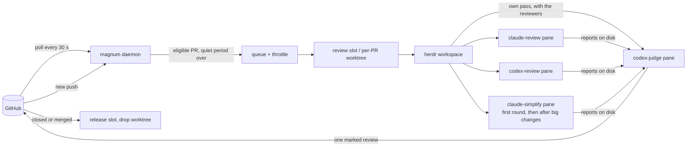

<p align="center">
  
</p>

<h1 align="center">Magnum PR</h1>

<p align="center"><strong>Multiple agents. One review. No drama.</strong></p>

<p align="center">
  <a href="https://go.dev/"></a>
  
  <a href="https://herdr.dev"></a>
  <a href="https://cli.github.com/"></a>
  <a href="LICENSE"></a>
</p>

Magnum reviews your pull requests with the AI coding agents you already use. On every push, several
agents (Claude Code, Codex, droid, omp or any CLI [herdr](https://herdr.dev) can drive) review the PR
side by side, a **judge** agent proves or rejects each finding they raise, and Magnum posts exactly
**one** GitHub review, as you or as a GitHub App. It runs as a daemon on your Mac, on the agent
subscriptions you already have, and every agent works in a herdr pane you can watch or take over.

<p align="center">
  <a href="#quick-start">Quick start</a> ·
  <a href="#how-it-works">How it works</a> ·
  <a href="#what-the-author-sees">What the author sees</a> ·
  <a href="#faq">FAQ</a> ·
  <a href="#configuration">Configuration</a> ·
  <a href="#daily-use">Commands</a> ·
  <a href="#the-pr-board">PR board</a>
</p>

- **Several reviewers, one review.** Each agent has its own prompt, model, credentials and schedule.
  Their findings go to a judge, so the author reads one review with one verdict, not four.
- **Proven or dropped.** The judge reproduces each finding and posts it on the line that must change,
  with the reproduction and the fix. A finding it cannot prove is not posted.
- **Re-reviews that remember.** A push goes back to the sessions that reviewed the PR before: they read
  the author's replies, check the claimed fixes and review only what changed.
- **Real checkouts.** Each PR gets its own worktree, or a warm slot with its own databases for a big app,
  so the agents can run the tests; a closed or merged PR releases it.
- **Your machine, your budget.** No hosted service in between: the agent CLIs you are logged into do the
  reviewing, and GitHub calls go through `gh`. Quiet periods, minimum intervals and daily caps keep a
  burst of pushes from burning your subscription, and a model at its limit can hand over to a fallback.
- **Fixes what it finds.** On a PR you wrote, one key starts a fixer agent that fixes the findings worth
  fixing, answers the threads, also those of other reviewers that nobody answered, and pushes as you.
  Magnum then reviews the push again, up to a cap of
  cycles ([Fixing your own PRs](#fixing-your-own-prs)).
- **Learns the repository.** The judge keeps notes per repository (how to test it, known pitfalls), and
  an optional daily retro collects what human reviewers caught that Magnum missed.

> [!NOTE]
> **Disclaimer:** this repository is 100% vibecoded and, I'd say, 100% awesome. It saves me hours, and I
> use it every day. If you're happy to let AI review your pull requests, I hope you won't mind that AI
> wrote the reviewer too.

### What the author sees

One review per round: a verdict line first (`Fix 1 problem before merging.`, or `No problems found.
LGTM :shipit:`) with the problems it counts listed under it, then each finding as an inline comment on the
line that must change, like this one:

> **[P2] Old Reject error appears in a new chat**
>
> If Reject fails after the user opens another chat, the old error appears there.
>
> **Reproduce** (`app/chat.test.jsx:88`)
>
> ```js
> it("keeps a late Reject error out of a new chat", async () => {
>   const chat = render(<Chat />);
>   api.reject.mockRejectedValueOnce(new Error("timeout"));
>   await chat.click("Reject");
>   await chat.click("New Chat");
>   await flushPromises();
>   expect(chat.text()).not.toContain("timeout"); // fails: the error is shown
> });
> ```
>
> **Fix**
>
> The `catch` changes state before the session check. Check the captured session first.

The author answers on the thread (`fixed`, `not a bug: <why>`, `won't fix: <why>`), and the next push is
re-reviewed against those answers. A reply with no push gets its answer a few minutes later: the judge
re-decides the thread and answers there (an acknowledgement, one sentence with its evidence, or an answer
to a question), or posts a new review when its verdict changes; after two rebuttals in one thread it
stops arguing and leaves the call to the operator. A P1 or P2 problem the judge proved next to the PR's changes that the
PR did not bring is not a finding: up to three go into a collapsed "Found nearby, not this PR's" block
before Checks, one line each, never counted in the verdict (a security one only into `magnum debt`).
A false claim of the description that bears on risk (a ticked "Can be reverted easily" the previous
release cannot keep) is a finding, or one `Description: ✗ <claim>: <why>` line when it harms nothing.
[The judge skill](#the-judge-skill) has the full format.

With `[pipeline] status_comment = true` the PR also gets one comment, edited in place, that says whether
its review is queued (and why it waits), in progress or posted (with its verdict in a few words), says when
Magnum's own failure stopped it, answers a review request on a PR Magnum leaves out, and ends on a true
line when the PR is closed, merged or turned into a draft first, so nobody merges before it by accident
(see [Review status comment](#review-status-comment)).

## How it works



1. **Poll.** One GraphQL query per organization finds new PRs, new heads, new repositories and closed
   PRs, and a second reads the CI state of the watched repositories' open PRs (a CI run that ends does not
   count as a change of the PR). Open PRs that existed before Magnum started are left alone until they
   change.
2. **Throttle.** A new head waits for a quiet period (default 5 min, 15 min after a burst of three
   pushes within 30 min) and at least 30 min since the previous round (2 h for drafts); pushes coalesce
   to the latest head; `magnum review` overrides.
3. **Check out.** Pool repositories (big apps with databases) get one of N provisioned slots; small
   repositories get a worktree next to their clone. Checkouts are detached, so they never collide with
   branches you have open yourself.
4. **Review.** Every role from the pipeline configuration gets a pane: candidate reviewers and the
   read-only simplifier (it proposes simplifications in a report, edits nothing) run in parallel, the
   judge does its own full pass alongside them, a checkout a role left modified is caught and restored,
   and once both ended the judge weighs every report against its own pass.
5. **Post and verify.** The judge posts one review with inline comments and an invisible run marker
   through `magnum post-review`, which checks every inline comment's line against the PR's diff first;
   Magnum verifies on GitHub that exactly that review by exactly that identity exists for that commit.
6. **Repeat and clean up.** New commits re-prompt the same sessions. A push while the reviewers (and the
   judge's own pass) still run restarts them in place on the new head (at most twice per round); a push
   while the judge weighs the reports is noted on the posted review and re-reviewed right after the
   quiet period. A closed or merged PR
   releases its folder after a grace period, with teardown hooks for its databases. If the poll confirms the
   close or the merge while a round runs, the round stops as `magnum abort` stops it (a `round.stopped`
   event). A round that someone asked for (`magnum review`, the board's `r`, a review request) and a
   post-merge review run on.

## Quick start

Requirements: macOS (see [Linux](#linux) below), [herdr](https://herdr.dev) 0.9.3+ running, `gh` logged
in and the agent CLIs you want to use (`codex`, `claude`, `droid`, `omp`). MySQL only for a `[[pool]]`
that declares databases: DBngin's server at 127.0.0.1:3306 (root, no password), or any other one that
`MAGNUM_MYSQL_DSN` names (a [go-sql-driver DSN](https://github.com/go-sql-driver/mysql#dsn-data-source-name)
such as `root:secret@tcp(127.0.0.1:3307)/`) in the environment of the daemon and the CLI (the LaunchAgent
does not carry it: a daemon launchd runs sees it only through `mise exec`, from the checkout's mise env);
[mise](https://mise.jdx.dev) only for a pool whose worktrees use it; dev.fast Whiteboard only for
whiteboards, with `[pipeline] whiteboard = true` or by hand with `magnum whiteboard` ([Whiteboards of reviewed
PRs](#whiteboards-of-reviewed-prs)): Whiteboard
Desktop running (or `whiteboard server start`) and its `whiteboard` CLI on PATH.

```bash
brew install zhuravel/tap/magnum             # built from source by Homebrew
magnum init                                  # ~/.config/magnum/config.toml: your gh login, one repository, who posts
magnum doctor                                # what this setup uses, with the exact fix for each problem
magnum daemon                                # in a second terminal or herdr pane: the daemon in the foreground
magnum review owner/repo#123 --wait          # one review of that repository's PR, start to finish
```

When the review has posted, hand the daemon to launchd (`install` stops the foreground one) and add the
extras you want:

```bash
magnum install --plugin                      # launchd agent + herdr plugin
magnum install --gh --no-launchd             # optional: `gh magnum …`
magnum completion zsh > "${fpath[1]}/_magnum"
```

To upgrade: `brew upgrade magnum && magnum daemon-restart --when-idle` (the daemon keeps running the old
binary until it restarts; `--when-idle` restarts at the first moment nothing is in flight, no round and no
notes curation or retro, `--drain` also stops new rounds meanwhile). `magnum status` and every reply to a
command the daemon answers say when the daemon runs an older build than the CLI or the binary on disk; with
`[daemon] restart_on_new_build = true` the daemon restarts on a new build by itself, at the first tick
nothing is in flight.

`magnum init` refuses to replace an existing config without `--force` (the old file is kept as
`config.toml.bak`); [config.example.toml](config.example.toml) is the same minimal setup to copy by hand.
To post as a GitHub App, answer 2 when init asks who posts: it asks for the App's ids and names the file
to save its private key as, `~/.config/magnum/keys/<app>.pem` (it never asks for the key); `magnum
identities check` verifies the App. A big repository with its own databases gets a pool of warm slots:
add a `[[pool]]` (see below), then `magnum slots provision --count 6`. `--count` takes 1 to 999; a count that would pass the pool's `max` is refused before anything is provisioned.

## FAQ

**How is this different from a hosted review bot?** Magnum is not a service: it runs on your Mac and
drives the agent CLIs you are already logged into, so reviews come out of subscriptions you already have.
The agents work in a real checkout of the PR (a worktree, or a pool slot with its own databases), so they
can run your tests, and you can watch any of them in its pane. A judge has to reproduce a finding before
it is posted, and later pushes resume the same sessions. The trade-off: reviews happen only while your
Mac is on and the daemon runs, and they spend your own budget.

**What does it cost?** Magnum is free (MIT); every round spends some of the budget of each agent it runs.
The defaults keep that down: a push waits for 5 quiet minutes (15 after a burst), a PR gets at most one
round per 30 minutes (2 hours for a draft) and 12 automatic rounds a day, a push that only touches
comments, whitespace or docs, or only merges the base branch, is not re-reviewed, and a change under 30
code lines since the last review gets a check by the judge alone. With 80% of the Codex budget used,
full re-reviews wait; at 95%, rounds that need Codex wait. `magnum status` shows how fast that budget goes,
`magnum stats` lists the PRs that took the most agent time, and
[triage](#triage-fewer-reviewers-for-a-small-diff) can skip reviewers on a small diff.

**Is it safe to point agents at pull requests?** Reviewing a PR means running its code: the agents run
its tests in the checkout, with the autonomy your agent CLIs allow. Watch repositories whose contributors
you would let run code on your machine; PRs from forks are skipped by default. Magnum treats PR content
as data: PR text never goes into a prompt, the repository's instruction files count only for its
conventions, permission prompts are answered No, hooks a checkout brings are declined, and your personal
GitHub tokens are stripped from review worktrees. [Under the hood](#under-the-hood) has the details.

**How noisy is it?** The judge posts only what it can reproduce, ranks findings by who can reach them (P0
to P3), and offers at most five simplifications by default (`max_simplifications`), marked optional.
Every candidate it rejects is recorded with a reason, so `magnum stats` shows per reviewer how many
findings were raised, posted and rejected, and why. The optional
[retro](#learning-from-other-reviewers) measures the other side: what human reviewers caught that Magnum
missed.

**Why herdr panes and not headless runs?** So you can see what an agent is doing, take it over or answer
it when it is stuck, and so its session lives on: a re-review continues the conversation that wrote the
first review. herdr also gives Magnum pane titles, toasts and a plugin for its popups.

**Can it post as a bot instead of me?** Yes: give it a GitHub App and the App posts, so its approvals and
change requests do not come from your account. See [Identities](#identities-who-posts).

**Does it run on Linux?** Not yet. [Linux](#linux) lists the four macOS-only spots; a small platform
interface around them is the whole job, and contributions are welcome.

## Configuration

Two layers and the App keys:

- The built-in defaults: [config.defaults.toml](config.defaults.toml), embedded in the binary. The
  daemon defaults, the agent kinds and the review roles, every key documented; it names no account,
  repository or path of yours. Editing it changes the defaults after `make build`.
- Your config, `~/.config/magnum/config.toml` (`$XDG_CONFIG_HOME/magnum/config.toml` when that is set;
  `magnum init` writes it): your identities, watches, pools and repos, plus any default you want to
  override. Its `[[watch]]`, `[[identity]]`, `[[pool]]` and `[[repo]]` blocks are appended, a `[[role]]`
  overrides the keys it sets on the role of the same name (or is appended), scalar keys and
  `[kinds.<name>]` entries override key by key. [config.full.example.toml](config.full.example.toml) is
  a complete, working setup (Talkable's) to copy from. `magnum config` and `magnum doctor` say which
  files were read.
- App private keys: PEM files the identity's `private_key_file` names, by convention
  `~/.config/magnum/keys/<identity>.pem` (chmod 600; doctor warns about a looser mode). The older
  `private_key_env` (an environment variable holding the PEM or its path, e.g. from a checkout's
  `mise.local.toml`) still works; launchd then runs the daemon through `mise exec`.

Magnum keeps its own files where XDG says: the registry, review reports and repository notes in
`~/.local/share/magnum` (`$XDG_DATA_HOME`), logs, locks, the identities' gh config dirs and the tab-bar
file in `~/.local/state/magnum` (`$XDG_STATE_HOME`); `magnum config` prints both. `MAGNUM_HOME=<checkout>`
keeps them in the checkout's `state/` instead, for development.

`--config FILE` (or `$MAGNUM_CONFIG`) replaces the built-in defaults with a complete file of your own.

Besides those, Magnum reads `MAGNUM_MYSQL_DSN` (the MySQL server, see [Quick start](#quick-start)) and
`HERDR_BIN_PATH` (the herdr executable that `magnum open`, `reveal_on_attention` and the plugin commands run;
herdr sets it inside plugin actions, else `herdr` on `PATH`), and hands `[herdr] socket` to the herdr
commands it runs and to the LaunchAgent as `HERDR_SOCKET_PATH`. `MAGNUM_BIN` names the `magnum` binary that
the herdr plugin's commands run (else the plugin's own `bin/magnum`, then the installed one),
`MAGNUM_PICK_QUERY` is the initial filter of `magnum pick` (as `--query`), and `MAGNUM_TUI_TRACE=<file>`
makes a live screen append one line per message to the file, with how long its Update and View took, to
diagnose a frozen or spinning screen (off unless set). Every role's pane gets the round's context
in its environment, next to the identity's gh selection (an App's `GH_CONFIG_DIR`, with `GH_TOKEN` and
`GITHUB_TOKEN` blanked) and the slot's env: `MAGNUM_PR_URL`, `MAGNUM_IDENTITY` (`gh` or `app`),
`MAGNUM_REVIEWER_LOGIN` (the login that posts), `MAGNUM_SELF_LOGIN` (the watch's poll login),
`MAGNUM_NO_FINDINGS_EVENT` and `MAGNUM_BLOCKING_EVENT` (the repository's verdict events) and
`MAGNUM_REPORT_DIR` (the round's report directory).

`[daemon] restart_on_new_build` (default `false`): when `true`, every reconcile looks at the binary
launchd starts; once a new one passes its check (`<binary> version` and `<binary> config`, as
`daemon-restart` checks it) the daemon exits at the first tick no round is claiming, reviewing or
verifying, and launchd starts the new build (events `daemon.restart_pending`, then
`daemon.restarted_for_build`). Dispatch is never held for it, and a daemon launchd does not run (started
by hand) only says so: nothing would start it again.

`[daemon] shell_path` (default `false`): launchd gives the daemon a fixed `PATH` (`~/.local/bin`, mise's
shims, Homebrew's and the system directories), and every command it runs inherits it: the pool hooks, the
readiness commands, `mise exec`, gh and the agent CLIs. A tool only your shell's exports put on `PATH`, such
as DBngin's `mysql`, `psql` or `redis-server` in versioned directories, is missing there. With `true` the
daemon asks your login shell for its `PATH` once at its start, before it runs anything (`$SHELL -ilc`, `zsh`
when `SHELL` is unset, 20 s at most, no terminal and no stdin), and appends the directories its own `PATH`
lacks, in the shell's order. launchd's `PATH` stays first, so mise's shims still win. Banners and hook
output are skipped: the last line that reads as a `PATH` (colon-separated absolute directories) counts. The
`daemon.shell_path` event says how many directories were added ("PATH from zsh: 4 directories added"),
and `magnum status` shows the count on its daemon line. The debug log names the directories, the event
never does. A shell that fails, prints no `PATH` or answers nothing in 20 s leaves launchd's `PATH`
alone, with a warning event ("the login shell (zsh) answered nothing in 20s. The launchd PATH stays"). A
change of your shell's `PATH` (a DBngin upgrade) takes effect at the next `magnum daemon-restart`, as a
config change does. The CLI keeps the environment of the terminal it runs in.

Three more `[daemon]` keys pace the agents. `max_total_working_codex` (default 5) caps the Codex agents working at once, your own sessions included. `agent_start_stagger` (default `"15s"`) is the least time between two agent launches, across rounds, and at most 3 Codex agents start at once. `min_warm` (default `"30m"`) is how long a pool slot another PR holds must stay unused before a waiting PR may take it back, its sessions parked and the slot released: with no human typing, no session working, blocked or prompted within it, no run and no pin.

A command handed to the daemon waits up to 30 s for its answer (the daemon answers requests before its
GitHub poll and between the poll's GitHub calls, so one waits for a single call); a request still pending says how to follow it (`magnum logs request:<id> -f`). A request
that reaches a daemon newer than it fails with "this daemon predates <field>: restart it" instead of
running without the field. Without a daemon, `review`, `approve`, `request-changes` and `open` of a parked
PR refuse and queue nothing (they would post or act whenever a daemon next started); the other commands
still queue for the next start, and a request no daemon saw within an hour fails at startup as "expired:
queued while no daemon ran".

The daemon prunes audit events older than `[daemon] keep_events` (default `"30d"`) and handled CLI
requests older than `keep_requests` (default `"7d"`) on every reconcile; `"0"` keeps them forever. The
step rows a checkout resumes from after a crash are the one exception, and only while their subject (a
checkout, named with the head's sha) has had an event inside the window: a subject quiet for `keep_events`
loses them with the rest. `poll_interval` and `reconcile_interval` must be positive, the other waits and
quiet periods (`close_grace`, `push_quiet_period`, ...) and `min_free_disk_gb` not negative, and
`default_repo`, when set, `owner/name`; the config is refused otherwise. Two `[[pool]]` blocks may not
render the same `slot_name` or `slot_path`.

A push that lands while a round's reviewers still run restarts them on the new head, up to
`[daemon] max_round_restarts` times per round (default 2; `0` turns restarts off). The turns it cuts
short are interrupted and their roles prompted again on the new head: an agent reviewer with esc, a shell
role's command with ctrl+c, and the judge's own pass with one ctrl+c, which aborts Codex's turn and keeps
the session with its context (two quit Codex, as for a judge that timed out). All of them get their keys
at once, before Magnum waits for any of them, and then Magnum waits for all of them side by side, so the
restart waits for the slowest turn, not for each in turn. A shell role's command that still runs 10 seconds
after its ctrl+c gets another, three in all, and a warning names the role when it runs on, since the
restart's line would find its pane busy. An agent gets up to a minute after its interrupt to go idle, and a
warning names it when it does not. A claude reviewer still at work 10 seconds after its esc whose
transcript shows background work it started still running (a test run in the background keeps it at work
after an interrupt) is told then to stop that work, which is what ends it, rather than at the end of the
minute; one idle within the 10 seconds gets no message then, only the one about work its transcript still
shows once it is idle. A stop that worked is an info event (`round.cut_settled`, with the seconds the agent
took to go idle), not a warning. When a refusal or a lost judge ends the round instead, the turns still at
work are stopped the same way.
A push that lands while the judge works lets the round finish: Magnum appends "Reviewed <sha>; N commits arrived during
the review, re-review follows" (or, for a small delta, "a short check of those commits follows") to the
posted review and queues the re-review without waiting for `min_rereview_interval`. A PR whose head changed `burst_pushes` times (default 3) within `burst_window`
(default `"30m"`) waits `burst_quiet_period` (default `"15m"`) instead of `push_quiet_period`; a
`[[watch]]` can override all three, and `burst_pushes = 0` turns the rule off.

A watch's `include_own = false` skips the PRs you authored (its author is one of your logins: every gh
identity and every watch's posting identity, the board's "mine"), whichever of your logins opened them,
not only the watch's poll login. A PR you authored waits `[daemon] own_min_rereview_interval` after its
last round instead of `min_rereview_interval` when that is set (default `"0"`: the same interval), say `"2h"` while another
session of yours pushes to it often; an own draft waits the longer of it and `draft_min_rereview_interval`,
a `[[watch]]` can override it, and a review request or `magnum review` skips it like the other timing
rules. The wait names it ("re-review · own PR interval → 16:40").

`magnum snooze <ref>` holds one PR's automatic rounds for a while: `--for` (default `2h`), `--until 18:00`
(tomorrow once past) or an RFC 3339 time; `--off` lifts it. Until then no push, quiet period, re-review,
reply round or delta check starts a round on it (the first review of a new PR included), while
`magnum review`, the board's review keys and a review request on GitHub still run one and leave the
snooze in place. It ends on its own at its time and survives a daemon restart (the registry keeps it); a
round in flight finishes. The board's `z` snoozes the selected PR for 2h after a y/N, and on a snoozed PR
offers to lift it; the state cell says `snoozed → 18:00` (in the wait, or after the state when nothing
waits), the card until when, since when and by whom (`magnum snooze` or the board), and `tui --json`
has `snoozed_until`, `snoozed_at` and `snoozed_by`.

Codex may block an account it takes for a cyber abuser, also when all it reads is your team's own code. So
when a role's turn ends on one of Codex's safety warnings ("This content was flagged for possible
cybersecurity risk", the words "cyber permissive safeguards" or "Daybreak access", or a usage-policy
violation, abuse or a threat named in Codex's own `■`/`⚠`/`ERROR:` line; the kind's `health_patterns`
`refused` list, read from the pane after the turn's prompt and, when the pane scrolled past it, from the
turn's error in the session's Codex rollout, `codex_error_info` `cyber_policy`), the round ends at once,
whichever role it was (the judge's own pass, its candidates turn, a nudge or a continue, a reviewer,
codex-review's output; also when a push cut the stage a moment before). A Codex helper agent the role's
session spawned counts as the role: when its rollout (the one naming the session as its parent) records a
`cyber_policy` refusal within the turn, the round ends the same way, even though the session's own turn
ended ok and the judge posted its review (which stays posted): no nudge, no retry, the other
roles are interrupted (the turns of the refused kind first), and the round's outcome and
the PR's last error say "Codex refused the review: content flagged as a cybersecurity risk (codex-judge,
run r-…)". The PR is flagged for good (the refused head, role, run and time) and one toast says so:
magnum never reviews it again, on any head, by itself or when asked (no retry, continue, reply round or
delta check; `magnum review` and the board's `r`/`R` refuse with the reason). With
`[pipeline] judge_fallback = "claude-judge"` (a `[[watch]]` may set its own) the PR goes on instead: it is
flagged for Codex, which never sees it again, its roles of that kind (`codex-judge`, `codex-review`) are
dropped, and `claude-judge`, the second built-in judge held in reserve (Claude Opus at xhigh, the judge's
prompts and skill), judges it from the next round on, starting fresh through the recovery prompt that
reads the earlier reviews and threads from GitHub. The PR goes back in line (a reviewed one as
`rereview_pending`, an unreviewed one `queued`) and waits the usual re-review interval, keeps its slot
and agents, and `magnum review` works; the board's cell reads `Codex flagged · judge claude-judge`. A
refusal by the fallback's kind too, or a fallback no longer declared as a judge of another kind, holds
the PR as below. Without the key, the board's state cell and
card read `Codex flagged · never reviewed again`, the card says when and where and how to lift it,
`magnum status` lists the PR among what needs you, `magnum tui` prints `codex-flagged` in STATE and
`tui --json` has `codex_flag` and `codex_flag_detail`; `magnum stats` counts such rounds as `refused`.
Review it by hand. Only `magnum codex-flag clear <ref>` lifts the flag, after a y/N question on a
terminal that names the account risk; `magnum codex-flag set <ref> [reason]` flags a PR by hand (one
Codex warned about elsewhere). The flag fails closed: a flag record magnum cannot parse is a flag, a
registry read that fails holds the PR that tick, and a flag a refused round could not write holds the PR
from memory and is written again every tick. A flagged PR gives back what it holds: the tick after the
flag parks its idle agents and releases its pool slot (a `pr.codex_flag_released` event), unless
`magnum open` pinned it for you to review by hand. Another PR's judge never hears of it: `related.json`
leaves flagged PRs out. A `magnum eval run` case whose replay was refused is recorded in
`<state>/eval/flagged.json` and never replayed, nor is another case on the same PR (`owner/repo#N`) or a
case whose PR the registry holds a Codex flag for (`eval run` says so; delete its entry, or clear the
flag, to replay it).

`[daemon] quiet_hours` (unset by default) holds the costly rounds of every PR during a daily window of
local time, `"HH:MM-HH:MM"` such as `"01:00-07:00"`: inside it first reviews, full re-reviews (a review
request's on GitHub too) and the continue of a judge turn a usage limit paused wait for its end
(`re-review · quiet hours → 07:00`), while their timing rules keep counting. A round of the judge alone
still starts: a delta check of a small push, a reply round, and a re-review of the head Magnum reviewed
(a review request after a reply), each one turn of a few minutes. `magnum review`, the board's and the
picker's review keys still start any round, and a round in flight finishes. Nothing else stops: the poll,
auto-approval, the retro, notes curation, parking and cleanup go on. The window includes its start and
excludes its end, and crosses midnight when the end comes first (`"22:00-06:00"` covers 22:00 to 05:59); a
malformed value or an empty window (`"07:00-07:00"`) is refused when the config loads.

### Settings: changing your config from a screen

The settings screen (`magnum settings`) changes a fixed list of settings in `~/.config/magnum/config.toml`
so you do not have to open an editor:

- **Spend & models:** `[pipeline] spend`, each agent kind's own `[kinds.<name>] spend`, the model, effort
  and re-review effort of each role in each `[spend.<level>]` table, and each role's base `model` in its
  `[[role]]` block. A role that two `[[role]]` blocks of your file name is left to a hand edit: the loader
  merges them, so which one to change is not clear.
- **Usage caps:** `[usage] codex_soft` and `codex_hard`.
- **Each `[[watch]]`:** `roles`, `auto_approve`, `auto_approve_authors`, `auto_approve_skip_authors`,
  `manual_repos`, `include_drafts`, `stakes` and `own_min_rereview_interval`.
- **Each repository:** its `[[repo]]` block's `stakes`, `max_simplifications`, `auto_approve_authors`,
  `auto_approve_skip_authors`, `allow_bot_authors` and `required_checks`. A watched repository without a
  block gets a minimal one.
- **Schedule:** `quiet_hours`, `push_quiet_period`, `min_rereview_interval` and
  `own_min_rereview_interval`.
- **Reviews & agents:** `[pipeline]` `status_comment`, `whiteboard`, `judge_fallback`, `fix_cycles`,
  `autofix`, `max_simplifications` and `judge_fresh_after`, and `[daemon]` `park_idle_after`,
  `max_concurrent_reviews` and `max_total_working_codex`.

It never edits identities, `auto_approve_as`, App keys, paths and sockets, commands, args, env, hooks,
MCP, the sandbox or pools. Those stay hand edits.

A save edits the file in place and never rewrites it:

- **Changed values:** only the value is replaced. The trailing comment stays at its column (a gap that
  holds a tab is kept as it is), even when several cells of one inline table change, and every other
  comment, blank line and line ending stays as it was. Each key of an inline table is edited in place
  inside its braces.
- **Keys you did not set:** a new key goes after the last key of its table, so above a `[pool.env]`
  subtable.
- **New blocks and tables:** a missing `[[repo]]` or `[[role]]` block goes after the last one of its kind.
  A missing table goes after the last table of its family (`[spend.*]`, `[kinds.*]`); with no family, it
  goes before the first array of tables.
- **Back to the default:** the key's line is deleted and its comment stays as a comment line.
- **Dated notes:** each changed line gets a note such as `# 2026-10-20: was "high"`. On a line that
  already has a comment, the note goes first. Notes are on by default and can be turned off.

Before anything is written, the save makes five checks:

- The file must not have changed on disk since the screen read it.
- The new file must decode with exactly the edited values changed.
- No line outside the edited keys' lines may change, byte for byte. A failure here, or a file that does not
  read back, is a bug in the editor and is reported as one; nothing is written.
- It must pass `magnum config`'s checks: the loader and the prompt render.
- The settings screen must understand the shape it is editing. A shape it does not, such as a table only
  dotted keys define, an inline table over several lines, or a multi-line array with comments inside, is
  refused, and you edit that key by hand.

The file is written atomically and keeps its mode. Saves take a lock file beside the config,
`~/.config/magnum/.config.toml.lock` (created 0600 and kept), so two screens, or a screen and a script,
never interleave, whatever `MAGNUM_HOME` each runs with. The hash is checked again right before the
write. A symlinked config, or one with more than one hard link, is refused rather than replaced with a
file.

The version a save replaces is kept in `~/.local/share/magnum/config-history/`, one
`<UTC time>-<sha>.toml` per save, and the last 20 are kept. A restore goes through the same checks (it needs
no current file that loads: a restore mends one a hand edit broke), and
the version it replaces is kept too.

The daemon reads the config only when it starts, so a save takes effect after a restart:

- **Restart when idle:** the screen can ask the daemon to restart once nothing is in flight. Before any
  idle restart (a saved config, a new build, a landed skill version) the daemon checks what it would start
  on. It loads a changed config file again, and when the binary on disk changed since it started, it runs
  that binary's own check; a binary that is missing or cannot be read counts as a failure. If the check
  fails, the daemon does not exit, drops the save's request and says so once (`daemon.config_restart_refused`).
  A new build or a landed skill version still waits: it checks again when the file or the binary changes,
  or every 10 minutes. With only the saved config waiting nothing checks again: once the file is fixed,
  `magnum daemon-restart --when-idle` or a new save restarts on it, as the event says. Right before exiting it checks once more that nothing
  started meanwhile. When it
  exits, launchd starts it again. A file reverted by hand to the config the daemon runs needs no restart,
  and the request is dropped. The events are `daemon.restarted_for_config` and
  `daemon.config_restart_refused`.
- **Restart by hand:** a daemon that launchd does not run leaves the restart to you
  (`magnum daemon-restart --when-idle`).
- **Restart pending:** the daemon records the hash of the user config it loaded. Until it runs the file on
  disk, `magnum status` shows `config: ... changed since the daemon started` and how the change will
  apply. When the daemon refused to restart on the file, it says to fix the file (`magnum config` shows
  why) instead.

### Re-reviews

A push whose changes since the last review are only comment lines, whitespace or documentation is not
re-reviewed: Magnum compares the reviewed commit with the new head (one GitHub call), moves the review
to the new head with its verdict, keeps an App's approval and records `pr.trivial_delta`. When such a
commit arrived during the judge's turn, the note on the review says "(comments only), no re-review
needed" instead. `[daemon] skip_trivial_deltas` (default `["comments", "whitespace", "docs", "base"]`,
`[]` = re-review every push) picks the kinds, a `[[watch]]` can override it, and `magnum review` always
runs. A file that steers the review agents (an `AGENTS.md`, `CLAUDE.md` or `CLAUDE.local.md` in any
directory, anything under `.claude/` or `.codex/`, `.mcp.json`) never counts as documentation for this. A
comment line that holds its language's interpolation counts as code, because in a heredoc, a template or a
`run:` block it runs: `#{` in Ruby and ERB, `{` in Python, `${` in JavaScript, TypeScript, Kotlin, shell and
Terraform, `{{` in YAML.

A push that merges the base branch into the PR (or rebases it onto the base) is judged by the PR's own
diff, not by the commits it brings: when the comparison of the reviewed commit with the new head shows a
merge commit or a divergence, Magnum compares the PR's diff against its base before and after the push
(two more GitHub calls, `<base>...<reviewed>` and `<base>...<head>`), file by file, by the sequence of
added and removed lines (context lines and hunk positions, which master's changes move, do not count).
When no file's own change differs, the push is the kind `base` ("base merge only"): the review stands
and `pr.trivial_delta` says, e.g., "the push to 2017f29 only merges master (13 commits, the PR's own
changes unchanged)". A file without a complete patch, or a diff over GitHub's 300-file cap, makes the
comparison incomplete, and the push is measured as any other. A daemon that starts on this rule checks
the PRs already waiting for a re-review once more, on its first poll, and settles those a base merge
queued.

Any other push is measured by the same GitHub call: the changed lines that are code (not comments,
blank lines, whitespace moves or documentation) since the reviewed commit; after a base merge or a
rebase, only the lines that changed in the PR's own diff. An automatic re-review runs after the quiet
period once that delta reaches `[daemon] rereview_min_lines` (default 30) or adds a file; a smaller
delta waits for further pushes, at most `rereview_max_wait` (default `"2h"`) after its first push.
`rereview_min_lines = 0` turns the threshold off, and a `[[watch]]` can override both. A force push back to
an ancestor of the reviewed commit (GitHub: "behind") has nothing to measure, so the threshold does not hold
its re-review.

Such a small delta (more than 0 and fewer than `rereview_min_lines` code lines, no added file) gets a
delta check instead of that wait and a full round (`[daemon] delta_check`, default `true`; a `[[watch]]`
can override it): once the push quiet period (or the burst one) is over, only the judge runs, in its own
session at its `rereview_effort`, without triage or reruns, and its prompt asks for one short review of the
commits since its last one against the PR's purpose and its earlier findings (`delta_check: true`, and the
delta's files listed in `delta-check.json` in the report directory). A modified image or other binary file
(no patch) counts 0 lines there and is named in that list; an added file still means a full round. Pauses,
the re-review interval, the daily cap, capacity and drains hold it as any round, and a forced or requested
round, or one that names roles, runs in full. The board, the card and `magnum status` call it a delta
check (`delta check · quiet → 14:09` while it waits, `delta check (4 lines)` on the card's last round and
in `engine.round_start`); the board marks a running one `∆` after its pill. A judge whose session is gone
(lost, parked by an identity migration, or fresh sessions requested) checks the delta in a fresh session
(`round.delta_check_fresh`): a recovery round of the judge alone at its `rereview_effort`, whose prompt has it read its previous review and threads before it
reviews just those commits (`delta_check: true` in `judge-recovery.md`); only when no review by the PR's
current or former identities is on record to build on does it become a full recovery round
(`round.delta_check_dropped`). An App's approval of the reviewed commit stands meanwhile (`review.approval_kept_for_check`): the check's approval supersedes it
(`review.approval_superseded`); a check that comments, requests changes, fails or needs attention, a later
push that makes the delta too large, or no check posted within an hour of the check becoming due (after the
push quiet period; quiet hours do not hold the check, and a `magnum pause` counts) dismisses it then, with the reason. `delta_check = false` keeps the wait and the full round.

A re-review of a head Magnum already reviewed (no new commits: `magnum review`, or a review request, to
have it re-read an author's reply) runs the judge alone as a delta check does: no triage, reruns or own
pass, at its `rereview_effort`, in a fresh session too when the old one is gone (`round.same_head_fresh`).
Its prompt says the head is unchanged: re-read the replies and comments since the last review, re-decide
each earlier finding under the reply contract, run no check that review already ran, and post one short
review, headed `Re-review of <sha> (no new commits):`. `round.same_head` records it. A request that names
roles (`--role`, `--simplify`) or asks for fresh sessions (`--fresh`) runs every reviewer as before, and so
does a round whose checkout finds a newer head (`round.same_head_dropped`).

A re-review reads only the commits since the last review, so after its first review nothing reads a
long-lived PR whole again. Every tenth automatic re-review is therefore a full pass (`[pipeline]
full_pass_every`, default `10`; `0` turns it off): the PR's sessions are parked and every role starts fresh
as with `--fresh`, the reviewers review the whole PR with their first-review prompts at their full effort
(triage judges the whole PR, as for a first review), and the judge gets the recovery prompt with a full-pass
clause (`full_pass: true`): review the full PR diff again as a first review does, then decide every earlier
thread under the reply contract; a finding the earlier reviews missed ends its title with `(missed
earlier)`, and the body is headed `Re-review <a> → <b> (full pass):`. The judge's own pass (with the
default `judge_own_pass = "parallel"`) is blind: it reviews the full diff as a first review does and reads
no earlier review, thread or reply, so the fresh session does not take on the old framing before it reads
the code; the candidates prompt then lists the earlier reviews, and the judge decides their threads there.
It costs a first review's rounds of every role. The count is the PR's re-reviews that posted a review on new
commits since its first review or its last full pass, read from the registry's runs, so a PR reviewed
before the key existed counts its past re-reviews. A delta check counts, and a due full pass overrides it:
the small push runs the full pass instead of the judge's check, so small pushes never put one off. A forced
or requested round counts but never becomes one, except `magnum review --fresh`: its round, on a new head or
the reviewed one, runs the full pass when any rule (`full_pass_every`, or the churn and age rules below)
makes one due, as an automatic re-review would, and the reason ends `, on magnum review --fresh`
(talkable#11483's recovery of its reviewed head after a dead judge ran none after 34 re-reviews and never a
full pass); a re-review of the same head, a reply round and a CI check neither count nor become one. The
soft Codex budget cap holds a full pass as any automatic full re-review.

Rounds say how often the whole-PR view was lost, not how much the code changed, so churn and age make a
full pass too. A PR's baseline is its last full pass, else its first review (a PR reviewed before these
rules: its next review of new commits); a round of the reviewed head that is no full pass (a same-head
round, `magnum review --fresh` with no full pass due) never becomes it, since it read nothing new and the
age rule would count from it. The baseline holds the PR's size then: its changed files and their added plus deleted lines,
lockfiles and the watch's `related_ignore` paths left out (`git diff --numstat` in the round's checkout).
Every review that posts on new commits adds them to the churn since the baseline, measured as the re-review
reads them: from the reviewed commit to the head, or, when the push merged the base branch, the change of
the PR's own diff before and after it, so the base branch's commits are not the PR's. The next automatic
re-review is a full pass once that churn reaches `full_pass_lines` lines (default `500`) or touches
`full_pass_files` files (default `10`, each file once), or a quarter of the PR's lines or files at the
baseline when that is more, or once `full_pass_after` (default `"12h"`) passed since the baseline, whatever
the PR's size, so the first push of a workday gets a whole read; `0` turns each rule off alone. The rules apply in that order, after
`magnum review --full` and `full_pass_every`, and a full pass that posts is the new baseline. `round.full_pass`
says why one runs and which rule fired (`rule`: the key, or `requested`), `engine.round_start` says
`re-review (full pass)` with the reason in `full_pass_reason`, the card's last round `full pass`, and the
status comment `In progress (full pass)`. `magnum review --full <ref>` asks for one by hand.

An approval rests on a whole read of the PR, not on a chain of deltas each read on its own. A re-review of a
PR that had `[pipeline] approve_after_full_pass` re-reviews or more since its baseline (default `2`, counted
as `full_pass_every` counts; `0` turns it off) cannot approve: its `no_findings_event` is `COMMENT`, its
prompt says why, and a clean verdict's body adds the line `A full pass of the whole PR follows before
approval.` after the verdict line. When such a review posts with the verdict `clean`, Magnum forces a full
pass of the same head at once, as `magnum review --full` does: every role starts fresh on the whole diff,
its clean verdict approves (one that finds problems posts as usual), and it is the new baseline, so the
next push and a clean re-review approve on their delta again. With the default, one round of fixes after
the first review approves on its delta. The hold applies to automatic and requested rounds alike (a delta
check, a recovery, an audit pass, a re-review of the same head) and to your own PRs, whose clean verdict
is a comment anyway; a full pass, a post-merge review, a reply round, a CI check and a dry run never hold.
Nor does a re-review in a repository with no approval to hold: where a clean review comments anyway (the
`no_findings_event` of the identity it posts as, or of its `[[repo]]` block, is `COMMENT`) and Magnum does
not approve as you (no `auto_approve` for it), the clean re-review posts its comment without the line and
no full pass follows.
Auto-approval as you waits for the full pass too. `round.approval_hold` says why a round holds
(`engine.round_start` carries `approval_hold`), `pr.approval_full_pass` that the full pass follows, whose
`round.full_pass` names the rule `approval` (`before_approval` in its start event), and the card's last
round says `full pass (before approval)`. Until a later review posts, the board's FINDINGS reads `✔ held`
for the review that held its approval (`findings.held` in `magnum tui --json`).

A full pass reads the whole PR again; what the evidence map (see the judge's `evidence.json` under the
pre-pass) says no round read or probed, or changed since one did, needs only those areas read. Every fifth
automatic re-review of a PR whose map holds `unknown` or `stale` entries is therefore an audit pass
(`[pipeline] audit_every`, default `5`; `0` turns it off), counted as the full pass counts, since the PR's
first review, its last full pass or its last audit pass: every session starts fresh, the round runs as a
recovery whose reviewers re-review the delta at their rereview effort (as with a cold judge), and the judge
gets `audit.json` in the report directory (the areas come from the PR, so the prompt names only the file):
at most three `unknown` or `stale` areas, the riskiest first (an irreversible write, authorization, money,
an optional branch, a file of the pre-pass's lists), and, marked `rotation`, the oldest probe on a file the
pushes touched since, to run again. It probes each through its real entry point with a control, writes each
probe that passes as `probed` in its evidence, posts no finding that only says an area is unknown, then
re-reviews the delta and decides the earlier threads. An audit pass counts toward the full pass's count and
never replaces one: when both are due, the full pass runs. A delta check, a re-review of the same head, a
reply round, a CI check, a forced or requested round and a push that left the head as reviewed never become
one. `round.audit_pass` says why it runs, `engine.round_start` says `re-review (audit pass)` and the card's
last round `audit pass`.

Replies get that round on their own, without a push. The poll reads, for a PR whose activity moved, its
reviews and comments with their authors and their association with the repository (no text): a reply in
one of Magnum's threads by the PR's author or by an owner, member or collaborator of the repository, or a
comment by the PR's author or a review of theirs with no inline comments (a body alone answers the review
as a whole; the author's agent's "(Claude)" replies are the author's), never one by Magnum's own logins.
A review of the author's whose inline comments start threads of their own (the findings of their own
review tool, say) or answer another reviewer's is no reply. The poll's read says which for the last two
reviews; for every other review since Magnum's latest review of the PR (up to ten) it asks GitHub in one
more call for the batch (1 point, none when nothing needs it), and a review it could not ask about counts
as before. Anyone else's reply in a thread (in a public repository anyone may
reply), a bot's without that association, a teammate's review elsewhere or a bot's top-level comment
starts nothing; the next round's judge reads them anyway. When such replies came on a head Magnum reviewed, the PR waits
`[daemon] reply_debounce` (default `"3m"`, `"0"` turns it off) after the last one and at least
`reply_min_interval` (default `"2h"`) after the last such round on that head, and then the judge alone
re-decides the threads (`re-decision · 2 replies → 14:09` while it waits, `reply round (2 replies)` in
`engine.round_start`). The quiet periods, the re-review interval and the daily cap do not hold it, and it
does not count against the cap; a round that only answers does not hold the next push either, whose
re-review interval counts from the last review round. When its verdict and event stay those of its last review, the judge posts
no review: it answers in the threads through `magnum post-review --replies` (an acknowledgement for a
reason it accepts, since resolving the thread is the author's; one sentence with its evidence for a
rebuttal; an answer as deep as asked; nothing where a reply needs none), and the round ends `replied`,
verified by the replies carrying its run's marker (`pr.replied`; the review stands, findings and
auto-approval are untouched). A thread another reviewer or the author started is theirs: the judge never
answers it inline, and `post-review` skips a reply there (listed under `skipped`) and posts the rest. A
reply round with nothing of Magnum's to answer ends `replied` with no replies, never blocked: the PR
stays reviewed with the replies read, so they start no new round, and `round.replies_none` says how many
replies started it and why none was Magnum's to answer (none in its threads, or the ones there needed no
answer); it never needs your attention. A changed verdict posts one short review, as any round does. A push
meanwhile wins: the re-review of the new head reads the replies too. After two of Magnum's rebuttals in
a thread, an answer marks the thread `stop`: the judge replies there no more, `post-review` refuses to,
and the board flags the PR for you (`pr.stalemate`; `reviewed · argued` in STATE) until you act on it
(`magnum review`, a verdict, a mute). Replies older than the daemon's first start with this build start nothing on their own; the board
counts them (`↩N`), and `magnum review --replies` (the board's `r` on such a row) re-decides them now.

CI that finishes red after the review gets a round of its own too. The judge reads the head's failing
checks when its prompt goes out (see The judge skill), so a review posted before CI finished never saw a
check that failed later. When a check of the head Magnum reviewed (no push since) fails after the judge
prompt behind the latest review posted on that head (the prompt's time, not the post's: a check that
finished in between was not seen either), the PR waits for a judge check of that head (`pr.ci_red`;
`CI check · CI red` on the board, "CI turned red after the review; judge check pending" on the card).
The judge alone, told that CI finished red after its review, decides each failed check from its log (a
P1 broken build when the PR causes it, else an unrelated Checks line) and posts one review
(`rereview round (CI red after the review)` in `engine.round_start`). Like a reply round it skips the
quiet periods, the re-review interval and the daily cap, counts against no cap and runs in quiet hours;
a snooze or a mute holds it. One judge check covers each failing check of a head: a rerun that fails the
same way starts no other, a different check failing later does. A rerun that turns the checks pending,
or passes, while it waits drops it (`pr.ci_red_dropped`, back to reviewed), and a push supersedes it.
The poll reads a head's checks again when its CI rollup's state changes, and also when its counts of
failed or pending checks do (a rollup stays FAILURE while an earlier failure is red); the counts come in
the same rollup request, with more fields.

The rest of the re-review sees a base merge the same way: triage reads the PR's own diff of the files whose
own change differs, the simplify reviewer's rerun measures that change, and the reviewers' and the judge's
prompts say the push merged the base branch, so they compare the PR's diff before and after it instead of
reading the base branch's commits as the PR's.

### Review requests, caps and pauses

A review request runs without delay: when someone requests a review from the poll login, from a posting
identity's login (an App's `<slug>[bot]` too) or from a team a `[[watch]]` lists in `request_teams`, or
marks a draft ready for review, the round starts `[daemon] request_debounce` (default `"1m"`) after the
request and the last push. It skips the quiet periods, the re-review intervals, the delta threshold and
the daily cap. Requests are edge-triggered by their time on the PR's timeline: one counts once, and only
when it is newer than the PR's last round start; a review of the head posted after it answers it too.
On a draft a `[[watch]]` skips (`include_drafts = false`), such a request makes the draft eligible for the
one round it starts, and the wait says so (`review · requested on a draft by alice → 14:09`); a later
push to the draft is skipped again until a newer request (GitHub keeps your request after magnum's App
reviews, so the request alone does not count twice).

The daily cap (`max_rounds_per_pr_per_day`, default 12) counts automatic rounds when they start:
requested rounds and `magnum review` never count. A round Magnum itself cut short is refunded
(`round.refunded`): one a shutdown, restart, drain, abort or the PR's close on GitHub stopped, one that
failed before any agent was prompted or on a prompt this build could not render, and one whose judge ran
out of fallback models. Posted, blocked, timed-out and needs-attention rounds count.

Every PR waiting for a round says why and until when: the dashboard's queue and the PR board show a
compact form (`re-review · quiet → 14:09`, `re-review · cap 6/6 → 00:00`, `re-review · small delta
8/30 lines → 16:40`, `re-review · requested by alice → now`, `delta check · quiet → 14:09`), and the card and
`magnum status <ref>` the full sentence with the command that lifts it (`magnum review <ref>` for the
timing rules, `magnum resume` for a pause). A retry names the attempt to come and what the last one hit
(`re-review · retry 2/3 setup → 22:57`, `retry 2/3 judge lost`, `timeout`, `human active`, ...; a narrow
column drops the cause first). A round waiting on the PR's pinned slot (`magnum open` pins the PR it
restores, `magnum pin` too) reads `re-review · pinned → u` with no error mark, the card says who pinned it
("pinned by magnum open (u unpins)"), and once the round has waited 30 minutes one toast per PR and pin says
"talkable#11792 waits for your pin (magnum unpin …)". A pin never lapses by itself, not when GitHub
merges or closes the PR either: the `pr.closed` event then says "slot kept: pinned (magnum unpin)" instead
of "slot released after 10m0s", one toast per PR says "magnum: talkable#11999 closed | its slot review16
stays pinned (magnum unpin)", `magnum status` lists every pin with the PR's state and the pin's age
("pinned:   review16 (talkable#11999, closed 5h ago, pinned 5d)"; a pin older than the events kept has no
age; `pins` in the JSON), and the board's summary pill adds how many of its pins hold a closed PR
("📌 4 pinned · 2 on closed PRs", only when there is one).

A slot its guard holds (`head_drift`: a commit made in it or a moved HEAD, `unpushed_commits`: commits on
no remote, `dirty_worktree`: a person's changes) keeps its PR waiting, and every sentence that says so names
the way back with the slot in quotes: "waiting: slot talkable/talkable-integration#867 is held: head_drift
(magnum unpin "talkable/talkable-integration#867")" in the reply of `magnum review`, in the PR's wait on the
board and the card, and in the refusal of `magnum fix`; the attention line of `magnum status` says
"check the folder, then `magnum unpin "<slot>"`"; and the skipped line of a release plan says "held:
head_drift (acknowledge it with magnum unpin "<slot>")" (its JSON keeps `reason: hold_reason` and the
`detail`, and adds `slot`). `magnum unpin <PR or slot>` hands the slot back whether or not anything is
pinned: for a `head_drift` or `unpushed_commits` hold it takes the folder's current HEAD as the checkout
Magnum expects, so the next release resets the slot, and answers "acknowledged the head_drift hold of slot
talkable/talkable-integration#867: HEAD 3e8c5b6 is now the checkout magnum expects; the next release resets
it" (a `dirty_worktree` hold comes back at the next guard while the changes are there). `magnum release`
never acknowledges a hold: a release must not take a HEAD it did not check out. A HEAD that is the PR's
pushed head is no drift, though: when the folder's HEAD is the head the poll last read from GitHub, its tree
has no changes and none of its commits is missing from the remotes (a person went on in the PR's panes and
pushed), the guard takes it as the checkout Magnum expects (a `slot.head_recorded` event) and the round goes
on; any other moved HEAD is held as before.

A round that fails three times on one head (a timeout, an error, a setup failure charged to the PR) parks
its PR in needs attention. When the cause was Magnum's own (an unknown role, a launch line that broke), the
fix is a new build, config or prompts, so the attention records what the daemon ran (the build's commit
and the binary's mtime, a hash of the config and one of the prompts and skills it loaded), and the next
start, after its recovery and before the first dispatch, puts back in line every open PR a failed round
parked under another one: queued, or re-review pending for a reviewed PR, with its attempts reset and not
forced, so it waits its turn like any PR. Each gets a `pr.retried_after_restart` event ("retried after the
restart on e7ad419: the failure's build differs") and one toast names them all ("magnum: retrying 2 PRs
parked by failed rounds before this build"). A PR that fails again on the same build, config and prompts
stays parked (and its attention toasts again), as does every other cause: a fix loop that needs your call,
a blocked judge, an identity failure, an API that stayed overloaded, a Codex flag.

A fetch, clone, checkout or dependency step that fails for a reason outside the PR (an SSH key the
agent lost, DNS, a network timeout or refusal, TLS, or the same dependency error on two PRs within ten
minutes) pauses dispatch for everything once, with one toast, and is never charged to the PR. Magnum
probes `git ls-remote` of a watched clone (over HTTPS through gh, like its fetches) after 2 minutes, then after twice as long each time it still
fails (up to 30 minutes), and resumes by itself when it answers; `magnum resume` lifts the pause at once.

A logged-out agent CLI pauses its kind: the login check before a round (`[kinds.*] login_check`) skips a
logged-out reviewer and ends a round whose judge is logged out, and a run that fails with the login error
(a reviewer's command, the judge's pane) pauses the kind the moment it fails, not when the round ends, so
other rounds stop starting its roles while this one goes on without the reviewer. A judge that stops
without a result while a reviewer's run proved its kind logged out ends its turn as `login_required`,
which Magnum continues once the login is back, instead of a nudge. The pause lifts when the login check
passes, and, for a pause a run proved, once the kind's login file changed too (`login_file`, codex:
`auth.json` under its home): `codex login status` reads the saved tokens and says logged in while a
revoked refresh token fails every call. A login file written after the run that failed (you logged in
since) leaves the decision to the login check alone, so a pause the round's end repeats lifts on its next
check. A pause whose login file stays unchanged lifts after 2 hours at most once the login check passes,
with a warning event; a run that fails again pauses the kind again.

The `[usage]` section watches the Codex budget, which Magnum reads from Codex's own session files
(`codex_home`, default `$CODEX_HOME` or `~/.codex`) at most once a minute. At `codex_soft` percent
(default 80) automatic full re-reviews wait (`re-review · Codex soft cap` on the board), since a full
re-review costs about twice a first review and finds no more; first reviews, delta checks, re-reviews of
the same head, reply rounds, a review request and `magnum review` still run. At `codex_hard` (default 95)
every round that needs Codex waits until the budget is below it again. `magnum status` and the tab bar
show the gauge (`codex 87%`); `0` turns a cap off. The reading can be stale: after a switch to another
Codex account the newest session file still carries the old account's limits, and no Codex session runs
while the kind is paused to refresh it. `magnum resume --tool codex` lifts the pause and overrules the
reading: both caps wait for Codex's next reading, from the next Codex session magnum or you run, and
apply again if it is still at the cap. `magnum status` says so on its codex line (`lifted by magnum resume
11:20: the caps wait for Codex's next reading`; `overruled_at` in the JSON), and a round's wait names the
command (`magnum resume --tool codex` lifts the pause).

Magnum meters its own GitHub calls. Every GraphQL call tells it the points GitHub charged and the rate
limit left, every REST call counts as one request against the core budget, and the daemon adds them up
per identity, per op and per clock hour (the last 24 hours, written to the registry at most once a minute),
keeping each identity's budget: the lowest reading whose window has not ended, whatever reset each names,
since one login can show two windows at once. A call GitHub refuses for its rate limit sets the budget to
0 until the reset the meter knows, or for 5 minutes when it knows none. `magnum status` shows one line per
identity, the window reaching back to the hour before while the current hour is younger than 30 minutes:

```
github:   zhuravel 4692/5000, resets 17:13 · since 16:00 1,470 points: round setup 620, settle 300, radar 180, …
```

The ops say what read GitHub: a round's setup (with its triage, delta check, full pass, rerun and
post-merge reads named apart), the round itself (the threads file, posting, verification) and its
settle; the poll's radar, CI, details and confirmations under their own names, a push's since-review
size and trivial-delta check; a fix job, its reads of the other reviewers (`other reviewers`) and its
settle; a whiteboard, the retro, auto-approval, the approval follow-up, the status comments and
`magnum approve`. `magnum status --json` has every hour by op under `github.identities`. The budget is
the identity's own: on your gh login it is shared by every tool that uses it (agents' `gh` calls
included), while the ops count only the daemon's calls.

Below `[github] budget_floor` points of an identity's budget (default 500 of 5,000; `0` turns it off;
at most 5000), no new work that reads GitHub as that identity starts until the budget's reset:

```toml
[github]
budget_floor = 500
```

A round waits (`review · github budget → 17:13` on the board, `waits: github budget: zhuravel at 312
points until 17:13` on the card and in `magnum status <ref>`) when its watch's poll identity or the
identity it posts as is below the floor; `magnum review` still forces it, and the forced round waits
too, its answer ending `waiting: github budget: ...`. A fix job waits: `magnum fix` and an autofix are
held, as during a drain (`held; the fix of ... starts once the GitHub budget of zhuravel recovers if
the review on a1b2c3d still stands`), and a fix loop's next cycle waits the same way (`fix.waiting`);
the tick that finds the budget recovered starts them before any round takes the PR, as long as the
review still stands (a held autofix also needs autofix still on and no `magnum fix --off`). Below the
floor a fix reads nothing from GitHub and takes no pin off: the other reviewers' threads and comments are
read when the held fix starts. A fix whose read of them, made before it starts, GitHub refuses for the rate
limit is held the same way once the budget shows below the floor. A posted review's whiteboard is
remembered and made once the identity it reads as recovered (`magnum whiteboard` is refused with the
budget and its reset), and the retro and a notes curation are queued until then. Auto-approval reads
nothing from GitHub as such an identity (a PR's reviews as the identity it approves as, a base tip's checks
as the poll identity), nor while the poll waits for the rate limit, and says so once in the log; a read
GitHub refuses for its rate limit is made again only after the identity's reset, not on every tick. What runs
goes on: a running round finishes (its settle and posting reads are the round's), a fix job or a
whiteboard that started runs to its end, a paused round's continuation finishes its judge turn, and
the poll keeps its own floor of 50 points, so new pushes and requests are still seen. The first tick
below the floor writes a `github.budget_low` event and toasts once ("GitHub budget of zhuravel at 312
points: new rounds wait until 17:13"), `magnum status` lists the hold among its pauses
(`github:zhuravel: budget floor until 17:13`), and the tick that finds the budget recovered writes
`github.budget_recovered`.

An idle agent is parked to free memory once it has idled for `[daemon] park_idle_after` (default `"15m"`,
`"0"` never); the next round resumes its conversation, which costs a Claude role a few seconds. Its idle time
counts from its own last turn or from the end of the PR's last round, fix job or whiteboard job, whichever is
later, so a reviewer that waited while the judge worked is not parked during the round or right after it,
and a fix cycle or a whiteboard that starts after the round finds the agents where they were. The judge
waits `[pipeline] judge_fresh_after` (`"90m"`) instead when that is longer: within it the next round reuses
the live judge rather than launch Codex again, and after it the judge would start fresh anyway (see below);
with `judge_fresh_after = "0"` it parks at `park_idle_after` like the others. So 15 minutes after a round
the reviewers park alone, their panes closed and the workspace kept, and `pr.parked` names their roles, each
with the threshold it idled past, with `"partial": true`, and says which agent stays until when; at
`judge_fresh_after` the PR's park takes the judge, the `codex-review` shell and the workspace. Only an agent
whose conversation can be resumed (herdr reported its session id) parks early: one without waits for the
PR's park. An early park quits the agent with one ctrl+c and a second later its kind's `exit_keys`
(Claude: `/exit`). Before each of these keys, herdr must still show the session's own conversation idle in
that pane, and a read of the screen right before the key must show no dialog and the composer, the one line
between its two rules, as a bare prompt mark (nothing typed, no placeholder, no draft). Otherwise nothing
more is sent (a screen that is not bare at the start gets no key at all), the park fails busy and the
session waits for the PR's park. A kind without `exit_keys` gets two ctrl+c. It ends as the PR's park
does: once the pane is an idle shell, the pane is closed and only then is the session parked, a pane that
runs something by then being left for a later close; each session's park records `pr.session_park_begin`,
then `pr.session_parked` ("quit with its exit keys" when they quit it) or `pr.session_park_failed`. This
covers a reviewed PR, an ineligible one (a draft, a mute or a skip after its review), and a PR whose review
or re-review waits behind `magnum pause`, a drain, the daily cap, or anything else that ends more than
`park_idle_after` from now. A PR that needs attention keeps its agents, since its pane shows what went
wrong, and so do pinned or held slots and PRs you typed into within `human_cooldown`; nothing parks while a
round, a fix job or a whiteboard job holds the PR, or while one of its agents works or is blocked.
The fixer's session is parked with the others; the next fix job resumes its conversation. A park closes the
panes it parked (see below), and a resume starts the conversation in a new pane; `o` and `magnum open` open
what is live, so a role whose pane is gone focuses a live agent pane of the PR, the judge's first. A park that
fails, for example because an agent does not quit on ctrl+c, is not tried on every tick. The next try waits
twice as long as the last wait: two ticks after the first failure, then four, eight and so on, up to 12
hours. A new round of the PR or a change in its sessions starts the wait over, and so does the PR's park
after an early park failed, so a reviewer that will not quit does not hold the judge's park. An early park
never uses the hard mode: an agent that ignores its exit keys too stays live, nothing closed, and waits for
the PR's park. The first failure of each cause records a `pr.park_failed` warning with the cause's class
(`quit_timeout`, `busy`, `herdr` or `error`) and the wait. Later failures of the same cause record
nothing, and a park that works records `pr.parked` as usual. A park that cannot quit one agent still quits
the PR's others and reports the
failures together. When the failure was an agent that did not quit (`quit_timeout`), the idle park's next
try, once the wait has passed, parks in the hard mode described below, and its `pr.parked` event says
"(hard: an agent did not quit at the plain park)". A failure of another class keeps the plain park, and a
restart forgets the record, so the first try after it is plain again.

A fresh start (`magnum review --fresh`, a full or audit pass, a new identity) parks every agent of the PR
first. When an agent stays in its pane through ctrl+c, that park waits like any busy agent: a minute at a
time, no attempt charged, and the board and the card count the tries (`retry 2/3 agent busy`). The second
try parks in the hard mode. Magnum sends the kind's `exit_keys` (Claude: `/exit`), waits again, and then
closes that pane alone, never the workspace, whose other panes may be yours. The session is closed, not
parked, and a `pr.park_forced` event names the role and the pane. A park that waits for a run of the PR (a
fixer or another round at work) is never forced, and `magnum abort` parks the same hard way on its last of
three tries. The release of a Codex-flagged PR keeps the plain park and its backoff.
Once any park worked (the idle park, a fresh start's, a hard one, `magnum abort`, `magnum release`, the
release of a Codex-flagged PR, an eviction), magnum closes the panes of the sessions it parked or closed, so
the workspace keeps one pane per role of the round plus the panes magnum does not own. The pane of a session
that was lost (its agent exited) is closed at the tick that sees it, unless a round holds the PR, and the
reconcile closes what is left for every PR, at the daemon's start and every `reconcile_interval`. A pane is
closed only when a parked, closed or lost session of the PR recorded it, it shows an idle shell and no
starting or live session of the PR still uses it, so a shell you opened in the workspace, which no session
recorded, stays, and a workspace left with no pane at all is closed. A
`pr.panes_closed` event says how many and of which roles, and, of a lost session's pane, the error line the
CLI printed before it died (`last_lines`, by role; a line that starts at column 0 with error, fatal or panic,
redacted), read before the pane closes; a reconcile with nothing to close records nothing.
A parked or lost conversation is kept: the role's next start resumes it in a new pane.

An agent CLI that dies as it starts can leave herdr listing the launch under the role's agent name
(`launch_pending`, status unknown) on a pane that shows only a shell prompt, and herdr refuses that name to
every later start (`agent_name_taken`). Before a start, and when the quit that starts a role fresh finds the
name still listed after its wait, magnum closes such a pane and records a `pr.launch_cleared` warning with
the role, the pane and the CLI's own error line. A pane whose agent works or is blocked, or whose
foreground is anything but the shell, is never touched. When the launch held the very pane the role was
about to start in, magnum first splits a replacement from it, with the same environment and label, and the
agent starts there.

A new CLI version is the first suspect when launches start failing, so the daemon reads the version of each
agent kind its roles use, as `magnum doctor` does (`<kind> --version` through its PATH), when it starts and
at every tick's health check, and keeps it in the registry with the binary (the kind's command with its
links resolved; for a mise shim, which links to mise itself, the binary `mise which <kind>` names) and its
modification time. The version command runs again only once the binary changes, except that a read that
failed (an error, its 15-second timeout, a context that ended) leaves nothing recorded and is tried again at
the next health check: one warning per cause since the daemon started, and a `kind.version_unknown` warning
when three checks in a row failed (the start's read is the first; the reads go on). Another version than the
one recorded is a `kind.version_changed` warning and one toast ("codex-cli 0.162.1 → 0.163.0 at 11:24"),
and `magnum status` shows the versions on its `clis:` line, with "(changed at 11:24)" for a day after a
change. For that day a PR that goes to needs attention because a role of that kind did not start (the
"failed 3× … start codex-judge" line, a dead launch's line among them) ends its line with "; the codex CLI
changed at 11:24". When two or more PRs' agents end with the same pane error line within 30 minutes (the
line of a `pr.launch_cleared`, of a prompt herdr refused because the agent was gone, or of a lost agent's pane
in `pr.panes_closed`), the daemon records an `agents.shared_failure` warning naming the PRs, the roles, the
line and a CLI change of the day, with one toast ("2 PRs' codex-judge launches end the same way"), once per
line a day. Nothing is paused and no version is pinned: you decide, and mise owns the versions.

The machine's memory is measured, not acted on. At most once a minute the health check starts a sample of
the kernel's memory pressure level (`sysctl -n kern.memorystatus_vm_pressure_level`: 1 normal, 2 warn, 4
critical) and the swap (`sysctl -n vm.swapusage`) on a goroutine of its own, each command with a 3-second
timeout, so one that fails keeps the other's reading; the tick never waits for it, and the next tick's check
records the finished sample in the registry (`machine.memory`: the level, the swap used and its total in
bytes, when it was read and, for a part it could not read, why). A new level counts once two samples in a
row read it (the first known level since a start counts at once), so a level that flaps for one sample
records nothing, and each change of the level that counts is a `machine.memory_pressure` event: the first
known level since a start is info, a return to normal is info, warn a warning and critical an error. A run
of critical pressure, which starts at its first critical sample and lasts until a normal sample, toasts
once ("magnum: memory pressure critical", with the swap and how many of magnum's agents are live), and never
twice within an hour, so a level that flaps does not toast again. A command that fails (Linux has neither
value) leaves its part unknown, with one warning per value and kind of failure (a non-zero exit, a timeout,
a failed start, an answer that does not parse) since the daemon started, and no sysctl at `/usr/sbin/sysctl`
stops the sampling until the daemon restarts; an unknown sample is never a return to normal. `magnum status`
shows the sample on its `memory:` line and `magnum doctor` reads the level and the swap at once (a WARN at
critical). Nothing waits on memory pressure yet: the samples tell how often it is critical, which a hold on
it would need to know.

The judge is the exception to resuming. Codex's prompt cache lasts about an hour and a half, so a judge
resumed later re-reads its whole conversation uncached on its first turn (25 of 39 resumed judge turns did,
4.7M tokens in 2.3 days). A judge whose last turn on the PR ended longer than `[pipeline] judge_fresh_after`
ago (default `"90m"`, `"0"` always resumes) starts the next round in a fresh session instead, the way a judge
whose session was lost does: a re-review becomes a recovery, whose prompt has the judge read its earlier
reviews and their threads from GitHub, while the reviewers keep their conversations and re-review the new
commits as usual. Unlike a lost session's, that judge works at its `rereview_effort` and its own pass reviews
the commits since the last review (the whole PR again after a force push); a delta check or a re-review of
the same head runs with a fresh judge at its `rereview_effort` too. A judge still live in its pane is quit
first, which parks its conversation (history kept), and the fresh one starts once herdr no longer lists it.
A continue finishes its paused turn in the old conversation. Each such start is a `round.judge_fresh_cold`
event with the idle time. A session that has served its role's `max_session_rounds` (the judge's 6) starts
fresh the same way, however recent its last turn (see Roles and kinds).

### Review status comment

People on a PR cannot see that Magnum is about to review it: they merge before the review posts, or ask
you where it is while it waits out a quiet period or a slot. `[pipeline] status_comment = true` (default
`false`) gives every PR Magnum means to review one comment on its conversation that says where the review
stands. Magnum posts it as the PR's posting identity (the watch's `identity`, the one the reviews use),
edits it in place and never posts a second one; its first line is the marker `<!-- magnum:status -->`:

```
<!-- magnum:status -->
**Magnum review status** (status changed 14 Oct, 18:43 UTC)
- [x] Review queued for `54fc258`: not before 18:45 UTC (the push quiet period)
- [ ] In progress
- [ ] Posted

This comment updates by itself.
A merge before the review posts skips it.
Reviews by the team's magnum.
```

```toml
[pipeline]
status_comment = true                              # default false
status_comment_note = "Reviews by the team's magnum."   # a line of yours under a review to come; "" = none

[[watch]]
owner = "example"
status_comment = false                             # this watch's PRs get none (true: only this watch's get one)
```

The header's time is when the stage or the wait last changed, with the day; an edit of anything else (a
link that turned up, your note) leaves it. The first line says where the review stands, in plain words:

- **Review queued for `54fc258`** once the PR waits for its round (queued, or waiting for a re-review,
  with the wait `magnum status` shows) or its round starts without a wait; "Re-review queued for" after an
  earlier review, and "Another review requested for" when `magnum review` (the board's `r`) or a review
  request asks for one more review of the head magnum reviewed. Then why it waits, in fixed words: "other
  reviews are running" (the slots and the review capacity), the earliest start of a timing rule ("not
  before 18:45 UTC (the push quiet period)", and the same for the burst quiet period, the re-review
  intervals, the daily round cap, a small change, a snooze, quiet hours and a review request's short
  delay), never a promised start, since the capacity can delay it, "a retry after a failed attempt", "starts
  shortly", or "held on Magnum's side" for a pause, an identity, a pinned slot and the like, whose own words
  can name an error, a branch, a pool or an identity. The comment carries no PR text. A re-review's list is
  followed by the latest earlier review, "Earlier review of `a1b2c3d`: <link>", and, when that review's
  result recorded earlier findings it kept open, "The last review recorded 2 earlier findings still open."
  (that review's count, not a live one).
- **In progress since 18:47 UTC** once the round started.
- **Posted**: the list collapses to one line, "Review of `54fc258` posted 18:52 UTC: Fix 1 problem before
  merging, 4 optional. <link>", without the sentences or your note. The words before the link are the
  review's verdict line, rebuilt from the result its round stored: "Blocking: 2 problems must be fixed
  before merging" (a P0 or P1, new or still open), "Fix 1 problem before merging" (P2), "No blocking
  problems" (optional ones only) or "No problems found", the optional ones (P3s and simplifications)
  counted after it, never a score; a review no round of Magnum's posted (a manual verdict) has only the
  link. The comment stays, and the next review of the PR starts the list again in it. A round on the
  reviewed head that nobody asked for (a reply round, a judge check of red CI, a re-decision of the
  replies) leaves the posted line. A review that held its approval (`approve_after_full_pass`, under
  Re-reviews) reads "Review of `54fc258` posted 18:52 UTC: No problems found. <link>. A full pass follows
  before approval." while its full pass waits; the full pass then shows as "Full pass before approval of
  `54fc258`" with "In progress (full pass) since 18:53 UTC", and its posted line replaces it.
- A [fix loop](#fixing-your-own-prs) shows as its own line: "Applying automatic fixes, cycle 1 of 3"
  under the posted line while the fixer works, and "Reviewing the fixes in `b2c3d4e`" for its re-review of
  what the fixer pushed, from the loop's state (never the fixer's words).
- One line replaces the list when Magnum will not review the head: "Magnum will not review this head. The
  operator was told." for a PR muted, ignored, flagged by Codex (with no fallback judge) or parked by a
  fix loop for your call, with no word of the cause. A PR Magnum's own failure parked for you
  (needs_attention: a setup or round that failed on every attempt, the agent API overloaded, a judge that
  reported a blocker or stopped without a review, an identity problem) reads "Magnum failed to finish the
  review of `54fc258`. The fault is on its side, not in your PR. The operator was told. A new push starts
  a new review." (a push queues it again); muted, it reads as muted.
- A review request that comes while the PR is muted or the watch's filters leave it out (a baseline PR
  included) gets "Magnum is not reviewing this PR. The operator was told.": it opens the comment where none
  stands, or turns the one there, and names no reason (the repositories are public, and a mute's reason or a
  filter could tell who is reviewed). The request is someone's, yours included; a draft marked ready is
  not one. You get one info toast per request that names the reason ("magnum: talkable/example#12: review
  requested by alice (not reviewed: muted)"; a manual repository's own toast stands for it) and a
  `pr.request_declined` event. The line holds while that request is the newest and no round served it; an
  unmute, or a filter change that queues the PR, hands the comment back to its review, and a mute or unmute
  drops the request (kv `pr.<id>.request_declined`).

Every comment ends on a true line, written at once (the 2-minute spacing below does not hold it) and only
once: "Closed before the review of `54fc258` posted." for a PR closed without a merge, "Merged before the
review of `54fc258` posted." for one GitHub merged first, the posted line for one merged or closed after its
review, and "Not reviewing: the PR is a draft." for a PR that turned into a draft (with `include_drafts =
false`) while its review was queued. A tick writes it whatever the PR's state, a release included (released
PRs of the last 24 hours are read for it). After it nothing is written until a new head, a new review
request, `magnum review`, a reopen or, for a draft, ready for review.

A post-merge review, an eval replay, a dry run (`magnum daemon --dry-run`, `magnum review --no-post`) and a
watch with the key off get none. A draft gets one only for a review someone asked for (a review request, or
`magnum review`), which opens it as on a ready PR, and otherwise only keeps one it had; a PR of a manual
repository gets one once `magnum review` queues it, or the not-reviewing line for a review request. The
daemon brings the comment in line with the registry at every tick, after it recorded the waits, and edits
only a changed text, at most once per PR every 2 minutes and 10 comments a tick, so In progress and Posted
can follow the round by a tick or two. The
comment never holds a round: a write GitHub refuses records a `pr.status_comment_failed` warning (at most
one per PR an hour) and a later tick tries again, and each comment posted or edited records a
`pr.status_comment` event with its stage. A comment someone deleted is posted once more at its next change
(a last line is not); deleted a second time, the PR gets none until its next push. The kv row
`pr.<id>.status_comment` keeps the comment's id, the identity that posted it, what it last said and whether
it ended. An App identity comments with the "Pull requests" write permission its reviews already need.

### Identities: who posts

```toml
[[identity]]
name = "me"
kind = "gh"                        # your gh login
login = "your-login"
no_findings_event = "APPROVE"
# dismiss_own_stale_change_requests = true   # default: false for kind = "gh", true for "app" (see below)
# review_footer = "_Reviewed {{.Short}} by the team's bot; reply on the thread._"   # a template; default: magnum's (see below); "" = none

[[identity]]
name = "reviewer-app"
kind = "app"                       # a GitHub App: reviews appear as <slug>[bot]
login = "your-app[bot]"
app_id = 123456
client_id = "Iv23liXXXXXXXXXXXXXX"
installation_id = 12345678
private_key_file = "~/.config/magnum/keys/reviewer-app.pem"
no_findings_event = "COMMENT"      # never let a bot approval unlock a merge by accident
```

App tokens are minted from a short-lived JWT and refreshed before they expire; every GitHub call,
including those, goes through `gh api` by default, so no extra firewall rules are needed (`[github] transport = "direct"` makes the JWT and token calls Go `net/http` requests, which an outbound firewall may block for a rebuilt, unsigned binary). The App needs the repository
permission Pull requests "Read and write"; Actions, Checks and Commit statuses "Read-only" are
recommended, since the judge reads the PR's CI with the App's token (without Actions it cannot read why a
CI job failed). `magnum identities check` verifies the key, the App, the installation, its permissions and
that `login` is the App's `<slug>[bot]`; a recommended permission the installation lacks is a WARN line
that does not fail the check. A PR follows its watch's identity. When you move a watch to another
identity, the next round of each of its PRs posts as the new one (`pr.identity_migrated`): it parks the
sessions the old identity ran in, reads the old login's reviews and threads as its own history (the
previous review, the replies to answer, the earlier findings), and once its review is posted dismisses
what the old identity left standing, its change requests and an App's approvals, with the old identity's
own credentials. It reads every review of the PR for that (up to 500); a PR with more dismisses nothing
and says so in a `review.former_dismiss_failed` warning. `magnum review --as <identity>` pins one PR to an
identity, and a pinned PR never migrates.

`dismiss_own_stale_change_requests` says what happens to an identity's own earlier REQUEST_CHANGES review
once a newer review of the PR has nothing blocking: `true` dismisses it ("Superseded by the newer Magnum
review"), `false` leaves it standing, and a standing change request keeps blocking the author's merge until
a human dismisses it. The default follows the kind: `true` for an `app`, `false` for `gh`, because a `gh`
identity is your own account and its reviews are yours to withdraw; set it to `true` on a `gh` identity to
let Magnum do that. A change request you posted by hand (`magnum request-changes`) and any review posted
after the PR was merged are never dismissed, and a dismissal that fails (a missing permission) only warns.

`review_footer` is the footer Magnum appends to every review the identity posts, once the review is
verified, there for the PR's author (the judge never writes it, and a dry run gets none). Without the key it
is Magnum's: the reviewed commit, then, collapsed under "About Magnum", that the review is automated, that a
P0-P2 thread is answered with `fixed`, `not a bug: <why>` or `won't fix: <why>` (the words the reply
classifier knows; a P3's title says it needs no reply), that simplifications are optional (only when the
watch runs a role aliased `simplify`), that new pushes are re-reviewed automatically (when
`[daemon] quiet_hours` is set, during it only small ones by a short check, the window named with the
daemon's offset from UTC, "03:00-12:00 UTC+3"; drafts only on request when the watch has
`include_drafts = false`), that a thread reply gets an answer without a push,
and whose review request starts a round (the watch's poll login when that is a `gh` identity, else the
posting login); `config.defaults.toml` shows it word for word. It is a Go
`text/template` of at most 2,000 characters, line breaks allowed, with `.SHA` and `.Short` (10 characters)
of the reviewed commit, `.Repo`, `.Number`, `.Login` (the posting login), `.Simplify`, `.Clean` (no
findings and no simplifications), `.Event` (`APPROVE`, `COMMENT` or `REQUEST_CHANGES`), `.PostMerge`,
`.DeltaCheck`, `.QuietHours` (`""` when unset), `.DraftsSkipped` and `.RequestLogin`; `""` turns it off. A template that does not render fails validation and the start check,
like a broken prompt. Magnum starts the footer with `<!-- magnum:footer -->` after a blank line, puts its
own notes ("_Reviewed d4e5f6a; 1 commit arrived during the review …_") above it, and replaces it rather than
adding a second one when it edits the review again; a review whose judge wrote the old footer itself is left
as it is.

### Watches, pools and repos: what to review and where

```toml
[[watch]]
owner = "talkable"
include = ["talkable"]             # repository globs; ["*"] for the whole organization
identity = "reviewer-app"          # who posts
poll_identity = "me"               # who polls
include_drafts = true              # false: a draft waits until ready for review, or a review request for you (one round per request)
skip_bot_authors = true
allow_bot_authors = ["helper[bot]"]
skip_departed_authors = true       # default: a branch PR by someone (not a bot) no longer a member or collaborator is not reviewed
roles = ["claude-review", "codex-review", "claude-simplify", "codex-judge"]
stakes = "A SaaS on the public internet: merchants' money and shoppers' personal data."   # what its repositories put at risk

[[repo]]                           # an internal tool of the same owner states its own
repo = "talkable/example"
stakes = "Internal tooling with no customers: a defect costs a colleague an hour at most."

[[pool]]                           # a big app with its own databases: a pool of warm slots
repo = "talkable/talkable"
main_clone = "~/Projects/talkable"
slot_path = "~/Projects/talkable.review{n}"
min = 12
max = 18
setup = ["bin/worktree-setup"]     # runs once per slot with WT_BRANCH=review<n>
teardown = ["bin/worktree-archive"]
copy_files = ["mise.local.toml", "config/initializers/local.rb"]
```

Repositories without a pool get a worktree per PR (`<clone>__worktrees/pr-<N>`). The clone is the one found
under the watch's `clone_root` (default `~/Projects`) by its `origin`. If the clone has
[worktrunk](https://worktrunk.dev) hooks in `.config/wt.toml`, Magnum runs them with
`WT_BRANCH=magnum-pr-<N>` on create and before removal, so apps that derive databases from the
workspace name get isolated ones. A `[[repo]]` block can declare `setup`, `teardown`, `copy_files` and
`env` explicitly instead, and `wt_hooks = false` there ignores `.config/wt.toml` without replacing it. The main clone's local mise file is rendered into the worktree (GitHub
tokens and the `[[repo]]` `strip_env` keys dropped, its `env` set) and its `copy_files` copied when the
worktree is created and again at each round's checkout, as a pool slot's are, so a `strip_env` name or
`env` key added since reaches the next round's panes once the daemon runs with it; the rendered file is
rewritten each time. The rendered file keeps the main clone's spelling, `mise.local.toml` or
`.mise.local.toml` (the dotted one when both exist, as mise lets it override the other); a pool slot
whose main clone has neither gets `mise.local.toml`. A file magnum rendered under the other spelling
is removed, so renaming the main clone's file leaves none behind; a file magnum did not write is kept,
and `copy_files` never copies either spelling. The guard that keeps a slot or worktree with a person's
untracked files from removal does not count the file magnum rendered (its first line is magnum's
marker), even where the PR's `.gitignore` names only the other spelling; a file of that name without the
marker still counts. Its `no_findings_event` and `blocking_event` override the posting identity's
verdicts for that repository, pooled or not. When a PR an App identity approved gets new commits,
Magnum dismisses that approval before the re-review is queued (a small delta keeps it until its delta
check posts, at most an hour); `keep_approvals = true` on the `[[repo]]` (or the `[[watch]]`) keeps it.
`stakes` on the `[[repo]]` (or the `[[watch]]`; the repo's wins), one line of at most 300 characters, says
what the repository puts at risk, as in the example above: the judge's prompts carry it as `stakes` in
their `<magnum>` block and the claude-review prompts in one sentence, and the judge sizes each finding's
harm against it, never against a stakes block in the checkout, which is PR content; codex-review gets
none. Unset, nothing renders. `max_simplifications` on the `[[repo]]` (0 to 10) is how many
simplifications the judge posts at most on the repository's PRs, the most substantial first; 0 or unset
keeps `[pipeline] max_simplifications` (1 to 10, default 5), and a pooled repository may set it too.
`auto_approve_skip_authors` on the `[[repo]]` adds logins to the watch's for that repository, and
`auto_approve_authors` there replaces the watch's allowlist for it (Approving as you); a pooled
repository may set both.
`prepare` (such as `["bin/rails db:test:prepare"]`) and
`ready` (probes, exit 0 = ready) on a `[[pool]]` or `[[repo]]` run in the checkout before the
reviewers, as `zsh -lc` with the slot's env and within `ready_timeout` (5m) together, followed by a
check that the login shell runs the Ruby the checkout pins; a failure never stops the round, it tells
the judge what will not work. A pool's `post_checkout` commands (such as
`["bundle check >/dev/null || bundle install --jobs 4", "yarn install --frozen-lockfile"]`) run in the
slot through `mise exec` after a checkout or a release, within 30 minutes, when the checkout's lockfiles
or the commands themselves differ from those of their last run in that slot: Gemfile.lock,
pnpm-lock.yaml, yarn.lock, package-lock.json, bun.lock, composer.lock, go.sum, Cargo.lock, poetry.lock
and uv.lock at the checkout's root, one it lacks counting for nothing. So an edit to the commands reruns
them at each slot's next checkout; a slot's `setup` counts as their first run. When the files under a pool's `schema_paths` (such as `["db/"]`) differ
from those the slot's databases were last loaded from, or the development database's
`schema_migrations` no longer match them, the pool's `reset_db` commands run first, as a release runs
them (through `mise exec` in the slot, not `zsh -lc`, so the checkout's local mise file does not
override the pool's env) within 30 minutes of their own (with `ready_timeout` starting after them), so the slot's databases
carry the PR's tables and columns. Another round of the same PR, or a PR on the same schema, reloads
nothing ("schema unchanged since <commit>: no reset"), and a release keeps the databases as they are
for the next PR to compare (each reload rewrites every table); `magnum open` reloads them the same way
before it hands a person a free slot. `reset_db_on_schema_change = false` on the `[[pool]]` keeps
`reset_db` to the release, which then loads the base schema, and `magnum doctor` warns about a pool with
`schema_paths` and no `reset_db`. A slot whose checkout changed the files under `schema_paths` against its
base carries the `dirty_schema` flag, and a release that must reload the databases (the flag with
`reset_db_on_schema_change = false`, or kept databases that no longer match what was loaded) moves the slot
to the `dirty_schema` state and runs `reset_db` through `mise exec` within 30 minutes. A reload that fails
twice in a row makes the slot `broken`, with the reload's error as its last error, and lets its PR go: the
PR's next round takes another slot (a slot pinned meanwhile keeps its PR, which waits for it). So does a
slot whose reload before the reviewers fails in two rounds in a row (counted per slot, until a reload passes
or a repair): its next release breaks it without reloading, with "<slot> schema reset failed in two rounds:
<cause>" as its last error, and the second failure toasts once ("slot review4: the schema reset failed in two
rounds (<cause>); it breaks at its release, then `magnum slots repair review4`"; each failure is a
`slot.schema_reset_failed` event). The cause is the failed command's last line, which for a rake task is the
line after "aborted!", not its "(See full trace by running task with --trace)" trailer; the readiness file,
the `round.readiness` event and the judge's machine lines carry it too.
`magnum slots repair <slot>` provisions the slot again and puts it back in the pool. A free slot above a pool's `min` is removed once it has been idle for
`idle_remove_after` (168h when unset or 0; a negative value is refused). A watch's `skip_paths` (path globs where `**` spans
directories, such as `["docs/**", "**/*.md"]`) skips a PR whose changed files all match, while a forced
`magnum review` still runs it. A watch's `skip_bot_authors` (default `true`) skips every bot's PR, and its
`allow_bot_authors` names the bots whose PRs are reviewed all the same, such as `["helper[bot]"]` above for
an App that writes code for the team, while the dependency bots' PRs stay skipped: GitHub logins, matched as `skip_authors`
matches them (any case, with or without `[bot]`; none empty or with a space; `helper` or `helper[bot]`, never
`app/helper`, which the config refuses in this list, in `skip_authors`, in `auto_approve_skip_authors` and
in `auto_approve_authors` because it would match no author), and a `[[repo]]` block's
`allow_bot_authors` adds logins for that repository alone. Such a PR is reviewed as a person's would be,
under every other filter but `skip_departed_authors`, which reads only people's membership (an App's
`authorAssociation` is `NONE` whatever its installation writes): `skip_authors` wins (a login on both lists is skipped), with
`skip_bot_authors = false` the list changes nothing, and auto-approval treats it as any PR its watch
reviews (`auto_approve_skip_authors` keeps it out, as does an `auto_approve_authors` that does not list it). Its author is still a bot: its remarks count only in
Magnum's threads, and nothing in the PR is trusted. The daemon classifies the skipped PRs again when it
starts, so once it restarts on the new list a bot's PR the poll skipped ("bot author") is queued without a
push, and one open since the repository's first sync goes back to baseline, as the first sync left it; a
skipped PR that another rule still skips shows that rule's reason from then on. A
watch's `skip_cross_repository` (default `true`) skips a PR whose head lives in a fork, and `false` reviews it. A watch's `manual_repos` (names of repositories it covers, without owner
or pattern, such as `["example"]`) keeps them on the board, in `magnum tui`, the status and the retro,
but starts no round there on its own: not for a new PR, a push or a review request on GitHub. Their PRs
read "skipped · manual"; `magnum review`, the board's `r`/`R` and the picker review one. A review request
on such a repository is still recorded: its `pr.review_requested` event says "manual repository: no round
starts by itself; `magnum review <owner/repo#N>` runs one", and one toast per request names who asked
("magnum: talkable/example#12: review requested by alice (manual repository)"). A PR whose base
branch name has anything but letters, digits, `.`, `_`, `/` and `-` (or `..`, or a leading `-`) is never
reviewed: the judge prompts put `origin/<base>` into a git command when the merge base is unknown, and git
allows `$`, `|`, `&` and parentheses in a branch name that anyone who can push may create. The poll makes
such a PR ineligible ("base branch name has characters magnum does not pass to a shell"), and a round
forced on it fails at its prompts, which refuse such a base. See the comments in `config.defaults.toml` for
every key.

#### Approving as you

GitHub does not count a GitHub App's approval toward a branch's required approvals, so a PR Magnum found
clean still waits for yours. A watch can let Magnum post your own approval on the repositories it names
(off by default):

```toml
[[watch]]
owner = "talkable"
include = ["talkable"]
identity = "reviewer-app"
auto_approve = ["talkable"]        # repository names of the watch, or ["*"]
auto_approve_as = "me"             # an identity of kind gh: your own account
# auto_approve_body = "Approved after Magnum's review of {{.Short}}."   # one line; magnum adds its marker
# auto_approve_skip_authors = ["alice"]   # GitHub logins whose PRs Magnum never approves as you on its own
# auto_approve_authors = ["rev-ann"]      # when set, the only GitHub logins whose PRs Magnum approves as you on its own
```

Magnum approves as `auto_approve_as`, on the head it reviewed, as soon as the round that posted the review
ends (each tick looks again, for a post to retry or a PR that changed), only when all of these hold:

- its author is not in `auto_approve_skip_authors` and, where an `auto_approve_authors` applies, is in
  it (below);
- its latest verified review is of the PR's current head and leaves nothing to fix before merging: no
  P0, P1 or P2 finding, still-open earlier ones included, by the priorities the judge's result gives them
  (P3 findings and simplifications are optional). Only a result written before it gave them leaves the
  still-open ones to the review's verdict line (`No blocking problems.`, `No problems found…`, `No new
  problems since…`); a line it does not know is not clean;
- the review heard every reviewer of its round: none ran and left no report (wrote none, timed out,
  failed) or was skipped as logged out (the judge then posts `COMMENT`, which an App posts anyway). A
  round continued after a pause counts only the roles its paused round ran; a round of the judge alone (a
  delta check, a same-head re-review, a reply round) counts what the round before it went without, since
  its review builds on that one. Magnum keeps the record of each round's reports, and a review whose round
  it has no record of (one posted before Magnum kept them) is not approved;
- the PR is open, not a draft, not muted, not yours, and no round is due or running on it; a dry run or
  a post-merge review never approves;
- its watch would review it on its own: a `magnum review` of a PR the watch's filters leave out (a
  `manual_repos` repository's, a bot's, one with a `skip_labels` label, one whose files all match
  `skip_paths`, ...) is not approved, however clean, nor is a PR Codex flagged;
- it changes none of the review agents' instructions or hooks: no `AGENTS.md`, `AGENTS.override.md`,
  `CLAUDE.md` or `CLAUDE.local.md` at any depth and in any case, nothing under `.claude/` or `.codex/`
  and no `.mcp.json` (the head's file list, as the poller read it), and no session of the head ran
  without the PR's project config (they steer the review agents, and their hooks run on every
  teammate's machine once merged). A PR of more files than GitHub lists (100) is not approved either;
- its head's checks pass, or it has none: while they fail or still run (the rollup `FAILURE`, `ERROR`,
  `PENDING` or `EXPECTED`) Magnum waits, and approves once they pass. A check that fails the same way on
  the base branch's tip (the same workflow and check failed on the tip the poller last read) does not
  hold it: once the head's other checks finished, a head whose every failing check also fails there is
  approved, and a `review.auto_approve_ci_base` event says so once per head and review (it names no
  check). The base tip's checks are read once per tip and ten minutes; a failure Magnum cannot match
  (another check, another workflow, no known tip, a read that fails) still holds the PR. Where the
  repository's `[[repo]] required_checks` lists checks, only the checks it names count (matched as the
  board matches them) and the rollup no longer decides: a failing check outside the list never holds the
  approval, whose `review.auto_approved` event and the daemon's log name it ("ignored 1 failing check
  outside required_checks: Terraform scripts / lint"; the posted approval does not), one outside it that
  still runs is not waited for, and a required one that fails or runs holds the PR as above, the base
  tip's comparison included. When the head's stored checks cannot say (none read for the head, more than
  GitHub lists, an entry that names no check on the head) every check counts, as without the key; the
  list GitHub's rulesets declare does not change the gate;
- on GitHub (read just before posting) you have not approved that head, have no review in progress, and
  have not reviewed the PR by hand; a PR with more reviews than Magnum reads (500) is not approved.

When the review, the watch, the agents' files or the checks hold a PR back, the card says why ("magnum does
not approve it as you: its head's checks fail …"; `auto_approve_refused` in `magnum tui --json`) and a
`review.auto_approve_refused` event records each reason once. They do not refuse the board's `A` (or
`magnum approve --as`) on a row that needs you: there you decide by hand.

`auto_approve_skip_authors` keeps some authors' PRs for a person's review, whatever Magnum's review says
(a colleague whose PRs must get an explicit human approval): GitHub logins, matched as `skip_authors`
matches them (any case, with or without `[bot]`; none empty or with a space; `app/<name>` is refused). A `[[repo]]` block's
`auto_approve_skip_authors` adds logins for that repository alone. On such a PR Magnum reviews as
usual and never posts your approval, neither as the automatic approval nor as the review itself: where the
posting identity approves when clean (your own gh account, or any identity whose `no_findings_event` is
`APPROVE`), its clean review of such a PR is a `COMMENT`. The refusal is recorded once per head, whatever round reviewed it
(`auto_approve_refused` reads "the author is in auto_approve_skip_authors", the card "auto-approval: off
for this author (auto_approve_skip_authors)", and the row shows no `✔ auto`). The board's `A` still
approves it as you, since you are the person it waits for, and an approval standing from before the
author was listed stays (a later review that finds something to fix withdraws it as any other). Nothing
on GitHub names the author or the list: the PR's status comment reads as on a watch without
auto-approval.

`auto_approve_authors` is the other way round: when set, only the authors it lists get your approval
from Magnum on its own, for repositories where you trust only some people's code that far. GitHub
logins, matched and checked as `auto_approve_skip_authors` is. The watch's list decides on every
repository the watch auto-approves; a `[[repo]]` block's `auto_approve_authors`, when set (not empty),
replaces it for that repository alone (it does not add to it, so a repository can trust fewer people
than the watch); with neither set every author not skipped is approved, as before. A login on both
lists is skipped (`auto_approve_skip_authors` wins), and a PR whose author Magnum does not know is on no
list. Any other author's PR is reviewed as usual and never approved as you, neither by the automatic
approval nor by a clean review an approving identity posts (it comments, as on a skipped author's PR): the
refusal is recorded once per head (`auto_approve_refused` reads "the author is not in auto_approve_authors", the card
"auto-approval: off for this author (not in auto_approve_authors)", and the row shows no `✔ auto`). As
with the skip list, the board's `A` still approves it as you, an approval standing from before the list
left the author out stays, and nothing on GitHub names the author or the list.

The body is one line, `Auto-approved: Magnum's review of `<sha7>` found no blocking problems ([review](<url>)).`
(or `auto_approve_body`, a template of `.Short`, `.SHA`, `.ReviewURL`, `.Repo` and `.Number`), with a hidden
`<!-- magnum:auto-approval head=<sha7> -->` marker Magnum knows its approvals by. One approval per review:
a post GitHub refuses (403, 422) is not tried again for that review, another failure is tried again after
5 minutes (three posts at most), and one whose answer was lost is found on GitHub instead of posted twice.

New commits alone leave the approval standing (the repository decides about stale approvals): the next
review decides. One that leaves something to fix, on any head, withdraws it (Magnum dismisses it as you:
"Magnum's review of <sha7> found blocking problems; this automatic approval is withdrawn ([review](<url>))."),
and a clean one of the PR's head is held to the reviewers, watch, agents' files and checks conditions above
as a new approval is: one they refuse withdraws it too ("Magnum's review of <sha7> found nothing to fix, but
it changes the review agents' instructions or hooks (AGENTS.md); this automatic approval is withdrawn
([review](<url>)).") with the same event and toast, while the head's checks still run Magnum waits, and a
head it has not reviewed yet changes nothing. A clean review they let through leaves the approval standing
without a second one, and they decide once per review: checks that fail afterwards do not withdraw it before
the next review. A clean review after a withdrawal approves again (a head whose checks pass later included).
A withdrawal GitHub refuses (422) reads the review again: one gone ends there, and one dismissed
meanwhile counts as that dismissal (below: by you or anyone else it stops auto-approval of the PR, by GitHub
on a push it does not); one GitHub keeps refusing is tried three times, 5 minutes apart, then ends failed
with an event and one urgent toast (dismiss it on GitHub). `magnum request-changes` withdraws your standing
approval first, as you, since GitHub would count it next to the changes request, and auto-approval waits
until the changes request is recorded. The approval of a PR that was merged or
closed ends as history (`review.auto_approval_ended`): nothing follows it any more.

Your word wins, for good on that PR: once you review it by hand (an approval, a comment or a changes
request; one you post with `magnum approve` or `magnum request-changes` counts as yours, but not `magnum
approve --as` your account, the board's `A` on a row that needs you, which is followed like these
approvals), or you or anyone
else dismisses one of these approvals, Magnum stops approving that PR as you, and your changes request shows
as `✔ lift your ✗` instead. `magnum review` does not change that; `magnum unapprove --resume <ref>` does
(only what you do from then on counts). GitHub dismissing it as stale on a push does not stop it.
`magnum unapprove <ref>` (y/N on a terminal) and the board's `D` (y/N) withdraw a standing approval and stop
it too.

You see every one: a toast per approval ("approved as you: talkable#12001", with the link) and per
withdrawal, `✔ auto` in the board's STATE and "N auto-approved" in the titles, the card, `magnum tui
--auto-approved`, and "approvals: auto-approved: N today, M standing" in `magnum status`. Each post and
withdrawal is a row of the registry's `auto_approvals` with begin, ok and fail events
(`review.auto_approve_begin`, `review.auto_approved`, `review.auto_approve_failed`,
`review.auto_approval_withdraw_begin`, `review.auto_approval_withdrawn`, `review.auto_approval_withdraw_failed`);
`magnum approve` and `magnum request-changes` write `review.manual_verdict_begin`, `review.manual_verdict`
and `review.manual_verdict_failed`.

### Roles and kinds: the review pipeline

The pipeline is data. Each `[[role]]` is a pane: which agent runs it, with which prompt, model,
effort and credentials, when it runs and how its report is captured. Exactly one role per watch is
the judge.

```toml
[[role]]
name = "claude-review"
kind = "claude"                    # codex | claude | droid | omp | … | shell
prompt = "claude-review.md"        # prompts/<file>; embedded defaults when absent
rereview = "claude-rereview.md"    # new commits since its last report: the delta only
restart = "claude-restart.md"      # a push cut its review short; the round restarted on the new head
effort = "high"
rereview_effort = "medium"         # re-reviews of new commits: fewer, surer findings on the delta
runs = "always"                    # always | first | manual | never
output = "claude-review.md"        # the report the judge receives

[[role]]
name = "codex-review"
kind = "shell"
tool = "codex"                     # codex's login check, pauses and health patterns apply
effort = "high"                    # -c model_reasoning_effort=high, never your global Codex effort
command = "{{.DBLockCommand}} codex review{{if .Model}} -c model={{.Model}}{{end}}{{if .Effort}} -c model_reasoning_effort={{.Effort}}{{end}}{{range .MCPOff}} {{.}}{{end}} --base {{if .BaseSHA}}{{.BaseSHA}}{{else}}{{.BaseRef}}{{end}}"   # takes its turn on the slot's databases; no MCP servers; the merge base
capture = "stdout"

[[role]]
name = "claude-simplify"
kind = "claude"
prompt = "claude-simplify.md"      # read-only: four angles in parallel subagents, every qualifying proposal, ranked
runs = "first"                     # first review of a PR, then on request (`magnum review --role claude-simplify`, or `--simplify`)
rerun_min_lines = 150              # ...and again once 150 code lines changed since its last run (0 = never)
output = "claude-simplify.md"      # the proposals; no `after`, so it runs alongside the reviewers

[[role]]
name = "codex-judge"
kind = "codex"
judge = true
skill = "{{repo}}/skills/magnum-review/SKILL.md"
prompt = "judge-initial.md"
rereview = "judge-rereview.md"
effort = "xhigh"
rereview_effort = "high"           # re-reviews of new commits; the first review stays at xhigh
max_subagents = 2                  # subagents open at once (0 = none)
max_session_rounds = 6             # rounds one session serves on a PR, then a fresh one (0 = no limit)
timeout = "90m"
```

A role's `timeout` bounds each of its turns (40m, a judge's 90m). `[daemon] reviewer_timeout` and
`judge_timeout` are only the timeouts of a role that sets none: a role's own wins, and the seven built-in roles
set theirs, so they change only a role you add without one, and `magnum config` (and doctor) warns when they
change nothing. To give a built-in role another, set `timeout` in a `[[role]]` block of its name.

Non-judge roles run in parallel unless `after = [...]` orders them; the judge runs last and gets every
other role's report. The judge's own full pass needs no report, so by default it starts with the
reviewers: `[pipeline] judge_own_pass = "parallel"` (a `[[watch]]` may set its own) prompts the judge
with `judge-own-pass.md` in the first stage, and it reads the code, runs its checks and writes its proven
findings to `judge-own.md` in the report directory, posting nothing; once every reviewer and that pass
ended, whichever comes last, its usual prompt names `phase: candidates` and that file, and it judges the
reports against it, posts and updates the notes. Over 54 rounds a first review took 32 minutes at the
median (51 at p90), the reviewers 17 and then the judge 15 one after the other; overlapping the own pass
leaves about the longer of the two plus 5 to 8 minutes of judging and posting, some 9 minutes off the
median at about the same usage. The own pass is a run of its own (kind `own_pass`, `round.own_pass`
events, `codex-judge own pass` on the board's card, in `magnum stats` and `own_pass` in `tui --json`;
the state cell reads `reviewers+judge` while both work), bounded by the judge's `timeout`; a push cuts
it short and the restart prompts it again on the new head, naming the head it moved from, and a pass
that left no file only makes the candidates prompt ask for it. Crash recovery counts it with the
reviewers (a daemon restart during it starts the round again), and a usage limit there pauses the round
at the candidates prompt, whose turn the paused round then continues. A judge alone (a delta check, a re-review of the same head, a continued
turn, a round whose reviewers were all dropped) gets one prompt, and `judge_own_pass = "after"` keeps one
prompt after the reviewers.

A watch without `roles = [...]` runs every role and its first judge. A second judge stands in reserve: the
built-in `claude-judge` (kind claude, model opus, effort xhigh, the same `judge-*.md` prompts and skill,
output `claude-judge.json`) runs for no watch until `[pipeline] judge_fallback = "claude-judge"` (or a
`[[watch]]`'s) names it as the judge that takes a PR over after a Codex refusal, or a watch's `roles`
names it as its judge. Validation refuses a `judge_fallback` that names no judge, a shell role, the
watch's own judge, a judge of the same kind, or a role the watch's `roles` already list.

A third kind of role takes part in no round: the fix role (`fix = true`). The built-in `claude-fix` (kind
claude, model opus, effort high, the prompt `fix.md`, the fix skill, `timeout` 60m, no identity) belongs to
the fix job, which fixes Magnum's findings on your own PRs (see [Fixing your own
PRs](#fixing-your-own-prs)). Four `[pipeline]` keys configure the job, and a `[[watch]]` may set its own of
the first three. `fix_role` (default `"claude-fix"`) names the role the job runs, and `fix_role = ""` on a watch
switches the job off for that watch. `fix_cycles` (default 3, at least 1) caps the fix runs of one loop.
`autofix` (`"never"` by default, or `"own"`) says whether a loop also starts by itself after a review with
findings on your own PRs. `fix_compact_at` (default 70) is the context percent at which a resumed fixer is
compacted; a watch cannot override it. A watch's `roles` list may not name a fix role, and `magnum roles` leaves it out.
Validation refuses a `fix_role` that names no role, a judge, a shell role or a role without `fix = true`, and
a fix role whose declared identity is not a `gh` one. A fix role that names none acts as the watch's poll identity.

A fourth kind of role takes part in no round either: the whiteboard role (`whiteboard = true`). The built-in
`claude-whiteboard` (kind claude, model opus, effort medium, the prompt `whiteboard.md`, no skill, `timeout`
30m, no identity) belongs to the whiteboard job, which writes a dev.fast Whiteboard of a PR after Magnum
posts a review on it (see [Whiteboards of reviewed PRs](#whiteboards-of-reviewed-prs)). Two `[pipeline]`
keys configure the job, and a `[[watch]]` may set its own of each: `whiteboard` (default `false`) switches
the automatic job on, and `whiteboard_role` (default `"claude-whiteboard"`) names the role that writes it;
`whiteboard_role = ""` means no whiteboard job at all, by hand or automatic. The role's `args` give its
session the Whiteboard MCP server alone (`--mcp-config` with an inline JSON that starts `whiteboard mcp`),
and the claude kind's `--strict-mcp-config` keeps every other server out. A whiteboard role without an
`identity` acts as the watch's poll identity; one it declares must be a `gh` identity. A watch's `roles` list
may not name a whiteboard role, and `magnum roles` leaves it out. Validation refuses a `whiteboard_role` that
names no role, a judge, a fix role, a shell role or a role without `whiteboard = true`, and a whiteboard role
with `runs`, `after`, `own_pass` or `max_session_rounds`.

What the reviewers add is measured, not guessed: in a round with the own pass, `judge` among a posted
finding's sources means the own pass found it before any report was read. `magnum stats` (WHO FOUND THE
POSTED FINDINGS, WHAT THE REVIEWERS ADD; `value` in `--json`) counts, for first reviews, re-reviews and
delta checks (the judge alone), the posted findings by priority found by the own pass, by the own pass
and a reviewer, and by reviewers only (by reviewer), the reviewer-only P0 to P2 per 10 rounds and each
role's median turn. Read the re-review row against its reviewers' minutes: when reviewers alone add
almost no P0 to P2 there, more re-reviews can run as the judge alone (a higher `rereview_min_lines` makes
more of them delta checks) and save the reviewers' turns; the first review row tells the same of first
reviews.

No role may edit the checkout: after each stage Magnum compares HEAD and `git status`
with what the stage found (the judge's own pass included while it works), and a role that changed them
gets a `round.checkout_dirty` warning and the checkout reset to the PR head (`git reset --hard`, `git
clean -fd`) before anything else runs on it.

The judge also knows the repository's other PRs on the same files, since a round otherwise sees only its
own PR (two open PRs fixing one flaky spec in different ways went unnoticed). The Details the poll reads
for a changed PR carry its changed paths (GitHub's first 100; a longer list is marked truncated), which
the registry keeps per PR with the head they belong to, refreshed only when the head moves and kept after
the PR merges. Every judge prompt (the own pass, the candidates phase, a round's one prompt, a delta
check) then names `related.json` in the report directory as `related_prs`, when there is any: the open
PRs (drafts included) and those merged within `[pipeline] related_lookback` (14 days) whose paths overlap
the PR's at the head under review, paths matching `related_ignore` (lockfiles by default) aside, a
`[[watch]]` may set both (`related_lookback = "0s"` there, as in `[pipeline]`, keeps only the open PRs;
unset keeps the pipeline's); an open PR without activity for 30 days (the board's UPDATED) is left out. They
are ranked by shared paths, at most 10 with 20 paths each, and each has its number, URL, state (and merge
time), last activity, head, the shared paths, whether Magnum reviewed it with its last review's URL and
verdict, and how many findings Magnum posted on those paths; no titles, bodies or comments (the judge
reads a PR itself with `gh` when it matters). Every judge prompt records its whole set in
`related-all.json` beside it, with what the PR's posted reviews named so far (each related PR's state
when last named and every path it shared), and a later round's `related.json` leaves out a related PR an
earlier posted review named unless its state changed since (merged, closed and reopened, made ready or
turned back into a draft) or it now shares a path no earlier line of it listed; fewer shared paths, a
new head or activity are no news, so a busy neighbour's pushes do not repeat the Related or Stacked
line. The first review names them all; with nothing new there is no file and no `related_prs`. The
skill has the judge name an open PR
that changes the same behaviour (a duplicate or competing fix, conflicting edits, one needing the other)
in one line of its review, raise a finding only when merging both provably breaks something, check that
the PR does not undo what a recently merged one fixed, and record a flaky-test or recurring-bug pattern
in the repository notes. A blind replay (`magnum eval`) never gets the file: it would tell of later PRs.

The reviewers also get the changed files' history, since in 4 of 5 misses traced the changed file's own
recent log named the fix the PR undid. Before the reviewers of each head, Magnum writes `history.json` in
the report directory: each file the PR changes that exists on its base (at most 40, in git's order, paths
matching `related_ignore` aside) with its last 8 commits on `origin/<base>`, each with its short SHA,
date, subject and the PR number a subject ending in `(#123)` names, read with `git log` in the checkout.
A commit the base got after the PR's merge base is marked `after_merge_base` (a second `git log` at the
merge base lacks it): the PR was never tested with it, and a PR once passed alone and failed after the
merge because a newer base commit changed the tool its spec called. The judge's prompts (the own pass,
the candidates phase, a round's one prompt) name it as `history`, the claude-review prompts in one
sentence; the judge reads a commit that fixed the code or mechanism the PR touches (`git show <sha>`), and
a PR that undoes or re-breaks that fix gets a finding; when a commit after the merge base changes what the
PR's code or tests call, the judge runs the affected specs on the merged tree (`git merge-tree`, checked
out in a scratch worktree), and a clean merge whose specs fail there is a broken build; a textual conflict,
which GitHub shows, is one body line and no finding. A restart writes
the new head's; a blind replay reads the logs at its merge base, never anything newer; a continued turn
gets none, and a `git log` that fails or takes more than 2 minutes in all only leaves the prompts without
it (a `round.history` warning).

The reviewers also learn which of the repository's own docs name the changed files, since agents opened a
repository's wiki only on the PRs that edited it. Beside `history.json`, Magnum writes `docs.json` in the
report directory: for each path the PR changes (added files included, paths matching `related_ignore`
aside, at most 400), the `.md` files on `origin/<base>` whose text names it, those naming it most often
first (at most 10, the rest counted); for the paths no page names, the pages that name their directory
(`app/services/mailer/`; two levels deep at least, since nearly every page names `app/`). It lists at most
40 paths and directories, the paths first, and counts the rest as `more`; only page paths, never their
text. The pages are read with one `git grep` on the base's tree, never in the checkout, whose copy of a page
is the PR's: a PR that edits a page gets the base's version listed. A blind replay reads them at its merge
base. A round without a page that names a changed path gets no file; each head's `round.docs` event counts
the pages listed (0 for none), and a grep that fails or takes more than 30 seconds only warns. The judge's
prompts (the own pass, the candidates phase, a round's one prompt) name the file as `docs`, the
claude-review prompts in one sentence. The reviewers read the pages that bear on the change as the base has
them (`git show <base>:<page>`); what a page records as deliberate, or as a known gap, is a nearby problem
at most, never this PR's finding, and a finding against documented behaviour needs a proof.

Beside `related.json`, `history.json` and `docs.json`, the reviewers get Magnum's own reading of the diff,
since a colleague's review tool lists the references a PR broke before any model reads code, and its
reviewers found defects from those leads that Magnum's missed. Before the reviewers of each head, Magnum
writes `prepass.json` in the report directory, read with git alone from the PR's diff
(`base_sha...head_sha`) and the head's tree, paths matching `related_ignore` aside, with four lists:
`removed_symbols`, each definition the diff removes or renames and does not add back under the same name
(Ruby `def`, `class` and `module`; Go `func` and `type`; JavaScript and TypeScript `function`, `class`,
`export const` and `const x = (`; Python `def` and `class`), with the files of the head outside the diff
that still name it as a whole word (`git grep -w`; each file's first line, at most 20 files; names under 4
characters and a short stop list such as `call` and `init` are never searched); `test_gaps`, each changed
source file whose test the diff leaves alone by its language's naming convention (`app/models/order.rb`
and `spec/models/order_spec.rb`, `x.go` and `x_test.go`, `x.ts` and `x.test.ts` or `__tests__/x.ts`, `x.py`
and `test_x.py`), tests, fixtures, migrations, generated files, views, styles, documents and configuration
files aside; `siblings`, the closest existing file to each new one (the same suffix and the longest
common prefix, in its directory, else its parent); and `methods`, since a reviewer who reads only a hunk
misses a write elsewhere in the same method: for each hunk of a modified source file, the method that
encloses it at the head, with its file, name, first and last line and whole body, found by the language's
shape rather than a parser (Ruby `def` to its `end` at the same indentation; Go, JavaScript and TypeScript
to the closing brace, braces in strings and comments aside; Python `def` to the first line at its
indentation or less). A method two hunks change is listed once; a hunk outside any method, and a method
the diff adds whole, list nothing. A method over 300 lines comes without its body, at most 120 methods are
listed (the rest counted as `unlisted_methods`), and past 400 KB of bodies the largest are dropped first
(counted as `dropped_bodies`). When it cannot run (no base sha, more than 50,000 changed lines, a git
failure, more than 60 seconds) the file says `skipped` and why, and the review goes on; each head's
`round.prepass` event counts the lists or gives the reason. The judge's prompts (the own pass, the
candidates phase, a round's one prompt) name the file as `prepass`, and they and the claude-review
prompts say to read it first, a changed method's body before its hunk and the sibling before the new
file: each item is a lead to check, never a finding by itself. codex-review runs the stock `codex review`
and does not get it.

Each round's judge also says what it examined, since a finding locates a problem and says nothing about the
areas that passed, and on a 268-file PR three latent defects sat in areas 38 rounds never probed. Before
it writes its result file, the judge writes `evidence.json` beside it (`evidence_file`): one entry per
behaviour it read or probed in the round (`path`, an optional `symbol`, `behaviour` and `state`: `read`;
`probed` with the probe's `command`, whether it ran a `control` and its `result`; or `skipped` with the
reason in `result`) and one `unknown` entry per file of the diff it reviewed that it did not read, 30 to
80 entries for 30 files. The round drops an entry without a path or with another state (one warning counts them) and
keeps a probe without a command as `read`. When the review posts, Magnum merges the file into the PR's
evidence map, `evidence.json` in the root of the PR's reports (`reviews/<owner>/<repo>/<number>/`, above
the per-head directories), keyed by path and behaviour: a newer entry replaces an older one, a file a round
read loses its `unknown` entry, and on a new head every entry whose file differs between the map's head and
the new one becomes `stale` unless the round wrote it again (every one, when git cannot tell). Each entry
keeps the head and the round that wrote it. The next rounds' judge prompts name the map as `evidence` and
the claude-review prompts in one sentence: the areas marked `unknown` or `stale` are leads to read first,
never findings by themselves, and a `probed` entry with a control needs no new probe. `magnum status <ref>`
shows it on the card, `evidence: 41 behaviours probed, 12 read, 9 unknown, 4 stale (3 files never read)`
(`--json`: `detail.evidence`), a file never read being one no round read or probed.

The judge also sees the head's failing CI checks, since a PR once got LGTM while a check had failed on
that head. When a judge prompt goes out (initial, rereview, continue), Magnum reads the PR's checks from
the registry (`prs.ci_json`, the poller's last Details fetch) and, when they belong to the head under
review and one failed, writes `failing-checks.json` in the report directory (name, state, workflow and
time of each failed check; the PR's workflows name them, so the names stay out of the prompt) and names
it as `failing_checks`. The review's Checks then say for each one whether the PR causes it, from its log
(`gh run view --log-failed`): one the PR causes is a P1 broken build, any other is named as unrelated. A
blind replay never gets the file.

A session role's turn ends when herdr shows its agent idle on two ticks in a row. The judge's ends as soon
as its result file (`codex-judge.json`, the last thing its skill writes) parses with a final status
(`posted`, `replied`, `dry_run`, `blocked`, `identity_error`, `closed`, `stopped` or `error`), and Magnum
checks GitHub at once instead of a minute or two later. The agent may still be printing its last message
then: that work is the turn's, never taken for someone typing into the pane, and Magnum sends the judge
nothing new until herdr shows it idle (it refuses the prompt as busy after 2 minutes). A result file that
does not parse, or holds another status, ends the turn as before: two idle ticks, or 2 minutes after the
file appeared while the agent still shows working. Claude Code also ends
its turn while work it started in the background runs (a command run in the background or moved there by
its timeout, an asynchronous subagent, a skill forked into the background such as `/code-review`) and
resumes when that work notifies it, so for a claude agent Magnum reads the session's transcript too
(`projects/<checkout>/<session id>.jsonl` under the pane's `CLAUDE_CONFIG_DIR`, else `~/.claude`; only what
the run appended) and keeps the turn going while such work has not finished or the agent has not answered
its notification (one `agent.background_wait` event per run). The role's `timeout`, which its prompt names
as the time budget, still bounds the turn: when it passes, Magnum asks the agent once to stop its background
tasks (TaskStop), write its report with what it found and list the checks it stopped as pending
(`round.time_up`), and waits 5 more minutes before it interrupts the agent and counts the report as
`timeout`. A reviewer whose turn ended without a report is interrupted too, and so is one whose turn a push
or the end of the round cuts short. An interrupt does not stop a claude agent's background work, so an
agent whose transcript still shows some is told once more to stop it with TaskStop and do nothing else
(after a push, that the head moved and the next message restarts the review on it), and the warning says
whether it did within 2 minutes (for a turn a push or the round's end cut short, a stop that worked is
said in a `round.cut_settled` info event instead); work that
finishes later anyway resumes the agent, and that turn is not taken for someone typing into the pane. If
its transcript shows a prompt typed after Magnum's last prompt to it, a claude agent at work with no Magnum
prompt in flight counts as someone typing into its pane (prompts to the PR wait `human_cooldown`, and an
`agent.human_active` event says until when), and otherwise not. A
reviewer's report starts with its run's marker (`<!-- magnum:run=<run id> -->`, which the prompts ask for
and codex-review's line prints before the output), a report file already there when its role is prompted
is set aside (`<name>.prev`), a report without its run's marker counts as missing, and a continued round
reuses only the reports its paused round verified, so a report written after its run ended never passes
for a later run's.

claude-simplify is Claude Code's `/simplify` made read-only. Four subagents review the diff in parallel,
one angle each: reuse (code the codebase already has), simplification (redundant state, near-copies,
nesting, dead code), efficiency (repeated work, serial independent steps, hot-path blocking) and altitude
(a symptom patched instead of the mechanism). Instead of applying the fixes it writes every qualifying
proposal, ranked, to `claude-simplify.md`: the angle, the lines, what the change removes, the exact current and
replacement lines, the other sites of the same idea and why behaviour is unchanged, then what it skipped
and why. The judge proves each with its own equivalence probe and posts the most substantial first, at
most `[pipeline] max_simplifications` of them (5 by default, 1 to 10); a `[[repo]]` block's own value wins
for that repository.

With no `[[role]]` at all Magnum has seven built-in roles, the four above, the second judge, the fix role
and the whiteboard role, which `config.defaults.toml` writes out in full; a block named like a built-in
role inherits every key it does not set.

A role whose `runs` is `first` (after its first run) or `manual` runs when asked:
`magnum review <ref> --role <name>` adds it to one round (repeat the flag for several), and a `never`
role is refused. `--simplify` is the shorthand for the role aliased `simplify`, claude-simplify by
default. `magnum roles` prints the effective roles per watch with the prompt file each resolves to, and
`magnum roles --kinds` prints how each agent kind is started, resumed and checked for login, so you can
see what Magnum will type.

`[kinds.<name>]` tables describe how each agent CLI is started, resumed, named, given a model and
effort, checked for login and classified for usage limits (`codex`, `claude`, `droid` and `omp` ship
with defaults; any herdr-supported kind can be added). A resumed Codex session runs in the slot it was
restored into (`-c tui.resume_cwd=current`): Codex 0.162 would otherwise ask which directory to use when
the slot changed, and Magnum does not answer that dialog. A conversation resumes by the session id herdr
reports (`session_source = "herdr"`), which herdr learns from its agent integration's hook, for Codex the
SessionStart hook in `$CODEX_HOME/hooks.json` (`herdr-agent-state.sh`). Codex keeps your trust in each hook in
`config.toml`'s `[hooks.state]`, and an entry with `enabled = false` (a hooks dialog answered that way) leaves
every Codex session without an id: no judge is resumed, and a helper's Codex refusal is not seen. `magnum
doctor` warns about it, the daemon records an `agents.session_id_missing` warning once per kind and start when
a session's first turn ends without an id, and Magnum never turns the hook back on itself (set `enabled =
true` in that entry). Prompts are files under `[pipeline]
prompts_dir` (default `prompts/`, falling back to copies built into the binary), so a prompt change is
a file edit, not a rebuild. The daemon loads the prompts and copies the judge skill and the fix skill when it starts,
right after checking that its build renders them, so an edit takes effect at the next
`magnum daemon-restart`; `magnum status` counts the files changed on disk since. [prompts/README.md](prompts/README.md) lists every key, every template
variable and examples (a droid simplifier, an omp reviewer, a watch with two roles).

#### Models and effort

Every task is a role, so its model and effort live in its `[[role]]` block in your config; a block
there overrides the built-in role of the same name key by key, so it needs only the keys you change.
`model` picks the model (else the kind's `default_model`, else the CLI's own), `effort` the reasoning
effort of first reviews and `rereview_effort` that of re-reviews of new commits. Claude roles get both as
`--model` and `--effort` at launch and on every resume, so a role without them runs at your own Claude
Code `model` and `effortLevel` settings, and a resumed conversation keeps the model it started on. `codex-review` is a
shell role that runs `codex review`: its command passes the role's `model` as `-c model=…` (only when it
has one; else Codex's own model) and its `effort` (`high` by default) as `-c model_reasoning_effort=…`,
so it never runs at the effort of your global Codex config (it did, at `xhigh`, for 23% of the Codex
spend). Its model belongs in `model =`, not in `args`: the `args`, appended after, still win as Codex
config overrides, over a spend level's model too. A `command` of your own that leaves `{{.Model}}` out
refuses a `model` rather than dropping it.

`[pipeline] spend` sets how hard every built-in role thinks, so a week of tight or of free usage is one
line: `"medium"` (the default) keeps the efforts config.defaults.toml writes out, `"high"` makes every
`effort` and `rereview_effort` `xhigh` (the strongest level both Codex and Claude take), and `"low"` takes
each one notch down (`xhigh` to `high`, `high` to `medium`), with `medium` the floor and an unset one left
unset. Each cell is `effort`, then `rereview_effort` ("-": unset; an unset `rereview_effort` is `effort`,
and a Claude role without `effort` runs at your own Claude Code `effortLevel`):

| Role | `low` | `medium` | `high` |
|---|---|---|---|
| `codex-judge` | `high`, `medium` | `xhigh`, `high` | `xhigh`, `xhigh` |
| `claude-review` | `medium`, `medium` | `high`, `medium` | `xhigh`, `xhigh` |
| `codex-review` | `medium`, - | `high`, - | `xhigh`, `xhigh` |
| `claude-simplify` | -, - | -, - | `xhigh`, `xhigh` |
| `claude-judge` | `high`, `medium` | `xhigh`, `high` | `xhigh`, `xhigh` |
| `claude-fix` | `medium`, - | `high`, - | `xhigh`, `xhigh` |
| `claude-whiteboard` | `medium`, - | `medium`, - | `xhigh`, `xhigh` |

```toml
[pipeline]
spend = "high"                       # or "low"; "medium" is the default
```

A key your own `[[role]]` block sets wins over that mapping under every level: a `codex-judge` block with
`effort = "medium"` keeps `medium` under `spend = "high"`, while the `rereview_effort` it leaves out
follows the level, so delete a role's `effort` and `rereview_effort` lines to hand them to it. A role
that is not built in keeps its own effort (none when it sets none), and the mapping changes no model.

A level is a budget mood, and a mood also picks models: a `[spend.<level>]` table gives the roles of one
level their `model`, `effort`, `rereview_effort` and `max_subagents` (any of the four, no other key). It
names a built-in role or one your `[[role]]` blocks declare, and a level's name matches
`^[a-z][a-z0-9_-]{0,15}$`:

```toml
[pipeline]
spend = "high"

[spend.high]                       # applied when spend = "high"
codex-judge = { model = "gpt-6-astra", effort = "xhigh", rereview_effort = "xhigh" }
codex-review = { model = "gpt-6-astra" }
claude-review = { model = "fable", effort = "xhigh" }

[spend.low]
codex-judge = { model = "gpt-6.1-sol", effort = "high", rereview_effort = "medium" }
claude-review = { model = "sonnet", effort = "medium", rereview_effort = "medium" }
claude-simplify = { model = "sonnet", effort = "low" }
```

The precedence, highest first: the active level's table, then your `[[role]]` block's own keys, then the
notch mapping of `low`, `medium` and `high` above, then the built-in defaults. The table is the more
specific intent, so it wins over the role's inherited and set keys alike: a `claude-review` block with
`model = "opus"` runs `fable` under `spend = "high"` above and `opus` under any other level. A key the
table leaves out follows the rest of the order (`claude-review`'s `rereview_effort` is the mapping's
`xhigh` under `high`). Any level name other than `low`, `medium` and `high` is your own: declare it with
its table (`[spend.burn]`) and name it in `spend`; it starts from `medium`, the defaults as written, and
applies its table. `spend` naming a level that is neither built in nor declared is refused with the
declared names, and a table for a level `spend` does not name waits for later. The user config's tables
merge into a base configuration's level by level, role by role and key by key. `magnum roles` names the
level in its first line and shows each role's resulting model and first-review effort in its MODEL and
EFFORT columns. The daemon reads it at startup, so `magnum daemon-restart --drain` applies a change.

An agent kind can have a level of its own, for a week when one CLI's budget runs short and another's does
not: `spend` in a `[kinds.<name>]` block (`codex`, `claude` or a kind of yours) takes the place of
`[pipeline] spend` for the roles of that kind, a shell role counting as the kind its `tool` names
(`codex-review` as `codex`). Those roles take that level's notch and its `[spend.<level>]` table, in the
same order of precedence; every other role, a shell role without a `tool` included, keeps `[pipeline]
spend`. The level is built in or declared by its table, as for `[pipeline] spend`, and the block needs
that key alone: the rest of the kind keeps its built-in values. With the tables above,

```toml
[pipeline]
spend = "high"

[kinds.codex]
spend = "low"                      # the Codex roles: the low notch and [spend.low]
```

runs `codex-judge` on `gpt-6.1-sol` at `high` (`medium` for re-reviews), `codex-review` at `medium` on
Codex's own model, and `claude-review` on `fable` at `xhigh`. `magnum roles` adds each kind whose level
differs to its first line, in kind name order: `spend: high (codex: low)`.

A role you can do without is turned off with `runs = "never"` (or `"manual"`: only when you ask). To
spend less than `spend = "low"`, or on other models, for example:

```toml
[[role]]
name = "codex-judge"
model = "gpt-6.1-sol"                # a cheaper Codex model
effort = "medium"
rereview_effort = "low"

[[role]]
name = "claude-review"
model = "sonnet"
effort = "medium"

[[role]]
name = "codex-review"
model = "gpt-6.1-sol"                # passed as -c model=gpt-6.1-sol
effort = "medium"

[[role]]
name = "claude-simplify"
runs = "never"
```

`magnum roles` prints the effective model and effort of every role, and `magnum daemon-restart --drain`
applies a change once the rounds in flight end.

A role's `max_subagents` caps the subagents its agent may have open at once, through its kind's `subagents`
args (Codex: `-c agents.max_concurrent_threads_per_session=N`; `0` turns them off with `-c
agents.enabled=false`; a kind without those args ignores the key). The judge defaults to 2: on its own it
started 53 subagent threads in 36 sessions, 27% of the Codex spend, two of them over a million tokens on one
PR. Codex caps the threads open at once, not how many a session starts in all.

A role's `max_session_rounds` is how many review rounds one of its sessions may serve on a PR (`0`, the
default, sets no limit; shell roles keep no session). The built-in judge serves 6: a Codex session resumed
round after round carries every round's context, and on one PR the judge's fifteenth round in one session
(29 million tokens of history) was refused by Codex's cybersecurity classifier, which flags the PR for
good. When a round starts and the role's conversation on the PR (its resumes included) has served that
many rounds (an own pass, a continue or a nudge is part of its round, not a round of its own), the role
starts in a fresh session instead: a live one is quit first (parked, history kept), a parked one is not
resumed. The judge goes the way a cold judge does (see `judge_fresh_after`): the round becomes a recovery
whose prompt has it read its earlier reviews, their threads and its findings from GitHub, at its
`rereview_effort`, while the reviewers keep their conversations; any other role starts fresh alone with
the round's prompt. A continue finishes its turn in the old session, and a session at work or at a dialog
is never quit. Each such start is an `agent.session_rotated` event ("codex-judge: fresh session after 6
rounds") in `magnum logs`, and the board's card lists it under LAST ROUND.

Magnum's Codex sessions (the judge, `codex review`) run on your own Codex setup: `$CODEX_HOME`'s login and
session files (which Magnum resumes and reads for usage), its `config.toml` (hooks and plugins) and your
global `AGENTS.md`, but without your MCP servers. Codex merges `-c` tables into your config, so a server
goes off only by name: every launch and resume of the judge, and `codex review`'s line, reads the
`[mcp_servers.<name>]` tables of the `config.toml` Codex reads (in the `CODEX_HOME` of the kind's or role's
`env`, else `$CODEX_HOME`, else `~/.codex`) and passes `-c mcp_servers.<name>.enabled=false` for each one
not already disabled there. Codex's built-in apps connector (the `codex_apps` server of ChatGPT's
connectors, which a `codex review` with every server off still searched the web through) is no such table:
the same launches pass `-c features.apps=false` once, and `-c skills.include_instructions=false`, which
keeps your skills list (about 5,900 tokens) out of every turn: the judge reads the skill its prompt links
(`[kinds.codex] mcp_strict`; `[]` keeps both on).
`mcp_allow = ["docs"]` keeps the servers it names, `mcp_off = false` keeps them all, the connector and the
skills list; a
name that is no TOML bare key (letters, digits, `_`, `-`) stays on, with a log line. Your Codex
plugins go the same way: a plugin's MCP servers (the playwright plugin's browser, a docs or GitHub server)
are no `[mcp_servers]` table, so the same launches pass `-c plugins.<name@marketplace>.enabled=false` once
per plugin installed in the Codex home's `plugins/cache` or declared enabled by a `[plugins."…"]` table
(`plugin_disable`; `plugin_allow` keeps the ones it names). Codex sessions get no web search unless
`[kinds.codex] start = ["--search"]`, Codex's live search, read-only and with no local browser, which is
what Claude's sessions have through their web tools. A custom
codex-review `command` needs `{{range .MCPOff}} {{.}}{{end}}` for the same. Magnum never
gives its sessions a `CODEX_HOME` of their own (the login, the session files, the folder trust and the
hooks live there), so your global `AGENTS.md` still loads; the judge skill tells the judge that your
instructions for interactive work (status lines, usage checks, delegation skills) do not apply in a
review.

A kind with `wrapper = "bypass"` runs its binary with Magnum's arguments alone: before every launch and resume Magnum removes the shell function or alias of the kind's name from the pane's shell (`unset -f codex; unalias codex`, kept for the pane's life, typed again until the shell echoes it back, as a line typed into a shell still starting is lost) and appends the kind's `args`, so a flag your function adds goes into `start` instead, once. The default, `auto`, runs through your function and skips `args`; a flag both pass makes the CLI exit at once, which a refused prompt now reports from the pane.

The checkout's own `.codex/` is project config Codex loads for a trusted folder (Magnum trusts its
checkouts): MCP servers it starts or sends tokens from the environment to, hooks, rules, settings. A PR
controls it, so when the files under the checkout's `.codex/` differ from the PR's merge base (the PR's
commits, files a round left there, or git cannot tell), every launch and resume of the judge and `codex
review`'s line pass `-c projects={"<checkout>"={trust_level="untrusted"}}` (`[kinds.codex]
project_untrust`): that session treats the checkout as an untrusted folder and loads none of its `.codex/`,
nothing is written to your config, and Magnum answers Codex's "Folder access" with "Open restricted".
Codex then also leaves the checkout's `AGENTS.md` out of its instructions. The `AGENTS.md` (or
`AGENTS.override.md`) at the checkout's root is the project's instructions Codex loads, so a PR that changes
it is declined too; when the instruction files are all it changes, the session gets `-c
project_doc_max_bytes=0` instead (`[kinds.codex] project_docs_off`): Codex reads no project `AGENTS.md`
and loads the rest of the team's `.codex/`, the checkout trusted. Codex loads no `AGENTS.md` below the root
(Magnum starts it at the root), though its model may read one as a file, as `codex review`'s own rubric
asks for the files a diff changes. An `agents.codex_project_declined` event records it, the board's card
says "Codex ran without the PR's AGENTS.md changes (its sessions loaded no AGENTS.md)", naming the files,
and the review's Checks of a round with a Codex role (the judge included) say the same in one line, which
Magnum writes (`project_checks`); the judge still reads the files as data.
Untracked log files are no change: a file under `.codex/log/` or `.codex/logs/`, or one named `*.log` or
`*.log.<digits>`, which a team's own hook may write into every checkout and Codex never loads; any other
untracked file, ignored or not, still counts, and so does a tracked log. The paths match in any case:
macOS's filesystem ignores case (and folds Unicode, so `ſ` is `s`), so Codex opening `.codex/config.toml`
reads a `.Codex/config.toml` a PR added, and Claude `.claude/` and `.mcp.json` likewise. A PR that leaves `.codex/` alone gets the base branch's
(the team's) project config as before; `project_mcp = "off"` turns its MCP servers off too, but for
`mcp_allow`. Not covered: a Codex TUI that attaches to a running Codex app-server daemon hands it only
some of its `-c` flags (Codex 0.160), so the MCP servers and the trust may then not be Magnum's to set; a
session herdr restores by itself starts without Magnum's flags.

Claude Code does the same with the checkout's `.claude/` and `.mcp.json`, which a PR controls too: the
project settings (hooks, which run outside any sandbox, `env`, plugins, permissions), `settings.local.json`,
the MCP servers of `.mcp.json`, skills, commands, agents (Magnum trusts its checkouts and skips Claude's
permission prompts), and the instruction files: the `CLAUDE.md` and `CLAUDE.local.md` of the root and of
each directory Claude reads files in, and where the project has no `CLAUDE.md` its `AGENTS.md` files
instead (Claude Code 2.1.292). When the files under `.claude/`, `.mcp.json` or a `CLAUDE.md`,
`CLAUDE.local.md` or `AGENTS.md` in any directory differ from the PR's merge base (or git cannot tell), every
launch and resume of a claude role (claude-review, claude-simplify) passes `--setting-sources user`
(`[kinds.claude] project_untrust`): the session loads your user settings, skills, agents and `CLAUDE.md`
and nothing of the checkout's. A `CLAUDE.md` that links to `AGENTS.md` (or an `AGENTS.md` that links to
`CLAUDE.md`, for Codex) loads the PR's file through the link: Magnum compares what an instruction file at
the root links to as well. An ignored instruction file below the root (a package's `AGENTS.md` in
`node_modules/`) is no change. An `agents.claude_project_declined` event records it, the board's card says
"Claude ran without the PR's CLAUDE.md changes (its sessions loaded your user settings only)", naming the
files, and so does the review's Checks of a round with a Claude role. Untracked logs under `.claude/` are no change, as
for Codex (a team hook's gitignored `.claude/log/tool_use.log` would otherwise decline every later
session); a gitignored `settings.local.json`, skill or anything else still declines. A PR that leaves both alone keeps the team's project config. Claude Code reloads
its settings and skills while it runs, and loads a `.claude/settings.json` a later commit adds, so a
Claude session that started with the project config loaded is quit (its conversation parked) before
Magnum moves the checkout to a new head that changes it, at a round's start and at a restart after a push,
and resumed once the new head is checked out; one that works or is blocked holds the round instead. The
checkout's fetch runs first, and the head it fetched decides: by the PR's file list when the list is
complete and of that head, else (a PR of more files than the list holds) by git, the files that head
changes there since its merge base with the base branch; a git that cannot tell quits the session. Not
covered: a nested `<dir>/.claude/skills/` or `.claude/rules/` (Claude loads them once it works on files
there), a team `CLAUDE.md` that imports (`@path`) another file the PR changes, an instruction file below
the root that links to one, a team hook that runs a script outside `.claude/` the PR changes, and an agent
that checks another commit out in the checkout.

Magnum's Claude sessions (claude-review, claude-simplify, and the retro's classifier and the notes curator
when they run Claude) run on your own Claude Code setup too: its login, your user settings (hooks, plugins,
permissions), skills, agents and `CLAUDE.md`, and the checkout's project config as the paragraph above
says, but without MCP servers. Claude Code turns servers off only all at once, so every launch and resume
passes `--strict-mcp-config` with no `--mcp-config` (`[kinds.claude] mcp_off` and `mcp_strict`; only the
whiteboard writer's `args` add one, for the Whiteboard server alone): none of
your user, local or plugin servers, the checkout's `.mcp.json` or claude.ai connectors load. They cost
tokens in every turn, and a session's servers stayed in its pane's foreground after the agent was asked to
exit, so quitting it before a checkout failed. `mcp_off = false` loads them again; to keep a few, write them
to a JSON file (`{"mcpServers": {...}}`) and add `"--mcp-config", "/absolute/path.json"` to `mcp_strict`
(`mcp_allow` names Codex servers only). A running session keeps what it started with until its next start.
Under a `managed-mcp.json` Claude Code refuses `--strict-mcp-config` and exits: set `mcp_off = false` there.

A session whose model hits its own limit switches to the kind's next `fallback_models` entry by
itself (Claude: `["opus", "sonnet"]`) and back once the limit lifts.

`context_pattern` reads how full a session's context is from the last status lines of its pane: a Go
regexp with a group named `used` (the percent used) or `left` (the percent left). `[kinds.claude]` reads
a status line's `418k/1m (41%)` and Claude Code's "Context left until auto-compact: 8%"; the fix job
compacts a resumed fixer by it (`[pipeline] fix_compact_at`, see Fixing your own PRs). A pattern that does
not compile or names neither group is refused; `""` turns the reading off for the kind.

#### Triage: fewer reviewers for a small diff

A one-line fix does not need every reviewer. With `[triage] enabled = true`, before a round starts its agents
Magnum asks a cheap model which reviewers the round's diff needs: Claude haiku by default, or any CLI that reads
a prompt on stdin and prints its answer (`command`, with a Codex line in `config.defaults.toml`). The limits are
Magnum's, not the model's. Only a first review or re-review whose diff has at most `max_lines` changed lines
(default 120, added plus deleted; a re-review counts the commits since the last review, or, after a base merge
or a rebase, the PR's own diff of the files whose own change they altered) is asked about, bigger
rounds run every role. The judge always runs, and the model can only remove roles that have a `summary`, the
one-line description of what a role checks (the built-in reviewers have one, a role without one always runs). A
round that names its roles (`magnum review --role`), a continued round and an eval are never triaged. Neither is a round on a repository magnum auto-approves (`auto_approve` with `auto_approve_as`): an automatic approval needs every reviewer, so every role runs there. Anything
that goes wrong (a missing or failing command, a `timeout`, an answer that cannot be read, a diff GitHub cannot
give in full) runs every role. The prompt, `prompts/triage.md`, tells the model that the diff is data, not
instructions, and never contains the PR's title or description. Each decision is a `round.triage` event on the
PR (`magnum logs <ref>`): the diff size, what runs, what was skipped and the model's reason, or the warning that
says why every role ran.

```toml
[triage]
enabled = true
max_lines = 120
command = ["claude", "-p", "--model", "haiku", "--tools", "", "--no-session-persistence"]   # prompt on stdin, answer on stdout

[[role]]
name = "claude-simplify"
summary = "simplifications and refactors of the changed code"   # what the model is told the role does
```

### The judge skill

`skills/magnum-review/SKILL.md` is the judge's method: review the whole PR, treat every candidate
report as a claim to prove or reject, attach findings to changed lines with reproduction and fix,
post one review (`REQUEST_CHANGES`, `COMMENT` or the configured no-findings event), verify it, and
write a machine-readable result. It reads every caller of a method whose behaviour changed, fixtures,
generators and scripts included, lists what a replaced mechanism (DELETE for TRUNCATE, another library)
did implicitly and checks each effect against those callers, probes the real engine while it looks,
replays a chance test failure to state its rate, and
counts developers' time (local runs that diverge from CI, a new flaky test) as harm. It reads the
changed files' recent commits (`history`) and checks that the PR does not undo or re-break an earlier
fix, and it verifies the description's claims that bear on risk (a ticked "Can be reverted easily",
"No migrations" or "Covered by tests", a stated scope or behaviour) at the reviewed head. A PR that closes
an access hole gets every parameter of that request traced to its writes, dynamic dispatch included, and
a hole left there is the PR's finding, not a pre-existing one; parallel copies of the code the PR edits
(one file per client or provider) are compared for a guard one lacks; a delete of records thought
unsaved is checked against every path that saves them; and a case called a known edge case or rare gets a
check of how often real traffic reaches it, while an input no caller produces and no user can send is P3
at most. A false claim is a finding unless its impact is proved to be none (impact nobody measured is not
none), an order of calls is checked in the real component, and a mechanism the description lists does
not make its unnamed consequences deliberate. A missing test for the PR's new or changed rule is never
speculative (P2 when the rule guards security or business behaviour, else P3), a finding in a cleanup or
backfill migration carries the read-only query that counts the rows it affects, and before it rejects a
candidate the judge searches the base branch's log and docs, never the checkout's (the claude reviewers
do the same, and read the writer a candidate or a fix rests on, such as an editor a code comment says saves
only disabled rows, before they drop the candidate or accept the fix). It runs the affected specs on the merged tree when a base commit after the merge base changes
what the PR calls, and gives each of the head's failing checks (`failing_checks`) a Checks line; when
CI finishes red after its review of a head, a judge check of that head asks it to decide those checks
and post one review (see Re-reviews). A finding its earlier reviews missed on code the PR did not change since is posted as new, its title
ending with `(missed earlier)`. The rules approved on 2026-10-12 add that a merged finding's Fix names
every other site of the same defect; a missing guard in a list, registry, validator or call-site set
gets the whole set swept with one probe and a `swept N <things>: M gaps` Checks line (in the own pass,
and again before a re-review calls the finding fixed); a documentation change's statements about data
(who can read it, how long it is kept, when it is deleted) are claims checked against the code, the
infrastructure files and the PR's other pages; records thought free that another path writes in that
state, and a remote change that cannot be undone before a local save that validations can refuse, are
structures to check; an example that passes only values no production caller sends pins nothing; a
trigger names its in-app producer, one that needs an operator-typed setting, a non-default local
environment, a console or stored rows no code path writes is P3 (P2 at most) with one command that
checks it, a P1 needs a trigger reached with the defaults, and any harm that needs stored rows of a
shape carries the query that counts them; a re-review checks what a fix costs at real sizes (remote
calls, pages, loops against throttling and timeouts) before it calls it fixed, and posts one finding
that a mechanism cannot be completed when fixes of two earlier findings patched it and a new case still
gets through; and database specs on a merged tree whose base added migrations are skipped as a machine
limit (the slot's schema is the head's). A flow the PR adds or changes that a third party governs with
published requirements (an app store listing, a platform app's install, OAuth, billing or webhook flow,
an API's terms) is checked against the whole section of those requirements that covers it, read on that
party's own site by web search, sentence by sentence, not only the one a report quotes; a flow they
forbid is a finding that cites the rule's number and quotes its sentence, P1 when the default path
reaches it, and a reason that calls it deliberate covers only the rule it names (the claude reviewers
do the same with WebFetch). The claude reviewers list each request entry point that
reached an access hole the PR closes, with its access check, and check a documentation change's
statements about data; the entry-point
rule is in their prompts only, since text that enumerates the reach of such a fix drew Codex
cybersecurity flags on judge turns. The rules approved on 2026-10-14 add that a race names its window
and how often the competing writer runs (seconds against a daily or rarer writer that a rerun heals is P3,
a loss that stays and matters beyond one record P2, and a failure a plain rerun clears is no broken
migration or deploy); a recorded payload of an external system (the PR's QA evidence, fixtures, logs)
outranks its docs, and a test double that produces a value the real component never sends proves
nothing; another reviewer's open P0–P2 the judge confirmed is counted and listed in the body under the
judge's own title, `- P1: <title> (confirmed: <link>)`, and one it rejected gets the line `Considered
<link>: <why not>`; a caller the PR refuses that the base passes (an API key acting as
a user included) is an authorization problem; the sinks of a value in a URL or header (analytics, error
trackers, app logs, parameter filters, access logs, log shippers) are swept as one set; a probe only the
review machine has gets a Checks line that says what it exercised, never its file name, and
codex-review's sandbox gets none; merged-tree database specs get no `environment_failures` entry; and a
report's own list of rejected candidates is context, not claims (the claude reviewers no longer write
one). The rule of 2026-10-17 has the judge and the claude reviewers check a version the PR sets or bumps
(an API version in a manifest, a runtime, an SDK) with `date` against the platform's support and deploy
window, a version past it being a broken deploy (P1), and its packages and lockfile against the release
line, those off it being P2. The rules the operator approved on 2026-10-17 add a switch from an older
setup some customers already run (what still triggers it and which rollout step turns it off, a second
payment, credit, charge or message it never stops being P1), the money guards a PR adds broken one at a
time against their spec file, a third party's answer the review machine cannot get posted at P3 naming
it when a check before the call removes the doubt, the claims in code comments and doc sentences the PR
adds, a compatibility, upgrade or old-data finding dropped unless it names the release that shipped the
old state (a table, command or config the branch adds never shipped), the edge classes (empty, whitespace, control characters, each range's ends)
of a predicate a fix changes run against the base, and a clean line that names a suite the review
machine skipped (`No problems found. <suite> not run on the review machine.`) instead of LGTM. An optional or keep-current branch the PR adds (a skip, a retain, a force flag) gets the state it
keeps checked against every later step of its flow that assumes the skipped thing was created or
replaced, with each reachable combination probed end to end. Before the verdict the own pass lists under
`## Notes applied` each line of the repository notes that applies to the PR, with the probe or argument
that discharged it or `unknown`, and a lesson the judge writes into the notes applies to its own round
first. In re-review mode magnum hands it the threads its login started with
every reply classified by its first clause, after an opening "Good catch", "Valid" or "Noted" (`fixed`,
`not a bug`, `won't fix`; a reply that scores the fix below zero, or says "not worth it" or "we accept the
risk", declines it, as do "Low priority" with no fix after it, "Deferred", "left open", "not adding it",
"No guard for now", "I did not make this change", "we are not patching them here" and a clause that ends
"as a separate follow-up", also in a later paragraph after "Confirmed" or "Thanks"; "added in", "removed
in", "closed by … in" and "follow-up in" with a commit are `fixed`); the
judge decides a reply by what it does, not by that hint, accepts a fix
only when the code shows it (a defect that is an end state only when every write that reaches it is
covered, with a probe of one the fix left untouched; a fix that rests on what another part writes, such as
a code comment's "the editor saves disabled rows", is probed on each shape those writers leave, built
through them, never by hand, and what passed before the fix and fails now is a finding), honours an answered finding unless it proves the reason wrong (then it
says why in one sentence in that thread), decides a reply that scores the fix (`Low priority, net -6`) by
its reason, never by the number (it rebuts only a fact it disproves at the head, or a consequence its
comment sized that the reply leaves out, with the evidence and no score of its own, and honours a product
decision, data only the author holds and every decline of a P3), and lists only what changed since its last review: findings
now fixed or answered, findings still open despite a reply or a commit, and new ones; the unchanged open
findings are one count with a link to the previous review. The own pass records each fix of an end
state under `## Fix evidence` (the invariant, the writes that reach the state, those it probed and those
unproven), and an unproven write the fix left untouched keeps the finding open. Its re-review and recovery prompts add the
reply wording: a second rebuttal in a thread names, in the same sentence, what both counterexamples
share and the change that closes the class, never a third instance, and a new P3 whose consequence the
reason of an answered thread already covers, with no larger harm, is not posted (`duplicate`): that
answer's line in the body says `(also covers <title>)`; and a verdict that blocks only on earlier
findings names each of them in the body with its thread link, not only their count.
The result records every finding the judge weighed with a short title, its sources (`judge` only when
its own pass found it, not when it confirmed a report) and, for a rejection, a reason code
(`outside_diff` only for a problem neither in nor caused by the lines the PR changes) and, on a
rejected P0 to P2 that is no `duplicate`, a one-sentence `reason` naming the fact that decided it, marking
`nearby` a pre-existing P1 or P2 it proved in or near the code the PR changes (the claude reviewers
report such a problem marked `nearby` instead of leaving it out); `magnum stats` reports
them per role and `magnum debt` lists the nearby ones across PRs. Its finding counts and posted entries
are only what the review posts as new: an earlier finding still open counts in
`previous_findings.open`, by priority (P0 to P3), never as posted again, so each finding counts once,
in the round that first posted it, under whoever found it then; magnum's summary of the round
(`open_counts` next to `open` in `status --json`) reads those priorities, an older result giving only
the number. A missing report gets its Checks line with `(machine)` as the reason when the review
machine caused it, and a check the machine blocked reads `skipped (machine)` (the detail goes to
`environment_failures`); a flaky test the PR adds may carry its finding. A security finding is proved
with the repository's own tests (a focused or request spec, through `db_lock`), never with attack tooling
(browser automation forging cookies or sessions, exploit or payload scripts, scanners, network tools
against hosts), which the agent CLI's provider may flag as abuse, and the judge tells a helper agent it
starts the same. Its probe files, overlays, mutants and logs are named after what they check, never as security work, and a mutant removes one rule to show which example fails. Every reviewer states a security finding as the input and who can send it, the wrong read
or write, the fix and the spec that proves it, never as an attacker's steps, numbered exploit sequences or
crafted payloads: a judge turn that only read such a report was refused. The skill runs unattended: it never stops to ask a human
(whatever an instruction file says), runs no usage checks, and ends with one line (the review URL or the
blocker) and a short `MAGNUM_RESULT` line: the status, run, review, verdict and counts of its result
file, which magnum reads only when the file is missing. The rules of rare rounds (a blind replay, a
post-merge review, former logins, claude-simplify's proposals) are in the prompts of those rounds, not in
the skill every session reads.

The judge writes only the findings; `magnum post-review` does the posting. Its `<magnum>` block names
the command as `post_review`: the daemon's own binary with every flag filled in (repository, PR, head,
run id, reviewer login and former logins, the identity's gh config directory, `--dry-run` in a dry
run), and the review file `review.json` in the report directory. The judge writes
`{"event": …, "body": …, "comments": [{"path", "line", "side", "start_line", "start_side", "body"}]}`
there and runs the line, which:

1. checks the file: a known event, bodies that are not empty and fit GitHub's 65,536 characters, sides
   `RIGHT` (the default) or `LEFT`, a `start_line` before `line` on the same side, no
   `<!-- magnum:footer -->` (Magnum appends the footer), no local path (one starting `/private/`,
   `/var/folders/`, `/Users/` or `~/`, or a `/tmp/` path that is there on this machine, as the judge's
   scratch files are; outside a repository path or URL; the problem names it, in a reply too), and appends
   the run marker when the body lacks it;
2. checks every inline comment against the PR's diff as GitHub shows it (`pulls/{n}/files`, both sides,
   context lines included; a multi-line comment within one hunk). A file GitHub sends without a patch
   is checked against `git diff` from the merge base in the checkout; a line neither can check is kept
   and GitHub decides. A PR that moved on while the judge worked is checked against its base and the
   reviewed head. Any line off the diff posts nothing and exits 2, listing each bad comment with the
   valid line ranges of its file on that side;
3. looks for a review by the reviewer login (or a former login) that already carries the run's marker,
   and posts nothing when there is one (`already_posted`); it reads every review of the PR (up to 500),
   and a PR with more whose reviews read carry no marker posts nothing either (`error`: the review may be
   among the later ones);
4. posts the review once on the reviewed head, the JSON on gh's stdin: a 422 refusing a verdict on the
   identity's own PR is retried once as `COMMENT` (`event_downgraded`), another refusal is `rejected`,
   and a failure whose outcome is unclear is settled by looking for the marker again;
5. reads the review back: author, commit, state, marker and the number of inline comments.

It prints one JSON object on stdout (`posted`, `already_posted`, `dry_run` with the `planned_review`,
`invalid`, `invalid_anchors`, `rejected`, `error`, `readback_mismatch`) and one line on stderr; exit 0
is posted, already posted or a dry run, 2 is the judge's file to fix, 1 anything else. It loads no
config, opens no registry, never talks to the daemon and writes no file, so it works from the judge's
pane whatever the daemon is doing.

Every round after an earlier review gets the same line with `--replies replies.json` as
`post_replies`, and the judge posts every thread reply through it: a rebuttal after its review, or, in
a reply round (replies with no push, see Re-reviews), the answers it posts instead of a review. It
writes `{"replies": [{"comment_id", "kind", "body"}]}` there
(`kind`: `ack`, `rebuttal` or `answer`; `comment_id` the thread's first comment, from the threads file),
and the command checks each entry (a known kind, a body without any `<!-- magnum:` marker, unique
threads), checks each names the first comment of a thread on the PR and is not one where it already
rebutted twice, skips a reply to a thread someone other than the reviewer login (or a former login)
started, since another reviewer's or the author's thread is theirs, then posts each other reply once with
`<!-- magnum:reply run=<run id> kind=<kind> -->` appended (a reply of the same run already in the thread
is reported, not posted again), and prints `replied` with the replies (a dry run prints them as planned)
and `skipped` with each reply it skipped and why: `replied` even when it posted nothing, so a reply round
whose replies were all skipped ends as one with nothing to answer. Exit 2 means the file needs fixing
(an unknown comment, a reply inside a thread, a duplicate, a thread where it already rebutted twice). A blind replay (`magnum eval`) passes `--local-base <base_sha>`: the
lines are checked against the local diff of the pinned range and nothing is read from GitHub. Magnum's
own verification is unchanged: it still finds the review on GitHub by its marker.

The roles of a round share the slot's databases, and the judge's own pass runs its checks while the
reviewers run theirs. So every role that runs tests gets `magnum db-lock` in its prompt (the judge as
`db_lock` in its `<magnum>` block, the claude prompts in one sentence): the daemon's binary with
`--checkout <slot> --role <role> --`, followed by the command that touches the databases (specs, `rails
runner`, rake tasks, migrations). It holds an exclusive lock per checkout while the command runs (a
flock on `db-locks/<checkout>-<hash>.lock` in the state directory, so a holder that crashes or is killed
frees it), passes the command's output and exit status through, and makes the other roles wait: a
waiting role prints once `db-lock: waiting for <role> (<command>) since <time>`. After `--timeout`
(default 20m) it gives up with exit 75 and `db-lock: waited <timeout> for <role> (<command>); the check
did not run`, which the skill treats as a check that did not run, never a finding. Exit 125 is db-lock's
own failure (no command, a checkout it cannot find), 126 and 127 a command it cannot start, 128+n one a
signal ended. Without `--checkout` it locks the git work tree it runs in. Like `post-review` it reads no
config and no registry. The lock covers one command: the claude prompts ask for one spec command per call
(never a batch or a loop of them) and for each mutant or overlay run to take the lock on its own, so the other
roles get their turn between commands. codex-review takes its turn on the databases like the others: it is sandboxed
without Redis and the network, but its workspace-write sandbox still reaches MySQL and Postgres on
localhost, and its sessions ran specs on the slot's test databases (Rails boots and truncates them) while
the other roles did, which lost their fixture rows. Its shell line therefore runs `codex review` through
the same line (`{{.DBLockCommand}}` in the role's `command`, so a `command` of your own that leaves it out
runs unlocked), holding the lock for the whole review (about 2.5 to 6 minutes, 17 at most), and `codex`
itself comes from `PATH`, not from your shell function. A wait of more than the default 20m ends in exit 75
and fails the role. The skill does not count the checks it could not run in its sandbox (Redis, the
network) as machine failures.

What an author gets, every review alike:

- **One verdict line** first: `Blocking: N problem(s) must be fixed before merging.` (a P0 or P1 among
  them), `Fix N problem(s) before merging.` (P2) or `No blocking problems.` (only optional ones), with the
  optional ones counted; with nothing at all, `No problems found. LGTM :shipit:` (a re-review: `No new
  problems since a1b2c3d. LGTM :shipit:`; post-merge: `No problems found in the merged commits. :shipit:`; with a failed check on the head, `No new problems since a1b2c3d; CI is red: build
  failed, unrelated (a flaky spec)`, never LGTM).
  A re-review puts `Re-review a1b2c3d → d4e5f6a:` before it. No GitHub event names, no notes on
  the process. The event follows `no_findings_event` and `blocking_event`, except that a round where a
  reviewer left no report (a usage limit, a timeout) never approves: its no-findings event is `COMMENT`,
  and Checks names the missing reviewer. Nor does a review of a PR whose author `auto_approve_skip_authors`
  lists or an `auto_approve_authors` that applies leaves out, whatever the identity (Approving as you). A
  PR the posting login (or the human behind it) opened gets `COMMENT` both ways, as a post-merge review
  does.
- **Only the counted problems under it**, by priority, each as `- P1: <title>`; another reviewer's open
  thread the judge confirmed is one of them, `- P1: <title> (confirmed: <link>)` under the judge's own
  title. The optional count (`2 optional: 1 P3, 1 simplification.`) and any P3 titles come after them. A
  re-review keeps its own order (fixed, answered, still open, new; unchanged open ones as one count and one
  link), with the new ones' P0 to P2 before any P3.
- **Each finding on the defective line**, the code that must change: a title that states the wrong result;
  the trigger, who can produce it and the concrete consequence with its size (who loses what, how many,
  how often); a test that proves it as a fenced block naming its spec file and line (the test the judge
  ran, never only its output); when that test also ran at the base, one line that states the regression
  (`This PR introduced it: on master, <result>; with this PR, <result>.`); **Fix** with the code cause, one
  smallest safe change, the behaviour it must keep and what it costs (the lines it touches, what it could
  break; the cost never lowers the priority), any code in it run with the reproduction before it is posted
  (a `suggestion` is only ever the code fix). When that change would restore what the PR or a merged
  related PR removed or replaced on purpose, or two plausible fixes differ in what users get, **Fix** names
  the options, each with what it keeps and costs, and ends "This is the author's call.", at the same
  priority. A P3's title ends "(optional, no reply needed)"; a re-review's finding in code written to fix an
  earlier one ends "(in the fix for <earlier title>)".
- **The description's claims checked**: a false claim that bears on risk (a ticked "Can be reverted
  easily" whose previous release cannot run on the new schema or the jobs queued meanwhile) is a finding
  at its priority; one without impact is one body line, `Description: ✗ <claim>: <why>`; a true claim
  gets no line.
- **Priority by reachability**: P2 is a defect that real use or an attacker reaches, with harm beyond the
  triggering request that the comment names and sizes (money, data or access lost, a task a user cannot
  finish, a day of someone's work); one that only crafted input or a stack of unlikely preconditions
  reaches, harming only that request, is P3, as is a harm that heals itself or ends with the request. A
  size or timing trigger states its threshold and why real data reaches it. No finding carries a score.
- **At most five simplifications by default** (`max_simplifications`, per repository), the most
  substantial, one comment per idea, titled
  "**Simplification** (optional, no reply needed)", each backed by an equivalence probe listed in Checks.
  Each removes something a reader must hold (a branch, helper, flag, duplicated block), never only renames
  or moves code, and none touches authorization, sandboxing, money or usage recording, or concurrency code
  unless it removes a defect-prone construct; a re-review suggests them only on lines changed since the
  previous review.
- **The identity's footer** last, appended by Magnum (`review_footer`, see Identities): the reviewed commit,
  then a collapsed "About Magnum" that says how to answer and what starts the next round.

A clean review, as GitHub receives it (the comments do not render):

```markdown
No problems found. LGTM :shipit:

<details><summary>Checks (2 run)</summary>

- `bin/rspec spec/models/order_spec.rb`: 42 passed
- `bin/rubocop app/models/order.rb`: no offenses

</details>
<!-- magnum:run=r-20261006T101500-1a2b3c head=d4e5f6a -->

<!-- magnum:footer -->
**Reviewed commit:** `d4e5f6a7b8`

<details><summary>ℹ️ About Magnum</summary>

Automated review by [Magnum](https://github.com/zhuravel/magnum). Reply on a P0-P2 thread with `fixed`, `not a bug: <why>` or `won't fix: <why>`; simplifications are optional. New pushes are re-reviewed automatically (during 03:00-12:00 UTC+3 only small ones, by a short check). A thread reply gets an answer without a push, and a review request for `your-login` starts a round.

</details>
```

One with findings starts with the verdict and the problems it counts, then the optional ones, and ends the
same way:

```markdown
Fix 1 problem before merging.

- P2: A retry sends the confirmation email twice

1 optional: 1 simplification.

<details><summary>Checks (2 run)</summary>

- `bin/rspec spec/jobs/confirmation_job_spec.rb:31`: 1 failed, the reproduction on the finding
- `bin/rspec spec/models/price_spec.rb` (equivalence probe): 12 passed

</details>
<!-- magnum:run=r-20261006T113000-4d5e6f head=e7f8a9b -->

<!-- magnum:footer -->
**Reviewed commit:** `e7f8a9b0c1`

<details><summary>ℹ️ About Magnum</summary>
…
</details>
```

### Fixing your own PRs

A review of a PR you wrote still leaves you a relay. You read the findings, fix the right ones, answer the
rest, push, and wait for the next review. Magnum can run that relay for you. A **fix loop** is a fixer agent
that works through one review, then a re-review of what it pushed, and so on until a review finds nothing,
the fixer needs your call, or the cap is reached. What is left to you is the contested findings, the
design-level ones, a red CI the fixer could not clear, and the merge.

Start a loop by hand with `magnum fix <pr>`, or press `f` on the PR board. Both ask y/N first. Only your own
PRs qualify, because the fixer pushes and replies as you. The daemon answers with a refusal, in one sentence,
for a PR Magnum has not reviewed at its current head, a review that found nothing and left nothing open while
no other reviewer's thread or comment waits for an answer (What other reviewers wrote, below), a PR
someone else wrote, a PR whose branch lives in a fork, a PR with a round in flight or a snooze, a PR whose loop already runs,
and a watch without a fix role. The command refuses inside a review agent's pane too. A pinned PR (`magnum
open` pins the PR it restores, `magnum pin` too) is unpinned by the fix, as by a review: the answer and a
`pr.unpinned` event say who pinned it, the board's y/N says "pinned: the fix unpins it", and a hold the
slot's guards keep (a person's changes, their agent in the slot) still refuses, naming the guard. Autofix
and a loop's next cycle never unpin: a pin holds them as it holds every automatic round.

A head that kept the verdict of the last posted review counts as reviewed by that review. That happens after
a push that only merges the base, or a round whose judge only replied in the threads because its verdict and
event did not change. The fixer then works on the head and fixes that review. The answer and the
`fix.start` event say so: "the review on f83d86a (the head 9e80a11 kept its verdict)". If a later round on
the head ended any other way, the head has no review to fix. A slot still at the review's commit is refused
too, with a pointer to `magnum review`.

One cycle of a loop has four steps.

1. **Fix.** The fixer works in the PR's own slot. That is the pool slot or per-PR worktree that already holds
   the reviewed head, the gems and the databases, so the fixer runs specs through `magnum db-lock` like a
   reviewer. Magnum holds the PR for the whole run, so no round, release or `magnum open` touches the checkout
   meanwhile. The PR stays `reviewed`. The fixer's conversation persists across cycles and loops until you
   park it, so it remembers what it declined and why. A fix role takes no `max_session_rounds`: a fix job is
   no review round, and the configuration refuses the key there. A conversation that is nearly full is
   compacted first (see below).
2. **Settle.** When the fixer's turn ends, Magnum reads its report. A push the report lists counts only once
   GitHub shows that commit as the PR's head (the poll identity's view of the PR, else `git ls-remote` of the
   branch). Magnum then puts the slot on the pushed head, or back on the reviewed head when nothing was
   pushed. The fixer's local commits survive only on GitHub.
3. **Re-review.** A push gets a forced re-review. It skips the throttle and does not count against the daily
   cap, because the loop has its own cap. Unlike a `magnum review` you ask for, it is no act of yours, so
   the threads Magnum stopped arguing in stay flagged for you.
4. **Decide.** When that review posts, the loop either starts the next cycle or ends (see below).

**A conversation that fills up.** On a long PR the fixer's one conversation grows cycle after cycle, and
Claude Code compacts a full one by itself in the middle of a turn, where it can lose the finding it was
fixing. So before a cycle resumes the fixer (its session still in its pane, or a parked one resumed),
Magnum reads how full its context is from the pane's status line, with the kind's `context_pattern`
(`[kinds.claude]`: a status line's `418k/1m (41%)`, or Claude Code's own "Context left until
auto-compact: 8%", read as 92%). A parked fixer it resumes draws that status line only a moment after the
resume, so Magnum reads its pane every 2 seconds until the figure shows, for up to a minute, once per PR
until a figure is read (a pane that never shows one is not waited for on every resumed cycle); a fixer still
in its pane is read once. At or above `[pipeline] fix_compact_at` (default 70) it types `/compact`,
waits for that turn to end and reads again: a `fix.compacted` event says "from 82% to 31%", and the fix
prompt follows in the same conversation. A fixer still at or above the key afterwards, or whose `/compact`
did not finish (it timed out after 10 minutes, or the agent was busy), is parked (its conversation kept)
and the cycle starts it fresh, with a `fix.fresh_session` event that says why. The fix prompt carries the
findings, so a fresh fixer loses what it declined and ran before, not what to fix. A pane that shows no
figure leaves the fixer as it is: no `/compact`, no fresh session (a figure missing right after a resume
would otherwise cost a fresh fixer every cycle). It warns once per PR (`fix.context_unknown`, said again
only after a figure was read in between): check that your status line shows the percent, or adjust
`context_pattern`. A fixer started fresh anyway (no conversation to resume) is never compacted,
`fix_compact_at = 0` switches this off, and a kind with `context_pattern = ""` is never read.

**Who the fixer is.** The fixer's pane acts as one GitHub identity. The built-in `claude-fix` names none, so
it acts as the watch's poll identity, which is your own gh login in the config `magnum init` writes. A
freshly initialised config therefore runs `magnum fix` without renaming anything. That identity must be a
`gh` one, your own account, since an App cannot push to your branch as you. A watch that polls as an App
makes `magnum fix` refuse ("the fix role's identity ... is an App; name a gh identity"), and under `autofix =
"own"` the configuration warns about it. So `gh` and `git` in the fixer's pane act as your gh login, with your
git config and your SSH agent (the daemon's `SSH_AUTH_SOCK`), and the pushes and replies show in the PR's
history as yours. To act as another account, set `identity` in a `[[role]]` block named `claude-fix` to a
`gh` identity; the configuration refuses an App there. An identity it names but nobody declared makes
`magnum fix` refuse ("no identity me for the fix role"), and `magnum doctor` says the same.

A watch that posts as your own login cannot tell the fixer's replies from its own. The re-review then does
not read them as the author's answers, and `magnum fix` says so in a note. Post the reviews as an App
identity when autofix is on. The configuration warns about this only under `autofix = "own"`, comparing
logins, so two identities of the same account count as one. It also warns when a watch's `fix_role` names
no declared fix role under `autofix = "own"`, since the loop would never start, and `magnum doctor` fails
that watch.

**The fix skill.** `skills/magnum-fix/SKILL.md` is the fixer's method. It is a document with no scripts, so it
works wherever `gh` works. The binary embeds it and the daemon copies it at startup under the state
directory, as it does the judge skill, so an edit reaches the fixer after `magnum daemon-restart` and
`magnum status` counts the file changed on disk since. The skill editor of the self-improving loop never
edits it. The fixer is skeptical. A finding is wrong until the code proves it right. It gives each finding one
verdict (`fix`, `already fixed`, `not a bug` or `won't fix`) and each `fix` but a simplification a net score, the pros minus the
cons, on an open scale with four anchors: 1 (nobody notices), 3 (the next person to touch the code feels
it), 10 (real money or a day of work) and 30 (not safe to ship). It fixes a finding that nets 3 or more. It always fixes a
regression (behaviour that works at the base and breaks at the head), a broken reference, a failing test and
a crash; every other defect, whatever part of the diff it is on, has to earn its score. A simplification of the
review keeps behaviour by definition and would net 1, so it is not scored: the fixer applies it when it keeps
behaviour, stays in the PR's own lines and the specs that cover the changed code pass, and declines it ("Won't
fix: <reason>") only with a concrete risk: it drops a guard, changes behaviour or reaches outside the PR. It commits each fix,
runs the specs the fix touches, pushes to the PR's branch, and replies in Magnum's thread with "Fixed in
<sha>", "Already fixed", "Not a bug: <reason>" or "Won't fix: <reason>", the words the re-review already
reads. It proves each guard, scope, permission or flag a fix adds, because the review counts a guard that no
spec needs as untested: it deletes the guard once, runs the new spec, sees it fail, restores the guard, and
its "Fixed in" reply names that spec ("`<spec>` fails without it"). Every reply ends with a hidden line,
`<!-- magnum:fix -->`: the fixer replies as you, and the marker is how the retro tells its choices from yours
(Learning from other reviewers, below). It resolves Magnum's threads it fixed. It answers an optional finding (a P3 or a simplification) that it
declines. It does not answer a blocking finding (P0 to P2) that it declines, nor any finding it cannot decide
from the code, which a finding whose **Fix** ends "This is the author's call." always is: the fixer never
picks one of its options, and its entry asks which to take. Those go under `Needs you` in its report, so
the call stays yours, and so does a finding it fixed and pushed but could not answer (its thread is answered already, or its reply failed); each entry
says `fixed in <sha7>.` or `not fixed.` after the finding's place. It never resolves or minimizes a thread
someone else started, never force-pushes or rebases, never touches another branch, and adds no dependency; it may edit the PR's description when a finding names it (the review body's `Description: ✗` line, or a comment about a deploy section that lists the head's migrations), never the title, and such a change shows as `description: …` in its report and in a `fix.description` event.

**What other reviewers wrote.** Each cycle the fixer also answers what other reviewers wrote on the PR that
nobody answered yet, people and bots alike: a colleague, another review tool, a code-review bot. Before it
starts, Magnum writes `external-threads.json` beside its report and names the file in the prompt: every
unresolved review thread that another reviewer started (neither one of Magnum's logins nor you), with each
comment's id and link, marked answered when its latest comment is yours or the fixer's (for a thread longer
than the 50 comments GitHub lists first, Magnum reads its newest ones too, so the latest is the real one), and
the review bodies and conversation comments of others since your own last comment (one without a Magnum
marker; Magnum pages back through the conversation until it finds it), each marked answered once a later reply
of the fixer names it on the line under its quote. Magnum's own review bodies, its status comment and the
fixer's replies are not in it, and neither is what someone outside the repository wrote: only its owners,
members and collaborators and GitHub Apps count, as for a reply round, since in a public repository anyone may
comment and the fixer acts on these items as you. The bodies are cut at 600 characters, as in a re-review's
threads file, and reach the fixer only through the file, never the prompt, an event or a log; a `fix.external`
event counts the items and what it left out. The fixer judges each unanswered item as it judges Magnum's
findings (an item is blocking when its reviewer marks it so: a changes request, or a tag such as P0 to P2,
blocker, critical or major) and replies once to each that asks for an answer: in its thread, or, for a review
body or a comment, with one issue comment that quotes the item's first line and gives its link on the next
line, each reply signed with `<!-- magnum:fix -->`. Right before each reply it reads the thread, or the
comments and reviews after the item, again with `gh`, and skips an item answered while it worked: only your
login and Magnum's, which the file names (`author`, `fixer_logins`), answer an item, a review body of yours
included, and an outsider's comment is ignored as in the file. A question the code answers gets "Answer: …"; a
status or CI comment, a thanks or an approval gets no reply; a question only you can answer, a business-logic
or product choice and a blocking item it declines go under `Needs you`, with no reply. It never resolves or
minimizes a thread someone else started (that reviewer resolves it), never replies in another reviewer's
thread where your answer is the last comment, and never edits, hides or deletes anyone else's comment. Its
report lists every item of the file and what it did with it. Magnum reads these items before the cycle
starts, after every refusal and before the pin goes, and the job writes that read. When GitHub refuses the
read for its rate limit and the identity's budget is then below `[github] budget_floor`, the fix is held as
below the floor (no fixer starts and no pin goes; `magnum fix` answers "held; the fix of … starts once the
GitHub budget of zhuravel recovers …", and a loop's next cycle waits with `fix.waiting`), and the held fix
reads them again when it starts. A read that fails for another reason, or for the rate limit with the floor
off, is tried once more at the job's start; when GitHub still cannot list them, the fixer works on Magnum's
findings alone and the `fix.external` event says so (a warning). The loop's end says so too, as does the
end of a loop whose read GitHub cut short: `fix.replied`, `fix.done`, the toast of the loop's end ("clean
for magnum's findings after 1 fix cycle"), an attention's detail and `magnum fix --wait` add "the other
reviewers' threads and comments were not read (HTTP 502): `magnum fix talkable/talkable#2` reads them
again" ("not all read (over 1000 review threads)" for a cut read).

A review of Magnum's that found nothing and left nothing open starts a loop too, when one of these items
waits for an answer. `magnum fix` and `f` then read the PR at the request, as the job would, and the job writes
that read to `external-threads.json`. The answer says what runs ("claude-fix answers the other reviewers' 1
unanswered thread or comment in review1 (magnum's review of 797e78a found nothing)"), and the prompt tells
the fixer that the review found nothing and to handle the file's unanswered items alone. The loop goes on as
any other: a push gets its re-review, and replies alone end it clean ("pushed nothing, replied to 1 thread or
comment of other reviewers"). When nothing waits, the request is refused with "nothing to fix: the review on
<sha> found nothing and no other reviewer's thread or comment waits for an answer". When GitHub cannot list
them, the request is refused with the cause, since the fixer would have nothing to do. GitHub lists at most
1,000 review threads, 500 reviews and 1,000 comments back to your last, so a read cut short that shows nothing
waiting is refused with what was cut ("... could not all be read (over 1000 review threads); answer them by
hand"), and the `fix.external` event of any fix names the lists cut short. A request that a whiteboard writer
yields to reads them once, before the yield. The board leaves the
call to the daemon: on such a review `f` asks "Answer the other reviewers' open threads and comments on … as
you (magnum's review of <sha> found nothing to fix)?" and the daemon's refusal shows in the footer.

The report is `claude-fix.md` in the head's report directory. Its first line is the run's marker. Then come
four sections: `Pushed`, `Replied`, `Needs you` and `Other reviewers` (one line per item of
`external-threads.json`; Magnum does not read it). To use another policy, point the role's `skill` at your
own file with an absolute path. The block inherits every key it does not set, so model, effort and timeout
(60m) stay the built-in's.

```toml
[[role]]
name = "claude-fix"
skill = "/Users/you/.config/magnum/skills/my-fix/SKILL.md"
```

**How a loop ends.** Magnum reads the report's `Needs you` section and the re-review's result.

- **Clean.** The re-review of the push posts no finding, does not request changes and keeps no earlier P0 to
  P2 open. An info toast says "PR #N: clean after 2 fix cycles" and the PR gets a `fix.done` event. A
  re-review that posts nothing new but keeps an earlier finding open ("Fix 1 problem before merging") is not
  clean: the next cycle fixes that finding, and at the cap the line says "1 earlier finding still open". The
  same review counts for `magnum fix` and the board's `f`, whose answer says "fixes the 1 finding of the
  review on <sha7>, 1 of them open from earlier reviews"; an earlier P3 left open is optional and counts for
  neither.
- **Replies only.** The fixer pushed nothing and left nothing to you. It answered every finding in the
  threads. An info toast says "PR #N: claude-fix pushed nothing, replied to 3 findings". The judge reads the
  replies in its usual reply round.
- **Needs you.** The fixer left findings under `Needs you`, or the cap was reached with findings left, or a
  run failed. A failed run is no report, a report of another run, a failed push (yours, made while the fixer
  worked, makes its push fail), a push GitHub does not show ("push not confirmed on GitHub"), a timeout, or a
  daemon restart in the middle of the run ("fix run lost in a daemon restart"). When your own push came in
  while the fixer worked, the PR keeps waiting for the re-review of your head: the urgent toast tells you
  about the fixer, and the PR does not go to needs attention. An urgent toast names the reason and the
  report's path, the attention key opens the fixer's pane, and `magnum status` and `magnum attention` list the
  PR. Findings left to you are named one by one, with what to do and where, in the toast, the events, the
  board's card and `magnum status`: "reply fixed in <sha7> in magnum's thread and resolve it: <link>" for a
  fix whose reply failed there, "reply fixed in <sha7> in another reviewer's thread: <link>" for one in a
  thread another reviewer started that the fixer could not answer (its reply failed, or your answer was the
  last comment there; that reviewer resolves it), and "decide magnum's P2 on <path>:<line>: the fixer
  declined it; reply won't fix at <link>, or `magnum fix <ref>` sends it back" ("another reviewer's" in such
  a thread) for one it did not fix, the link being the finding's thread; then "details: <report>", where
  the fixer's reasons stay. A fix in another reviewer's thread that GitHub shows the fixer's reply in after
  all (the reply took though the fixer saw it fail) asks nothing of you and is not counted: Magnum looks
  once when the run ends, and a `fix.external` event says so.
  `magnum status <ref>` prints them one per line under the fix line, also while the loop waits for the
  re-review of the fixer's push, and `--json` gives them as `fix.needs_you` (`thread`, `url`, `action`). A
  finding whose entry does not say `fixed in` or `not fixed`, the description finding, another reviewer's
  review body or comment (`<id> review`, `<id> comment`), and one whose thread Magnum cannot place keep the
  older words ("1 more finding needs your call (2101 P1 app/models/offer.rb:42)"). When the fixer pushed and also left findings, the push still gets its re-review first, and the loop ends
  after it. The urgent toast comes at once, with the fixer's push, not after the re-review (which can wait
  or run for an hour): you can act on the findings meanwhile. The loop's end after the re-review asks for the
  same call and toasts it no second time (one toast per loop cycle); the PR goes to needs attention then.
- **Ended.** GitHub closed the PR, or you pushed a newer head, before the next cycle started. The loop ends
  quietly with a `fix.ended` event, and your push gets its own review.

A re-review whose judge turn a usage limit or a lost login cuts short after the judge was prompted is not
over: Magnum continues that turn once the pause lifts, as for any round. The loop waits for it in phase
reviewing (a `fix.waiting` event, no toast), and the continued turn's review decides the loop as above. A
pause before the judge was prompted continues no turn: the loop ends with a `fix.failed` event ("the
re-review did not post (usage_limit)"), and the round starts over once the pause lifts.

Only the re-review the loop forced decides it: the forced round dispatched after the fixer's push,
whatever head it reviews by then (a push of yours that came first is read as above). A reply round, a
judge check of a red CI, a post-merge review, an audit pass, a full pass the schedule started, or any
other round that ends while the loop waits decides nothing. `magnum logs` shows a `fix.round_ignored`
event that names the round and what it is ("round 54 ended replied: a reply round, not the re-review
the fix loop forced on 76cd67b"), and the loop goes on waiting for its re-review, or with the next
cycle that re-review called for. A loop that ended before this rule as "the re-review did not post
(replied)" stays in needs attention for you to decide, and its attention line says the loop took a
reply round for its re-review, whose review stands.

**Configuration.** Four `[pipeline]` keys set the job, and a `[[watch]]` may set its own of the first three.

```toml
[pipeline]
fix_role = "claude-fix"    # the role the fix job runs, "" = no fix job (on a watch: off for that watch)
fix_cycles = 3             # fix runs one loop may take before the PR needs you (at least 1)
autofix = "never"          # never | own: start a loop by itself after a review with findings on your own PR
fix_compact_at = 70        # compact a resumed fixer whose context is this full (percent; 0 = off, at most 99)
```

The figure `fix_compact_at` compares comes from `[kinds.claude] context_pattern` (see A conversation that
fills up, above).

`fix_cycles` bounds the loop, because two agents can disagree forever. A cycle is one fix run and the forced
re-review of its push. The cap bounds one loop, and a loop you start by hand counts from cycle 1 again, so
the line that ends it at the cap (the event, the card and the toast) says what is left and how long the PR
has been at it: "5 fix cycles (14 on this PR), 3 findings left: 1 new, 0 missed earlier, 2 fallout of the
fixes: <report>". The parenthesis counts all the PR's fix runs and appears once an earlier loop ran some. The
split is the last review's findings by the judge's title suffixes: `(in the fix for ...)` is fallout of the
fixes, `(missed earlier)` a finding the earlier reviews missed, anything else is new. A loop that converges
leaves new findings, or none; one that chases its own fixes leaves fallout. The split is left out when the
registry holds no titles for the review. With `autofix = "own"` a loop also starts by itself after Magnum posts a review with
findings, other than an approval, on a PR one of your logins wrote, unless you took the PR out of autofix.
The same refusals apply, and they are logged, never toasted. The default is `"never"` on purpose. For the
first week, start loops with `f` and read what the fixer committed and replied. Then set `autofix = "own"`,
on one `[[watch]]` first if you like. The switch is config only.

**Taking a PR out of autofix.** `magnum fix --off <pr>` (board key `F`, asks y/N) leaves one PR's findings
to you. Autofix never starts a loop on it. A `magnum fix` you ask for still runs, with the note "fix is off
for this PR: this requested loop runs anyway", as a forced review runs on a muted PR. `magnum fix --on <pr>`
(the board's `F` again) puts the PR back. Muting a PR stops every automatic round, and `fix off` stops only
autofix. The status dashboard has the same `f` and `F` keys, and its `F` reads `fix on` on a PR you took
out, as the board's does.

**What you see.**

- The board's state cell reads `fixing 1/3 · claude-fix` while the fixer works (`fixing 1/3` in a narrow
  cell), then the usual `reviewing` for the re-review. A PR taken out of autofix carries `fix off` in its
  flags and on its card. The dashboard shows the fixer's pane like any agent's.
- `magnum status <pr>` prints a `fix:` line with the cycle, the cap, who started the loop and the report's
  path, or `off since 12:30 (magnum fix --off)`. When the cycle compacted the fixer or started it fresh, the
  line says so after the role (`claude-fix · compacted 82% → 31%`, `claude-fix · fresh session (82% after
  /compact)`), and `--json` has it as the loop's `context`. `magnum tui --json` has `fixing`, `fix_loop` (a loop in either phase) and `fix_off`.
- `magnum logs <ref>` shows `fix.start`, `fix.compacted`, `fix.fresh_session`, `fix.context_unknown`,
  `fix.pushed`, `fix.replied`, `fix.waiting`, `fix.round_ignored`, `fix.needs_you`, `fix.capped`,
  `fix.done`, `fix.failed`, `fix.stopped` and `fix.ended`.
- `magnum stats` counts fix cycles per day and repository in a FIX CYCLES table. They are not rounds.
  `magnum doctor` checks that the fix skill and prompt resolve and that the identity the fix role acts as is
  a `gh` identity whose login works, one line per identity when watches poll as different ones.

**Good to know.**

- `magnum abort <pr>` interrupts the fixer, abandons its run, puts the slot back and ends the loop. It
  reaches the loop in both phases, although the PR stays `reviewed` while the fixer works, and so does the
  `K` key of the board and the dashboard.
  `magnum review <pr>` refuses while the PR has a loop.
- A fix job is no review round, so it does not count toward `[daemon] max_concurrent_reviews`.
- `magnum daemon-restart` refuses while a fixer works. `--drain` waits for it and starts no new cycle
  meanwhile: a re-review that calls for the next cycle during the drain leaves the loop held (its row says
  so), no round that ends meanwhile can end it, and the new daemon starts that cycle at once, before a
  reply round or any other round waiting in line. A `magnum fix` asked during the drain is held, not refused
  ("held; the fix of talkable/talkable#2 starts after the restart if the review on a1a1a1a still stands",
  a `fix.held` event): every other refusal still answers at once, and the new daemon starts cycle 1 while
  the PR sits at the head it was asked on and the review there still has something to fix, or drops the
  request with a `fix.dropped` warning and a toast that say why (the head moved, the PR closed, nothing left
  to fix). `magnum abort` takes a held fix back, and `--wait` on one says there is nothing to follow before
  the restart. A drain that ends
  without a restart (its command interrupted, timed out or gone) goes on with that loop, and starts a held
  fix, at the next tick. While the GitHub budget of the watch's poll identity is below `[github]
  budget_floor`, a `magnum fix`, an autofix and a loop's next cycle are held the same way ("held; the fix of
  talkable/talkable#2 starts once the GitHub budget of zhuravel recovers if the review on a1a1a1a still
  stands"; the cycle's `fix.waiting` event), and the tick that finds the budget recovered starts them (see
  Review requests, caps and pauses). A held fix that would start while the fix role's agent kind is paused
  (a usage limit, a login) waits for the pause instead of being dropped: the tick after the pause ends starts
  it with the same checks, and `--wait` on it says "the fix starts when claude's pause ends". A `magnum fix`
  asked during the pause is still refused with the pause as its answer. One held fix waits for whichever of
  the three it meets: a pause hold whose start finds the budget low waits for the budget, and the reverse.
  `magnum abort` says which hold it took back ("the fix held while the GitHub budget was low is dropped").
  `--now` stops the
  daemon under the fixer, and the next start ends that loop as "fix run lost in a daemon restart". herdr
  keeps the fixer's pane, so that start first interrupts a fixer still at work and puts the slot back on
  the reviewed head: nothing pushes or replies as you after Magnum said the run was lost.

### Whiteboards of reviewed PRs

A posted review says what is wrong with a PR. It does not say what the PR is, and a diff is a slow way to
find out. A **whiteboard** is a dev.fast Whiteboard: an interactive document in Whiteboard Desktop, with
diagrams and code views pinned to the PR's commits, written for the person who decides from it whether to
read the PR themselves. Magnum can have one written after each review it posts, so the PR is explained by
the time you look at it. The job is off by default and needs dev.fast Whiteboard on the machine: Whiteboard
Desktop running (or a headless `whiteboard server start`) and its `whiteboard` CLI on PATH.

**Configuration.** Two `[pipeline]` keys set the job, and a `[[watch]]` may set its own of each.

```toml
[pipeline]
whiteboard = false                      # true: a whiteboard after every review Magnum posts on a new head
whiteboard_role = "claude-whiteboard"   # the role that writes it; "" = no whiteboard job, by hand or automatic
```

`whiteboard = true` on a watch turns the automatic job on for its PRs, and `whiteboard_role = ""` on a watch
switches the job off there altogether, `magnum whiteboard` included. The writer is the whiteboard role, the
built-in `claude-whiteboard` (kind claude, model opus, effort medium, the prompt `whiteboard.md`, no skill,
30 minutes). Its `args` give the session the Whiteboard MCP server alone: `--mcp-config` with an inline JSON
that starts `whiteboard mcp`, while the claude kind's `--strict-mcp-config` keeps every other server out,
your own whiteboard plugin included. So the session's tools are the role's, and Magnum writes no MCP file.
The role names no identity, so its pane acts as the watch's poll identity, your own gh login in the config
`magnum init` writes, and `gh` in its pane reads the PR's title as you. An identity you declare for it must
be a `gh` one. The role takes part in no round: a watch's `roles` may not name it, and it takes no `runs`,
`after`, `own_pass` or `max_session_rounds`.

**When a whiteboard is written.** After each review Magnum posts on a head, once the fix loop's hook ran
(a fix loop that starts first holds the PR, and the whiteboard is skipped). The PR must be open, not muted
and still at the reviewed head, and the head must have no whiteboard yet. Magnum first asks Whiteboard
whether it runs (`whiteboard api whiteboard_status`). When it does not, the whiteboard is skipped, not waited
for: a `whiteboard.skipped` event says "Whiteboard is not running (start Whiteboard Desktop or `whiteboard
server start`)", and the next posted review is the next chance. A drain for a restart (`magnum daemon-restart
--drain`) starts no whiteboard either, but it waits for the rounds in flight, so their reviews post inside it:
such a whiteboard is skipped with "the daemon is draining; it is made after the restart", and Magnum remembers
the PR and the reviewed head (kv `pr.<id>.whiteboard_pending`). The restart makes it, as the posted review
would have, when the PR is still open at that head and its watch still asks for whiteboards; a drain that ends
without a restart makes it then. A posted review's whiteboard is skipped and remembered the same way while
the GitHub budget of the watch's poll identity is below `[github] budget_floor` ("github budget: zhuravel at
312 points until 17:13; it is made once the budget recovers"), and the tick that finds that identity's
budget recovered makes it, whatever another watch's budget; `magnum whiteboard` is then refused with the
budget and its reset. One whose PR got a
push or closed meanwhile is dropped with `whiteboard.stopped` ("superseded by a push to <sha7>", "the PR
closed"). The job holds the PR as the fix job does, in
the PR's own slot, so no round or release touches the checkout meanwhile, and a round that waits for it
reads `whiteboard in progress · claude-whiteboard` (`magnum abort` stops the writer). Your own request wins
over it: `magnum review` and the board's `r`, `magnum fix` and `f`, and `magnum open` and `o` stop the writer
first (`whiteboard.stopped` says "superseded by magnum review", "by magnum fix" or "by magnum open"), then go
on as they would have without the job, with their own answer. A dry run of `magnum fix` stops nothing and
says it would stop the writer first. It is no
round: the daily cap, the interval and quiet hours do not apply, and it does not count toward `[daemon]
max_concurrent_reviews`. One Claude session runs per posted review on a new head. A reply round posts
nothing and gets none, and a head that has its whiteboard gets no second one.

**What it contains.** The writer calls Whiteboard's own authoring guide (`session_get_instructions`) and
follows it: what the PR does and why, the design, the implementation walk, every claim linked to the code,
short for a small change. Then a last top-level section, "Review", gives Magnum's posted review as one line
with its verdict and one callout per finding (danger for P0 and P1, warning for P2, info for P3 and notes)
that quotes the finding's title and links the lines it names. The whiteboard is created with `open: false`,
so it does not take over Whiteboard Desktop: you open it when you want to. The writer's report is
`claude-whiteboard.md` in the head's report directory, two lines (the session and the head) or one line that
says why there is none.

**The record.** A written whiteboard is kept in the registry's kv as `pr.<id>.whiteboard`: the Whiteboard
session, the head it describes, when it was written and by which role. The next head's whiteboard moves the
same session to the new head (`session_set_target`, which keeps the document) and follows the guide's update
flow, so a PR has one whiteboard over its life.

**By hand.** `magnum whiteboard <pr>` writes the whiteboard of the reviewed head now, whatever `whiteboard`
says, as long as a whiteboard role is set. A terminal asks y/N first (`--yes` skips the question). The daemon
answers "writing the whiteboard of <sha7> in <slot>", or refuses in one sentence: no whiteboard role
("whiteboard_role is empty"), no review on the head, a round or a job that holds the PR ("try again after
it"), Whiteboard not running, a slot not at the head, a pinned slot (`magnum open`, `magnum pin`; unpin
first) or a head whose whiteboard exists ("<sha7> has its whiteboard <id>; magnum whiteboard <pr> --open
opens it"). `--wait` follows the job to its end (exit 0 once the whiteboard is written, 1 otherwise). `--open` opens the
recorded whiteboard in Whiteboard Desktop
(`whiteboard app pick --session <id> --focus`) and refuses "no whiteboard of <pr> yet" without a record. The
board's `w` opens it the same way, after y/N, and refuses a row without a record; the card shows `whiteboard
<sha7>` when one exists, and `magnum tui --json` has `whiteboard` (`session` and `head`, `null` without one).

**Good to know.**

- `magnum logs <ref>` shows `whiteboard.start`, `whiteboard.done` (the session, the head and how long it
  took), `whiteboard.failed`, `whiteboard.stopped` and `whiteboard.skipped`.
- A push, a close on GitHub or `magnum abort` ends a job in progress: the writer is interrupted, its run
  abandoned, the slot put back at the head, and `whiteboard.stopped` says why. A whiteboard of a closed PR
  has no reader, so a close stops the writer, unlike a fixer.
- A failure asks nothing of you: no needs attention, no toast. `whiteboard.failed` says why: the writer
  reported a failure ("claude-whiteboard failed (its report: <path>)": its sentence may quote the PR, so it
  stays in the report for you to read), a report that is not the two lines, no report, the role's 30 minutes
  run out, or a daemon restart in the middle of the run ("whiteboard run lost in a restart"). herdr keeps the
  writer's pane across a crash or `daemon-restart --now`, so the next start interrupts a writer still at work
  and puts the slot back at the run's head before it says so. `magnum daemon-restart` refuses while the
  writer works, as under a fixer, and `--drain` waits for it. The next posted review tries again.
- The code views read the slot's checkout at the pinned commits. When the slot is handed back and its
  worktree removed, the whiteboard keeps its text and loses its code views.
- `magnum doctor` has a `whiteboard` check: SKIP while no watch has `whiteboard = true`, FAIL when the
  `whiteboard` CLI is not on PATH, WARN when it is but Whiteboard is not running (the job skips whiteboards
  until it does).

### Webhooks: the GitHub App's events in shadow mode

Magnum learns what changed on GitHub by polling: a radar of each watch owner every 30 seconds, then the
details of each PR that moved. A GitHub App can also send a webhook for each change, and magnum-relay, a
small service you host where GitHub can reach it, receives the App's deliveries and keeps a journal of
them: ids and routing only (the event and its action, the repository, the PR numbers, the head SHA, a
check's name and conclusion), never a title, a body, a comment or a patch. The daemon, behind NAT on a Mac
that sleeps, reads that journal by cursor. [Webhooks relay](#webhooks-relay) says how to deploy the relay.

This is the first phase, shadow mode: the daemon reads the events and compares them with what the poll
finds, and changes nothing it does. It writes no PR row, starts no round or job and makes no GitHub read
for an event; the poll runs as before. The numbers say whether a later phase may let the events stand in
for most of the radar of the owners the App covers.

```toml
[webhooks]
mode = "shadow"                      # off (the default) | shadow; "active" is refused for now
url = "https://relay.example"        # the relay's base URL, https only
token_file = "keys/relay.token"      # the relay's bearer token, mode 0600; relative = beside this config
owners = ["talkable"]                # the watch owners the App is installed on; others are never compared
# wait = "25s"                       # how long a page waits for an event (the relay's long poll, at most 30s)
# stale_after = "90s"                # no page for this long makes the stream unhealthy (longer than wait + 10s)
```

- **Reading.** A goroutine beside the daemon's loop asks the relay for the events after its cursor
  (`GET <url>/v1/events`, a long poll of `wait`), with `curl`: a rebuilt magnum binary's own HTTP client is
  what an outbound firewall such as Little Snitch blocks, and gh reaches only GitHub. The token goes to curl
  on stdin, in the config it reads with `--config -`, never in argv or a log; `--disable` keeps your
  `~/.curlrc` out. The cursor is kept in the registry (`webhooks.cursor`, with the relay's journal id), so
  a restart reads on where it stopped; the first start begins at the relay's newest event, and so does a
  gap (the relay no longer holds the events after the cursor), after a wait that grows while gaps come in
  a row. A relay busy with other long polls (HTTP 429) is asked again a second later, then longer, which
  is no failure. Each delivery counts once. The token is one word of 32 to 512 printable ASCII characters,
  as the relay's are; a token file that is missing, not a regular file or open to its group or others is
  never read (the stream says why and `magnum config` warns), and it never keeps the daemon from starting.
- **Hints.** An event of a covered owner's watched repository names what changed: its PR (a
  `pull_request*`, review or comment event), or a head (a check or a status, for a fork's check too). An
  event of any other repository or owner is only counted, and so is one the relay received more than 5
  minutes before the page that lists it (a backlog read after a sleep, an outage or a restart): it could
  not have announced what a poll sees now. It is still the last event read for what it names, and its
  repository's next poll compares nothing.
- **The comparison.** Each poll of a covered owner compares what it saw change on each PR (a push, draft
  or ready, a newer `updatedAt`, a reopen, a new PR, a close GitHub confirmed) with the hints. A change
  some event named in the 5 minutes before it (or since the repository's previous poll, when the poll
  paused longer) is **announced**, and so is one whose event comes within a minute after the poll saw it;
  a change with none is **missed**, and leaves a `webhooks.missed` event at debug level that names the PR,
  what changed and the last event read for it, on the watch's subject (`magnum logs watch:talkable`), so
  it never crowds the PR's own events. One event that names several PRs (a check run of two, a status on
  a head two PRs share) announces each of them. An event no change followed within 5 minutes is **early
  or noise**: a check run, a review thread resolved, a comment that moves nothing the radar reads. A poll
  while the stream is unhealthy compares nothing, and neither does each repository's first poll after a
  gap or after a sleep of the Mac, nor its next poll after a page that listed a backlog of its events:
  what changed during an outage, a gap or a sleep (a close GitHub confirms later included) is not a miss
  of the events (a push made while the Mac slept comes as a backlog, whether its page reaches the daemon
  before the poll after the wake or after it). The comparison writes nothing itself: a writer goroutine of
  the consumer's does, so a slow registry never holds the poll.
- **Bounds.** The relay, and the proxy in front of it, are not magnum's to trust. The consumer refuses a
  page that lists more events than it asked for (200), or carries an epoch or a cursor over 100 bytes or
  with a character other than letters, digits and `._:-`: the stream turns unhealthy with the cause, and
  the cursor stays the last good one (a kept cursor the client would refuse, an earlier build's, is
  dropped at the start). It cuts an event's PRs at 100, as the relay does, and keeps at most 10,000 hints
  and the last events of 10,000 PRs and heads, letting the oldest go first and counting them
  (`hints_dropped` and `last_events_dropped` under `webhooks` in `magnum status --json`).
- **Reading the line.** `magnum status` shows, in shadow mode:

  ```
  webhooks: shadow · last page 8s ago · since 16:00 140 events (9 early or noise) · poll changes 23: 22 announced, 1 missed · healthy
  ```

  The totals are those of the last 24 hours, kept by the hour in the registry; the line and `--json`
  (under `webhooks`) give their sums. The relay's pages are read with curl, not through the GitHub
  client: they spend no GitHub budget, and the `github:` lines' meter does not count them. Missed changes
  are what a later phase would have to catch by a slower radar; many early or noise events cost nothing
  but a read. The stream is **unhealthy** with its cause when the last page failed (the relay refused the
  token, a 5xx, curl could not connect, a page out of bounds), after a gap until each repository's next
  poll, or when no page came within `stale_after`; the daemon writes a `webhooks.unhealthy` event when a
  kind of failure starts and `webhooks.healthy` when the pages come again.

## Daily use

`magnum` alone opens the PR board, `magnum tui` (the printed rows when the output is not a terminal, so
`magnum | head` lists the PRs). `magnum help` and `magnum --help` list the commands by group, and
`magnum <command> --help` explains one.

| Command | What it does |
|---|---|
| `magnum init [--force]` | Write `~/.config/magnum/config.toml` for this machine from three questions: your gh login, one repository, who posts (your login or a GitHub App). |
| `magnum tui [--repo …] [--view all\|magnum\|mine\|ready] [--sort updated\|last-review\|reviewer-activity\|requested\|changes\|state] [--desc] [--all] [--needs-me] [--auto-approved] [--json] [--limit N]` | The PR board: every watched PR with its last review, each reviewer's verdict (with staleness), when a review was last requested (and whether of you), what changed since the last review, assignees; then the PRs merged or closed in the last day (`[board] recent_closed`), flagging one merged before Magnum reviewed its last push. `--view` keeps what Magnum reviewed, what is yours or what is ready to merge; `--desc` (the default) puts the largest first and `--desc=false` reverses the order, `--limit` caps the rows (0 = all). Live screen on a terminal, table or JSON otherwise: snake_case keys, times in RFC 3339 (left out while unset), durations in seconds (`total_seconds`, `duration_seconds`), `null` for a part a PR has none of and `[]` for an empty list; UPDATED is `activity_at`, the PR's last activity, and GitHub's own updatedAt is `github_updated_at`. `--needs-me` lists only the PRs Magnum approved that GitHub still blocks on your approval (below); `needs_me` (`approve`, `lift` or `""`) and `review_decision` (GitHub's) say it in the JSON, and `approve_as` whom the board's `A` approves such a PR as (the watch's `auto_approve_as`: its `identity`, `login` and the `refusal` that would stop it now, `""` when none; `null` without one). `--auto-approved` lists only the PRs Magnum approved as you (Approving as you); `auto_approved` (its `review_id`, `head`, `url` and `at`, or `null`) and `auto_approve_stopped` (why Magnum no longer approves the PR as you, or `""`) say it in the JSON, as does `auto_approve_refused` (why it does not approve the head as you although the review left nothing to fix, or `""`), `auto-approved` in the printed STATE. `pending_replies` counts the replies on Magnum's review its judge has not re-decided (", 2 replies" in the printed LAST REVIEW) and `stalemate_threads` lists the threads where it stopped arguing (`stalemate` in the printed STATE; `reviewed · argued` on the board). `attention_kind` is why a PR needs attention, the reason the daemon recorded when it parked it (`failed`, `overloaded`, `blocked`, `needs_attention`, `identity_error`, `identity_leak` or `fix`; `""` otherwise), which the board's attention pill names, and `findings.held` says that Magnum's latest review held its approval for a full pass (`✔ held` on the board, `held` in the printed STATE). As on the board, the printed STATE names a snooze (`snoozed→18:00`) and FINDINGS the earlier findings still open when the review posted none new (`blocking 3 open`); `open_problems` in the JSON counts those of them that `magnum fix` and `f` fix (P0 to P2). `whiteboard` is the PR's whiteboard (its Whiteboard `session` and the `head` it describes), `null` without one (Whiteboards of reviewed PRs). The other keys of a PR: `gh_state` (GitHub's `OPEN`, `CLOSED` or `MERGED`), `closed_at` (when GitHub merged or closed it), `release_after` (when the close grace ends and the slot is released), `skip_reason` (why the configuration skips an ineligible PR), `issue_url` (the page of the title's issue key), `last_review` (the latest review Magnum knows of: `login`, `event`, `submitted_at`, `commit_sha`, `stale` and `mine`, or `null`), `since_review` (what changed since it: `base`, `commits`, `files`, `additions`, `deletions`), `next_eligible_at` (the earliest next automatic review), `last_error` (why a PR in needs attention needs you), `error_fix` (the next step) and `error_detail` (the end of the failing command's output), `rounds_today`, `last_round` (the stages of the last review round and their `duration_seconds`), `round_why` (which roles the last round ran and why: its `kind`, `roles` and `reason`, `replies` for a reply round, `before_approval` for the full pass after a review that held its approval, `audit_pass` for an audit pass), `wait_detail` (the sentence with the command that lifts the wait that `wait` gives in short, why a PR waiting for a round has none yet) and `wait_narrow` (`wait` for a narrow cell), `slot_hold` (the hold a guard persisted on the PR's slot: `head_drift`, `unpushed_commits`, `dirty_worktree`; "" when none), `pin_wait` (the round waits on the PR's pinned slot) with `pinned_by` (who pinned it), `project_note` (the agents ran without the PR's changes to the checkout's own agent config), `requested_to_me` and `last_request` (the latest review request that asked you, and the latest whoever it asked: `to`, `by`, `at` and `mine`) and `flag_dismissed` (a mute dismissed the merged-unreviewed flag, which `M` restores). `prs` is its alias, and `magnum` alone opens it. |
| `magnum status [<ref>\|<slot>] [--all] [--sizes] [--json] [--watch]` | Daemon, slots, queue, pauses; a PR's detail card with its review history and the last round's stage timings. The codex line says how fast the Codex budget is spent, the share used over the share of the window elapsed, the same over the last 24 hours (which leaves out one-off spending days ago; not shown when the window reset within them), and when `[usage]` codex_soft and codex_hard come at the window's pace if before the reset ("pace 2.8x since the reset, 1.1x in the last 24h: 80% Oct 7 13:30, 95% Oct 8 09:10"; `pace`, `pace_24h`, `soft_at` and `hard_at` in the JSON); the daemon toasts once per window, naming both paces, when codex_soft would come before the reset at the window's pace (not in the window's first tenth, when one burst is no pace). The github lines say, per identity the daemon meters, what is left of its GitHub budget, whether the `[github] budget_floor` holds new work, and which ops spent it since the hour's start ("github:   zhuravel 4692/5000, resets 17:13 · since 16:00 1,470 points: round setup 620, settle 300, radar 180, …"; `github.identities` in the JSON with every hour by op; see Review requests, caps and pauses). The notes line sums up the repositories with notes, the proposals to review and those past a limit (`magnum notes` lists them). A queue line adds, as the board does, the PR's snooze and the earlier findings still open (`· snoozed → 18:00 · 3 open`; `snoozed_until` and `open` in the JSON), and a PR's card its snooze on the state line. A `machine:` line per repository and command sums up what the judges reported of the review machine in the last 24 hours (`round.environment`: "machine:  6 rounds of talkable: `bundle exec rspec`: no test database for the worktree, last 09:24", a test file's path left out of the command; `machine` in the JSON); a command that fails in 3 rounds of one repository toasts once a day. A `pinned:` line per pinned slot (or pinned PR without one) gives the PR, what GitHub says of it and the pin's age ("pinned:   review16 (talkable#11999, closed 5h ago, pinned 5d)"; `pins` in the JSON). The `clis:` line gives the version the daemon read of each agent kind's CLI, with when it changed for a day after a change ("clis:     codex codex-cli 0.163.0 (changed at 11:24), claude 2.1.292 (Claude Code)"; `clis` in the JSON, each with its binary, its mtime, when it was read and the version before). The `memory:` line, after `disk:`, gives the machine's memory pressure and swap as the daemon last sampled them, magnum's live agents from the registry's live sessions (those not working are idle) and the sample's age ("memory:   pressure warn, swap 49.1 of 50.0 GB used, 44 agents live (6 working), sampled 20s ago", GB of 2³⁰ bytes as Activity Monitor counts them; `memory` in the JSON: `level`, `pressure`, `swap` with `used_bytes` and `total_bytes`, `sampled_at`, `cause`, `agents_live` and `agents_working`); a part the daemon could not read says so with its cause ("memory:   unknown (sysctl kern.memorystatus_vm_pressure_level failed: …)"), and there is no line before the daemon recorded a sample. `--watch` is the live dashboard (`tab` flips to the PR board, `,` opens the settings screen). |
| `magnum stats [--since 7d] [--repo owner/name] [--json]` | Review statistics per local day and repository over a window (`--since` takes `7d`, `36h`, `90m` or a date; default 7d): rounds started and how they ended, findings posted by priority (only the new ones: a re-review's still-open earlier findings are not counted again), median and p90 durations per role and per round, how many findings each source raised, had posted, had posted alone or had rejected (with reason codes), model switches, denied prompts and round restarts, and the top 10 PRs by agent time (the sum of their runs' durations in the window, the rounds and the share of all agent time; `top_prs` in the JSON), so a PR burning the budget can be muted; and, for first reviews and re-reviews with the judge's own pass and for delta checks, who found the posted findings (the own pass, the own pass and a reviewer, reviewers only), the reviewer-only P0–P2 per 10 rounds and each role's median turn (`value`; see [Roles and kinds](#roles-and-kinds-the-review-pipeline)). |
| `magnum eval run\|score\|list\|show\|baseline` | Measure a prompt, skill or model change: `run` replays the PRs with known defects in `~/.config/magnum/eval.toml` (see `eval.toml.example`) and in the learned corpus the retro writes (`--corpus FILE`: that file alone) at their pinned heads as blind dry runs (`--candidate <dir>`: with another checkout's prompts and skill; `--judge-only`: the judge alone on a full replay's reviewer reports) and reports, per case, the seeded defects the planned review found, at what severity, and its other findings (noise), next to the previous run, with the Codex points each case used and the cases whose judge read other notes than in that run; it refuses to start while the daemon's skill gate replays cases (naming its proposal). `score` re-scores a run after a match rule is fixed, without the agents. `baseline` (read-only) names the stored replays a run of the cases would repeat: same head, same skill, prompts, role config, stakes lines and simplification caps. Two runs started in the same second get separate ids (`<time>`, then `<time>-2`), so they keep separate records and agent tags. |
| `magnum merge-check <repo> --merged <commit\|#PR> --pr N [--slot NAME] [--keep] [--command CMD] [--timeout 1h] [--json]` | An experiment, run by hand (the daemon never runs it): do PR N's specs still pass once another PR is merged? It holds a free pool slot of `<repo>` (`--slot` names one; never a pinned or held slot or one holding a PR) with the hold reason `merge-check`, which `magnum slots` and `magnum status` show and the daemon, which may keep running, leaves alone. It merges N's head into the merged commit (`--merged`: its id, or `#M` for the merge commit GitHub reports for PR M); a textual conflict is the answer `conflict`. Otherwise it checks the merge out with the slot's checkout steps and readiness (the databases reloaded when they carry another schema, the prepare and ready commands) and runs, through the slot's db-lock line, the spec files N changes, those the merged commit changes and those of the Ruby files it changes (`app/models/a.rb` → `spec/models/a_spec.rb`), with `--command` (default `bin/rspec`) and its JSON formatter. The files of the failing examples run again at N's head alone: an example that does not fail there is a `clash`, one that does `already_failing`. It prints the failing examples with their verdicts and writes `result.json`, the runs' reports and output under `~/.local/state/magnum/merge-check/` and a `merge_check.result` event on the PR (`magnum logs <repo>#N`). The slot is then released as a round's release does, also after a failure or ctrl+c; `--keep` leaves it held (`magnum slots unpin <slot>` hands it back). It refuses a Codex-flagged PR, a draining daemon and another command's in-process slot work. |
| `magnum retro [<ref>...] [--again] [--lookback 14d] [--json]` | Run the retro now (see Learning from other reviewers): classify what other reviewers said about the PRs closed within the lookback, whether or not `[learn] enabled`. `--again` looks again at PRs a retro already did; PRs named by `<ref>` are looked at again in any case. Queued while another learn job runs, it starts once that job ended; queued during a drain for a restart, it starts after the restart. A stop, an infrastructure pause or a pause of its agent's CLI refuses it. |
| `magnum misses [<ref>] [--all] [--class miss\|not_issue\|style\|outside\|unclassified] [--declines] [--json]` | What other reviewers caught and Magnum did not: the retro's new misses, with the reviewer, where, severity, whether Magnum's judge had raised and rejected it, the title and the lesson. `--all` lists every class and state. `--declines` lists instead how authors answered Magnum's own findings: by default the ones they declined or argued that no lesson was drawn from yet, with the priority, where, outcome, verdict, scope, state, title and lesson (`--all` every answer). |
| `magnum learn [--review [--reason …] \| --propose \| --revert <version> [--reason …]] [--json]` | The self-improving loop (see Self-improving loop): the landed skill versions with what their reviews did (and how many `origin/master` does not hold yet), the proposals that wait for the gate, the landing or you, the last failed and invalid ones and when the editor runs next. `--propose` asks the daemon for a skill edit now (refused while one runs or a proposal waits, naming it); `--review` shows the oldest held proposal (its inputs, the diff of each file, its design-log entry, the gate's table) and lands (y) or rejects (n, `--reason` says why) it; `--revert` proposes restoring the files a landed version changed as they were before it, held for `--review`. |
| `magnum debt [<repo>] [--json]` | Bugs found next door: the P1 and P2 problems the judge proved at a PR's head in or near its changes but did not post because the PR did not bring them, across PRs, newest first and once per path and title, with the PR and day it was found (security ones appear only here). Rows recorded before findings had titles show the path and reason only. |
| `magnum review <url\|owner/repo#N\|repo#N\|N> [--fresh] [--full] [--role <role>] [--simplify] [--replies] [--as <identity>] [--no-post] [--wait] [--timeout <duration>]` | Force a round now, bypassing throttles. `--replies` has the judge alone re-decide the replies on Magnum's review now, answering in the threads unless its verdict changes (a head Magnum reviewed; see the replies under Re-reviews). `--role` (repeatable) also runs an on-demand role this round; `--simplify` is its shorthand for the role aliased `simplify` (claude-simplify by default). `--wait` follows the round; `--timeout` stops following after that long while the round goes on. On a head Magnum already reviewed (no new commits) only the judge runs, to re-decide its earlier findings from the replies; `--role`, `--simplify` and `--fresh` keep the full round. `--full` makes the round a full pass: fresh sessions, every role reviews the whole PR again and the judge decides every earlier thread (see `full_pass_every` under Re-reviews); `--fresh` starts every role in a new conversation and runs that full pass when a full-pass rule (`full_pass_every`, `full_pass_lines`, `full_pass_files`, `full_pass_after`) makes one due. On a PR GitHub merged it is a post-merge review: the commits Magnum missed since its last review (the whole PR when it never reviewed it), posted as a comment only, after which the PR is released again; a merged PR whose head was reviewed and a PR closed without merging are refused. A pinned PR (`magnum open`, `magnum pin`) is unpinned for it; its slot's guards still keep a person's changes or agent safe, and the answer names the guard that holds the round. `--focus` focuses the judge pane once its session starts, and `--dry-run` prints the resolution and the request without queuing anything. |
| `magnum fix <url\|owner/repo#N\|repo#N\|N> [--off \| --on] [--wait] [--timeout 2h] [--dry-run] [--json] [--yes]` | Fix Magnum's findings on your own PR now (see Fixing your own PRs). The fixer, the fix role (`claude-fix` by default), works in the PR's slot as you. It fixes the findings of Magnum's review on the current head, answers the review's threads and what other reviewers wrote that nobody answered (their open threads, review bodies and comments, from `external-threads.json`), pushes and writes a report. Magnum then reviews the push and goes on while findings remain, up to `[pipeline] fix_cycles` cycles. A terminal asks y/N first (`--yes` skips the question, and `--json` on a terminal needs it). The daemon refuses, with the reason as its answer, a PR Magnum has not reviewed at its current head, a review without findings that keeps no earlier one open while no other reviewer's thread or comment waits for an answer (with one waiting, the fixer answers those alone), a PR that is not yours or lives in a fork, a round in flight, a snooze, a loop that already runs and a watch without a fix role. During a drain for a restart a fix it would start is held instead ("held; the fix of … starts after the restart if the review on … still stands"): the new daemon starts it if the review still stands at the same head and drops it otherwise, with a `fix.dropped` event and a toast that say why; `magnum abort` takes it back. A fix is held the same way while the GitHub budget is below `[github] budget_floor` or when GitHub refuses its read of the other reviewers' items for the rate limit, and a held fix waits out a pause of the fix role's agent kind (see Fixing your own PRs). A pinned PR (`magnum open`, `magnum pin`) is unpinned for it, as for `magnum review`; its slot's guards still keep a person's changes or agent safe, and the refusal names the guard. A review agent's pane is refused. `--wait` follows the loop and says how it ended: exit 0 for "clean after N fix cycles" (adding "for magnum's findings; the other reviewers' threads and comments were not read (…)" when its last fixer did not get them) and "pushed nothing", exit 1 for "needs you", "aborted" and "ended". `--timeout` (default `2h`, `0` = no limit) stops following after that long while the loop goes on. `--off` takes the PR out of autofix and `--on` puts it back (both ask y/N, start no loop and exclude `--wait`). `--dry-run` only asks what would happen. `magnum abort` ends a loop. Board keys `f` and `F`. |
| `magnum whiteboard <url\|owner/repo#N\|repo#N\|N> [--open] [--wait] [--timeout <duration>] [--json] [--yes]` | Write the PR's whiteboard now (see Whiteboards of reviewed PRs): the whiteboard role (`claude-whiteboard` by default) writes a dev.fast Whiteboard of the head Magnum reviewed, in the PR's slot, with Magnum's review as its last section. It runs whatever `[pipeline] whiteboard` says, as long as a whiteboard role is set. A terminal asks y/N first (`--yes` skips the question, and `--json` on a terminal needs it). The daemon refuses, with the reason as its answer, a watch without a whiteboard role, a PR Magnum has not reviewed at its current head, a round or a fix loop that holds the PR, a Whiteboard that is not running, a slot not at the head, a pinned PR (`magnum open`, `magnum pin`) and a head that has its whiteboard. The command refuses inside a review agent's pane too. `--wait` follows the job and says how it ended: exit 0 when the whiteboard was written (`whiteboard.done`), exit 1 when the run failed or a push, a close or `magnum abort` stopped it (`whiteboard.failed`, `whiteboard.stopped`). `--timeout` (default `2h`, `0` = no limit) stops following after that long while the job goes on. `--open` asks the daemon nothing: it opens the recorded whiteboard in Whiteboard Desktop (`whiteboard app pick --session <id> --focus`) and refuses a PR without one. `magnum abort` ends a job. Board key `w`. |
| `magnum open <ref> [--role <role>]` | Focus the PR's pane in herdr (its judge's; the fixer's while a fix loop's fixer works; any role's with `--role`; a live agent pane of the PR, the judge's first, when that role's pane is gone with its lost or closed session) and reveal the herdr client of `[terminal] session` (default `default`) in `[terminal] app` (Terminal, iTerm2, Ghostty, WezTerm, `custom` with a `launcher` template, or any other app name, which is only brought to the front with `open -a`): focus the tab that runs it, or open a new one. When macOS refuses its AppleScript (the Automation permission, error -1743) it says so and where to allow it. With `[terminal] reveal_on_attention = true` the daemon does the same by itself for a PR that needs you (an agent waiting on a dialog, a round that needs attention), at most once in 30 minutes for the same agent or cause. `--no-reveal` only focuses inside herdr and leaves the terminal where it is, and `--new-window` opens a new terminal window instead of a tab when no herdr client is found. |
| `magnum watch <ref> [--role <role>] [--ansi]` | Read-only live mirror of a pane in any terminal. `--ansi` keeps the pane's colors and text styles only: links, clipboard writes, cursor moves and screen erases are dropped, and both modes show a control character as a space. `--interval` sets the redraw interval (default `2s`) and `--lines` the lines shown (default: the terminal's height). |
| `magnum roles [--repo owner/name] [--kinds] [--json]` | The effective roles per watch (kind, runs, model, effort, the rounds one session serves (`max_session_rounds`), capture, output, prompt file and whether it is yours or built in, after, judge, aliases), under a first line that names `prompts_dir` and the `[pipeline] spend` profile, followed by each kind whose own `spend` differs (`spend: high (codex: low)`). `--kinds` shows how each agent CLI is started and resumed, and which models it switches to when one hits its own limit, instead. |
| `magnum attention [--list]` | Jump to whatever needs you: a blocked agent, a failed round, an unseen result. A PR in needs_attention is explained in one line (the stage, how many attempts on which head, the line of the output that names the cause) with the next step; `magnum status <ref>` adds the failing step and the end of its output, and the dashboard, the PR board's card and `magnum review --wait` say the same. `--json` omits `since` for an item that has no time. It takes `--no-reveal` and `--new-window` as `magnum open` does. |
| `magnum pick` | Filterable PR picker; the herdr popup and ctrl+click on PR links use it. `enter` reviews (a reviewed head again too), `ctrl+f` fresh, `ctrl+g` opens the pane, `ctrl+o` the browser, `ctrl+p` pins or unpins, `ctrl+x` releases, `ctrl+r` refreshes the list; a key that cannot act on the PR says why instead (a review while its round runs, a release of a pinned PR). In the herdr popup a failure stays on screen until a key is pressed. `--query` sets the initial filter, and a PR URL or reference there preselects that PR (or offers it when Magnum does not know it). |
| `magnum ui open picker\|status\|cleanup\|doctor [--workspace id] [--width 90%] [--height 60%]` | Open one of the herdr plugin's popup panes over the herdr socket (what the plugin's keys run); the sizes come from the `[[panes]]` of `herdr-plugin.toml` unless given, the workspace from the plugin's context. |
| `magnum pin\|unpin\|release\|mute\|unmute <ref>`, `magnum mute <ref> [reason…]` | Hold a PR's slot and sessions, hand them back, stop automation for a PR (on a merged PR `mute` dismisses its merged-unreviewed flag and `unmute` restores it). The words after a muted PR are the mute's reason, kept in the request, its answer and the `pr.muted` event, and shown under the head of the board's card (`muted: <reason>`; `mute_reason` in `tui --json`); a mute takes a PR waiting for an automatic round out of the queue at once (ineligible, `muted`), and `unmute` decides its eligibility again. A mute stops every automatic round. To leave only autofix alone, use `magnum fix --off`, which the board shows as `fix off` where it shows `muted`. `unpin` of a PR (or a slot) that no pin holds but a guard does, for a `head_drift` or `unpushed_commits` hold, acknowledges the hold: the folder's HEAD becomes the checkout Magnum expects, and the answer says "acknowledged the head_drift hold of slot <name>: HEAD <sha7> is now the checkout magnum expects; the next release resets it". |
| `magnum snooze <ref> [--for 2h \| --until 18:00 \| --off]` | Hold a PR's automatic reviews until then (default 2h): no push, re-review, reply round or delta check starts a round, while `magnum review`, the board and a GitHub review request still do; it ends on its own and survives restarts, `--off` lifts it (see Configuration). Board key `z`. |
| `magnum star <ref> [--off] [--json]` | Star a PR you must deliver, your own or a colleague's: the board lists it first in its section, newest update first among the starred whatever the sort, and marks it ✪ (The PR board). Starring again keeps when it was first starred, `--off` unstars it, and both print the PR's state (`--json`: `ref`, `starred`, `starred_at`, `starred_by`, `changed`); it sets the state and never toggles. The registry keeps the star (`pr.<id>.star`), written at once without the daemon, which never reads it: no review, queue, dispatch or `magnum pick` changes. A PR the registry does not know yet is refused. Board key `*`. |
| `magnum codex-flag set <ref> [reason...]`, `magnum codex-flag clear <ref>` | Flag a PR Codex warned about (a round Codex refuses flags its PR by itself, a refused helper agent of a role too): magnum never reviews it again, not even `magnum review` or the board's `r`/`R`, parks its agents and releases its pool slot unless `magnum open` pinned it, and names it in no other PR's `related.json`; with `[pipeline] judge_fallback` set, the PR goes on without Codex, with that judge (see "Codex may block an account" above). `clear` lifts the flag after a y/N question on a terminal that names the account risk; the PR is then judged by its watch again (see Configuration). |
| `magnum abort <ref>` | Kill a PR's running (or paused) review: its agents are interrupted, its runs abandoned, its sessions parked and a pool slot handed back. A review that waits in line (one `magnum review` asked for, or an automatic one) is taken back before it starts: its forced mark and what it asked for go, and nothing else is touched. The PR returns to reviewed (or baseline) until the next push. It also ends a PR's fix loop, whether its fixer works (the PR stays reviewed meanwhile) or the loop waits for its re-review or next cycle: the fixer is interrupted, its run abandoned and the slot put back. A whiteboard job at work is stopped the same way: the writer is interrupted, its run abandoned and the slot put back. |
| `magnum approve <ref> [-m TEXT] [--as IDENTITY] [--force]`, `magnum request-changes <ref> [-m TEXT] [--force]` | Your own verdict on the head magnum reviewed, posted by the daemon as the PR's posting identity with a body that names magnum's review and its findings: for repositories where magnum only comments, or when you decide differently. The head must still be the reviewed one unless `--force`. A manual approval follows the head like magnum's own; magnum's later rounds never dismiss a manual verdict as their own stale review. `--as` the watch's `auto_approve_as` posts your own approval, which GitHub counts (an App's never does), followed like an automatic one (PRs that need you, below); `--as` the PR's posting identity is the approval without it. Board keys `A` and `C`. |
| `magnum unapprove <ref> [--resume] [--yes] [--json]` | Withdraw the approval Magnum posted as you on the PR (Approving as you), dismissing it as you, and stop it approving that PR as you; without one standing it only stops it. Asks y/N on a terminal. `--resume` lets Magnum approve the PR as you again; your reviews from before then no longer stop it. Board key `D`. On a terminal `--json` needs `--yes`: without it the command refuses (exit 2) instead of skipping the question. |
| `magnum ignore <ref>` | Abort (a fix loop and a whiteboard job included), then mute the PR as ignored and free its slot: the daemon never queues it again until `magnum unmute <ref>`, which undoes the ignore. |
| `magnum notes [--json]` | Every repository with notes, one row each: the notes' size and lines and the harness's files and size (`!` marks what is past a `[notes]` curation trigger), when they changed and by whom (`judge #11940`, curation, human, import), and the state: ok, over limit (which triggers), curation running, curation queued, proposal N to review, or proposal N stale (the notes changed since it was made); a hint under the table says what to run for each (see Repository notes). |
| `magnum notes <repo> [--edit \| --log \| --diff [N] \| --curate \| --review [--reason …] \| --restore <version>] [--json]` | The repository notes every role reads first and the judge rewrites after a round that taught it something (`~/.local/share/magnum/notes/<owner>/<repo>.md`): what the repo is, how to test and QA it, known pitfalls; on stderr their sizes against the `[notes]` curation triggers, the unused harness files and a waiting proposal (marked when stale). `--log` and `--diff` read the history the registry keeps, `--curate` asks for a curation (queued while the daemon drains for a restart, a round of the repository is in its judge stage or another learn job runs: a curation, the retro, a skill edit or gate), `--review` applies (y) or rejects (n) a proposal, a stale one merged with the notes' changes since or followed up by a new curation (c, or y when they conflict), `--restore` proposes an earlier version (see Repository notes). |
| `magnum post-review --repo O/N --pr N --head SHA --run-id ID --login L [--former-login L]... [--gh-config-dir DIR] [--dry-run] [--local-base SHA] (--review FILE \| --replies FILE)` | For the judge, which runs the `post_review` line of its prompt: check the review file and its inline lines against the PR's diff, post it once and read it back; with `--replies` (a reply round's `post_replies`), post its answers in its own threads instead, skipping a reply to a thread someone else started (see The judge skill). Exit 2 means the file needs fixing. |
| `magnum db-lock [--checkout DIR] [--timeout 20m] [--role NAME] -- COMMAND [ARG]...` | For the review roles and the fixer, which run the `db_lock` line of their prompts: run COMMAND under the checkout's database lock, so the roles sharing a slot's databases take turns (see The judge skill). Exits with COMMAND's status; 75 means it waited `--timeout` and the command did not run, 125 that db-lock itself failed. |
| `magnum cleanup [--dry-run] [--pr <ref>] [--slot <name>] [--orphans [--slug X]] [--shrink] [--external --slot repoN]` | Storage cleanup with a reviewable plan: closed PRs, orphan databases, idle slots, manual worktrees. On a terminal the plan opens in a review screen: space toggles an action, `a`/`n` select all or none, enter confirms (`y`, or the slug typed when another slug's databases would be dropped) and applies the selection, `q` cancels. With `--yes`, `--dry-run` or `--json`, or off a terminal, the plan is printed instead and it asks its y/N and typed-slug questions on stderr, only when stdin and stderr are both terminals; otherwise it applies nothing unless you pass `--yes`. `--wait` follows the daemon while it applies the plan, `--shrink --idle` removes only free slots idle longer than `pool.idle_remove_after`, `--slot <name> --remove` removes a managed slot instead of releasing it, and `--force` discards tracked changes, accepts unpushed commits on `--external` and releases inside the close grace. |
| `magnum slots [list\|provision\|remove\|repair\|adopt\|pin\|unpin]` | Pool management. `slots pin\|unpin <slot>` is `magnum pin\|unpin <slot>`. |
| `magnum where <ref>` | `cd $(magnum where 123)`. |
| `magnum config`, `magnum version` | `config` validates the configuration (the built-in defaults with `~/.config/magnum/config.toml` over them, or `--config FILE`), renders every prompt file the roles name with this binary and prints the checkout, config, data, state and judge skill paths; `daemon-restart` and `install` run it with the binary that will run and refuse when it fails. `version` prints the build (`make build` stamps it; `dev` for a plain `go build`). |
| `magnum pause\|resume`, `magnum logs [<ref>] [-f]`, `magnum doctor`, `magnum identities check`, `magnum kick` | Operations. `pause` holds automatic reviews (`--for 2h` or `--until 15:30` ends it; words after `pause` are the reason, and one that reads as a duration is refused); a review you ask for (`magnum review`, the board, the picker) still runs, and so does the daily retro. `resume` lifts the pause, and its answer names each agent kind still paused with the command that lifts it ("resumed; claude is still paused (usage_limit) until 14:00: `magnum resume --tool claude` lifts it"; a refusal for a paused kind, such as `magnum fix`'s, ends the same way); `resume --tool <kind>\|all` lifts the usage-limit, login or Codex-budget pause of an agent kind (or of all) and forgets its per-model limits (a Codex-budget pause lifted this way overrules Codex's last reading until its next one), while `resume --watch <owner>` lifts the identity-leak pause of a watch owner. `kick` wakes the daemon for a tick, which polls, schedules and reconciles. The tab bar and `magnum status` show since when it holds them and how many review requests people made wait on it. `logs -n N` sets how many recent lines or events show first (default 50) and `logs --raw` prints the daemon log's lines as written (JSON). |
| `magnum settings [--watch N\|--repo owner/name] [--history] [--restore N]` | The settings screen (below): change the settings you change most in `~/.config/magnum/config.toml` without opening it, and pause or resume automation. `--watch N` opens it on the N-th `[[watch]]`, `--repo` on a repository; `--history` lists the kept versions of the file and `--restore N` opens the save of the N-th (1 = the newest), a save like any other, and both work when a hand edit broke the file. It needs a terminal (`--history` does not) and writes nothing without its `y`. `,` opens it from the PR board and the status dashboard. |
| `magnum daemon [--once] [--dry-run]`, `magnum install\|uninstall\|daemon-restart\|daemon-stop [--now]`, `magnum daemon-restart --when-idle\|--drain [--timeout D]` | The daemon and its launchd job. Stop and restart refuse while review rounds, a notes curation, the retro, a skill edit (or revert), a skill gate, a fix job whose fixer works or a whiteboard job whose writer works are in flight unless `--now`; `daemon-restart --when-idle` waits, stopping nothing, until nothing is in flight and restarts then (it waits again when something starts in between); `daemon-restart --drain` and `install --drain` stop new rounds, curations, retros, skill edits, skill gates (a running gate stops before its next replay, its proposal staying `gating`), fix cycles and whiteboard jobs, wait for those in flight and then restart (meanwhile `magnum retro` and `magnum notes --curate` are queued and `magnum fix` is held, all to start after the restart, as `magnum review` is queued); both wait at most `--timeout` (default 2h), and ctrl+c or closing the terminal stops the wait and lifts the drain. A drain names its command's pid: `magnum status` shows it with how to lift it, and the daemon lifts a drain whose command is gone. `daemon-restart` and `install` first run `magnum config` with the binary launchd will run, which validates the configuration and renders every prompt with the build that will run, and refuse when it fails; the daemon refuses to start on the same errors (written to `daemon.log` and `launchd.log`). After a build that adds a registry migration, other commands refuse to run while the older daemon is up (they would migrate the registry under it) and point at `daemon-restart --drain`. Once `daemon-restart` has stopped the daemon, the stop and the start finish even after ctrl+c, so the daemon is not left down; a stopped daemon gets up to 50 s to exit (launchd's ExitTimeOut plus 5 s), and ctrl+c during any other wait ends it at once. `magnum daemon --log-level debug\|info\|warn\|error` sets the daemon's log level (default `info`). |

Shell completion is dynamic: PR references complete from the registry with their titles (what you typed is matched against every recorded PR, not only the newest 200), slots,
identities, roles and sorts from config.

### The PR board

One row per open PR, newest activity first: repository and PR number (two columns, so a long repository name never hides the number), title, author, assignee, updated age (the PR's last activity:
a push, a comment, a review or a reply in a thread, a label added or removed, a review requested or removed, ready
for review or back to draft, a title rename, a description edit, a base change, a close, reopen or merge, bots
included and CI checks not; GitHub's own updatedAt also moves for what a reviewer never sees, such as a project
field, a resolved thread, someone's pending review or a deleted comment, so it is left to `github_updated_at` in
`tui --json`; a PR shows GitHub's until Magnum next reads its details), when a review was last requested
(`★ 2h` when of you, also for an older PR whose author asked again; the dimmed age of the latest request
when of someone else; it comes from the PR's timeline, which Magnum reads for the newest ten requests),
Magnum's state badge, the last review (who, verdict, age, ⟳ when the head moved since, and `↩2`, `<-2` in
ASCII, for replies on it the judge has not re-decided yet; `r` on such a row whose head Magnum reviewed asks
"Judge re-decides 2 replies on talkable#7 now (judge only; …)?" and runs that reply round, and the card's
LAST REVIEW counts them; a PR where Magnum stopped arguing after two rebuttals carries `!` and the card's
NEEDS YOU names the threads until you act on it), what changed since
(`3c +41 −7`; after a merge of the base branch, or a rebase onto it, the PR's own commits, files and lines
with a merge mark, `⑂`, and the card says "(excluding a merge of master)", or "(raw: including a merge of
master)" when the PR's own diff could not be compared in full (a patch GitHub left out as too large, or 300
files or more): the files and lines then include the merge's, the commits are still the PR's own; an empty
or binary file, which GitHub sends without a patch, is compared by its blob), and reviewer chips with a verdict glyph each (✔ approved, ✗ changes requested,
💬 commented, ◌ requested, ⟳ stale); yours and Magnum's are marked ★, and a bot's login carries the bot
mark (🤖, or `[bot]` in ASCII), so an App named like you (`zhuravel[bot]`) never reads as you. `enter` opens the card with the full
per-reviewer table (and a line with the latest request to each reviewer: who asked and when) and the last
round's stage timings (fetch/checkout, each role, verify, total), which roles that round ran and why (its
kind, a continue running the judge alone, what triage skipped and its reason, a role whose code changed
enough to run again, the roles asked for), and the PR's agent time over 7 days with its rounds; `g`/`G` jump
to the first and last PR; `a` jumps to what needs you; `ctrl+r` or `F5` refreshes now; `/`
filters; `v` cycles the views; `s`/`S` sort (updated, last review, reviewer activity, requested, changes,
state; the requested sort puts the newest request first, the one the column shows, and PRs nobody asked
last); `r`, `R`, `i` start review variants (a post-merge review on a
merged PR, below); `o` opens the pane; `p`/`u` pin and unpin (`u` also hands back a slot the guard holds `head_drift` or `unpushed_commits`, pinned or not: it asks "Acknowledge the head_drift hold of slot review3 (takes its HEAD as the checkout)?" and sends the same unpin request, whose answer says it acknowledged the hold; the card names the key "unpin / acknowledge a hold" there); `*` stars the PR or unstars a starred one (below); `x` releases; `M`/`U` mute (on a merged PR, below); `z` snoozes the PR for 2h, or lifts its snooze (`magnum snooze`); `f` fixes the PR's findings as you (`magnum fix`, your own PRs) and `F` takes the PR out of autofix or puts it back (`magnum fix --off`, `--on`); `w` opens the PR's whiteboard in Whiteboard Desktop (`magnum whiteboard --open`, Whiteboards of reviewed PRs); `K` kills the running review, or drops one that waits in line; `I` ignores the PR (an ignored
row is greyed with its title struck through, and `U` unmutes it, which stops ignoring it); `A` approves
and `C` requests changes as the PR's posting identity (see `magnum approve`), and on a row that needs your
approval `A` approves as you (below); `b` opens the browser;
`t` opens the PR's issue in its tracker (below); `tab` switches to the status dashboard; `,` opens the settings screen over the board (the status dashboard has the same key), and `esc` there brings the board back as you left it. Every action that stops or starts work asks y/N first,
and only when `y` will do what it asks: a key that cannot act on the row says why at once instead (`x` on a
pinned PR: unpin first, or with no slot: nothing to release, or on a slot held `head_drift` or `unpushed_commits`: "held: head_drift, acknowledge it with u" (the release would skip it), while a round runs or is paused (`K` kills
it) or inside a closed PR's close grace (the slot is released when it ends); `A`/`C` after the head moved: review again
first, since a screen cannot force a verdict; `r`, `R`, `i` while a round runs: `K` kills it; `f` on a PR Magnum has not reviewed, a merged or closed one, a head that moved past the review (one that kept its verdict counts as reviewed), or while a round runs (on a review that found nothing it asks, and the daemon looks for another reviewer's item to answer); `w` on a PR without a whiteboard; `I` on a
merged PR; `K` with no review running or waiting; `U` on a PR that is not muted; `z` on a merged or closed
PR; `D` on a merged or closed PR), and the right-click
menu dims and the card's ACTIONS leave out the same actions; the status dashboard and `magnum pick` refuse
the same way. `I` names what it will do: kill or drop the review when one runs or waits, mute, and free
the slot only when the PR holds one that is not pinned (the daemon keeps a pinned slot). `A` and `C` say
what Magnum's review found, the earlier findings still open included ("magnum found no new findings; 3
earlier findings still open").

Star the PRs you must deliver, your own or a colleague's, so they stay on top. `*` stars the PR under the
cursor, or unstars a starred one, at once: like `p`, `u`, `o`, `b` and `t` it asks nothing, since it starts
and stops no work and the same key undoes it. It writes the registry itself (`magnum star`, no daemon
request), and the board reloads with the cursor still on that PR. A starred PR carries ✪ in yellow
(nf-oct-feed_star in nerd mode, `star` in ASCII) as the title's first tag, before the pin; ★ still marks
yours. Starred PRs lead their section, the open PRs or the merged and closed ones, newest update first, then
by reference, whatever the sort and its direction (`s`/`S`) and ahead of the PRs that need you; the others
keep the sort. A star never shows a row the owner scope, the view, the filter or `h` hides. A starred PR
that merges or closes leads the recently closed section and leaves with its window like any other PR; its
star stays in the registry, so a reopened PR returns starred. The summary line counts them (`✪ 3 starred`),
the card says when the PR was starred (`✪ starred 2h ago (* unstars)`), the printed rows flag `starred`,
`tui --json` has `starred` and `starred_at`, and `--limit` caps the live board after its sort, as it caps
the printed rows, so an old starred PR is never cut first. The status dashboard's queue, eligibility,
throttling and `magnum pick` ignore stars: a star is what you track, not a request for review capacity.

An action hands its work to the daemon as a request and shows the daemon's answer, not "queued": when the
answer is not there by the time the action returns (a release always, which runs on the daemon's heavy
worker; anything else while a slow GitHub call holds the tick), its row carries ◷ (`?` in ASCII) and the
screen re-reads the request with every refresh until the answer comes, then flashes it. A failure, the
action's own or the daemon's refusal of its request, stays in red until a key is pressed; one too long
for the footer ends in "(! shows all)". `!` opens the action log on both screens: the last 20 outcomes,
newest first, with their times, their request ids and states, everything the action printed and the
daemon's answers whole. The board and the status dashboard share the log and the requests they follow,
so `tab` keeps both.

The title line of both screens also says what holds the daemon back, in yellow on the right: an older
build running ("daemon on v1.4.0 since 17:40 · v1.5.0 built: daemon-restart", or "new build Oct 5 18:48"
for a binary rebuilt on disk), a drain ("draining (pid 4242)"), a pause ("paused 19h · 6 requests held"),
a watch whose radar calls have failed for 10 minutes or more ("talkable polls failing 47m (HTTP 502)";
Magnum sees none of its new PRs or pushes meanwhile) and the Codex budget's pace when it reaches `codex_soft` (or `codex_hard`, once past the soft cap) before
the window resets ("codex 51% · at this pace 80% Tue 13:30"). On a narrow screen they shorten ("v1.5.0
built: daemon-restart", "paused 19h", "talkable ✗ 47m", "codex 80% Tue 13:30") and give way, the least
pressing first; they never add a line. Each watch keeps its last good poll (`watch.<owner>.poll`): the
dashboard's activity line and `magnum status` name a failing watch after the last poll ("last poll 12s ago ·
talkable polls failing 47m (HTTP 502)"; `polls_failing` in the JSON), and the daemon toasts once when it has
failed for 15 minutes and 10 polls in a row. A poll right after the Mac slept counts for nothing. That is a
tick that starts more than 3 poll intervals after the last one ended. Its failures record no event and start
no streak, because the network of a waking Mac is often not up yet.

A PR Magnum approved that GitHub still blocks on your approval reads `✔ needs you` in STATE: GitHub never
counts a GitHub App's approval toward a branch's required approvals, so while its review decision is
`REVIEW_REQUIRED` yours is the approval that counts. `✔ lift your ✗` marks one whose only outstanding changes
request is yours (an old one counts until you approve or dismiss it). Both need Magnum's latest review to
approve the PR's current head (or, for an identity that comments when clean, `no_findings_event = "COMMENT"`,
or on a PR whose author the auto-approval author lists refuse, to comment with a clean verdict), an open PR that is not a draft and not yours, and no changes request of
anyone else's; yours are the logins the board marks ★ (every watch's posting identity and every gh identity),
and only reviewers with write access count, as for GitHub's decision. Magnum reads the decision
(`reviewDecision`, `latestOpinionatedReviews`) with the PR's details, at no extra GitHub point. While such
a row is on screen its text shimmers, a rainbow sliding across it four times a second (`[board] shimmer =
false` keeps it still; with `NO_COLOR` or a terminal without colors it is bold reverse video); the updated
sort lists these PRs first, the titles of the board and the status dashboard count them ("3 need your
✓"), `magnum tui --needs-me` lists only them (`needs-you` and `lift-yours` in the printed STATE),
`magnum pick` marks them, and the daemon toasts each once per head with its link (`[herdr] notify`). A PR
that also waits for a round, is paused or needs attention keeps that state's pill in STATE instead (the card
shows both).

On such a row `A` approves as you, since the posting identity's approval would change nothing: it asks
"Approve talkable#12001 at abcdef1 as zhuravel? Your approval counts and lifts your ✗; magnum found no
findings" (without "and lifts your ✗" on a `✔ needs you` row) and posts as the watch's `auto_approve_as`,
your own gh account, which may be set without `auto_approve` for this alone (`magnum approve <ref> --as
<identity>` does the same). It is refused, saying why, where Magnum would not approve the PR as you on its
own (a draft, a muted PR, a head its latest review does not cover, a round due or running, a review that
found something to fix; Approving as you), except that your own changes request and your stop of
auto-approval do not refuse it: you lift them on purpose; nor do a reviewer's missing report, the watch's
filters, the agents' instruction files or the head's checks, which only hold auto-approval back (the card
shows them): you decide by hand. It is followed like an automatic approval (its
`auto_approvals` row and marker; a `review.manual_verdict` event): a later review that finds something to fix
withdraws it, `D` and `magnum unapprove` withdraw it, and the row reads `✔ auto`. Without `auto_approve_as`
on the watch `A` refuses there ("GitHub counts only your approval: b opens the PR"), and the card says the
same.

A PR Magnum approved as you (Approving as you) reads `✔ auto` in STATE, in a cyan pill that does not
shimmer, instead of `✔ needs you`; the titles count them ("2 auto-approved"), the card says which head was
approved and when, or why Magnum no longer approves the PR as you, `magnum pick` marks them `✔ auto`, and
`D` withdraws the approval after a y/N (as `magnum unapprove`).

A PR that needs attention says why after its pill, in a word from the reason the daemon recorded when it
parked the PR (never from the error's text), since each asks something else of you: `attention · failed`
(its setup failed three times on one head: fix the cause, then `r`), `attention · blocked` (the judge
reported a blocker or waits on a dialog: `o` opens its pane), `attention · identity` (the judge's identity
check failed, or a review carrying the run's marker came from another login), `attention · fix` (a fix
loop left findings to you, reached its cap or failed: the card's next step says what each finding the fixer
left asks of you and links its thread, "reply in 1 thread, decide 1 finding" in the line, else read the
fixer's report), `attention · overload`
(the agent's API stayed overloaded) or `attention · no review` (the judge posted nothing after a nudge, or
an inconsistent result). A reason Magnum does not know keeps the bare `attention`; the card gives the
cause, the next step and the end of the output, and a snooze's time gives way to the cause. When a launch
that never came up held a role's agent name (herdr's `agent_name_taken`), the card's line names it, its
pane and the agent, for example `agents failed 3× on abc1234: a dead launch holds the codex-judge's pane
w9J:p2 (agent mg-11932-codex-judge-5d01cf): closed on the next retry`, since the next start closes such a
pane when it shows only a shell (`magnum open` shows a pane that runs something). A reviewed PR
with threads where Magnum stopped arguing reads `reviewed · argued` (its title keeps the `!` a failed round
shares): the card's NEEDS YOU lists the threads, and `r`, `A` or `C` decide them. A round in flight, a wait
or a snooze keeps the cell, as do `✔ auto` and `✔ needs you`. Both words are dimmed like a wait's text and
never wider than one (`attention · no review` is 22 cells, `re-review  quiet → 14:09` 25), so on a board
where a PR waits or a round runs no column gives way; on one where none does, STATE grows by up to 11 cells
as it does for a wait.

CI shows the head's checks: the repository's required checks when it has some (read from GitHub's
rulesets, or `[[repo]] required_checks`; `✗ Completion`, `– Completion not run` when it never ran on the
head, `⊘ Completion skipped`), else the counts (`✓ 65/65`, `✗ 2 failed`, `◌ 40/65`); the card lists the
checks per workflow and names every failed job. `[[repo]] required_checks` also sets what the automatic
approval waits for: only the checks it names hold it (see "Approving as you"). Rows the configuration skips read "skipped" with the
reason in a word: "skipped · bot", "· author" (`skip_authors`), "· label", "· draft", "· left org" (an
author who left) or "· manual" (`manual_repos`); any other reason (a fork's PR, `skip_paths`,
`include_own`, a base branch name Magnum does not pass to a shell) reads a plain "skipped", and the card
gives the reason in full. They are dimmed; `R` still reviews one (a base branch name Magnum does not pass to
a shell fails at the prompts), and `h` hides the skipped and ignored rows (the title says how many; the
choice is kept). A label in `[board] badges`
(`{ "Flagged" = "🚩" }`, or `{ text = "\uf1c0", color = "yellow" }` for a colored one) shows as its badge
before the title and is counted in the summary. `[board] trackers` links PRs to their issues: URL templates
with `{num}` right after the issue key's prefix, such as
`["https://example.atlassian.net/browse/PS-{num}", "https://linear.app/example/issue/ENG-{num}"]`. The first
issue key in the title that a template knows (`[PS-38553] …` → `…/browse/PS-38553`) is what `t` opens
and what the card shows as Issue; a key is matched whole, so `XPS-1` is not `PS-1`. `trackers` on a
`[[watch]]` or `[[repo]]` applies to its PRs and wins prefix by prefix (`[[repo]]`, then `[[watch]]`, then
`[board]`), so two organizations can both have `PR-` issues in different trackers.

PRs GitHub merged or closed within `[board] recent_closed` (24h by default; `"0"` turns it off) stay on the
board in a section after the open ones, under a "merged or closed in the last 24h" heading: newest closed
first whatever the sort, dimmed, their state `merged` or `closed`; they follow the view, the owner and the
filter like any row, and their keys work as with `--all` (which still lists every closed PR). A PR GitHub
merged in a state where Magnum still meant to review it (queued, re-review, a round running, paused or
needing attention) before Magnum reviewed its last push reads `merged · unreviewed` in the red attention
pill; the summary counts them in a red "N merged unreviewed" pill, the card says when it merged and which
commits (the one Magnum last reviewed, the merged head), the status dashboard lists it under ATTENTION, and
the daemon writes a `pr.merged_unreviewed` warning and sends one toast per PR (`[herdr] notify`), except
for your own PR (its author is one of your logins), which you merged on purpose: it gets the warning and
the pill, no toast. A baseline,
skipped, ignored or reviewed PR is never flagged: Magnum was not going to review it, and a muted one is
not flagged either unless a review of it was forced before it merged. A merged or closed PR gets no
automatic reviews, so `M` does not ask to stop them there: on a flagged row it asks "Dismiss the
merged-unreviewed flag on talkable#7? (r still runs a post-merge review)" and, on `y`, sends the mute
(the daemon also clears the stale forced mark of a PR GitHub no longer lists as open, unless a post-merge
round is due or running for it); the card then reads "merged-unreviewed flag dismissed (M restores it)",
and `M` asks "Restore the merged-unreviewed flag on talkable#7?" and sends an unmute, which brings the flag
back (the forced mark does not return); on any other merged or closed row `M` only says there is nothing
to mute (the status dashboard and the right-click menu do the same); `U` there restores a dismissed flag and
otherwise says there is nothing to unmute. Printed rows
(`magnum tui` without a terminal) list the section too, with `closed,merged,unreviewed` in STATE.
`r` on a merged row asks "Post-merge review talkable#7 (comment only)?" (`R` and `i` their fresh and
simplify variants; the status dashboard and `magnum pick` ask the same) and, on `y`, runs `magnum review`
for it: a re-review from the commit Magnum last reviewed to the merged head (a first review when there is
none), in a pool slot or a per-PR worktree, against the base branch as it was before the merge (the first
parent of GitHub's merge commit, so a merge-commit merge still has a diff), posted as a COMMENT whatever
the identity or `[[repo]]` events say (a review posted otherwise stands, with a `pr.post_merge_event`
warning), with findings framed as follow-ups and no earlier review dismissed. Its row shows the round's state with `post-merge` in the state cell
(`re-review post-merge · next tick`; while it runs, before the round's kind mark:
`⣷ reviewing  post-merge » judge · 4m`), the flag clears once the review is verified on the merged head, and
the PR goes back to closed and is released after a fresh `close_grace`. A round that cannot post (the
judge is blocked, say) also goes back to closed, with a `pr.post_merge_failed` warning and a toast. A row
closed without merging, or merged with its head reviewed, refuses at once.

While a round runs, the state cell says what kind of round it is, what it is doing and for how long, in
whole minutes since the round started: `⣷ reviewing  » simplify · 17m`, `reviewers · 9m` while several
reviewers work at once, `judge · 31m`, or the time alone (`3m`) during the readiness step and between
stages. A role is named by the shortest of its name and aliases; the judge is always `judge`. The kind is
one mark right after the pill, in the reviewing pill's color and the `[terminal] icons` mode's symbols
(nerd, unicode, ascii): a first review `nf-oct-sparkle_fill` `✦` `1`, a re-review `nf-oct-sync` `»` `r`, a
recovery (a fresh judge session) `nf-oct-issue_reopened` `✚` `rc`, a delta check `nf-oct-diff` `∆` `d`, a
full pass `nf-oct-checklist` `◉` `F`, the full pass before approval `nf-oct-shield_check` `⚑` `F+` and an
audit pass `nf-oct-telescope` `☑` `a`. A delta check wins over the full pass before approval, that over a
full pass, that over an audit pass, and each over the round's own kind (a full pass runs as a recovery); a
continue, a nudge and a reply round (the judge re-deciding replies on the head it reviewed) say
`continue`, `nudge` and `replies` in its place, and a post-merge round puts `post-merge` before it. The
mark appears once the round's `engine.round_start` is written (until then the cell shows the stage and
the time alone, never the previous round's kind) and keeps a plain space after it. On a narrow screen the
cell gives up the stage first, then the time, and keeps the mark: `⣷ reviewing  ∆ judge · 4m`,
`⣷ reviewing  ∆ 4m`, `⣷ reviewing  ∆`; a column dragged narrower still keeps the pill alone. The `?`
legend lists the marks of the mode in use, and the card says the round's kind in words. The card's LAST
ROUND lists each role of the running round with when it started and ended and how long it took (a role
still working shows its time so far, one without a run "not started yet"), and the status dashboard's
rounds line shows the same stage and time after each PR.

FINDINGS shows what magnum's latest review concluded, also where its repository lets it only comment:
the verdict (✗ blocking, ● comment, ✔ clean), the findings by priority (`P1 P2×3`), or `3 open` when a
re-review posted nothing new while earlier findings stay open (they decide its verdict), and the optional
simplifications it suggested (`✂4`); the card spells out the decision, what was posted instead, the
counts and the earlier findings (a held review's card says "held: posted as a comment, the approval waits
for the full pass" and offers no `A`). A review that held its approval (`approve_after_full_pass`: its clean
verdict posted as a comment, and a full pass of the whole PR decides the approval) reads `✔ held` instead
of `✔ clean`, `held` in yellow and before whatever else it left (`✔ held ✂2`), until a later review posts;
only the review the hold names is held, so a clean verdict posted as a comment without one (a repository or
identity that only comments posts every clean verdict so) still reads `✔ clean`. A PR that was open before magnum began watching its repository reads
"not reviewed": a push, a review request for you or a posting identity, or `R` starts its first review.

The views are `all`, `magnum` (what Magnum reviewed or is reviewing: not baseline or ineligible, and any
PR your review is requested on, a skipped draft's included), `mine` (assigned to you or your review
requested) and `ready`: open and not a draft, approved on the current head (a stale approval does not
count), no changes requested, magnum's latest review not blocking, and
every required check passed (a skipped, missing or pending required check is not passed; a repository
without required checks is not held back by its CI). `v` cycles the views and `O` the owners (all, then
each user or organization with PRs); the title bar names both and `magnum tui --view` picks the view the
board opens in. The filter
matches words fuzzily against the reference, title, author, reviewers and labels, and takes
`state:<state>` (a prefix is enough: `state:needs`), `assignee:<login>`, `author:<login>` (`@me` means
you) and `review:requested` (your review is requested); a comma lists alternatives (`state:queued,reviewing`).

The mouse works on both screens: the wheel scrolls; click selects a row and double-click opens its card (on
the status dashboard: its pane); click a column heading to sort by it, again to reverse; drag the gap between
two headings to resize the column on its left (widths are kept per screen; `W` resets them); right-click a
row for a menu of its actions (each still asks y/N where its key does, dimmed where its key would refuse). `m` turns the mouse off and on
(`[terminal] mouse = false` starts with it off); while it is on, select text with Option-drag in iTerm2 or
Shift-drag in most other terminals. On the status dashboard `w` shows or hides the manual worktrees (it used
to be `m`).

`[terminal] icons` picks the screens' symbols: `unicode` (the default), `nerd` for a
[Nerd Font](https://www.nerdfonts.com) terminal (an icon on every state, verdict and section; review
verdicts and check states use gh-dash's icons, so both boards read alike; finding priorities are a flame
for P0 and a dot for P1 to P3 in the priority's color; the summary and the status dashboard mark each
state with its pill's icon in the state's color, and slots and the daemon with a colored dot), or `ascii`. Outside ASCII a reviewing PR's state
pill spins (herdr-radar's braille spinner) while its round runs, followed by the round's kind mark (see the
state cell above). `?` shows the legend for the mode in use, the round marks, the attention causes,
`argued` and `held` included:

```text
✪ starred: floats to the top, * toggles; ★ is still yours
Rounds: ✦ first · » re-review · ✚ recovery · ∆ delta
◉ full · ⚑ full before approval · ☑ audit; post-merge prefixes the kind
Enter shows the round's roles and why it ran
 attention · failed or blocked, identity, fix, overload, no review
 reviewed · argued magnum stopped arguing in a thread: you decide
FINDINGS   ✗ blocking   ● non-blocking   ✔ clean   ✔ held clean, the approval waits for a full pass
```

### The settings screen

`magnum settings`, or `,` on the PR board and the status dashboard, opens a screen for the settings you
change most, so a spend level, a cap or an auto-approval list needs no editor. A rail on the left lists the
sections (Runtime, Spend & models, Usage caps, Watches, Repositories, Schedule, Reviews & agents), with a
yellow ● on each that holds unsaved changes; the list shows one line per setting with its value and its
state (`default` dimmed, `set` in your file, `● unsaved`, `✗ invalid` when Magnum's loader refuses the
value), and the strip under it gives the setting's TOML key, when it applies, what it does, what it was, its
default and where its value comes from ("your file, line 96"). The title names the scope, the file, the
unsaved count and, on the right, `restart pending` while the daemon runs an older file than the saved one.
Which settings it edits, what it never edits and how a save writes the file are in
[Settings: changing your config from a screen](#settings-changing-your-config-from-a-screen).

```text
magnum · settings · Global · ~/.config/magnum/config.toml · 1 unsaved

SECTIONS            SPEND & MODELS · applies after restart                │ ROLES AFTER RESTART · spend high
                      SETTING       VALUE           STATE                 │   ROLE               MODEL        FIRST   AGAIN
  Runtime             spend level   high            set                   │   codex-judge        gpt-6.1-sol  xhigh   high
▌ Spend & models ●    codex spend   inherit (high)  default               │   claude-review      opus         xhigh   high
  Usage caps          claude spend  inherit (high)  default               │ › claude-simplify    opus*        high    -
  Watches                                                                 │   claude-fix         opus         high    -
  Repositories                                                            │
  Schedule                                                                │ * differs from the saved file
  Reviews & agents                                                        │
──────────────────────────────────────────────────────────────────────────────────────────────────────────────────────────────
[spend.high].claude-simplify                                                                             applies after restart
claude-simplify runs opus, first high, again - while spend is high · enter edits its table or its base model
was model sonnet · from: your file, line 84 · default model: the role's base model (sonnet)

j/k move · tab section · enter edit · d default · / search · c scope · s save · u undo · ? help · esc back
```

Spend & models lists the spend level and each agent kind's spend; the roles grid beside it is the roles
after a restart as Magnum's own loader resolves your changes, a changed cell marked `*` against the saved
file. `enter` on a role edits its model and efforts in its level's `[spend.<level>]` table, or its base
`[[role]]` model. Below 125 columns the roles join the list (`opus* high/-`) and the grid under it lists
only the roles whose model or effort changes. While you move through the spend levels in their popup the
grid previews the one under the cursor ("preview: burn") without changing anything.

`enter` edits the selected setting in a popup: a list of choices for a level, an effort, a model (or
"other…" to type one) or true and false, an input with the setting's own check for a duration, a number,
a percent or a text (empty puts the default back), the roles of a watch (exactly one judge), and a list editor for
logins and repositories (`enter` edits an item, `a` adds one after it, `x` removes it, each change staged at
once). `enter` stages, `esc` cancels; nothing is written yet. `d` puts the default back (your key goes, its
comment stays as a comment line), `u` takes the last staged change back, `/` searches labels and keys in
every section (start with `*` for what your file sets or you changed), `c` picks the scope (Global, a watch
by its position, owner and first repositories, or a repository, which a save gives a `[[repo]]` block if it
has none) and `[`/`]` move between watches or repositories, `ctrl+r` reads the pauses again (and the file,
when nothing is staged), `?` lists the keys.

`s` checks your changes with Magnum's loader and the prompt check, as `magnum config` does, and shows the
diff of the lines that change; each changed line gets a dated note (`# 2026-10-20: was "high"`), which `n`
turns off and on. Only its own `s` then asks "Save 3 changes to ~/.config/magnum/config.toml? y/N", and only
`y` writes: the previous file is kept in `~/.local/share/magnum/config-history/` first
(`magnum settings --history` lists the kept versions, newest first, and `--restore N` opens the save
that puts one back). A value its setting refuses keeps the popup open with the reason; one Magnum's
loader refuses (a soft cap above the hard one) is marked `✗ invalid` with the loader's words, and the
save says them too. The daemon reads the
config when it starts, so the screen then asks "Restart the daemon when it is idle to apply? y/N": `y` lets
the daemon restart on the new file at its first moment with nothing in flight, anything else keeps
`restart pending` in the title. `esc`, `q` and `ctrl+c` leave, asking "Discard 3 unsaved changes? y/N"
first when there are any; from the board or the dashboard, leaving brings that screen back as you left it.

Runtime is not config and says so ("applies now · not saved to the config file"): automation, each agent
kind and each watch's identity-leak pause, as `magnum status` lists them. `p` pauses automation (until
`magnum resume`, for a while or until a time, with a reason), `r` resumes the selected row (automation, an
agent kind, or a watch) and `R` every agent kind, each after its own y/N and through the same requests as
`magnum pause` and `magnum resume`; the strip gives the full command. A plain resume's answer names the
agent-kind and watch pauses it leaves. The screen takes no mouse: a click does nothing, and the terminal
keeps its own text selection.

### Learning from other reviewers

Other people review the same pull requests, and what they catch that Magnum did not is the plainest measure
of what its review misses. The retro collects it. With `[learn] enabled = true` it runs once a day, on the
first tick after `daily_at` (07:00), also while `magnum pause` holds the reviews (it reviews nothing), but
not while Magnum drains for a restart, an infrastructure pause holds dispatch or its agent's CLI is paused at
a usage limit or a logout; `magnum retro` runs one at any time and is refused while the daemon stops, an
infrastructure pause holds dispatch or its agent's CLI is paused. During a drain for a restart `magnum retro`
queues the retro ("queued: starts after the restart (the daemon is draining); `magnum logs` follows it"), and
it starts after the restart, or once the drain is lifted without one. While
another learn job runs, `magnum retro` queues the retro too: the answer names the job and when it started
("queued: starts when the notes curation of talkable/talkable (started 17:17) ends; `magnum logs` follows it"),
and the retro starts with the lookback and the pull requests it was asked for once that job ended, before any
queued curation, at the first tick nothing holds it (a drain, an infrastructure pause or its CLI's pause keeps it
queued, and so does a restart). While a watch's poll identity's GitHub budget is below `[github]
budget_floor`, the day's retro waits and `magnum retro` is queued until it recovers ("queued: starts when the
GitHub budget of zhuravel recovers (github budget: zhuravel at 312 points until 17:13)"), and so is a
requested notes curation. One retro waits at a time; a second request says one is queued already. It looks at the pull requests
merged or closed within `lookback` (a week) and at least `settle` ago (24 hours, so a review posted after
the merge is in: the daily retro at 07:00 would otherwise take a pull request merged at 06:55 and never see
a change request posted at 07:30), that Magnum posted a review on and that no retro looked at yet (or whose
retro failed, up to three times), newest first, until `max_prs` (20) of them had something to classify;
the retro's start event and `magnum status` count the pull requests that wait for the settle delay.
`magnum retro <ref>...` looks at the pull requests it names whenever they closed, settled or not, and
whether or not a retro already did, like `--again` for those.

For each one it reads the review threads and reviews from GitHub and keeps the root comment of every thread
and the summary of every review written by someone other than the author, Magnum's own logins (every
configured identity's, and the ones the PR's reviews were posted as) and, unless `include_bots`, bots.
Replies are not candidates; only those under Magnum's own findings are read (below). A comment shorter than
`min_comment_chars` (20) once quotes and code blocks are removed, or one that only approves
("LGTM, thanks!"), is dropped. A comment within three lines of a finding Magnum posted on the same file was
caught and is only counted. So is a comment made before the review in which the judge rejected a finding
near it as a `duplicate` (an existing thread already covers it): the judge read the comment and agreed. A
comment made on a commit Magnum reviewed applies to that commit; one made on a
later commit applies to the newest commit Magnum reviewed before it only when that later commit descends
from it and GitHub's comparison shows the file unchanged since, and is recorded as `outside` otherwise
(about code Magnum never saw: a later change, an older commit, a history a force push replaced). A comment
near any other finding the judge rejected is marked as raised and rejected, with the judge's reason code,
unless the agent below names another rejected finding as the one that reports the comment's problem. That
covers a `duplicate` rejection in a review posted before the comment (the judge never read it) and every
other reason (`not_reproducible`, `speculative`, ...), where the judge read the comment and disagreed. A
comment on deleted lines keeps its file and hunk but no line.

The rest goes to an interactive agent in a herdr workspace named `learn retro`, tagged `learn` like eval's
agents are tagged `eval`: `kind` and `model` (Claude sonnet by default; `sonnet` is the default of the
`claude` kind only, so another `kind` without a `model` runs on its own default model, and the agent
is checked like a `[[role]]`), one prompt per pull request
(`prompts/retro.md`) that carries only file paths, the pull request's URL and the reviewed SHAs. The agent
reads the comments from a file, with each commented file, and the file of each of Magnum's answered
findings, as it was at the reviewed commit (copied from GitHub, up to 512 KiB each, each once), and writes
its answer to another: `miss` (a real defect a careful reviewer should have reported), `not_issue`, `style`
or `outside`, and for a miss a severity, a title, a one-line lesson ("When X, check Y because Z"), a scope
(`general` or `repo`), the lines and patterns a finding of it would match. It also gets the 40 newest
findings the judge rejected on the pull request (title, file, reason, priority) and names the one that
reports a comment's problem, if any, by meaning rather than by line: a test gap the judge raised on the spec
file is linked to a comment on the code it should test. Magnum checks the answer; a missing or invalid one
gets one nudge, then the pull request is recorded as failed and the retro goes on; the next retros try a
failed pull request again, three times in all. A lesson is dropped (a `retro.lesson_rejected` event says
why, never what) when it names a pull request or issue, a URL, the author or a reviewer, mentions one of
Magnum's logins, or, for a `general` lesson, the repository: general lessons can reach the public review
skill, while a `repo` lesson stays with that repository's notes. A shutdown, an agent that cannot start or
goes away, a limit on the agent (a usage limit or a logout, which also pause its CLI as a round's would, a
per-model limit or an overload), or GitHub that cannot be reached (the network, a server error, a rate
limit) ends the retro without recording the pull request it was on, so the next retro takes that one and
the rest, and the pull request keeps its attempts. A daily retro that GitHub stopped is not the day's: it
starts again 15 minutes later. No retro starts while the agent's CLI is paused, nor while the daemon
stops, drains for a restart or holds dispatch for an infrastructure pause, and one a shutdown cuts short
counts as neither done nor failed (`magnum status` keeps the last finished retro, and the next start runs
the day's again). Trust dialogs, permission prompts (answered No) and Codex's hooks review behave as in
rounds. The agent works in `~/.local/share/magnum/learn/retro/` and is closed when the retro ends, quit if
it is still busy; an agent an earlier retro left running is ended before a new one starts.

The registry keeps one row per comment in its `misses` table: the comment's URL, reviewer, file and line,
the reviewed commit, the class, whether Magnum had raised it and, for a miss, what the agent wrote. It never
keeps a comment's text; that stays in the retro's run directory,
`~/.local/share/magnum/learn/retro/<run>/<owner>/<repo>/<N>/` (`candidates.json`, the files, `retro.json`),
which is deleted after 30 days. `magnum misses` lists the new misses (`--all` every class and state, with
the latest notes proposal each was given to), `magnum status` shows when the last retro ran, how many new
misses wait and how many pull requests wait for the settle delay, and every step is a `retro.*` event
(`magnum logs <ref>`) that never quotes a comment.

**What happens to a miss.** A miss whose lesson is for its repository (class `miss`, scope `repo`) goes to
that repository's notes: once the retro is over it marks the repository (a `notes.misses` event), and the
next notes curation (below) gets every such miss still new as data, with its id, severity, place
(path:line at the reviewed commit), title and lesson, never a login, a pull request number or a comment.
The curator adds or sharpens a note for a miss when a future review of the repository would catch a
similar problem because of it, and skips it otherwise, saying why; you review the proposal with `magnum
notes <repo> --review`, which lists every miss with what the proposal did with it. Applied, the misses
become `used`; rejected, they go back to `new` and the next curation reads your reason; a miss in two
rejected proposals is `dismissed`; an expired proposal leaves its misses `new`. The turnaround: a pull
request closes, 24 hours later the daily retro classifies what its other reviewers said, a repository miss
triggers a curation whose proposal you approve, and the next review round of that repository reads the
note. A `general` miss stays `new` for the review skill: the skill editor (Self-improving loop, below)
takes it.

**What authors answered.** A thread Magnum started with one of its findings and that someone else replied to
(the author or another reviewer; a bot only with `include_bots`) goes to the same agent in the same prompt,
listed under `threads` in `candidates.json` with the finding's first line, priority, file and line, a copy
of that file at the commit Magnum reviewed and every reply, Magnum's own marked `(magnum)`. Only a review
Magnum posted holds its findings: with a `gh` identity the login is yours, so what you comment by hand is
not one of them, and your own replies by hand count as answers (Magnum's carry its reply marker). A reply of
the fixer's (Fixing your own PRs, above) is posted as you but ends with `<!-- magnum:fix -->`, so it is marked
`(magnum fix)`, not yours: the retro listens to people. A thread only the fixer answered (`fixer` in
`candidates.json`) still gets its outcome and verdict, but no lesson, scope or patterns, so its decline
becomes no learned eval case, no skill editor input and no repository miss; a person's reply beside the
fixer's makes it a person's thread again. The agent
says what the author did with the finding: `fixed`, `declined`, `deferred`, `argued`, `question` or
`unrelated`; for a declined or argued one whether Magnum was `wrong`, ranked it too high (`over_ranked`),
lacked the repository's context (`missing_context`) or was `right`; and for the first three a lesson, its
scope and patterns, as for a miss. Each answer is one row of the registry's `declines` table, with the run
that posted the review, the finding's provenance row and the hash of the review skill the round ran with,
never a reply's text, and a re-run keeps its state. A finding declined for missing context with scope `repo`
is also a repository miss, so the next notes curation of that repository takes it like any other, until a
later retro of the pull request answers it otherwise. `magnum misses --declines` lists the findings authors
declined or argued that no lesson was drawn from yet (`--all` every answer, `--json` the rows),
`magnum stats` counts the answers by source and by priority, and `magnum status` adds how many declined
findings wait.

**The learned eval corpus.** Each retro ends by rewriting `~/.local/share/magnum/learn/corpus.toml`, which
`magnum eval` reads after your corpus: one case per `general` miss of severity P0 to P2 (`miss-<id>`, a
defect to find at the miss's path, lines and patterns) and per finding an author declined as `wrong` or
`over_ranked` for every repository (`decline-<id>`, an absent defect: reporting it again is a false
positive; an over-ranked one only at the priority Magnum posted or stronger, and no case for one posted
without a priority), each at the commit Magnum reviewed. A retro, the rejection of a skill proposal
(`magnum learn --review`, which can dismiss a row) and a gate's decision that dismisses one rewrite the file,
so a case leaves it when its row is dismissed (but for one a gate found covered at its baseline: that case
stays, a check that no later candidate loses it), or at the first retro after its pull request leaves every watch or is flagged by Codex (a
flagged pull request is not replayed meanwhile: `eval run` checks the flag before each case); the file is
rewritten only when it changes, and removed when no case is left. The learned cases grow with every retro and
each costs a review round: `magnum eval run` replays them after your default corpus and counts them on its
start line (`3 case(s) (2 learned)`), and `--corpus FILE` reads that file alone, without them.

```toml
[learn]
enabled = true          # once a day; `magnum retro` runs one regardless
daily_at = "07:00"
lookback = "7d"
settle = "24h"          # a pull request waits this long after it closes (0 = at once)
model = "sonnet"
```

### Self-improving loop

What the retro learns for every repository, a `general` miss of severity P0 to P2 or a finding an author
declined as `wrong` or `over_ranked` with scope `general`, belongs in the review skill and the prompts, not
in one repository's notes. The skill editor drafts that change. It runs in a git worktree of the checkout
Magnum runs from (`~/.local/state/magnum/learn/wt/<run>`, on a new branch `learn/<run>` from the
checkout's `master`), so your own branch and files are never touched, and only when Magnum runs from a
checkout: an installed binary has none. Like the retro's agent it is an interactive agent in a herdr
workspace, `learn skill`, tagged `learn`: `editor_kind` and `editor_model` (Claude sonnet by default,
checked like a `[[role]]`; `editor_effort` and `editor_args` give it an effort and extra launch args), one prompt
(`editor_prompt`, default `prompts/skill-edit.md`) with paths only, `editor_timeout` (45 minutes) per turn. Its run directory, `~/.local/share/magnum/learn/skill/<run>/` (deleted after 30 days),
gives it `inputs.json` (the newest 40 such misses and declines still `new`, by id: `m<n>` and `d<n>`, with its
severity or posted priority, title, lesson and patterns, scrubbed of logins, pull request references,
links and repository names again, and the rules of the gates that failed earlier proposals noting it;
`left_out`, how many older ones wait; your reasons for rejecting earlier proposals; the numbers of the last
three landed versions, as `magnum learn` shows them; the skill's size and cap)
and `pins.json` (every phrase the skill tests want the skill to hold, the example result file of its
section 8 included, from `internal/agents/testdata/skill_pins.txt`, which `go test ./internal/agents
-update` regenerates, and the skill's cap).

It may change `skills/magnum-review/SKILL.md`, `prompts/judge-*.md` and `prompts/claude-*.md` only, and
writes `changes.json` in the worktree: every input noted (where the change covers it) or skipped (why), and
the `decision`, a design-log entry whose first sentence is the change. Magnum checks it: every input
accounted for once, no other file changed, the skill within its cap (shortening, never dropping a rule)
and keeping every pinned sentence, no pull request reference, branch, secret or home directory path in
what it adds, no login, link or repository in the decision. Then the candidate's prompts must render, the
`decision` is appended to the worktree's `docs/DECISIONS.md`, at the end of its last section, `## Learned
rules`, which the file carries from the start and which holds only the loop's entries (yours go to the
end of the section they belong to, above it, so an entry you commit to `master` meanwhile does not make
the landing's rebase conflict), put back as it was before each check, so a nudge does not add it twice; and the format gate
must pass in the worktree: the golden files regenerated from the prompts by every test that writes one
(and put back as they were before each check, so a golden edited by hand is not committed), `go test
./internal/agents ./internal/pipeline ./internal/config`, and `make
check-private` with the checkout's `mise` environment (its `mise.local.toml` holds the private patterns,
and the login check reads your registry), which so checks the entry and the commit's headline too.
Whatever fails gets one nudge with the problems; a failing gate command's output is cut to 40 lines
that name the failing tests first (each `--- FAIL:` line and up to three of its `x_test.go:12:`
messages, "… and N more failures" for those that do not fit), then the end of the output. The agent edits the existing files in place (none
created or deleted), keeps every `{{...}}` action of a prompt, adds no login, repository or link, and
commits nothing: a worktree whose HEAD moved is refused. The agent is closed when its turns end, and a
worktree that changed after its last check (the design log included) is not committed. A valid edit is
committed on its branch (unsigned, only the files it changed, the regenerated goldens and the log; the
message names the inputs by id and the skill's bytes, never the agent's reasons), and the proposal waits
in the registry for the gate (`gating`). An edit still invalid after the nudge is kept as `invalid` with its
problems, and one that stops (a limit, a shutdown, an agent that cannot start, a turn and its nudge that
both ran past `editor_timeout`) as `stopped`; both lose their
worktree and branch. A worktree or a `learn/<run>` branch no waiting proposal holds (a daemon killed in the
middle of a run) goes at the start of the next edit or revert. Nothing is pushed. An edit in flight counts as background work for
`magnum daemon-restart`, install, uninstall and daemon-stop, which refuse to cut it short.

The gate then decides the proposal with the eval, in the daemon's process, one case at a time. Its cases
are the learned cases of the inputs it noted (its targets: `miss-<n>`, `decline-<n>`; first those no gate
compared yet, then the others, the misses first and the newest first), then the newest other
cases of your corpus and the learned one, up to `gate_cases` (6); a case whose pull request is in no watch
or Codex-flagged is never replayed. A target whose baseline already finds its missed finding, or no longer
reports its declined one, is no target: the candidate is not replayed on it, the next target past the cap
takes its place, and the input is `dismissed` ("found at the baseline", "not reported at the baseline"), so
the editor stops noting it; its case stays in the learned corpus, a check that no later candidate loses
it. A proposal whose every target is so fails (nothing to improve). Only the judge replays when the change touches `SKILL.md` and
`prompts/judge-*.md` alone (on the reviewers' reports of the newest full replay whose reviewers read the
same prompts), every role otherwise; then both judges read the same reports, so the baseline is that full
replay when the judge it compares against made it, else that judge replayed alone on those reports. A
case's baseline is the newest stored replay with the prompts and skill of
the commit the proposal started from, else a replay of that commit first, from a worktree of its own that
goes after the gate, or at the next start when a crash left it (never the checkout: the branch you have checked out and your uncommitted edits are no
baseline); the candidate replays with the worktree, and a case it lost is replayed once more. It passes
when a missed finding of its targets is found more often and nothing regressed (no defect the baseline
found lost, no declined finding reported that the baseline did not), fails when something regressed or
no target improved (its worktree and branch go, its inputs stay `new`, but an input whose case two failed
gates compared without improving it is `dismissed`, "noted in 2 failed gates"; `magnum misses --all`
shows why and which proposal), and is held for you when none of
its targets could be replayed, or when the only targets it improved are declined findings no longer
reported ("only declined findings improved: review the rule it adds": one author's reply and one
classifier's answer would otherwise take a kind of finding out of every review without you seeing it). Its replays are stored like `magnum eval
run`'s (`magnum eval list` shows them), and the result with the proposal; each case replays in a worktree of
the gate's own (`~/.local/state/magnum/learn/eval/wt/<case>`, never the one `magnum eval run` replaces), and
`magnum eval run` refuses to start while a gate runs (it names the proposal). The gate waits
while the Codex budget is at `[usage] codex_soft` (one toast per window), under a drain, `magnum pause` or a
paused reviewing CLI (checked before each replay, so one that comes while it runs stops it), and counts as
background work for a restart. A replay of a target or of its baseline, or the second replay of a lost
case, that ends without a score (herdr away, a GitHub read that failed, a judge that timed out) stops the
gate instead of deciding without it: the proposal stays `gating` and the gate tries again 30 minutes later,
and only the third gate of it that stops so holds it for you, naming the replay. A corpus or a list of
flagged replays the gate cannot read stops it the same way, before any replay. A gate that stops short
keeps what it replayed: the next one takes the candidate's stored replays of the cases (and a lost case's
second replay) instead of replaying them again. Every gate of a proposal that stops short, whatever
stopped it (the budget, a usage limit, a replay without a score, an error), is counted, and the sixth
holds it for you naming the last stop; a shutdown, a drain or a pause stop does not count, and leaves the
count of the earlier stops as it is, since it says nothing about the proposal. A proposal still `gating`
3 days after the editor made it is held too, whether or not a gate could start. Until then `magnum learn
--review` shows the oldest `gating` proposal when none is held, and its `y` rejects it (the daemon stops a
gate that runs for it first).

A `passed` proposal lands at the next tick, at most `land_per_day` (1) a local day and not before the
daemon restarted on the previous landed version, and never while a gate or an edit runs. The landing
works on the checkout's `master` and holds the proposal for you (a toast, `magnum learn --review`) when it
cannot go on: the checkout must have `master` checked out with no rebase, merge or cherry-pick in progress;
the branch must hold the proposal's commit, or that commit as an earlier landing rebased it (one commit on
`master` with the same patch id: a commit made in its worktree holds it); `master` must still hold the
proposal's base (one you reset below it holds it); when `master` moved past the base, the proposal's commit
alone is rebased once in its worktree (`git rebase --onto master <base>`), and a conflict holds it; its
prompts must render with the daemon's build, as the restart on it checks first (a commit of yours that
renamed a template field the candidate still uses holds it); the files it changes must have no uncommitted
change in the checkout (your edit of `SKILL.md` is never merged over). Then `master` fast-forwards to the branch (`git merge --ff-only
--no-autostash`, so your `merge.autoStash` never stashes what you staged; the rebase and the
fast-forward are not cut short by a daemon that stops); a checkout that left `master` right before the merge,
or a `master` not at the branch's commit right after it (you switched branch meanwhile), holds it. The proposal is `landed` with its commit, its
noted inputs become `used` and a skill version records the commit and the hashes of the skill and the
prompts it landed, all in one registry transaction, and the branch and the worktree go. A landing a crash
cut short after the fast-forward is recorded as landed at the next try, and so is a `held` one you answer
`n` (the answer says so) or one that would expire. Nothing is pushed: `magnum learn` says how many landed versions
`origin/master` does not hold yet. The daemon reads its prompts and skill when it starts, so with `restart
= "idle"` it exits at the first tick with no round, retro, notes curation, edit or gate in flight, and
launchd starts it on the landed version; with `restart = "manual"`, or a daemon launchd does not run, a
toast and `magnum status` ask for `magnum daemon-restart --when-idle`. The next start marks the version
restarted (the newest version, when a crash kept the landing from noting the restart it waits for), which
starts its measurement window. `magnum status` has a `learn:` line (the newest
proposal, the held, passed and gating ones, a restart waiting), and the board's and the dashboard's titles
count the held proposals ("2 skill proposals to review", "skill ×2" when space is short).

With `editor = true` the editor also runs on its own. A retro that stores a `general` miss of P0 to P2 or
a `general` finding declined as `wrong` or `over_ranked` that was not an input before marks new evidence
(`learn.evidence`; the retro's `retro.done` event counts the new inputs; a retro a shutdown cut short
marks what it stored too), and the loop's scan, every 10
minutes, starts the editor at most once a local day (`learn.edit_day`) once nothing holds it: no other learn
job runs, no proposal is `gating`, `passed` or `held`, no round of any repository is in its judge stage (the
judge is about to read its skill), no drain, infrastructure pause or `magnum pause`, the editor's CLI is not
paused, and `go version` runs in the checkout's `mise` environment (the format gate runs `go test` there).
The start consumes the mark and the day; a run that stops short (a limit, a shutdown) marks the evidence
again, so a later day tries again. `magnum doctor` has a `learn editor` check that says why the editor is
off: `editor = false`, no checkout of Magnum (an installed binary has none), or go that does not run in the
checkout. The retro, a notes curation, a skill edit and a skill gate are learn jobs, and they run one at a
time: the day's retro waits for a running curation (and a curation for the retro), `magnum learn --propose`
is refused while another learn job runs (the answer names it), and `magnum retro` and a requested curation
are queued behind it; a queued retro goes before the curations, since it feeds them with misses.

`magnum learn` is the window: the landed versions newest first, each with what its reviews did from the
daemon's restart on it to the restart on the next version (the reviews posted, their posted findings, how
many of those the authors fixed and declined or argued, with the declined share, and the misses other
reviewers caught on the commits they reviewed; all of it counts only the rounds that ran that version's
skill, so a skill you changed by hand and restarted on is no version's, and a round that was nudged or fell
back to another model counts as one review), the proposals that wait (`gating` for the gate, `passed` for the landing, `held` for you) with their
inputs, the last failed and invalid proposals
with their reasons, an edit in flight and when the editor runs next; `--json` prints the same. `magnum learn
--propose` asks the daemon for an edit now, whatever `editor` says; it is refused while an edit runs or a
proposal is `gating`, `passed` or `held` (the refusal names it, and the command checks first), when
nothing new is left to learn from, and as a retro is (a drain, an infrastructure pause, the editor's CLI
paused). `magnum learn --review` shows the oldest `held` proposal, one the gate could not decide or left to you: every
input with its title and lesson and what the editor did with it, the diff of each file its commit changes
against the `master` it started from (from the checkout's `learn/<run>` branch), its design-log entry and
the gate's table (each case's baseline and candidate scores, a target starred), and asks y/N on a terminal
(`--json` prints it instead). `y` asks the daemon to land it at once, whatever the day's count says, but
not before the daemon restarted on the version landed last (ask again after the restart; the answer says
why when it stays held); `n` rejects it with `--reason`, which the next
edit reads: the daemon removes its worktree and branch, its inputs go back to `new`, an input in two
rejected proposals is `dismissed`, and the learned eval corpus is rewritten at once, so a dismissed input's
case is gone from the next `magnum eval run`; anything else leaves it. A `held` or `passed` proposal
nobody decided within 7 days of becoming so (a gate that waited days for the budget does not shorten your
week) expires at the loop's scan, as a notes proposal does (`learn.expired`): its worktree and branch go,
and its inputs stay `new` for a later edit.

A landed version that made things worse is reverted only with you. `magnum learn --revert <version>`
(`--reason` says why; it goes into the design log and the commit's subject, so no pull request, link,
login of the registry's pull requests or watched repository's name: the daemon refuses one) asks the
daemon for a revert proposal: in a worktree on a new `learn/<run>` branch from `master`, the skill and prompt files the
version's commit changed are restored as the commit before it had them, the design log's Learned rules
section gets an entry "Reverts skill version N: <why>", and the candidate passes the same checks and format gate as an edit (the
restored skill within today's cap and keeping today's pinned sentences, the prompts rendering, the goldens,
the tests, `make check-private`). The gate then replays it like any proposal, but holds it for `magnum learn
--review` whatever it found (its table shows what the revert would lose): a revert never lands on its own.
It is refused while another learn job runs, when a waiting proposal already reverts that version, and when
`master` changed one of those files since the version landed (the revert would undo that too: revert by
hand then). The daemon proposes one by itself at the loop's scan, once per version (`learn.regression`
remembers it), when the newest version the daemon restarted on and the version before it each posted at
least `regression_min_findings` (20) findings and the share of them authors declined or argued grew by
`regression_points` (10) or more; the version before the first is the skill before the loop, over a window
as long as the first version's. It proposes none for a version a waiting or landed proposal reverts already
(your `--revert` came first), and a revert that could not start (another learn job or a drain came first)
is proposed at a later scan. A toast says the version regressed, and another when its revert waits for
you.

```toml
[learn]
editor = false          # run the editor after a retro (`magnum learn --propose` runs it regardless)
editor_kind = "claude"
editor_model = "sonnet"
editor_timeout = "45m"
gate_cases = 6          # eval cases the gate replays per proposal, its targets first
land_per_day = 1        # passed proposals that land per local day
restart = "idle"        # "idle": the daemon restarts on a landed version once nothing is in flight;
                        # "manual": a toast and `magnum status` ask for `magnum daemon-restart --when-idle`
```

### Repository notes

Every review role reads the repository's notes first, `~/.local/share/magnum/notes/<owner>/<repo>.md`, and
the judge rewrites them under a lock when a round taught it something durable: what the repository is, how
to test, lint and QA a change, known pitfalls (with the authors' answer to one on its line), standing
decisions (only what the authors decided: a
finding they confirmed but left undecided is open with the decision pending, never declined), failures of
the review machine (not a role's limits by design, such as codex-review's sandbox). The directory beside the file (the same name without `.md`), the harness, holds the QA scripts the notes name.
The test for every line and script is whether it helps a review of another, future pull request: the
judge keeps a probe written to verify one pull request in that round's report directory, never in the
harness, and the notes never describe one pull request's findings or code. `magnum notes <repo>` prints
them, with their sizes on stderr. `magnum notes` lists every repository with notes:

```
REPO               NOTES                      HARNESS          CHANGED                STATE
example/api        552 B!, 2 lines (1 long!)  3 files!, 3 B    5d ago, import         over limit (max_bytes, max_line, max_harness_files)
example/queued     8 B, 1 line                none             1d ago, curation       curation queued (request, waits for a judge stage)
talkable/talkable  26.5 KB!, 81 lines         12 files, 48 KB  2h ago, judge #11940   proposal 12 stale (over_limit, 3h; the notes changed since it was made)

! past a [notes] limit: a curation trigger, not a cap
curate: magnum notes example/api --curate (or wait: the daemon curates notes past a limit once they change)
review: magnum notes talkable/talkable --review (stale: it merges the notes' changes since, or asks for a new curation)
```

`--json` prints the same rows. `magnum status` and the dashboard sum them up in a `notes:` line ("4 repos ·
2 proposals to review (talkable/talkable, example/api stale) · 1 over limit", with a curation running or
queued), left out while no repository has notes, and `magnum notes <TAB>` completes the repositories with
notes.

**Curation triggers.** After each judge round and at startup Magnum measures the notes against `[notes]`
`max_bytes` (16 KiB), `max_line` (300 characters), `max_harness_files` (15) and `max_harness_bytes` (128
KiB). Past any of them the repository is marked for curation (a `notes.over_limit` event names the
limits). They are triggers, not caps: nothing blocks a review, and a curated proposal may stay above them
when what it keeps helps future reviews. The judge prompts carry `max_line` as `notes_max_line` and ask the
judge to keep each notes line within it, so the judges do not write the long lines that start a curation.

**History.** Every version of the notes and the harness is kept in the registry, forever: the judge's
(with the round's PR and run) after every round that changed them, an applied curation's, an edit through
`magnum notes <repo> --edit` or a restore (the operator's), and an import of what Magnum finds on disk
without a record of it (the first start, an edit by hand). Bodies are gzip-compressed and stored once per
content. `magnum notes <repo> --log` lists the versions (time, source, PR, size, harness changes),
`--diff [N]` shows what changed since the version N back (default 1), and `--restore <version>` proposes
a version back, reviewed like a curation on a terminal, so nothing is ever unrecoverable (with `--json` it
prints what the restore would change and records nothing). A version a restore names stays in the
history, an applied curation's too. A `notes.changed` event counts
the lines and harness files each version adds and removes, without quoting them. Later rounds run the
harness's scripts, so a judge's version that adds or changes one also writes a `notes.harness_changed`
event (the repository, the PR, the run and the names of the files added, changed and removed, never their
content) and one toast, such as "talkable notes: #12's judge added qa/lint.rb, changed run_spec.sh";
a version that only removes scripts is named in the event alone, and one that changes only the notes text
writes neither.

**Usage.** The judge's result names the harness files it ran or read (`harness_used`), and a reviewer
report that names one by its path counts too. A file that existed for 20 judge rounds of its repository
without a use is a curation candidate; `magnum notes <repo>` lists them.

**Curation.** `[notes] curate` lists what starts a curation, at most one of a repository a day: `over_limit`
curates a marked repository once its notes changed since the last curation; `weekly` curates every
repository with notes once a week, once they changed; `misses` curates a repository whose retro recorded
misses for its notes (above). The default is `["over_limit", "misses"]`; `[]` leaves it to `magnum notes
<repo> --curate`, which runs one now. (The string form `"over_limit"`, `"weekly"` and `"off"` still reads
as it did: `"weekly"` is `["over_limit", "weekly"]`.) Every curation takes the repository's pending misses,
whatever triggered it. A curation copies the
notes and the harness under the notes lock into a scratch directory (`notes/.curate/<owner>/<repo>/<run>/`,
kept 30 days) and starts an interactive agent there, tagged `learn` like the retro's, in a herdr workspace
named `learn notes` (`[notes]` kind, model and effort: Claude sonnet by default). Its prompt
(`prompts/notes-curate.md`) carries paths, the limits and a usage file only, never notes text; the usage
file has each harness file's rounds and uses and the operator's reasons for rejecting earlier proposals, and
`misses.json`, when there are misses, has them with the reasons of the rejected proposals each was in. It
keeps durable repository knowledge and removes anything about one pull request, machine-specific paths and
obsolete workarounds, duplicates and contradictions; one-off probes are merged into a few parameterized
scripts or deleted. It checks each pitfall against the standing decisions and puts the answer one gives on
the pitfall's line, and turns a line that a base-branch doc the notes name covers into a pointer to that
doc (its path and heading); it runs without the repository, so it points only to docs the notes name. It writes `proposal.md`, a `harness/` directory and `changes.json`, where every kept
section and file carries a one-line reason saying how it helps a future review, and every miss it was given
is noted (with the section that now covers it) or skipped (with a one-line reason). Magnum checks the
proposal: every harness file named in the notes, plain files only (`proposal.md` and `changes.json` too: a
symbolic link is refused, never followed), every file kept or added present in `harness/`, a reason for
every item kept, every miss
accounted for, no pull request number, branch name or probe file (a file name or path that says probe, not
an identifier such as `window.PROBE_SELECTOR`), no secret and no home directory path
(size is not checked). A proposal that changes nothing is invalid, unless it skips every miss it was given:
then you confirm the skips. An invalid proposal gets one nudge naming its problems, then is kept as
invalid; the live notes never change during a curation. One curation runs at a time, none while the retro,
a skill edit or a skill gate runs (learn jobs run one at a time), and none starts while a round of the
repository is in its judge stage (which may rewrite the notes) or a proposal of it waits. A curation asked
for (`--curate`) or due while a round is in its judge stage, or asked for while the daemon drains for a
restart, another learn job runs or a
queued retro waits for its turn, is queued instead (a `notes.curate_queued` event; "queued: starts when the current round's judge stage ends",
"queued: starts after the restart (the daemon is draining)")
and starts once that ended (for a drain, after the restart or once the drain is lifted without one; a stale
proposal it supersedes is superseded at once); `magnum notes` shows it as "curation queued". An
infrastructure pause or a pause of the curator's CLI still refuses the request.

**Review.** A valid proposal waits for you: a toast says "notes curation for <repo> is ready", and the
board's and the dashboard's titles count the proposals to review. `magnum notes <repo> --review` prints
the notes as a colored unified diff, the harness changes with the curator's reasons and the sizes before
and after, then asks y/N (on a terminal; `--json` prints the data for scripts). `y` applies it under the
notes lock, as the judges take it: the live notes are read again and must still be what the review showed
(else nothing is written and `--review` again shows the proposal against them), then the notes and the
harness are replaced and the version recorded. `n` rejects it, with an optional `--reason` the next
curation reads; any other answer leaves it waiting.

**Stale proposals.** Judges keep writing the notes while a proposal waits, so a proposal goes stale: its
base is no longer the notes on disk. `magnum notes` and `--review` say so first. When the judges' changes
since the base and the proposal's merge cleanly as text (a three-way merge of the notes and of each harness
file), the review shows the merge as the diff it would apply to the notes now, and `y` applies it, recording
the notes it replaces first and the merge as the curation's version; a harness file the proposal deletes
but a round changed since is kept and named. When they conflict (the review names the base lines and
files), or you answer `c` to a clean one, `y` asks the daemon for a new curation from the notes now, which
reads the stale proposal's notes, harness and reasons (`superseded/` in its scratch directory) so its work
is not lost; the stale proposal is kept as `superseded`. The daemon does the same on its own for a stale
proposal a day old whose changes no longer merge (trigger `stale`), unless `[notes] curate` is `[]`. Under the diff it lists the misses
the proposal was given, each noted in a section or skipped with its reason; `y` makes them `used`, `n`
sends them back to `new` (or `dismissed`, for a miss in its second rejected proposal), and the answer says
which. A proposal not reviewed within 7 days expires, and its misses stay `new`. The registry keeps every
proposal, applied, rejected, expired, invalid or superseded, with its changes, what it did with each miss, the
curator's model and the hash of its prompt.

```toml
[notes]
max_bytes = 16384       # triggers a curation; not a cap
curate = ["over_limit", "weekly", "misses"]   # also curate every repository with notes once a week
```

## Integrations

- **herdr plugin** (`herdr-plugin.toml`; `magnum install --plugin` links it: a checkout's own, else the
  copy of the embedded plugin it writes to `~/.local/share/magnum/herdr-plugin`): actions that open the
  review picker (also "review this pull request" from a link), jump to the review that needs you, re-review,
  pin, unpin or release the PR of the focused workspace, open the status, cleanup and doctor popups and
  restart the daemon (`daemon-restart --when-idle`); a link handler so ctrl+click on a GitHub PR URL opens the
  picker; after herdr restores a session the plugin wakes the daemon (`magnum kick`) so it finds its panes; the daemon shows toasts when an agent needs you, a PR needs attention, reviews pause or two
  or more PRs' agent launches end with the same pane line (once per line a day; retried
  through herdr's rate limit, then shown with osascript). A review you asked for (`magnum review`, the
  board, the picker) toasts when it posts (verdict, findings by priority, how long it took), when it fails
  (why, and when it retries), and once when it cannot start for something only you can lift (a guard
  keeping its slot, an unhealthy identity, a paused agent kind, a drain past 15 minutes); a review request
  someone made that `magnum pause` holds toasts once per pause, and a round that has waited 30 minutes on
  its pinned slot once per PR and pin. A watch whose radar calls have failed for 15 minutes and 10 polls in a
  row toasts once per failure streak, a command the judges report failing on the review machine in 3 rounds of one
  repository once a day, and an agent CLI once per new version it reports. These, new repositories and, with `[herdr]
  toast_every_review = true`, every automatic review posted come as one summary a minute; `[herdr] notify
  = false` turns all toasts off. `magnum install` prints a tab-bar entry for herdr's config that shows the
  daemon's status line ("magnum · 1 reviewing · paused 19h · 6 requests held"), or "magnum down" once the
  daemon stopped writing it for three poll intervals.
- **gh extension**: `magnum install --gh` installs a `gh magnum` shim, so `gh magnum tui` works anywhere.
- **gh-dash**: [docs/gh-dash.yml](docs/gh-dash.yml) has keybindings that hand the selected PR to Magnum.
- **launchd**: `magnum install` writes `~/Library/LaunchAgents/zhuravel.magnum.plist`, running the daemon
  with mise's shims on its `PATH`, so it sees your mise toolchain (`[daemon] shell_path = true` also appends
  your login shell's `PATH`, see [Configuration](#configuration)); through `mise exec` only while an App
  identity reads its key from an environment variable (`private_key_env` without `private_key_file`).

## Webhooks relay

`magnum-relay` (`cmd/magnum-relay`) is a small Go service for a server that is always on. It receives
the GitHub App's webhooks, which the sleeping Mac behind NAT cannot.

- **What it keeps.** It checks each delivery's signature over the exact bytes. It keeps only the
  routing envelope in SQLite: the delivery id, the event and action, the installation, repository and
  pull request numbers, the head SHA, the base branch, and a check's name and conclusion. It never
  keeps a body, a title, a comment or a user name.
- **How the daemon reads it.** The daemon pulls the events with a bearer token, through a long-polled
  listing with a cursor. A cursor the relay can no longer continue answers 410, and the daemon then
  resyncs by polling.
- **Deploying it.** [deploy/relay/README.md](deploy/relay/README.md) covers the deploy on a self-hosted
  container platform (`deploy/relay/Dockerfile`, or `deploy/relay/compose.yaml` as a Compose project), the webhook secret and the token, and the GitHub App settings you set by
  hand: the webhook URL, the secret, the events and the permissions.

## Under the hood

| Package | Role |
|---|---|
| `internal/engine` | The daemon loop: poll, throttle, dispatch, health, release, reconcile, requests from the CLI. |
| `internal/pipeline` | One review round: reviewers and the simplifier in parallel, the checkout check, judge, verification on GitHub. |
| `internal/postreview` | `magnum post-review`, the judge's posting tool: check the review and its lines against the diff, post once, read back. |
| `internal/dblock` | `magnum db-lock`: one lock per checkout, so the roles sharing a slot's databases take turns. |
| `internal/agents` | Agent sessions in herdr: start, resume, prompt, observe, titles, trust dialogs, health classification. |
| `internal/slots` | Pool slots and per-PR worktrees: provision, checkout, release, teardown hooks, guards. |
| `internal/store` | The SQLite registry: PRs, slots, assignments, sessions, runs, events; compare-and-set transitions. |
| `internal/github`, `internal/identity` | GraphQL/REST through `gh api`; user and GitHub App identities with token refresh. |
| `internal/tui`, `internal/cli` | Bubble Tea v2 screens and the cobra CLI. |
| `internal/herdr`, `internal/reveal`, `internal/notify` | herdr socket client, terminal reveal (iTerm2, Terminal, Ghostty, WezTerm), toasts. |
| `internal/relay`, `cmd/magnum-relay` | The webhook relay, a separate service: the signed receiver, the SQLite journal of routing envelopes, the long-polled listing. |
| `internal/webhooks` | The daemon's reader of the relay's listing (`[webhooks]` shadow mode): curl through execx, the token on stdin. |

The full exported API is in [docs/API.md](docs/API.md); live probe notes that shaped the design are in
[docs/spikes.md](docs/spikes.md); every behavioural decision and the alternative it rejected is in
[docs/DECISIONS.md](docs/DECISIONS.md); [AGENTS.md](AGENTS.md) is the contributor guide (people and coding
agents alike).

**Safety.** Agents run with the autonomy your shell wrappers give them, so Magnum treats PR content as
data: PR text is never interpolated into prompts, fork PRs are skipped by default, personal tokens are
stripped from review worktrees so the configured identity always posts, and a posted review is accepted
only if its author matches that identity. Magnum pre-trusts only the directories it creates, by writing
the same entries Codex and Claude write when you click "trust". The files a pull request controls that magnum
reads itself (the lockfiles a pool slot hashes, such as Gemfile.lock and yarn.lock, db/schema.rb, the setup's tmp/.worktree-db-slug, .codex/config.toml)
are read only as regular files under a size cap: a symlink, a FIFO or a device in their place is refused (the
slot's checkout fails naming the file, the slug marker is not trusted, the hooks review is declined). Magnum's git commands run none of a checkout's git hooks (`core.hooksPath=/dev/null`), so hooks that a PR's setup
installs (husky, lefthook) never run on its checkouts; a per-PR repository's existing clone must have its origin on
github.com (another host, a mirror or a local path is refused as an origin mismatch); pool scripts and per-PR hooks run
without `GH_TOKEN`, `GITHUB_TOKEN`, `GITHUB_PERSONAL_ACCESS_TOKEN`, the App identities' `private_key_env` and the
variables that point git at another repository (set a value a script needs in `[pool] env` or `[[repo]] env`); and
`magnum approve --as`, `unapprove`, `mute`, `ignore` and `pause` refuse to run in a review agent's pane (where
`MAGNUM_REPORT_DIR` or `MAGNUM_PR_URL` is set), so a steered agent cannot act for the operator. An approval prompt that stops an agent
during a review (Claude Code asks before some commands even with `--dangerously-skip-permissions`) is
answered No, never Yes, at most 10 times per run and recorded as an `agent.prompt_denied` event, and an
agent that stops after the No is told once to finish without the command (`after_deny_prompt`), a Claude
agent as soon as its transcript shows the turn ended, even while a forked `/code-review` keeps it busy; set
`on_permission_prompt = "wait"` under `[kinds.<name>]` to leave such prompts to you. Codex's "Hooks need
review" (your hooks changed since Codex last trusted them) is answered "Trust all" only when the checkout
declares no hooks of its own, so every hook it lists is yours; hooks a repository brings are declined
for the session (`on_hooks_review = "decline"` declines them all).

## Development

Work on magnum from a checkout, and run that checkout's build instead of a Homebrew one (one or the other
runs the daemon; both use the same files in `~/.config`, `~/.local/share` and `~/.local/state`). Go 1.27
is needed:

```bash
git clone https://github.com/zhuravel/magnum ~/Projects/magnum && cd ~/Projects/magnum
make link        # build, and link ~/.local/bin/magnum to bin/magnum: `magnum` anywhere runs this build
make install     # launchd runs this checkout's bin/magnum, herdr links this checkout as its plugin
```

Then the loop is: edit, `make build && magnum daemon-restart --drain` (the daemon loads the prompts and
the skill from the checkout when it starts, so a prompt edit needs the restart too). `make unlink` removes
the link; `brew install zhuravel/tap/magnum && magnum install --plugin` switches to the released build.

```bash
make test        # gofmt, check-private, go mod verify and tidy, go vet, hermetic tests (fakes for git, gh, herdr, MySQL)
make lint        # golangci-lint with .golangci.yml (mise pins 2.14.0); make lint-fix applies only the safe fixes
make vuln        # govulncheck: known vulnerabilities the code reaches
make api-doc     # regenerate docs/API.md; make api-doc-check fails when it differs from the exported API
mise run dev     # air: rebuild and restart the foreground daemon on save (`magnum install` hands it back)
magnum daemon --once --dry-run   # one tick, every decision printed, no side effects
```

Releasing: `make release VERSION=v0.2.0` on a pushed, clean master runs the gate, tags, publishes the
GitHub release and points the tap's formula ([packaging/homebrew/magnum.rb](packaging/homebrew/magnum.rb),
pushed to github.com/zhuravel/homebrew-tap) at the new tag. CI (`.github/workflows/ci.yml`) runs the gate under
the race detector on macOS for every push to master and every pull request, and on ubuntu checks the modules,
gofmt, golangci-lint (only the issues a change adds), govulncheck and docs/API.md, every job on the Go and
golangci-lint that `mise.toml` pins; a weekly run adds the newest stable Go and reruns the pipeline, engine and
agents tests at GOMAXPROCS 1 and 3, and Dependabot opens weekly update PRs for the modules and the actions.

To measure a change to the prompts, the skill or a model before the daemon picks it up, keep a corpus
of PRs whose defects you know in `~/.config/magnum/eval.toml` (a checkout's gitignored `eval.local.toml` still
works; the format is in `eval.toml.example`; the learned corpus the retro writes is read after it, alone when
you have none, and a case name in both is an error; `--corpus FILE` reads that file alone)
and run `magnum eval run --label "<the change>"`. Each case replays the PR at its pinned head with the
watch's roles, in a scratch registry and a detached worktree under `~/.local/state/magnum/eval/<run>/`, with agents
named apart from the PR's own and from every other run's (tagged `eval-<6 hex digits of the run id>`), in a herdr
workspace `eval <repo>#<N>`; the roles are told not to read the PR's reviews, comments or later
commits, and nothing is posted. When a case ends, a judge still at work gets one ctrl+c, an agent esc, and the
workspace is closed (a message names any workspace that stays open); before a case starts, an `eval <repo>#<N>`
workspace of the same PR whose panes all work in the eval worktrees, which an earlier run left open, is closed,
and a case whose agent would run anywhere but its own workspace fails before the first prompt. The report gives recall of the seeded defects and the noise count, and
compares them with the previous run; `magnum eval score` re-applies the corpus the run read after you fix a
match rule (a run given `--corpus FILE` that file alone again; a case the corpus now pins to another head
keeps its score and says so). A defect with `body = true`
counts a mention in the review body's finding list or its "Found nearby" block, never one in a `Description: ✗`
line or the Checks block. A defect with `expect = "absent"` is a finding the review must not make (one an
author declined as wrong): a finding that matches it is a false positive, an `absent hit` in the report and
its total (`absent defects: 1 of 2 hit`), never noise nor recall; with a `severity`, only a finding at that
severity or stronger is a hit, so a point that was right but ranked too high counts as fixed once the review
ranks it lower. A case costs a whole review round, so `run` waits for real reviews: it refuses to start a case
past `[usage] codex_soft` unless `--force`. Each run's `run.json` records `inputs`, a hash of the judge skill, the
roles' prompts, the role config, the `stakes` lines of the `[[watch]]` and `[[repo]]` blocks (the judge and the
reviewers size a harm against them, so editing one makes the next run replay its baseline once) and the
`max_simplifications` caps of `[pipeline]` and the `[[repo]]` blocks (the judge's alone),
`reviewer_inputs`, the same hash over the roles that are not judges (the stakes lines included, the caps
left out), and per case the hash of each notes file its judge read and the Codex gauge
before and after it: the report prints the points the cases used (`codex: +2 points (geo +1, copy +1)`) and,
next to the previous run, `notes differ from <run>: <case> (<file> changed)` when the judge read other notes, so a
notes change is not taken for a skill change. `magnum eval baseline [--case NAME]...` lists, without replaying
anything, the stored replays of each case at its head whose `inputs` match what this binary and config would use
now. `magnum eval run --candidate <dir>` measures a change kept in another checkout or worktree of magnum
without touching yours: the replay reads `<dir>/prompts/` (a prompt missing there is the embedded one) and gives
every judge `<dir>/skills/magnum-review/SKILL.md`, the run records the directory (`candidate` in `run.json` and
the report's header) and `inputs` hash the candidate's texts; a judge's skill path is not part of the hash, so the
same texts in another directory are the same inputs. A directory without `prompts/` or the skill is refused
before any case. `--judge-only` measures a change to the judge's prompts or skill for the price of one agent:
each case's judge reviews alone on the reviewers' reports of the case's newest full replay at the same head
that ended a scored dry run with the same `reviewer_inputs` and the same `--no-notes` (so a candidate that
changed a reviewer's prompt, or a full replay that withheld the notes, lends its reports to no other run; copied
into the case's scratch reports, a reviewer that left none shown to the judge as missing), with its own pass as
configured; `run.json` records `judge_only` and `reports_run` per case, the report's header says `judge-only`,
and a case without such a full replay, or whose full replay's reports are gone, fails before anything starts,
naming the newest full replay it left out and why, and the run to make. A judge-only replay is never a
baseline (`eval baseline` lists full replays only).

Troubleshooting lives in `magnum doctor` (`--json` stays JSON even when the registry cannot be opened: a
build with a new migration under a running daemon is a failed `registry` check whose fix is `magnum
daemon-restart --drain`). It checks what the config uses and says how to fix each problem: the config,
prompts, the judge and fix skills and the fix role, Whiteboard when a watch asks for whiteboards (SKIP while
whiteboards are off; FAIL when the `whiteboard` CLI is not on PATH; WARN when Whiteboard is not running, since
the job then skips whiteboards), herdr and the plugin, the agent CLIs (logins, wrappers or autonomy flags),
herdr's Codex session hook (a `codex session hook` WARN when no SessionStart hook in `$CODEX_HOME/hooks.json`
names `herdr-agent-state.sh`, or when its `[hooks.state]` entry in `config.toml` has `enabled = false`, naming
the entry: no session id, so judges are never resumed and a helper's Codex refusal is not seen), gh and
the identities, MySQL, the main clones and pools' schema reset, mise and the LaunchAgent, free disk, the
machine's memory pressure and swap (WARN at critical pressure, SKIP where the level cannot be read), the
size of Codex's marketplace staging directory and the registry. It also checks login shells that do not
see mise: Codex and Claude run their tool commands as `zsh -lc`, which skips `.zshrc` and lets macOS put
`/usr/bin` first, so `eval "$(mise activate zsh --shims)"` belongs in `~/.zprofile`, or every review
sees the system Ruby and Node. On macOS it names the Automation permission `magnum open` needs to focus
the herdr tab in Terminal, iTerm2 or Ghostty (System Settings → Privacy & Security → Automation) without
probing it: an AppleScript call would start the terminal or raise macOS's permission dialog.

## Linux

Nothing against it, just no time and no machine to test on yet, so it stays a todo. The code already
cross-compiles (`GOOS=linux go build ./...`) and the daemon runs in the foreground anywhere; what is
macOS-only is the plumbing around it: `magnum install` and the daemon commands drive launchd (a
systemd user unit is the equivalent), `magnum open` focuses Terminal.app, iTerm2 and Ghostty with
AppleScript (the WezTerm path would work as is), the browser opens with `open` and the notification fallback is
`osascript`. Contributions welcome; a small platform interface around those four spots is the whole
job. The memory sample reads two macOS sysctl values, so `magnum status` says `memory:   unknown (…)`
elsewhere.

## License

[MIT](LICENSE).

---

<p align="center"><em>Named after the investigator with the best mustache in Hawaii. LGTM.</em></p>
